Repository: telepat-io/lore
Files analyzed: 257

Estimated tokens: 516.6k

Directory structure:
└── telepat-io-lore/
    ├── README.md
    ├── AGENTS.md
    ├── CHANGELOG.md
    ├── codecov.yml
    ├── eslint.config.js
    ├── jest.config.js
    ├── jest.e2e.config.js
    ├── LICENSE
    ├── package.json
    ├── README.de.md
    ├── README.zh-CN.md
    ├── release-please-config.json
    ├── tsconfig.json
    ├── tsconfig.typecheck.json
    ├── .release-please-manifest.json
    ├── assets/
    │   └── avatar/
    │       ├── avatar.md
    │       ├── lore-avatar.webp
    │       └── lore-logo.webp
    ├── docs-site/
    │   ├── docusaurus.config.mjs
    │   ├── package-lock.json
    │   ├── package.json
    │   ├── sidebars.mjs
    │   ├── docs/
    │   │   ├── features.md
    │   │   ├── index.md
    │   │   ├── contributing/
    │   │   │   ├── development.md
    │   │   │   └── releasing-and-docs-deploy.md
    │   │   ├── getting-started/
    │   │   │   ├── installation.md
    │   │   │   ├── overview.md
    │   │   │   └── quickstart.md
    │   │   ├── guides/
    │   │   │   ├── best-practices.md
    │   │   │   ├── compiling-your-wiki.md
    │   │   │   ├── configuration.md
    │   │   │   ├── credentials-and-secrets.md
    │   │   │   ├── explain-command.md
    │   │   │   ├── exporting.md
    │   │   │   ├── ingesting-content.md
    │   │   │   ├── linting-and-health.md
    │   │   │   ├── lore-angela.md
    │   │   │   ├── mcp-server.md
    │   │   │   ├── searching-and-querying.md
    │   │   │   └── troubleshooting.md
    │   │   ├── reference/
    │   │   │   ├── cli-reference.md
    │   │   │   ├── environment-variables.md
    │   │   │   ├── llm-models.md
    │   │   │   └── supported-formats.md
    │   │   └── technical/
    │   │       ├── architecture.md
    │   │       ├── ingest-pipeline.md
    │   │       ├── llm-pipeline.md
    │   │       └── logging.md
    │   ├── i18n/
    │   │   ├── de/
    │   │   │   ├── code.json
    │   │   │   ├── docusaurus-plugin-content-docs/
    │   │   │   │   ├── current.json
    │   │   │   │   └── current/
    │   │   │   │       ├── features.md
    │   │   │   │       ├── index.md
    │   │   │   │       ├── contributing/
    │   │   │   │       │   ├── development.md
    │   │   │   │       │   └── releasing-and-docs-deploy.md
    │   │   │   │       ├── getting-started/
    │   │   │   │       │   ├── installation.md
    │   │   │   │       │   ├── overview.md
    │   │   │   │       │   └── quickstart.md
    │   │   │   │       ├── guides/
    │   │   │   │       │   ├── best-practices.md
    │   │   │   │       │   ├── compiling-your-wiki.md
    │   │   │   │       │   ├── configuration.md
    │   │   │   │       │   ├── credentials-and-secrets.md
    │   │   │   │       │   ├── explain-command.md
    │   │   │   │       │   ├── exporting.md
    │   │   │   │       │   ├── ingesting-content.md
    │   │   │   │       │   ├── linting-and-health.md
    │   │   │   │       │   ├── lore-angela.md
    │   │   │   │       │   ├── mcp-server.md
    │   │   │   │       │   ├── searching-and-querying.md
    │   │   │   │       │   └── troubleshooting.md
    │   │   │   │       ├── reference/
    │   │   │   │       │   ├── cli-reference.md
    │   │   │   │       │   ├── environment-variables.md
    │   │   │   │       │   ├── llm-models.md
    │   │   │   │       │   └── supported-formats.md
    │   │   │   │       └── technical/
    │   │   │   │           ├── architecture.md
    │   │   │   │           ├── ingest-pipeline.md
    │   │   │   │           ├── llm-pipeline.md
    │   │   │   │           └── logging.md
    │   │   │   └── docusaurus-theme-classic/
    │   │   │       ├── footer.json
    │   │   │       └── navbar.json
    │   │   └── zh-CN/
    │   │       ├── code.json
    │   │       ├── docusaurus-plugin-content-docs/
    │   │       │   ├── current.json
    │   │       │   └── current/
    │   │       │       ├── features.md
    │   │       │       ├── index.md
    │   │       │       ├── contributing/
    │   │       │       │   ├── development.md
    │   │       │       │   └── releasing-and-docs-deploy.md
    │   │       │       ├── getting-started/
    │   │       │       │   ├── installation.md
    │   │       │       │   ├── overview.md
    │   │       │       │   └── quickstart.md
    │   │       │       ├── guides/
    │   │       │       │   ├── best-practices.md
    │   │       │       │   ├── compiling-your-wiki.md
    │   │       │       │   ├── configuration.md
    │   │       │       │   ├── credentials-and-secrets.md
    │   │       │       │   ├── explain-command.md
    │   │       │       │   ├── exporting.md
    │   │       │       │   ├── ingesting-content.md
    │   │       │       │   ├── linting-and-health.md
    │   │       │       │   ├── lore-angela.md
    │   │       │       │   ├── mcp-server.md
    │   │       │       │   ├── searching-and-querying.md
    │   │       │       │   └── troubleshooting.md
    │   │       │       ├── reference/
    │   │       │       │   ├── cli-reference.md
    │   │       │       │   ├── environment-variables.md
    │   │       │       │   ├── llm-models.md
    │   │       │       │   └── supported-formats.md
    │   │       │       └── technical/
    │   │       │           ├── architecture.md
    │   │       │           ├── ingest-pipeline.md
    │   │       │           ├── llm-pipeline.md
    │   │       │           └── logging.md
    │   │       └── docusaurus-theme-classic/
    │   │           ├── footer.json
    │   │           └── navbar.json
    │   ├── src/
    │   │   └── css/
    │   │       └── custom.css
    │   └── static/
    │       ├── .nojekyll
    │       └── img/
    │           ├── lore-avatar.webp
    │           └── .gitkeep
    ├── e2e/
    │   ├── tsconfig.json
    │   ├── fixtures/
    │   │   ├── sample.json
    │   │   ├── sample.md
    │   │   └── sample.vtt
    │   ├── flows/
    │   │   ├── angela.e2e.ts
    │   │   ├── compile.e2e.ts
    │   │   ├── export.e2e.ts
    │   │   ├── ingest.e2e.ts
    │   │   ├── init.e2e.ts
    │   │   ├── lint.e2e.ts
    │   │   ├── path.e2e.ts
    │   │   ├── pipeline.e2e.ts
    │   │   ├── query.e2e.ts
    │   │   └── search.e2e.ts
    │   ├── helpers/
    │   │   └── setup.ts
    │   └── mocks/
    │       ├── cloudflare.ts
    │       ├── jina.ts
    │       ├── openrouter.ts
    │       ├── replicate.ts
    │       └── ytdlp.ts
    ├── src/
    │   ├── __tests__/
    │   │   ├── tsconfig.json
    │   │   ├── commands/
    │   │   │   ├── angela.test.ts
    │   │   │   ├── compile.test.ts
    │   │   │   ├── explain.test.ts
    │   │   │   ├── export.test.ts
    │   │   │   ├── index.test.ts
    │   │   │   ├── ingest-sessions.test.ts
    │   │   │   ├── ingest.test.ts
    │   │   │   ├── init.test.ts
    │   │   │   ├── lint.test.ts
    │   │   │   ├── path.test.ts
    │   │   │   ├── query.test.ts
    │   │   │   ├── search.test.ts
    │   │   │   └── settings.test.ts
    │   │   ├── core/
    │   │   │   ├── applyOps.test.ts
    │   │   │   ├── articleMatch.test.ts
    │   │   │   ├── canvas.test.ts
    │   │   │   ├── compile.test.ts
    │   │   │   ├── conceptExtract.test.ts
    │   │   │   ├── concepts.test.ts
    │   │   │   ├── config-global.test.ts
    │   │   │   ├── config.test.ts
    │   │   │   ├── db.test.ts
    │   │   │   ├── export-pdf.test.ts
    │   │   │   ├── export.test.ts
    │   │   │   ├── index.test.ts
    │   │   │   ├── ingest-video-provenance.test.ts
    │   │   │   ├── ingest.test.ts
    │   │   │   ├── lint.test.ts
    │   │   │   ├── llm.test.ts
    │   │   │   ├── lock.test.ts
    │   │   │   ├── logger.test.ts
    │   │   │   ├── mcp-server.test.ts
    │   │   │   ├── mcp.test.ts
    │   │   │   ├── query.test.ts
    │   │   │   ├── repo.test.ts
    │   │   │   ├── search.test.ts
    │   │   │   ├── secretStore.test.ts
    │   │   │   ├── sessionAdapters.test.ts
    │   │   │   └── sessionIngest.test.ts
    │   │   ├── parsers/
    │   │   │   ├── fts.test.ts
    │   │   │   ├── hash.test.ts
    │   │   │   ├── html.test.ts
    │   │   │   ├── json.test.ts
    │   │   │   ├── marker.test.ts
    │   │   │   ├── queryText.test.ts
    │   │   │   ├── unified.test.ts
    │   │   │   ├── url.test.ts
    │   │   │   ├── video.test.ts
    │   │   │   └── vision.test.ts
    │   │   └── utils/
    │   │       └── provenance.test.ts
    │   ├── bin/
    │   │   └── lore.ts
    │   ├── commands/
    │   │   ├── angela.ts
    │   │   ├── compile.ts
    │   │   ├── explain.ts
    │   │   ├── export.ts
    │   │   ├── index.ts
    │   │   ├── ingest.ts
    │   │   ├── ingestSessions.ts
    │   │   ├── init.ts
    │   │   ├── lint.ts
    │   │   ├── mcp.ts
    │   │   ├── path.ts
    │   │   ├── query.ts
    │   │   ├── search.ts
    │   │   ├── settings.ts
    │   │   └── status.ts
    │   ├── core/
    │   │   ├── angela.ts
    │   │   ├── applyOps.ts
    │   │   ├── articleMatch.ts
    │   │   ├── canvas.ts
    │   │   ├── compile.ts
    │   │   ├── conceptExtract.ts
    │   │   ├── concepts.ts
    │   │   ├── config.ts
    │   │   ├── db.ts
    │   │   ├── export.ts
    │   │   ├── index.ts
    │   │   ├── ingest.ts
    │   │   ├── lint.ts
    │   │   ├── llm.ts
    │   │   ├── lock.ts
    │   │   ├── logger.ts
    │   │   ├── mcp.ts
    │   │   ├── query.ts
    │   │   ├── repo.ts
    │   │   ├── search.ts
    │   │   ├── secretStore.ts
    │   │   ├── sessionIngest.ts
    │   │   └── sessionAdapters/
    │   │       ├── claudeCode.ts
    │   │       ├── codexCli.ts
    │   │       ├── copilotChat.ts
    │   │       ├── copilotCli.ts
    │   │       ├── cursor.ts
    │   │       ├── filesystem.ts
    │   │       ├── geminiCli.ts
    │   │       ├── index.ts
    │   │       ├── obsidian.ts
    │   │       └── types.ts
    │   ├── ui/
    │   │   ├── App.tsx
    │   │   ├── CompileView.tsx
    │   │   ├── Dashboard.tsx
    │   │   ├── IngestView.tsx
    │   │   ├── SearchView.tsx
    │   │   ├── SettingsCliFlow.tsx
    │   │   ├── SettingsView.tsx
    │   │   └── WikiBrowser.tsx
    │   └── utils/
    │       ├── fts.ts
    │       ├── hash.ts
    │       ├── provenance.ts
    │       ├── queryText.ts
    │       └── parsers/
    │           ├── html.ts
    │           ├── json.ts
    │           ├── marker.ts
    │           ├── unified.ts
    │           ├── url.ts
    │           ├── video.ts
    │           └── vision.ts
    └── .github/
        └── workflows/
            ├── ci.yml
            ├── docs-pages.yml
            ├── npm-publish.yml
            └── release-please.yml


================================================
FILE: README.md
================================================
<p align="center"></p>
<h1 align="center">Lore</h1>
<p align="center"><em>Build persistent LLM knowledge bases from any content. Compiled markdown wikis, not vector embeddings.</em></p>

<p align="center">
  <a href="https://docs.telepat.io/lore">📖 Docs</a>
  · <a href="./README.md">🇺🇸 English</a>
  · <a href="./README.zh-CN.md">🇨🇳 简体中文</a>
  · <a href="./README.de.md">🇩🇪 Deutsch</a>
</p>

<p align="center">
  <a href="https://github.com/telepat-io/lore/actions/workflows/ci.yml"></a>
  <a href="https://codecov.io/gh/telepat-io/lore"></a>
  <a href="https://www.npmjs.com/package/@telepat/lore"></a>
  <a href="https://github.com/telepat-io/lore/blob/main/LICENSE"></a>
</p>

Lore builds persistent LLM knowledge bases from your project content — compiled markdown wikis, not vector embeddings.

Turn raw files, URLs, and transcripts into a navigable wiki organized by an LLM librarian. Ingest once, compile, and your knowledge stays useful across sessions without the retrieval noise of RAG.

Built for teams who need their LLMs to retain real architectural context across sessions.

## Features

- **Compiled markdown wikis, not vector embeddings** — Structured, human-readable, git-friendly. No opaque vectors or retrieval noise.
- **LLM-driven librarian** — An LLM actively organizes and interlinks your knowledge like a full-time research librarian.
- **Paragraph-level provenance** — Every sentence traces back to its source. Inline annotations tell you exactly which documents contributed to each line.
- **Backlinks + FTS5/BM25 search** — Fast, precise retrieval without vector similarity noise. Follow links to adjacent concepts.
- **Code-driven pipeline** — Deterministic code handles ingestion, compilation, indexing, and graph building. Tokens spent on knowledge, not infrastructure.
- **Mixed source ingestion** — Docs, code notes, URLs, chat transcripts, and media. Lore normalizes everything into a consistent knowledge structure.
- **Export everywhere** — Slides, PDF, DOCX, HTML, canvas, GraphML. Your knowledge isn't locked in a proprietary format.
- **Agent-ready MCP server** — 16 tools over stdio for retrieval, graph diagnostics, write actions, and maintenance. Compatible with any MCP host.
- **Git-friendly & portable** — Your wiki is plain markdown. Commit it, branch it, ship it with your project.

## Quick Start

```bash
# 1) Install
npm install -g @telepat/lore

# 2) Create a lore repo in your project
lore init

# 3) Add source material
lore ingest ./README.md
lore ingest https://example.com/article

# 4) Compile into wiki pages
lore compile

# 5) Search and ask questions
lore search "architecture"
lore query "How does this system work?"
```

## Requirements

- Node.js 22+
- Optional: `yt-dlp` for video transcript ingestion
  - macOS: `brew install yt-dlp`

## How It Works

Lore ingests content into `.lore/raw/`, compiles it into linked wiki articles in `.lore/wiki/articles/`, then builds a search index and backlink graph. Query and search resolve through the graph and FTS index. Exports bundle wiki content into slides, PDF, docx, web, canvas, or graphml formats.

## Using With AI Agents

Lore ships with a first-class MCP server for agent integration:

- **MCP server** — Run `lore mcp` to start the stdio MCP server with 16 tools:
  - **Retrieval:** `search`, `ask`, `explain`, `list_articles`, `get_article`, `get_neighbors`, `path`
  - **Graph diagnostics:** `graph_stats`, `lint_summary`, `list_orphans`, `list_gaps`, `list_ambiguous`
  - **Write:** `ingest`, `compile`
  - **Ingest / maintenance:** `check_duplicate`, `list_raw_tags`, `rebuild_index`
- **Compatible hosts** — Works with Claude Code, Cursor, VS Code Copilot, and any stdio MCP client.
- **Recommended agent loop:** `list_orphans` → `list_gaps` → `list_ambiguous` → `ingest`/`compile` → `rebuild_index(repair=true)`.
- **Agent docs** — [MCP Server Guide](https://docs.telepat.io/lore/guides/mcp-server) covers tool schemas, example calls, and troubleshooting.

## Security And Trust

- Secrets are stored in OS secure storage (Keychain on macOS, platform equivalent on Linux/Windows) when available.
- If secure storage is unavailable or explicitly disabled (`TELEPAT_DISABLE_KEYTAR=true`), secret writes fail with guidance to use environment variables.
- Lore does not persist secrets in plaintext fallback files.

Environment variables (highest precedence at runtime):

- `TELEPAT_OPENROUTER_KEY`
- `TELEPAT_REPLICATE_TOKEN`
- `LORE_CF_ACCOUNT_ID`, `LORE_CF_TOKEN`
- `TELEPAT_DISABLE_KEYTAR`

## Documentation And Support

- [Documentation site](https://docs.telepat.io/lore)
- [Quickstart](https://docs.telepat.io/lore/getting-started/quickstart)
- [Ingesting content](https://docs.telepat.io/lore/guides/ingesting-content)
- [Compiling your wiki](https://docs.telepat.io/lore/guides/compiling-your-wiki)
- [MCP server](https://docs.telepat.io/lore/guides/mcp-server)
- [Troubleshooting](https://docs.telepat.io/lore/guides/troubleshooting)
- [CLI reference](https://docs.telepat.io/lore/reference/cli-reference)
- [Repository](https://github.com/telepat-io/lore)
- [npm package](https://www.npmjs.com/package/@telepat/lore)

## Contributing

Contributions are welcome. See [Development](https://docs.telepat.io/lore/contributing/development) for setup, workflow, and quality gates.

## License

MIT. See [LICENSE](./LICENSE).


================================================
FILE: AGENTS.md
================================================
# AGENTS

Short operational guide for agents working in this repository.

## Repository Map

- `src/bin/`: CLI entry
- `src/commands/`: command handlers
- `src/core/`: ingestion, compile, search/query, repo/db logic
- `src/ui/`: Ink/React TUI views
- `src/utils/`: helper utilities/parsers
- `src/__tests__/`: unit tests
- `e2e/flows/`: end-to-end behavior tests
- `docs-site/`: Docusaurus documentation site

## Backpressure (Mandatory)

Run these before handoff/PR, in order:

```bash
npm run lint
npm run test:coverage
npm run build
npm run docs:build
```

If behavior changed (commands/core/ui/integration paths), also run:

```bash
npm run test:e2e
```

## Command Truth Source

Use `package.json` scripts as canonical. Do not invent alternate command names.

## Quality Gates

- TypeScript strict mode is enabled.
- ESLint rejects `any` and unused vars (except `_`-prefixed args).
- Unit coverage threshold: `lines >= 80`, `branches >= 60`.
- CI and release workflows enforce lint + coverage + build + docs build.

## Editing Rules

- Keep changes minimal and scoped.
- Preserve existing ESM import style (`.js` specifiers in TS imports).
- Avoid touching unrelated files.
- Update docs when user-facing command behavior changes.

## Docs Update Policy (Mandatory)

- Always update documentation extensively for user-visible behavior changes.
- At minimum, update impacted surfaces across root docs and `docs-site/docs/` guides/reference pages.
- Treat documentation completeness as part of done criteria before handoff.

## MCP Interface Sync (Mandatory)

After any significant codebase change — new commands, changed command signatures, new ingest formats, or altered core behavior — also:

- Update `src/core/mcp.ts` (or the relevant MCP tool definitions) to keep the MCP interface in sync with the implementation.
- Verify that tool descriptions, parameter schemas, and example inputs in the MCP server reflect the updated behavior.
- If a new parser or ingest path is added, confirm the `ingest` MCP tool documentation covers it.

## Testing Guidance

- Unit tests: `src/__tests__/...`
- E2E tests: `e2e/flows/...` with mocked integrations in `e2e/mocks/...`
- Prefer targeted tests first, then full suite as needed.

## Commits and Releases

Use Conventional Commits (`fix:`, `feat:`, `docs:`, etc.). This repo uses a release-please driven workflow, so commit messages directly affect changelogs and version bumps.

## Docs Guidance

For user-facing docs, optimize for:

- clear value proposition
- simple quick start
- copy-paste command snippets
- links to deeper docs in `docs-site/docs/`


================================================
FILE: CHANGELOG.md
================================================
# Changelog

## [0.1.7](https://github.com/telepat-io/lore/compare/lore-v0.1.6...lore-v0.1.7) (2026-05-31)


### Features

* standardize env vars to TELEPAT_OPENROUTER_KEY, TELEPAT_REPLICATE_TOKEN, TELEPAT_DISABLE_KEYTAR ([17950f7](https://github.com/telepat-io/lore/commit/17950f75c7def8003f25e00004ee28325e66fcb6))

## [0.1.6](https://github.com/telepat-io/lore/compare/lore-v0.1.5...lore-v0.1.6) (2026-05-21)


### Features

* implement autoCompile feature across commands and settings ([d06773c](https://github.com/telepat-io/lore/commit/d06773cc4e0c1a677d306a38928f74ff5e7e52f6))

## [0.1.5](https://github.com/telepat-io/lore/compare/lore-v0.1.4...lore-v0.1.5) (2026-05-05)


### Features

* add custom waitUntil option for Cloudflare ingestion and update related documentation ([384e3f7](https://github.com/telepat-io/lore/commit/384e3f7cf0a78e802be313af3f8d1b8e61cfc049))
* update default model references from moonshotai/kimi-k2.5 to deepseek/deepseek-v4-pro across documentation and tests ([9b27835](https://github.com/telepat-io/lore/commit/9b27835b47d6b25238a0241bdb63b9c379b4aefd))

## [0.1.4](https://github.com/telepat-io/lore/compare/lore-v0.1.3...lore-v0.1.4) (2026-05-02)


### Features

* add ingest and compile tools to MCP server and update documentation ([50ea7ec](https://github.com/telepat-io/lore/commit/50ea7eced414cd241799ccf0047e99f0eabda255))
* enhance URL ingestion process with document and image handling, update related documentation ([74015b1](https://github.com/telepat-io/lore/commit/74015b1397c01ee6f827684f2fc14f1149e0eb57))
* Implement article operations and provenance management ([358ab18](https://github.com/telepat-io/lore/commit/358ab18f8c86828ca1c785be423270bc36f5806f))

## [0.1.3](https://github.com/telepat-io/lore/compare/lore-v0.1.2...lore-v0.1.3) (2026-04-29)


### Bug Fixes

* use Object.defineProperty for isTTY in config test and add coverage for renderSettings ([4dc254f](https://github.com/telepat-io/lore/commit/4dc254ffd00ee62c1c8d60ecc83f0f93c64292e9))

## [0.1.2](https://github.com/telepat-io/lore/compare/lore-v0.1.1...lore-v0.1.2) (2026-04-29)


### Bug Fixes

* update better-sqlite3 to v12 for Node 24 compatibility ([71e9185](https://github.com/telepat-io/lore/commit/71e9185419deb3acf2028813b42fa20d575f0bd9))

## [0.1.1](https://github.com/telepat-io/lore/compare/lore-v0.1.0...lore-v0.1.1) (2026-04-29)


### Features

* Add comprehensive tests for core functionality and improve type safety ([3652dcb](https://github.com/telepat-io/lore/commit/3652dcb65bc9f07e8dbc4ba5a81386ca93a1a248))
* add diagnostics for linting process including error and warning reporting ([009be5e](https://github.com/telepat-io/lore/commit/009be5e257eee7c96cfe31963e6233ffc1cf0143))
* add integration tests for startMcpServer and lint-maintenance tools ([b1ec182](https://github.com/telepat-io/lore/commit/b1ec1823ee68c528b7976658852d233a19fd3fc2))
* add list_gaps and list_ambiguous utilities; update MCP_TOOLS and enhance documentation ([4cf1704](https://github.com/telepat-io/lore/commit/4cf17040b33674581cb752d37e5ea565bf157817))
* add query normalization and new MCP utility functions for duplicate checking and raw tag listing ([01b2956](https://github.com/telepat-io/lore/commit/01b2956dd867faef71edb72b0b88afb103b26faa))
* add rebuild_index and list_orphans utilities; enhance tests for duplicate checking and metadata summarization ([0057aa1](https://github.com/telepat-io/lore/commit/0057aa19a36d7c242334045628d0fb972935f477))
* add session ingestion command and framework adapters ([10ca74c](https://github.com/telepat-io/lore/commit/10ca74c221a39d6baf9a1bf28e23c49d07c3b70f))
* enhance compile and ingest processes with content hashing and manifest updates ([6992d19](https://github.com/telepat-io/lore/commit/6992d19a33157438d9fdf9413984f31aec611bde))
* enhance conversation export ingestion and normalization to transcript markdown ([694f870](https://github.com/telepat-io/lore/commit/694f870a9f55e61994dfbb0c436ec5e337b65a03))
* enhance documentation with recent updates on ingestion, indexing, and MCP utilities ([a49f19e](https://github.com/telepat-io/lore/commit/a49f19e0213ffa90ff1e4f092b94700ed822c658))
* enhance ingest and indexing processes with folder-based tags, duplicate detection, and manifest repair ([b898cc4](https://github.com/telepat-io/lore/commit/b898cc446b2c7cdcb6fab82da401930ec41b3185))
* enhance secretStore with keytar loading and error handling ([e92ad19](https://github.com/telepat-io/lore/commit/e92ad19e82eab178a0d150a03350c2d8ee0f1163))
* enhance tests for concepts extraction and indexing, add diagnostics for linting process ([4d982d4](https://github.com/telepat-io/lore/commit/4d982d41567ae8528ee1f35eff9f04466a493838))
* implement autoCompile feature in watch command with event notifications ([1868e3e](https://github.com/telepat-io/lore/commit/1868e3e6efbf5dd64dca8e9c092480e6e7c60ac4))
* implement compile lock mechanism to prevent concurrent compile processes ([1436d98](https://github.com/telepat-io/lore/commit/1436d981e6a68cb1d51646b84fb663f777e36a42))
* implement concepts extraction and indexing functionality with tests ([4917461](https://github.com/telepat-io/lore/commit/4917461cdfb94e587d727bbeb696f1c964f14380))
* implement graph quality guardrail to filter low-signal wiki-link targets during index rebuild ([8f703da](https://github.com/telepat-io/lore/commit/8f703dab6d2167a02d9da4372e30a5ca753e6c68))
* implement run logging for ingest, compile, and query commands with structured JSONL output ([bc8da1a](https://github.com/telepat-io/lore/commit/bc8da1a4691a3f11a62a2b150bb093c0f4103192))
* initial commit ([0f56440](https://github.com/telepat-io/lore/commit/0f56440d043b7c52044dfc53d8efdc8ad2ae7ecb))
* update documentation to reflect dark-mode support and enhance theme behavior ([c4e75bf](https://github.com/telepat-io/lore/commit/c4e75bff98aacd3046509029a1449c96ac197589))
* update documentation with new features including hash-based incremental compile, compile lock safety, and enhanced lint diagnostics ([5ea8f78](https://github.com/telepat-io/lore/commit/5ea8f78b291d5bedb1d78f89f74a836edafc5f52))
* update maxTokens handling and documentation for optional configuration ([b7a7db8](https://github.com/telepat-io/lore/commit/b7a7db85b304327af392dbcc82c66d08cb55c76e))


### Bug Fixes

* ensure unblockCompile is correctly typed to prevent runtime errors ([1d1063d](https://github.com/telepat-io/lore/commit/1d1063d880d2484a16def2e0cf8ef8193995432e))


================================================
FILE: codecov.yml
================================================
codecov:
  require_ci_to_pass: no

coverage:
  status:
    project:
      default:
        target: auto
        threshold: 1%
    patch:
      default:
        target: auto
        threshold: 1%

comment:
  layout: "reach,diff,flags,files,footer"
  behavior: default
  require_changes: false


================================================
FILE: eslint.config.js
================================================
import js from '@eslint/js';
import globals from 'globals';
import tseslint from 'typescript-eslint';

export default tseslint.config(
  {
    ignores: ['coverage/**', 'dist/**', 'docs-site/**'],
  },
  {
    files: ['src/**/*.{ts,tsx}', 'e2e/**/*.{ts,tsx}'],
    extends: [js.configs.recommended, ...tseslint.configs.recommended],
    languageOptions: {
      ecmaVersion: 2024,
      sourceType: 'module',
      globals: {
        ...globals.node,
        ...globals.es2024,
      },
    },
    rules: {
      '@typescript-eslint/no-unused-vars': ['error', { argsIgnorePattern: '^_' }],
      '@typescript-eslint/no-explicit-any': 'error',
      'max-lines': ['error', { max: 600, skipBlankLines: false, skipComments: false }],
    },
  },
  {
    files: ['src/__tests__/**/*.{ts,tsx}', 'e2e/**/*.{ts,tsx}'],
    languageOptions: {
      globals: {
        ...globals.jest,
      },
    },
    rules: {
      '@typescript-eslint/no-explicit-any': 'off',
      'max-lines': ['error', { max: 800, skipBlankLines: false, skipComments: false }],
    },
  },
);


================================================
FILE: jest.config.js
================================================
export default {
  displayName: 'unit',
  preset: 'ts-jest/presets/default-esm',
  extensionsToTreatAsEsm: ['.ts', '.tsx'],
  testEnvironment: 'node',
  moduleNameMapper: {
    '^(\\.{1,2}/.*)\\.js$': '$1',
  },
  transform: {
    '^.+\\.tsx?$': [
      'ts-jest',
      {
        useESM: true,
        tsconfig: {
          module: 'esnext',
          jsx: 'react-jsx',
        },
      },
    ],
  },
  testMatch: ['**/src/__tests__/**/*.test.ts?(x)'],
  collectCoverageFrom: [
    'src/core/**/*.ts',
    'src/utils/**/*.ts',
    '!src/**/*.d.ts',
    '!src/bin/**',
    '!src/core/llm.ts',
    '!src/core/mcp.ts',
    '!src/core/query.ts',
    '!src/core/compile.ts',
    '!src/core/watch.ts',
    '!src/core/angela.ts',
    '!src/utils/parsers/marker.ts',
    '!src/utils/parsers/vision.ts',
    '!src/utils/parsers/url.ts',
  ],
  coverageThreshold: {
    global: {
      lines: 80,
      branches: 60,
    },
    'src/core/**/*.ts': {
      lines: 80,
      branches: 60,
    },
    'src/utils/**/*.ts': {
      lines: 80,
      branches: 60,
    },
  },
};


================================================
FILE: jest.e2e.config.js
================================================
export default {
  displayName: 'e2e',
  preset: 'ts-jest/presets/default-esm',
  extensionsToTreatAsEsm: ['.ts', '.tsx'],
  testEnvironment: 'node',
  moduleNameMapper: {
    '^(\\.{1,2}/.*)\\.js$': '$1',
  },
  transform: {
    '^.+\\.tsx?$': [
      'ts-jest',
      {
        useESM: true,
        tsconfig: {
          module: 'esnext',
          jsx: 'react-jsx',
        },
      },
    ],
  },
  testMatch: ['**/e2e/**/*.e2e.ts'],
  testTimeout: 15000,
};


================================================
FILE: LICENSE
================================================
MIT License

Copyright (c) 2026 Telepat contributors

Permission is hereby granted, free of charge, to any person obtaining a copy
of this software and associated documentation files (the "Software"), to deal
in the Software without restriction, including without limitation the rights
to use, copy, modify, merge, publish, distribute, sublicense, and/or sell
copies of the Software, and to permit persons to whom the Software is
furnished to do so, subject to the following conditions:

The above copyright notice and this permission notice shall be included in all
copies or substantial portions of the Software.

THE SOFTWARE IS PROVIDED "AS IS", WITHOUT WARRANTY OF ANY KIND, EXPRESS OR
IMPLIED, INCLUDING BUT NOT LIMITED TO THE WARRANTIES OF MERCHANTABILITY,
FITNESS FOR A PARTICULAR PURPOSE AND NONINFRINGEMENT. IN NO EVENT SHALL THE
AUTHORS OR COPYRIGHT HOLDERS BE LIABLE FOR ANY CLAIM, DAMAGES OR OTHER
LIABILITY, WHETHER IN AN ACTION OF CONTRACT, TORT OR OTHERWISE, ARISING FROM,
OUT OF OR IN CONNECTION WITH THE SOFTWARE OR THE USE OR OTHER DEALINGS IN THE
SOFTWARE.


================================================
FILE: package.json
================================================
{
  "name": "@telepat/lore",
  "version": "0.1.7",
  "description": "Build and maintain persistent LLM knowledge bases from any content.",
  "type": "module",
  "repository": {
    "type": "git",
    "url": "git+https://github.com/telepat-io/lore.git"
  },
  "homepage": "https://docs.telepat.io/lore",
  "bugs": {
    "url": "https://github.com/telepat-io/lore/issues"
  },
  "bin": {
    "lore": "dist/lore.js"
  },
  "publishConfig": {
    "access": "public"
  },
  "files": [
    "dist"
  ],
  "engines": {
    "node": ">=22"
  },
  "scripts": {
    "build": "tsup src/bin/lore.ts --format esm --dts --clean --out-dir dist",
    "dev": "tsx src/bin/lore.ts",
    "typecheck": "tsc -p tsconfig.typecheck.json",
    "lint": "npm run typecheck && eslint src e2e",
    "test": "NODE_OPTIONS=--experimental-vm-modules jest --config jest.config.js",
    "test:e2e": "NODE_OPTIONS=--experimental-vm-modules jest --config jest.e2e.config.js",
    "test:coverage": "NODE_OPTIONS=--experimental-vm-modules jest --config jest.config.js --coverage",
    "test:all": "npm test && npm run test:e2e",
    "prepublishOnly": "npm run lint && npm run test:coverage && npm run build",
    "docs:start": "npm --prefix docs-site run start",
    "docs:build": "npm --prefix docs-site run build",
    "docs:serve": "npm --prefix docs-site run serve"
  },
  "keywords": [
    "cli",
    "ink",
    "knowledge-base",
    "llm",
    "openrouter",
    "replicate",
    "wiki",
    "markdown",
    "rag"
  ],
  "license": "MIT",
  "dependencies": {
    "@inkjs/ui": "^2",
    "@modelcontextprotocol/sdk": "^1",
    "better-sqlite3": "^12.9.0",
    "chalk": "^5",
    "commander": "^12",
    "docx": "^8",
    "env-paths": "^3",
    "execa": "^8",
    "ink": "^6",
    "keytar": "^7",
    "openai": "^4",
    "puppeteer": "^22",
    "react": "^19",
    "rehype-parse": "^9",
    "rehype-remark": "^10",
    "remark": "^15",
    "remark-parse": "^11",
    "remark-stringify": "^11",
    "replicate": "^1",
    "unified": "^11",
    "zod": "^3"
  },
  "devDependencies": {
    "@eslint/js": "^9",
    "@types/better-sqlite3": "^7",
    "@types/jest": "^30.0.0",
    "@types/node": "^22",
    "@types/react": "^19",
    "eslint": "^9",
    "globals": "^16",
    "jest": "^30",
    "msw": "^2",
    "ts-jest": "^29",
    "tsup": "^8",
    "tsx": "^4",
    "typescript": "^5",
    "typescript-eslint": "^8"
  }
}


================================================
FILE: README.de.md
================================================
<p align="center"></p>
<h1 align="center">Lore</h1>
<p align="center"><em>Erstellen Sie persistente LLM-Wissensdatenbanken aus beliebigen Inhalten. Kompilierte Markdown-Wikis, keine Vektoreinbettungen.</em></p>

<p align="center">
  <a href="https://docs.telepat.io/lore">📖 Dokumentation</a>
  · <a href="./README.md">🇺🇸 English</a>
  · <a href="./README.zh-CN.md">🇨🇳 简体中文</a>
  · <a href="./README.de.md">🇩🇪 Deutsch</a>
</p>

<p align="center">
  <a href="https://github.com/telepat-io/lore/actions/workflows/ci.yml"></a>
  <a href="https://codecov.io/gh/telepat-io/lore"></a>
  <a href="https://www.npmjs.com/package/@telepat/lore"></a>
  <a href="https://github.com/telepat-io/lore/blob/main/LICENSE"></a>
</p>

Lore erstellt persistente LLM-Wissensdatenbanken aus Ihren Projektinhalten — kompilierte Markdown-Wikis, keine Vektoreinbettungen.

Wandeln Sie Rohdateien, URLs und Transkripte in ein navigierbares Wiki um, das von einem LLM-Bibliothekar organisiert wird. Einmal erfassen, kompilieren — und Ihr Wissen bleibt sitzungsübergreifend nutzbar, ohne das Retrieval-Rauschen von RAG.

Entwickelt für Teams, deren LLMs echten architektonischen Kontext über Sitzungen hinweg behalten müssen.

## Funktionen

- **Kompilierte Markdown-Wikis, keine Vektoreinbettungen** — Strukturiert, menschenlesbar, git-freundlich. Keine undurchsichtigen Vektoren oder Retrieval-Rauschen.
- **LLM-gesteuerter Bibliothekar** — Ein LLM organisiert und verlinkt Ihr Wissen aktiv, wie ein Vollzeit-Recherche-Bibliothekar.
- **Herkunftsnachweis auf Absatzebene** — Jeder Satz lässt sich zu seiner Quelle zurückverfolgen. Inline-Anmerkungen zeigen genau, welche Dokumente zu jeder Zeile beigetragen haben.
- **Backlinks + FTS5/BM25-Suche** — Schnelle, präzise Suche ohne Vektorähnlichkeits-Rauschen. Folgen Sie Links zu verwandten Konzepten.
- **Code-gesteuerte Pipeline** — Deterministischer Code übernimmt Erfassung, Kompilierung, Indizierung und Grapherstellung. Tokens werden für Wissen ausgegeben, nicht für Infrastruktur.
- **Gemischte Quellenerfassung** — Dokumente, Code-Notizen, URLs, Chat-Transkripte und Medien. Lore normalisiert alles in eine konsistente Wissensstruktur.
- **Export überallhin** — Folien, PDF, DOCX, HTML, Canvas, GraphML. Ihr Wissen ist nicht in einem proprietären Format eingesperrt.
- **Agent-fähiger MCP-Server** — 16 Tools über stdio für Abfrage, Graph-Diagnose, Schreibaktionen und Wartung. Kompatibel mit jedem MCP-Host.
- **Git-freundlich & portabel** — Ihr Wiki ist reines Markdown. Committen, branchen, mit Ihrem Projekt ausliefern.

## Schnellstart

```bash
# 1) Installieren
npm install -g @telepat/lore

# 2) Ein Lore-Repo in Ihrem Projekt erstellen
lore init

# 3) Quellmaterial hinzufügen
lore ingest ./README.md
lore ingest https://example.com/article

# 4) In Wiki-Seiten kompilieren
lore compile

# 5) Suchen und Fragen stellen
lore search "architecture"
lore query "How does this system work?"
```

## Voraussetzungen

- Node.js 22+
- Optional: `yt-dlp` für die Erfassung von Videotranskripten
  - macOS: `brew install yt-dlp`

## Funktionsweise

Lore erfasst Inhalte in `.lore/raw/`, kompiliert sie zu verlinkten Wiki-Artikeln in `.lore/wiki/articles/` und erstellt dann einen Suchindex und Backlink-Graphen. Abfragen und Suche werden über den Graphen und den FTS-Index aufgelöst. Exporte bündeln Wiki-Inhalte in Folien-, PDF-, DOCX-, Web-, Canvas- oder GraphML-Formate.

## Nutzung mit KI-Agenten

Lore wird mit einem erstklassigen MCP-Server für die Agent-Integration ausgeliefert:

- **MCP-Server** — Führen Sie `lore mcp` aus, um den stdio MCP-Server mit 16 Tools zu starten:
  - **Abruf:** `search`, `ask`, `explain`, `list_articles`, `get_article`, `get_neighbors`, `path`
  - **Graph-Diagnose:** `graph_stats`, `lint_summary`, `list_orphans`, `list_gaps`, `list_ambiguous`
  - **Schreiben:** `ingest`, `compile`
  - **Erfassung / Wartung:** `check_duplicate`, `list_raw_tags`, `rebuild_index`
- **Kompatible Hosts** — Funktioniert mit Claude Code, Cursor, VS Code Copilot und jedem stdio MCP-Client.
- **Empfohlener Agent-Loop:** `list_orphans` → `list_gaps` → `list_ambiguous` → `ingest`/`compile` → `rebuild_index(repair=true)`.
- **Agent-Dokumentation** — [MCP Server Guide](https://docs.telepat.io/lore/guides/mcp-server) behandelt Tool-Schemas, Beispielaufrufe und Fehlerbehebung.

## Sicherheit und Vertrauen

- Secrets werden im sicheren Speicher des Betriebssystems gespeichert (Schlüsselbund auf macOS, Plattform-Äquivalent auf Linux/Windows), sofern verfügbar.
- Wenn sicherer Speicher nicht verfügbar ist oder explizit deaktiviert wurde (`TELEPAT_DISABLE_KEYTAR=true`), schlagen Secret-Schreibvorgänge mit einer Anleitung zur Verwendung von Umgebungsvariablen fehl.
- Lore speichert Secrets nicht in unverschlüsselten Fallback-Dateien.

Umgebungsvariablen (höchste Priorität zur Laufzeit):

- `TELEPAT_OPENROUTER_KEY`
- `TELEPAT_REPLICATE_TOKEN`
- `LORE_CF_ACCOUNT_ID`, `LORE_CF_TOKEN`
- `TELEPAT_DISABLE_KEYTAR`

## Dokumentation und Support

- [Dokumentationsseite](https://docs.telepat.io/lore)
- [Schnellstart](https://docs.telepat.io/lore/getting-started/quickstart)
- [Inhalte erfassen](https://docs.telepat.io/lore/guides/ingesting-content)
- [Wiki kompilieren](https://docs.telepat.io/lore/guides/compiling-your-wiki)
- [MCP-Server](https://docs.telepat.io/lore/guides/mcp-server)
- [Fehlerbehebung](https://docs.telepat.io/lore/guides/troubleshooting)
- [CLI-Referenz](https://docs.telepat.io/lore/reference/cli-reference)
- [Repository](https://github.com/telepat-io/lore)
- [npm-Paket](https://www.npmjs.com/package/@telepat/lore)

## Mitwirken

Beiträge sind willkommen. Siehe [Entwicklung](https://docs.telepat.io/lore/contributing/development) für Einrichtung, Workflow und Qualitätskriterien.

## Lizenz

MIT. Siehe [LICENSE](./LICENSE).


================================================
FILE: README.zh-CN.md
================================================
<p align="center"></p>
<h1 align="center">Lore</h1>
<p align="center"><em>从任何内容构建持久 LLM 知识库——编译 Markdown 百科，而非向量嵌入。</em></p>

<p align="center">
  <a href="https://docs.telepat.io/lore">📖 文档</a>
  · <a href="./README.md">🇺🇸 English</a>
  · <a href="./README.zh-CN.md">🇨🇳 简体中文</a>
  · <a href="./README.de.md">🇩🇪 Deutsch</a>
</p>

<p align="center">
  <a href="https://github.com/telepat-io/lore/actions/workflows/ci.yml"></a>
  <a href="https://codecov.io/gh/telepat-io/lore"></a>
  <a href="https://www.npmjs.com/package/@telepat/lore"></a>
  <a href="https://github.com/telepat-io/lore/blob/main/LICENSE"></a>
</p>

Lore 从您的项目内容构建持久 LLM 知识库——编译 Markdown 百科，而非向量嵌入。

将原始文件、URL 和转录内容转化为由 LLM 图书管理员组织的可导航百科。一次摄入，编译后，您的知识在多次会话中保持可用，没有 RAG 的检索噪音。

专为需要 LLM 在跨会话中保留真实架构上下文的团队打造。

## 功能特性

- **编译 Markdown 百科，而非向量嵌入** — 结构化、人类可读、Git 友好。无不透明向量或检索噪音。
- **LLM 驱动的图书管理员** — LLM 像全职研究图书管理员一样，主动组织和交叉链接您的知识。
- **反向链接 + FTS5/BM25 搜索** — 快速精准检索，无需向量相似度噪音。通过链接直达相关概念。
- **代码驱动的工作流** — 确定性代码处理摄入、编译、索引和图构建。Token 用于知识组织，而非基础设施。
- **混合来源摄入** — 文档、代码笔记、URL、聊天记录、媒体文件。Lore 将其统一为一致的知识结构。
- **多格式导出** — 幻灯片、PDF、DOCX、HTML、Canvas、GraphML。您的知识不受专有格式限制。
- **智能体就绪的 MCP 服务器** — 13 个工具通过 stdio 提供检索、图谱诊断和维护。兼容任何 MCP 主机。
- **Git 友好且可移植** — 您的百科就是纯 Markdown 文件。提交、分支、随项目发布。

## 快速开始

```bash
# 1) 安装
npm install -g @telepat/lore

# 2) 在项目内创建 Lore 仓库
lore init

# 3) 添加素材
lore ingest ./README.md
lore ingest https://example.com/article

# 4) 编译为百科页面
lore compile

# 5) 搜索和提问
lore search "architecture"
lore query "How does this system work?"
```

## 环境要求

- Node.js 22+
- 可选：`yt-dlp`，用于视频字幕提取
  - macOS：`brew install yt-dlp`

## 工作原理

Lore 将内容提取到 `.lore/raw/`，编译为 `.lore/wiki/articles/` 中的链接百科文章，然后构建搜索索引和反向链接图。查询和搜索通过图和 FTS 索引解析。导出功能可将百科内容打包为 slides、PDF、docx、web、canvas 或 graphml 格式。

## 与 AI Agent 一起使用

Lore 内置一流的 MCP 服务器，供智能体集成：

- **MCP 服务器** — 运行 `lore mcp` 启动 stdio MCP 服务器，提供 13 个工具：
  - **检索：** `search`、`ask`、`list_articles`、`get_article`、`get_neighbors`、`path`
  - **图诊断：** `graph_stats`、`lint_summary`、`list_orphans`、`list_gaps`、`list_ambiguous`
  - **提取/维护：** `check_duplicate`、`list_raw_tags`、`rebuild_index`
- **兼容主机** — 支持 Claude Code、Cursor、VS Code Copilot 及任何 stdio MCP 客户端。
- **推荐智能体循环：** `list_orphans` → `list_gaps` → `list_ambiguous` → 编辑/编译 → `rebuild_index(repair=true)`。
- **Agent 文档** — [MCP 服务器指南](https://docs.telepat.io/lore/guides/mcp-server) 涵盖工具模式、示例调用和故障排查。

## 安全与信任

- 密钥在 OS 安全存储可用时保存（macOS Keychain、Linux/Windows 平台等效工具）。
- 如果安全存储不可用或显式禁用（`TELEPAT_DISABLE_KEYTAR=true`），写入会失败并提示使用环境变量。
- Lore 不会以明文回退文件持久化密钥。

运行时环境变量（最高优先级）：

- `TELEPAT_OPENROUTER_KEY`
- `TELEPAT_REPLICATE_TOKEN`
- `LORE_CF_ACCOUNT_ID`、`LORE_CF_TOKEN`
- `TELEPAT_DISABLE_KEYTAR`

## 文档与支持

- [文档站点](https://docs.telepat.io/lore)
- [快速上手](https://docs.telepat.io/lore/getting-started/quickstart)
- [内容提取](https://docs.telepat.io/lore/guides/ingesting-content)
- [编译百科](https://docs.telepat.io/lore/guides/compiling-your-wiki)
- [MCP 服务器](https://docs.telepat.io/lore/guides/mcp-server)
- [故障排查](https://docs.telepat.io/lore/guides/troubleshooting)
- [CLI 参考](https://docs.telepat.io/lore/reference/cli-reference)
- [仓库](https://github.com/telepat-io/lore)
- [npm 包](https://www.npmjs.com/package/@telepat/lore)

## 贡献

欢迎贡献。请参阅[开发指南](https://docs.telepat.io/lore/contributing/development)了解环境搭建、工作流和质量门禁。

## 许可证

MIT。详见 [LICENSE](./LICENSE)。


================================================
FILE: release-please-config.json
================================================
{
  "$schema": "https://raw.githubusercontent.com/googleapis/release-please/main/schemas/config.json",
  "release-type": "node",
  "packages": {
    ".": {
      "bump-minor-pre-major": true,
      "bump-patch-for-minor-pre-major": true
    }
  }
}


================================================
FILE: tsconfig.json
================================================
{
  "compilerOptions": {
    "target": "ES2022",
    "module": "NodeNext",
    "moduleResolution": "NodeNext",
    "lib": ["ES2022"],
    "strict": true,
    "jsx": "react-jsx",
    "esModuleInterop": true,
    "allowSyntheticDefaultImports": true,
    "resolveJsonModule": true,
    "isolatedModules": true,
    "forceConsistentCasingInFileNames": true,
    "skipLibCheck": true,
    "types": ["node", "jest"],
    "rootDir": "src",
    "outDir": "dist"
  },
  "include": ["src/**/*.ts", "src/**/*.tsx"]
}


================================================
FILE: tsconfig.typecheck.json
================================================
{
  "extends": "./tsconfig.json",
  "compilerOptions": {
    "noEmit": true,
    "rootDir": ".",
    "types": ["node", "jest"]
  },
  "include": [
    "src/**/*.ts",
    "src/**/*.tsx",
    "e2e/**/*.ts"
  ],
  "exclude": []
}


================================================
FILE: .release-please-manifest.json
================================================
{
  ".": "0.1.7"
}


================================================
FILE: assets/avatar/avatar.md
================================================
# Lore — Digital Sage

Lore bridges the gap between ancient wisdom and digital data. She is the calm, guiding force of the organization.

## Visual Identity

- **Clothing:** Cream-colored robes — serene, timeless
- **Features:** Eyes closed, serene expression, long braided hair interwoven with silver
- **Pose:** Holding a stylized, glowing book that radiates blue light
- **Expression:** Calm, knowing — the keeper of knowledge

## Floating Interaction Element

- Stylized glowing book radiating blue light (mystical/ancient symbol mixed with digital)
- No complex UI — her wisdom is the interface
- Neon accent: ethereal blue/white glow

## Color Palette

| Role | Primary | Secondary Accent |
|------|---------|-----------------|
| Wisdom | Ethereal Blue | Cream/Gold |

- Background: Soft, ethereal blue — wisdom, calm, depth

## Generation Prompt

> A professional 2D flat-style illustrative avatar of Lore, a Digital Sage. The character is a woman with eyes closed in a serene expression, wearing cream-colored robes, with long braided hair interwoven with silver. She is centered in a white circular frame with a soft ethereal blue background. She holds a stylized glowing book that radiates blue light with an ethereal white-blue neon glow. Clean thin black outlines, soft shading, modern tech aesthetic, high-quality vector style, 4k.

## Files

- `lore.jpeg` — source (1024x1024)
- `lore.webp` — processed (600x600, background removed)


================================================
FILE: assets/avatar/lore-avatar.webp
================================================
[Non-text file]


================================================
FILE: assets/avatar/lore-logo.webp
================================================
[Non-text file]


================================================
FILE: docs-site/docusaurus.config.mjs
================================================
/** @type {import('@docusaurus/types').Config} */
const config = {
  title: 'Lore',
  tagline: 'Build persistent LLM knowledge bases from any content — compiled markdown wikis, not vector embeddings.',
  favicon: 'img/lore-favicon.png',
  url: 'https://docs.telepat.io',
  baseUrl: '/lore/',
  organizationName: 'telepat-io',
  projectName: 'lore',
  onBrokenLinks: 'throw',
  onBrokenMarkdownLinks: 'warn',

  i18n: {
    defaultLocale: 'en',
    locales: ['en', 'zh-CN', 'de'],
  },

  presets: [
    [
      'classic',
      /** @type {import('@docusaurus/preset-classic').Options} */
      ({
        docs: {
          routeBasePath: '/',
          sidebarPath: './sidebars.mjs',
          editUrl: 'https://github.com/telepat-io/lore/tree/main/docs-site/',
        },
        blog: false,
        theme: {
          customCss: './src/css/custom.css',
        },
      }),
    ],
  ],

  themeConfig:
    /** @type {import('@docusaurus/preset-classic').ThemeConfig} */
    ({
      colorMode: {
        defaultMode: 'light',
        respectPrefersColorScheme: true,
      },
      navbar: {
        title: 'Lore',
        logo: {
          alt: 'Lore Logo',
          src: 'img/lore-avatar.webp',
        },
        items: [
          { type: 'docSidebar', sidebarId: 'docs', position: 'left', label: 'Docs' },
          { type: 'localeDropdown', position: 'right' },
          { href: 'https://github.com/telepat-io/lore', label: 'GitHub', position: 'right' },
        ],
      },
      footer: {
        style: 'dark',
        links: [
          {
            title: 'Docs',
            items: [
              { label: 'Getting Started', to: '/getting-started/overview' },
              { label: 'CLI Reference', to: '/reference/cli-reference' },
            ],
          },
          {
            title: 'More',
            items: [
              { label: 'GitHub', href: 'https://github.com/telepat-io/lore' },
            ],
          },
        ],
        copyright: `Copyright ${new Date().getFullYear()} Telepat. Built with Docusaurus.`,
      },
    }),
};

export default config;


================================================
FILE: docs-site/package-lock.json
================================================
{
  "name": "@telepat/lore-docs",
  "version": "0.1.0",
  "lockfileVersion": 3,
  "requires": true,
  "packages": {
    "": {
      "name": "@telepat/lore-docs",
      "version": "0.1.0",
      "dependencies": {
        "@docusaurus/core": "^3",
        "@docusaurus/preset-classic": "^3",
        "prism-react-renderer": "^2",
        "react": "^19",
        "react-dom": "^19"
      },
      "devDependencies": {
        "@docusaurus/module-type-aliases": "^3",
        "@docusaurus/types": "^3",
        "typescript": "^5"
      },
      "engines": {
        "node": ">=18.0"
      }
    },
    "node_modules/@algolia/abtesting": {
      "version": "1.16.1",
      "resolved": "https://registry.npmjs.org/@algolia/abtesting/-/abtesting-1.16.1.tgz",
      "integrity": "sha512-Xxk4l00pYI+jE0PNw8y0MvsQWh5278WRtZQav8/BMMi3HKi2xmeuqe11WJ3y8/6nuBHdv39w76OpJb09TMfAVQ==",
      "license": "MIT",
      "dependencies": {
        "@algolia/client-common": "5.50.1",
        "@algolia/requester-browser-xhr": "5.50.1",
        "@algolia/requester-fetch": "5.50.1",
        "@algolia/requester-node-http": "5.50.1"
      },
      "engines": {
        "node": ">= 14.0.0"
      }
    },
    "node_modules/@algolia/autocomplete-core": {
      "version": "1.19.2",
      "resolved": "https://registry.npmjs.org/@algolia/autocomplete-core/-/autocomplete-core-1.19.2.tgz",
      "integrity": "sha512-mKv7RyuAzXvwmq+0XRK8HqZXt9iZ5Kkm2huLjgn5JoCPtDy+oh9yxUMfDDaVCw0oyzZ1isdJBc7l9nuCyyR7Nw==",
      "license": "MIT",
      "dependencies": {
        "@algolia/autocomplete-plugin-algolia-insights": "1.19.2",
        "@algolia/autocomplete-shared": "1.19.2"
      }
    },
    "node_modules/@algolia/autocomplete-plugin-algolia-insights": {
      "version": "1.19.2",
      "resolved": "https://registry.npmjs.org/@algolia/autocomplete-plugin-algolia-insights/-/autocomplete-plugin-algolia-insights-1.19.2.tgz",
      "integrity": "sha512-TjxbcC/r4vwmnZaPwrHtkXNeqvlpdyR+oR9Wi2XyfORkiGkLTVhX2j+O9SaCCINbKoDfc+c2PB8NjfOnz7+oKg==",
      "license": "MIT",
      "dependencies": {
        "@algolia/autocomplete-shared": "1.19.2"
      },
      "peerDependencies": {
        "search-insights": ">= 1 < 3"
      }
    },
    "node_modules/@algolia/autocomplete-shared": {
      "version": "1.19.2",
      "resolved": "https://registry.npmjs.org/@algolia/autocomplete-shared/-/autocomplete-shared-1.19.2.tgz",
      "integrity": "sha512-jEazxZTVD2nLrC+wYlVHQgpBoBB5KPStrJxLzsIFl6Kqd1AlG9sIAGl39V5tECLpIQzB3Qa2T6ZPJ1ChkwMK/w==",
      "license": "MIT",
      "peerDependencies": {
        "@algolia/client-search": ">= 4.9.1 < 6",
        "algoliasearch": ">= 4.9.1 < 6"
      }
    },
    "node_modules/@algolia/client-abtesting": {
      "version": "5.50.1",
      "resolved": "https://registry.npmjs.org/@algolia/client-abtesting/-/client-abtesting-5.50.1.tgz",
      "integrity": "sha512-4peZlPXMwTOey9q1rQKMdCnwZb/E95/1e+7KujXpLLSh0FawJzg//U2NM+r4AiJy4+naT2MTBhj0K30yshnVTA==",
      "license": "MIT",
      "dependencies": {
        "@algolia/client-common": "5.50.1",
        "@algolia/requester-browser-xhr": "5.50.1",
        "@algolia/requester-fetch": "5.50.1",
        "@algolia/requester-node-http": "5.50.1"
      },
      "engines": {
        "node": ">= 14.0.0"
      }
    },
    "node_modules/@algolia/client-analytics": {
      "version": "5.50.1",
      "resolved": "https://registry.npmjs.org/@algolia/client-analytics/-/client-analytics-5.50.1.tgz",
      "integrity": "sha512-i+aWHHG8NZvGFHtPeMZkxL2Loc6Fm7iaRo15lYSMx8gFL+at9vgdWxhka7mD1fqxkrxXsQstUBCIsSY8FvkEOw==",
      "license": "MIT",
      "dependencies": {
        "@algolia/client-common": "5.50.1",
        "@algolia/requester-browser-xhr": "5.50.1",
        "@algolia/requester-fetch": "5.50.1",
        "@algolia/requester-node-http": "5.50.1"
      },
      "engines": {
        "node": ">= 14.0.0"
      }
    },
    "node_modules/@algolia/client-common": {
      "version": "5.50.1",
      "resolved": "https://registry.npmjs.org/@algolia/client-common/-/client-common-5.50.1.tgz",
      "integrity": "sha512-Hw52Fwapyk/7hMSV/fI4+s3H9MGZEUcRh4VphyXLAk2oLYdndVUkc6KBi0zwHSzwPAr+ZBwFPe2x6naUt9mZGw==",
      "license": "MIT",
      "engines": {
        "node": ">= 14.0.0"
      }
    },
    "node_modules/@algolia/client-insights": {
      "version": "5.50.1",
      "resolved": "https://registry.npmjs.org/@algolia/client-insights/-/client-insights-5.50.1.tgz",
      "integrity": "sha512-Bn/wtwhJ7p1OD/6pY+Zzn+zlu2N/SJnH46md/PAbvqIzmjVuwjNwD4y0vV5Ov8naeukXdd7UU9v550+v8+mtlg==",
      "license": "MIT",
      "dependencies": {
        "@algolia/client-common": "5.50.1",
        "@algolia/requester-browser-xhr": "5.50.1",
        "@algolia/requester-fetch": "5.50.1",
        "@algolia/requester-node-http": "5.50.1"
      },
      "engines": {
        "node": ">= 14.0.0"
      }
    },
    "node_modules/@algolia/client-personalization": {
      "version": "5.50.1",
      "resolved": "https://registry.npmjs.org/@algolia/client-personalization/-/client-personalization-5.50.1.tgz",
      "integrity": "sha512-0V4Tu0RWR8YxkgI9EPVOZHGE4K5pEIhkLNN0CTkP/rnPsqaaSQpNMYW3/mGWdiKOWbX0iVmwLB9QESk3H0jS5g==",
      "license": "MIT",
      "dependencies": {
        "@algolia/client-common": "5.50.1",
        "@algolia/requester-browser-xhr": "5.50.1",
        "@algolia/requester-fetch": "5.50.1",
        "@algolia/requester-node-http": "5.50.1"
      },
      "engines": {
        "node": ">= 14.0.0"
      }
    },
    "node_modules/@algolia/client-query-suggestions": {
      "version": "5.50.1",
      "resolved": "https://registry.npmjs.org/@algolia/client-query-suggestions/-/client-query-suggestions-5.50.1.tgz",
      "integrity": "sha512-jofcWNYMXJDDr87Z2eivlWY6o71Zn7F7aOvQCXSDAo9QTlyf7BhXEsZymLUvF0O1yU9Q9wvrjAWn8uVHYnAvgw==",
      "license": "MIT",
      "dependencies": {
        "@algolia/client-common": "5.50.1",
        "@algolia/requester-browser-xhr": "5.50.1",
        "@algolia/requester-fetch": "5.50.1",
        "@algolia/requester-node-http": "5.50.1"
      },
      "engines": {
        "node": ">= 14.0.0"
      }
    },
    "node_modules/@algolia/client-search": {
      "version": "5.50.1",
      "resolved": "https://registry.npmjs.org/@algolia/client-search/-/client-search-5.50.1.tgz",
      "integrity": "sha512-OteRb8WubcmEvU0YlMJwCXs3Q6xrdkb0v50/qZBJP1TF0CvujFZQM++9BjEkTER/Jr9wbPHvjSFKnbMta0b4dQ==",
      "license": "MIT",
      "dependencies": {
        "@algolia/client-common": "5.50.1",
        "@algolia/requester-browser-xhr": "5.50.1",
        "@algolia/requester-fetch": "5.50.1",
        "@algolia/requester-node-http": "5.50.1"
      },
      "engines": {
        "node": ">= 14.0.0"
      }
    },
    "node_modules/@algolia/events": {
      "version": "4.0.1",
      "resolved": "https://registry.npmjs.org/@algolia/events/-/events-4.0.1.tgz",
      "integrity": "sha512-FQzvOCgoFXAbf5Y6mYozw2aj5KCJoA3m4heImceldzPSMbdyS4atVjJzXKMsfX3wnZTFYwkkt8/z8UesLHlSBQ==",
      "license": "MIT"
    },
    "node_modules/@algolia/ingestion": {
      "version": "1.50.1",
      "resolved": "https://registry.npmjs.org/@algolia/ingestion/-/ingestion-1.50.1.tgz",
      "integrity": "sha512-0GmfSgDQK6oiIVXnJvGxtNFOfosBspRTR7csCOYCTL1P8QtxX2vDCIKwTM7xdSAEbJaZ43QlWg25q0Qdsndz8Q==",
      "license": "MIT",
      "dependencies": {
        "@algolia/client-common": "5.50.1",
        "@algolia/requester-browser-xhr": "5.50.1",
        "@algolia/requester-fetch": "5.50.1",
        "@algolia/requester-node-http": "5.50.1"
      },
      "engines": {
        "node": ">= 14.0.0"
      }
    },
    "node_modules/@algolia/monitoring": {
      "version": "1.50.1",
      "resolved": "https://registry.npmjs.org/@algolia/monitoring/-/monitoring-1.50.1.tgz",
      "integrity": "sha512-ySuigKEe4YjYV3si8NVk9BHQpFj/1B+ON7DhhvTvbrZJseHQQloxzq0yHwKmznSdlO6C956fx4pcfOKkZClsyg==",
      "license": "MIT",
      "dependencies": {
        "@algolia/client-common": "5.50.1",
        "@algolia/requester-browser-xhr": "5.50.1",
        "@algolia/requester-fetch": "5.50.1",
        "@algolia/requester-node-http": "5.50.1"
      },
      "engines": {
        "node": ">= 14.0.0"
      }
    },
    "node_modules/@algolia/recommend": {
      "version": "5.50.1",
      "resolved": "https://registry.npmjs.org/@algolia/recommend/-/recommend-5.50.1.tgz",
      "integrity": "sha512-Cp8T/B0gVmjFlzzp6eP47hwKh5FGyeqQp1N48/ANDdvdiQkPqLyFHQVDwLBH0LddfIPQE+yqmZIgmKc82haF4A==",
      "license": "MIT",
      "dependencies": {
        "@algolia/client-common": "5.50.1",
        "@algolia/requester-browser-xhr": "5.50.1",
        "@algolia/requester-fetch": "5.50.1",
        "@algolia/requester-node-http": "5.50.1"
      },
      "engines": {
        "node": ">= 14.0.0"
      }
    },
    "node_modules/@algolia/requester-browser-xhr": {
      "version": "5.50.1",
      "resolved": "https://registry.npmjs.org/@algolia/requester-browser-xhr/-/requester-browser-xhr-5.50.1.tgz",
      "integrity": "sha512-XKdGGLikfrlK66ZSXh/vWcXZZ8Vg3byDFbJD8pwEvN1FoBRGxhxya476IY2ohoTymLa4qB5LBRlIa+2TLHx3Uw==",
      "license": "MIT",
      "dependencies": {
        "@algolia/client-common": "5.50.1"
      },
      "engines": {
        "node": ">= 14.0.0"
      }
    },
    "node_modules/@algolia/requester-fetch": {
      "version": "5.50.1",
      "resolved": "https://registry.npmjs.org/@algolia/requester-fetch/-/requester-fetch-5.50.1.tgz",
      "integrity": "sha512-mBAU6WyVsDwhHyGM+nodt1/oebHxgvuLlOAoMGbj/1i6LygDHZWDgL1t5JEs37x9Aywv7ZGhqbM1GsfZ54sU6g==",
      "license": "MIT",
      "dependencies": {
        "@algolia/client-common": "5.50.1"
      },
      "engines": {
        "node": ">= 14.0.0"
      }
    },
    "node_modules/@algolia/requester-node-http": {
      "version": "5.50.1",
      "resolved": "https://registry.npmjs.org/@algolia/requester-node-http/-/requester-node-http-5.50.1.tgz",
      "integrity": "sha512-qmo1LXrNKLHvJE6mdQbLnsZAoZvj7VyF2ft4xmbSGWI2WWm87fx/CjUX4kEExt4y0a6T6nEts6ofpUfH5TEE1A==",
      "license": "MIT",
      "dependencies": {
        "@algolia/client-common": "5.50.1"
      },
      "engines": {
        "node": ">= 14.0.0"
      }
    },
    "node_modules/@babel/code-frame": {
      "version": "7.29.0",
      "resolved": "https://registry.npmjs.org/@babel/code-frame/-/code-frame-7.29.0.tgz",
      "integrity": "sha512-9NhCeYjq9+3uxgdtp20LSiJXJvN0FeCtNGpJxuMFZ1Kv3cWUNb6DOhJwUvcVCzKGR66cw4njwM6hrJLqgOwbcw==",
      "license": "MIT",
      "dependencies": {
        "@babel/helper-validator-identifier": "^7.28.5",
        "js-tokens": "^4.0.0",
        "picocolors": "^1.1.1"
      },
      "engines": {
        "node": ">=6.9.0"
      }
    },
    "node_modules/@babel/compat-data": {
      "version": "7.29.0",
      "resolved": "https://registry.npmjs.org/@babel/compat-data/-/compat-data-7.29.0.tgz",
      "integrity": "sha512-T1NCJqT/j9+cn8fvkt7jtwbLBfLC/1y1c7NtCeXFRgzGTsafi68MRv8yzkYSapBnFA6L3U2VSc02ciDzoAJhJg==",
      "license": "MIT",
      "engines": {
        "node": ">=6.9.0"
      }
    },
    "node_modules/@babel/core": {
      "version": "7.29.0",
      "resolved": "https://registry.npmjs.org/@babel/core/-/core-7.29.0.tgz",
      "integrity": "sha512-CGOfOJqWjg2qW/Mb6zNsDm+u5vFQ8DxXfbM09z69p5Z6+mE1ikP2jUXw+j42Pf1XTYED2Rni5f95npYeuwMDQA==",
      "license": "MIT",
      "dependencies": {
        "@babel/code-frame": "^7.29.0",
        "@babel/generator": "^7.29.0",
        "@babel/helper-compilation-targets": "^7.28.6",
        "@babel/helper-module-transforms": "^7.28.6",
        "@babel/helpers": "^7.28.6",
        "@babel/parser": "^7.29.0",
        "@babel/template": "^7.28.6",
        "@babel/traverse": "^7.29.0",
        "@babel/types": "^7.29.0",
        "@jridgewell/remapping": "^2.3.5",
        "convert-source-map": "^2.0.0",
        "debug": "^4.1.0",
        "gensync": "^1.0.0-beta.2",
        "json5": "^2.2.3",
        "semver": "^6.3.1"
      },
      "engines": {
        "node": ">=6.9.0"
      },
      "funding": {
        "type": "opencollective",
        "url": "https://opencollective.com/babel"
      }
    },
    "node_modules/@babel/core/node_modules/semver": {
      "version": "6.3.1",
      "resolved": "https://registry.npmjs.org/semver/-/semver-6.3.1.tgz",
      "integrity": "sha512-BR7VvDCVHO+q2xBEWskxS6DJE1qRnb7DxzUrogb71CWoSficBxYsiAGd+Kl0mmq/MprG9yArRkyrQxTO6XjMzA==",
      "license": "ISC",
      "bin": {
        "semver": "bin/semver.js"
      }
    },
    "node_modules/@babel/generator": {
      "version": "7.29.1",
      "resolved": "https://registry.npmjs.org/@babel/generator/-/generator-7.29.1.tgz",
      "integrity": "sha512-qsaF+9Qcm2Qv8SRIMMscAvG4O3lJ0F1GuMo5HR/Bp02LopNgnZBC/EkbevHFeGs4ls/oPz9v+Bsmzbkbe+0dUw==",
      "license": "MIT",
      "dependencies": {
        "@babel/parser": "^7.29.0",
        "@babel/types": "^7.29.0",
        "@jridgewell/gen-mapping": "^0.3.12",
        "@jridgewell/trace-mapping": "^0.3.28",
        "jsesc": "^3.0.2"
      },
      "engines": {
        "node": ">=6.9.0"
      }
    },
    "node_modules/@babel/helper-annotate-as-pure": {
      "version": "7.27.3",
      "resolved": "https://registry.npmjs.org/@babel/helper-annotate-as-pure/-/helper-annotate-as-pure-7.27.3.tgz",
      "integrity": "sha512-fXSwMQqitTGeHLBC08Eq5yXz2m37E4pJX1qAU1+2cNedz/ifv/bVXft90VeSav5nFO61EcNgwr0aJxbyPaWBPg==",
      "license": "MIT",
      "dependencies": {
        "@babel/types": "^7.27.3"
      },
      "engines": {
        "node": ">=6.9.0"
      }
    },
    "node_modules/@babel/helper-compilation-targets": {
      "version": "7.28.6",
      "resolved": "https://registry.npmjs.org/@babel/helper-compilation-targets/-/helper-compilation-targets-7.28.6.tgz",
      "integrity": "sha512-JYtls3hqi15fcx5GaSNL7SCTJ2MNmjrkHXg4FSpOA/grxK8KwyZ5bubHsCq8FXCkua6xhuaaBit+3b7+VZRfcA==",
      "license": "MIT",
      "dependencies": {
        "@babel/compat-data": "^7.28.6",
        "@babel/helper-validator-option": "^7.27.1",
        "browserslist": "^4.24.0",
        "lru-cache": "^5.1.1",
        "semver": "^6.3.1"
      },
      "engines": {
        "node": ">=6.9.0"
      }
    },
    "node_modules/@babel/helper-compilation-targets/node_modules/semver": {
      "version": "6.3.1",
      "resolved": "https://registry.npmjs.org/semver/-/semver-6.3.1.tgz",
      "integrity": "sha512-BR7VvDCVHO+q2xBEWskxS6DJE1qRnb7DxzUrogb71CWoSficBxYsiAGd+Kl0mmq/MprG9yArRkyrQxTO6XjMzA==",
      "license": "ISC",
      "bin": {
        "semver": "bin/semver.js"
      }
    },
    "node_modules/@babel/helper-create-class-features-plugin": {
      "version": "7.28.6",
      "resolved": "https://registry.npmjs.org/@babel/helper-create-class-features-plugin/-/helper-create-class-features-plugin-7.28.6.tgz",
      "integrity": "sha512-dTOdvsjnG3xNT9Y0AUg1wAl38y+4Rl4sf9caSQZOXdNqVn+H+HbbJ4IyyHaIqNR6SW9oJpA/RuRjsjCw2IdIow==",
      "license": "MIT",
      "dependencies": {
        "@babel/helper-annotate-as-pure": "^7.27.3",
        "@babel/helper-member-expression-to-functions": "^7.28.5",
        "@babel/helper-optimise-call-expression": "^7.27.1",
        "@babel/helper-replace-supers": "^7.28.6",
        "@babel/helper-skip-transparent-expression-wrappers": "^7.27.1",
        "@babel/traverse": "^7.28.6",
        "semver": "^6.3.1"
      },
      "engines": {
        "node": ">=6.9.0"
      },
      "peerDependencies": {
        "@babel/core": "^7.0.0"
      }
    },
    "node_modules/@babel/helper-create-class-features-plugin/node_modules/semver": {
      "version": "6.3.1",
      "resolved": "https://registry.npmjs.org/semver/-/semver-6.3.1.tgz",
      "integrity": "sha512-BR7VvDCVHO+q2xBEWskxS6DJE1qRnb7DxzUrogb71CWoSficBxYsiAGd+Kl0mmq/MprG9yArRkyrQxTO6XjMzA==",
      "license": "ISC",
      "bin": {
        "semver": "bin/semver.js"
      }
    },
    "node_modules/@babel/helper-create-regexp-features-plugin": {
      "version": "7.28.5",
      "resolved": "https://registry.npmjs.org/@babel/helper-create-regexp-features-plugin/-/helper-create-regexp-features-plugin-7.28.5.tgz",
      "integrity": "sha512-N1EhvLtHzOvj7QQOUCCS3NrPJP8c5W6ZXCHDn7Yialuy1iu4r5EmIYkXlKNqT99Ciw+W0mDqWoR6HWMZlFP3hw==",
      "license": "MIT",
      "dependencies": {
        "@babel/helper-annotate-as-pure": "^7.27.3",
        "regexpu-core": "^6.3.1",
        "semver": "^6.3.1"
      },
      "engines": {
        "node": ">=6.9.0"
      },
      "peerDependencies": {
        "@babel/core": "^7.0.0"
      }
    },
    "node_modules/@babel/helper-create-regexp-features-plugin/node_modules/semver": {
      "version": "6.3.1",
      "resolved": "https://registry.npmjs.org/semver/-/semver-6.3.1.tgz",
      "integrity": "sha512-BR7VvDCVHO+q2xBEWskxS6DJE1qRnb7DxzUrogb71CWoSficBxYsiAGd+Kl0mmq/MprG9yArRkyrQxTO6XjMzA==",
      "license": "ISC",
      "bin": {
        "semver": "bin/semver.js"
      }
    },
    "node_modules/@babel/helper-define-polyfill-provider": {
      "version": "0.6.8",
      "resolved": "https://registry.npmjs.org/@babel/helper-define-polyfill-provider/-/helper-define-polyfill-provider-0.6.8.tgz",
      "integrity": "sha512-47UwBLPpQi1NoWzLuHNjRoHlYXMwIJoBf7MFou6viC/sIHWYygpvr0B6IAyh5sBdA2nr2LPIRww8lfaUVQINBA==",
      "license": "MIT",
      "dependencies": {
        "@babel/helper-compilation-targets": "^7.28.6",
        "@babel/helper-plugin-utils": "^7.28.6",
        "debug": "^4.4.3",
        "lodash.debounce": "^4.0.8",
        "resolve": "^1.22.11"
      },
      "peerDependencies": {
        "@babel/core": "^7.4.0 || ^8.0.0-0 <8.0.0"
      }
    },
    "node_modules/@babel/helper-globals": {
      "version": "7.28.0",
      "resolved": "https://registry.npmjs.org/@babel/helper-globals/-/helper-globals-7.28.0.tgz",
      "integrity": "sha512-+W6cISkXFa1jXsDEdYA8HeevQT/FULhxzR99pxphltZcVaugps53THCeiWA8SguxxpSp3gKPiuYfSWopkLQ4hw==",
      "license": "MIT",
      "engines": {
        "node": ">=6.9.0"
      }
    },
    "node_modules/@babel/helper-member-expression-to-functions": {
      "version": "7.28.5",
      "resolved": "https://registry.npmjs.org/@babel/helper-member-expression-to-functions/-/helper-member-expression-to-functions-7.28.5.tgz",
      "integrity": "sha512-cwM7SBRZcPCLgl8a7cY0soT1SptSzAlMH39vwiRpOQkJlh53r5hdHwLSCZpQdVLT39sZt+CRpNwYG4Y2v77atg==",
      "license": "MIT",
      "dependencies": {
        "@babel/traverse": "^7.28.5",
        "@babel/types": "^7.28.5"
      },
      "engines": {
        "node": ">=6.9.0"
      }
    },
    "node_modules/@babel/helper-module-imports": {
      "version": "7.28.6",
      "resolved": "https://registry.npmjs.org/@babel/helper-module-imports/-/helper-module-imports-7.28.6.tgz",
      "integrity": "sha512-l5XkZK7r7wa9LucGw9LwZyyCUscb4x37JWTPz7swwFE/0FMQAGpiWUZn8u9DzkSBWEcK25jmvubfpw2dnAMdbw==",
      "license": "MIT",
      "dependencies": {
        "@babel/traverse": "^7.28.6",
        "@babel/types": "^7.28.6"
      },
      "engines": {
        "node": ">=6.9.0"
      }
    },
    "node_modules/@babel/helper-module-transforms": {
      "version": "7.28.6",
      "resolved": "https://registry.npmjs.org/@babel/helper-module-transforms/-/helper-module-transforms-7.28.6.tgz",
      "integrity": "sha512-67oXFAYr2cDLDVGLXTEABjdBJZ6drElUSI7WKp70NrpyISso3plG9SAGEF6y7zbha/wOzUByWWTJvEDVNIUGcA==",
      "license": "MIT",
      "dependencies": {
        "@babel/helper-module-imports": "^7.28.6",
        "@babel/helper-validator-identifier": "^7.28.5",
        "@babel/traverse": "^7.28.6"
      },
      "engines": {
        "node": ">=6.9.0"
      },
      "peerDependencies": {
        "@babel/core": "^7.0.0"
      }
    },
    "node_modules/@babel/helper-optimise-call-expression": {
      "version": "7.27.1",
      "resolved": "https://registry.npmjs.org/@babel/helper-optimise-call-expression/-/helper-optimise-call-expression-7.27.1.tgz",
      "integrity": "sha512-URMGH08NzYFhubNSGJrpUEphGKQwMQYBySzat5cAByY1/YgIRkULnIy3tAMeszlL/so2HbeilYloUmSpd7GdVw==",
      "license": "MIT",
      "dependencies": {
        "@babel/types": "^7.27.1"
      },
      "engines": {
        "node": ">=6.9.0"
      }
    },
    "node_modules/@babel/helper-plugin-utils": {
      "version": "7.28.6",
      "resolved": "https://registry.npmjs.org/@babel/helper-plugin-utils/-/helper-plugin-utils-7.28.6.tgz",
      "integrity": "sha512-S9gzZ/bz83GRysI7gAD4wPT/AI3uCnY+9xn+Mx/KPs2JwHJIz1W8PZkg2cqyt3RNOBM8ejcXhV6y8Og7ly/Dug==",
      "license": "MIT",
      "engines": {
        "node": ">=6.9.0"
      }
    },
    "node_modules/@babel/helper-remap-async-to-generator": {
      "version": "7.27.1",
      "resolved": "https://registry.npmjs.org/@babel/helper-remap-async-to-generator/-/helper-remap-async-to-generator-7.27.1.tgz",
      "integrity": "sha512-7fiA521aVw8lSPeI4ZOD3vRFkoqkJcS+z4hFo82bFSH/2tNd6eJ5qCVMS5OzDmZh/kaHQeBaeyxK6wljcPtveA==",
      "license": "MIT",
      "dependencies": {
        "@babel/helper-annotate-as-pure": "^7.27.1",
        "@babel/helper-wrap-function": "^7.27.1",
        "@babel/traverse": "^7.27.1"
      },
      "engines": {
        "node": ">=6.9.0"
      },
      "peerDependencies": {
        "@babel/core": "^7.0.0"
      }
    },
    "node_modules/@babel/helper-replace-supers": {
      "version": "7.28.6",
      "resolved": "https://registry.npmjs.org/@babel/helper-replace-supers/-/helper-replace-supers-7.28.6.tgz",
      "integrity": "sha512-mq8e+laIk94/yFec3DxSjCRD2Z0TAjhVbEJY3UQrlwVo15Lmt7C2wAUbK4bjnTs4APkwsYLTahXRraQXhb1WCg==",
      "license": "MIT",
      "dependencies": {
        "@babel/helper-member-expression-to-functions": "^7.28.5",
        "@babel/helper-optimise-call-expression": "^7.27.1",
        "@babel/traverse": "^7.28.6"
      },
      "engines": {
        "node": ">=6.9.0"
      },
      "peerDependencies": {
        "@babel/core": "^7.0.0"
      }
    },
    "node_modules/@babel/helper-skip-transparent-expression-wrappers": {
      "version": "7.27.1",
      "resolved": "https://registry.npmjs.org/@babel/helper-skip-transparent-expression-wrappers/-/helper-skip-transparent-expression-wrappers-7.27.1.tgz",
      "integrity": "sha512-Tub4ZKEXqbPjXgWLl2+3JpQAYBJ8+ikpQ2Ocj/q/r0LwE3UhENh7EUabyHjz2kCEsrRY83ew2DQdHluuiDQFzg==",
      "license": "MIT",
      "dependencies": {
        "@babel/traverse": "^7.27.1",
        "@babel/types": "^7.27.1"
      },
      "engines": {
        "node": ">=6.9.0"
      }
    },
    "node_modules/@babel/helper-string-parser": {
      "version": "7.27.1",
      "resolved": "https://registry.npmjs.org/@babel/helper-string-parser/-/helper-string-parser-7.27.1.tgz",
      "integrity": "sha512-qMlSxKbpRlAridDExk92nSobyDdpPijUq2DW6oDnUqd0iOGxmQjyqhMIihI9+zv4LPyZdRje2cavWPbCbWm3eA==",
      "license": "MIT",
      "engines": {
        "node": ">=6.9.0"
      }
    },
    "node_modules/@babel/helper-validator-identifier": {
      "version": "7.28.5",
      "resolved": "https://registry.npmjs.org/@babel/helper-validator-identifier/-/helper-validator-identifier-7.28.5.tgz",
      "integrity": "sha512-qSs4ifwzKJSV39ucNjsvc6WVHs6b7S03sOh2OcHF9UHfVPqWWALUsNUVzhSBiItjRZoLHx7nIarVjqKVusUZ1Q==",
      "license": "MIT",
      "engines": {
        "node": ">=6.9.0"
      }
    },
    "node_modules/@babel/helper-validator-option": {
      "version": "7.27.1",
      "resolved": "https://registry.npmjs.org/@babel/helper-validator-option/-/helper-validator-option-7.27.1.tgz",
      "integrity": "sha512-YvjJow9FxbhFFKDSuFnVCe2WxXk1zWc22fFePVNEaWJEu8IrZVlda6N0uHwzZrUM1il7NC9Mlp4MaJYbYd9JSg==",
      "license": "MIT",
      "engines": {
        "node": ">=6.9.0"
      }
    },
    "node_modules/@babel/helper-wrap-function": {
      "version": "7.28.6",
      "resolved": "https://registry.npmjs.org/@babel/helper-wrap-function/-/helper-wrap-function-7.28.6.tgz",
      "integrity": "sha512-z+PwLziMNBeSQJonizz2AGnndLsP2DeGHIxDAn+wdHOGuo4Fo1x1HBPPXeE9TAOPHNNWQKCSlA2VZyYyyibDnQ==",
      "license": "MIT",
      "dependencies": {
        "@babel/template": "^7.28.6",
        "@babel/traverse": "^7.28.6",
        "@babel/types": "^7.28.6"
      },
      "engines": {
        "node": ">=6.9.0"
      }
    },
    "node_modules/@babel/helpers": {
      "version": "7.29.2",
      "resolved": "https://registry.npmjs.org/@babel/helpers/-/helpers-7.29.2.tgz",
      "integrity": "sha512-HoGuUs4sCZNezVEKdVcwqmZN8GoHirLUcLaYVNBK2J0DadGtdcqgr3BCbvH8+XUo4NGjNl3VOtSjEKNzqfFgKw==",
      "license": "MIT",
      "dependencies": {
        "@babel/template": "^7.28.6",
        "@babel/types": "^7.29.0"
      },
      "engines": {
        "node": ">=6.9.0"
      }
    },
    "node_modules/@babel/parser": {
      "version": "7.29.2",
      "resolved": "https://registry.npmjs.org/@babel/parser/-/parser-7.29.2.tgz",
      "integrity": "sha512-4GgRzy/+fsBa72/RZVJmGKPmZu9Byn8o4MoLpmNe1m8ZfYnz5emHLQz3U4gLud6Zwl0RZIcgiLD7Uq7ySFuDLA==",
      "license": "MIT",
      "dependencies": {
        "@babel/types": "^7.29.0"
      },
      "bin": {
        "parser": "bin/babel-parser.js"
      },
      "engines": {
        "node": ">=6.0.0"
      }
    },
    "node_modules/@babel/plugin-bugfix-firefox-class-in-computed-class-key": {
      "version": "7.28.5",
      "resolved": "https://registry.npmjs.org/@babel/plugin-bugfix-firefox-class-in-computed-class-key/-/plugin-bugfix-firefox-class-in-computed-class-key-7.28.5.tgz",
      "integrity": "sha512-87GDMS3tsmMSi/3bWOte1UblL+YUTFMV8SZPZ2eSEL17s74Cw/l63rR6NmGVKMYW2GYi85nE+/d6Hw5N0bEk2Q==",
      "license": "MIT",
      "dependencies": {
        "@babel/helper-plugin-utils": "^7.27.1",
        "@babel/traverse": "^7.28.5"
      },
      "engines": {
        "node": ">=6.9.0"
      },
      "peerDependencies": {
        "@babel/core": "^7.0.0"
      }
    },
    "node_modules/@babel/plugin-bugfix-safari-class-field-initializer-scope": {
      "version": "7.27.1",
      "resolved": "https://registry.npmjs.org/@babel/plugin-bugfix-safari-class-field-initializer-scope/-/plugin-bugfix-safari-class-field-initializer-scope-7.27.1.tgz",
      "integrity": "sha512-qNeq3bCKnGgLkEXUuFry6dPlGfCdQNZbn7yUAPCInwAJHMU7THJfrBSozkcWq5sNM6RcF3S8XyQL2A52KNR9IA==",
      "license": "MIT",
      "dependencies": {
        "@babel/helper-plugin-utils": "^7.27.1"
      },
      "engines": {
        "node": ">=6.9.0"
      },
      "peerDependencies": {
        "@babel/core": "^7.0.0"
      }
    },
    "node_modules/@babel/plugin-bugfix-safari-id-destructuring-collision-in-function-expression": {
      "version": "7.27.1",
      "resolved": "https://registry.npmjs.org/@babel/plugin-bugfix-safari-id-destructuring-collision-in-function-expression/-/plugin-bugfix-safari-id-destructuring-collision-in-function-expression-7.27.1.tgz",
      "integrity": "sha512-g4L7OYun04N1WyqMNjldFwlfPCLVkgB54A/YCXICZYBsvJJE3kByKv9c9+R/nAfmIfjl2rKYLNyMHboYbZaWaA==",
      "license": "MIT",
      "dependencies": {
        "@babel/helper-plugin-utils": "^7.27.1"
      },
      "engines": {
        "node": ">=6.9.0"
      },
      "peerDependencies": {
        "@babel/core": "^7.0.0"
      }
    },
    "node_modules/@babel/plugin-bugfix-v8-spread-parameters-in-optional-chaining": {
      "version": "7.27.1",
      "resolved": "https://registry.npmjs.org/@babel/plugin-bugfix-v8-spread-parameters-in-optional-chaining/-/plugin-bugfix-v8-spread-parameters-in-optional-chaining-7.27.1.tgz",
      "integrity": "sha512-oO02gcONcD5O1iTLi/6frMJBIwWEHceWGSGqrpCmEL8nogiS6J9PBlE48CaK20/Jx1LuRml9aDftLgdjXT8+Cw==",
      "license": "MIT",
      "dependencies": {
        "@babel/helper-plugin-utils": "^7.27.1",
        "@babel/helper-skip-transparent-expression-wrappers": "^7.27.1",
        "@babel/plugin-transform-optional-chaining": "^7.27.1"
      },
      "engines": {
        "node": ">=6.9.0"
      },
      "peerDependencies": {
        "@babel/core": "^7.13.0"
      }
    },
    "node_modules/@babel/plugin-bugfix-v8-static-class-fields-redefine-readonly": {
      "version": "7.28.6",
      "resolved": "https://registry.npmjs.org/@babel/plugin-bugfix-v8-static-class-fields-redefine-readonly/-/plugin-bugfix-v8-static-class-fields-redefine-readonly-7.28.6.tgz",
      "integrity": "sha512-a0aBScVTlNaiUe35UtfxAN7A/tehvvG4/ByO6+46VPKTRSlfnAFsgKy0FUh+qAkQrDTmhDkT+IBOKlOoMUxQ0g==",
      "license": "MIT",
      "dependencies": {
        "@babel/helper-plugin-utils": "^7.28.6",
        "@babel/traverse": "^7.28.6"
      },
      "engines": {
        "node": ">=6.9.0"
      },
      "peerDependencies": {
        "@babel/core": "^7.0.0"
      }
    },
    "node_modules/@babel/plugin-proposal-private-property-in-object": {
      "version": "7.21.0-placeholder-for-preset-env.2",
      "resolved": "https://registry.npmjs.org/@babel/plugin-proposal-private-property-in-object/-/plugin-proposal-private-property-in-object-7.21.0-placeholder-for-preset-env.2.tgz",
      "integrity": "sha512-SOSkfJDddaM7mak6cPEpswyTRnuRltl429hMraQEglW+OkovnCzsiszTmsrlY//qLFjCpQDFRvjdm2wA5pPm9w==",
      "license": "MIT",
      "engines": {
        "node": ">=6.9.0"
      },
      "peerDependencies": {
        "@babel/core": "^7.0.0-0"
      }
    },
    "node_modules/@babel/plugin-syntax-dynamic-import": {
      "version": "7.8.3",
      "resolved": "https://registry.npmjs.org/@babel/plugin-syntax-dynamic-import/-/plugin-syntax-dynamic-import-7.8.3.tgz",
      "integrity": "sha512-5gdGbFon+PszYzqs83S3E5mpi7/y/8M9eC90MRTZfduQOYW76ig6SOSPNe41IG5LoP3FGBn2N0RjVDSQiS94kQ==",
      "license": "MIT",
      "dependencies": {
        "@babel/helper-plugin-utils": "^7.8.0"
      },
      "peerDependencies": {
        "@babel/core": "^7.0.0-0"
      }
    },
    "node_modules/@babel/plugin-syntax-import-assertions": {
      "version": "7.28.6",
      "resolved": "https://registry.npmjs.org/@babel/plugin-syntax-import-assertions/-/plugin-syntax-import-assertions-7.28.6.tgz",
      "integrity": "sha512-pSJUpFHdx9z5nqTSirOCMtYVP2wFgoWhP0p3g8ONK/4IHhLIBd0B9NYqAvIUAhq+OkhO4VM1tENCt0cjlsNShw==",
      "license": "MIT",
      "dependencies": {
        "@babel/helper-plugin-utils": "^7.28.6"
      },
      "engines": {
        "node": ">=6.9.0"
      },
      "peerDependencies": {
        "@babel/core": "^7.0.0-0"
      }
    },
    "node_modules/@babel/plugin-syntax-import-attributes": {
      "version": "7.28.6",
      "resolved": "https://registry.npmjs.org/@babel/plugin-syntax-import-attributes/-/plugin-syntax-import-attributes-7.28.6.tgz",
      "integrity": "sha512-jiLC0ma9XkQT3TKJ9uYvlakm66Pamywo+qwL+oL8HJOvc6TWdZXVfhqJr8CCzbSGUAbDOzlGHJC1U+vRfLQDvw==",
      "license": "MIT",
      "dependencies": {
        "@babel/helper-plugin-utils": "^7.28.6"
      },
      "engines": {
        "node": ">=6.9.0"
      },
      "peerDependencies": {
        "@babel/core": "^7.0.0-0"
      }
    },
    "node_modules/@babel/plugin-syntax-jsx": {
      "version": "7.28.6",
      "resolved": "https://registry.npmjs.org/@babel/plugin-syntax-jsx/-/plugin-syntax-jsx-7.28.6.tgz",
      "integrity": "sha512-wgEmr06G6sIpqr8YDwA2dSRTE3bJ+V0IfpzfSY3Lfgd7YWOaAdlykvJi13ZKBt8cZHfgH1IXN+CL656W3uUa4w==",
      "license": "MIT",
      "dependencies": {
        "@babel/helper-plugin-utils": "^7.28.6"
      },
      "engines": {
        "node": ">=6.9.0"
      },
      "peerDependencies": {
        "@babel/core": "^7.0.0-0"
      }
    },
    "node_modules/@babel/plugin-syntax-typescript": {
      "version": "7.28.6",
      "resolved": "https://registry.npmjs.org/@babel/plugin-syntax-typescript/-/plugin-syntax-typescript-7.28.6.tgz",
      "integrity": "sha512-+nDNmQye7nlnuuHDboPbGm00Vqg3oO8niRRL27/4LYHUsHYh0zJ1xWOz0uRwNFmM1Avzk8wZbc6rdiYhomzv/A==",
      "license": "MIT",
      "dependencies": {
        "@babel/helper-plugin-utils": "^7.28.6"
      },
      "engines": {
        "node": ">=6.9.0"
      },
      "peerDependencies": {
        "@babel/core": "^7.0.0-0"
      }
    },
    "node_modules/@babel/plugin-syntax-unicode-sets-regex": {
      "version": "7.18.6",
      "resolved": "https://registry.npmjs.org/@babel/plugin-syntax-unicode-sets-regex/-/plugin-syntax-unicode-sets-regex-7.18.6.tgz",
      "integrity": "sha512-727YkEAPwSIQTv5im8QHz3upqp92JTWhidIC81Tdx4VJYIte/VndKf1qKrfnnhPLiPghStWfvC/iFaMCQu7Nqg==",
      "license": "MIT",
      "dependencies": {
        "@babel/helper-create-regexp-features-plugin": "^7.18.6",
        "@babel/helper-plugin-utils": "^7.18.6"
      },
      "engines": {
        "node": ">=6.9.0"
      },
      "peerDependencies": {
        "@babel/core": "^7.0.0"
      }
    },
    "node_modules/@babel/plugin-transform-arrow-functions": {
      "version": "7.27.1",
      "resolved": "https://registry.npmjs.org/@babel/plugin-transform-arrow-functions/-/plugin-transform-arrow-functions-7.27.1.tgz",
      "integrity": "sha512-8Z4TGic6xW70FKThA5HYEKKyBpOOsucTOD1DjU3fZxDg+K3zBJcXMFnt/4yQiZnf5+MiOMSXQ9PaEK/Ilh1DeA==",
      "license": "MIT",
      "dependencies": {
        "@babel/helper-plugin-utils": "^7.27.1"
      },
      "engines": {
        "node": ">=6.9.0"
      },
      "peerDependencies": {
        "@babel/core": "^7.0.0-0"
      }
    },
    "node_modules/@babel/plugin-transform-async-generator-functions": {
      "version": "7.29.0",
      "resolved": "https://registry.npmjs.org/@babel/plugin-transform-async-generator-functions/-/plugin-transform-async-generator-functions-7.29.0.tgz",
      "integrity": "sha512-va0VdWro4zlBr2JsXC+ofCPB2iG12wPtVGTWFx2WLDOM3nYQZZIGP82qku2eW/JR83sD+k2k+CsNtyEbUqhU6w==",
      "license": "MIT",
      "dependencies": {
        "@babel/helper-plugin-utils": "^7.28.6",
        "@babel/helper-remap-async-to-generator": "^7.27.1",
        "@babel/traverse": "^7.29.0"
      },
      "engines": {
        "node": ">=6.9.0"
      },
      "peerDependencies": {
        "@babel/core": "^7.0.0-0"
      }
    },
    "node_modules/@babel/plugin-transform-async-to-generator": {
      "version": "7.28.6",
      "resolved": "https://registry.npmjs.org/@babel/plugin-transform-async-to-generator/-/plugin-transform-async-to-generator-7.28.6.tgz",
      "integrity": "sha512-ilTRcmbuXjsMmcZ3HASTe4caH5Tpo93PkTxF9oG2VZsSWsahydmcEHhix9Ik122RcTnZnUzPbmux4wh1swfv7g==",
      "license": "MIT",
      "dependencies": {
        "@babel/helper-module-imports": "^7.28.6",
        "@babel/helper-plugin-utils": "^7.28.6",
        "@babel/helper-remap-async-to-generator": "^7.27.1"
      },
      "engines": {
        "node": ">=6.9.0"
      },
      "peerDependencies": {
        "@babel/core": "^7.0.0-0"
      }
    },
    "node_modules/@babel/plugin-transform-block-scoped-functions": {
      "version": "7.27.1",
      "resolved": "https://registry.npmjs.org/@babel/plugin-transform-block-scoped-functions/-/plugin-transform-block-scoped-functions-7.27.1.tgz",
      "integrity": "sha512-cnqkuOtZLapWYZUYM5rVIdv1nXYuFVIltZ6ZJ7nIj585QsjKM5dhL2Fu/lICXZ1OyIAFc7Qy+bvDAtTXqGrlhg==",
      "license": "MIT",
      "dependencies": {
        "@babel/helper-plugin-utils": "^7.27.1"
      },
      "engines": {
        "node": ">=6.9.0"
      },
      "peerDependencies": {
        "@babel/core": "^7.0.0-0"
      }
    },
    "node_modules/@babel/plugin-transform-block-scoping": {
      "version": "7.28.6",
      "resolved": "https://registry.npmjs.org/@babel/plugin-transform-block-scoping/-/plugin-transform-block-scoping-7.28.6.tgz",
      "integrity": "sha512-tt/7wOtBmwHPNMPu7ax4pdPz6shjFrmHDghvNC+FG9Qvj7D6mJcoRQIF5dy4njmxR941l6rgtvfSB2zX3VlUIw==",
      "license": "MIT",
      "dependencies": {
        "@babel/helper-plugin-utils": "^7.28.6"
      },
      "engines": {
        "node": ">=6.9.0"
      },
      "peerDependencies": {
        "@babel/core": "^7.0.0-0"
      }
    },
    "node_modules/@babel/plugin-transform-class-properties": {
      "version": "7.28.6",
      "resolved": "https://registry.npmjs.org/@babel/plugin-transform-class-properties/-/plugin-transform-class-properties-7.28.6.tgz",
      "integrity": "sha512-dY2wS3I2G7D697VHndN91TJr8/AAfXQNt5ynCTI/MpxMsSzHp+52uNivYT5wCPax3whc47DR8Ba7cmlQMg24bw==",
      "license": "MIT",
      "dependencies": {
        "@babel/helper-create-class-features-plugin": "^7.28.6",
        "@babel/helper-plugin-utils": "^7.28.6"
      },
      "engines": {
        "node": ">=6.9.0"
      },
      "peerDependencies": {
        "@babel/core": "^7.0.0-0"
      }
    },
    "node_modules/@babel/plugin-transform-class-static-block": {
      "version": "7.28.6",
      "resolved": "https://registry.npmjs.org/@babel/plugin-transform-class-static-block/-/plugin-transform-class-static-block-7.28.6.tgz",
      "integrity": "sha512-rfQ++ghVwTWTqQ7w8qyDxL1XGihjBss4CmTgGRCTAC9RIbhVpyp4fOeZtta0Lbf+dTNIVJer6ych2ibHwkZqsQ==",
      "license": "MIT",
      "dependencies": {
        "@babel/helper-create-class-features-plugin": "^7.28.6",
        "@babel/helper-plugin-utils": "^7.28.6"
      },
      "engines": {
        "node": ">=6.9.0"
      },
      "peerDependencies": {
        "@babel/core": "^7.12.0"
      }
    },
    "node_modules/@babel/plugin-transform-classes": {
      "version": "7.28.6",
      "resolved": "https://registry.npmjs.org/@babel/plugin-transform-classes/-/plugin-transform-classes-7.28.6.tgz",
      "integrity": "sha512-EF5KONAqC5zAqT783iMGuM2ZtmEBy+mJMOKl2BCvPZ2lVrwvXnB6o+OBWCS+CoeCCpVRF2sA2RBKUxvT8tQT5Q==",
      "license": "MIT",
      "dependencies": {
        "@babel/helper-annotate-as-pure": "^7.27.3",
        "@babel/helper-compilation-targets": "^7.28.6",
        "@babel/helper-globals": "^7.28.0",
        "@babel/helper-plugin-utils": "^7.28.6",
        "@babel/helper-replace-supers": "^7.28.6",
        "@babel/traverse": "^7.28.6"
      },
      "engines": {
        "node": ">=6.9.0"
      },
      "peerDependencies": {
        "@babel/core": "^7.0.0-0"
      }
    },
    "node_modules/@babel/plugin-transform-computed-properties": {
      "version": "7.28.6",
      "resolved": "https://registry.npmjs.org/@babel/plugin-transform-computed-properties/-/plugin-transform-computed-properties-7.28.6.tgz",
      "integrity": "sha512-bcc3k0ijhHbc2lEfpFHgx7eYw9KNXqOerKWfzbxEHUGKnS3sz9C4CNL9OiFN1297bDNfUiSO7DaLzbvHQQQ1BQ==",
      "license": "MIT",
      "dependencies": {
        "@babel/helper-plugin-utils": "^7.28.6",
        "@babel/template": "^7.28.6"
      },
      "engines": {
        "node": ">=6.9.0"
      },
      "peerDependencies": {
        "@babel/core": "^7.0.0-0"
      }
    },
    "node_modules/@babel/plugin-transform-destructuring": {
      "version": "7.28.5",
      "resolved": "https://registry.npmjs.org/@babel/plugin-transform-destructuring/-/plugin-transform-destructuring-7.28.5.tgz",
      "integrity": "sha512-Kl9Bc6D0zTUcFUvkNuQh4eGXPKKNDOJQXVyyM4ZAQPMveniJdxi8XMJwLo+xSoW3MIq81bD33lcUe9kZpl0MCw==",
      "license": "MIT",
      "dependencies": {
        "@babel/helper-plugin-utils": "^7.27.1",
        "@babel/traverse": "^7.28.5"
      },
      "engines": {
        "node": ">=6.9.0"
      },
      "peerDependencies": {
        "@babel/core": "^7.0.0-0"
      }
    },
    "node_modules/@babel/plugin-transform-dotall-regex": {
      "version": "7.28.6",
      "resolved": "https://registry.npmjs.org/@babel/plugin-transform-dotall-regex/-/plugin-transform-dotall-regex-7.28.6.tgz",
      "integrity": "sha512-SljjowuNKB7q5Oayv4FoPzeB74g3QgLt8IVJw9ADvWy3QnUb/01aw8I4AVv8wYnPvQz2GDDZ/g3GhcNyDBI4Bg==",
      "license": "MIT",
      "dependencies": {
        "@babel/helper-create-regexp-features-plugin": "^7.28.5",
        "@babel/helper-plugin-utils": "^7.28.6"
      },
      "engines": {
        "node": ">=6.9.0"
      },
      "peerDependencies": {
        "@babel/core": "^7.0.0-0"
      }
    },
    "node_modules/@babel/plugin-transform-duplicate-keys": {
      "version": "7.27.1",
      "resolved": "https://registry.npmjs.org/@babel/plugin-transform-duplicate-keys/-/plugin-transform-duplicate-keys-7.27.1.tgz",
      "integrity": "sha512-MTyJk98sHvSs+cvZ4nOauwTTG1JeonDjSGvGGUNHreGQns+Mpt6WX/dVzWBHgg+dYZhkC4X+zTDfkTU+Vy9y7Q==",
      "license": "MIT",
      "dependencies": {
        "@babel/helper-plugin-utils": "^7.27.1"
      },
      "engines": {
        "node": ">=6.9.0"
      },
      "peerDependencies": {
        "@babel/core": "^7.0.0-0"
      }
    },
    "node_modules/@babel/plugin-transform-duplicate-named-capturing-groups-regex": {
      "version": "7.29.0",
      "resolved": "https://registry.npmjs.org/@babel/plugin-transform-duplicate-named-capturing-groups-regex/-/plugin-transform-duplicate-named-capturing-groups-regex-7.29.0.tgz",
      "integrity": "sha512-zBPcW2lFGxdiD8PUnPwJjag2J9otbcLQzvbiOzDxpYXyCuYX9agOwMPGn1prVH0a4qzhCKu24rlH4c1f7yA8rw==",
      "license": "MIT",
      "dependencies": {
        "@babel/helper-create-regexp-features-plugin": "^7.28.5",
        "@babel/helper-plugin-utils": "^7.28.6"
      },
      "engines": {
        "node": ">=6.9.0"
      },
      "peerDependencies": {
        "@babel/core": "^7.0.0"
      }
    },
    "node_modules/@babel/plugin-transform-dynamic-import": {
      "version": "7.27.1",
      "resolved": "https://registry.npmjs.org/@babel/plugin-transform-dynamic-import/-/plugin-transform-dynamic-import-7.27.1.tgz",
      "integrity": "sha512-MHzkWQcEmjzzVW9j2q8LGjwGWpG2mjwaaB0BNQwst3FIjqsg8Ct/mIZlvSPJvfi9y2AC8mi/ktxbFVL9pZ1I4A==",
      "license": "MIT",
      "dependencies": {
        "@babel/helper-plugin-utils": "^7.27.1"
      },
      "engines": {
        "node": ">=6.9.0"
      },
      "peerDependencies": {
        "@babel/core": "^7.0.0-0"
      }
    },
    "node_modules/@babel/plugin-transform-explicit-resource-management": {
      "version": "7.28.6",
      "resolved": "https://registry.npmjs.org/@babel/plugin-transform-explicit-resource-management/-/plugin-transform-explicit-resource-management-7.28.6.tgz",
      "integrity": "sha512-Iao5Konzx2b6g7EPqTy40UZbcdXE126tTxVFr/nAIj+WItNxjKSYTEw3RC+A2/ZetmdJsgueL1KhaMCQHkLPIg==",
      "license": "MIT",
      "dependencies": {
        "@babel/helper-plugin-utils": "^7.28.6",
        "@babel/plugin-transform-destructuring": "^7.28.5"
      },
      "engines": {
        "node": ">=6.9.0"
      },
      "peerDependencies": {
        "@babel/core": "^7.0.0-0"
      }
    },
    "node_modules/@babel/plugin-transform-exponentiation-operator": {
      "version": "7.28.6",
      "resolved": "https://registry.npmjs.org/@babel/plugin-transform-exponentiation-operator/-/plugin-transform-exponentiation-operator-7.28.6.tgz",
      "integrity": "sha512-WitabqiGjV/vJ0aPOLSFfNY1u9U3R7W36B03r5I2KoNix+a3sOhJ3pKFB3R5It9/UiK78NiO0KE9P21cMhlPkw==",
      "license": "MIT",
      "dependencies": {
        "@babel/helper-plugin-utils": "^7.28.6"
      },
      "engines": {
        "node": ">=6.9.0"
      },
      "peerDependencies": {
        "@babel/core": "^7.0.0-0"
      }
    },
    "node_modules/@babel/plugin-transform-export-namespace-from": {
      "version": "7.27.1",
      "resolved": "https://registry.npmjs.org/@babel/plugin-transform-export-namespace-from/-/plugin-transform-export-namespace-from-7.27.1.tgz",
      "integrity": "sha512-tQvHWSZ3/jH2xuq/vZDy0jNn+ZdXJeM8gHvX4lnJmsc3+50yPlWdZXIc5ay+umX+2/tJIqHqiEqcJvxlmIvRvQ==",
      "license": "MIT",
      "dependencies": {
        "@babel/helper-plugin-utils": "^7.27.1"
      },
      "engines": {
        "node": ">=6.9.0"
      },
      "peerDependencies": {
        "@babel/core": "^7.0.0-0"
      }
    },
    "node_modules/@babel/plugin-transform-for-of": {
      "version": "7.27.1",
      "resolved": "https://registry.npmjs.org/@babel/plugin-transform-for-of/-/plugin-transform-for-of-7.27.1.tgz",
      "integrity": "sha512-BfbWFFEJFQzLCQ5N8VocnCtA8J1CLkNTe2Ms2wocj75dd6VpiqS5Z5quTYcUoo4Yq+DN0rtikODccuv7RU81sw==",
      "license": "MIT",
      "dependencies": {
        "@babel/helper-plugin-utils": "^7.27.1",
        "@babel/helper-skip-transparent-expression-wrappers": "^7.27.1"
      },
      "engines": {
        "node": ">=6.9.0"
      },
      "peerDependencies": {
        "@babel/core": "^7.0.0-0"
      }
    },
    "node_modules/@babel/plugin-transform-function-name": {
      "version": "7.27.1",
      "resolved": "https://registry.npmjs.org/@babel/plugin-transform-function-name/-/plugin-transform-function-name-7.27.1.tgz",
      "integrity": "sha512-1bQeydJF9Nr1eBCMMbC+hdwmRlsv5XYOMu03YSWFwNs0HsAmtSxxF1fyuYPqemVldVyFmlCU7w8UE14LupUSZQ==",
      "license": "MIT",
      "dependencies": {
        "@babel/helper-compilation-targets": "^7.27.1",
        "@babel/helper-plugin-utils": "^7.27.1",
        "@babel/traverse": "^7.27.1"
      },
      "engines": {
        "node": ">=6.9.0"
      },
      "peerDependencies": {
        "@babel/core": "^7.0.0-0"
      }
    },
    "node_modules/@babel/plugin-transform-json-strings": {
      "version": "7.28.6",
      "resolved": "https://registry.npmjs.org/@babel/plugin-transform-json-strings/-/plugin-transform-json-strings-7.28.6.tgz",
      "integrity": "sha512-Nr+hEN+0geQkzhbdgQVPoqr47lZbm+5fCUmO70722xJZd0Mvb59+33QLImGj6F+DkK3xgDi1YVysP8whD6FQAw==",
      "license": "MIT",
      "dependencies": {
        "@babel/helper-plugin-utils": "^7.28.6"
      },
      "engines": {
        "node": ">=6.9.0"
      },
      "peerDependencies": {
        "@babel/core": "^7.0.0-0"
      }
    },
    "node_modules/@babel/plugin-transform-literals": {
      "version": "7.27.1",
      "resolved": "https://registry.npmjs.org/@babel/plugin-transform-literals/-/plugin-transform-literals-7.27.1.tgz",
      "integrity": "sha512-0HCFSepIpLTkLcsi86GG3mTUzxV5jpmbv97hTETW3yzrAij8aqlD36toB1D0daVFJM8NK6GvKO0gslVQmm+zZA==",
      "license": "MIT",
      "dependencies": {
        "@babel/helper-plugin-utils": "^7.27.1"
      },
      "engines": {
        "node": ">=6.9.0"
      },
      "peerDependencies": {
        "@babel/core": "^7.0.0-0"
      }
    },
    "node_modules/@babel/plugin-transform-logical-assignment-operators": {
      "version": "7.28.6",
      "resolved": "https://registry.npmjs.org/@babel/plugin-transform-logical-assignment-operators/-/plugin-transform-logical-assignment-operators-7.28.6.tgz",
      "integrity": "sha512-+anKKair6gpi8VsM/95kmomGNMD0eLz1NQ8+Pfw5sAwWH9fGYXT50E55ZpV0pHUHWf6IUTWPM+f/7AAff+wr9A==",
      "license": "MIT",
      "dependencies": {
        "@babel/helper-plugin-utils": "^7.28.6"
      },
      "engines": {
        "node": ">=6.9.0"
      },
      "peerDependencies": {
        "@babel/core": "^7.0.0-0"
      }
    },
    "node_modules/@babel/plugin-transform-member-expression-literals": {
      "version": "7.27.1",
      "resolved": "https://registry.npmjs.org/@babel/plugin-transform-member-expression-literals/-/plugin-transform-member-expression-literals-7.27.1.tgz",
      "integrity": "sha512-hqoBX4dcZ1I33jCSWcXrP+1Ku7kdqXf1oeah7ooKOIiAdKQ+uqftgCFNOSzA5AMS2XIHEYeGFg4cKRCdpxzVOQ==",
      "license": "MIT",
      "dependencies": {
        "@babel/helper-plugin-utils": "^7.27.1"
      },
      "engines": {
        "node": ">=6.9.0"
      },
      "peerDependencies": {
        "@babel/core": "^7.0.0-0"
      }
    },
    "node_modules/@babel/plugin-transform-modules-amd": {
      "version": "7.27.1",
      "resolved": "https://registry.npmjs.org/@babel/plugin-transform-modules-amd/-/plugin-transform-modules-amd-7.27.1.tgz",
      "integrity": "sha512-iCsytMg/N9/oFq6n+gFTvUYDZQOMK5kEdeYxmxt91fcJGycfxVP9CnrxoliM0oumFERba2i8ZtwRUCMhvP1LnA==",
      "license": "MIT",
      "dependencies": {
        "@babel/helper-module-transforms": "^7.27.1",
        "@babel/helper-plugin-utils": "^7.27.1"
      },
      "engines": {
        "node": ">=6.9.0"
      },
      "peerDependencies": {
        "@babel/core": "^7.0.0-0"
      }
    },
    "node_modules/@babel/plugin-transform-modules-commonjs": {
      "version": "7.28.6",
      "resolved": "https://registry.npmjs.org/@babel/plugin-transform-modules-commonjs/-/plugin-transform-modules-commonjs-7.28.6.tgz",
      "integrity": "sha512-jppVbf8IV9iWWwWTQIxJMAJCWBuuKx71475wHwYytrRGQ2CWiDvYlADQno3tcYpS/T2UUWFQp3nVtYfK/YBQrA==",
      "license": "MIT",
      "dependencies": {
        "@babel/helper-module-transforms": "^7.28.6",
        "@babel/helper-plugin-utils": "^7.28.6"
      },
      "engines": {
        "node": ">=6.9.0"
      },
      "peerDependencies": {
        "@babel/core": "^7.0.0-0"
      }
    },
    "node_modules/@babel/plugin-transform-modules-systemjs": {
      "version": "7.29.0",
      "resolved": "https://registry.npmjs.org/@babel/plugin-transform-modules-systemjs/-/plugin-transform-modules-systemjs-7.29.0.tgz",
      "integrity": "sha512-PrujnVFbOdUpw4UHiVwKvKRLMMic8+eC0CuNlxjsyZUiBjhFdPsewdXCkveh2KqBA9/waD0W1b4hXSOBQJezpQ==",
      "license": "MIT",
      "dependencies": {
        "@babel/helper-module-transforms": "^7.28.6",
        "@babel/helper-plugin-utils": "^7.28.6",
        "@babel/helper-validator-identifier": "^7.28.5",
        "@babel/traverse": "^7.29.0"
      },
      "engines": {
        "node": ">=6.9.0"
      },
      "peerDependencies": {
        "@babel/core": "^7.0.0-0"
      }
    },
    "node_modules/@babel/plugin-transform-modules-umd": {
      "version": "7.27.1",
      "resolved": "https://registry.npmjs.org/@babel/plugin-transform-modules-umd/-/plugin-transform-modules-umd-7.27.1.tgz",
      "integrity": "sha512-iQBE/xC5BV1OxJbp6WG7jq9IWiD+xxlZhLrdwpPkTX3ydmXdvoCpyfJN7acaIBZaOqTfr76pgzqBJflNbeRK+w==",
      "license": "MIT",
      "dependencies": {
        "@babel/helper-module-transforms": "^7.27.1",
        "@babel/helper-plugin-utils": "^7.27.1"
      },
      "engines": {
        "node": ">=6.9.0"
      },
      "peerDependencies": {
        "@babel/core": "^7.0.0-0"
      }
    },
    "node_modules/@babel/plugin-transform-named-capturing-groups-regex": {
      "version": "7.29.0",
      "resolved": "https://registry.npmjs.org/@babel/plugin-transform-named-capturing-groups-regex/-/plugin-transform-named-capturing-groups-regex-7.29.0.tgz",
      "integrity": "sha512-1CZQA5KNAD6ZYQLPw7oi5ewtDNxH/2vuCh+6SmvgDfhumForvs8a1o9n0UrEoBD8HU4djO2yWngTQlXl1NDVEQ==",
      "license": "MIT",
      "dependencies": {
        "@babel/helper-create-regexp-features-plugin": "^7.28.5",
        "@babel/helper-plugin-utils": "^7.28.6"
      },
      "engines": {
        "node": ">=6.9.0"
      },
      "peerDependencies": {
        "@babel/core": "^7.0.0"
      }
    },
    "node_modules/@babel/plugin-transform-new-target": {
      "version": "7.27.1",
      "resolved": "https://registry.npmjs.org/@babel/plugin-transform-new-target/-/plugin-transform-new-target-7.27.1.tgz",
      "integrity": "sha512-f6PiYeqXQ05lYq3TIfIDu/MtliKUbNwkGApPUvyo6+tc7uaR4cPjPe7DFPr15Uyycg2lZU6btZ575CuQoYh7MQ==",
      "license": "MIT",
      "dependencies": {
        "@babel/helper-plugin-utils": "^7.27.1"
      },
      "engines": {
        "node": ">=6.9.0"
      },
      "peerDependencies": {
        "@babel/core": "^7.0.0-0"
      }
    },
    "node_modules/@babel/plugin-transform-nullish-coalescing-operator": {
      "version": "7.28.6",
      "resolved": "https://registry.npmjs.org/@babel/plugin-transform-nullish-coalescing-operator/-/plugin-transform-nullish-coalescing-operator-7.28.6.tgz",
      "integrity": "sha512-3wKbRgmzYbw24mDJXT7N+ADXw8BC/imU9yo9c9X9NKaLF1fW+e5H1U5QjMUBe4Qo4Ox/o++IyUkl1sVCLgevKg==",
      "license": "MIT",
      "dependencies": {
        "@babel/helper-plugin-utils": "^7.28.6"
      },
      "engines": {
        "node": ">=6.9.0"
      },
      "peerDependencies": {
        "@babel/core": "^7.0.0-0"
      }
    },
    "node_modules/@babel/plugin-transform-numeric-separator": {
      "version": "7.28.6",
      "resolved": "https://registry.npmjs.org/@babel/plugin-transform-numeric-separator/-/plugin-transform-numeric-separator-7.28.6.tgz",
      "integrity": "sha512-SJR8hPynj8outz+SlStQSwvziMN4+Bq99it4tMIf5/Caq+3iOc0JtKyse8puvyXkk3eFRIA5ID/XfunGgO5i6w==",
      "license": "MIT",
      "dependencies": {
        "@babel/helper-plugin-utils": "^7.28.6"
      },
      "engines": {
        "node": ">=6.9.0"
      },
      "peerDependencies": {
        "@babel/core": "^7.0.0-0"
      }
    },
    "node_modules/@babel/plugin-transform-object-rest-spread": {
      "version": "7.28.6",
      "resolved": "https://registry.npmjs.org/@babel/plugin-transform-object-rest-spread/-/plugin-transform-object-rest-spread-7.28.6.tgz",
      "integrity": "sha512-5rh+JR4JBC4pGkXLAcYdLHZjXudVxWMXbB6u6+E9lRL5TrGVbHt1TjxGbZ8CkmYw9zjkB7jutzOROArsqtncEA==",
      "license": "MIT",
      "dependencies": {
        "@babel/helper-compilation-targets": "^7.28.6",
        "@babel/helper-plugin-utils": "^7.28.6",
        "@babel/plugin-transform-destructuring": "^7.28.5",
        "@babel/plugin-transform-parameters": "^7.27.7",
        "@babel/traverse": "^7.28.6"
      },
      "engines": {
        "node": ">=6.9.0"
      },
      "peerDependencies": {
        "@babel/core": "^7.0.0-0"
      }
    },
    "node_modules/@babel/plugin-transform-object-super": {
      "version": "7.27.1",
      "resolved": "https://registry.npmjs.org/@babel/plugin-transform-object-super/-/plugin-transform-object-super-7.27.1.tgz",
      "integrity": "sha512-SFy8S9plRPbIcxlJ8A6mT/CxFdJx/c04JEctz4jf8YZaVS2px34j7NXRrlGlHkN/M2gnpL37ZpGRGVFLd3l8Ng==",
      "license": "MIT",
      "dependencies": {
        "@babel/helper-plugin-utils": "^7.27.1",
        "@babel/helper-replace-supers": "^7.27.1"
      },
      "engines": {
        "node": ">=6.9.0"
      },
      "peerDependencies": {
        "@babel/core": "^7.0.0-0"
      }
    },
    "node_modules/@babel/plugin-transform-optional-catch-binding": {
      "version": "7.28.6",
      "resolved": "https://registry.npmjs.org/@babel/plugin-transform-optional-catch-binding/-/plugin-transform-optional-catch-binding-7.28.6.tgz",
      "integrity": "sha512-R8ja/Pyrv0OGAvAXQhSTmWyPJPml+0TMqXlO5w+AsMEiwb2fg3WkOvob7UxFSL3OIttFSGSRFKQsOhJ/X6HQdQ==",
      "license": "MIT",
      "dependencies": {
        "@babel/helper-plugin-utils": "^7.28.6"
      },
      "engines": {
        "node": ">=6.9.0"
      },
      "peerDependencies": {
        "@babel/core": "^7.0.0-0"
      }
    },
    "node_modules/@babel/plugin-transform-optional-chaining": {
      "version": "7.28.6",
      "resolved": "https://registry.npmjs.org/@babel/plugin-transform-optional-chaining/-/plugin-transform-optional-chaining-7.28.6.tgz",
      "integrity": "sha512-A4zobikRGJTsX9uqVFdafzGkqD30t26ck2LmOzAuLL8b2x6k3TIqRiT2xVvA9fNmFeTX484VpsdgmKNA0bS23w==",
      "license": "MIT",
      "dependencies": {
        "@babel/helper-plugin-utils": "^7.28.6",
        "@babel/helper-skip-transparent-expression-wrappers": "^7.27.1"
      },
      "engines": {
        "node": ">=6.9.0"
      },
      "peerDependencies": {
        "@babel/core": "^7.0.0-0"
      }
    },
    "node_modules/@babel/plugin-transform-parameters": {
      "version": "7.27.7",
      "resolved": "https://registry.npmjs.org/@babel/plugin-transform-parameters/-/plugin-transform-parameters-7.27.7.tgz",
      "integrity": "sha512-qBkYTYCb76RRxUM6CcZA5KRu8K4SM8ajzVeUgVdMVO9NN9uI/GaVmBg/WKJJGnNokV9SY8FxNOVWGXzqzUidBg==",
      "license": "MIT",
      "dependencies": {
        "@babel/helper-plugin-utils": "^7.27.1"
      },
      "engines": {
        "node": ">=6.9.0"
      },
      "peerDependencies": {
        "@babel/core": "^7.0.0-0"
      }
    },
    "node_modules/@babel/plugin-transform-private-methods": {
      "version": "7.28.6",
      "resolved": "https://registry.npmjs.org/@babel/plugin-transform-private-methods/-/plugin-transform-private-methods-7.28.6.tgz",
      "integrity": "sha512-piiuapX9CRv7+0st8lmuUlRSmX6mBcVeNQ1b4AYzJxfCMuBfB0vBXDiGSmm03pKJw1v6cZ8KSeM+oUnM6yAExg==",
      "license": "MIT",
      "dependencies": {
        "@babel/helper-create-class-features-plugin": "^7.28.6",
        "@babel/helper-plugin-utils": "^7.28.6"
      },
      "engines": {
        "node": ">=6.9.0"
      },
      "peerDependencies": {
        "@babel/core": "^7.0.0-0"
      }
    },
    "node_modules/@babel/plugin-transform-private-property-in-object": {
      "version": "7.28.6",
      "resolved": "https://registry.npmjs.org/@babel/plugin-transform-private-property-in-object/-/plugin-transform-private-property-in-object-7.28.6.tgz",
      "integrity": "sha512-b97jvNSOb5+ehyQmBpmhOCiUC5oVK4PMnpRvO7+ymFBoqYjeDHIU9jnrNUuwHOiL9RpGDoKBpSViarV+BU+eVA==",
      "license": "MIT",
      "dependencies": {
        "@babel/helper-annotate-as-pure": "^7.27.3",
        "@babel/helper-create-class-features-plugin": "^7.28.6",
        "@babel/helper-plugin-utils": "^7.28.6"
      },
      "engines": {
        "node": ">=6.9.0"
      },
      "peerDependencies": {
        "@babel/core": "^7.0.0-0"
      }
    },
    "node_modules/@babel/plugin-transform-property-literals": {
      "version": "7.27.1",
      "resolved": "https://registry.npmjs.org/@babel/plugin-transform-property-literals/-/plugin-transform-property-literals-7.27.1.tgz",
      "integrity": "sha512-oThy3BCuCha8kDZ8ZkgOg2exvPYUlprMukKQXI1r1pJ47NCvxfkEy8vK+r/hT9nF0Aa4H1WUPZZjHTFtAhGfmQ==",
      "license": "MIT",
      "dependencies": {
        "@babel/helper-plugin-utils": "^7.27.1"
      },
      "engines": {
        "node": ">=6.9.0"
      },
      "peerDependencies": {
        "@babel/core": "^7.0.0-0"
      }
    },
    "node_modules/@babel/plugin-transform-react-constant-elements": {
      "version": "7.27.1",
      "resolved": "https://registry.npmjs.org/@babel/plugin-transform-react-constant-elements/-/plugin-transform-react-constant-elements-7.27.1.tgz",
      "integrity": "sha512-edoidOjl/ZxvYo4lSBOQGDSyToYVkTAwyVoa2tkuYTSmjrB1+uAedoL5iROVLXkxH+vRgA7uP4tMg2pUJpZ3Ug==",
      "license": "MIT",
      "dependencies": {
        "@babel/helper-plugin-utils": "^7.27.1"
      },
      "engines": {
        "node": ">=6.9.0"
      },
      "peerDependencies": {
        "@babel/core": "^7.0.0-0"
      }
    },
    "node_modules/@babel/plugin-transform-react-display-name": {
      "version": "7.28.0",
      "resolved": "https://registry.npmjs.org/@babel/plugin-transform-react-display-name/-/plugin-transform-react-display-name-7.28.0.tgz",
      "integrity": "sha512-D6Eujc2zMxKjfa4Zxl4GHMsmhKKZ9VpcqIchJLvwTxad9zWIYulwYItBovpDOoNLISpcZSXoDJ5gaGbQUDqViA==",
      "license": "MIT",
      "dependencies": {
        "@babel/helper-plugin-utils": "^7.27.1"
      },
      "engines": {
        "node": ">=6.9.0"
      },
      "peerDependencies": {
        "@babel/core": "^7.0.0-0"
      }
    },
    "node_modules/@babel/plugin-transform-react-jsx": {
      "version": "7.28.6",
      "resolved": "https://registry.npmjs.org/@babel/plugin-transform-react-jsx/-/plugin-transform-react-jsx-7.28.6.tgz",
      "integrity": "sha512-61bxqhiRfAACulXSLd/GxqmAedUSrRZIu/cbaT18T1CetkTmtDN15it7i80ru4DVqRK1WMxQhXs+Lf9kajm5Ow==",
      "license": "MIT",
      "dependencies": {
        "@babel/helper-annotate-as-pure": "^7.27.3",
        "@babel/helper-module-imports": "^7.28.6",
        "@babel/helper-plugin-utils": "^7.28.6",
        "@babel/plugin-syntax-jsx": "^7.28.6",
        "@babel/types": "^7.28.6"
      },
      "engines": {
        "node": ">=6.9.0"
      },
      "peerDependencies": {
        "@babel/core": "^7.0.0-0"
      }
    },
    "node_modules/@babel/plugin-transform-react-jsx-development": {
      "version": "7.27.1",
      "resolved": "https://registry.npmjs.org/@babel/plugin-transform-react-jsx-development/-/plugin-transform-react-jsx-development-7.27.1.tgz",
      "integrity": "sha512-ykDdF5yI4f1WrAolLqeF3hmYU12j9ntLQl/AOG1HAS21jxyg1Q0/J/tpREuYLfatGdGmXp/3yS0ZA76kOlVq9Q==",
      "license": "MIT",
      "dependencies": {
        "@babel/plugin-transform-react-jsx": "^7.27.1"
      },
      "engines": {
        "node": ">=6.9.0"
      },
      "peerDependencies": {
        "@babel/core": "^7.0.0-0"
      }
    },
    "node_modules/@babel/plugin-transform-react-pure-annotations": {
      "version": "7.27.1",
      "resolved": "https://registry.npmjs.org/@babel/plugin-transform-react-pure-annotations/-/plugin-transform-react-pure-annotations-7.27.1.tgz",
      "integrity": "sha512-JfuinvDOsD9FVMTHpzA/pBLisxpv1aSf+OIV8lgH3MuWrks19R27e6a6DipIg4aX1Zm9Wpb04p8wljfKrVSnPA==",
      "license": "MIT",
      "dependencies": {
        "@babel/helper-annotate-as-pure": "^7.27.1",
        "@babel/helper-plugin-utils": "^7.27.1"
      },
      "engines": {
        "node": ">=6.9.0"
      },
      "peerDependencies": {
        "@babel/core": "^7.0.0-0"
      }
    },
    "node_modules/@babel/plugin-transform-regenerator": {
      "version": "7.29.0",
      "resolved": "https://registry.npmjs.org/@babel/plugin-transform-regenerator/-/plugin-transform-regenerator-7.29.0.tgz",
      "integrity": "sha512-FijqlqMA7DmRdg/aINBSs04y8XNTYw/lr1gJ2WsmBnnaNw1iS43EPkJW+zK7z65auG3AWRFXWj+NcTQwYptUog==",
      "license": "MIT",
      "dependencies": {
        "@babel/helper-plugin-utils": "^7.28.6"
      },
      "engines": {
        "node": ">=6.9.0"
      },
      "peerDependencies": {
        "@babel/core": "^7.0.0-0"
      }
    },
    "node_modules/@babel/plugin-transform-regexp-modifiers": {
      "version": "7.28.6",
      "resolved": "https://registry.npmjs.org/@babel/plugin-transform-regexp-modifiers/-/plugin-transform-regexp-modifiers-7.28.6.tgz",
      "integrity": "sha512-QGWAepm9qxpaIs7UM9FvUSnCGlb8Ua1RhyM4/veAxLwt3gMat/LSGrZixyuj4I6+Kn9iwvqCyPTtbdxanYoWYg==",
      "license": "MIT",
      "dependencies": {
        "@babel/helper-create-regexp-features-plugin": "^7.28.5",
        "@babel/helper-plugin-utils": "^7.28.6"
      },
      "engines": {
        "node": ">=6.9.0"
      },
      "peerDependencies": {
        "@babel/core": "^7.0.0"
      }
    },
    "node_modules/@babel/plugin-transform-reserved-words": {
      "version": "7.27.1",
      "resolved": "https://registry.npmjs.org/@babel/plugin-transform-reserved-words/-/plugin-transform-reserved-words-7.27.1.tgz",
      "integrity": "sha512-V2ABPHIJX4kC7HegLkYoDpfg9PVmuWy/i6vUM5eGK22bx4YVFD3M5F0QQnWQoDs6AGsUWTVOopBiMFQgHaSkVw==",
      "license": "MIT",
      "dependencies": {
        "@babel/helper-plugin-utils": "^7.27.1"
      },
      "engines": {
        "node": ">=6.9.0"
      },
      "peerDependencies": {
        "@babel/core": "^7.0.0-0"
      }
    },
    "node_modules/@babel/plugin-transform-runtime": {
      "version": "7.29.0",
      "resolved": "https://registry.npmjs.org/@babel/plugin-transform-runtime/-/plugin-transform-runtime-7.29.0.tgz",
      "integrity": "sha512-jlaRT5dJtMaMCV6fAuLbsQMSwz/QkvaHOHOSXRitGGwSpR1blCY4KUKoyP2tYO8vJcqYe8cEj96cqSztv3uF9w==",
      "license": "MIT",
      "dependencies": {
        "@babel/helper-module-imports": "^7.28.6",
        "@babel/helper-plugin-utils": "^7.28.6",
        "babel-plugin-polyfill-corejs2": "^0.4.14",
        "babel-plugin-polyfill-corejs3": "^0.13.0",
        "babel-plugin-polyfill-regenerator": "^0.6.5",
        "semver": "^6.3.1"
      },
      "engines": {
        "node": ">=6.9.0"
      },
      "peerDependencies": {
        "@babel/core": "^7.0.0-0"
      }
    },
    "node_modules/@babel/plugin-transform-runtime/node_modules/semver": {
      "version": "6.3.1",
      "resolved": "https://registry.npmjs.org/semver/-/semver-6.3.1.tgz",
      "integrity": "sha512-BR7VvDCVHO+q2xBEWskxS6DJE1qRnb7DxzUrogb71CWoSficBxYsiAGd+Kl0mmq/MprG9yArRkyrQxTO6XjMzA==",
      "license": "ISC",
      "bin": {
        "semver": "bin/semver.js"
      }
    },
    "node_modules/@babel/plugin-transform-shorthand-properties": {
      "version": "7.27.1",
      "resolved": "https://registry.npmjs.org/@babel/plugin-transform-shorthand-properties/-/plugin-transform-shorthand-properties-7.27.1.tgz",
      "integrity": "sha512-N/wH1vcn4oYawbJ13Y/FxcQrWk63jhfNa7jef0ih7PHSIHX2LB7GWE1rkPrOnka9kwMxb6hMl19p7lidA+EHmQ==",
      "license": "MIT",
      "dependencies": {
        "@babel/helper-plugin-utils": "^7.27.1"
      },
      "engines": {
        "node": ">=6.9.0"
      },
      "peerDependencies": {
        "@babel/core": "^7.0.0-0"
      }
    },
    "node_modules/@babel/plugin-transform-spread": {
      "version": "7.28.6",
      "resolved": "https://registry.npmjs.org/@babel/plugin-transform-spread/-/plugin-transform-spread-7.28.6.tgz",
      "integrity": "sha512-9U4QObUC0FtJl05AsUcodau/RWDytrU6uKgkxu09mLR9HLDAtUMoPuuskm5huQsoktmsYpI+bGmq+iapDcriKA==",
      "license": "MIT",
      "dependencies": {
        "@babel/helper-plugin-utils": "^7.28.6",
        "@babel/helper-skip-transparent-expression-wrappers": "^7.27.1"
      },
      "engines": {
        "node": ">=6.9.0"
      },
      "peerDependencies": {
        "@babel/core": "^7.0.0-0"
      }
    },
    "node_modules/@babel/plugin-transform-sticky-regex": {
      "version": "7.27.1",
      "resolved": "https://registry.npmjs.org/@babel/plugin-transform-sticky-regex/-/plugin-transform-sticky-regex-7.27.1.tgz",
      "integrity": "sha512-lhInBO5bi/Kowe2/aLdBAawijx+q1pQzicSgnkB6dUPc1+RC8QmJHKf2OjvU+NZWitguJHEaEmbV6VWEouT58g==",
      "license": "MIT",
      "dependencies": {
        "@babel/helper-plugin-utils": "^7.27.1"
      },
      "engines": {
        "node": ">=6.9.0"
      },
      "peerDependencies": {
        "@babel/core": "^7.0.0-0"
      }
    },
    "node_modules/@babel/plugin-transform-template-literals": {
      "version": "7.27.1",
      "resolved": "https://registry.npmjs.org/@babel/plugin-transform-template-literals/-/plugin-transform-template-literals-7.27.1.tgz",
      "integrity": "sha512-fBJKiV7F2DxZUkg5EtHKXQdbsbURW3DZKQUWphDum0uRP6eHGGa/He9mc0mypL680pb+e/lDIthRohlv8NCHkg==",
      "license": "MIT",
      "dependencies": {
        "@babel/helper-plugin-utils": "^7.27.1"
      },
      "engines": {
        "node": ">=6.9.0"
      },
      "peerDependencies": {
        "@babel/core": "^7.0.0-0"
      }
    },
    "node_modules/@babel/plugin-transform-typeof-symbol": {
      "version": "7.27.1",
      "resolved": "https://registry.npmjs.org/@babel/plugin-transform-typeof-symbol/-/plugin-transform-typeof-symbol-7.27.1.tgz",
      "integrity": "sha512-RiSILC+nRJM7FY5srIyc4/fGIwUhyDuuBSdWn4y6yT6gm652DpCHZjIipgn6B7MQ1ITOUnAKWixEUjQRIBIcLw==",
      "license": "MIT",
      "dependencies": {
        "@babel/helper-plugin-utils": "^7.27.1"
      },
      "engines": {
        "node": ">=6.9.0"
      },
      "peerDependencies": {
        "@babel/core": "^7.0.0-0"
      }
    },
    "node_modules/@babel/plugin-transform-typescript": {
      "version": "7.28.6",
      "resolved": "https://registry.npmjs.org/@babel/plugin-transform-typescript/-/plugin-transform-typescript-7.28.6.tgz",
      "integrity": "sha512-0YWL2RFxOqEm9Efk5PvreamxPME8OyY0wM5wh5lHjF+VtVhdneCWGzZeSqzOfiobVqQaNCd2z0tQvnI9DaPWPw==",
      "license": "MIT",
      "dependencies": {
        "@babel/helper-annotate-as-pure": "^7.27.3",
        "@babel/helper-create-class-features-plugin": "^7.28.6",
        "@babel/helper-plugin-utils": "^7.28.6",
        "@babel/helper-skip-transparent-expression-wrappers": "^7.27.1",
        "@babel/plugin-syntax-typescript": "^7.28.6"
      },
      "engines": {
        "node": ">=6.9.0"
      },
      "peerDependencies": {
        "@babel/core": "^7.0.0-0"
      }
    },
    "node_modules/@babel/plugin-transform-unicode-escapes": {
      "version": "7.27.1",
      "resolved": "https://registry.npmjs.org/@babel/plugin-transform-unicode-escapes/-/plugin-transform-unicode-escapes-7.27.1.tgz",
      "integrity": "sha512-Ysg4v6AmF26k9vpfFuTZg8HRfVWzsh1kVfowA23y9j/Gu6dOuahdUVhkLqpObp3JIv27MLSii6noRnuKN8H0Mg==",
      "license": "MIT",
      "dependencies": {
        "@babel/helper-plugin-utils": "^7.27.1"
      },
      "engines": {
        "node": ">=6.9.0"
      },
      "peerDependencies": {
        "@babel/core": "^7.0.0-0"
      }
    },
    "node_modules/@babel/plugin-transform-unicode-property-regex": {
      "version": "7.28.6",
      "resolved": "https://registry.npmjs.org/@babel/plugin-transform-unicode-property-regex/-/plugin-transform-unicode-property-regex-7.28.6.tgz",
      "integrity": "sha512-4Wlbdl/sIZjzi/8St0evF0gEZrgOswVO6aOzqxh1kDZOl9WmLrHq2HtGhnOJZmHZYKP8WZ1MDLCt5DAWwRo57A==",
      "license": "MIT",
      "dependencies": {
        "@babel/helper-create-regexp-features-plugin": "^7.28.5",
        "@babel/helper-plugin-utils": "^7.28.6"
      },
      "engines": {
        "node": ">=6.9.0"
      },
      "peerDependencies": {
        "@babel/core": "^7.0.0-0"
      }
    },
    "node_modules/@babel/plugin-transform-unicode-regex": {
      "version": "7.27.1",
      "resolved": "https://registry.npmjs.org/@babel/plugin-transform-unicode-regex/-/plugin-transform-unicode-regex-7.27.1.tgz",
      "integrity": "sha512-xvINq24TRojDuyt6JGtHmkVkrfVV3FPT16uytxImLeBZqW3/H52yN+kM1MGuyPkIQxrzKwPHs5U/MP3qKyzkGw==",
      "license": "MIT",
      "dependencies": {
        "@babel/helper-create-regexp-features-plugin": "^7.27.1",
        "@babel/helper-plugin-utils": "^7.27.1"
      },
      "engines": {
        "node": ">=6.9.0"
      },
      "peerDependencies": {
        "@babel/core": "^7.0.0-0"
      }
    },
    "node_modules/@babel/plugin-transform-unicode-sets-regex": {
      "version": "7.28.6",
      "resolved": "https://registry.npmjs.org/@babel/plugin-transform-unicode-sets-regex/-/plugin-transform-unicode-sets-regex-7.28.6.tgz",
      "integrity": "sha512-/wHc/paTUmsDYN7SZkpWxogTOBNnlx7nBQYfy6JJlCT7G3mVhltk3e++N7zV0XfgGsrqBxd4rJQt9H16I21Y1Q==",
      "license": "MIT",
      "dependencies": {
        "@babel/helper-create-regexp-features-plugin": "^7.28.5",
        "@babel/helper-plugin-utils": "^7.28.6"
      },
      "engines": {
        "node": ">=6.9.0"
      },
      "peerDependencies": {
        "@babel/core": "^7.0.0"
      }
    },
    "node_modules/@babel/preset-env": {
      "version": "7.29.2",
      "resolved": "https://registry.npmjs.org/@babel/preset-env/-/preset-env-7.29.2.tgz",
      "integrity": "sha512-DYD23veRYGvBFhcTY1iUvJnDNpuqNd/BzBwCvzOTKUnJjKg5kpUBh3/u9585Agdkgj+QuygG7jLfOPWMa2KVNw==",
      "license": "MIT",
      "dependencies": {
        "@babel/compat-data": "^7.29.0",
        "@babel/helper-compilation-targets": "^7.28.6",
        "@babel/helper-plugin-utils": "^7.28.6",
        "@babel/helper-validator-option": "^7.27.1",
        "@babel/plugin-bugfix-firefox-class-in-computed-class-key": "^7.28.5",
        "@babel/plugin-bugfix-safari-class-field-initializer-scope": "^7.27.1",
        "@babel/plugin-bugfix-safari-id-destructuring-collision-in-function-expression": "^7.27.1",
        "@babel/plugin-bugfix-v8-spread-parameters-in-optional-chaining": "^7.27.1",
        "@babel/plugin-bugfix-v8-static-class-fields-redefine-readonly": "^7.28.6",
        "@babel/plugin-proposal-private-property-in-object": "7.21.0-placeholder-for-preset-env.2",
        "@babel/plugin-syntax-import-assertions": "^7.28.6",
        "@babel/plugin-syntax-import-attributes": "^7.28.6",
        "@babel/plugin-syntax-unicode-sets-regex": "^7.18.6",
        "@babel/plugin-transform-arrow-functions": "^7.27.1",
        "@babel/plugin-transform-async-generator-functions": "^7.29.0",
        "@babel/plugin-transform-async-to-generator": "^7.28.6",
        "@babel/plugin-transform-block-scoped-functions": "^7.27.1",
        "@babel/plugin-transform-block-scoping": "^7.28.6",
        "@babel/plugin-transform-class-properties": "^7.28.6",
        "@babel/plugin-transform-class-static-block": "^7.28.6",
        "@babel/plugin-transform-classes": "^7.28.6",
        "@babel/plugin-transform-computed-properties": "^7.28.6",
        "@babel/plugin-transform-destructuring": "^7.28.5",
        "@babel/plugin-transform-dotall-regex": "^7.28.6",
        "@babel/plugin-transform-duplicate-keys": "^7.27.1",
        "@babel/plugin-transform-duplicate-named-capturing-groups-regex": "^7.29.0",
        "@babel/plugin-transform-dynamic-import": "^7.27.1",
        "@babel/plugin-transform-explicit-resource-management": "^7.28.6",
        "@babel/plugin-transform-exponentiation-operator": "^7.28.6",
        "@babel/plugin-transform-export-namespace-from": "^7.27.1",
        "@babel/plugin-transform-for-of": "^7.27.1",
        "@babel/plugin-transform-function-name": "^7.27.1",
        "@babel/plugin-transform-json-strings": "^7.28.6",
        "@babel/plugin-transform-literals": "^7.27.1",
        "@babel/plugin-transform-logical-assignment-operators": "^7.28.6",
        "@babel/plugin-transform-member-expression-literals": "^7.27.1",
        "@babel/plugin-transform-modules-amd": "^7.27.1",
        "@babel/plugin-transform-modules-commonjs": "^7.28.6",
        "@babel/plugin-transform-modules-systemjs": "^7.29.0",
        "@babel/plugin-transform-modules-umd": "^7.27.1",
        "@babel/plugin-transform-named-capturing-groups-regex": "^7.29.0",
        "@babel/plugin-transform-new-target": "^7.27.1",
        "@babel/plugin-transform-nullish-coalescing-operator": "^7.28.6",
        "@babel/plugin-transform-numeric-separator": "^7.28.6",
        "@babel/plugin-transform-object-rest-spread": "^7.28.6",
        "@babel/plugin-transform-object-super": "^7.27.1",
        "@babel/plugin-transform-optional-catch-binding": "^7.28.6",
        "@babel/plugin-transform-optional-chaining": "^7.28.6",
        "@babel/plugin-transform-parameters": "^7.27.7",
        "@babel/plugin-transform-private-methods": "^7.28.6",
        "@babel/plugin-transform-private-property-in-object": "^7.28.6",
        "@babel/plugin-transform-property-literals": "^7.27.1",
        "@babel/plugin-transform-regenerator": "^7.29.0",
        "@babel/plugin-transform-regexp-modifiers": "^7.28.6",
        "@babel/plugin-transform-reserved-words": "^7.27.1",
        "@babel/plugin-transform-shorthand-properties": "^7.27.1",
        "@babel/plugin-transform-spread": "^7.28.6",
        "@babel/plugin-transform-sticky-regex": "^7.27.1",
        "@babel/plugin-transform-template-literals": "^7.27.1",
        "@babel/plugin-transform-typeof-symbol": "^7.27.1",
        "@babel/plugin-transform-unicode-escapes": "^7.27.1",
        "@babel/plugin-transform-unicode-property-regex": "^7.28.6",
        "@babel/plugin-transform-unicode-regex": "^7.27.1",
        "@babel/plugin-transform-unicode-sets-regex": "^7.28.6",
        "@babel/preset-modules": "0.1.6-no-external-plugins",
        "babel-plugin-polyfill-corejs2": "^0.4.15",
        "babel-plugin-polyfill-corejs3": "^0.14.0",
        "babel-plugin-polyfill-regenerator": "^0.6.6",
        "core-js-compat": "^3.48.0",
        "semver": "^6.3.1"
      },
      "engines": {
        "node": ">=6.9.0"
      },
      "peerDependencies": {
        "@babel/core": "^7.0.0-0"
      }
    },
    "node_modules/@babel/preset-env/node_modules/babel-plugin-polyfill-corejs3": {
      "version": "0.14.2",
      "resolved": "https://registry.npmjs.org/babel-plugin-polyfill-corejs3/-/babel-plugin-polyfill-corejs3-0.14.2.tgz",
      "integrity": "sha512-coWpDLJ410R781Npmn/SIBZEsAetR4xVi0SxLMXPaMO4lSf1MwnkGYMtkFxew0Dn8B3/CpbpYxN0JCgg8mn67g==",
      "license": "MIT",
      "dependencies": {
        "@babel/helper-define-polyfill-provider": "^0.6.8",
        "core-js-compat": "^3.48.0"
      },
      "peerDependencies": {
        "@babel/core": "^7.4.0 || ^8.0.0-0 <8.0.0"
      }
    },
    "node_modules/@babel/preset-env/node_modules/semver": {
      "version": "6.3.1",
      "resolved": "https://registry.npmjs.org/semver/-/semver-6.3.1.tgz",
      "integrity": "sha512-BR7VvDCVHO+q2xBEWskxS6DJE1qRnb7DxzUrogb71CWoSficBxYsiAGd+Kl0mmq/MprG9yArRkyrQxTO6XjMzA==",
      "license": "ISC",
      "bin": {
        "semver": "bin/semver.js"
      }
    },
    "node_modules/@babel/preset-modules": {
      "version": "0.1.6-no-external-plugins",
      "resolved": "https://registry.npmjs.org/@babel/preset-modules/-/preset-modules-0.1.6-no-external-plugins.tgz",
      "integrity": "sha512-HrcgcIESLm9aIR842yhJ5RWan/gebQUJ6E/E5+rf0y9o6oj7w0Br+sWuL6kEQ/o/AdfvR1Je9jG18/gnpwjEyA==",
      "license": "MIT",
      "dependencies": {
        "@babel/helper-plugin-utils": "^7.0.0",
        "@babel/types": "^7.4.4",
        "esutils": "^2.0.2"
      },
      "peerDependencies": {
        "@babel/core": "^7.0.0-0 || ^8.0.0-0 <8.0.0"
      }
    },
    "node_modules/@babel/preset-react": {
      "version": "7.28.5",
      "resolved": "https://registry.npmjs.org/@babel/preset-react/-/preset-react-7.28.5.tgz",
      "integrity": "sha512-Z3J8vhRq7CeLjdC58jLv4lnZ5RKFUJWqH5emvxmv9Hv3BD1T9R/Im713R4MTKwvFaV74ejZ3sM01LyEKk4ugNQ==",
      "license": "MIT",
      "dependencies": {
        "@babel/helper-plugin-utils": "^7.27.1",
        "@babel/helper-validator-option": "^7.27.1",
        "@babel/plugin-transform-react-display-name": "^7.28.0",
        "@babel/plugin-transform-react-jsx": "^7.27.1",
        "@babel/plugin-transform-react-jsx-development": "^7.27.1",
        "@babel/plugin-transform-react-pure-annotations": "^7.27.1"
      },
      "engines": {
        "node": ">=6.9.0"
      },
      "peerDependencies": {
        "@babel/core": "^7.0.0-0"
      }
    },
    "node_modules/@babel/preset-typescript": {
      "version": "7.28.5",
      "resolved": "https://registry.npmjs.org/@babel/preset-typescript/-/preset-typescript-7.28.5.tgz",
      "integrity": "sha512-+bQy5WOI2V6LJZpPVxY+yp66XdZ2yifu0Mc1aP5CQKgjn4QM5IN2i5fAZ4xKop47pr8rpVhiAeu+nDQa12C8+g==",
      "license": "MIT",
      "dependencies": {
        "@babel/helper-plugin-utils": "^7.27.1",
        "@babel/helper-validator-option": "^7.27.1",
        "@babel/plugin-syntax-jsx": "^7.27.1",
        "@babel/plugin-transform-modules-commonjs": "^7.27.1",
        "@babel/plugin-transform-typescript": "^7.28.5"
      },
      "engines": {
        "node": ">=6.9.0"
      },
      "peerDependencies": {
        "@babel/core": "^7.0.0-0"
      }
    },
    "node_modules/@babel/runtime": {
      "version": "7.29.2",
      "resolved": "https://registry.npmjs.org/@babel/runtime/-/runtime-7.29.2.tgz",
      "integrity": "sha512-JiDShH45zKHWyGe4ZNVRrCjBz8Nh9TMmZG1kh4QTK8hCBTWBi8Da+i7s1fJw7/lYpM4ccepSNfqzZ/QvABBi5g==",
      "license": "MIT",
      "engines": {
        "node": ">=6.9.0"
      }
    },
    "node_modules/@babel/runtime-corejs3": {
      "version": "7.29.2",
      "resolved": "https://registry.npmjs.org/@babel/runtime-corejs3/-/runtime-corejs3-7.29.2.tgz",
      "integrity": "sha512-Lc94FOD5+0aXhdb0Tdg3RUtqT6yWbI/BbFWvlaSJ3gAb9Ks+99nHRDKADVqC37er4eCB0fHyWT+y+K3QOvJKbw==",
      "license": "MIT",
      "dependencies": {
        "core-js-pure": "^3.48.0"
      },
      "engines": {
        "node": ">=6.9.0"
      }
    },
    "node_modules/@babel/template": {
      "version": "7.28.6",
      "resolved": "https://registry.npmjs.org/@babel/template/-/template-7.28.6.tgz",
      "integrity": "sha512-YA6Ma2KsCdGb+WC6UpBVFJGXL58MDA6oyONbjyF/+5sBgxY/dwkhLogbMT2GXXyU84/IhRw/2D1Os1B/giz+BQ==",
      "license": "MIT",
      "dependencies": {
        "@babel/code-frame": "^7.28.6",
        "@babel/parser": "^7.28.6",
        "@babel/types": "^7.28.6"
      },
      "engines": {
        "node": ">=6.9.0"
      }
    },
    "node_modules/@babel/traverse": {
      "version": "7.29.0",
      "resolved": "https://registry.npmjs.org/@babel/traverse/-/traverse-7.29.0.tgz",
      "integrity": "sha512-4HPiQr0X7+waHfyXPZpWPfWL/J7dcN1mx9gL6WdQVMbPnF3+ZhSMs8tCxN7oHddJE9fhNE7+lxdnlyemKfJRuA==",
      "license": "MIT",
      "dependencies": {
        "@babel/code-frame": "^7.29.0",
        "@babel/generator": "^7.29.0",
        "@babel/helper-globals": "^7.28.0",
        "@babel/parser": "^7.29.0",
        "@babel/template": "^7.28.6",
        "@babel/types": "^7.29.0",
        "debug": "^4.3.1"
      },
      "engines": {
        "node": ">=6.9.0"
      }
    },
    "node_modules/@babel/types": {
      "version": "7.29.0",
      "resolved": "https://registry.npmjs.org/@babel/types/-/types-7.29.0.tgz",
      "integrity": "sha512-LwdZHpScM4Qz8Xw2iKSzS+cfglZzJGvofQICy7W7v4caru4EaAmyUuO6BGrbyQ2mYV11W0U8j5mBhd14dd3B0A==",
      "license": "MIT",
      "dependencies": {
        "@babel/helper-string-parser": "^7.27.1",
        "@babel/helper-validator-identifier": "^7.28.5"
      },
      "engines": {
        "node": ">=6.9.0"
      }
    },
    "node_modules/@colors/colors": {
      "version": "1.5.0",
      "resolved": "https://registry.npmjs.org/@colors/colors/-/colors-1.5.0.tgz",
      "integrity": "sha512-ooWCrlZP11i8GImSjTHYHLkvFDP48nS4+204nGb1RiX/WXYHmJA2III9/e2DWVabCESdW7hBAEzHRqUn9OUVvQ==",
      "license": "MIT",
      "optional": true,
      "engines": {
        "node": ">=0.1.90"
      }
    },
    "node_modules/@csstools/cascade-layer-name-parser": {
      "version": "2.0.5",
      "resolved": "https://registry.npmjs.org/@csstools/cascade-layer-name-parser/-/cascade-layer-name-parser-2.0.5.tgz",
      "integrity": "sha512-p1ko5eHgV+MgXFVa4STPKpvPxr6ReS8oS2jzTukjR74i5zJNyWO1ZM1m8YKBXnzDKWfBN1ztLYlHxbVemDD88A==",
      "funding": [
        {
          "type": "github",
          "url": "https://github.com/sponsors/csstools"
        },
        {
          "type": "opencollective",
          "url": "https://opencollective.com/csstools"
        }
      ],
      "license": "MIT",
      "engines": {
        "node": ">=18"
      },
      "peerDependencies": {
        "@csstools/css-parser-algorithms": "^3.0.5",
        "@csstools/css-tokenizer": "^3.0.4"
      }
    },
    "node_modules/@csstools/color-helpers": {
      "version": "5.1.0",
      "resolved": "https://registry.npmjs.org/@csstools/color-helpers/-/color-helpers-5.1.0.tgz",
      "integrity": "sha512-S11EXWJyy0Mz5SYvRmY8nJYTFFd1LCNV+7cXyAgQtOOuzb4EsgfqDufL+9esx72/eLhsRdGZwaldu/h+E4t4BA==",
      "funding": [
        {
          "type": "github",
          "url": "https://github.com/sponsors/csstools"
        },
        {
          "type": "opencollective",
          "url": "https://opencollective.com/csstools"
        }
      ],
      "license": "MIT-0",
      "engines": {
        "node": ">=18"
      }
    },
    "node_modules/@csstools/css-calc": {
      "version": "2.1.4",
      "resolved": "https://registry.npmjs.org/@csstools/css-calc/-/css-calc-2.1.4.tgz",
      "integrity": "sha512-3N8oaj+0juUw/1H3YwmDDJXCgTB1gKU6Hc/bB502u9zR0q2vd786XJH9QfrKIEgFlZmhZiq6epXl4rHqhzsIgQ==",
      "funding": [
        {
          "type": "github",
          "url": "https://github.com/sponsors/csstools"
        },
        {
          "type": "opencollective",
          "url": "https://opencollective.com/csstools"
        }
      ],
      "license": "MIT",
      "engines": {
        "node": ">=18"
      },
      "peerDependencies": {
        "@csstools/css-parser-algorithms": "^3.0.5",
        "@csstools/css-tokenizer": "^3.0.4"
      }
    },
    "node_modules/@csstools/css-color-parser": {
      "version": "3.1.0",
      "resolved": "https://registry.npmjs.org/@csstools/css-color-parser/-/css-color-parser-3.1.0.tgz",
      "integrity": "sha512-nbtKwh3a6xNVIp/VRuXV64yTKnb1IjTAEEh3irzS+HkKjAOYLTGNb9pmVNntZ8iVBHcWDA2Dof0QtPgFI1BaTA==",
      "funding": [
        {
          "type": "github",
          "url": "https://github.com/sponsors/csstools"
        },
        {
          "type": "opencollective",
          "url": "https://opencollective.com/csstools"
        }
      ],
      "license": "MIT",
      "dependencies": {
        "@csstools/color-helpers": "^5.1.0",
        "@csstools/css-calc": "^2.1.4"
      },
      "engines": {
        "node": ">=18"
      },
      "peerDependencies": {
        "@csstools/css-parser-algorithms": "^3.0.5",
        "@csstools/css-tokenizer": "^3.0.4"
      }
    },
    "node_modules/@csstools/css-parser-algorithms": {
      "version": "3.0.5",
      "resolved": "https://registry.npmjs.org/@csstools/css-parser-algorithms/-/css-parser-algorithms-3.0.5.tgz",
      "integrity": "sha512-DaDeUkXZKjdGhgYaHNJTV9pV7Y9B3b644jCLs9Upc3VeNGg6LWARAT6O+Q+/COo+2gg/bM5rhpMAtf70WqfBdQ==",
      "funding": [
        {
          "type": "github",
          "url": "https://github.com/sponsors/csstools"
        },
        {
          "type": "opencollective",
          "url": "https://opencollective.com/csstools"
        }
      ],
      "license": "MIT",
      "engines": {
        "node": ">=18"
      },
      "peerDependencies": {
        "@csstools/css-tokenizer": "^3.0.4"
      }
    },
    "node_modules/@csstools/css-tokenizer": {
      "version": "3.0.4",
      "resolved": "https://registry.npmjs.org/@csstools/css-tokenizer/-/css-tokenizer-3.0.4.tgz",
      "integrity": "sha512-Vd/9EVDiu6PPJt9yAh6roZP6El1xHrdvIVGjyBsHR0RYwNHgL7FJPyIIW4fANJNG6FtyZfvlRPpFI4ZM/lubvw==",
      "funding": [
        {
          "type": "github",
          "url": "https://github.com/sponsors/csstools"
        },
        {
          "type": "opencollective",
          "url": "https://opencollective.com/csstools"
        }
      ],
      "license": "MIT",
      "engines": {
        "node": ">=18"
      }
    },
    "node_modules/@csstools/media-query-list-parser": {
      "version": "4.0.3",
      "resolved": "https://registry.npmjs.org/@csstools/media-query-list-parser/-/media-query-list-parser-4.0.3.tgz",
      "integrity": "sha512-HAYH7d3TLRHDOUQK4mZKf9k9Ph/m8Akstg66ywKR4SFAigjs3yBiUeZtFxywiTm5moZMAp/5W/ZuFnNXXYLuuQ==",
      "funding": [
        {
          "type": "github",
          "url": "https://github.com/sponsors/csstools"
        },
        {
          "type": "opencollective",
          "url": "https://opencollective.com/csstools"
        }
      ],
      "license": "MIT",
      "engines": {
        "node": ">=18"
      },
      "peerDependencies": {
        "@csstools/css-parser-algorithms": "^3.0.5",
        "@csstools/css-tokenizer": "^3.0.4"
      }
    },
    "node_modules/@csstools/postcss-alpha-function": {
      "version": "1.0.1",
      "resolved": "https://registry.npmjs.org/@csstools/postcss-alpha-function/-/postcss-alpha-function-1.0.1.tgz",
      "integrity": "sha512-isfLLwksH3yHkFXfCI2Gcaqg7wGGHZZwunoJzEZk0yKYIokgre6hYVFibKL3SYAoR1kBXova8LB+JoO5vZzi9w==",
      "funding": [
        {
          "type": "github",
          "url": "https://github.com/sponsors/csstools"
        },
        {
          "type": "opencollective",
          "url": "https://opencollective.com/csstools"
        }
      ],
      "license": "MIT-0",
      "dependencies": {
        "@csstools/css-color-parser": "^3.1.0",
        "@csstools/css-parser-algorithms": "^3.0.5",
        "@csstools/css-tokenizer": "^3.0.4",
        "@csstools/postcss-progressive-custom-properties": "^4.2.1",
        "@csstools/utilities": "^2.0.0"
      },
      "engines": {
        "node": ">=18"
      },
      "peerDependencies": {
        "postcss": "^8.4"
      }
    },
    "node_modules/@csstools/postcss-cascade-layers": {
      "version": "5.0.2",
      "resolved": "https://registry.npmjs.org/@csstools/postcss-cascade-layers/-/postcss-cascade-layers-5.0.2.tgz",
      "integrity": "sha512-nWBE08nhO8uWl6kSAeCx4im7QfVko3zLrtgWZY4/bP87zrSPpSyN/3W3TDqz1jJuH+kbKOHXg5rJnK+ZVYcFFg==",
      "funding": [
        {
          "type": "github",
          "url": "https://github.com/sponsors/csstools"
        },
        {
          "type": "opencollective",
          "url": "https://opencollective.com/csstools"
        }
      ],
      "license": "MIT-0",
      "dependencies": {
        "@csstools/selector-specificity": "^5.0.0",
        "postcss-selector-parser": "^7.0.0"
      },
      "engines": {
        "node": ">=18"
      },
      "peerDependencies": {
        "postcss": "^8.4"
      }
    },
    "node_modules/@csstools/postcss-cascade-layers/node_modules/@csstools/selector-specificity": {
      "version": "5.0.0",
      "resolved": "https://registry.npmjs.org/@csstools/selector-specificity/-/selector-specificity-5.0.0.tgz",
      "integrity": "sha512-PCqQV3c4CoVm3kdPhyeZ07VmBRdH2EpMFA/pd9OASpOEC3aXNGoqPDAZ80D0cLpMBxnmk0+yNhGsEx31hq7Gtw==",
      "funding": [
        {
          "type": "github",
          "url": "https://github.com/sponsors/csstools"
        },
        {
          "type": "opencollective",
          "url": "https://opencollective.com/csstools"
        }
      ],
      "license": "MIT-0",
      "engines": {
        "node": ">=18"
      },
      "peerDependencies": {
        "postcss-selector-parser": "^7.0.0"
      }
    },
    "node_modules/@csstools/postcss-cascade-layers/node_modules/postcss-selector-parser": {
      "version": "7.1.1",
      "resolved": "https://registry.npmjs.org/postcss-selector-parser/-/postcss-selector-parser-7.1.1.tgz",
      "integrity": "sha512-orRsuYpJVw8LdAwqqLykBj9ecS5/cRHlI5+nvTo8LcCKmzDmqVORXtOIYEEQuL9D4BxtA1lm5isAqzQZCoQ6Eg==",
      "license": "MIT",
      "dependencies": {
        "cssesc": "^3.0.0",
        "util-deprecate": "^1.0.2"
      },
      "engines": {
        "node": ">=4"
      }
    },
    "node_modules/@csstools/postcss-color-function": {
      "version": "4.0.12",
      "resolved": "https://registry.npmjs.org/@csstools/postcss-color-function/-/postcss-color-function-4.0.12.tgz",
      "integrity": "sha512-yx3cljQKRaSBc2hfh8rMZFZzChaFgwmO2JfFgFr1vMcF3C/uyy5I4RFIBOIWGq1D+XbKCG789CGkG6zzkLpagA==",
      "funding": [
        {
          "type": "github",
          "url": "https://github.com/sponsors/csstools"
        },
        {
          "type": "opencollective",
          "url": "https://opencollective.com/csstools"
        }
      ],
      "license": "MIT-0",
      "dependencies": {
        "@csstools/css-color-parser": "^3.1.0",
        "@csstools/css-parser-algorithms": "^3.0.5",
        "@csstools/css-tokenizer": "^3.0.4",
        "@csstools/postcss-progressive-custom-properties": "^4.2.1",
        "@csstools/utilities": "^2.0.0"
      },
      "engines": {
        "node": ">=18"
      },
      "peerDependencies": {
        "postcss": "^8.4"
      }
    },
    "node_modules/@csstools/postcss-color-function-display-p3-linear": {
      "version": "1.0.1",
      "resolved": "https://registry.npmjs.org/@csstools/postcss-color-function-display-p3-linear/-/postcss-color-function-display-p3-linear-1.0.1.tgz",
      "integrity": "sha512-E5qusdzhlmO1TztYzDIi8XPdPoYOjoTY6HBYBCYSj+Gn4gQRBlvjgPQXzfzuPQqt8EhkC/SzPKObg4Mbn8/xMg==",
      "funding": [
        {
          "type": "github",
          "url": "https://github.com/sponsors/csstools"
        },
        {
          "type": "opencollective",
          "url": "https://opencollective.com/csstools"
        }
      ],
      "license": "MIT-0",
      "dependencies": {
        "@csstools/css-color-parser": "^3.1.0",
        "@csstools/css-parser-algorithms": "^3.0.5",
        "@csstools/css-tokenizer": "^3.0.4",
        "@csstools/postcss-progressive-custom-properties": "^4.2.1",
        "@csstools/utilities": "^2.0.0"
      },
      "engines": {
        "node": ">=18"
      },
      "peerDependencies": {
        "postcss": "^8.4"
      }
    },
    "node_modules/@csstools/postcss-color-mix-function": {
      "version": "3.0.12",
      "resolved": "https://registry.npmjs.org/@csstools/postcss-color-mix-function/-/postcss-color-mix-function-3.0.12.tgz",
      "integrity": "sha512-4STERZfCP5Jcs13P1U5pTvI9SkgLgfMUMhdXW8IlJWkzOOOqhZIjcNhWtNJZes2nkBDsIKJ0CJtFtuaZ00moag==",
      "funding": [
        {
          "type": "github",
          "url": "https://github.com/sponsors/csstools"
        },
        {
          "type": "opencollective",
          "url": "https://opencollective.com/csstools"
        }
      ],
      "license": "MIT-0",
      "dependencies": {
        "@csstools/css-color-parser": "^3.1.0",
        "@csstools/css-parser-algorithms": "^3.0.5",
        "@csstools/css-tokenizer": "^3.0.4",
        "@csstools/postcss-progressive-custom-properties": "^4.2.1",
        "@csstools/utilities": "^2.0.0"
      },
      "engines": {
        "node": ">=18"
      },
      "peerDependencies": {
        "postcss": "^8.4"
      }
    },
    "node_modules/@csstools/postcss-color-mix-variadic-function-arguments": {
      "version": "1.0.2",
      "resolved": "https://registry.npmjs.org/@csstools/postcss-color-mix-variadic-function-arguments/-/postcss-color-mix-variadic-function-arguments-1.0.2.tgz",
      "integrity": "sha512-rM67Gp9lRAkTo+X31DUqMEq+iK+EFqsidfecmhrteErxJZb6tUoJBVQca1Vn1GpDql1s1rD1pKcuYzMsg7Z1KQ==",
      "funding": [
        {
          "type": "github",
          "url": "https://github.com/sponsors/csstools"
        },
        {
          "type": "opencollective",
          "url": "https://opencollective.com/csstools"
        }
      ],
      "license": "MIT-0",
      "dependencies": {
        "@csstools/css-color-parser": "^3.1.0",
        "@csstools/css-parser-algorithms": "^3.0.5",
        "@csstools/css-tokenizer": "^3.0.4",
        "@csstools/postcss-progressive-custom-properties": "^4.2.1",
        "@csstools/utilities": "^2.0.0"
      },
      "engines": {
        "node": ">=18"
      },
      "peerDependencies": {
        "postcss": "^8.4"
      }
    },
    "node_modules/@csstools/postcss-content-alt-text": {
      "version": "2.0.8",
      "resolved": "https://registry.npmjs.org/@csstools/postcss-content-alt-text/-/postcss-content-alt-text-2.0.8.tgz",
      "integrity": "sha512-9SfEW9QCxEpTlNMnpSqFaHyzsiRpZ5J5+KqCu1u5/eEJAWsMhzT40qf0FIbeeglEvrGRMdDzAxMIz3wqoGSb+Q==",
      "funding": [
        {
          "type": "github",
          "url": "https://github.com/sponsors/csstools"
        },
        {
          "type": "opencollective",
          "url": "https://opencollective.com/csstools"
        }
      ],
      "license": "MIT-0",
      "dependencies": {
        "@csstools/css-parser-algorithms": "^3.0.5",
        "@csstools/css-tokenizer": "^3.0.4",
        "@csstools/postcss-progressive-custom-properties": "^4.2.1",
        "@csstools/utilities": "^2.0.0"
      },
      "engines": {
        "node": ">=18"
      },
      "peerDependencies": {
        "postcss": "^8.4"
      }
    },
    "node_modules/@csstools/postcss-contrast-color-function": {
      "version": "2.0.12",
      "resolved": "https://registry.npmjs.org/@csstools/postcss-contrast-color-function/-/postcss-contrast-color-function-2.0.12.tgz",
      "integrity": "sha512-YbwWckjK3qwKjeYz/CijgcS7WDUCtKTd8ShLztm3/i5dhh4NaqzsbYnhm4bjrpFpnLZ31jVcbK8YL77z3GBPzA==",
      "funding": [
        {
          "type": "github",
          "url": "https://github.com/sponsors/csstools"
        },
        {
          "type": "opencollective",
          "url": "https://opencollective.com/csstools"
        }
      ],
      "license": "MIT-0",
      "dependencies": {
        "@csstools/css-color-parser": "^3.1.0",
        "@csstools/css-parser-algorithms": "^3.0.5",
        "@csstools/css-tokenizer": "^3.0.4",
        "@csstools/postcss-progressive-custom-properties": "^4.2.1",
        "@csstools/utilities": "^2.0.0"
      },
      "engines": {
        "node": ">=18"
      },
      "peerDependencies": {
        "postcss": "^8.4"
      }
    },
    "node_modules/@csstools/postcss-exponential-functions": {
      "version": "2.0.9",
      "resolved": "https://registry.npmjs.org/@csstools/postcss-exponential-functions/-/postcss-exponential-functions-2.0.9.tgz",
      "integrity": "sha512-abg2W/PI3HXwS/CZshSa79kNWNZHdJPMBXeZNyPQFbbj8sKO3jXxOt/wF7juJVjyDTc6JrvaUZYFcSBZBhaxjw==",
      "funding": [
        {
          "type": "github",
          "url": "https://github.com/sponsors/csstools"
        },
        {
          "type": "opencollective",
          "url": "https://opencollective.com/csstools"
        }
      ],
      "license": "MIT-0",
      "dependencies": {
        "@csstools/css-calc": "^2.1.4",
        "@csstools/css-parser-algorithms": "^3.0.5",
        "@csstools/css-tokenizer": "^3.0.4"
      },
      "engines": {
        "node": ">=18"
      },
      "peerDependencies": {
        "postcss": "^8.4"
      }
    },
    "node_modules/@csstools/postcss-font-format-keywords": {
      "version": "4.0.0",
      "resolved": "https://registry.npmjs.org/@csstools/postcss-font-format-keywords/-/postcss-font-format-keywords-4.0.0.tgz",
      "integrity": "sha512-usBzw9aCRDvchpok6C+4TXC57btc4bJtmKQWOHQxOVKen1ZfVqBUuCZ/wuqdX5GHsD0NRSr9XTP+5ID1ZZQBXw==",
      "funding": [
        {
          "type": "github",
          "url": "https://github.com/sponsors/csstools"
        },
        {
          "type": "opencollective",
          "url": "https://opencollective.com/csstools"
        }
      ],
      "license": "MIT-0",
      "dependencies": {
        "@csstools/utilities": "^2.0.0",
        "postcss-value-parser": "^4.2.0"
      },
      "engines": {
        "node": ">=18"
      },
      "peerDependencies": {
        "postcss": "^8.4"
      }
    },
    "node_modules/@csstools/postcss-gamut-mapping": {
      "version": "2.0.11",
      "resolved": "https://registry.npmjs.org/@csstools/postcss-gamut-mapping/-/postcss-gamut-mapping-2.0.11.tgz",
      "integrity": "sha512-fCpCUgZNE2piVJKC76zFsgVW1apF6dpYsqGyH8SIeCcM4pTEsRTWTLCaJIMKFEundsCKwY1rwfhtrio04RJ4Dw==",
      "funding": [
        {
          "type": "github",
          "url": "https://github.com/sponsors/csstools"
        },
        {
          "type": "opencollective",
          "url": "https://opencollective.com/csstools"
        }
      ],
      "license": "MIT-0",
      "dependencies": {
        "@csstools/css-color-parser": "^3.1.0",
        "@csstools/css-parser-algorithms": "^3.0.5",
        "@csstools/css-tokenizer": "^3.0.4"
      },
      "engines": {
        "node": ">=18"
      },
      "peerDependencies": {
        "postcss": "^8.4"
      }
    },
    "node_modules/@csstools/postcss-gradients-interpolation-method": {
      "version": "5.0.12",
      "resolved": "https://registry.npmjs.org/@csstools/postcss-gradients-interpolation-method/-/postcss-gradients-interpolation-method-5.0.12.tgz",
      "integrity": "sha512-jugzjwkUY0wtNrZlFeyXzimUL3hN4xMvoPnIXxoZqxDvjZRiSh+itgHcVUWzJ2VwD/VAMEgCLvtaJHX+4Vj3Ow==",
      "funding": [
        {
          "type": "github",
          "url": "https://github.com/sponsors/csstools"
        },
        {
          "type": "opencollective",
          "url": "https://opencollective.com/csstools"
        }
      ],
      "license": "MIT-0",
      "dependencies": {
        "@csstools/css-color-parser": "^3.1.0",
        "@csstools/css-parser-algorithms": "^3.0.5",
        "@csstools/css-tokenizer": "^3.0.4",
        "@csstools/postcss-progressive-custom-properties": "^4.2.1",
        "@csstools/utilities": "^2.0.0"
      },
      "engines": {
        "node": ">=18"
      },
      "peerDependencies": {
        "postcss": "^8.4"
      }
    },
    "node_modules/@csstools/postcss-hwb-function": {
      "version": "4.0.12",
      "resolved": "https://registry.npmjs.org/@csstools/postcss-hwb-function/-/postcss-hwb-function-4.0.12.tgz",
      "integrity": "sha512-mL/+88Z53KrE4JdePYFJAQWFrcADEqsLprExCM04GDNgHIztwFzj0Mbhd/yxMBngq0NIlz58VVxjt5abNs1VhA==",
      "funding": [
        {
          "type": "github",
          "url": "https://github.com/sponsors/csstools"
        },
        {
          "type": "opencollective",
          "url": "https://opencollective.com/csstools"
        }
      ],
      "license": "MIT-0",
      "dependencies": {
        "@csstools/css-color-parser": "^3.1.0",
        "@csstools/css-parser-algorithms": "^3.0.5",
        "@csstools/css-tokenizer": "^3.0.4",
        "@csstools/postcss-progressive-custom-properties": "^4.2.1",
        "@csstools/utilities": "^2.0.0"
      },
      "engines": {
        "node": ">=18"
      },
      "peerDependencies": {
        "postcss": "^8.4"
      }
    },
    "node_modules/@csstools/postcss-ic-unit": {
      "version": "4.0.4",
      "resolved": "https://registry.npmjs.org/@csstools/postcss-ic-unit/-/postcss-ic-unit-4.0.4.tgz",
      "integrity": "sha512-yQ4VmossuOAql65sCPppVO1yfb7hDscf4GseF0VCA/DTDaBc0Wtf8MTqVPfjGYlT5+2buokG0Gp7y0atYZpwjg==",
      "funding": [
        {
          "type": "github",
          "url": "https://github.com/sponsors/csstools"
        },
        {
          "type": "opencollective",
          "url": "https://opencollective.com/csstools"
        }
      ],
      "license": "MIT-0",
      "dependencies": {
        "@csstools/postcss-progressive-custom-properties": "^4.2.1",
        "@csstools/utilities": "^2.0.0",
        "postcss-value-parser": "^4.2.0"
      },
      "engines": {
        "node": ">=18"
      },
      "peerDependencies": {
        "postcss": "^8.4"
      }
    },
    "node_modules/@csstools/postcss-initial": {
      "version": "2.0.1",
      "resolved": "https://registry.npmjs.org/@csstools/postcss-initial/-/postcss-initial-2.0.1.tgz",
      "integrity": "sha512-L1wLVMSAZ4wovznquK0xmC7QSctzO4D0Is590bxpGqhqjboLXYA16dWZpfwImkdOgACdQ9PqXsuRroW6qPlEsg==",
      "funding": [
        {
          "type": "github",
          "url": "https://github.com/sponsors/csstools"
        },
        {
          "type": "opencollective",
          "url": "https://opencollective.com/csstools"
        }
      ],
      "license": "MIT-0",
      "engines": {
        "node": ">=18"
      },
      "peerDependencies": {
        "postcss": "^8.4"
      }
    },
    "node_modules/@csstools/postcss-is-pseudo-class": {
      "version": "5.0.3",
      "resolved": "https://registry.npmjs.org/@csstools/postcss-is-pseudo-class/-/postcss-is-pseudo-class-5.0.3.tgz",
      "integrity": "sha512-jS/TY4SpG4gszAtIg7Qnf3AS2pjcUM5SzxpApOrlndMeGhIbaTzWBzzP/IApXoNWEW7OhcjkRT48jnAUIFXhAQ==",
      "funding": [
        {
          "type": "github",
          "url": "https://github.com/sponsors/csstools"
        },
        {
          "type": "opencollective",
          "url": "https://opencollective.com/csstools"
        }
      ],
      "license": "MIT-0",
      "dependencies": {
        "@csstools/selector-specificity": "^5.0.0",
        "postcss-selector-parser": "^7.0.0"
      },
      "engines": {
        "node": ">=18"
      },
      "peerDependencies": {
        "postcss": "^8.4"
      }
    },
    "node_modules/@csstools/postcss-is-pseudo-class/node_modules/@csstools/selector-specificity": {
      "version": "5.0.0",
      "resolved": "https://registry.npmjs.org/@csstools/selector-specificity/-/selector-specificity-5.0.0.tgz",
      "integrity": "sha512-PCqQV3c4CoVm3kdPhyeZ07VmBRdH2EpMFA/pd9OASpOEC3aXNGoqPDAZ80D0cLpMBxnmk0+yNhGsEx31hq7Gtw==",
      "funding": [
        {
          "type": "github",
          "url": "https://github.com/sponsors/csstools"
        },
        {
          "type": "opencollective",
          "url": "https://opencollective.com/csstools"
        }
      ],
      "license": "MIT-0",
      "engines": {
        "node": ">=18"
      },
      "peerDependencies": {
        "postcss-selector-parser": "^7.0.0"
      }
    },
    "node_modules/@csstools/postcss-is-pseudo-class/node_modules/postcss-selector-parser": {
      "version": "7.1.1",
      "resolved": "https://registry.npmjs.org/postcss-selector-parser/-/postcss-selector-parser-7.1.1.tgz",
      "integrity": "sha512-orRsuYpJVw8LdAwqqLykBj9ecS5/cRHlI5+nvTo8LcCKmzDmqVORXtOIYEEQuL9D4BxtA1lm5isAqzQZCoQ6Eg==",
      "license": "MIT",
      "dependencies": {
        "cssesc": "^3.0.0",
        "util-deprecate": "^1.0.2"
      },
      "engines": {
        "node": ">=4"
      }
    },
    "node_modules/@csstools/postcss-light-dark-function": {
      "version": "2.0.11",
      "resolved": "https://registry.npmjs.org/@csstools/postcss-light-dark-function/-/postcss-light-dark-function-2.0.11.tgz",
      "integrity": "sha512-fNJcKXJdPM3Lyrbmgw2OBbaioU7yuKZtiXClf4sGdQttitijYlZMD5K7HrC/eF83VRWRrYq6OZ0Lx92leV2LFA==",
      "funding": [
        {
          "type": "github",
          "url": "https://github.com/sponsors/csstools"
        },
        {
          "type": "opencollective",
          "url": "https://opencollective.com/csstools"
        }
      ],
      "license": "MIT-0",
      "dependencies": {
        "@csstools/css-parser-algorithms": "^3.0.5",
        "@csstools/css-tokenizer": "^3.0.4",
        "@csstools/postcss-progressive-custom-properties": "^4.2.1",
        "@csstools/utilities": "^2.0.0"
      },
      "engines": {
        "node": ">=18"
      },
      "peerDependencies": {
        "postcss": "^8.4"
      }
    },
    "node_modules/@csstools/postcss-logical-float-and-clear": {
      "version": "3.0.0",
      "resolved": "https://registry.npmjs.org/@csstools/postcss-logical-float-and-clear/-/postcss-logical-float-and-clear-3.0.0.tgz",
      "integrity": "sha512-SEmaHMszwakI2rqKRJgE+8rpotFfne1ZS6bZqBoQIicFyV+xT1UF42eORPxJkVJVrH9C0ctUgwMSn3BLOIZldQ==",
      "funding": [
        {
          "type": "github",
          "url": "https://github.com/sponsors/csstools"
        },
        {
          "type": "opencollective",
          "url": "https://opencollective.com/csstools"
        }
      ],
      "license": "MIT-0",
      "engines": {
        "node": ">=18"
      },
      "peerDependencies": {
        "postcss": "^8.4"
      }
    },
    "node_modules/@csstools/postcss-logical-overflow": {
      "version": "2.0.0",
      "resolved": "https://registry.npmjs.org/@csstools/postcss-logical-overflow/-/postcss-logical-overflow-2.0.0.tgz",
      "integrity": "sha512-spzR1MInxPuXKEX2csMamshR4LRaSZ3UXVaRGjeQxl70ySxOhMpP2252RAFsg8QyyBXBzuVOOdx1+bVO5bPIzA==",
      "funding": [
        {
          "type": "github",
          "url": "https://github.com/sponsors/csstools"
        },
        {
          "type": "opencollective",
          "url": "https://opencollective.com/csstools"
        }
      ],
      "license": "MIT-0",
      "engines": {
        "node": ">=18"
      },
      "peerDependencies": {
        "postcss": "^8.4"
      }
    },
    "node_modules/@csstools/postcss-logical-overscroll-behavior": {
      "version": "2.0.0",
      "resolved": "https://registry.npmjs.org/@csstools/postcss-logical-overscroll-behavior/-/postcss-logical-overscroll-behavior-2.0.0.tgz",
      "integrity": "sha512-e/webMjoGOSYfqLunyzByZj5KKe5oyVg/YSbie99VEaSDE2kimFm0q1f6t/6Jo+VVCQ/jbe2Xy+uX+C4xzWs4w==",
      "funding": [
        {
          "type": "github",
          "url": "https://github.com/sponsors/csstools"
        },
        {
          "type": "opencollective",
          "url": "https://opencollective.com/csstools"
        }
      ],
      "license": "MIT-0",
      "engines": {
        "node": ">=18"
      },
      "peerDependencies": {
        "postcss": "^8.4"
      }
    },
    "node_modules/@csstools/postcss-logical-resize": {
      "version": "3.0.0",
      "resolved": "https://registry.npmjs.org/@csstools/postcss-logical-resize/-/postcss-logical-resize-3.0.0.tgz",
      "integrity": "sha512-DFbHQOFW/+I+MY4Ycd/QN6Dg4Hcbb50elIJCfnwkRTCX05G11SwViI5BbBlg9iHRl4ytB7pmY5ieAFk3ws7yyg==",
      "funding": [
        {
          "type": "github",
          "url": "https://github.com/sponsors/csstools"
        },
        {
          "type": "opencollective",
          "url": "https://opencollective.com/csstools"
        }
      ],
      "license": "MIT-0",
      "dependencies": {
        "postcss-value-parser": "^4.2.0"
      },
      "engines": {
        "node": ">=18"
      },
      "peerDependencies": {
        "postcss": "^8.4"
      }
    },
    "node_modules/@csstools/postcss-logical-viewport-units": {
      "version": "3.0.4",
      "resolved": "https://registry.npmjs.org/@csstools/postcss-logical-viewport-units/-/postcss-logical-viewport-units-3.0.4.tgz",
      "integrity": "sha512-q+eHV1haXA4w9xBwZLKjVKAWn3W2CMqmpNpZUk5kRprvSiBEGMgrNH3/sJZ8UA3JgyHaOt3jwT9uFa4wLX4EqQ==",
      "funding": [
        {
          "type": "github",
          "url": "https://github.com/sponsors/csstools"
        },
        {
          "type": "opencollective",
          "url": "https://opencollective.com/csstools"
        }
      ],
      "license": "MIT-0",
      "dependencies": {
        "@csstools/css-tokenizer": "^3.0.4",
        "@csstools/utilities": "^2.0.0"
      },
      "engines": {
        "node": ">=18"
      },
      "peerDependencies": {
        "postcss": "^8.4"
      }
    },
    "node_modules/@csstools/postcss-media-minmax": {
      "version": "2.0.9",
      "resolved": "https://registry.npmjs.org/@csstools/postcss-media-minmax/-/postcss-media-minmax-2.0.9.tgz",
      "integrity": "sha512-af9Qw3uS3JhYLnCbqtZ9crTvvkR+0Se+bBqSr7ykAnl9yKhk6895z9rf+2F4dClIDJWxgn0iZZ1PSdkhrbs2ig==",
      "funding": [
        {
          "type": "github",
          "url": "https://github.com/sponsors/csstools"
        },
        {
          "type": "opencollective",
          "url": "https://opencollective.com/csstools"
        }
      ],
      "license": "MIT",
      "dependencies": {
        "@csstools/css-calc": "^2.1.4",
        "@csstools/css-parser-algorithms": "^3.0.5",
        "@csstools/css-tokenizer": "^3.0.4",
        "@csstools/media-query-list-parser": "^4.0.3"
      },
      "engines": {
        "node": ">=18"
      },
      "peerDependencies": {
        "postcss": "^8.4"
      }
    },
    "node_modules/@csstools/postcss-media-queries-aspect-ratio-number-values": {
      "version": "3.0.5",
      "resolved": "https://registry.npmjs.org/@csstools/postcss-media-queries-aspect-ratio-number-values/-/postcss-media-queries-aspect-ratio-number-values-3.0.5.tgz",
      "integrity": "sha512-zhAe31xaaXOY2Px8IYfoVTB3wglbJUVigGphFLj6exb7cjZRH9A6adyE22XfFK3P2PzwRk0VDeTJmaxpluyrDg==",
      "funding": [
        {
          "type": "github",
          "url": "https://github.com/sponsors/csstools"
        },
        {
          "type": "opencollective",
          "url": "https://opencollective.com/csstools"
        }
      ],
      "license": "MIT-0",
      "dependencies": {
        "@csstools/css-parser-algorithms": "^3.0.5",
        "@csstools/css-tokenizer": "^3.0.4",
        "@csstools/media-query-list-parser": "^4.0.3"
      },
      "engines": {
        "node": ">=18"
      },
      "peerDependencies": {
        "postcss": "^8.4"
      }
    },
    "node_modules/@csstools/postcss-nested-calc": {
      "version": "4.0.0",
      "resolved": "https://registry.npmjs.org/@csstools/postcss-nested-calc/-/postcss-nested-calc-4.0.0.tgz",
      "integrity": "sha512-jMYDdqrQQxE7k9+KjstC3NbsmC063n1FTPLCgCRS2/qHUbHM0mNy9pIn4QIiQGs9I/Bg98vMqw7mJXBxa0N88A==",
      "funding": [
        {
          "type": "github",
          "url": "https://github.com/sponsors/csstools"
        },
        {
          "type": "opencollective",
          "url": "https://opencollective.com/csstools"
        }
      ],
      "license": "MIT-0",
      "dependencies": {
        "@csstools/utilities": "^2.0.0",
        "postcss-value-parser": "^4.2.0"
      },
      "engines": {
        "node": ">=18"
      },
      "peerDependencies": {
        "postcss": "^8.4"
      }
    },
    "node_modules/@csstools/postcss-normalize-display-values": {
      "version": "4.0.1",
      "resolved": "https://registry.npmjs.org/@csstools/postcss-normalize-display-values/-/postcss-normalize-display-values-4.0.1.tgz",
      "integrity": "sha512-TQUGBuRvxdc7TgNSTevYqrL8oItxiwPDixk20qCB5me/W8uF7BPbhRrAvFuhEoywQp/woRsUZ6SJ+sU5idZAIA==",
      "funding": [
        {
          "type": "github",
          "url": "https://github.com/sponsors/csstools"
        },
        {
          "type": "opencollective",
          "url": "https://opencollective.com/csstools"
        }
      ],
      "license": "MIT-0",
      "dependencies": {
        "postcss-value-parser": "^4.2.0"
      },
      "engines": {
        "node": ">=18"
      },
      "peerDependencies": {
        "postcss": "^8.4"
      }
    },
    "node_modules/@csstools/postcss-oklab-function": {
      "version": "4.0.12",
      "resolved": "https://registry.npmjs.org/@csstools/postcss-oklab-function/-/postcss-oklab-function-4.0.12.tgz",
      "integrity": "sha512-HhlSmnE1NKBhXsTnNGjxvhryKtO7tJd1w42DKOGFD6jSHtYOrsJTQDKPMwvOfrzUAk8t7GcpIfRyM7ssqHpFjg==",
      "funding": [
        {
          "type": "github",
          "url": "https://github.com/sponsors/csstools"
        },
        {
          "type": "opencollective",
          "url": "https://opencollective.com/csstools"
        }
      ],
      "license": "MIT-0",
      "dependencies": {
        "@csstools/css-color-parser": "^3.1.0",
        "@csstools/css-parser-algorithms": "^3.0.5",
        "@csstools/css-tokenizer": "^3.0.4",
        "@csstools/postcss-progressive-custom-properties": "^4.2.1",
        "@csstools/utilities": "^2.0.0"
      },
      "engines": {
        "node": ">=18"
      },
      "peerDependencies": {
        "postcss": "^8.4"
      }
    },
    "node_modules/@csstools/postcss-position-area-property": {
      "version": "1.0.0",
      "resolved": "https://registry.npmjs.org/@csstools/postcss-position-area-property/-/postcss-position-area-property-1.0.0.tgz",
      "integrity": "sha512-fUP6KR8qV2NuUZV3Cw8itx0Ep90aRjAZxAEzC3vrl6yjFv+pFsQbR18UuQctEKmA72K9O27CoYiKEgXxkqjg8Q==",
      "funding": [
        {
          "type": "github",
          "url": "https://github.com/sponsors/csstools"
        },
        {
          "type": "opencollective",
          "url": "https://opencollective.com/csstools"
        }
      ],
      "license": "MIT-0",
      "engines": {
        "node": ">=18"
      },
      "peerDependencies": {
        "postcss": "^8.4"
      }
    },
    "node_modules/@csstools/postcss-progressive-custom-properties": {
      "version": "4.2.1",
      "resolved": "https://registry.npmjs.org/@csstools/postcss-progressive-custom-properties/-/postcss-progressive-custom-properties-4.2.1.tgz",
      "integrity": "sha512-uPiiXf7IEKtUQXsxu6uWtOlRMXd2QWWy5fhxHDnPdXKCQckPP3E34ZgDoZ62r2iT+UOgWsSbM4NvHE5m3mAEdw==",
      "funding": [
        {
          "type": "github",
          "url": "https://github.com/sponsors/csstools"
        },
        {
          "type": "opencollective",
          "url": "https://opencollective.com/csstools"
        }
      ],
      "license": "MIT-0",
      "dependencies": {
        "postcss-value-parser": "^4.2.0"
      },
      "engines": {
        "node": ">=18"
      },
      "peerDependencies": {
        "postcss": "^8.4"
      }
    },
    "node_modules/@csstools/postcss-property-rule-prelude-list": {
      "version": "1.0.0",
      "resolved": "https://registry.npmjs.org/@csstools/postcss-property-rule-prelude-list/-/postcss-property-rule-prelude-list-1.0.0.tgz",
      "integrity": "sha512-IxuQjUXq19fobgmSSvUDO7fVwijDJaZMvWQugxfEUxmjBeDCVaDuMpsZ31MsTm5xbnhA+ElDi0+rQ7sQQGisFA==",
      "funding": [
        {
          "type": "github",
          "url": "https://github.com/sponsors/csstools"
        },
        {
          "type": "opencollective",
          "url": "https://opencollective.com/csstools"
        }
      ],
      "license": "MIT-0",
      "dependencies": {
        "@csstools/css-parser-algorithms": "^3.0.5",
        "@csstools/css-tokenizer": "^3.0.4"
      },
      "engines": {
        "node": ">=18"
      },
      "peerDependencies": {
        "postcss": "^8.4"
      }
    },
    "node_modules/@csstools/postcss-random-function": {
      "version": "2.0.1",
      "resolved": "https://registry.npmjs.org/@csstools/postcss-random-function/-/postcss-random-function-2.0.1.tgz",
      "integrity": "sha512-q+FQaNiRBhnoSNo+GzqGOIBKoHQ43lYz0ICrV+UudfWnEF6ksS6DsBIJSISKQT2Bvu3g4k6r7t0zYrk5pDlo8w==",
      "funding": [
        {
          "type": "github",
          "url": "https://github.com/sponsors/csstools"
        },
        {
          "type": "opencollective",
          "url": "https://opencollective.com/csstools"
        }
      ],
      "license": "MIT-0",
      "dependencies": {
        "@csstools/css-calc": "^2.1.4",
        "@csstools/css-parser-algorithms": "^3.0.5",
        "@csstools/css-tokenizer": "^3.0.4"
      },
      "engines": {
        "node": ">=18"
      },
      "peerDependencies": {
        "postcss": "^8.4"
      }
    },
    "node_modules/@csstools/postcss-relative-color-syntax": {
      "version": "3.0.12",
      "resolved": "https://registry.npmjs.org/@csstools/postcss-relative-color-syntax/-/postcss-relative-color-syntax-3.0.12.tgz",
      "integrity": "sha512-0RLIeONxu/mtxRtf3o41Lq2ghLimw0w9ByLWnnEVuy89exmEEq8bynveBxNW3nyHqLAFEeNtVEmC1QK9MZ8Huw==",
      "funding": [
        {
          "type": "github",
          "url": "https://github.com/sponsors/csstools"
        },
        {
          "type": "opencollective",
          "url": "https://opencollective.com/csstools"
        }
      ],
      "license": "MIT-0",
      "dependencies": {
        "@csstools/css-color-parser": "^3.1.0",
        "@csstools/css-parser-algorithms": "^3.0.5",
        "@csstools/css-tokenizer": "^3.0.4",
        "@csstools/postcss-progressive-custom-properties": "^4.2.1",
        "@csstools/utilities": "^2.0.0"
      },
      "engines": {
        "node": ">=18"
      },
      "peerDependencies": {
        "postcss": "^8.4"
      }
    },
    "node_modules/@csstools/postcss-scope-pseudo-class": {
      "version": "4.0.1",
      "resolved": "https://registry.npmjs.org/@csstools/postcss-scope-pseudo-class/-/postcss-scope-pseudo-class-4.0.1.tgz",
      "integrity": "sha512-IMi9FwtH6LMNuLea1bjVMQAsUhFxJnyLSgOp/cpv5hrzWmrUYU5fm0EguNDIIOHUqzXode8F/1qkC/tEo/qN8Q==",
      "funding": [
        {
          "type": "github",
          "url": "https://github.com/sponsors/csstools"
        },
        {
          "type": "opencollective",
          "url": "https://opencollective.com/csstools"
        }
      ],
      "license": "MIT-0",
      "dependencies": {
        "postcss-selector-parser": "^7.0.0"
      },
      "engines": {
        "node": ">=18"
      },
      "peerDependencies": {
        "postcss": "^8.4"
      }
    },
    "node_modules/@csstools/postcss-scope-pseudo-class/node_modules/postcss-selector-parser": {
      "version": "7.1.1",
      "resolved": "https://registry.npmjs.org/postcss-selector-parser/-/postcss-selector-parser-7.1.1.tgz",
      "integrity": "sha512-orRsuYpJVw8LdAwqqLykBj9ecS5/cRHlI5+nvTo8LcCKmzDmqVORXtOIYEEQuL9D4BxtA1lm5isAqzQZCoQ6Eg==",
      "license": "MIT",
      "dependencies": {
        "cssesc": "^3.0.0",
        "util-deprecate": "^1.0.2"
      },
      "engines": {
        "node": ">=4"
      }
    },
    "node_modules/@csstools/postcss-sign-functions": {
      "version": "1.1.4",
      "resolved": "https://registry.npmjs.org/@csstools/postcss-sign-functions/-/postcss-sign-functions-1.1.4.tgz",
      "integrity": "sha512-P97h1XqRPcfcJndFdG95Gv/6ZzxUBBISem0IDqPZ7WMvc/wlO+yU0c5D/OCpZ5TJoTt63Ok3knGk64N+o6L2Pg==",
      "funding": [
        {
          "type": "github",
          "url": "https://github.com/sponsors/csstools"
        },
        {
          "type": "opencollective",
          "url": "https://opencollective.com/csstools"
        }
      ],
      "license": "MIT-0",
      "dependencies": {
        "@csstools/css-calc": "^2.1.4",
        "@csstools/css-parser-algorithms": "^3.0.5",
        "@csstools/css-tokenizer": "^3.0.4"
      },
      "engines": {
        "node": ">=18"
      },
      "peerDependencies": {
        "postcss": "^8.4"
      }
    },
    "node_modules/@csstools/postcss-stepped-value-functions": {
      "version": "4.0.9",
      "resolved": "https://registry.npmjs.org/@csstools/postcss-stepped-value-functions/-/postcss-stepped-value-functions-4.0.9.tgz",
      "integrity": "sha512-h9btycWrsex4dNLeQfyU3y3w40LMQooJWFMm/SK9lrKguHDcFl4VMkncKKoXi2z5rM9YGWbUQABI8BT2UydIcA==",
      "funding": [
        {
          "type": "github",
          "url": "https://github.com/sponsors/csstools"
        },
        {
          "type": "opencollective",
          "url": "https://opencollective.com/csstools"
        }
      ],
      "license": "MIT-0",
      "dependencies": {
        "@csstools/css-calc": "^2.1.4",
        "@csstools/css-parser-algorithms": "^3.0.5",
        "@csstools/css-tokenizer": "^3.0.4"
      },
      "engines": {
        "node": ">=18"
      },
      "peerDependencies": {
        "postcss": "^8.4"
      }
    },
    "node_modules/@csstools/postcss-syntax-descriptor-syntax-production": {
      "version": "1.0.1",
      "resolved": "https://registry.npmjs.org/@csstools/postcss-syntax-descriptor-syntax-production/-/postcss-syntax-descriptor-syntax-production-1.0.1.tgz",
      "integrity": "sha512-GneqQWefjM//f4hJ/Kbox0C6f2T7+pi4/fqTqOFGTL3EjnvOReTqO1qUQ30CaUjkwjYq9qZ41hzarrAxCc4gow==",
      "funding": [
        {
          "type": "github",
          "url": "https://github.com/sponsors/csstools"
        },
        {
          "type": "opencollective",
          "url": "https://opencollective.com/csstools"
        }
      ],
      "license": "MIT-0",
      "dependencies": {
        "@csstools/css-tokenizer": "^3.0.4"
      },
      "engines": {
        "node": ">=18"
      },
      "peerDependencies": {
        "postcss": "^8.4"
      }
    },
    "node_modules/@csstools/postcss-system-ui-font-family": {
      "version": "1.0.0",
      "resolved": "https://registry.npmjs.org/@csstools/postcss-system-ui-font-family/-/postcss-system-ui-font-family-1.0.0.tgz",
      "integrity": "sha512-s3xdBvfWYfoPSBsikDXbuorcMG1nN1M6GdU0qBsGfcmNR0A/qhloQZpTxjA3Xsyrk1VJvwb2pOfiOT3at/DuIQ==",
      "funding": [
        {
          "type": "github",
          "url": "https://github.com/sponsors/csstools"
        },
        {
          "type": "opencollective",
          "url": "https://opencollective.com/csstools"
        }
      ],
      "license": "MIT-0",
      "dependencies": {
        "@csstools/css-parser-algorithms": "^3.0.5",
        "@csstools/css-tokenizer": "^3.0.4"
      },
      "engines": {
        "node": ">=18"
      },
      "peerDependencies": {
        "postcss": "^8.4"
      }
    },
    "node_modules/@csstools/postcss-text-decoration-shorthand": {
      "version": "4.0.3",
      "resolved": "https://registry.npmjs.org/@csstools/postcss-text-decoration-shorthand/-/postcss-text-decoration-shorthand-4.0.3.tgz",
      "integrity": "sha512-KSkGgZfx0kQjRIYnpsD7X2Om9BUXX/Kii77VBifQW9Ih929hK0KNjVngHDH0bFB9GmfWcR9vJYJJRvw/NQjkrA==",
      "funding": [
        {
          "type": "github",
          "url": "https://github.com/sponsors/csstools"
        },
        {
          "type": "opencollective",
          "url": "https://opencollective.com/csstools"
        }
      ],
      "license": "MIT-0",
      "dependencies": {
        "@csstools/color-helpers": "^5.1.0",
        "postcss-value-parser": "^4.2.0"
      },
      "engines": {
        "node": ">=18"
      },
      "peerDependencies": {
        "postcss": "^8.4"
      }
    },
    "node_modules/@csstools/postcss-trigonometric-functions": {
      "version": "4.0.9",
      "resolved": "https://registry.npmjs.org/@csstools/postcss-trigonometric-functions/-/postcss-trigonometric-functions-4.0.9.tgz",
      "integrity": "sha512-Hnh5zJUdpNrJqK9v1/E3BbrQhaDTj5YiX7P61TOvUhoDHnUmsNNxcDAgkQ32RrcWx9GVUvfUNPcUkn8R3vIX6A==",
      "funding": [
        {
          "type": "github",
          "url": "https://github.com/sponsors/csstools"
        },
        {
          "type": "opencollective",
          "url": "https://opencollective.com/csstools"
        }
      ],
      "license": "MIT-0",
      "dependencies": {
        "@csstools/css-calc": "^2.1.4",
        "@csstools/css-parser-algorithms": "^3.0.5",
        "@csstools/css-tokenizer": "^3.0.4"
      },
      "engines": {
        "node": ">=18"
      },
      "peerDependencies": {
        "postcss": "^8.4"
      }
    },
    "node_modules/@csstools/postcss-unset-value": {
      "version": "4.0.0",
      "resolved": "https://registry.npmjs.org/@csstools/postcss-unset-value/-/postcss-unset-value-4.0.0.tgz",
      "integrity": "sha512-cBz3tOCI5Fw6NIFEwU3RiwK6mn3nKegjpJuzCndoGq3BZPkUjnsq7uQmIeMNeMbMk7YD2MfKcgCpZwX5jyXqCA==",
      "funding": [
        {
          "type": "github",
          "url": "https://github.com/sponsors/csstools"
        },
        {
          "type": "opencollective",
          "url": "https://opencollective.com/csstools"
        }
      ],
      "license": "MIT-0",
      "engines": {
        "node": ">=18"
      },
      "peerDependencies": {
        "postcss": "^8.4"
      }
    },
    "node_modules/@csstools/utilities": {
      "version": "2.0.0",
      "resolved": "https://registry.npmjs.org/@csstools/utilities/-/utilities-2.0.0.tgz",
      "integrity": "sha512-5VdOr0Z71u+Yp3ozOx8T11N703wIFGVRgOWbOZMKgglPJsWA54MRIoMNVMa7shUToIhx5J8vX4sOZgD2XiihiQ==",
      "funding": [
        {
          "type": "github",
          "url": "https://github.com/sponsors/csstools"
        },
        {
          "type": "opencollective",
          "url": "https://opencollective.com/csstools"
        }
      ],
      "license": "MIT-0",
      "engines": {
        "node": ">=18"
      },
      "peerDependencies": {
        "postcss": "^8.4"
      }
    },
    "node_modules/@discoveryjs/json-ext": {
      "version": "0.5.7",
      "resolved": "https://registry.npmjs.org/@discoveryjs/json-ext/-/json-ext-0.5.7.tgz",
      "integrity": "sha512-dBVuXR082gk3jsFp7Rd/JI4kytwGHecnCoTtXFb7DB6CNHp4rg5k1bhg0nWdLGLnOV71lmDzGQaLMy8iPLY0pw==",
      "license": "MIT",
      "engines": {
        "node": ">=10.0.0"
      }
    },
    "node_modules/@docsearch/core": {
      "version": "4.6.2",
      "resolved": "https://registry.npmjs.org/@docsearch/core/-/core-4.6.2.tgz",
      "integrity": "sha512-/S0e6Dj7Zcm8m9Rru49YEX49dhU11be68c+S/BCyN8zQsTTgkKzXlhRbVL5mV6lOLC2+ZRRryaTdcm070Ug2oA==",
      "license": "MIT",
      "peerDependencies": {
        "@types/react": ">= 16.8.0 < 20.0.0",
        "react": ">= 16.8.0 < 20.0.0",
        "react-dom": ">= 16.8.0 < 20.0.0"
      },
      "peerDependenciesMeta": {
        "@types/react": {
          "optional": true
        },
        "react": {
          "optional": true
        },
        "react-dom": {
          "optional": true
        }
      }
    },
    "node_modules/@docsearch/css": {
      "version": "4.6.2",
      "resolved": "https://registry.npmjs.org/@docsearch/css/-/css-4.6.2.tgz",
      "integrity": "sha512-fH/cn8BjEEdM2nJdjNMHIvOVYupG6AIDtFVDgIZrNzdCSj4KXr9kd+hsehqsNGYjpUjObeKYKvgy/IwCb1jZYQ==",
      "license": "MIT"
    },
    "node_modules/@docsearch/react": {
      "version": "4.6.2",
      "resolved": "https://registry.npmjs.org/@docsearch/react/-/react-4.6.2.tgz",
      "integrity": "sha512-/BbtGFtqVOGwZx0dw/UfhN/0/DmMQYnulY4iv0tPRhC2JCXv0ka/+izwt3Jzo1ZxXS/2eMvv9zHsBJOK1I9f/w==",
      "license": "MIT",
      "dependencies": {
        "@algolia/autocomplete-core": "1.19.2",
        "@docsearch/core": "4.6.2",
        "@docsearch/css": "4.6.2"
      },
      "peerDependencies": {
        "@types/react": ">= 16.8.0 < 20.0.0",
        "react": ">= 16.8.0 < 20.0.0",
        "react-dom": ">= 16.8.0 < 20.0.0",
        "search-insights": ">= 1 < 3"
      },
      "peerDependenciesMeta": {
        "@types/react": {
          "optional": true
        },
        "react": {
          "optional": true
        },
        "react-dom": {
          "optional": true
        },
        "search-insights": {
          "optional": true
        }
      }
    },
    "node_modules/@docusaurus/babel": {
      "version": "3.9.2",
      "resolved": "https://registry.npmjs.org/@docusaurus/babel/-/babel-3.9.2.tgz",
      "integrity": "sha512-GEANdi/SgER+L7Japs25YiGil/AUDnFFHaCGPBbundxoWtCkA2lmy7/tFmgED4y1htAy6Oi4wkJEQdGssnw9MA==",
      "license": "MIT",
      "dependencies": {
        "@babel/core": "^7.25.9",
        "@babel/generator": "^7.25.9",
        "@babel/plugin-syntax-dynamic-import": "^7.8.3",
        "@babel/plugin-transform-runtime": "^7.25.9",
        "@babel/preset-env": "^7.25.9",
        "@babel/preset-react": "^7.25.9",
        "@babel/preset-typescript": "^7.25.9",
        "@babel/runtime": "^7.25.9",
        "@babel/runtime-corejs3": "^7.25.9",
        "@babel/traverse": "^7.25.9",
        "@docusaurus/logger": "3.9.2",
        "@docusaurus/utils": "3.9.2",
        "babel-plugin-dynamic-import-node": "^2.3.3",
        "fs-extra": "^11.1.1",
        "tslib": "^2.6.0"
      },
      "engines": {
        "node": ">=20.0"
      }
    },
    "node_modules/@docusaurus/bundler": {
      "version": "3.9.2",
      "resolved": "https://registry.npmjs.org/@docusaurus/bundler/-/bundler-3.9.2.tgz",
      "integrity": "sha512-ZOVi6GYgTcsZcUzjblpzk3wH1Fya2VNpd5jtHoCCFcJlMQ1EYXZetfAnRHLcyiFeBABaI1ltTYbOBtH/gahGVA==",
      "license": "MIT",
      "dependencies": {
        "@babel/core": "^7.25.9",
        "@docusaurus/babel": "3.9.2",
        "@docusaurus/cssnano-preset": "3.9.2",
        "@docusaurus/logger": "3.9.2",
        "@docusaurus/types": "3.9.2",
        "@docusaurus/utils": "3.9.2",
        "babel-loader": "^9.2.1",
        "clean-css": "^5.3.3",
        "copy-webpack-plugin": "^11.0.0",
        "css-loader": "^6.11.0",
        "css-minimizer-webpack-plugin": "^5.0.1",
        "cssnano": "^6.1.2",
        "file-loader": "^6.2.0",
        "html-minifier-terser": "^7.2.0",
        "mini-css-extract-plugin": "^2.9.2",
        "null-loader": "^4.0.1",
        "postcss": "^8.5.4",
        "postcss-loader": "^7.3.4",
        "postcss-preset-env": "^10.2.1",
        "terser-webpack-plugin": "^5.3.9",
        "tslib": "^2.6.0",
        "url-loader": "^4.1.1",
        "webpack": "^5.95.0",
        "webpackbar": "^6.0.1"
      },
      "engines": {
        "node": ">=20.0"
      },
      "peerDependencies": {
        "@docusaurus/faster": "*"
      },
      "peerDependenciesMeta": {
        "@docusaurus/faster": {
          "optional": true
        }
      }
    },
    "node_modules/@docusaurus/core": {
      "version": "3.9.2",
      "resolved": "https://registry.npmjs.org/@docusaurus/core/-/core-3.9.2.tgz",
      "integrity": "sha512-HbjwKeC+pHUFBfLMNzuSjqFE/58+rLVKmOU3lxQrpsxLBOGosYco/Q0GduBb0/jEMRiyEqjNT/01rRdOMWq5pw==",
      "license": "MIT",
      "dependencies": {
        "@docusaurus/babel": "3.9.2",
        "@docusaurus/bundler": "3.9.2",
        "@docusaurus/logger": "3.9.2",
        "@docusaurus/mdx-loader": "3.9.2",
        "@docusaurus/utils": "3.9.2",
        "@docusaurus/utils-common": "3.9.2",
        "@docusaurus/utils-validation": "3.9.2",
        "boxen": "^6.2.1",
        "chalk": "^4.1.2",
        "chokidar": "^3.5.3",
        "cli-table3": "^0.6.3",
        "combine-promises": "^1.1.0",
        "commander": "^5.1.0",
        "core-js": "^3.31.1",
        "detect-port": "^1.5.1",
        "escape-html": "^1.0.3",
        "eta": "^2.2.0",
        "eval": "^0.1.8",
        "execa": "5.1.1",
        "fs-extra": "^11.1.1",
        "html-tags": "^3.3.1",
        "html-webpack-plugin": "^5.6.0",
        "leven": "^3.1.0",
        "lodash": "^4.17.21",
        "open": "^8.4.0",
        "p-map": "^4.0.0",
        "prompts": "^2.4.2",
        "react-helmet-async": "npm:@slorber/react-helmet-async@1.3.0",
        "react-loadable": "npm:@docusaurus/react-loadable@6.0.0",
        "react-loadable-ssr-addon-v5-slorber": "^1.0.1",
        "react-router": "^5.3.4",
        "react-router-config": "^5.1.1",
        "react-router-dom": "^5.3.4",
        "semver": "^7.5.4",
        "serve-handler": "^6.1.6",
        "tinypool": "^1.0.2",
        "tslib": "^2.6.0",
        "update-notifier": "^6.0.2",
        "webpack": "^5.95.0",
        "webpack-bundle-analyzer": "^4.10.2",
        "webpack-dev-server": "^5.2.2",
        "webpack-merge": "^6.0.1"
      },
      "bin": {
        "docusaurus": "bin/docusaurus.mjs"
      },
      "engines": {
        "node": ">=20.0"
      },
      "peerDependencies": {
        "@mdx-js/react": "^3.0.0",
        "react": "^18.0.0 || ^19.0.0",
        "react-dom": "^18.0.0 || ^19.0.0"
      }
    },
    "node_modules/@docusaurus/cssnano-preset": {
      "version": "3.9.2",
      "resolved": "https://registry.npmjs.org/@docusaurus/cssnano-preset/-/cssnano-preset-3.9.2.tgz",
      "integrity": "sha512-8gBKup94aGttRduABsj7bpPFTX7kbwu+xh3K9NMCF5K4bWBqTFYW+REKHF6iBVDHRJ4grZdIPbvkiHd/XNKRMQ==",
      "license": "MIT",
      "dependencies": {
        "cssnano-preset-advanced": "^6.1.2",
        "postcss": "^8.5.4",
        "postcss-sort-media-queries": "^5.2.0",
        "tslib": "^2.6.0"
      },
      "engines": {
        "node": ">=20.0"
      }
    },
    "node_modules/@docusaurus/logger": {
      "version": "3.9.2",
      "resolved": "https://registry.npmjs.org/@docusaurus/logger/-/logger-3.9.2.tgz",
      "integrity": "sha512-/SVCc57ByARzGSU60c50rMyQlBuMIJCjcsJlkphxY6B0GV4UH3tcA1994N8fFfbJ9kX3jIBe/xg3XP5qBtGDbA==",
      "license": "MIT",
      "dependencies": {
        "chalk": "^4.1.2",
        "tslib": "^2.6.0"
      },
      "engines": {
        "node": ">=20.0"
      }
    },
    "node_modules/@docusaurus/mdx-loader": {
      "version": "3.9.2",
      "resolved": "https://registry.npmjs.org/@docusaurus/mdx-loader/-/mdx-loader-3.9.2.tgz",
      "integrity": "sha512-wiYoGwF9gdd6rev62xDU8AAM8JuLI/hlwOtCzMmYcspEkzecKrP8J8X+KpYnTlACBUUtXNJpSoCwFWJhLRevzQ==",
      "license": "MIT",
      "dependencies": {
        "@docusaurus/logger": "3.9.2",
        "@docusaurus/utils": "3.9.2",
        "@docusaurus/utils-validation": "3.9.2",
        "@mdx-js/mdx": "^3.0.0",
        "@slorber/remark-comment": "^1.0.0",
        "escape-html": "^1.0.3",
        "estree-util-value-to-estree": "^3.0.1",
        "file-loader": "^6.2.0",
        "fs-extra": "^11.1.1",
        "image-size": "^2.0.2",
        "mdast-util-mdx": "^3.0.0",
        "mdast-util-to-string": "^4.0.0",
        "rehype-raw": "^7.0.0",
        "remark-directive": "^3.0.0",
        "remark-emoji": "^4.0.0",
        "remark-frontmatter": "^5.0.0",
        "remark-gfm": "^4.0.0",
        "stringify-object": "^3.3.0",
        "tslib": "^2.6.0",
        "unified": "^11.0.3",
        "unist-util-visit": "^5.0.0",
        "url-loader": "^4.1.1",
        "vfile": "^6.0.1",
        "webpack": "^5.88.1"
      },
      "engines": {
        "node": ">=20.0"
      },
      "peerDependencies": {
        "react": "^18.0.0 || ^19.0.0",
        "react-dom": "^18.0.0 || ^19.0.0"
      }
    },
    "node_modules/@docusaurus/module-type-aliases": {
      "version": "3.9.2",
      "resolved": "https://registry.npmjs.org/@docusaurus/module-type-aliases/-/module-type-aliases-3.9.2.tgz",
      "integrity": "sha512-8qVe2QA9hVLzvnxP46ysuofJUIc/yYQ82tvA/rBTrnpXtCjNSFLxEZfd5U8cYZuJIVlkPxamsIgwd5tGZXfvew==",
      "license": "MIT",
      "dependencies": {
        "@docusaurus/types": "3.9.2",
        "@types/history": "^4.7.11",
        "@types/react": "*",
        "@types/react-router-config": "*",
        "@types/react-router-dom": "*",
        "react-helmet-async": "npm:@slorber/react-helmet-async@1.3.0",
        "react-loadable": "npm:@docusaurus/react-loadable@6.0.0"
      },
      "peerDependencies": {
        "react": "*",
        "react-dom": "*"
      }
    },
    "node_modules/@docusaurus/plugin-content-blog": {
      "version": "3.9.2",
      "resolved": "https://registry.npmjs.org/@docusaurus/plugin-content-blog/-/plugin-content-blog-3.9.2.tgz",
      "integrity": "sha512-3I2HXy3L1QcjLJLGAoTvoBnpOwa6DPUa3Q0dMK19UTY9mhPkKQg/DYhAGTiBUKcTR0f08iw7kLPqOhIgdV3eVQ==",
      "license": "MIT",
      "dependencies": {
        "@docusaurus/core": "3.9.2",
        "@docusaurus/logger": "3.9.2",
        "@docusaurus/mdx-loader": "3.9.2",
        "@docusaurus/theme-common": "3.9.2",
        "@docusaurus/types": "3.9.2",
        "@docusaurus/utils": "3.9.2",
        "@docusaurus/utils-common": "3.9.2",
        "@docusaurus/utils-validation": "3.9.2",
        "cheerio": "1.0.0-rc.12",
        "feed": "^4.2.2",
        "fs-extra": "^11.1.1",
        "lodash": "^4.17.21",
        "schema-dts": "^1.1.2",
        "srcset": "^4.0.0",
        "tslib": "^2.6.0",
        "unist-util-visit": "^5.0.0",
        "utility-types": "^3.10.0",
        "webpack": "^5.88.1"
      },
      "engines": {
        "node": ">=20.0"
      },
      "peerDependencies": {
        "@docusaurus/plugin-content-docs": "*",
        "react": "^18.0.0 || ^19.0.0",
        "react-dom": "^18.0.0 || ^19.0.0"
      }
    },
    "node_modules/@docusaurus/plugin-content-docs": {
      "version": "3.9.2",
      "resolved": "https://registry.npmjs.org/@docusaurus/plugin-content-docs/-/plugin-content-docs-3.9.2.tgz",
      "integrity": "sha512-C5wZsGuKTY8jEYsqdxhhFOe1ZDjH0uIYJ9T/jebHwkyxqnr4wW0jTkB72OMqNjsoQRcb0JN3PcSeTwFlVgzCZg==",
      "license": "MIT",
      "dependencies": {
        "@docusaurus/core": "3.9.2",
        "@docusaurus/logger": "3.9.2",
        "@docusaurus/mdx-loader": "3.9.2",
        "@docusaurus/module-type-aliases": "3.9.2",
        "@docusaurus/theme-common": "3.9.2",
        "@docusaurus/types": "3.9.2",
        "@docusaurus/utils": "3.9.2",
        "@docusaurus/utils-common": "3.9.2",
        "@docusaurus/utils-validation": "3.9.2",
        "@types/react-router-config": "^5.0.7",
        "combine-promises": "^1.1.0",
        "fs-extra": "^11.1.1",
        "js-yaml": "^4.1.0",
        "lodash": "^4.17.21",
        "schema-dts": "^1.1.2",
        "tslib": "^2.6.0",
        "utility-types": "^3.10.0",
        "webpack": "^5.88.1"
      },
      "engines": {
        "node": ">=20.0"
      },
      "peerDependencies": {
        "react": "^18.0.0 || ^19.0.0",
        "react-dom": "^18.0.0 || ^19.0.0"
      }
    },
    "node_modules/@docusaurus/plugin-content-pages": {
      "version": "3.9.2",
      "resolved": "https://registry.npmjs.org/@docusaurus/plugin-content-pages/-/plugin-content-pages-3.9.2.tgz",
      "integrity": "sha512-s4849w/p4noXUrGpPUF0BPqIAfdAe76BLaRGAGKZ1gTDNiGxGcpsLcwJ9OTi1/V8A+AzvsmI9pkjie2zjIQZKA==",
      "license": "MIT",
      "dependencies": {
        "@docusaurus/core": "3.9.2",
        "@docusaurus/mdx-loader": "3.9.2",
        "@docusaurus/types": "3.9.2",
        "@docusaurus/utils": "3.9.2",
        "@docusaurus/utils-validation": "3.9.2",
        "fs-extra": "^11.1.1",
        "tslib": "^2.6.0",
        "webpack": "^5.88.1"
      },
      "engines": {
        "node": ">=20.0"
      },
      "peerDependencies": {
        "react": "^18.0.0 || ^19.0.0",
        "react-dom": "^18.0.0 || ^19.0.0"
      }
    },
    "node_modules/@docusaurus/plugin-css-cascade-layers": {
      "version": "3.9.2",
      "resolved": "https://registry.npmjs.org/@docusaurus/plugin-css-cascade-layers/-/plugin-css-cascade-layers-3.9.2.tgz",
      "integrity": "sha512-w1s3+Ss+eOQbscGM4cfIFBlVg/QKxyYgj26k5AnakuHkKxH6004ZtuLe5awMBotIYF2bbGDoDhpgQ4r/kcj4rQ==",
      "license": "MIT",
      "dependencies": {
        "@docusaurus/core": "3.9.2",
        "@docusaurus/types": "3.9.2",
        "@docusaurus/utils": "3.9.2",
        "@docusaurus/utils-validation": "3.9.2",
        "tslib": "^2.6.0"
      },
      "engines": {
        "node": ">=20.0"
      }
    },
    "node_modules/@docusaurus/plugin-debug": {
      "version": "3.9.2",
      "resolved": "https://registry.npmjs.org/@docusaurus/plugin-debug/-/plugin-debug-3.9.2.tgz",
      "integrity": "sha512-j7a5hWuAFxyQAkilZwhsQ/b3T7FfHZ+0dub6j/GxKNFJp2h9qk/P1Bp7vrGASnvA9KNQBBL1ZXTe7jlh4VdPdA==",
      "license": "MIT",
      "dependencies": {
        "@docusaurus/core": "3.9.2",
        "@docusaurus/types": "3.9.2",
        "@docusaurus/utils": "3.9.2",
        "fs-extra": "^11.1.1",
        "react-json-view-lite": "^2.3.0",
        "tslib": "^2.6.0"
      },
      "engines": {
        "node": ">=20.0"
      },
      "peerDependencies": {
        "react": "^18.0.0 || ^19.0.0",
        "react-dom": "^18.0.0 || ^19.0.0"
      }
    },
    "node_modules/@docusaurus/plugin-google-analytics": {
      "version": "3.9.2",
      "resolved": "https://registry.npmjs.org/@docusaurus/plugin-google-analytics/-/plugin-google-analytics-3.9.2.tgz",
      "integrity": "sha512-mAwwQJ1Us9jL/lVjXtErXto4p4/iaLlweC54yDUK1a97WfkC6Z2k5/769JsFgwOwOP+n5mUQGACXOEQ0XDuVUw==",
      "license": "MIT",
      "dependencies": {
        "@docusaurus/core": "3.9.2",
        "@docusaurus/types": "3.9.2",
        "@docusaurus/utils-validation": "3.9.2",
        "tslib": "^2.6.0"
      },
      "engines": {
        "node": ">=20.0"
      },
      "peerDependencies": {
        "react": "^18.0.0 || ^19.0.0",
        "react-dom": "^18.0.0 || ^19.0.0"
      }
    },
    "node_modules/@docusaurus/plugin-google-gtag": {
      "version": "3.9.2",
      "resolved": "https://registry.npmjs.org/@docusaurus/plugin-google-gtag/-/plugin-google-gtag-3.9.2.tgz",
      "integrity": "sha512-YJ4lDCphabBtw19ooSlc1MnxtYGpjFV9rEdzjLsUnBCeis2djUyCozZaFhCg6NGEwOn7HDDyMh0yzcdRpnuIvA==",
      "license": "MIT",
      "dependencies": {
        "@docusaurus/core": "3.9.2",
        "@docusaurus/types": "3.9.2",
        "@docusaurus/utils-validation": "3.9.2",
        "@types/gtag.js": "^0.0.12",
        "tslib": "^2.6.0"
      },
      "engines": {
        "node": ">=20.0"
      },
      "peerDependencies": {
        "react": "^18.0.0 || ^19.0.0",
        "react-dom": "^18.0.0 || ^19.0.0"
      }
    },
    "node_modules/@docusaurus/plugin-google-tag-manager": {
      "version": "3.9.2",
      "resolved": "https://registry.npmjs.org/@docusaurus/plugin-google-tag-manager/-/plugin-google-tag-manager-3.9.2.tgz",
      "integrity": "sha512-LJtIrkZN/tuHD8NqDAW1Tnw0ekOwRTfobWPsdO15YxcicBo2ykKF0/D6n0vVBfd3srwr9Z6rzrIWYrMzBGrvNw==",
      "license": "MIT",
      "dependencies": {
        "@docusaurus/core": "3.9.2",
        "@docusaurus/types": "3.9.2",
        "@docusaurus/utils-validation": "3.9.2",
        "tslib": "^2.6.0"
      },
      "engines": {
        "node": ">=20.0"
      },
      "peerDependencies": {
        "react": "^18.0.0 || ^19.0.0",
        "react-dom": "^18.0.0 || ^19.0.0"
      }
    },
    "node_modules/@docusaurus/plugin-sitemap": {
      "version": "3.9.2",
      "resolved": "https://registry.npmjs.org/@docusaurus/plugin-sitemap/-/plugin-sitemap-3.9.2.tgz",
      "integrity": "sha512-WLh7ymgDXjG8oPoM/T4/zUP7KcSuFYRZAUTl8vR6VzYkfc18GBM4xLhcT+AKOwun6kBivYKUJf+vlqYJkm+RHw==",
      "license": "MIT",
      "dependencies": {
        "@docusaurus/core": "3.9.2",
        "@docusaurus/logger": "3.9.2",
        "@docusaurus/types": "3.9.2",
        "@docusaurus/utils": "3.9.2",
        "@docusaurus/utils-common": "3.9.2",
        "@docusaurus/utils-validation": "3.9.2",
        "fs-extra": "^11.1.1",
        "sitemap": "^7.1.1",
        "tslib": "^2.6.0"
      },
      "engines": {
        "node": ">=20.0"
      },
      "peerDependencies": {
        "react": "^18.0.0 || ^19.0.0",
        "react-dom": "^18.0.0 || ^19.0.0"
      }
    },
    "node_modules/@docusaurus/plugin-svgr": {
      "version": "3.9.2",
      "resolved": "https://registry.npmjs.org/@docusaurus/plugin-svgr/-/plugin-svgr-3.9.2.tgz",
      "integrity": "sha512-n+1DE+5b3Lnf27TgVU5jM1d4x5tUh2oW5LTsBxJX4PsAPV0JGcmI6p3yLYtEY0LRVEIJh+8RsdQmRE66wSV8mw==",
      "license": "MIT",
      "dependencies": {
        "@docusaurus/core": "3.9.2",
        "@docusaurus/types": "3.9.2",
        "@docusaurus/utils": "3.9.2",
        "@docusaurus/utils-validation": "3.9.2",
        "@svgr/core": "8.1.0",
        "@svgr/webpack": "^8.1.0",
        "tslib": "^2.6.0",
        "webpack": "^5.88.1"
      },
      "engines": {
        "node": ">=20.0"
      },
      "peerDependencies": {
        "react": "^18.0.0 || ^19.0.0",
        "react-dom": "^18.0.0 || ^19.0.0"
      }
    },
    "node_modules/@docusaurus/preset-classic": {
      "version": "3.9.2",
      "resolved": "https://registry.npmjs.org/@docusaurus/preset-classic/-/preset-classic-3.9.2.tgz",
      "integrity": "sha512-IgyYO2Gvaigi21LuDIe+nvmN/dfGXAiMcV/murFqcpjnZc7jxFAxW+9LEjdPt61uZLxG4ByW/oUmX/DDK9t/8w==",
      "license": "MIT",
      "dependencies": {
        "@docusaurus/core": "3.9.2",
        "@docusaurus/plugin-content-blog": "3.9.2",
        "@docusaurus/plugin-content-docs": "3.9.2",
        "@docusaurus/plugin-content-pages": "3.9.2",
        "@docusaurus/plugin-css-cascade-layers": "3.9.2",
        "@docusaurus/plugin-debug": "3.9.2",
        "@docusaurus/plugin-google-analytics": "3.9.2",
        "@docusaurus/plugin-google-gtag": "3.9.2",
        "@docusaurus/plugin-google-tag-manager": "3.9.2",
        "@docusaurus/plugin-sitemap": "3.9.2",
        "@docusaurus/plugin-svgr": "3.9.2",
        "@docusaurus/theme-classic": "3.9.2",
        "@docusaurus/theme-common": "3.9.2",
        "@docusaurus/theme-search-algolia": "3.9.2",
        "@docusaurus/types": "3.9.2"
      },
      "engines": {
        "node": ">=20.0"
      },
      "peerDependencies": {
        "react": "^18.0.0 || ^19.0.0",
        "react-dom": "^18.0.0 || ^19.0.0"
      }
    },
    "node_modules/@docusaurus/theme-classic": {
      "version": "3.9.2",
      "resolved": "https://registry.npmjs.org/@docusaurus/theme-classic/-/theme-classic-3.9.2.tgz",
      "integrity": "sha512-IGUsArG5hhekXd7RDb11v94ycpJpFdJPkLnt10fFQWOVxAtq5/D7hT6lzc2fhyQKaaCE62qVajOMKL7OiAFAIA==",
      "license": "MIT",
      "dependencies": {
        "@docusaurus/core": "3.9.2",
        "@docusaurus/logger": "3.9.2",
        "@docusaurus/mdx-loader": "3.9.2",
        "@docusaurus/module-type-aliases": "3.9.2",
        "@docusaurus/plugin-content-blog": "3.9.2",
        "@docusaurus/plugin-content-docs": "3.9.2",
        "@docusaurus/plugin-content-pages": "3.9.2",
        "@docusaurus/theme-common": "3.9.2",
        "@docusaurus/theme-translations": "3.9.2",
        "@docusaurus/types": "3.9.2",
        "@docusaurus/utils": "3.9.2",
        "@docusaurus/utils-common": "3.9.2",
        "@docusaurus/utils-validation": "3.9.2",
        "@mdx-js/react": "^3.0.0",
        "clsx": "^2.0.0",
        "infima": "0.2.0-alpha.45",
        "lodash": "^4.17.21",
        "nprogress": "^0.2.0",
        "postcss": "^8.5.4",
        "prism-react-renderer": "^2.3.0",
        "prismjs": "^1.29.0",
        "react-router-dom": "^5.3.4",
        "rtlcss": "^4.1.0",
        "tslib": "^2.6.0",
        "utility-types": "^3.10.0"
      },
      "engines": {
        "node": ">=20.0"
      },
      "peerDependencies": {
        "react": "^18.0.0 || ^19.0.0",
        "react-dom": "^18.0.0 || ^19.0.0"
      }
    },
    "node_modules/@docusaurus/theme-common": {
      "version": "3.9.2",
      "resolved": "https://registry.npmjs.org/@docusaurus/theme-common/-/theme-common-3.9.2.tgz",
      "integrity": "sha512-6c4DAbR6n6nPbnZhY2V3tzpnKnGL+6aOsLvFL26VRqhlczli9eWG0VDUNoCQEPnGwDMhPS42UhSAnz5pThm5Ag==",
      "license": "MIT",
      "dependencies": {
        "@docusaurus/mdx-loader": "3.9.2",
        "@docusaurus/module-type-aliases": "3.9.2",
        "@docusaurus/utils": "3.9.2",
        "@docusaurus/utils-common": "3.9.2",
        "@types/history": "^4.7.11",
        "@types/react": "*",
        "@types/react-router-config": "*",
        "clsx": "^2.0.0",
        "parse-numeric-range": "^1.3.0",
        "prism-react-renderer": "^2.3.0",
        "tslib": "^2.6.0",
        "utility-types": "^3.10.0"
      },
      "engines": {
        "node": ">=20.0"
      },
      "peerDependencies": {
        "@docusaurus/plugin-content-docs": "*",
        "react": "^18.0.0 || ^19.0.0",
        "react-dom": "^18.0.0 || ^19.0.0"
      }
    },
    "node_modules/@docusaurus/theme-search-algolia": {
      "version": "3.9.2",
      "resolved": "https://registry.npmjs.org/@docusaurus/theme-search-algolia/-/theme-search-algolia-3.9.2.tgz",
      "integrity": "sha512-GBDSFNwjnh5/LdkxCKQHkgO2pIMX1447BxYUBG2wBiajS21uj64a+gH/qlbQjDLxmGrbrllBrtJkUHxIsiwRnw==",
      "license": "MIT",
      "dependencies": {
        "@docsearch/react": "^3.9.0 || ^4.1.0",
        "@docusaurus/core": "3.9.2",
        "@docusaurus/logger": "3.9.2",
        "@docusaurus/plugin-content-docs": "3.9.2",
        "@docusaurus/theme-common": "3.9.2",
        "@docusaurus/theme-translations": "3.9.2",
        "@docusaurus/utils": "3.9.2",
        "@docusaurus/utils-validation": "3.9.2",
        "algoliasearch": "^5.37.0",
        "algoliasearch-helper": "^3.26.0",
        "clsx": "^2.0.0",
        "eta": "^2.2.0",
        "fs-extra": "^11.1.1",
        "lodash": "^4.17.21",
        "tslib": "^2.6.0",
        "utility-types": "^3.10.0"
      },
      "engines": {
        "node": ">=20.0"
      },
      "peerDependencies": {
        "react": "^18.0.0 || ^19.0.0",
        "react-dom": "^18.0.0 || ^19.0.0"
      }
    },
    "node_modules/@docusaurus/theme-translations": {
      "version": "3.9.2",
      "resolved": "https://registry.npmjs.org/@docusaurus/theme-translations/-/theme-translations-3.9.2.tgz",
      "integrity": "sha512-vIryvpP18ON9T9rjgMRFLr2xJVDpw1rtagEGf8Ccce4CkTrvM/fRB8N2nyWYOW5u3DdjkwKw5fBa+3tbn9P4PA==",
      "license": "MIT",
      "dependencies": {
        "fs-extra": "^11.1.1",
        "tslib": "^2.6.0"
      },
      "engines": {
        "node": ">=20.0"
      }
    },
    "node_modules/@docusaurus/types": {
      "version": "3.9.2",
      "resolved": "https://registry.npmjs.org/@docusaurus/types/-/types-3.9.2.tgz",
      "integrity": "sha512-Ux1JUNswg+EfUEmajJjyhIohKceitY/yzjRUpu04WXgvVz+fbhVC0p+R0JhvEu4ytw8zIAys2hrdpQPBHRIa8Q==",
      "license": "MIT",
      "dependencies": {
        "@mdx-js/mdx": "^3.0.0",
        "@types/history": "^4.7.11",
        "@types/mdast": "^4.0.2",
        "@types/react": "*",
        "commander": "^5.1.0",
        "joi": "^17.9.2",
        "react-helmet-async": "npm:@slorber/react-helmet-async@1.3.0",
        "utility-types": "^3.10.0",
        "webpack": "^5.95.0",
        "webpack-merge": "^5.9.0"
      },
      "peerDependencies": {
        "react": "^18.0.0 || ^19.0.0",
        "react-dom": "^18.0.0 || ^19.0.0"
      }
    },
    "node_modules/@docusaurus/types/node_modules/webpack-merge": {
      "version": "5.10.0",
      "resolved": "https://registry.npmjs.org/webpack-merge/-/webpack-merge-5.10.0.tgz",
      "integrity": "sha512-+4zXKdx7UnO+1jaN4l2lHVD+mFvnlZQP/6ljaJVb4SZiwIKeUnrT5l0gkT8z+n4hKpC+jpOv6O9R+gLtag7pSA==",
      "license": "MIT",
      "dependencies": {
        "clone-deep": "^4.0.1",
        "flat": "^5.0.2",
        "wildcard": "^2.0.0"
      },
      "engines": {
        "node": ">=10.0.0"
      }
    },
    "node_modules/@docusaurus/utils": {
      "version": "3.9.2",
      "resolved": "https://registry.npmjs.org/@docusaurus/utils/-/utils-3.9.2.tgz",
      "integrity": "sha512-lBSBiRruFurFKXr5Hbsl2thmGweAPmddhF3jb99U4EMDA5L+e5Y1rAkOS07Nvrup7HUMBDrCV45meaxZnt28nQ==",
      "license": "MIT",
      "dependencies": {
        "@docusaurus/logger": "3.9.2",
        "@docusaurus/types": "3.9.2",
        "@docusaurus/utils-common": "3.9.2",
        "escape-string-regexp": "^4.0.0",
        "execa": "5.1.1",
        "file-loader": "^6.2.0",
        "fs-extra": "^11.1.1",
        "github-slugger": "^1.5.0",
        "globby": "^11.1.0",
        "gray-matter": "^4.0.3",
        "jiti": "^1.20.0",
        "js-yaml": "^4.1.0",
        "lodash": "^4.17.21",
        "micromatch": "^4.0.5",
        "p-queue": "^6.6.2",
        "prompts": "^2.4.2",
        "resolve-pathname": "^3.0.0",
        "tslib": "^2.6.0",
        "url-loader": "^4.1.1",
        "utility-types": "^3.10.0",
        "webpack": "^5.88.1"
      },
      "engines": {
        "node": ">=20.0"
      }
    },
    "node_modules/@docusaurus/utils-common": {
      "version": "3.9.2",
      "resolved": "https://registry.npmjs.org/@docusaurus/utils-common/-/utils-common-3.9.2.tgz",
      "integrity": "sha512-I53UC1QctruA6SWLvbjbhCpAw7+X7PePoe5pYcwTOEXD/PxeP8LnECAhTHHwWCblyUX5bMi4QLRkxvyZ+IT8Aw==",
      "license": "MIT",
      "dependencies": {
        "@docusaurus/types": "3.9.2",
        "tslib": "^2.6.0"
      },
      "engines": {
        "node": ">=20.0"
      }
    },
    "node_modules/@docusaurus/utils-validation": {
      "version": "3.9.2",
      "resolved": "https://registry.npmjs.org/@docusaurus/utils-validation/-/utils-validation-3.9.2.tgz",
      "integrity": "sha512-l7yk3X5VnNmATbwijJkexdhulNsQaNDwoagiwujXoxFbWLcxHQqNQ+c/IAlzrfMMOfa/8xSBZ7KEKDesE/2J7A==",
      "license": "MIT",
      "dependencies": {
        "@docusaurus/logger": "3.9.2",
        "@docusaurus/utils": "3.9.2",
        "@docusaurus/utils-common": "3.9.2",
        "fs-extra": "^11.2.0",
        "joi": "^17.9.2",
        "js-yaml": "^4.1.0",
        "lodash": "^4.17.21",
        "tslib": "^2.6.0"
      },
      "engines": {
        "node": ">=20.0"
      }
    },
    "node_modules/@hapi/hoek": {
      "version": "9.3.0",
      "resolved": "https://registry.npmjs.org/@hapi/hoek/-/hoek-9.3.0.tgz",
      "integrity": "sha512-/c6rf4UJlmHlC9b5BaNvzAcFv7HZ2QHaV0D4/HNlBdvFnvQq8RI4kYdhyPCl7Xj+oWvTWQ8ujhqS53LIgAe6KQ==",
      "license": "BSD-3-Clause"
    },
    "node_modules/@hapi/topo": {
      "version": "5.1.0",
      "resolved": "https://registry.npmjs.org/@hapi/topo/-/topo-5.1.0.tgz",
      "integrity": "sha512-foQZKJig7Ob0BMAYBfcJk8d77QtOe7Wo4ox7ff1lQYoNNAb6jwcY1ncdoy2e9wQZzvNy7ODZCYJkK8kzmcAnAg==",
      "license": "BSD-3-Clause",
      "dependencies": {
        "@hapi/hoek": "^9.0.0"
      }
    },
    "node_modules/@jest/schemas": {
      "version": "29.6.3",
      "resolved": "https://registry.npmjs.org/@jest/schemas/-/schemas-29.6.3.tgz",
      "integrity": "sha512-mo5j5X+jIZmJQveBKeS/clAueipV7KgiX1vMgCxam1RNYiqE1w62n0/tJJnHtjW8ZHcQco5gY85jA3mi0L+nSA==",
      "license": "MIT",
      "dependencies": {
        "@sinclair/typebox": "^0.27.8"
      },
      "engines": {
        "node": "^14.15.0 || ^16.10.0 || >=18.0.0"
      }
    },
    "node_modules/@jest/types": {
      "version": "29.6.3",
      "resolved": "https://registry.npmjs.org/@jest/types/-/types-29.6.3.tgz",
      "integrity": "sha512-u3UPsIilWKOM3F9CXtrG8LEJmNxwoCQC/XVj4IKYXvvpx7QIi/Kg1LI5uDmDpKlac62NUtX7eLjRh+jVZcLOzw==",
      "license": "MIT",
      "dependencies": {
        "@jest/schemas": "^29.6.3",
        "@types/istanbul-lib-coverage": "^2.0.0",
        "@types/istanbul-reports": "^3.0.0",
        "@types/node": "*",
        "@types/yargs": "^17.0.8",
        "chalk": "^4.0.0"
      },
      "engines": {
        "node": "^14.15.0 || ^16.10.0 || >=18.0.0"
      }
    },
    "node_modules/@jridgewell/gen-mapping": {
      "version": "0.3.13",
      "resolved": "https://registry.npmjs.org/@jridgewell/gen-mapping/-/gen-mapping-0.3.13.tgz",
      "integrity": "sha512-2kkt/7niJ6MgEPxF0bYdQ6etZaA+fQvDcLKckhy1yIQOzaoKjBBjSj63/aLVjYE3qhRt5dvM+uUyfCg6UKCBbA==",
      "license": "MIT",
      "dependencies": {
        "@jridgewell/sourcemap-codec": "^1.5.0",
        "@jridgewell/trace-mapping": "^0.3.24"
      }
    },
    "node_modules/@jridgewell/remapping": {
      "version": "2.3.5",
      "resolved": "https://registry.npmjs.org/@jridgewell/remapping/-/remapping-2.3.5.tgz",
      "integrity": "sha512-LI9u/+laYG4Ds1TDKSJW2YPrIlcVYOwi2fUC6xB43lueCjgxV4lffOCZCtYFiH6TNOX+tQKXx97T4IKHbhyHEQ==",
      "license": "MIT",
      "dependencies": {
        "@jridgewell/gen-mapping": "^0.3.5",
        "@jridgewell/trace-mapping": "^0.3.24"
      }
    },
    "node_modules/@jridgewell/resolve-uri": {
      "version": "3.1.2",
      "resolved": "https://registry.npmjs.org/@jridgewell/resolve-uri/-/resolve-uri-3.1.2.tgz",
      "integrity": "sha512-bRISgCIjP20/tbWSPWMEi54QVPRZExkuD9lJL+UIxUKtwVJA8wW1Trb1jMs1RFXo1CBTNZ/5hpC9QvmKWdopKw==",
      "license": "MIT",
      "engines": {
        "node": ">=6.0.0"
      }
    },
    "node_modules/@jridgewell/source-map": {
      "version": "0.3.11",
      "resolved": "https://registry.npmjs.org/@jridgewell/source-map/-/source-map-0.3.11.tgz",
      "integrity": "sha512-ZMp1V8ZFcPG5dIWnQLr3NSI1MiCU7UETdS/A0G8V/XWHvJv3ZsFqutJn1Y5RPmAPX6F3BiE397OqveU/9NCuIA==",
      "license": "MIT",
      "dependencies": {
        "@jridgewell/gen-mapping": "^0.3.5",
        "@jridgewell/trace-mapping": "^0.3.25"
      }
    },
    "node_modules/@jridgewell/sourcemap-codec": {
      "version": "1.5.5",
      "resolved": "https://registry.npmjs.org/@jridgewell/sourcemap-codec/-/sourcemap-codec-1.5.5.tgz",
      "integrity": "sha512-cYQ9310grqxueWbl+WuIUIaiUaDcj7WOq5fVhEljNVgRfOUhY9fy2zTvfoqWsnebh8Sl70VScFbICvJnLKB0Og==",
      "license": "MIT"
    },
    "node_modules/@jridgewell/trace-mapping": {
      "version": "0.3.31",
      "resolved": "https://registry.npmjs.org/@jridgewell/trace-mapping/-/trace-mapping-0.3.31.tgz",
      "integrity": "sha512-zzNR+SdQSDJzc8joaeP8QQoCQr8NuYx2dIIytl1QeBEZHJ9uW6hebsrYgbz8hJwUQao3TWCMtmfV8Nu1twOLAw==",
      "license": "MIT",
      "dependencies": {
        "@jridgewell/resolve-uri": "^3.1.0",
        "@jridgewell/sourcemap-codec": "^1.4.14"
      }
    },
    "node_modules/@jsonjoy.com/base64": {
      "version": "1.1.2",
      "resolved": "https://registry.npmjs.org/@jsonjoy.com/base64/-/base64-1.1.2.tgz",
      "integrity": "sha512-q6XAnWQDIMA3+FTiOYajoYqySkO+JSat0ytXGSuRdq9uXE7o92gzuQwQM14xaCRlBLGq3v5miDGC4vkVTn54xA==",
      "license": "Apache-2.0",
      "engines": {
        "node": ">=10.0"
      },
      "funding": {
        "type": "github",
        "url": "https://github.com/sponsors/streamich"
      },
      "peerDependencies": {
        "tslib": "2"
      }
    },
    "node_modules/@jsonjoy.com/buffers": {
      "version": "17.67.0",
      "resolved": "https://registry.npmjs.org/@jsonjoy.com/buffers/-/buffers-17.67.0.tgz",
      "integrity": "sha512-tfExRpYxBvi32vPs9ZHaTjSP4fHAfzSmcahOfNxtvGHcyJel+aibkPlGeBB+7AoC6hL7lXIE++8okecBxx7lcw==",
      "license": "Apache-2.0",
      "engines": {
        "node": ">=10.0"
      },
      "funding": {
        "type": "github",
        "url": "https://github.com/sponsors/streamich"
      },
      "peerDependencies": {
        "tslib": "2"
      }
    },
    "node_modules/@jsonjoy.com/codegen": {
      "version": "1.0.0",
      "resolved": "https://registry.npmjs.org/@jsonjoy.com/codegen/-/codegen-1.0.0.tgz",
      "integrity": "sha512-E8Oy+08cmCf0EK/NMxpaJZmOxPqM+6iSe2S4nlSBrPZOORoDJILxtbSUEDKQyTamm/BVAhIGllOBNU79/dwf0g==",
      "license": "Apache-2.0",
      "engines": {
        "node": ">=10.0"
      },
      "funding": {
        "type": "github",
        "url": "https://github.com/sponsors/streamich"
      },
      "peerDependencies": {
        "tslib": "2"
      }
    },
    "node_modules/@jsonjoy.com/fs-core": {
      "version": "4.57.1",
      "resolved": "https://registry.npmjs.org/@jsonjoy.com/fs-core/-/fs-core-4.57.1.tgz",
      "integrity": "sha512-YrEi/ZPmgc+GfdO0esBF04qv8boK9Dg9WpRQw/+vM8Qt3nnVIJWIa8HwZ/LXVZ0DB11XUROM8El/7yYTJX+WtA==",
      "license": "Apache-2.0",
      "dependencies": {
        "@jsonjoy.com/fs-node-builtins": "4.57.1",
        "@jsonjoy.com/fs-node-utils": "4.57.1",
        "thingies": "^2.5.0"
      },
      "engines": {
        "node": ">=10.0"
      },
      "funding": {
        "type": "github",
        "url": "https://github.com/sponsors/streamich"
      },
      "peerDependencies": {
        "tslib": "2"
      }
    },
    "node_modules/@jsonjoy.com/fs-fsa": {
      "version": "4.57.1",
      "resolved": "https://registry.npmjs.org/@jsonjoy.com/fs-fsa/-/fs-fsa-4.57.1.tgz",
      "integrity": "sha512-ooEPvSW/HQDivPDPZMibHGKZf/QS4WRir1czGZmXmp3MsQqLECZEpN0JobrD8iV9BzsuwdIv+PxtWX9WpPLsIA==",
      "license": "Apache-2.0",
      "dependencies": {
        "@jsonjoy.com/fs-core": "4.57.1",
        "@jsonjoy.com/fs-node-builtins": "4.57.1",
        "@jsonjoy.com/fs-node-utils": "4.57.1",
        "thingies": "^2.5.0"
      },
      "engines": {
        "node": ">=10.0"
      },
      "funding": {
        "type": "github",
        "url": "https://github.com/sponsors/streamich"
      },
      "peerDependencies": {
        "tslib": "2"
      }
    },
    "node_modules/@jsonjoy.com/fs-node": {
      "version": "4.57.1",
      "resolved": "https://registry.npmjs.org/@jsonjoy.com/fs-node/-/fs-node-4.57.1.tgz",
      "integrity": "sha512-3YaKhP8gXEKN+2O49GLNfNb5l2gbnCFHyAaybbA2JkkbQP3dpdef7WcUaHAulg/c5Dg4VncHsA3NWAUSZMR5KQ==",
      "license": "Apache-2.0",
      "dependencies": {
        "@jsonjoy.com/fs-core": "4.57.1",
        "@jsonjoy.com/fs-node-builtins": "4.57.1",
        "@jsonjoy.com/fs-node-utils": "4.57.1",
        "@jsonjoy.com/fs-print": "4.57.1",
        "@jsonjoy.com/fs-snapshot": "4.57.1",
        "glob-to-regex.js": "^1.0.0",
        "thingies": "^2.5.0"
      },
      "engines": {
        "node": ">=10.0"
      },
      "funding": {
        "type": "github",
        "url": "https://github.com/sponsors/streamich"
      },
      "peerDependencies": {
        "tslib": "2"
      }
    },
    "node_modules/@jsonjoy.com/fs-node-builtins": {
      "version": "4.57.1",
      "resolved": "https://registry.npmjs.org/@jsonjoy.com/fs-node-builtins/-/fs-node-builtins-4.57.1.tgz",
      "integrity": "sha512-XHkFKQ5GSH3uxm8c3ZYXVrexGdscpWKIcMWKFQpMpMJc8gA3AwOMBJXJlgpdJqmrhPyQXxaY9nbkNeYpacC0Og==",
      "license": "Apache-2.0",
      "engines": {
        "node": ">=10.0"
      },
      "funding": {
        "type": "github",
        "url": "https://github.com/sponsors/streamich"
      },
      "peerDependencies": {
        "tslib": "2"
      }
    },
    "node_modules/@jsonjoy.com/fs-node-to-fsa": {
      "version": "4.57.1",
      "resolved": "https://registry.npmjs.org/@jsonjoy.com/fs-node-to-fsa/-/fs-node-to-fsa-4.57.1.tgz",
      "integrity": "sha512-pqGHyWWzNck4jRfaGV39hkqpY5QjRUQ/nRbNT7FYbBa0xf4bDG+TE1Gt2KWZrSkrkZZDE3qZUjYMbjwSliX6pg==",
      "license": "Apache-2.0",
      "dependencies": {
        "@jsonjoy.com/fs-fsa": "4.57.1",
        "@jsonjoy.com/fs-node-builtins": "4.57.1",
        "@jsonjoy.com/fs-node-utils": "4.57.1"
      },
      "engines": {
        "node": ">=10.0"
      },
      "funding": {
        "type": "github",
        "url": "https://github.com/sponsors/streamich"
      },
      "peerDependencies": {
        "tslib": "2"
      }
    },
    "node_modules/@jsonjoy.com/fs-node-utils": {
      "version": "4.57.1",
      "resolved": "https://registry.npmjs.org/@jsonjoy.com/fs-node-utils/-/fs-node-utils-4.57.1.tgz",
      "integrity": "sha512-vp+7ZzIB8v43G+GLXTS4oDUSQmhAsRz532QmmWBbdYA20s465JvwhkSFvX9cVTqRRAQg+vZ7zWDaIEh0lFe2gw==",
      "license": "Apache-2.0",
      "dependencies": {
        "@jsonjoy.com/fs-node-builtins": "4.57.1"
      },
      "engines": {
        "node": ">=10.0"
      },
      "funding": {
        "type": "github",
        "url": "https://github.com/sponsors/streamich"
      },
      "peerDependencies": {
        "tslib": "2"
      }
    },
    "node_modules/@jsonjoy.com/fs-print": {
      "version": "4.57.1",
      "resolved": "https://registry.npmjs.org/@jsonjoy.com/fs-print/-/fs-print-4.57.1.tgz",
      "integrity": "sha512-Ynct7ZJmfk6qoXDOKfpovNA36ITUx8rChLmRQtW08J73VOiuNsU8PB6d/Xs7fxJC2ohWR3a5AqyjmLojfrw5yw==",
      "license": "Apache-2.0",
      "dependencies": {
        "@jsonjoy.com/fs-node-utils": "4.57.1",
        "tree-dump": "^1.1.0"
      },
      "engines": {
        "node": ">=10.0"
      },
      "funding": {
        "type": "github",
        "url": "https://github.com/sponsors/streamich"
      },
      "peerDependencies": {
        "tslib": "2"
      }
    },
    "node_modules/@jsonjoy.com/fs-snapshot": {
      "version": "4.57.1",
      "resolved": "https://registry.npmjs.org/@jsonjoy.com/fs-snapshot/-/fs-snapshot-4.57.1.tgz",
      "integrity": "sha512-/oG8xBNFMbDXTq9J7vepSA1kerS5vpgd3p5QZSPd+nX59uwodGJftI51gDYyHRpP57P3WCQf7LHtBYPqwUg2Bg==",
      "license": "Apache-2.0",
      "dependencies": {
        "@jsonjoy.com/buffers": "^17.65.0",
        "@jsonjoy.com/fs-node-utils": "4.57.1",
        "@jsonjoy.com/json-pack": "^17.65.0",
        "@jsonjoy.com/util": "^17.65.0"
      },
      "engines": {
        "node": ">=10.0"
      },
      "funding": {
        "type": "github",
        "url": "https://github.com/sponsors/streamich"
      },
      "peerDependencies": {
        "tslib": "2"
      }
    },
    "node_modules/@jsonjoy.com/fs-snapshot/node_modules/@jsonjoy.com/base64": {
      "version": "17.67.0",
      "resolved": "https://registry.npmjs.org/@jsonjoy.com/base64/-/base64-17.67.0.tgz",
      "integrity": "sha512-5SEsJGsm15aP8TQGkDfJvz9axgPwAEm98S5DxOuYe8e1EbfajcDmgeXXzccEjh+mLnjqEKrkBdjHWS5vFNwDdw==",
      "license": "Apache-2.0",
      "engines": {
        "node": ">=10.0"
      },
      "funding": {
        "type": "github",
        "url": "https://github.com/sponsors/streamich"
      },
      "peerDependencies": {
        "tslib": "2"
      }
    },
    "node_modules/@jsonjoy.com/fs-snapshot/node_modules/@jsonjoy.com/codegen": {
      "version": "17.67.0",
      "resolved": "https://registry.npmjs.org/@jsonjoy.com/codegen/-/codegen-17.67.0.tgz",
      "integrity": "sha512-idnkUplROpdBOV0HMcwhsCUS5TRUi9poagdGs70A6S4ux9+/aPuKbh8+UYRTLYQHtXvAdNfQWXDqZEx5k4Dj2Q==",
      "license": "Apache-2.0",
      "engines": {
        "node": ">=10.0"
      },
      "funding": {
        "type": "github",
        "url": "https://github.com/sponsors/streamich"
      },
      "peerDependencies": {
        "tslib": "2"
      }
    },
    "node_modules/@jsonjoy.com/fs-snapshot/node_modules/@jsonjoy.com/json-pack": {
      "version": "17.67.0",
      "resolved": "https://registry.npmjs.org/@jsonjoy.com/json-pack/-/json-pack-17.67.0.tgz",
      "integrity": "sha512-t0ejURcGaZsn1ClbJ/3kFqSOjlryd92eQY465IYrezsXmPcfHPE/av4twRSxf6WE+TkZgLY+71vCZbiIiFKA/w==",
      "license": "Apache-2.0",
      "dependencies": {
        "@jsonjoy.com/base64": "17.67.0",
        "@jsonjoy.com/buffers": "17.67.0",
        "@jsonjoy.com/codegen": "17.67.0",
        "@jsonjoy.com/json-pointer": "17.67.0",
        "@jsonjoy.com/util": "17.67.0",
        "hyperdyperid": "^1.2.0",
        "thingies": "^2.5.0",
        "tree-dump": "^1.1.0"
      },
      "engines": {
        "node": ">=10.0"
      },
      "funding": {
        "type": "github",
        "url": "https://github.com/sponsors/streamich"
      },
      "peerDependencies": {
        "tslib": "2"
      }
    },
    "node_modules/@jsonjoy.com/fs-snapshot/node_modules/@jsonjoy.com/json-pointer": {
      "version": "17.67.0",
      "resolved": "https://registry.npmjs.org/@jsonjoy.com/json-pointer/-/json-pointer-17.67.0.tgz",
      "integrity": "sha512-+iqOFInH+QZGmSuaybBUNdh7yvNrXvqR+h3wjXm0N/3JK1EyyFAeGJvqnmQL61d1ARLlk/wJdFKSL+LHJ1eaUA==",
      "license": "Apache-2.0",
      "dependencies": {
        "@jsonjoy.com/util": "17.67.0"
      },
      "engines": {
        "node": ">=10.0"
      },
      "funding": {
        "type": "github",
        "url": "https://github.com/sponsors/streamich"
      },
      "peerDependencies": {
        "tslib": "2"
      }
    },
    "node_modules/@jsonjoy.com/fs-snapshot/node_modules/@jsonjoy.com/util": {
      "version": "17.67.0",
      "resolved": "https://registry.npmjs.org/@jsonjoy.com/util/-/util-17.67.0.tgz",
      "integrity": "sha512-6+8xBaz1rLSohlGh68D1pdw3AwDi9xydm8QNlAFkvnavCJYSze+pxoW2VKP8p308jtlMRLs5NTHfPlZLd4w7ew==",
      "license": "Apache-2.0",
      "dependencies": {
        "@jsonjoy.com/buffers": "17.67.0",
        "@jsonjoy.com/codegen": "17.67.0"
      },
      "engines": {
        "node": ">=10.0"
      },
      "funding": {
        "type": "github",
        "url": "https://github.com/sponsors/streamich"
      },
      "peerDependencies": {
        "tslib": "2"
      }
    },
    "node_modules/@jsonjoy.com/json-pack": {
      "version": "1.21.0",
      "resolved": "https://registry.npmjs.org/@jsonjoy.com/json-pack/-/json-pack-1.21.0.tgz",
      "integrity": "sha512-+AKG+R2cfZMShzrF2uQw34v3zbeDYUqnQ+jg7ORic3BGtfw9p/+N6RJbq/kkV8JmYZaINknaEQ2m0/f693ZPpg==",
      "license": "Apache-2.0",
      "dependencies": {
        "@jsonjoy.com/base64": "^1.1.2",
        "@jsonjoy.com/buffers": "^1.2.0",
        "@jsonjoy.com/codegen": "^1.0.0",
        "@jsonjoy.com/json-pointer": "^1.0.2",
        "@jsonjoy.com/util": "^1.9.0",
        "hyperdyperid": "^1.2.0",
        "thingies": "^2.5.0",
        "tree-dump": "^1.1.0"
      },
      "engines": {
        "node": ">=10.0"
      },
      "funding": {
        "type": "github",
        "url": "https://github.com/sponsors/streamich"
      },
      "peerDependencies": {
        "tslib": "2"
      }
    },
    "node_modules/@jsonjoy.com/json-pack/node_modules/@jsonjoy.com/buffers": {
      "version": "1.2.1",
      "resolved": "https://registry.npmjs.org/@jsonjoy.com/buffers/-/buffers-1.2.1.tgz",
      "integrity": "sha512-12cdlDwX4RUM3QxmUbVJWqZ/mrK6dFQH4Zxq6+r1YXKXYBNgZXndx2qbCJwh3+WWkCSn67IjnlG3XYTvmvYtgA==",
      "license": "Apache-2.0",
      "engines": {
        "node": ">=10.0"
      },
      "funding": {
        "type": "github",
        "url": "https://github.com/sponsors/streamich"
      },
      "peerDependencies": {
        "tslib": "2"
      }
    },
    "node_modules/@jsonjoy.com/json-pointer": {
      "version": "1.0.2",
      "resolved": "https://registry.npmjs.org/@jsonjoy.com/json-pointer/-/json-pointer-1.0.2.tgz",
      "integrity": "sha512-Fsn6wM2zlDzY1U+v4Nc8bo3bVqgfNTGcn6dMgs6FjrEnt4ZCe60o6ByKRjOGlI2gow0aE/Q41QOigdTqkyK5fg==",
      "license": "Apache-2.0",
      "dependencies": {
        "@jsonjoy.com/codegen": "^1.0.0",
        "@jsonjoy.com/util": "^1.9.0"
      },
      "engines": {
        "node": ">=10.0"
      },
      "funding": {
        "type": "github",
        "url": "https://github.com/sponsors/streamich"
      },
      "peerDependencies": {
        "tslib": "2"
      }
    },
    "node_modules/@jsonjoy.com/util": {
      "version": "1.9.0",
      "resolved": "https://registry.npmjs.org/@jsonjoy.com/util/-/util-1.9.0.tgz",
      "integrity": "sha512-pLuQo+VPRnN8hfPqUTLTHk126wuYdXVxE6aDmjSeV4NCAgyxWbiOIeNJVtID3h1Vzpoi9m4jXezf73I6LgabgQ==",
      "license": "Apache-2.0",
      "dependencies": {
        "@jsonjoy.com/buffers": "^1.0.0",
        "@jsonjoy.com/codegen": "^1.0.0"
      },
      "engines": {
        "node": ">=10.0"
      },
      "funding": {
        "type": "github",
        "url": "https://github.com/sponsors/streamich"
      },
      "peerDependencies": {
        "tslib": "2"
      }
    },
    "node_modules/@jsonjoy.com/util/node_modules/@jsonjoy.com/buffers": {
      "version": "1.2.1",
      "resolved": "https://registry.npmjs.org/@jsonjoy.com/buffers/-/buffers-1.2.1.tgz",
      "integrity": "sha512-12cdlDwX4RUM3QxmUbVJWqZ/mrK6dFQH4Zxq6+r1YXKXYBNgZXndx2qbCJwh3+WWkCSn67IjnlG3XYTvmvYtgA==",
      "license": "Apache-2.0",
      "engines": {
        "node": ">=10.0"
      },
      "funding": {
        "type": "github",
        "url": "https://github.com/sponsors/streamich"
      },
      "peerDependencies": {
        "tslib": "2"
      }
    },
    "node_modules/@leichtgewicht/ip-codec": {
      "version": "2.0.5",
      "resolved": "https://registry.npmjs.org/@leichtgewicht/ip-codec/-/ip-codec-2.0.5.tgz",
      "integrity": "sha512-Vo+PSpZG2/fmgmiNzYK9qWRh8h/CHrwD0mo1h1DzL4yzHNSfWYujGTYsWGreD000gcgmZ7K4Ys6Tx9TxtsKdDw==",
      "license": "MIT"
    },
    "node_modules/@mdx-js/mdx": {
      "version": "3.1.1",
      "resolved": "https://registry.npmjs.org/@mdx-js/mdx/-/mdx-3.1.1.tgz",
      "integrity": "sha512-f6ZO2ifpwAQIpzGWaBQT2TXxPv6z3RBzQKpVftEWN78Vl/YweF1uwussDx8ECAXVtr3Rs89fKyG9YlzUs9DyGQ==",
      "license": "MIT",
      "dependencies": {
        "@types/estree": "^1.0.0",
        "@types/estree-jsx": "^1.0.0",
        "@types/hast": "^3.0.0",
        "@types/mdx": "^2.0.0",
        "acorn": "^8.0.0",
        "collapse-white-space": "^2.0.0",
        "devlop": "^1.0.0",
        "estree-util-is-identifier-name": "^3.0.0",
        "estree-util-scope": "^1.0.0",
        "estree-walker": "^3.0.0",
        "hast-util-to-jsx-runtime": "^2.0.0",
        "markdown-extensions": "^2.0.0",
        "recma-build-jsx": "^1.0.0",
        "recma-jsx": "^1.0.0",
        "recma-stringify": "^1.0.0",
        "rehype-recma": "^1.0.0",
        "remark-mdx": "^3.0.0",
        "remark-parse": "^11.0.0",
        "remark-rehype": "^11.0.0",
        "source-map": "^0.7.0",
        "unified": "^11.0.0",
        "unist-util-position-from-estree": "^2.0.0",
        "unist-util-stringify-position": "^4.0.0",
        "unist-util-visit": "^5.0.0",
        "vfile": "^6.0.0"
      },
      "funding": {
        "type": "opencollective",
        "url": "https://opencollective.com/unified"
      }
    },
    "node_modules/@mdx-js/react": {
      "version": "3.1.1",
      "resolved": "https://registry.npmjs.org/@mdx-js/react/-/react-3.1.1.tgz",
      "integrity": "sha512-f++rKLQgUVYDAtECQ6fn/is15GkEH9+nZPM3MS0RcxVqoTfawHvDlSCH7JbMhAM6uJ32v3eXLvLmLvjGu7PTQw==",
      "license": "MIT",
      "dependencies": {
        "@types/mdx": "^2.0.0"
      },
      "funding": {
        "type": "opencollective",
        "url": "https://opencollective.com/unified"
      },
      "peerDependencies": {
        "@types/react": ">=16",
        "react": ">=16"
      }
    },
    "node_modules/@noble/hashes": {
      "version": "1.4.0",
      "resolved": "https://registry.npmjs.org/@noble/hashes/-/hashes-1.4.0.tgz",
      "integrity": "sha512-V1JJ1WTRUqHHrOSh597hURcMqVKVGL/ea3kv0gSnEdsEZ0/+VyPghM1lMNGc00z7CIQorSvbKpuJkxvuHbvdbg==",
      "license": "MIT",
      "engines": {
        "node": ">= 16"
      },
      "funding": {
        "url": "https://paulmillr.com/funding/"
      }
    },
    "node_modules/@nodelib/fs.scandir": {
      "version": "2.1.5",
      "resolved": "https://registry.npmjs.org/@nodelib/fs.scandir/-/fs.scandir-2.1.5.tgz",
      "integrity": "sha512-vq24Bq3ym5HEQm2NKCr3yXDwjc7vTsEThRDnkp2DK9p1uqLR+DHurm/NOTo0KG7HYHU7eppKZj3MyqYuMBf62g==",
      "license": "MIT",
      "dependencies": {
        "@nodelib/fs.stat": "2.0.5",
        "run-parallel": "^1.1.9"
      },
      "engines": {
        "node": ">= 8"
      }
    },
    "node_modules/@nodelib/fs.stat": {
      "version": "2.0.5",
      "resolved": "https://registry.npmjs.org/@nodelib/fs.stat/-/fs.stat-2.0.5.tgz",
      "integrity": "sha512-RkhPPp2zrqDAQA/2jNhnztcPAlv64XdhIp7a7454A5ovI7Bukxgt7MX7udwAu3zg1DcpPU0rz3VV1SeaqvY4+A==",
      "license": "MIT",
      "engines": {
        "node": ">= 8"
      }
    },
    "node_modules/@nodelib/fs.walk": {
      "version": "1.2.8",
      "resolved": "https://registry.npmjs.org/@nodelib/fs.walk/-/fs.walk-1.2.8.tgz",
      "integrity": "sha512-oGB+UxlgWcgQkgwo8GcEGwemoTFt3FIO9ababBmaGwXIoBKZ+GTy0pP185beGg7Llih/NSHSV2XAs1lnznocSg==",
      "license": "MIT",
      "dependencies": {
        "@nodelib/fs.scandir": "2.1.5",
        "fastq": "^1.6.0"
      },
      "engines": {
        "node": ">= 8"
      }
    },
    "node_modules/@peculiar/asn1-cms": {
      "version": "2.6.1",
      "resolved": "https://registry.npmjs.org/@peculiar/asn1-cms/-/asn1-cms-2.6.1.tgz",
      "integrity": "sha512-vdG4fBF6Lkirkcl53q6eOdn3XYKt+kJTG59edgRZORlg/3atWWEReRCx5rYE1ZzTTX6vLK5zDMjHh7vbrcXGtw==",
      "license": "MIT",
      "dependencies": {
        "@peculiar/asn1-schema": "^2.6.0",
        "@peculiar/asn1-x509": "^2.6.1",
        "@peculiar/asn1-x509-attr": "^2.6.1",
        "asn1js": "^3.0.6",
        "tslib": "^2.8.1"
      }
    },
    "node_modules/@peculiar/asn1-csr": {
      "version": "2.6.1",
      "resolved": "https://registry.npmjs.org/@peculiar/asn1-csr/-/asn1-csr-2.6.1.tgz",
      "integrity": "sha512-WRWnKfIocHyzFYQTka8O/tXCiBquAPSrRjXbOkHbO4qdmS6loffCEGs+rby6WxxGdJCuunnhS2duHURhjyio6w==",
      "license": "MIT",
      "dependencies": {
        "@peculiar/asn1-schema": "^2.6.0",
        "@peculiar/asn1-x509": "^2.6.1",
        "asn1js": "^3.0.6",
        "tslib": "^2.8.1"
      }
    },
    "node_modules/@peculiar/asn1-ecc": {
      "version": "2.6.1",
      "resolved": "https://registry.npmjs.org/@peculiar/asn1-ecc/-/asn1-ecc-2.6.1.tgz",
      "integrity": "sha512-+Vqw8WFxrtDIN5ehUdvlN2m73exS2JVG0UAyfVB31gIfor3zWEAQPD+K9ydCxaj3MLen9k0JhKpu9LqviuCE1g==",
      "license": "MIT",
      "dependencies": {
        "@peculiar/asn1-schema": "^2.6.0",
        "@peculiar/asn1-x509": "^2.6.1",
        "asn1js": "^3.0.6",
        "tslib": "^2.8.1"
      }
    },
    "node_modules/@peculiar/asn1-pfx": {
      "version": "2.6.1",
      "resolved": "https://registry.npmjs.org/@peculiar/asn1-pfx/-/asn1-pfx-2.6.1.tgz",
      "integrity": "sha512-nB5jVQy3MAAWvq0KY0R2JUZG8bO/bTLpnwyOzXyEh/e54ynGTatAR+csOnXkkVD9AFZ2uL8Z7EV918+qB1qDvw==",
      "license": "MIT",
      "dependencies": {
        "@peculiar/asn1-cms": "^2.6.1",
        "@peculiar/asn1-pkcs8": "^2.6.1",
        "@peculiar/asn1-rsa": "^2.6.1",
        "@peculiar/asn1-schema": "^2.6.0",
        "asn1js": "^3.0.6",
        "tslib": "^2.8.1"
      }
    },
    "node_modules/@peculiar/asn1-pkcs8": {
      "version": "2.6.1",
      "resolved": "https://registry.npmjs.org/@peculiar/asn1-pkcs8/-/asn1-pkcs8-2.6.1.tgz",
      "integrity": "sha512-JB5iQ9Izn5yGMw3ZG4Nw3Xn/hb/G38GYF3lf7WmJb8JZUydhVGEjK/ZlFSWhnlB7K/4oqEs8HnfFIKklhR58Tw==",
      "license": "MIT",
      "dependencies": {
        "@peculiar/asn1-schema": "^2.6.0",
        "@peculiar/asn1-x509": "^2.6.1",
        "asn1js": "^3.0.6",
        "tslib": "^2.8.1"
      }
    },
    "node_modules/@peculiar/asn1-pkcs9": {
      "version": "2.6.1",
      "resolved": "https://registry.npmjs.org/@peculiar/asn1-pkcs9/-/asn1-pkcs9-2.6.1.tgz",
      "integrity": "sha512-5EV8nZoMSxeWmcxWmmcolg22ojZRgJg+Y9MX2fnE2bGRo5KQLqV5IL9kdSQDZxlHz95tHvIq9F//bvL1OeNILw==",
      "license": "MIT",
      "dependencies": {
        "@peculiar/asn1-cms": "^2.6.1",
        "@peculiar/asn1-pfx": "^2.6.1",
        "@peculiar/asn1-pkcs8": "^2.6.1",
        "@peculiar/asn1-schema": "^2.6.0",
        "@peculiar/asn1-x509": "^2.6.1",
        "@peculiar/asn1-x509-attr": "^2.6.1",
        "asn1js": "^3.0.6",
        "tslib": "^2.8.1"
      }
    },
    "node_modules/@peculiar/asn1-rsa": {
      "version": "2.6.1",
      "resolved": "https://registry.npmjs.org/@peculiar/asn1-rsa/-/asn1-rsa-2.6.1.tgz",
      "integrity": "sha512-1nVMEh46SElUt5CB3RUTV4EG/z7iYc7EoaDY5ECwganibQPkZ/Y2eMsTKB/LeyrUJ+W/tKoD9WUqIy8vB+CEdA==",
      "license": "MIT",
      "dependencies": {
        "@peculiar/asn1-schema": "^2.6.0",
        "@peculiar/asn1-x509": "^2.6.1",
        "asn1js": "^3.0.6",
        "tslib": "^2.8.1"
      }
    },
    "node_modules/@peculiar/asn1-schema": {
      "version": "2.6.0",
      "resolved": "https://registry.npmjs.org/@peculiar/asn1-schema/-/asn1-schema-2.6.0.tgz",
      "integrity": "sha512-xNLYLBFTBKkCzEZIw842BxytQQATQv+lDTCEMZ8C196iJcJJMBUZxrhSTxLaohMyKK8QlzRNTRkUmanucnDSqg==",
      "license": "MIT",
      "dependencies": {
        "asn1js": "^3.0.6",
        "pvtsutils": "^1.3.6",
        "tslib": "^2.8.1"
      }
    },
    "node_modules/@peculiar/asn1-x509": {
      "version": "2.6.1",
      "resolved": "https://registry.npmjs.org/@peculiar/asn1-x509/-/asn1-x509-2.6.1.tgz",
      "integrity": "sha512-O9jT5F1A2+t3r7C4VT7LYGXqkGLK7Kj1xFpz7U0isPrubwU5PbDoyYtx6MiGst29yq7pXN5vZbQFKRCP+lLZlA==",
      "license": "MIT",
      "dependencies": {
        "@peculiar/asn1-schema": "^2.6.0",
        "asn1js": "^3.0.6",
        "pvtsutils": "^1.3.6",
        "tslib": "^2.8.1"
      }
    },
    "node_modules/@peculiar/asn1-x509-attr": {
      "version": "2.6.1",
      "resolved": "https://registry.npmjs.org/@peculiar/asn1-x509-attr/-/asn1-x509-attr-2.6.1.tgz",
      "integrity": "sha512-tlW6cxoHwgcQghnJwv3YS+9OO1737zgPogZ+CgWRUK4roEwIPzRH4JEiG770xe5HX2ATfCpmX60gurfWIF9dcQ==",
      "license": "MIT",
      "dependencies": {
        "@peculiar/asn1-schema": "^2.6.0",
        "@peculiar/asn1-x509": "^2.6.1",
        "asn1js": "^3.0.6",
        "tslib": "^2.8.1"
      }
    },
    "node_modules/@peculiar/x509": {
      "version": "1.14.3",
      "resolved": "https://registry.npmjs.org/@peculiar/x509/-/x509-1.14.3.tgz",
      "integrity": "sha512-C2Xj8FZ0uHWeCXXqX5B4/gVFQmtSkiuOolzAgutjTfseNOHT3pUjljDZsTSxXFGgio54bCzVFqmEOUrIVk8RDA==",
      "license": "MIT",
      "dependencies": {
        "@peculiar/asn1-cms": "^2.6.0",
        "@peculiar/asn1-csr": "^2.6.0",
        "@peculiar/asn1-ecc": "^2.6.0",
        "@peculiar/asn1-pkcs9": "^2.6.0",
        "@peculiar/asn1-rsa": "^2.6.0",
        "@peculiar/asn1-schema": "^2.6.0",
        "@peculiar/asn1-x509": "^2.6.0",
        "pvtsutils": "^1.3.6",
        "reflect-metadata": "^0.2.2",
        "tslib": "^2.8.1",
        "tsyringe": "^4.10.0"
      },
      "engines": {
        "node": ">=20.0.0"
      }
    },
    "node_modules/@pnpm/config.env-replace": {
      "version": "1.1.0",
      "resolved": "https://registry.npmjs.org/@pnpm/config.env-replace/-/config.env-replace-1.1.0.tgz",
      "integrity": "sha512-htyl8TWnKL7K/ESFa1oW2UB5lVDxuF5DpM7tBi6Hu2LNL3mWkIzNLG6N4zoCUP1lCKNxWy/3iu8mS8MvToGd6w==",
      "license": "MIT",
      "engines": {
        "node": ">=12.22.0"
      }
    },
    "node_modules/@pnpm/network.ca-file": {
      "version": "1.0.2",
      "resolved": "https://registry.npmjs.org/@pnpm/network.ca-file/-/network.ca-file-1.0.2.tgz",
      "integrity": "sha512-YcPQ8a0jwYU9bTdJDpXjMi7Brhkr1mXsXrUJvjqM2mQDgkRiz8jFaQGOdaLxgjtUfQgZhKy/O3cG/YwmgKaxLA==",
      "license": "MIT",
      "dependencies": {
        "graceful-fs": "4.2.10"
      },
      "engines": {
        "node": ">=12.22.0"
      }
    },
    "node_modules/@pnpm/network.ca-file/node_modules/graceful-fs": {
      "version": "4.2.10",
      "resolved": "https://registry.npmjs.org/graceful-fs/-/graceful-fs-4.2.10.tgz",
      "integrity": "sha512-9ByhssR2fPVsNZj478qUUbKfmL0+t5BDVyjShtyZZLiK7ZDAArFFfopyOTj0M05wE2tJPisA4iTnnXl2YoPvOA==",
      "license": "ISC"
    },
    "node_modules/@pnpm/npm-conf": {
      "version": "3.0.2",
      "resolved": "https://registry.npmjs.org/@pnpm/npm-conf/-/npm-conf-3.0.2.tgz",
      "integrity": "sha512-h104Kh26rR8tm+a3Qkc5S4VLYint3FE48as7+/5oCEcKR2idC/pF1G6AhIXKI+eHPJa/3J9i5z0Al47IeGHPkA==",
      "license": "MIT",
      "dependencies": {
        "@pnpm/config.env-replace": "^1.1.0",
        "@pnpm/network.ca-file": "^1.0.1",
        "config-chain": "^1.1.11"
      },
      "engines": {
        "node": ">=12"
      }
    },
    "node_modules/@polka/url": {
      "version": "1.0.0-next.29",
      "resolved": "https://registry.npmjs.org/@polka/url/-/url-1.0.0-next.29.tgz",
      "integrity": "sha512-wwQAWhWSuHaag8c4q/KN/vCoeOJYshAIvMQwD4GpSb3OiZklFfvAgmj0VCBBImRpuF/aFgIRzllXlVX93Jevww==",
      "license": "MIT"
    },
    "node_modules/@sideway/address": {
      "version": "4.1.5",
      "resolved": "https://registry.npmjs.org/@sideway/address/-/address-4.1.5.tgz",
      "integrity": "sha512-IqO/DUQHUkPeixNQ8n0JA6102hT9CmaljNTPmQ1u8MEhBo/R4Q8eKLN/vGZxuebwOroDB4cbpjheD4+/sKFK4Q==",
      "license": "BSD-3-Clause",
      "dependencies": {
        "@hapi/hoek": "^9.0.0"
      }
    },
    "node_modules/@sideway/formula": {
      "version": "3.0.1",
      "resolved": "https://registry.npmjs.org/@sideway/formula/-/formula-3.0.1.tgz",
      "integrity": "sha512-/poHZJJVjx3L+zVD6g9KgHfYnb443oi7wLu/XKojDviHy6HOEOA6z1Trk5aR1dGcmPenJEgb2sK2I80LeS3MIg==",
      "license": "BSD-3-Clause"
    },
    "node_modules/@sideway/pinpoint": {
      "version": "2.0.0",
      "resolved": "https://registry.npmjs.org/@sideway/pinpoint/-/pinpoint-2.0.0.tgz",
      "integrity": "sha512-RNiOoTPkptFtSVzQevY/yWtZwf/RxyVnPy/OcA9HBM3MlGDnBEYL5B41H0MTn0Uec8Hi+2qUtTfG2WWZBmMejQ==",
      "license": "BSD-3-Clause"
    },
    "node_modules/@sinclair/typebox": {
      "version": "0.27.10",
      "resolved": "https://registry.npmjs.org/@sinclair/typebox/-/typebox-0.27.10.tgz",
      "integrity": "sha512-MTBk/3jGLNB2tVxv6uLlFh1iu64iYOQ2PbdOSK3NW8JZsmlaOh2q6sdtKowBhfw8QFLmYNzTW4/oK4uATIi6ZA==",
      "license": "MIT"
    },
    "node_modules/@sindresorhus/is": {
      "version": "4.6.0",
      "resolved": "https://registry.npmjs.org/@sindresorhus/is/-/is-4.6.0.tgz",
      "integrity": "sha512-t09vSN3MdfsyCHoFcTRCH/iUtG7OJ0CsjzB8cjAmKc/va/kIgeDI/TxsigdncE/4be734m0cvIYwNaV4i2XqAw==",
      "license": "MIT",
      "engines": {
        "node": ">=10"
      },
      "funding": {
        "url": "https://github.com/sindresorhus/is?sponsor=1"
      }
    },
    "node_modules/@slorber/remark-comment": {
      "version": "1.0.0",
      "resolved": "https://registry.npmjs.org/@slorber/remark-comment/-/remark-comment-1.0.0.tgz",
      "integrity": "sha512-RCE24n7jsOj1M0UPvIQCHTe7fI0sFL4S2nwKVWwHyVr/wI/H8GosgsJGyhnsZoGFnD/P2hLf1mSbrrgSLN93NA==",
      "license": "MIT",
      "dependencies": {
        "micromark-factory-space": "^1.0.0",
        "micromark-util-character": "^1.1.0",
        "micromark-util-symbol": "^1.0.1"
      }
    },
    "node_modules/@svgr/babel-plugin-add-jsx-attribute": {
      "version": "8.0.0",
      "resolved": "https://registry.npmjs.org/@svgr/babel-plugin-add-jsx-attribute/-/babel-plugin-add-jsx-attribute-8.0.0.tgz",
      "integrity": "sha512-b9MIk7yhdS1pMCZM8VeNfUlSKVRhsHZNMl5O9SfaX0l0t5wjdgu4IDzGB8bpnGBBOjGST3rRFVsaaEtI4W6f7g==",
      "license": "MIT",
      "engines": {
        "node": ">=14"
      },
      "funding": {
        "type": "github",
        "url": "https://github.com/sponsors/gregberge"
      },
      "peerDependencies": {
        "@babel/core": "^7.0.0-0"
      }
    },
    "node_modules/@svgr/babel-plugin-remove-jsx-attribute": {
      "version": "8.0.0",
      "resolved": "https://registry.npmjs.org/@svgr/babel-plugin-remove-jsx-attribute/-/babel-plugin-remove-jsx-attribute-8.0.0.tgz",
      "integrity": "sha512-BcCkm/STipKvbCl6b7QFrMh/vx00vIP63k2eM66MfHJzPr6O2U0jYEViXkHJWqXqQYjdeA9cuCl5KWmlwjDvbA==",
      "license": "MIT",
      "engines": {
        "node": ">=14"
      },
      "funding": {
        "type": "github",
        "url": "https://github.com/sponsors/gregberge"
      },
      "peerDependencies": {
        "@babel/core": "^7.0.0-0"
      }
    },
    "node_modules/@svgr/babel-plugin-remove-jsx-empty-expression": {
      "version": "8.0.0",
      "resolved": "https://registry.npmjs.org/@svgr/babel-plugin-remove-jsx-empty-expression/-/babel-plugin-remove-jsx-empty-expression-8.0.0.tgz",
      "integrity": "sha512-5BcGCBfBxB5+XSDSWnhTThfI9jcO5f0Ai2V24gZpG+wXF14BzwxxdDb4g6trdOux0rhibGs385BeFMSmxtS3uA==",
      "license": "MIT",
      "engines": {
        "node": ">=14"
      },
      "funding": {
        "type": "github",
        "url": "https://github.com/sponsors/gregberge"
      },
      "peerDependencies": {
        "@babel/core": "^7.0.0-0"
      }
    },
    "node_modules/@svgr/babel-plugin-replace-jsx-attribute-value": {
      "version": "8.0.0",
      "resolved": "https://registry.npmjs.org/@svgr/babel-plugin-replace-jsx-attribute-value/-/babel-plugin-replace-jsx-attribute-value-8.0.0.tgz",
      "integrity": "sha512-KVQ+PtIjb1BuYT3ht8M5KbzWBhdAjjUPdlMtpuw/VjT8coTrItWX6Qafl9+ji831JaJcu6PJNKCV0bp01lBNzQ==",
      "license": "MIT",
      "engines": {
        "node": ">=14"
      },
      "funding": {
        "type": "github",
        "url": "https://github.com/sponsors/gregberge"
      },
      "peerDependencies": {
        "@babel/core": "^7.0.0-0"
      }
    },
    "node_modules/@svgr/babel-plugin-svg-dynamic-title": {
      "version": "8.0.0",
      "resolved": "https://registry.npmjs.org/@svgr/babel-plugin-svg-dynamic-title/-/babel-plugin-svg-dynamic-title-8.0.0.tgz",
      "integrity": "sha512-omNiKqwjNmOQJ2v6ge4SErBbkooV2aAWwaPFs2vUY7p7GhVkzRkJ00kILXQvRhA6miHnNpXv7MRnnSjdRjK8og==",
      "license": "MIT",
      "engines": {
        "node": ">=14"
      },
      "funding": {
        "type": "github",
        "url": "https://github.com/sponsors/gregberge"
      },
      "peerDependencies": {
        "@babel/core": "^7.0.0-0"
      }
    },
    "node_modules/@svgr/babel-plugin-svg-em-dimensions": {
      "version": "8.0.0",
      "resolved": "https://registry.npmjs.org/@svgr/babel-plugin-svg-em-dimensions/-/babel-plugin-svg-em-dimensions-8.0.0.tgz",
      "integrity": "sha512-mURHYnu6Iw3UBTbhGwE/vsngtCIbHE43xCRK7kCw4t01xyGqb2Pd+WXekRRoFOBIY29ZoOhUCTEweDMdrjfi9g==",
      "license": "MIT",
      "engines": {
        "node": ">=14"
      },
      "funding": {
        "type": "github",
        "url": "https://github.com/sponsors/gregberge"
      },
      "peerDependencies": {
        "@babel/core": "^7.0.0-0"
      }
    },
    "node_modules/@svgr/babel-plugin-transform-react-native-svg": {
      "version": "8.1.0",
      "resolved": "https://registry.npmjs.org/@svgr/babel-plugin-transform-react-native-svg/-/babel-plugin-transform-react-native-svg-8.1.0.tgz",
      "integrity": "sha512-Tx8T58CHo+7nwJ+EhUwx3LfdNSG9R2OKfaIXXs5soiy5HtgoAEkDay9LIimLOcG8dJQH1wPZp/cnAv6S9CrR1Q==",
      "license": "MIT",
      "engines": {
        "node": ">=14"
      },
      "funding": {
        "type": "github",
        "url": "https://github.com/sponsors/gregberge"
      },
      "peerDependencies": {
        "@babel/core": "^7.0.0-0"
      }
    },
    "node_modules/@svgr/babel-plugin-transform-svg-component": {
      "version": "8.0.0",
      "resolved": "https://registry.npmjs.org/@svgr/babel-plugin-transform-svg-component/-/babel-plugin-transform-svg-component-8.0.0.tgz",
      "integrity": "sha512-DFx8xa3cZXTdb/k3kfPeaixecQLgKh5NVBMwD0AQxOzcZawK4oo1Jh9LbrcACUivsCA7TLG8eeWgrDXjTMhRmw==",
      "license": "MIT",
      "engines": {
        "node": ">=12"
      },
      "funding": {
        "type": "github",
        "url": "https://github.com/sponsors/gregberge"
      },
      "peerDependencies": {
        "@babel/core": "^7.0.0-0"
      }
    },
    "node_modules/@svgr/babel-preset": {
      "version": "8.1.0",
      "resolved": "https://registry.npmjs.org/@svgr/babel-preset/-/babel-preset-8.1.0.tgz",
      "integrity": "sha512-7EYDbHE7MxHpv4sxvnVPngw5fuR6pw79SkcrILHJ/iMpuKySNCl5W1qcwPEpU+LgyRXOaAFgH0KhwD18wwg6ug==",
      "license": "MIT",
      "dependencies": {
        "@svgr/babel-plugin-add-jsx-attribute": "8.0.0",
        "@svgr/babel-plugin-remove-jsx-attribute": "8.0.0",
        "@svgr/babel-plugin-remove-jsx-empty-expression": "8.0.0",
        "@svgr/babel-plugin-replace-jsx-attribute-value": "8.0.0",
        "@svgr/babel-plugin-svg-dynamic-title": "8.0.0",
        "@svgr/babel-plugin-svg-em-dimensions": "8.0.0",
        "@svgr/babel-plugin-transform-react-native-svg": "8.1.0",
        "@svgr/babel-plugin-transform-svg-component": "8.0.0"
      },
      "engines": {
        "node": ">=14"
      },
      "funding": {
        "type": "github",
        "url": "https://github.com/sponsors/gregberge"
      },
      "peerDependencies": {
        "@babel/core": "^7.0.0-0"
      }
    },
    "node_modules/@svgr/core": {
      "version": "8.1.0",
      "resolved": "https://registry.npmjs.org/@svgr/core/-/core-8.1.0.tgz",
      "integrity": "sha512-8QqtOQT5ACVlmsvKOJNEaWmRPmcojMOzCz4Hs2BGG/toAp/K38LcsMRyLp349glq5AzJbCEeimEoxaX6v/fLrA==",
      "license": "MIT",
      "dependencies": {
        "@babel/core": "^7.21.3",
        "@svgr/babel-preset": "8.1.0",
        "camelcase": "^6.2.0",
        "cosmiconfig": "^8.1.3",
        "snake-case": "^3.0.4"
      },
      "engines": {
        "node": ">=14"
      },
      "funding": {
        "type": "github",
        "url": "https://github.com/sponsors/gregberge"
      }
    },
    "node_modules/@svgr/hast-util-to-babel-ast": {
      "version": "8.0.0",
      "resolved": "https://registry.npmjs.org/@svgr/hast-util-to-babel-ast/-/hast-util-to-babel-ast-8.0.0.tgz",
      "integrity": "sha512-EbDKwO9GpfWP4jN9sGdYwPBU0kdomaPIL2Eu4YwmgP+sJeXT+L7bMwJUBnhzfH8Q2qMBqZ4fJwpCyYsAN3mt2Q==",
      "license": "MIT",
      "dependencies": {
        "@babel/types": "^7.21.3",
        "entities": "^4.4.0"
      },
      "engines": {
        "node": ">=14"
      },
      "funding": {
        "type": "github",
        "url": "https://github.com/sponsors/gregberge"
      }
    },
    "node_modules/@svgr/plugin-jsx": {
      "version": "8.1.0",
      "resolved": "https://registry.npmjs.org/@svgr/plugin-jsx/-/plugin-jsx-8.1.0.tgz",
      "integrity": "sha512-0xiIyBsLlr8quN+WyuxooNW9RJ0Dpr8uOnH/xrCVO8GLUcwHISwj1AG0k+LFzteTkAA0GbX0kj9q6Dk70PTiPA==",
      "license": "MIT",
      "dependencies": {
        "@babel/core": "^7.21.3",
        "@svgr/babel-preset": "8.1.0",
        "@svgr/hast-util-to-babel-ast": "8.0.0",
        "svg-parser": "^2.0.4"
      },
      "engines": {
        "node": ">=14"
      },
      "funding": {
        "type": "github",
        "url": "https://github.com/sponsors/gregberge"
      },
      "peerDependencies": {
        "@svgr/core": "*"
      }
    },
    "node_modules/@svgr/plugin-svgo": {
      "version": "8.1.0",
      "resolved": "https://registry.npmjs.org/@svgr/plugin-svgo/-/plugin-svgo-8.1.0.tgz",
      "integrity": "sha512-Ywtl837OGO9pTLIN/onoWLmDQ4zFUycI1g76vuKGEz6evR/ZTJlJuz3G/fIkb6OVBJ2g0o6CGJzaEjfmEo3AHA==",
      "license": "MIT",
      "dependencies": {
        "cosmiconfig": "^8.1.3",
        "deepmerge": "^4.3.1",
        "svgo": "^3.0.2"
      },
      "engines": {
        "node": ">=14"
      },
      "funding": {
        "type": "github",
        "url": "https://github.com/sponsors/gregberge"
      },
      "peerDependencies": {
        "@svgr/core": "*"
      }
    },
    "node_modules/@svgr/webpack": {
      "version": "8.1.0",
      "resolved": "https://registry.npmjs.org/@svgr/webpack/-/webpack-8.1.0.tgz",
      "integrity": "sha512-LnhVjMWyMQV9ZmeEy26maJk+8HTIbd59cH4F2MJ439k9DqejRisfFNGAPvRYlKETuh9LrImlS8aKsBgKjMA8WA==",
      "license": "MIT",
      "dependencies": {
        "@babel/core": "^7.21.3",
        "@babel/plugin-transform-react-constant-elements": "^7.21.3",
        "@babel/preset-env": "^7.20.2",
        "@babel/preset-react": "^7.18.6",
        "@babel/preset-typescript": "^7.21.0",
        "@svgr/core": "8.1.0",
        "@svgr/plugin-jsx": "8.1.0",
        "@svgr/plugin-svgo": "8.1.0"
      },
      "engines": {
        "node": ">=14"
      },
      "funding": {
        "type": "github",
        "url": "https://github.com/sponsors/gregberge"
      }
    },
    "node_modules/@szmarczak/http-timer": {
      "version": "5.0.1",
      "resolved": "https://registry.npmjs.org/@szmarczak/http-timer/-/http-timer-5.0.1.tgz",
      "integrity": "sha512-+PmQX0PiAYPMeVYe237LJAYvOMYW1j2rH5YROyS3b4CTVJum34HfRvKvAzozHAQG0TnHNdUfY9nCeUyRAs//cw==",
      "license": "MIT",
      "dependencies": {
        "defer-to-connect": "^2.0.1"
      },
      "engines": {
        "node": ">=14.16"
      }
    },
    "node_modules/@types/body-parser": {
      "version": "1.19.6",
      "resolved": "https://registry.npmjs.org/@types/body-parser/-/body-parser-1.19.6.tgz",
      "integrity": "sha512-HLFeCYgz89uk22N5Qg3dvGvsv46B8GLvKKo1zKG4NybA8U2DiEO3w9lqGg29t/tfLRJpJ6iQxnVw4OnB7MoM9g==",
      "license": "MIT",
      "dependencies": {
        "@types/connect": "*",
        "@types/node": "*"
      }
    },
    "node_modules/@types/bonjour": {
      "version": "3.5.13",
      "resolved": "https://registry.npmjs.org/@types/bonjour/-/bonjour-3.5.13.tgz",
      "integrity": "sha512-z9fJ5Im06zvUL548KvYNecEVlA7cVDkGUi6kZusb04mpyEFKCIZJvloCcmpmLaIahDpOQGHaHmG6imtPMmPXGQ==",
      "license": "MIT",
      "dependencies": {
        "@types/node": "*"
      }
    },
    "node_modules/@types/connect": {
      "version": "3.4.38",
      "resolved": "https://registry.npmjs.org/@types/connect/-/connect-3.4.38.tgz",
      "integrity": "sha512-K6uROf1LD88uDQqJCktA4yzL1YYAK6NgfsI0v/mTgyPKWsX1CnJ0XPSDhViejru1GcRkLWb8RlzFYJRqGUbaug==",
      "license": "MIT",
      "dependencies": {
        "@types/node": "*"
      }
    },
    "node_modules/@types/connect-history-api-fallback": {
      "version": "1.5.4",
      "resolved": "https://registry.npmjs.org/@types/connect-history-api-fallback/-/connect-history-api-fallback-1.5.4.tgz",
      "integrity": "sha512-n6Cr2xS1h4uAulPRdlw6Jl6s1oG8KrVilPN2yUITEs+K48EzMJJ3W1xy8K5eWuFvjp3R74AOIGSmp2UfBJ8HFw==",
      "license": "MIT",
      "dependencies": {
        "@types/express-serve-static-core": "*",
        "@types/node": "*"
      }
    },
    "node_modules/@types/debug": {
      "version": "4.1.13",
      "resolved": "https://registry.npmjs.org/@types/debug/-/debug-4.1.13.tgz",
      "integrity": "sha512-KSVgmQmzMwPlmtljOomayoR89W4FynCAi3E8PPs7vmDVPe84hT+vGPKkJfThkmXs0x0jAaa9U8uW8bbfyS2fWw==",
      "license": "MIT",
      "dependencies": {
        "@types/ms": "*"
      }
    },
    "node_modules/@types/eslint": {
      "version": "9.6.1",
      "resolved": "https://registry.npmjs.org/@types/eslint/-/eslint-9.6.1.tgz",
      "integrity": "sha512-FXx2pKgId/WyYo2jXw63kk7/+TY7u7AziEJxJAnSFzHlqTAS3Ync6SvgYAN/k4/PQpnnVuzoMuVnByKK2qp0ag==",
      "license": "MIT",
      "dependencies": {
        "@types/estree": "*",
        "@types/json-schema": "*"
      }
    },
    "node_modules/@types/eslint-scope": {
      "version": "3.7.7",
      "resolved": "https://registry.npmjs.org/@types/eslint-scope/-/eslint-scope-3.7.7.tgz",
      "integrity": "sha512-MzMFlSLBqNF2gcHWO0G1vP/YQyfvrxZ0bF+u7mzUdZ1/xK4A4sru+nraZz5i3iEIk1l1uyicaDVTB4QbbEkAYg==",
      "license": "MIT",
      "dependencies": {
        "@types/eslint": "*",
        "@types/estree": "*"
      }
    },
    "node_modules/@types/estree": {
      "version": "1.0.8",
      "resolved": "https://registry.npmjs.org/@types/estree/-/estree-1.0.8.tgz",
      "integrity": "sha512-dWHzHa2WqEXI/O1E9OjrocMTKJl2mSrEolh1Iomrv6U+JuNwaHXsXx9bLu5gG7BUWFIN0skIQJQ/L1rIex4X6w==",
      "license": "MIT"
    },
    "node_modules/@types/estree-jsx": {
      "version": "1.0.5",
      "resolved": "https://registry.npmjs.org/@types/estree-jsx/-/estree-jsx-1.0.5.tgz",
      "integrity": "sha512-52CcUVNFyfb1A2ALocQw/Dd1BQFNmSdkuC3BkZ6iqhdMfQz7JWOFRuJFloOzjk+6WijU56m9oKXFAXc7o3Towg==",
      "license": "MIT",
      "dependencies": {
        "@types/estree": "*"
      }
    },
    "node_modules/@types/express": {
      "version": "4.17.25",
      "resolved": "https://registry.npmjs.org/@types/express/-/express-4.17.25.tgz",
      "integrity": "sha512-dVd04UKsfpINUnK0yBoYHDF3xu7xVH4BuDotC/xGuycx4CgbP48X/KF/586bcObxT0HENHXEU8Nqtu6NR+eKhw==",
      "license": "MIT",
      "dependencies": {
        "@types/body-parser": "*",
        "@types/express-serve-static-core": "^4.17.33",
        "@types/qs": "*",
        "@types/serve-static": "^1"
      }
    },
    "node_modules/@types/express-serve-static-core": {
      "version": "4.19.8",
      "resolved": "https://registry.npmjs.org/@types/express-serve-static-core/-/express-serve-static-core-4.19.8.tgz",
      "integrity": "sha512-02S5fmqeoKzVZCHPZid4b8JH2eM5HzQLZWN2FohQEy/0eXTq8VXZfSN6Pcr3F6N9R/vNrj7cpgbhjie6m/1tCA==",
      "license": "MIT",
      "dependencies": {
        "@types/node": "*",
        "@types/qs": "*",
        "@types/range-parser": "*",
        "@types/send": "*"
      }
    },
    "node_modules/@types/gtag.js": {
      "version": "0.0.12",
      "resolved": "https://registry.npmjs.org/@types/gtag.js/-/gtag.js-0.0.12.tgz",
      "integrity": "sha512-YQV9bUsemkzG81Ea295/nF/5GijnD2Af7QhEofh7xu+kvCN6RdodgNwwGWXB5GMI3NoyvQo0odNctoH/qLMIpg==",
      "license": "MIT"
    },
    "node_modules/@types/hast": {
      "version": "3.0.4",
      "resolved": "https://registry.npmjs.org/@types/hast/-/hast-3.0.4.tgz",
      "integrity": "sha512-WPs+bbQw5aCj+x6laNGWLH3wviHtoCv/P3+otBhbOhJgG8qtpdAMlTCxLtsTWA7LH1Oh/bFCHsBn0TPS5m30EQ==",
      "license": "MIT",
      "dependencies": {
        "@types/unist": "*"
      }
    },
    "node_modules/@types/history": {
      "version": "4.7.11",
      "resolved": "https://registry.npmjs.org/@types/history/-/history-4.7.11.tgz",
      "integrity": "sha512-qjDJRrmvBMiTx+jyLxvLfJU7UznFuokDv4f3WRuriHKERccVpFU+8XMQUAbDzoiJCsmexxRExQeMwwCdamSKDA==",
      "license": "MIT"
    },
    "node_modules/@types/html-minifier-terser": {
      "version": "6.1.0",
      "resolved": "https://registry.npmjs.org/@types/html-minifier-terser/-/html-minifier-terser-6.1.0.tgz",
      "integrity": "sha512-oh/6byDPnL1zeNXFrDXFLyZjkr1MsBG667IM792caf1L2UPOOMf65NFzjUH/ltyfwjAGfs1rsX1eftK0jC/KIg==",
      "license": "MIT"
    },
    "node_modules/@types/http-cache-semantics": {
      "version": "4.2.0",
      "resolved": "https://registry.npmjs.org/@types/http-cache-semantics/-/http-cache-semantics-4.2.0.tgz",
      "integrity": "sha512-L3LgimLHXtGkWikKnsPg0/VFx9OGZaC+eN1u4r+OB1XRqH3meBIAVC2zr1WdMH+RHmnRkqliQAOHNJ/E0j/e0Q==",
      "license": "MIT"
    },
    "node_modules/@types/http-errors": {
      "version": "2.0.5",
      "resolved": "https://registry.npmjs.org/@types/http-errors/-/http-errors-2.0.5.tgz",
      "integrity": "sha512-r8Tayk8HJnX0FztbZN7oVqGccWgw98T/0neJphO91KkmOzug1KkofZURD4UaD5uH8AqcFLfdPErnBod0u71/qg==",
      "license": "MIT"
    },
    "node_modules/@types/http-proxy": {
      "version": "1.17.17",
      "resolved": "https://registry.npmjs.org/@types/http-proxy/-/http-proxy-1.17.17.tgz",
      "integrity": "sha512-ED6LB+Z1AVylNTu7hdzuBqOgMnvG/ld6wGCG8wFnAzKX5uyW2K3WD52v0gnLCTK/VLpXtKckgWuyScYK6cSPaw==",
      "license": "MIT",
      "dependencies": {
        "@types/node": "*"
      }
    },
    "node_modules/@types/istanbul-lib-coverage": {
      "version": "2.0.6",
      "resolved": "https://registry.npmjs.org/@types/istanbul-lib-coverage/-/istanbul-lib-coverage-2.0.6.tgz",
      "integrity": "sha512-2QF/t/auWm0lsy8XtKVPG19v3sSOQlJe/YHZgfjb/KBBHOGSV+J2q/S671rcq9uTBrLAXmZpqJiaQbMT+zNU1w==",
      "license": "MIT"
    },
    "node_modules/@types/istanbul-lib-report": {
      "version": "3.0.3",
      "resolved": "https://registry.npmjs.org/@types/istanbul-lib-report/-/istanbul-lib-report-3.0.3.tgz",
      "integrity": "sha512-NQn7AHQnk/RSLOxrBbGyJM/aVQ+pjj5HCgasFxc0K/KhoATfQ/47AyUl15I2yBUpihjmas+a+VJBOqecrFH+uA==",
      "license": "MIT",
      "dependencies": {
        "@types/istanbul-lib-coverage": "*"
      }
    },
    "node_modules/@types/istanbul-reports": {
      "version": "3.0.4",
      "resolved": "https://registry.npmjs.org/@types/istanbul-reports/-/istanbul-reports-3.0.4.tgz",
      "integrity": "sha512-pk2B1NWalF9toCRu6gjBzR69syFjP4Od8WRAX+0mmf9lAjCRicLOWc+ZrxZHx/0XRjotgkF9t6iaMJ+aXcOdZQ==",
      "license": "MIT",
      "dependencies": {
        "@types/istanbul-lib-report": "*"
      }
    },
    "node_modules/@types/json-schema": {
      "version": "7.0.15",
      "resolved": "https://registry.npmjs.org/@types/json-schema/-/json-schema-7.0.15.tgz",
      "integrity": "sha512-5+fP8P8MFNC+AyZCDxrB2pkZFPGzqQWUzpSeuuVLvm8VMcorNYavBqoFcxK8bQz4Qsbn4oUEEem4wDLfcysGHA==",
      "license": "MIT"
    },
    "node_modules/@types/mdast": {
      "version": "4.0.4",
      "resolved": "https://registry.npmjs.org/@types/mdast/-/mdast-4.0.4.tgz",
      "integrity": "sha512-kGaNbPh1k7AFzgpud/gMdvIm5xuECykRR+JnWKQno9TAXVa6WIVCGTPvYGekIDL4uwCZQSYbUxNBSb1aUo79oA==",
      "license": "MIT",
      "dependencies": {
        "@types/unist": "*"
      }
    },
    "node_modules/@types/mdx": {
      "version": "2.0.13",
      "resolved": "https://registry.npmjs.org/@types/mdx/-/mdx-2.0.13.tgz",
      "integrity": "sha512-+OWZQfAYyio6YkJb3HLxDrvnx6SWWDbC0zVPfBRzUk0/nqoDyf6dNxQi3eArPe8rJ473nobTMQ/8Zk+LxJ+Yuw==",
      "license": "MIT"
    },
    "node_modules/@types/mime": {
      "version": "1.3.5",
      "resolved": "https://registry.npmjs.org/@types/mime/-/mime-1.3.5.tgz",
      "integrity": "sha512-/pyBZWSLD2n0dcHE3hq8s8ZvcETHtEuF+3E7XVt0Ig2nvsVQXdghHVcEkIWjy9A0wKfTn97a/PSDYohKIlnP/w==",
      "license": "MIT"
    },
    "node_modules/@types/ms": {
      "version": "2.1.0",
      "resolved": "https://registry.npmjs.org/@types/ms/-/ms-2.1.0.tgz",
      "integrity": "sha512-GsCCIZDE/p3i96vtEqx+7dBUGXrc7zeSK3wwPHIaRThS+9OhWIXRqzs4d6k1SVU8g91DrNRWxWUGhp5KXQb2VA==",
      "license": "MIT"
    },
    "node_modules/@types/node": {
      "version": "25.5.2",
      "resolved": "https://registry.npmjs.org/@types/node/-/node-25.5.2.tgz",
      "integrity": "sha512-tO4ZIRKNC+MDWV4qKVZe3Ql/woTnmHDr5JD8UI5hn2pwBrHEwOEMZK7WlNb5RKB6EoJ02gwmQS9OrjuFnZYdpg==",
      "license": "MIT",
      "dependencies": {
        "undici-types": "~7.18.0"
      }
    },
    "node_modules/@types/prismjs": {
      "version": "1.26.6",
      "resolved": "https://registry.npmjs.org/@types/prismjs/-/prismjs-1.26.6.tgz",
      "integrity": "sha512-vqlvI7qlMvcCBbVe0AKAb4f97//Hy0EBTaiW8AalRnG/xAN5zOiWWyrNqNXeq8+KAuvRewjCVY1+IPxk4RdNYw==",
      "license": "MIT"
    },
    "node_modules/@types/qs": {
      "version": "6.15.0",
      "resolved": "https://registry.npmjs.org/@types/qs/-/qs-6.15.0.tgz",
      "integrity": "sha512-JawvT8iBVWpzTrz3EGw9BTQFg3BQNmwERdKE22vlTxawwtbyUSlMppvZYKLZzB5zgACXdXxbD3m1bXaMqP/9ow==",
      "license": "MIT"
    },
    "node_modules/@types/range-parser": {
      "version": "1.2.7",
      "resolved": "https://registry.npmjs.org/@types/range-parser/-/range-parser-1.2.7.tgz",
      "integrity": "sha512-hKormJbkJqzQGhziax5PItDUTMAM9uE2XXQmM37dyd4hVM+5aVl7oVxMVUiVQn2oCQFN/LKCZdvSM0pFRqbSmQ==",
      "license": "MIT"
    },
    "node_modules/@types/react": {
      "version": "19.2.14",
      "resolved": "https://registry.npmjs.org/@types/react/-/react-19.2.14.tgz",
      "integrity": "sha512-ilcTH/UniCkMdtexkoCN0bI7pMcJDvmQFPvuPvmEaYA/NSfFTAgdUSLAoVjaRJm7+6PvcM+q1zYOwS4wTYMF9w==",
      "license": "MIT",
      "dependencies": {
        "csstype": "^3.2.2"
      }
    },
    "node_modules/@types/react-router": {
      "version": "5.1.20",
      "resolved": "https://registry.npmjs.org/@types/react-router/-/react-router-5.1.20.tgz",
      "integrity": "sha512-jGjmu/ZqS7FjSH6owMcD5qpq19+1RS9DeVRqfl1FeBMxTDQAGwlMWOcs52NDoXaNKyG3d1cYQFMs9rCrb88o9Q==",
      "license": "MIT",
      "dependencies": {
        "@types/history": "^4.7.11",
        "@types/react": "*"
      }
    },
    "node_modules/@types/react-router-config": {
      "version": "5.0.11",
      "resolved": "https://registry.npmjs.org/@types/react-router-config/-/react-router-config-5.0.11.tgz",
      "integrity": "sha512-WmSAg7WgqW7m4x8Mt4N6ZyKz0BubSj/2tVUMsAHp+Yd2AMwcSbeFq9WympT19p5heCFmF97R9eD5uUR/t4HEqw==",
      "license": "MIT",
      "dependencies": {
        "@types/history": "^4.7.11",
        "@types/react": "*",
        "@types/react-router": "^5.1.0"
      }
    },
    "node_modules/@types/react-router-dom": {
      "version": "5.3.3",
      "resolved": "https://registry.npmjs.org/@types/react-router-dom/-/react-router-dom-5.3.3.tgz",
      "integrity": "sha512-kpqnYK4wcdm5UaWI3fLcELopqLrHgLqNsdpHauzlQktfkHL3npOSwtj1Uz9oKBAzs7lFtVkV8j83voAz2D8fhw==",
      "license": "MIT",
      "dependencies": {
        "@types/history": "^4.7.11",
        "@types/react": "*",
        "@types/react-router": "*"
      }
    },
    "node_modules/@types/retry": {
      "version": "0.12.2",
      "resolved": "https://registry.npmjs.org/@types/retry/-/retry-0.12.2.tgz",
      "integrity": "sha512-XISRgDJ2Tc5q4TRqvgJtzsRkFYNJzZrhTdtMoGVBttwzzQJkPnS3WWTFc7kuDRoPtPakl+T+OfdEUjYJj7Jbow==",
      "license": "MIT"
    },
    "node_modules/@types/sax": {
      "version": "1.2.7",
      "resolved": "https://registry.npmjs.org/@types/sax/-/sax-1.2.7.tgz",
      "integrity": "sha512-rO73L89PJxeYM3s3pPPjiPgVVcymqU490g0YO5n5By0k2Erzj6tay/4lr1CHAAU4JyOWd1rpQ8bCf6cZfHU96A==",
      "license": "MIT",
      "dependencies": {
        "@types/node": "*"
      }
    },
    "node_modules/@types/send": {
      "version": "1.2.1",
      "resolved": "https://registry.npmjs.org/@types/send/-/send-1.2.1.tgz",
      "integrity": "sha512-arsCikDvlU99zl1g69TcAB3mzZPpxgw0UQnaHeC1Nwb015xp8bknZv5rIfri9xTOcMuaVgvabfIRA7PSZVuZIQ==",
      "license": "MIT",
      "dependencies": {
        "@types/node": "*"
      }
    },
    "node_modules/@types/serve-index": {
      "version": "1.9.4",
      "resolved": "https://registry.npmjs.org/@types/serve-index/-/serve-index-1.9.4.tgz",
      "integrity": "sha512-qLpGZ/c2fhSs5gnYsQxtDEq3Oy8SXPClIXkW5ghvAvsNuVSA8k+gCONcUCS/UjLEYvYps+e8uBtfgXgvhwfNug==",
      "license": "MIT",
      "dependencies": {
        "@types/express": "*"
      }
    },
    "node_modules/@types/serve-static": {
      "version": "1.15.10",
      "resolved": "https://registry.npmjs.org/@types/serve-static/-/serve-static-1.15.10.tgz",
      "integrity": "sha512-tRs1dB+g8Itk72rlSI2ZrW6vZg0YrLI81iQSTkMmOqnqCaNr/8Ek4VwWcN5vZgCYWbg/JJSGBlUaYGAOP73qBw==",
      "license": "MIT",
      "dependencies": {
        "@types/http-errors": "*",
        "@types/node": "*",
        "@types/send": "<1"
      }
    },
    "node_modules/@types/serve-static/node_modules/@types/send": {
      "version": "0.17.6",
      "resolved": "https://registry.npmjs.org/@types/send/-/send-0.17.6.tgz",
      "integrity": "sha512-Uqt8rPBE8SY0RK8JB1EzVOIZ32uqy8HwdxCnoCOsYrvnswqmFZ/k+9Ikidlk/ImhsdvBsloHbAlewb2IEBV/Og==",
      "license": "MIT",
      "dependencies": {
        "@types/mime": "^1",
        "@types/node": "*"
      }
    },
    "node_modules/@types/sockjs": {
      "version": "0.3.36",
      "resolved": "https://registry.npmjs.org/@types/sockjs/-/sockjs-0.3.36.tgz",
      "integrity": "sha512-MK9V6NzAS1+Ud7JV9lJLFqW85VbC9dq3LmwZCuBe4wBDgKC0Kj/jd8Xl+nSviU+Qc3+m7umHHyHg//2KSa0a0Q==",
      "license": "MIT",
      "dependencies": {
        "@types/node": "*"
      }
    },
    "node_modules/@types/unist": {
      "version": "3.0.3",
      "resolved": "https://registry.npmjs.org/@types/unist/-/unist-3.0.3.tgz",
      "integrity": "sha512-ko/gIFJRv177XgZsZcBwnqJN5x/Gien8qNOn0D5bQU/zAzVf9Zt3BlcUiLqhV9y4ARk0GbT3tnUiPNgnTXzc/Q==",
      "license": "MIT"
    },
    "node_modules/@types/ws": {
      "version": "8.18.1",
      "resolved": "https://registry.npmjs.org/@types/ws/-/ws-8.18.1.tgz",
      "integrity": "sha512-ThVF6DCVhA8kUGy+aazFQ4kXQ7E1Ty7A3ypFOe0IcJV8O/M511G99AW24irKrW56Wt44yG9+ij8FaqoBGkuBXg==",
      "license": "MIT",
      "dependencies": {
        "@types/node": "*"
      }
    },
    "node_modules/@types/yargs": {
      "version": "17.0.35",
      "resolved": "https://registry.npmjs.org/@types/yargs/-/yargs-17.0.35.tgz",
      "integrity": "sha512-qUHkeCyQFxMXg79wQfTtfndEC+N9ZZg76HJftDJp+qH2tV7Gj4OJi7l+PiWwJ+pWtW8GwSmqsDj/oymhrTWXjg==",
      "license": "MIT",
      "dependencies": {
        "@types/yargs-parser": "*"
      }
    },
    "node_modules/@types/yargs-parser": {
      "version": "21.0.3",
      "resolved": "https://registry.npmjs.org/@types/yargs-parser/-/yargs-parser-21.0.3.tgz",
      "integrity": "sha512-I4q9QU9MQv4oEOz4tAHJtNz1cwuLxn2F3xcc2iV5WdqLPpUnj30aUuxt1mAxYTG+oe8CZMV/+6rU4S4gRDzqtQ==",
      "license": "MIT"
    },
    "node_modules/@ungap/structured-clone": {
      "version": "1.3.0",
      "resolved": "https://registry.npmjs.org/@ungap/structured-clone/-/structured-clone-1.3.0.tgz",
      "integrity": "sha512-WmoN8qaIAo7WTYWbAZuG8PYEhn5fkz7dZrqTBZ7dtt//lL2Gwms1IcnQ5yHqjDfX8Ft5j4YzDM23f87zBfDe9g==",
      "license": "ISC"
    },
    "node_modules/@webassemblyjs/ast": {
      "version": "1.14.1",
      "resolved": "https://registry.npmjs.org/@webassemblyjs/ast/-/ast-1.14.1.tgz",
      "integrity": "sha512-nuBEDgQfm1ccRp/8bCQrx1frohyufl4JlbMMZ4P1wpeOfDhF6FQkxZJ1b/e+PLwr6X1Nhw6OLme5usuBWYBvuQ==",
      "license": "MIT",
      "dependencies": {
        "@webassemblyjs/helper-numbers": "1.13.2",
        "@webassemblyjs/helper-wasm-bytecode": "1.13.2"
      }
    },
    "node_modules/@webassemblyjs/floating-point-hex-parser": {
      "version": "1.13.2",
      "resolved": "https://registry.npmjs.org/@webassemblyjs/floating-point-hex-parser/-/floating-point-hex-parser-1.13.2.tgz",
      "integrity": "sha512-6oXyTOzbKxGH4steLbLNOu71Oj+C8Lg34n6CqRvqfS2O71BxY6ByfMDRhBytzknj9yGUPVJ1qIKhRlAwO1AovA==",
      "license": "MIT"
    },
    "node_modules/@webassemblyjs/helper-api-error": {
      "version": "1.13.2",
      "resolved": "https://registry.npmjs.org/@webassemblyjs/helper-api-error/-/helper-api-error-1.13.2.tgz",
      "integrity": "sha512-U56GMYxy4ZQCbDZd6JuvvNV/WFildOjsaWD3Tzzvmw/mas3cXzRJPMjP83JqEsgSbyrmaGjBfDtV7KDXV9UzFQ==",
      "license": "MIT"
    },
    "node_modules/@webassemblyjs/helper-buffer": {
      "version": "1.14.1",
      "resolved": "https://registry.npmjs.org/@webassemblyjs/helper-buffer/-/helper-buffer-1.14.1.tgz",
      "integrity": "sha512-jyH7wtcHiKssDtFPRB+iQdxlDf96m0E39yb0k5uJVhFGleZFoNw1c4aeIcVUPPbXUVJ94wwnMOAqUHyzoEPVMA==",
      "license": "MIT"
    },
    "node_modules/@webassemblyjs/helper-numbers": {
      "version": "1.13.2",
      "resolved": "https://registry.npmjs.org/@webassemblyjs/helper-numbers/-/helper-numbers-1.13.2.tgz",
      "integrity": "sha512-FE8aCmS5Q6eQYcV3gI35O4J789wlQA+7JrqTTpJqn5emA4U2hvwJmvFRC0HODS+3Ye6WioDklgd6scJ3+PLnEA==",
      "license": "MIT",
      "dependencies": {
        "@webassemblyjs/floating-point-hex-parser": "1.13.2",
        "@webassemblyjs/helper-api-error": "1.13.2",
        "@xtuc/long": "4.2.2"
      }
    },
    "node_modules/@webassemblyjs/helper-wasm-bytecode": {
      "version": "1.13.2",
      "resolved": "https://registry.npmjs.org/@webassemblyjs/helper-wasm-bytecode/-/helper-wasm-bytecode-1.13.2.tgz",
      "integrity": "sha512-3QbLKy93F0EAIXLh0ogEVR6rOubA9AoZ+WRYhNbFyuB70j3dRdwH9g+qXhLAO0kiYGlg3TxDV+I4rQTr/YNXkA==",
      "license": "MIT"
    },
    "node_modules/@webassemblyjs/helper-wasm-section": {
      "version": "1.14.1",
      "resolved": "https://registry.npmjs.org/@webassemblyjs/helper-wasm-section/-/helper-wasm-section-1.14.1.tgz",
      "integrity": "sha512-ds5mXEqTJ6oxRoqjhWDU83OgzAYjwsCV8Lo/N+oRsNDmx/ZDpqalmrtgOMkHwxsG0iI//3BwWAErYRHtgn0dZw==",
      "license": "MIT",
      "dependencies": {
        "@webassemblyjs/ast": "1.14.1",
        "@webassemblyjs/helper-buffer": "1.14.1",
        "@webassemblyjs/helper-wasm-bytecode": "1.13.2",
        "@webassemblyjs/wasm-gen": "1.14.1"
      }
    },
    "node_modules/@webassemblyjs/ieee754": {
      "version": "1.13.2",
      "resolved": "https://registry.npmjs.org/@webassemblyjs/ieee754/-/ieee754-1.13.2.tgz",
      "integrity": "sha512-4LtOzh58S/5lX4ITKxnAK2USuNEvpdVV9AlgGQb8rJDHaLeHciwG4zlGr0j/SNWlr7x3vO1lDEsuePvtcDNCkw==",
      "license": "MIT",
      "dependencies": {
        "@xtuc/ieee754": "^1.2.0"
      }
    },
    "node_modules/@webassemblyjs/leb128": {
      "version": "1.13.2",
      "resolved": "https://registry.npmjs.org/@webassemblyjs/leb128/-/leb128-1.13.2.tgz",
      "integrity": "sha512-Lde1oNoIdzVzdkNEAWZ1dZ5orIbff80YPdHx20mrHwHrVNNTjNr8E3xz9BdpcGqRQbAEa+fkrCb+fRFTl/6sQw==",
      "license": "Apache-2.0",
      "dependencies": {
        "@xtuc/long": "4.2.2"
      }
    },
    "node_modules/@webassemblyjs/utf8": {
      "version": "1.13.2",
      "resolved": "https://registry.npmjs.org/@webassemblyjs/utf8/-/utf8-1.13.2.tgz",
      "integrity": "sha512-3NQWGjKTASY1xV5m7Hr0iPeXD9+RDobLll3T9d2AO+g3my8xy5peVyjSag4I50mR1bBSN/Ct12lo+R9tJk0NZQ==",
      "license": "MIT"
    },
    "node_modules/@webassemblyjs/wasm-edit": {
      "version": "1.14.1",
      "resolved": "https://registry.npmjs.org/@webassemblyjs/wasm-edit/-/wasm-edit-1.14.1.tgz",
      "integrity": "sha512-RNJUIQH/J8iA/1NzlE4N7KtyZNHi3w7at7hDjvRNm5rcUXa00z1vRz3glZoULfJ5mpvYhLybmVcwcjGrC1pRrQ==",
      "license": "MIT",
      "dependencies": {
        "@webassemblyjs/ast": "1.14.1",
        "@webassemblyjs/helper-buffer": "1.14.1",
        "@webassemblyjs/helper-wasm-bytecode": "1.13.2",
        "@webassemblyjs/helper-wasm-section": "1.14.1",
        "@webassemblyjs/wasm-gen": "1.14.1",
        "@webassemblyjs/wasm-opt": "1.14.1",
        "@webassemblyjs/wasm-parser": "1.14.1",
        "@webassemblyjs/wast-printer": "1.14.1"
      }
    },
    "node_modules/@webassemblyjs/wasm-gen": {
      "version": "1.14.1",
      "resolved": "https://registry.npmjs.org/@webassemblyjs/wasm-gen/-/wasm-gen-1.14.1.tgz",
      "integrity": "sha512-AmomSIjP8ZbfGQhumkNvgC33AY7qtMCXnN6bL2u2Js4gVCg8fp735aEiMSBbDR7UQIj90n4wKAFUSEd0QN2Ukg==",
      "license": "MIT",
      "dependencies": {
        "@webassemblyjs/ast": "1.14.1",
        "@webassemblyjs/helper-wasm-bytecode": "1.13.2",
        "@webassemblyjs/ieee754": "1.13.2",
        "@webassemblyjs/leb128": "1.13.2",
        "@webassemblyjs/utf8": "1.13.2"
      }
    },
    "node_modules/@webassemblyjs/wasm-opt": {
      "version": "1.14.1",
      "resolved": "https://registry.npmjs.org/@webassemblyjs/wasm-opt/-/wasm-opt-1.14.1.tgz",
      "integrity": "sha512-PTcKLUNvBqnY2U6E5bdOQcSM+oVP/PmrDY9NzowJjislEjwP/C4an2303MCVS2Mg9d3AJpIGdUFIQQWbPds0Sw==",
      "license": "MIT",
      "dependencies": {
        "@webassemblyjs/ast": "1.14.1",
        "@webassemblyjs/helper-buffer": "1.14.1",
        "@webassemblyjs/wasm-gen": "1.14.1",
        "@webassemblyjs/wasm-parser": "1.14.1"
      }
    },
    "node_modules/@webassemblyjs/wasm-parser": {
      "version": "1.14.1",
      "resolved": "https://registry.npmjs.org/@webassemblyjs/wasm-parser/-/wasm-parser-1.14.1.tgz",
      "integrity": "sha512-JLBl+KZ0R5qB7mCnud/yyX08jWFw5MsoalJ1pQ4EdFlgj9VdXKGuENGsiCIjegI1W7p91rUlcB/LB5yRJKNTcQ==",
      "license": "MIT",
      "dependencies": {
        "@webassemblyjs/ast": "1.14.1",
        "@webassemblyjs/helper-api-error": "1.13.2",
        "@webassemblyjs/helper-wasm-bytecode": "1.13.2",
        "@webassemblyjs/ieee754": "1.13.2",
        "@webassemblyjs/leb128": "1.13.2",
        "@webassemblyjs/utf8": "1.13.2"
      }
    },
    "node_modules/@webassemblyjs/wast-printer": {
      "version": "1.14.1",
      "resolved": "https://registry.npmjs.org/@webassemblyjs/wast-printer/-/wast-printer-1.14.1.tgz",
      "integrity": "sha512-kPSSXE6De1XOR820C90RIo2ogvZG+c3KiHzqUoO/F34Y2shGzesfqv7o57xrxovZJH/MetF5UjroJ/R/3isoiw==",
      "license": "MIT",
      "dependencies": {
        "@webassemblyjs/ast": "1.14.1",
        "@xtuc/long": "4.2.2"
      }
    },
    "node_modules/@xtuc/ieee754": {
      "version": "1.2.0",
      "resolved": "https://registry.npmjs.org/@xtuc/ieee754/-/ieee754-1.2.0.tgz",
      "integrity": "sha512-DX8nKgqcGwsc0eJSqYt5lwP4DH5FlHnmuWWBRy7X0NcaGR0ZtuyeESgMwTYVEtxmsNGY+qit4QYT/MIYTOTPeA==",
      "license": "BSD-3-Clause"
    },
    "node_modules/@xtuc/long": {
      "version": "4.2.2",
      "resolved": "https://registry.npmjs.org/@xtuc/long/-/long-4.2.2.tgz",
      "integrity": "sha512-NuHqBY1PB/D8xU6s/thBgOAiAP7HOYDQ32+BFZILJ8ivkUkAHQnWfn6WhL79Owj1qmUnoN/YPhktdIoucipkAQ==",
      "license": "Apache-2.0"
    },
    "node_modules/accepts": {
      "version": "1.3.8",
      "resolved": "https://registry.npmjs.org/accepts/-/accepts-1.3.8.tgz",
      "integrity": "sha512-PYAthTa2m2VKxuvSD3DPC/Gy+U+sOA1LAuT8mkmRuvw+NACSaeXEQ+NHcVF7rONl6qcaxV3Uuemwawk+7+SJLw==",
      "license": "MIT",
      "dependencies": {
        "mime-types": "~2.1.34",
        "negotiator": "0.6.3"
      },
      "engines": {
        "node": ">= 0.6"
      }
    },
    "node_modules/accepts/node_modules/mime-db": {
      "version": "1.52.0",
      "resolved": "https://registry.npmjs.org/mime-db/-/mime-db-1.52.0.tgz",
      "integrity": "sha512-sPU4uV7dYlvtWJxwwxHD0PuihVNiE7TyAbQ5SWxDCB9mUYvOgroQOwYQQOKPJ8CIbE+1ETVlOoK1UC2nU3gYvg==",
      "license": "MIT",
      "engines": {
        "node": ">= 0.6"
      }
    },
    "node_modules/accepts/node_modules/mime-types": {
      "version": "2.1.35",
      "resolved": "https://registry.npmjs.org/mime-types/-/mime-types-2.1.35.tgz",
      "integrity": "sha512-ZDY+bPm5zTTF+YpCrAU9nK0UgICYPT0QtT1NZWFv4s++TNkcgVaT0g6+4R2uI4MjQjzysHB1zxuWL50hzaeXiw==",
      "license": "MIT",
      "dependencies": {
        "mime-db": "1.52.0"
      },
      "engines": {
        "node": ">= 0.6"
      }
    },
    "node_modules/accepts/node_modules/negotiator": {
      "version": "0.6.3",
      "resolved": "https://registry.npmjs.org/negotiator/-/negotiator-0.6.3.tgz",
      "integrity": "sha512-+EUsqGPLsM+j/zdChZjsnX51g4XrHFOIXwfnCVPGlQk/k5giakcKsuxCObBRu6DSm9opw/O6slWbJdghQM4bBg==",
      "license": "MIT",
      "engines": {
        "node": ">= 0.6"
      }
    },
    "node_modules/acorn": {
      "version": "8.16.0",
      "resolved": "https://registry.npmjs.org/acorn/-/acorn-8.16.0.tgz",
      "integrity": "sha512-UVJyE9MttOsBQIDKw1skb9nAwQuR5wuGD3+82K6JgJlm/Y+KI92oNsMNGZCYdDsVtRHSak0pcV5Dno5+4jh9sw==",
      "license": "MIT",
      "bin": {
        "acorn": "bin/acorn"
      },
      "engines": {
        "node": ">=0.4.0"
      }
    },
    "node_modules/acorn-import-phases": {
      "version": "1.0.4",
      "resolved": "https://registry.npmjs.org/acorn-import-phases/-/acorn-import-phases-1.0.4.tgz",
      "integrity": "sha512-wKmbr/DDiIXzEOiWrTTUcDm24kQ2vGfZQvM2fwg2vXqR5uW6aapr7ObPtj1th32b9u90/Pf4AItvdTh42fBmVQ==",
      "license": "MIT",
      "engines": {
        "node": ">=10.13.0"
      },
      "peerDependencies": {
        "acorn": "^8.14.0"
      }
    },
    "node_modules/acorn-jsx": {
      "version": "5.3.2",
      "resolved": "https://registry.npmjs.org/acorn-jsx/-/acorn-jsx-5.3.2.tgz",
      "integrity": "sha512-rq9s+JNhf0IChjtDXxllJ7g41oZk5SlXtp0LHwyA5cejwn7vKmKp4pPri6YEePv2PU65sAsegbXtIinmDFDXgQ==",
      "license": "MIT",
      "peerDependencies": {
        "acorn": "^6.0.0 || ^7.0.0 || ^8.0.0"
      }
    },
    "node_modules/acorn-walk": {
      "version": "8.3.5",
      "resolved": "https://registry.npmjs.org/acorn-walk/-/acorn-walk-8.3.5.tgz",
      "integrity": "sha512-HEHNfbars9v4pgpW6SO1KSPkfoS0xVOM/9UzkJltjlsHZmJasxg8aXkuZa7SMf8vKGIBhpUsPluQSqhJFCqebw==",
      "license": "MIT",
      "dependencies": {
        "acorn": "^8.11.0"
      },
      "engines": {
        "node": ">=0.4.0"
      }
    },
    "node_modules/address": {
      "version": "1.2.2",
      "resolved": "https://registry.npmjs.org/address/-/address-1.2.2.tgz",
      "integrity": "sha512-4B/qKCfeE/ODUaAUpSwfzazo5x29WD4r3vXiWsB7I2mSDAihwEqKO+g8GELZUQSSAo5e1XTYh3ZVfLyxBc12nA==",
      "license": "MIT",
      "engines": {
        "node": ">= 10.0.0"
      }
    },
    "node_modules/aggregate-error": {
      "version": "3.1.0",
      "resolved": "https://registry.npmjs.org/aggregate-error/-/aggregate-error-3.1.0.tgz",
      "integrity": "sha512-4I7Td01quW/RpocfNayFdFVk1qSuoh0E7JrbRJ16nH01HhKFQ88INq9Sd+nd72zqRySlr9BmDA8xlEJ6vJMrYA==",
      "license": "MIT",
      "dependencies": {
        "clean-stack": "^2.0.0",
        "indent-string": "^4.0.0"
      },
      "engines": {
        "node": ">=8"
      }
    },
    "node_modules/ajv": {
      "version": "8.18.0",
      "resolved": "https://registry.npmjs.org/ajv/-/ajv-8.18.0.tgz",
      "integrity": "sha512-PlXPeEWMXMZ7sPYOHqmDyCJzcfNrUr3fGNKtezX14ykXOEIvyK81d+qydx89KY5O71FKMPaQ2vBfBFI5NHR63A==",
      "license": "MIT",
      "dependencies": {
        "fast-deep-equal": "^3.1.3",
        "fast-uri": "^3.0.1",
        "json-schema-traverse": "^1.0.0",
        "require-from-string": "^2.0.2"
      },
      "funding": {
        "type": "github",
        "url": "https://github.com/sponsors/epoberezkin"
      }
    },
    "node_modules/ajv-formats": {
      "version": "2.1.1",
      "resolved": "https://registry.npmjs.org/ajv-formats/-/ajv-formats-2.1.1.tgz",
      "integrity": "sha512-Wx0Kx52hxE7C18hkMEggYlEifqWZtYaRgouJor+WMdPnQyEK13vgEWyVNup7SoeeoLMsr4kf5h6dOW11I15MUA==",
      "license": "MIT",
      "dependencies": {
        "ajv": "^8.0.0"
      },
      "peerDependencies": {
        "ajv": "^8.0.0"
      },
      "peerDependenciesMeta": {
        "ajv": {
          "optional": true
        }
      }
    },
    "node_modules/ajv-keywords": {
      "version": "5.1.0",
      "resolved": "https://registry.npmjs.org/ajv-keywords/-/ajv-keywords-5.1.0.tgz",
      "integrity": "sha512-YCS/JNFAUyr5vAuhk1DWm1CBxRHW9LbJ2ozWeemrIqpbsqKjHVxYPyi5GC0rjZIT5JxJ3virVTS8wk4i/Z+krw==",
      "license": "MIT",
      "dependencies": {
        "fast-deep-equal": "^3.1.3"
      },
      "peerDependencies": {
        "ajv": "^8.8.2"
      }
    },
    "node_modules/algoliasearch": {
      "version": "5.50.1",
      "resolved": "https://registry.npmjs.org/algoliasearch/-/algoliasearch-5.50.1.tgz",
      "integrity": "sha512-/bwdue1/8LWELn/DBalGRfuLsXBLXULJo/yOeavJtDu8rBwxIzC6/Rz9Jg19S21VkJvRuZO1k8CZXBMS73mYbA==",
      "license": "MIT",
      "dependencies": {
        "@algolia/abtesting": "1.16.1",
        "@algolia/client-abtesting": "5.50.1",
        "@algolia/client-analytics": "5.50.1",
        "@algolia/client-common": "5.50.1",
        "@algolia/client-insights": "5.50.1",
        "@algolia/client-personalization": "5.50.1",
        "@algolia/client-query-suggestions": "5.50.1",
        "@algolia/client-search": "5.50.1",
        "@algolia/ingestion": "1.50.1",
        "@algolia/monitoring": "1.50.1",
        "@algolia/recommend": "5.50.1",
        "@algolia/requester-browser-xhr": "5.50.1",
        "@algolia/requester-fetch": "5.50.1",
        "@algolia/requester-node-http": "5.50.1"
      },
      "engines": {
        "node": ">= 14.0.0"
      }
    },
    "node_modules/algoliasearch-helper": {
      "version": "3.28.1",
      "resolved": "https://registry.npmjs.org/algoliasearch-helper/-/algoliasearch-helper-3.28.1.tgz",
      "integrity": "sha512-6iXpbkkrAI5HFpCWXlNmIDSBuoN/U1XnEvb2yJAoWfqrZ+DrybI7MQ5P5mthFaprmocq+zbi6HxnR28xnZAYBw==",
      "license": "MIT",
      "dependencies": {
        "@algolia/events": "^4.0.1"
      },
      "peerDependencies": {
        "algoliasearch": ">= 3.1 < 6"
      }
    },
    "node_modules/ansi-align": {
      "version": "3.0.1",
      "resolved": "https://registry.npmjs.org/ansi-align/-/ansi-align-3.0.1.tgz",
      "integrity": "sha512-IOfwwBF5iczOjp/WeY4YxyjqAFMQoZufdQWDd19SEExbVLNXqvpzSJ/M7Za4/sCPmQ0+GRquoA7bGcINcxew6w==",
      "license": "ISC",
      "dependencies": {
        "string-width": "^4.1.0"
      }
    },
    "node_modules/ansi-align/node_modules/emoji-regex": {
      "version": "8.0.0",
      "resolved": "https://registry.npmjs.org/emoji-regex/-/emoji-regex-8.0.0.tgz",
      "integrity": "sha512-MSjYzcWNOA0ewAHpz0MxpYFvwg6yjy1NG3xteoqz644VCo/RPgnr1/GGt+ic3iJTzQ8Eu3TdM14SawnVUmGE6A==",
      "license": "MIT"
    },
    "node_modules/ansi-align/node_modules/string-width": {
      "version": "4.2.3",
      "resolved": "https://registry.npmjs.org/string-width/-/string-width-4.2.3.tgz",
      "integrity": "sha512-wKyQRQpjJ0sIp62ErSZdGsjMJWsap5oRNihHhu6G7JVO/9jIB6UyevL+tXuOqrng8j/cxKTWyWUwvSTriiZz/g==",
      "license": "MIT",
      "dependencies": {
        "emoji-regex": "^8.0.0",
        "is-fullwidth-code-point": "^3.0.0",
        "strip-ansi": "^6.0.1"
      },
      "engines": {
        "node": ">=8"
      }
    },
    "node_modules/ansi-escapes": {
      "version": "4.3.2",
      "resolved": "https://registry.npmjs.org/ansi-escapes/-/ansi-escapes-4.3.2.tgz",
      "integrity": "sha512-gKXj5ALrKWQLsYG9jlTRmR/xKluxHV+Z9QEwNIgCfM1/uwPMCuzVVnh5mwTd+OuBZcwSIMbqssNWRm1lE51QaQ==",
      "license": "MIT",
      "dependencies": {
        "type-fest": "^0.21.3"
      },
      "engines": {
        "node": ">=8"
      },
      "funding": {
        "url": "https://github.com/sponsors/sindresorhus"
      }
    },
    "node_modules/ansi-escapes/node_modules/type-fest": {
      "version": "0.21.3",
      "resolved": "https://registry.npmjs.org/type-fest/-/type-fest-0.21.3.tgz",
      "integrity": "sha512-t0rzBq87m3fVcduHDUFhKmyyX+9eo6WQjZvf51Ea/M0Q7+T374Jp1aUiyUl0GKxp8M/OETVHSDvmkyPgvX+X2w==",
      "license": "(MIT OR CC0-1.0)",
      "engines": {
        "node": ">=10"
      },
      "funding": {
        "url": "https://github.com/sponsors/sindresorhus"
      }
    },
    "node_modules/ansi-html-community": {
      "version": "0.0.8",
      "resolved": "https://registry.npmjs.org/ansi-html-community/-/ansi-html-community-0.0.8.tgz",
      "integrity": "sha512-1APHAyr3+PCamwNw3bXCPp4HFLONZt/yIH0sZp0/469KWNTEy+qN5jQ3GVX6DMZ1UXAi34yVwtTeaG/HpBuuzw==",
      "engines": [
        "node >= 0.8.0"
      ],
      "license": "Apache-2.0",
      "bin": {
        "ansi-html": "bin/ansi-html"
      }
    },
    "node_modules/ansi-regex": {
      "version": "5.0.1",
      "resolved": "https://registry.npmjs.org/ansi-regex/-/ansi-regex-5.0.1.tgz",
      "integrity": "sha512-quJQXlTSUGL2LH9SUXo8VwsY4soanhgo6LNSm84E1LBcE8s3O0wpdiRzyR9z/ZZJMlMWv37qOOb9pdJlMUEKFQ==",
      "license": "MIT",
      "engines": {
        "node": ">=8"
      }
    },
    "node_modules/ansi-styles": {
      "version": "4.3.0",
      "resolved": "https://registry.npmjs.org/ansi-styles/-/ansi-styles-4.3.0.tgz",
      "integrity": "sha512-zbB9rCJAT1rbjiVDb2hqKFHNYLxgtk8NURxZ3IZwD3F6NtxbXZQCnnSi1Lkx+IDohdPlFp222wVALIheZJQSEg==",
      "license": "MIT",
      "dependencies": {
        "color-convert": "^2.0.1"
      },
      "engines": {
        "node": ">=8"
      },
      "funding": {
        "url": "https://github.com/chalk/ansi-styles?sponsor=1"
      }
    },
    "node_modules/anymatch": {
      "version": "3.1.3",
      "resolved": "https://registry.npmjs.org/anymatch/-/anymatch-3.1.3.tgz",
      "integrity": "sha512-KMReFUr0B4t+D+OBkjR3KYqvocp2XaSzO55UcB6mgQMd3KbcE+mWTyvVV7D/zsdEbNnV6acZUutkiHQXvTr1Rw==",
      "license": "ISC",
      "dependencies": {
        "normalize-path": "^3.0.0",
        "picomatch": "^2.0.4"
      },
      "engines": {
        "node": ">= 8"
      }
    },
    "node_modules/arg": {
      "version": "5.0.2",
      "resolved": "https://registry.npmjs.org/arg/-/arg-5.0.2.tgz",
      "integrity": "sha512-PYjyFOLKQ9y57JvQ6QLo8dAgNqswh8M1RMJYdQduT6xbWSgK36P/Z/v+p888pM69jMMfS8Xd8F6I1kQ/I9HUGg==",
      "license": "MIT"
    },
    "node_modules/argparse": {
      "version": "2.0.1",
      "resolved": "https://registry.npmjs.org/argparse/-/argparse-2.0.1.tgz",
      "integrity": "sha512-8+9WqebbFzpX9OR+Wa6O29asIogeRMzcGtAINdpMHHyAg10f05aSFVBbcEqGf/PXw1EjAZ+q2/bEBg3DvurK3Q==",
      "license": "Python-2.0"
    },
    "node_modules/array-flatten": {
      "version": "1.1.1",
      "resolved": "https://registry.npmjs.org/array-flatten/-/array-flatten-1.1.1.tgz",
      "integrity": "sha512-PCVAQswWemu6UdxsDFFX/+gVeYqKAod3D3UVm91jHwynguOwAvYPhx8nNlM++NqRcK6CxxpUafjmhIdKiHibqg==",
      "license": "MIT"
    },
    "node_modules/array-union": {
      "version": "2.1.0",
      "resolved": "https://registry.npmjs.org/array-union/-/array-union-2.1.0.tgz",
      "integrity": "sha512-HGyxoOTYUyCM6stUe6EJgnd4EoewAI7zMdfqO+kGjnlZmBDz/cR5pf8r/cR4Wq60sL/p0IkcjUEEPwS3GFrIyw==",
      "license": "MIT",
      "engines": {
        "node": ">=8"
      }
    },
    "node_modules/asn1js": {
      "version": "3.0.7",
      "resolved": "https://registry.npmjs.org/asn1js/-/asn1js-3.0.7.tgz",
      "integrity": "sha512-uLvq6KJu04qoQM6gvBfKFjlh6Gl0vOKQuR5cJMDHQkmwfMOQeN3F3SHCv9SNYSL+CRoHvOGFfllDlVz03GQjvQ==",
      "license": "BSD-3-Clause",
      "dependencies": {
        "pvtsutils": "^1.3.6",
        "pvutils": "^1.1.3",
        "tslib": "^2.8.1"
      },
      "engines": {
        "node": ">=12.0.0"
      }
    },
    "node_modules/astring": {
      "version": "1.9.0",
      "resolved": "https://registry.npmjs.org/astring/-/astring-1.9.0.tgz",
      "integrity": "sha512-LElXdjswlqjWrPpJFg1Fx4wpkOCxj1TDHlSV4PlaRxHGWko024xICaa97ZkMfs6DRKlCguiAI+rbXv5GWwXIkg==",
      "license": "MIT",
      "bin": {
        "astring": "bin/astring"
      }
    },
    "node_modules/autoprefixer": {
      "version": "10.4.27",
      "resolved": "https://registry.npmjs.org/autoprefixer/-/autoprefixer-10.4.27.tgz",
      "integrity": "sha512-NP9APE+tO+LuJGn7/9+cohklunJsXWiaWEfV3si4Gi/XHDwVNgkwr1J3RQYFIvPy76GmJ9/bW8vyoU1LcxwKHA==",
      "funding": [
        {
          "type": "opencollective",
          "url": "https://opencollective.com/postcss/"
        },
        {
          "type": "tidelift",
          "url": "https://tidelift.com/funding/github/npm/autoprefixer"
        },
        {
          "type": "github",
          "url": "https://github.com/sponsors/ai"
        }
      ],
      "license": "MIT",
      "dependencies": {
        "browserslist": "^4.28.1",
        "caniuse-lite": "^1.0.30001774",
        "fraction.js": "^5.3.4",
        "picocolors": "^1.1.1",
        "postcss-value-parser": "^4.2.0"
      },
      "bin": {
        "autoprefixer": "bin/autoprefixer"
      },
      "engines": {
        "node": "^10 || ^12 || >=14"
      },
      "peerDependencies": {
        "postcss": "^8.1.0"
      }
    },
    "node_modules/babel-loader": {
      "version": "9.2.1",
      "resolved": "https://registry.npmjs.org/babel-loader/-/babel-loader-9.2.1.tgz",
      "integrity": "sha512-fqe8naHt46e0yIdkjUZYqddSXfej3AHajX+CSO5X7oy0EmPc6o5Xh+RClNoHjnieWz9AW4kZxW9yyFMhVB1QLA==",
      "license": "MIT",
      "dependencies": {
        "find-cache-dir": "^4.0.0",
        "schema-utils": "^4.0.0"
      },
      "engines": {
        "node": ">= 14.15.0"
      },
      "peerDependencies": {
        "@babel/core": "^7.12.0",
        "webpack": ">=5"
      }
    },
    "node_modules/babel-plugin-dynamic-import-node": {
      "version": "2.3.3",
      "resolved": "https://registry.npmjs.org/babel-plugin-dynamic-import-node/-/babel-plugin-dynamic-import-node-2.3.3.tgz",
      "integrity": "sha512-jZVI+s9Zg3IqA/kdi0i6UDCybUI3aSBLnglhYbSSjKlV7yF1F/5LWv8MakQmvYpnbJDS6fcBL2KzHSxNCMtWSQ==",
      "license": "MIT",
      "dependencies": {
        "object.assign": "^4.1.0"
      }
    },
    "node_modules/babel-plugin-polyfill-corejs2": {
      "version": "0.4.17",
      "resolved": "https://registry.npmjs.org/babel-plugin-polyfill-corejs2/-/babel-plugin-polyfill-corejs2-0.4.17.tgz",
      "integrity": "sha512-aTyf30K/rqAsNwN76zYrdtx8obu0E4KoUME29B1xj+B3WxgvWkp943vYQ+z8Mv3lw9xHXMHpvSPOBxzAkIa94w==",
      "license": "MIT",
      "dependencies": {
        "@babel/compat-data": "^7.28.6",
        "@babel/helper-define-polyfill-provider": "^0.6.8",
        "semver": "^6.3.1"
      },
      "peerDependencies": {
        "@babel/core": "^7.4.0 || ^8.0.0-0 <8.0.0"
      }
    },
    "node_modules/babel-plugin-polyfill-corejs2/node_modules/semver": {
      "version": "6.3.1",
      "resolved": "https://registry.npmjs.org/semver/-/semver-6.3.1.tgz",
      "integrity": "sha512-BR7VvDCVHO+q2xBEWskxS6DJE1qRnb7DxzUrogb71CWoSficBxYsiAGd+Kl0mmq/MprG9yArRkyrQxTO6XjMzA==",
      "license": "ISC",
      "bin": {
        "semver": "bin/semver.js"
      }
    },
    "node_modules/babel-plugin-polyfill-corejs3": {
      "version": "0.13.0",
      "resolved": "https://registry.npmjs.org/babel-plugin-polyfill-corejs3/-/babel-plugin-polyfill-corejs3-0.13.0.tgz",
      "integrity": "sha512-U+GNwMdSFgzVmfhNm8GJUX88AadB3uo9KpJqS3FaqNIPKgySuvMb+bHPsOmmuWyIcuqZj/pzt1RUIUZns4y2+A==",
      "license": "MIT",
      "dependencies": {
        "@babel/helper-define-polyfill-provider": "^0.6.5",
        "core-js-compat": "^3.43.0"
      },
      "peerDependencies": {
        "@babel/core": "^7.4.0 || ^8.0.0-0 <8.0.0"
      }
    },
    "node_modules/babel-plugin-polyfill-regenerator": {
      "version": "0.6.8",
      "resolved": "https://registry.npmjs.org/babel-plugin-polyfill-regenerator/-/babel-plugin-polyfill-regenerator-0.6.8.tgz",
      "integrity": "sha512-M762rNHfSF1EV3SLtnCJXFoQbbIIz0OyRwnCmV0KPC7qosSfCO0QLTSuJX3ayAebubhE6oYBAYPrBA5ljowaZg==",
      "license": "MIT",
      "dependencies": {
        "@babel/helper-define-polyfill-provider": "^0.6.8"
      },
      "peerDependencies": {
        "@babel/core": "^7.4.0 || ^8.0.0-0 <8.0.0"
      }
    },
    "node_modules/bail": {
      "version": "2.0.2",
      "resolved": "https://registry.npmjs.org/bail/-/bail-2.0.2.tgz",
      "integrity": "sha512-0xO6mYd7JB2YesxDKplafRpsiOzPt9V02ddPCLbY1xYGPOX24NTyN50qnUxgCPcSoYMhKpAuBTjQoRZCAkUDRw==",
      "license": "MIT",
      "funding": {
        "type": "github",
        "url": "https://github.com/sponsors/wooorm"
      }
    },
    "node_modules/balanced-match": {
      "version": "1.0.2",
      "resolved": "https://registry.npmjs.org/balanced-match/-/balanced-match-1.0.2.tgz",
      "integrity": "sha512-3oSeUO0TMV67hN1AmbXsK4yaqU7tjiHlbxRDZOpH0KW9+CeX4bRAaX0Anxt0tx2MrpRpWwQaPwIlISEJhYU5Pw==",
      "license": "MIT"
    },
    "node_modules/baseline-browser-mapping": {
      "version": "2.10.16",
      "resolved": "https://registry.npmjs.org/baseline-browser-mapping/-/baseline-browser-mapping-2.10.16.tgz",
      "integrity": "sha512-Lyf3aK28zpsD1yQMiiHD4RvVb6UdMoo8xzG2XzFIfR9luPzOpcBlAsT/qfB1XWS1bxWT+UtE4WmQgsp297FYOA==",
      "license": "Apache-2.0",
      "bin": {
        "baseline-browser-mapping": "dist/cli.cjs"
      },
      "engines": {
        "node": ">=6.0.0"
      }
    },
    "node_modules/batch": {
      "version": "0.6.1",
      "resolved": "https://registry.npmjs.org/batch/-/batch-0.6.1.tgz",
      "integrity": "sha512-x+VAiMRL6UPkx+kudNvxTl6hB2XNNCG2r+7wixVfIYwu/2HKRXimwQyaumLjMveWvT2Hkd/cAJw+QBMfJ/EKVw==",
      "license": "MIT"
    },
    "node_modules/big.js": {
      "version": "5.2.2",
      "resolved": "https://registry.npmjs.org/big.js/-/big.js-5.2.2.tgz",
      "integrity": "sha512-vyL2OymJxmarO8gxMr0mhChsO9QGwhynfuu4+MHTAW6czfq9humCB7rKpUjDd9YUiDPU4mzpyupFSvOClAwbmQ==",
      "license": "MIT",
      "engines": {
        "node": "*"
      }
    },
    "node_modules/binary-extensions": {
      "version": "2.3.0",
      "resolved": "https://registry.npmjs.org/binary-extensions/-/binary-extensions-2.3.0.tgz",
      "integrity": "sha512-Ceh+7ox5qe7LJuLHoY0feh3pHuUDHAcRUeyL2VYghZwfpkNIy/+8Ocg0a3UuSoYzavmylwuLWQOf3hl0jjMMIw==",
      "license": "MIT",
      "engines": {
        "node": ">=8"
      },
      "funding": {
        "url": "https://github.com/sponsors/sindresorhus"
      }
    },
    "node_modules/body-parser": {
      "version": "1.20.4",
      "resolved": "https://registry.npmjs.org/body-parser/-/body-parser-1.20.4.tgz",
      "integrity": "sha512-ZTgYYLMOXY9qKU/57FAo8F+HA2dGX7bqGc71txDRC1rS4frdFI5R7NhluHxH6M0YItAP0sHB4uqAOcYKxO6uGA==",
      "license": "MIT",
      "dependencies": {
        "bytes": "~3.1.2",
        "content-type": "~1.0.5",
        "debug": "2.6.9",
        "depd": "2.0.0",
        "destroy": "~1.2.0",
        "http-errors": "~2.0.1",
        "iconv-lite": "~0.4.24",
        "on-finished": "~2.4.1",
        "qs": "~6.14.0",
        "raw-body": "~2.5.3",
        "type-is": "~1.6.18",
        "unpipe": "~1.0.0"
      },
      "engines": {
        "node": ">= 0.8",
        "npm": "1.2.8000 || >= 1.4.16"
      }
    },
    "node_modules/body-parser/node_modules/bytes": {
      "version": "3.1.2",
      "resolved": "https://registry.npmjs.org/bytes/-/bytes-3.1.2.tgz",
      "integrity": "sha512-/Nf7TyzTx6S3yRJObOAV7956r8cr2+Oj8AC5dt8wSP3BQAoeX58NoHyCU8P8zGkNXStjTSi6fzO6F0pBdcYbEg==",
      "license": "MIT",
      "engines": {
        "node": ">= 0.8"
      }
    },
    "node_modules/body-parser/node_modules/debug": {
      "version": "2.6.9",
      "resolved": "https://registry.npmjs.org/debug/-/debug-2.6.9.tgz",
      "integrity": "sha512-bC7ElrdJaJnPbAP+1EotYvqZsb3ecl5wi6Bfi6BJTUcNowp6cvspg0jXznRTKDjm/E7AdgFBVeAPVMNcKGsHMA==",
      "license": "MIT",
      "dependencies": {
        "ms": "2.0.0"
      }
    },
    "node_modules/body-parser/node_modules/ms": {
      "version": "2.0.0",
      "resolved": "https://registry.npmjs.org/ms/-/ms-2.0.0.tgz",
      "integrity": "sha512-Tpp60P6IUJDTuOq/5Z8cdskzJujfwqfOTkrwIwj7IRISpnkJnT6SyJ4PCPnGMoFjC9ddhal5KVIYtAt97ix05A==",
      "license": "MIT"
    },
    "node_modules/bonjour-service": {
      "version": "1.3.0",
      "resolved": "https://registry.npmjs.org/bonjour-service/-/bonjour-service-1.3.0.tgz",
      "integrity": "sha512-3YuAUiSkWykd+2Azjgyxei8OWf8thdn8AITIog2M4UICzoqfjlqr64WIjEXZllf/W6vK1goqleSR6brGomxQqA==",
      "license": "MIT",
      "dependencies": {
        "fast-deep-equal": "^3.1.3",
        "multicast-dns": "^7.2.5"
      }
    },
    "node_modules/boolbase": {
      "version": "1.0.0",
      "resolved": "https://registry.npmjs.org/boolbase/-/boolbase-1.0.0.tgz",
      "integrity": "sha512-JZOSA7Mo9sNGB8+UjSgzdLtokWAky1zbztM3WRLCbZ70/3cTANmQmOdR7y2g+J0e2WXywy1yS468tY+IruqEww==",
      "license": "ISC"
    },
    "node_modules/boxen": {
      "version": "6.2.1",
      "resolved": "https://registry.npmjs.org/boxen/-/boxen-6.2.1.tgz",
      "integrity": "sha512-H4PEsJXfFI/Pt8sjDWbHlQPx4zL/bvSQjcilJmaulGt5mLDorHOHpmdXAJcBcmru7PhYSp/cDMWRko4ZUMFkSw==",
      "license": "MIT",
      "dependencies": {
        "ansi-align": "^3.0.1",
        "camelcase": "^6.2.0",
        "chalk": "^4.1.2",
        "cli-boxes": "^3.0.0",
        "string-width": "^5.0.1",
        "type-fest": "^2.5.0",
        "widest-line": "^4.0.1",
        "wrap-ansi": "^8.0.1"
      },
      "engines": {
        "node": "^12.20.0 || ^14.13.1 || >=16.0.0"
      },
      "funding": {
        "url": "https://github.com/sponsors/sindresorhus"
      }
    },
    "node_modules/brace-expansion": {
      "version": "1.1.13",
      "resolved": "https://registry.npmjs.org/brace-expansion/-/brace-expansion-1.1.13.tgz",
      "integrity": "sha512-9ZLprWS6EENmhEOpjCYW2c8VkmOvckIJZfkr7rBW6dObmfgJ/L1GpSYW5Hpo9lDz4D1+n0Ckz8rU7FwHDQiG/w==",
      "license": "MIT",
      "dependencies": {
        "balanced-match": "^1.0.0",
        "concat-map": "0.0.1"
      }
    },
    "node_modules/braces": {
      "version": "3.0.3",
      "resolved": "https://registry.npmjs.org/braces/-/braces-3.0.3.tgz",
      "integrity": "sha512-yQbXgO/OSZVD2IsiLlro+7Hf6Q18EJrKSEsdoMzKePKXct3gvD8oLcOQdIzGupr5Fj+EDe8gO/lxc1BzfMpxvA==",
      "license": "MIT",
      "dependencies": {
        "fill-range": "^7.1.1"
      },
      "engines": {
        "node": ">=8"
      }
    },
    "node_modules/browserslist": {
      "version": "4.28.2",
      "resolved": "https://registry.npmjs.org/browserslist/-/browserslist-4.28.2.tgz",
      "integrity": "sha512-48xSriZYYg+8qXna9kwqjIVzuQxi+KYWp2+5nCYnYKPTr0LvD89Jqk2Or5ogxz0NUMfIjhh2lIUX/LyX9B4oIg==",
      "funding": [
        {
          "type": "opencollective",
          "url": "https://opencollective.com/browserslist"
        },
        {
          "type": "tidelift",
          "url": "https://tidelift.com/funding/github/npm/browserslist"
        },
        {
          "type": "github",
          "url": "https://github.com/sponsors/ai"
        }
      ],
      "license": "MIT",
      "dependencies": {
        "baseline-browser-mapping": "^2.10.12",
        "caniuse-lite": "^1.0.30001782",
        "electron-to-chromium": "^1.5.328",
        "node-releases": "^2.0.36",
        "update-browserslist-db": "^1.2.3"
      },
      "bin": {
        "browserslist": "cli.js"
      },
      "engines": {
        "node": "^6 || ^7 || ^8 || ^9 || ^10 || ^11 || ^12 || >=13.7"
      }
    },
    "node_modules/buffer-from": {
      "version": "1.1.2",
      "resolved": "https://registry.npmjs.org/buffer-from/-/buffer-from-1.1.2.tgz",
      "integrity": "sha512-E+XQCRwSbaaiChtv6k6Dwgc+bx+Bs6vuKJHHl5kox/BaKbhiXzqQOwK4cO22yElGp2OCmjwVhT3HmxgyPGnJfQ==",
      "license": "MIT"
    },
    "node_modules/bundle-name": {
      "version": "4.1.0",
      "resolved": "https://registry.npmjs.org/bundle-name/-/bundle-name-4.1.0.tgz",
      "integrity": "sha512-tjwM5exMg6BGRI+kNmTntNsvdZS1X8BFYS6tnJ2hdH0kVxM6/eVZ2xy+FqStSWvYmtfFMDLIxurorHwDKfDz5Q==",
      "license": "MIT",
      "dependencies": {
        "run-applescript": "^7.0.0"
      },
      "engines": {
        "node": ">=18"
      },
      "funding": {
        "url": "https://github.com/sponsors/sindresorhus"
      }
    },
    "node_modules/bytes": {
      "version": "3.0.0",
      "resolved": "https://registry.npmjs.org/bytes/-/bytes-3.0.0.tgz",
      "integrity": "sha512-pMhOfFDPiv9t5jjIXkHosWmkSyQbvsgEVNkz0ERHbuLh2T/7j4Mqqpz523Fe8MVY89KC6Sh/QfS2sM+SjgFDcw==",
      "license": "MIT",
      "engines": {
        "node": ">= 0.8"
      }
    },
    "node_modules/bytestreamjs": {
      "version": "2.0.1",
      "resolved": "https://registry.npmjs.org/bytestreamjs/-/bytestreamjs-2.0.1.tgz",
      "integrity": "sha512-U1Z/ob71V/bXfVABvNr/Kumf5VyeQRBEm6Txb0PQ6S7V5GpBM3w4Cbqz/xPDicR5tN0uvDifng8C+5qECeGwyQ==",
      "license": "BSD-3-Clause",
      "engines": {
        "node": ">=6.0.0"
      }
    },
    "node_modules/cacheable-lookup": {
      "version": "7.0.0",
      "resolved": "https://registry.npmjs.org/cacheable-lookup/-/cacheable-lookup-7.0.0.tgz",
      "integrity": "sha512-+qJyx4xiKra8mZrcwhjMRMUhD5NR1R8esPkzIYxX96JiecFoxAXFuz/GpR3+ev4PE1WamHip78wV0vcmPQtp8w==",
      "license": "MIT",
      "engines": {
        "node": ">=14.16"
      }
    },
    "node_modules/cacheable-request": {
      "version": "10.2.14",
      "resolved": "https://registry.npmjs.org/cacheable-request/-/cacheable-request-10.2.14.tgz",
      "integrity": "sha512-zkDT5WAF4hSSoUgyfg5tFIxz8XQK+25W/TLVojJTMKBaxevLBBtLxgqguAuVQB8PVW79FVjHcU+GJ9tVbDZ9mQ==",
      "license": "MIT",
      "dependencies": {
        "@types/http-cache-semantics": "^4.0.2",
        "get-stream": "^6.0.1",
        "http-cache-semantics": "^4.1.1",
        "keyv": "^4.5.3",
        "mimic-response": "^4.0.0",
        "normalize-url": "^8.0.0",
        "responselike": "^3.0.0"
      },
      "engines": {
        "node": ">=14.16"
      }
    },
    "node_modules/call-bind": {
      "version": "1.0.8",
      "resolved": "https://registry.npmjs.org/call-bind/-/call-bind-1.0.8.tgz",
      "integrity": "sha512-oKlSFMcMwpUg2ednkhQ454wfWiU/ul3CkJe/PEHcTKuiX6RpbehUiFMXu13HalGZxfUwCQzZG747YXBn1im9ww==",
      "license": "MIT",
      "dependencies": {
        "call-bind-apply-helpers": "^1.0.0",
        "es-define-property": "^1.0.0",
        "get-intrinsic": "^1.2.4",
        "set-function-length": "^1.2.2"
      },
      "engines": {
        "node": ">= 0.4"
      },
      "funding": {
        "url": "https://github.com/sponsors/ljharb"
      }
    },
    "node_modules/call-bind-apply-helpers": {
      "version": "1.0.2",
      "resolved": "https://registry.npmjs.org/call-bind-apply-helpers/-/call-bind-apply-helpers-1.0.2.tgz",
      "integrity": "sha512-Sp1ablJ0ivDkSzjcaJdxEunN5/XvksFJ2sMBFfq6x0ryhQV/2b/KwFe21cMpmHtPOSij8K99/wSfoEuTObmuMQ==",
      "license": "MIT",
      "dependencies": {
        "es-errors": "^1.3.0",
        "function-bind": "^1.1.2"
      },
      "engines": {
        "node": ">= 0.4"
      }
    },
    "node_modules/call-bound": {
      "version": "1.0.4",
      "resolved": "https://registry.npmjs.org/call-bound/-/call-bound-1.0.4.tgz",
      "integrity": "sha512-+ys997U96po4Kx/ABpBCqhA9EuxJaQWDQg7295H4hBphv3IZg0boBKuwYpt4YXp6MZ5AmZQnU/tyMTlRpaSejg==",
      "license": "MIT",
      "dependencies": {
        "call-bind-apply-helpers": "^1.0.2",
        "get-intrinsic": "^1.3.0"
      },
      "engines": {
        "node": ">= 0.4"
      },
      "funding": {
        "url": "https://github.com/sponsors/ljharb"
      }
    },
    "node_modules/callsites": {
      "version": "3.1.0",
      "resolved": "https://registry.npmjs.org/callsites/-/callsites-3.1.0.tgz",
      "integrity": "sha512-P8BjAsXvZS+VIDUI11hHCQEv74YT67YUi5JJFNWIqL235sBmjX4+qx9Muvls5ivyNENctx46xQLQ3aTuE7ssaQ==",
      "license": "MIT",
      "engines": {
        "node": ">=6"
      }
    },
    "node_modules/camel-case": {
      "version": "4.1.2",
      "resolved": "https://registry.npmjs.org/camel-case/-/camel-case-4.1.2.tgz",
      "integrity": "sha512-gxGWBrTT1JuMx6R+o5PTXMmUnhnVzLQ9SNutD4YqKtI6ap897t3tKECYla6gCWEkplXnlNybEkZg9GEGxKFCgw==",
      "license": "MIT",
      "dependencies": {
        "pascal-case": "^3.1.2",
        "tslib": "^2.0.3"
      }
    },
    "node_modules/camelcase": {
      "version": "6.3.0",
      "resolved": "https://registry.npmjs.org/camelcase/-/camelcase-6.3.0.tgz",
      "integrity": "sha512-Gmy6FhYlCY7uOElZUSbxo2UCDH8owEk996gkbrpsgGtrJLM3J7jGxl9Ic7Qwwj4ivOE5AWZWRMecDdF7hqGjFA==",
      "license": "MIT",
      "engines": {
        "node": ">=10"
      },
      "funding": {
        "url": "https://github.com/sponsors/sindresorhus"
      }
    },
    "node_modules/caniuse-api": {
      "version": "3.0.0",
      "resolved": "https://registry.npmjs.org/caniuse-api/-/caniuse-api-3.0.0.tgz",
      "integrity": "sha512-bsTwuIg/BZZK/vreVTYYbSWoe2F+71P7K5QGEX+pT250DZbfU1MQ5prOKpPR+LL6uWKK3KMwMCAS74QB3Um1uw==",
      "license": "MIT",
      "dependencies": {
        "browserslist": "^4.0.0",
        "caniuse-lite": "^1.0.0",
        "lodash.memoize": "^4.1.2",
        "lodash.uniq": "^4.5.0"
      }
    },
    "node_modules/caniuse-lite": {
      "version": "1.0.30001786",
      "resolved": "https://registry.npmjs.org/caniuse-lite/-/caniuse-lite-1.0.30001786.tgz",
      "integrity": "sha512-4oxTZEvqmLLrERwxO76yfKM7acZo310U+v4kqexI2TL1DkkUEMT8UijrxxcnVdxR3qkVf5awGRX+4Z6aPHVKrA==",
      "funding": [
        {
          "type": "opencollective",
          "url": "https://opencollective.com/browserslist"
        },
        {
          "type": "tidelift",
          "url": "https://tidelift.com/funding/github/npm/caniuse-lite"
        },
        {
          "type": "github",
          "url": "https://github.com/sponsors/ai"
        }
      ],
      "license": "CC-BY-4.0"
    },
    "node_modules/ccount": {
      "version": "2.0.1",
      "resolved": "https://registry.npmjs.org/ccount/-/ccount-2.0.1.tgz",
      "integrity": "sha512-eyrF0jiFpY+3drT6383f1qhkbGsLSifNAjA61IUjZjmLCWjItY6LB9ft9YhoDgwfmclB2zhu51Lc7+95b8NRAg==",
      "license": "MIT",
      "funding": {
        "type": "github",
        "url": "https://github.com/sponsors/wooorm"
      }
    },
    "node_modules/chalk": {
      "version": "4.1.2",
      "resolved": "https://registry.npmjs.org/chalk/-/chalk-4.1.2.tgz",
      "integrity": "sha512-oKnbhFyRIXpUuez8iBMmyEa4nbj4IOQyuhc/wy9kY7/WVPcwIO9VA668Pu8RkO7+0G76SLROeyw9CpQ061i4mA==",
      "license": "MIT",
      "dependencies": {
        "ansi-styles": "^4.1.0",
        "supports-color": "^7.1.0"
      },
      "engines": {
        "node": ">=10"
      },
      "funding": {
        "url": "https://github.com/chalk/chalk?sponsor=1"
      }
    },
    "node_modules/char-regex": {
      "version": "1.0.2",
      "resolved": "https://registry.npmjs.org/char-regex/-/char-regex-1.0.2.tgz",
      "integrity": "sha512-kWWXztvZ5SBQV+eRgKFeh8q5sLuZY2+8WUIzlxWVTg+oGwY14qylx1KbKzHd8P6ZYkAg0xyIDU9JMHhyJMZ1jw==",
      "license": "MIT",
      "engines": {
        "node": ">=10"
      }
    },
    "node_modules/character-entities": {
      "version": "2.0.2",
      "resolved": "https://registry.npmjs.org/character-entities/-/character-entities-2.0.2.tgz",
      "integrity": "sha512-shx7oQ0Awen/BRIdkjkvz54PnEEI/EjwXDSIZp86/KKdbafHh1Df/RYGBhn4hbe2+uKC9FnT5UCEdyPz3ai9hQ==",
      "license": "MIT",
      "funding": {
        "type": "github",
        "url": "https://github.com/sponsors/wooorm"
      }
    },
    "node_modules/character-entities-html4": {
      "version": "2.1.0",
      "resolved": "https://registry.npmjs.org/character-entities-html4/-/character-entities-html4-2.1.0.tgz",
      "integrity": "sha512-1v7fgQRj6hnSwFpq1Eu0ynr/CDEw0rXo2B61qXrLNdHZmPKgb7fqS1a2JwF0rISo9q77jDI8VMEHoApn8qDoZA==",
      "license": "MIT",
      "funding": {
        "type": "github",
        "url": "https://github.com/sponsors/wooorm"
      }
    },
    "node_modules/character-entities-legacy": {
      "version": "3.0.0",
      "resolved": "https://registry.npmjs.org/character-entities-legacy/-/character-entities-legacy-3.0.0.tgz",
      "integrity": "sha512-RpPp0asT/6ufRm//AJVwpViZbGM/MkjQFxJccQRHmISF/22NBtsHqAWmL+/pmkPWoIUJdWyeVleTl1wydHATVQ==",
      "license": "MIT",
      "funding": {
        "type": "github",
        "url": "https://github.com/sponsors/wooorm"
      }
    },
    "node_modules/character-reference-invalid": {
      "version": "2.0.1",
      "resolved": "https://registry.npmjs.org/character-reference-invalid/-/character-reference-invalid-2.0.1.tgz",
      "integrity": "sha512-iBZ4F4wRbyORVsu0jPV7gXkOsGYjGHPmAyv+HiHG8gi5PtC9KI2j1+v8/tlibRvjoWX027ypmG/n0HtO5t7unw==",
      "license": "MIT",
      "funding": {
        "type": "github",
        "url": "https://github.com/sponsors/wooorm"
      }
    },
    "node_modules/cheerio": {
      "version": "1.0.0-rc.12",
      "resolved": "https://registry.npmjs.org/cheerio/-/cheerio-1.0.0-rc.12.tgz",
      "integrity": "sha512-VqR8m68vM46BNnuZ5NtnGBKIE/DfN0cRIzg9n40EIq9NOv90ayxLBXA8fXC5gquFRGJSTRqBq25Jt2ECLR431Q==",
      "license": "MIT",
      "dependencies": {
        "cheerio-select": "^2.1.0",
        "dom-serializer": "^2.0.0",
        "domhandler": "^5.0.3",
        "domutils": "^3.0.1",
        "htmlparser2": "^8.0.1",
        "parse5": "^7.0.0",
        "parse5-htmlparser2-tree-adapter": "^7.0.0"
      },
      "engines": {
        "node": ">= 6"
      },
      "funding": {
        "url": "https://github.com/cheeriojs/cheerio?sponsor=1"
      }
    },
    "node_modules/cheerio-select": {
      "version": "2.1.0",
      "resolved": "https://registry.npmjs.org/cheerio-select/-/cheerio-select-2.1.0.tgz",
      "integrity": "sha512-9v9kG0LvzrlcungtnJtpGNxY+fzECQKhK4EGJX2vByejiMX84MFNQw4UxPJl3bFbTMw+Dfs37XaIkCwTZfLh4g==",
      "license": "BSD-2-Clause",
      "dependencies": {
        "boolbase": "^1.0.0",
        "css-select": "^5.1.0",
        "css-what": "^6.1.0",
        "domelementtype": "^2.3.0",
        "domhandler": "^5.0.3",
        "domutils": "^3.0.1"
      },
      "funding": {
        "url": "https://github.com/sponsors/fb55"
      }
    },
    "node_modules/chokidar": {
      "version": "3.6.0",
      "resolved": "https://registry.npmjs.org/chokidar/-/chokidar-3.6.0.tgz",
      "integrity": "sha512-7VT13fmjotKpGipCW9JEQAusEPE+Ei8nl6/g4FBAmIm0GOOLMua9NDDo/DWp0ZAxCr3cPq5ZpBqmPAQgDda2Pw==",
      "license": "MIT",
      "dependencies": {
        "anymatch": "~3.1.2",
        "braces": "~3.0.2",
        "glob-parent": "~5.1.2",
        "is-binary-path": "~2.1.0",
        "is-glob": "~4.0.1",
        "normalize-path": "~3.0.0",
        "readdirp": "~3.6.0"
      },
      "engines": {
        "node": ">= 8.10.0"
      },
      "funding": {
        "url": "https://paulmillr.com/funding/"
      },
      "optionalDependencies": {
        "fsevents": "~2.3.2"
      }
    },
    "node_modules/chrome-trace-event": {
      "version": "1.0.4",
      "resolved": "https://registry.npmjs.org/chrome-trace-event/-/chrome-trace-event-1.0.4.tgz",
      "integrity": "sha512-rNjApaLzuwaOTjCiT8lSDdGN1APCiqkChLMJxJPWLunPAt5fy8xgU9/jNOchV84wfIxrA0lRQB7oCT8jrn/wrQ==",
      "license": "MIT",
      "engines": {
        "node": ">=6.0"
      }
    },
    "node_modules/ci-info": {
      "version": "3.9.0",
      "resolved": "https://registry.npmjs.org/ci-info/-/ci-info-3.9.0.tgz",
      "integrity": "sha512-NIxF55hv4nSqQswkAeiOi1r83xy8JldOFDTWiug55KBu9Jnblncd2U6ViHmYgHf01TPZS77NJBhBMKdWj9HQMQ==",
      "funding": [
        {
          "type": "github",
          "url": "https://github.com/sponsors/sibiraj-s"
        }
      ],
      "license": "MIT",
      "engines": {
        "node": ">=8"
      }
    },
    "node_modules/clean-css": {
      "version": "5.3.3",
      "resolved": "https://registry.npmjs.org/clean-css/-/clean-css-5.3.3.tgz",
      "integrity": "sha512-D5J+kHaVb/wKSFcyyV75uCn8fiY4sV38XJoe4CUyGQ+mOU/fMVYUdH1hJC+CJQ5uY3EnW27SbJYS4X8BiLrAFg==",
      "license": "MIT",
      "dependencies": {
        "source-map": "~0.6.0"
      },
      "engines": {
        "node": ">= 10.0"
      }
    },
    "node_modules/clean-css/node_modules/source-map": {
      "version": "0.6.1",
      "resolved": "https://registry.npmjs.org/source-map/-/source-map-0.6.1.tgz",
      "integrity": "sha512-UjgapumWlbMhkBgzT7Ykc5YXUT46F0iKu8SGXq0bcwP5dz/h0Plj6enJqjz1Zbq2l5WaqYnrVbwWOWMyF3F47g==",
      "license": "BSD-3-Clause",
      "engines": {
        "node": ">=0.10.0"
      }
    },
    "node_modules/clean-stack": {
      "version": "2.2.0",
      "resolved": "https://registry.npmjs.org/clean-stack/-/clean-stack-2.2.0.tgz",
      "integrity": "sha512-4diC9HaTE+KRAMWhDhrGOECgWZxoevMc5TlkObMqNSsVU62PYzXZ/SMTjzyGAFF1YusgxGcSWTEXBhp0CPwQ1A==",
      "license": "MIT",
      "engines": {
        "node": ">=6"
      }
    },
    "node_modules/cli-boxes": {
      "version": "3.0.0",
      "resolved": "https://registry.npmjs.org/cli-boxes/-/cli-boxes-3.0.0.tgz",
      "integrity": "sha512-/lzGpEWL/8PfI0BmBOPRwp0c/wFNX1RdUML3jK/RcSBA9T8mZDdQpqYBKtCFTOfQbwPqWEOpjqW+Fnayc0969g==",
      "license": "MIT",
      "engines": {
        "node": ">=10"
      },
      "funding": {
        "url": "https://github.com/sponsors/sindresorhus"
      }
    },
    "node_modules/cli-table3": {
      "version": "0.6.5",
      "resolved": "https://registry.npmjs.org/cli-table3/-/cli-table3-0.6.5.tgz",
      "integrity": "sha512-+W/5efTR7y5HRD7gACw9yQjqMVvEMLBHmboM/kPWam+H+Hmyrgjh6YncVKK122YZkXrLudzTuAukUw9FnMf7IQ==",
      "license": "MIT",
      "dependencies": {
        "string-width": "^4.2.0"
      },
      "engines": {
        "node": "10.* || >= 12.*"
      },
      "optionalDependencies": {
        "@colors/colors": "1.5.0"
      }
    },
    "node_modules/cli-table3/node_modules/emoji-regex": {
      "version": "8.0.0",
      "resolved": "https://registry.npmjs.org/emoji-regex/-/emoji-regex-8.0.0.tgz",
      "integrity": "sha512-MSjYzcWNOA0ewAHpz0MxpYFvwg6yjy1NG3xteoqz644VCo/RPgnr1/GGt+ic3iJTzQ8Eu3TdM14SawnVUmGE6A==",
      "license": "MIT"
    },
    "node_modules/cli-table3/node_modules/string-width": {
      "version": "4.2.3",
      "resolved": "https://registry.npmjs.org/string-width/-/string-width-4.2.3.tgz",
      "integrity": "sha512-wKyQRQpjJ0sIp62ErSZdGsjMJWsap5oRNihHhu6G7JVO/9jIB6UyevL+tXuOqrng8j/cxKTWyWUwvSTriiZz/g==",
      "license": "MIT",
      "dependencies": {
        "emoji-regex": "^8.0.0",
        "is-fullwidth-code-point": "^3.0.0",
        "strip-ansi": "^6.0.1"
      },
      "engines": {
        "node": ">=8"
      }
    },
    "node_modules/clone-deep": {
      "version": "4.0.1",
      "resolved": "https://registry.npmjs.org/clone-deep/-/clone-deep-4.0.1.tgz",
      "integrity": "sha512-neHB9xuzh/wk0dIHweyAXv2aPGZIVk3pLMe+/RNzINf17fe0OG96QroktYAUm7SM1PBnzTabaLboqqxDyMU+SQ==",
      "license": "MIT",
      "dependencies": {
        "is-plain-object": "^2.0.4",
        "kind-of": "^6.0.2",
        "shallow-clone": "^3.0.0"
      },
      "engines": {
        "node": ">=6"
      }
    },
    "node_modules/clsx": {
      "version": "2.1.1",
      "resolved": "https://registry.npmjs.org/clsx/-/clsx-2.1.1.tgz",
      "integrity": "sha512-eYm0QWBtUrBWZWG0d386OGAw16Z995PiOVo2B7bjWSbHedGl5e0ZWaq65kOGgUSNesEIDkB9ISbTg/JK9dhCZA==",
      "license": "MIT",
      "engines": {
        "node": ">=6"
      }
    },
    "node_modules/collapse-white-space": {
      "version": "2.1.0",
      "resolved": "https://registry.npmjs.org/collapse-white-space/-/collapse-white-space-2.1.0.tgz",
      "integrity": "sha512-loKTxY1zCOuG4j9f6EPnuyyYkf58RnhhWTvRoZEokgB+WbdXehfjFviyOVYkqzEWz1Q5kRiZdBYS5SwxbQYwzw==",
      "license": "MIT",
      "funding": {
        "type": "github",
        "url": "https://github.com/sponsors/wooorm"
      }
    },
    "node_modules/color-convert": {
      "version": "2.0.1",
      "resolved": "https://registry.npmjs.org/color-convert/-/color-convert-2.0.1.tgz",
      "integrity": "sha512-RRECPsj7iu/xb5oKYcsFHSppFNnsj/52OVTRKb4zP5onXwVF3zVmmToNcOfGC+CRDpfK/U584fMg38ZHCaElKQ==",
      "license": "MIT",
      "dependencies": {
        "color-name": "~1.1.4"
      },
      "engines": {
        "node": ">=7.0.0"
      }
    },
    "node_modules/color-name": {
      "version": "1.1.4",
      "resolved": "https://registry.npmjs.org/color-name/-/color-name-1.1.4.tgz",
      "integrity": "sha512-dOy+3AuW3a2wNbZHIuMZpTcgjGuLU/uBL/ubcZF9OXbDo8ff4O8yVp5Bf0efS8uEoYo5q4Fx7dY9OgQGXgAsQA==",
      "license": "MIT"
    },
    "node_modules/colord": {
      "version": "2.9.3",
      "resolved": "https://registry.npmjs.org/colord/-/colord-2.9.3.tgz",
      "integrity": "sha512-jeC1axXpnb0/2nn/Y1LPuLdgXBLH7aDcHu4KEKfqw3CUhX7ZpfBSlPKyqXE6btIgEzfWtrX3/tyBCaCvXvMkOw==",
      "license": "MIT"
    },
    "node_modules/colorette": {
      "version": "2.0.20",
      "resolved": "https://registry.npmjs.org/colorette/-/colorette-2.0.20.tgz",
      "integrity": "sha512-IfEDxwoWIjkeXL1eXcDiow4UbKjhLdq6/EuSVR9GMN7KVH3r9gQ83e73hsz1Nd1T3ijd5xv1wcWRYO+D6kCI2w==",
      "license": "MIT"
    },
    "node_modules/combine-promises": {
      "version": "1.2.0",
      "resolved": "https://registry.npmjs.org/combine-promises/-/combine-promises-1.2.0.tgz",
      "integrity": "sha512-VcQB1ziGD0NXrhKxiwyNbCDmRzs/OShMs2GqW2DlU2A/Sd0nQxE1oWDAE5O0ygSx5mgQOn9eIFh7yKPgFRVkPQ==",
      "license": "MIT",
      "engines": {
        "node": ">=10"
      }
    },
    "node_modules/comma-separated-tokens": {
      "version": "2.0.3",
      "resolved": "https://registry.npmjs.org/comma-separated-tokens/-/comma-separated-tokens-2.0.3.tgz",
      "integrity": "sha512-Fu4hJdvzeylCfQPp9SGWidpzrMs7tTrlu6Vb8XGaRGck8QSNZJJp538Wrb60Lax4fPwR64ViY468OIUTbRlGZg==",
      "license": "MIT",
      "funding": {
        "type": "github",
        "url": "https://github.com/sponsors/wooorm"
      }
    },
    "node_modules/commander": {
      "version": "5.1.0",
      "resolved": "https://registry.npmjs.org/commander/-/commander-5.1.0.tgz",
      "integrity": "sha512-P0CysNDQ7rtVw4QIQtm+MRxV66vKFSvlsQvGYXZWR3qFU0jlMKHZZZgw8e+8DSah4UDKMqnknRDQz+xuQXQ/Zg==",
      "license": "MIT",
      "engines": {
        "node": ">= 6"
      }
    },
    "node_modules/common-path-prefix": {
      "version": "3.0.0",
      "resolved": "https://registry.npmjs.org/common-path-prefix/-/common-path-prefix-3.0.0.tgz",
      "integrity": "sha512-QE33hToZseCH3jS0qN96O/bSh3kaw/h+Tq7ngyY9eWDUnTlTNUyqfqvCXioLe5Na5jFsL78ra/wuBU4iuEgd4w==",
      "license": "ISC"
    },
    "node_modules/compressible": {
      "version": "2.0.18",
      "resolved": "https://registry.npmjs.org/compressible/-/compressible-2.0.18.tgz",
      "integrity": "sha512-AF3r7P5dWxL8MxyITRMlORQNaOA2IkAFaTr4k7BUumjPtRpGDTZpl0Pb1XCO6JeDCBdp126Cgs9sMxqSjgYyRg==",
      "license": "MIT",
      "dependencies": {
        "mime-db": ">= 1.43.0 < 2"
      },
      "engines": {
        "node": ">= 0.6"
      }
    },
    "node_modules/compressible/node_modules/mime-db": {
      "version": "1.54.0",
      "resolved": "https://registry.npmjs.org/mime-db/-/mime-db-1.54.0.tgz",
      "integrity": "sha512-aU5EJuIN2WDemCcAp2vFBfp/m4EAhWJnUNSSw0ixs7/kXbd6Pg64EmwJkNdFhB8aWt1sH2CTXrLxo/iAGV3oPQ==",
      "license": "MIT",
      "engines": {
        "node": ">= 0.6"
      }
    },
    "node_modules/compression": {
      "version": "1.8.1",
      "resolved": "https://registry.npmjs.org/compression/-/compression-1.8.1.tgz",
      "integrity": "sha512-9mAqGPHLakhCLeNyxPkK4xVo746zQ/czLH1Ky+vkitMnWfWZps8r0qXuwhwizagCRttsL4lfG4pIOvaWLpAP0w==",
      "license": "MIT",
      "dependencies": {
        "bytes": "3.1.2",
        "compressible": "~2.0.18",
        "debug": "2.6.9",
        "negotiator": "~0.6.4",
        "on-headers": "~1.1.0",
        "safe-buffer": "5.2.1",
        "vary": "~1.1.2"
      },
      "engines": {
        "node": ">= 0.8.0"
      }
    },
    "node_modules/compression/node_modules/bytes": {
      "version": "3.1.2",
      "resolved": "https://registry.npmjs.org/bytes/-/bytes-3.1.2.tgz",
      "integrity": "sha512-/Nf7TyzTx6S3yRJObOAV7956r8cr2+Oj8AC5dt8wSP3BQAoeX58NoHyCU8P8zGkNXStjTSi6fzO6F0pBdcYbEg==",
      "license": "MIT",
      "engines": {
        "node": ">= 0.8"
      }
    },
    "node_modules/compression/node_modules/debug": {
      "version": "2.6.9",
      "resolved": "https://registry.npmjs.org/debug/-/debug-2.6.9.tgz",
      "integrity": "sha512-bC7ElrdJaJnPbAP+1EotYvqZsb3ecl5wi6Bfi6BJTUcNowp6cvspg0jXznRTKDjm/E7AdgFBVeAPVMNcKGsHMA==",
      "license": "MIT",
      "dependencies": {
        "ms": "2.0.0"
      }
    },
    "node_modules/compression/node_modules/ms": {
      "version": "2.0.0",
      "resolved": "https://registry.npmjs.org/ms/-/ms-2.0.0.tgz",
      "integrity": "sha512-Tpp60P6IUJDTuOq/5Z8cdskzJujfwqfOTkrwIwj7IRISpnkJnT6SyJ4PCPnGMoFjC9ddhal5KVIYtAt97ix05A==",
      "license": "MIT"
    },
    "node_modules/concat-map": {
      "version": "0.0.1",
      "resolved": "https://registry.npmjs.org/concat-map/-/concat-map-0.0.1.tgz",
      "integrity": "sha512-/Srv4dswyQNBfohGpz9o6Yb3Gz3SrUDqBH5rTuhGR7ahtlbYKnVxw2bCFMRljaA7EXHaXZ8wsHdodFvbkhKmqg==",
      "license": "MIT"
    },
    "node_modules/config-chain": {
      "version": "1.1.13",
      "resolved": "https://registry.npmjs.org/config-chain/-/config-chain-1.1.13.tgz",
      "integrity": "sha512-qj+f8APARXHrM0hraqXYb2/bOVSV4PvJQlNZ/DVj0QrmNM2q2euizkeuVckQ57J+W0mRH6Hvi+k50M4Jul2VRQ==",
      "license": "MIT",
      "dependencies": {
        "ini": "^1.3.4",
        "proto-list": "~1.2.1"
      }
    },
    "node_modules/config-chain/node_modules/ini": {
      "version": "1.3.8",
      "resolved": "https://registry.npmjs.org/ini/-/ini-1.3.8.tgz",
      "integrity": "sha512-JV/yugV2uzW5iMRSiZAyDtQd+nxtUnjeLt0acNdw98kKLrvuRVyB80tsREOE7yvGVgalhZ6RNXCmEHkUKBKxew==",
      "license": "ISC"
    },
    "node_modules/configstore": {
      "version": "6.0.0",
      "resolved": "https://registry.npmjs.org/configstore/-/configstore-6.0.0.tgz",
      "integrity": "sha512-cD31W1v3GqUlQvbBCGcXmd2Nj9SvLDOP1oQ0YFuLETufzSPaKp11rYBsSOm7rCsW3OnIRAFM3OxRhceaXNYHkA==",
      "license": "BSD-2-Clause",
      "dependencies": {
        "dot-prop": "^6.0.1",
        "graceful-fs": "^4.2.6",
        "unique-string": "^3.0.0",
        "write-file-atomic": "^3.0.3",
        "xdg-basedir": "^5.0.1"
      },
      "engines": {
        "node": ">=12"
      },
      "funding": {
        "url": "https://github.com/yeoman/configstore?sponsor=1"
      }
    },
    "node_modules/connect-history-api-fallback": {
      "version": "2.0.0",
      "resolved": "https://registry.npmjs.org/connect-history-api-fallback/-/connect-history-api-fallback-2.0.0.tgz",
      "integrity": "sha512-U73+6lQFmfiNPrYbXqr6kZ1i1wiRqXnp2nhMsINseWXO8lDau0LGEffJ8kQi4EjLZympVgRdvqjAgiZ1tgzDDA==",
      "license": "MIT",
      "engines": {
        "node": ">=0.8"
      }
    },
    "node_modules/consola": {
      "version": "3.4.2",
      "resolved": "https://registry.npmjs.org/consola/-/consola-3.4.2.tgz",
      "integrity": "sha512-5IKcdX0nnYavi6G7TtOhwkYzyjfJlatbjMjuLSfE2kYT5pMDOilZ4OvMhi637CcDICTmz3wARPoyhqyX1Y+XvA==",
      "license": "MIT",
      "engines": {
        "node": "^14.18.0 || >=16.10.0"
      }
    },
    "node_modules/content-disposition": {
      "version": "0.5.2",
      "resolved": "https://registry.npmjs.org/content-disposition/-/content-disposition-0.5.2.tgz",
      "integrity": "sha512-kRGRZw3bLlFISDBgwTSA1TMBFN6J6GWDeubmDE3AF+3+yXL8hTWv8r5rkLbqYXY4RjPk/EzHnClI3zQf1cFmHA==",
      "license": "MIT",
      "engines": {
        "node": ">= 0.6"
      }
    },
    "node_modules/content-type": {
      "version": "1.0.5",
      "resolved": "https://registry.npmjs.org/content-type/-/content-type-1.0.5.tgz",
      "integrity": "sha512-nTjqfcBFEipKdXCv4YDQWCfmcLZKm81ldF0pAopTvyrFGVbcR6P/VAAd5G7N+0tTr8QqiU0tFadD6FK4NtJwOA==",
      "license": "MIT",
      "engines": {
        "node": ">= 0.6"
      }
    },
    "node_modules/convert-source-map": {
      "version": "2.0.0",
      "resolved": "https://registry.npmjs.org/convert-source-map/-/convert-source-map-2.0.0.tgz",
      "integrity": "sha512-Kvp459HrV2FEJ1CAsi1Ku+MY3kasH19TFykTz2xWmMeq6bk2NU3XXvfJ+Q61m0xktWwt+1HSYf3JZsTms3aRJg==",
      "license": "MIT"
    },
    "node_modules/cookie": {
      "version": "0.7.2",
      "resolved": "https://registry.npmjs.org/cookie/-/cookie-0.7.2.tgz",
      "integrity": "sha512-yki5XnKuf750l50uGTllt6kKILY4nQ1eNIQatoXEByZ5dWgnKqbnqmTrBE5B4N7lrMJKQ2ytWMiTO2o0v6Ew/w==",
      "license": "MIT",
      "engines": {
        "node": ">= 0.6"
      }
    },
    "node_modules/cookie-signature": {
      "version": "1.0.7",
      "resolved": "https://registry.npmjs.org/cookie-signature/-/cookie-signature-1.0.7.tgz",
      "integrity": "sha512-NXdYc3dLr47pBkpUCHtKSwIOQXLVn8dZEuywboCOJY/osA0wFSLlSawr3KN8qXJEyX66FcONTH8EIlVuK0yyFA==",
      "license": "MIT"
    },
    "node_modules/copy-webpack-plugin": {
      "version": "11.0.0",
      "resolved": "https://registry.npmjs.org/copy-webpack-plugin/-/copy-webpack-plugin-11.0.0.tgz",
      "integrity": "sha512-fX2MWpamkW0hZxMEg0+mYnA40LTosOSa5TqZ9GYIBzyJa9C3QUaMPSE2xAi/buNr8u89SfD9wHSQVBzrRa/SOQ==",
      "license": "MIT",
      "dependencies": {
        "fast-glob": "^3.2.11",
        "glob-parent": "^6.0.1",
        "globby": "^13.1.1",
        "normalize-path": "^3.0.0",
        "schema-utils": "^4.0.0",
        "serialize-javascript": "^6.0.0"
      },
      "engines": {
        "node": ">= 14.15.0"
      },
      "funding": {
        "type": "opencollective",
        "url": "https://opencollective.com/webpack"
      },
      "peerDependencies": {
        "webpack": "^5.1.0"
      }
    },
    "node_modules/copy-webpack-plugin/node_modules/glob-parent": {
      "version": "6.0.2",
      "resolved": "https://registry.npmjs.org/glob-parent/-/glob-parent-6.0.2.tgz",
      "integrity": "sha512-XxwI8EOhVQgWp6iDL+3b0r86f4d6AX6zSU55HfB4ydCEuXLXc5FcYeOu+nnGftS4TEju/11rt4KJPTMgbfmv4A==",
      "license": "ISC",
      "dependencies": {
        "is-glob": "^4.0.3"
      },
      "engines": {
        "node": ">=10.13.0"
      }
    },
    "node_modules/copy-webpack-plugin/node_modules/globby": {
      "version": "13.2.2",
      "resolved": "https://registry.npmjs.org/globby/-/globby-13.2.2.tgz",
      "integrity": "sha512-Y1zNGV+pzQdh7H39l9zgB4PJqjRNqydvdYCDG4HFXM4XuvSaQQlEc91IU1yALL8gUTDomgBAfz3XJdmUS+oo0w==",
      "license": "MIT",
      "dependencies": {
        "dir-glob": "^3.0.1",
        "fast-glob": "^3.3.0",
        "ignore": "^5.2.4",
        "merge2": "^1.4.1",
        "slash": "^4.0.0"
      },
      "engines": {
        "node": "^12.20.0 || ^14.13.1 || >=16.0.0"
      },
      "funding": {
        "url": "https://github.com/sponsors/sindresorhus"
      }
    },
    "node_modules/copy-webpack-plugin/node_modules/slash": {
      "version": "4.0.0",
      "resolved": "https://registry.npmjs.org/slash/-/slash-4.0.0.tgz",
      "integrity": "sha512-3dOsAHXXUkQTpOYcoAxLIorMTp4gIQr5IW3iVb7A7lFIp0VHhnynm9izx6TssdrIcVIESAlVjtnO2K8bg+Coew==",
      "license": "MIT",
      "engines": {
        "node": ">=12"
      },
      "funding": {
        "url": "https://github.com/sponsors/sindresorhus"
      }
    },
    "node_modules/core-js": {
      "version": "3.49.0",
      "resolved": "https://registry.npmjs.org/core-js/-/core-js-3.49.0.tgz",
      "integrity": "sha512-es1U2+YTtzpwkxVLwAFdSpaIMyQaq0PBgm3YD1W3Qpsn1NAmO3KSgZfu+oGSWVu6NvLHoHCV/aYcsE5wiB7ALg==",
      "hasInstallScript": true,
      "license": "MIT",
      "funding": {
        "type": "opencollective",
        "url": "https://opencollective.com/core-js"
      }
    },
    "node_modules/core-js-compat": {
      "version": "3.49.0",
      "resolved": "https://registry.npmjs.org/core-js-compat/-/core-js-compat-3.49.0.tgz",
      "integrity": "sha512-VQXt1jr9cBz03b331DFDCCP90b3fanciLkgiOoy8SBHy06gNf+vQ1A3WFLqG7I8TipYIKeYK9wxd0tUrvHcOZA==",
      "license": "MIT",
      "dependencies": {
        "browserslist": "^4.28.1"
      },
      "funding": {
        "type": "opencollective",
        "url": "https://opencollective.com/core-js"
      }
    },
    "node_modules/core-js-pure": {
      "version": "3.49.0",
      "resolved": "https://registry.npmjs.org/core-js-pure/-/core-js-pure-3.49.0.tgz",
      "integrity": "sha512-XM4RFka59xATyJv/cS3O3Kml72hQXUeGRuuTmMYFxwzc9/7C8OYTaIR/Ji+Yt8DXzsFLNhat15cE/JP15HrCgw==",
      "hasInstallScript": true,
      "license": "MIT",
      "funding": {
        "type": "opencollective",
        "url": "https://opencollective.com/core-js"
      }
    },
    "node_modules/core-util-is": {
      "version": "1.0.3",
      "resolved": "https://registry.npmjs.org/core-util-is/-/core-util-is-1.0.3.tgz",
      "integrity": "sha512-ZQBvi1DcpJ4GDqanjucZ2Hj3wEO5pZDS89BWbkcrvdxksJorwUDDZamX9ldFkp9aw2lmBDLgkObEA4DWNJ9FYQ==",
      "license": "MIT"
    },
    "node_modules/cosmiconfig": {
      "version": "8.3.6",
      "resolved": "https://registry.npmjs.org/cosmiconfig/-/cosmiconfig-8.3.6.tgz",
      "integrity": "sha512-kcZ6+W5QzcJ3P1Mt+83OUv/oHFqZHIx8DuxG6eZ5RGMERoLqp4BuGjhHLYGK+Kf5XVkQvqBSmAy/nGWN3qDgEA==",
      "license": "MIT",
      "dependencies": {
        "import-fresh": "^3.3.0",
        "js-yaml": "^4.1.0",
        "parse-json": "^5.2.0",
        "path-type": "^4.0.0"
      },
      "engines": {
        "node": ">=14"
      },
      "funding": {
        "url": "https://github.com/sponsors/d-fischer"
      },
      "peerDependencies": {
        "typescript": ">=4.9.5"
      },
      "peerDependenciesMeta": {
        "typescript": {
          "optional": true
        }
      }
    },
    "node_modules/cross-spawn": {
      "version": "7.0.6",
      "resolved": "https://registry.npmjs.org/cross-spawn/-/cross-spawn-7.0.6.tgz",
      "integrity": "sha512-uV2QOWP2nWzsy2aMp8aRibhi9dlzF5Hgh5SHaB9OiTGEyDTiJJyx0uy51QXdyWbtAHNua4XJzUKca3OzKUd3vA==",
      "license": "MIT",
      "dependencies": {
        "path-key": "^3.1.0",
        "shebang-command": "^2.0.0",
        "which": "^2.0.1"
      },
      "engines": {
        "node": ">= 8"
      }
    },
    "node_modules/crypto-random-string": {
      "version": "4.0.0",
      "resolved": "https://registry.npmjs.org/crypto-random-string/-/crypto-random-string-4.0.0.tgz",
      "integrity": "sha512-x8dy3RnvYdlUcPOjkEHqozhiwzKNSq7GcPuXFbnyMOCHxX8V3OgIg/pYuabl2sbUPfIJaeAQB7PMOK8DFIdoRA==",
      "license": "MIT",
      "dependencies": {
        "type-fest": "^1.0.1"
      },
      "engines": {
        "node": ">=12"
      },
      "funding": {
        "url": "https://github.com/sponsors/sindresorhus"
      }
    },
    "node_modules/crypto-random-string/node_modules/type-fest": {
      "version": "1.4.0",
      "resolved": "https://registry.npmjs.org/type-fest/-/type-fest-1.4.0.tgz",
      "integrity": "sha512-yGSza74xk0UG8k+pLh5oeoYirvIiWo5t0/o3zHHAO2tRDiZcxWP7fywNlXhqb6/r6sWvwi+RsyQMWhVLe4BVuA==",
      "license": "(MIT OR CC0-1.0)",
      "engines": {
        "node": ">=10"
      },
      "funding": {
        "url": "https://github.com/sponsors/sindresorhus"
      }
    },
    "node_modules/css-blank-pseudo": {
      "version": "7.0.1",
      "resolved": "https://registry.npmjs.org/css-blank-pseudo/-/css-blank-pseudo-7.0.1.tgz",
      "integrity": "sha512-jf+twWGDf6LDoXDUode+nc7ZlrqfaNphrBIBrcmeP3D8yw1uPaix1gCC8LUQUGQ6CycuK2opkbFFWFuq/a94ag==",
      "funding": [
        {
          "type": "github",
          "url": "https://github.com/sponsors/csstools"
        },
        {
          "type": "opencollective",
          "url": "https://opencollective.com/csstools"
        }
      ],
      "license": "MIT-0",
      "dependencies": {
        "postcss-selector-parser": "^7.0.0"
      },
      "engines": {
        "node": ">=18"
      },
      "peerDependencies": {
        "postcss": "^8.4"
      }
    },
    "node_modules/css-blank-pseudo/node_modules/postcss-selector-parser": {
      "version": "7.1.1",
      "resolved": "https://registry.npmjs.org/postcss-selector-parser/-/postcss-selector-parser-7.1.1.tgz",
      "integrity": "sha512-orRsuYpJVw8LdAwqqLykBj9ecS5/cRHlI5+nvTo8LcCKmzDmqVORXtOIYEEQuL9D4BxtA1lm5isAqzQZCoQ6Eg==",
      "license": "MIT",
      "dependencies": {
        "cssesc": "^3.0.0",
        "util-deprecate": "^1.0.2"
      },
      "engines": {
        "node": ">=4"
      }
    },
    "node_modules/css-declaration-sorter": {
      "version": "7.3.1",
      "resolved": "https://registry.npmjs.org/css-declaration-sorter/-/css-declaration-sorter-7.3.1.tgz",
      "integrity": "sha512-gz6x+KkgNCjxq3Var03pRYLhyNfwhkKF1g/yoLgDNtFvVu0/fOLV9C8fFEZRjACp/XQLumjAYo7JVjzH3wLbxA==",
      "license": "ISC",
      "engines": {
        "node": "^14 || ^16 || >=18"
      },
      "peerDependencies": {
        "postcss": "^8.0.9"
      }
    },
    "node_modules/css-has-pseudo": {
      "version": "7.0.3",
      "resolved": "https://registry.npmjs.org/css-has-pseudo/-/css-has-pseudo-7.0.3.tgz",
      "integrity": "sha512-oG+vKuGyqe/xvEMoxAQrhi7uY16deJR3i7wwhBerVrGQKSqUC5GiOVxTpM9F9B9hw0J+eKeOWLH7E9gZ1Dr5rA==",
      "funding": [
        {
          "type": "github",
          "url": "https://github.com/sponsors/csstools"
        },
        {
          "type": "opencollective",
          "url": "https://opencollective.com/csstools"
        }
      ],
      "license": "MIT-0",
      "dependencies": {
        "@csstools/selector-specificity": "^5.0.0",
        "postcss-selector-parser": "^7.0.0",
        "postcss-value-parser": "^4.2.0"
      },
      "engines": {
        "node": ">=18"
      },
      "peerDependencies": {
        "postcss": "^8.4"
      }
    },
    "node_modules/css-has-pseudo/node_modules/@csstools/selector-specificity": {
      "version": "5.0.0",
      "resolved": "https://registry.npmjs.org/@csstools/selector-specificity/-/selector-specificity-5.0.0.tgz",
      "integrity": "sha512-PCqQV3c4CoVm3kdPhyeZ07VmBRdH2EpMFA/pd9OASpOEC3aXNGoqPDAZ80D0cLpMBxnmk0+yNhGsEx31hq7Gtw==",
      "funding": [
        {
          "type": "github",
          "url": "https://github.com/sponsors/csstools"
        },
        {
          "type": "opencollective",
          "url": "https://opencollective.com/csstools"
        }
      ],
      "license": "MIT-0",
      "engines": {
        "node": ">=18"
      },
      "peerDependencies": {
        "postcss-selector-parser": "^7.0.0"
      }
    },
    "node_modules/css-has-pseudo/node_modules/postcss-selector-parser": {
      "version": "7.1.1",
      "resolved": "https://registry.npmjs.org/postcss-selector-parser/-/postcss-selector-parser-7.1.1.tgz",
      "integrity": "sha512-orRsuYpJVw8LdAwqqLykBj9ecS5/cRHlI5+nvTo8LcCKmzDmqVORXtOIYEEQuL9D4BxtA1lm5isAqzQZCoQ6Eg==",
      "license": "MIT",
      "dependencies": {
        "cssesc": "^3.0.0",
        "util-deprecate": "^1.0.2"
      },
      "engines": {
        "node": ">=4"
      }
    },
    "node_modules/css-loader": {
      "version": "6.11.0",
      "resolved": "https://registry.npmjs.org/css-loader/-/css-loader-6.11.0.tgz",
      "integrity": "sha512-CTJ+AEQJjq5NzLga5pE39qdiSV56F8ywCIsqNIRF0r7BDgWsN25aazToqAFg7ZrtA/U016xudB3ffgweORxX7g==",
      "license": "MIT",
      "dependencies": {
        "icss-utils": "^5.1.0",
        "postcss": "^8.4.33",
        "postcss-modules-extract-imports": "^3.1.0",
        "postcss-modules-local-by-default": "^4.0.5",
        "postcss-modules-scope": "^3.2.0",
        "postcss-modules-values": "^4.0.0",
        "postcss-value-parser": "^4.2.0",
        "semver": "^7.5.4"
      },
      "engines": {
        "node": ">= 12.13.0"
      },
      "funding": {
        "type": "opencollective",
        "url": "https://opencollective.com/webpack"
      },
      "peerDependencies": {
        "@rspack/core": "0.x || 1.x",
        "webpack": "^5.0.0"
      },
      "peerDependenciesMeta": {
        "@rspack/core": {
          "optional": true
        },
        "webpack": {
          "optional": true
        }
      }
    },
    "node_modules/css-minimizer-webpack-plugin": {
      "version": "5.0.1",
      "resolved": "https://registry.npmjs.org/css-minimizer-webpack-plugin/-/css-minimizer-webpack-plugin-5.0.1.tgz",
      "integrity": "sha512-3caImjKFQkS+ws1TGcFn0V1HyDJFq1Euy589JlD6/3rV2kj+w7r5G9WDMgSHvpvXHNZ2calVypZWuEDQd9wfLg==",
      "license": "MIT",
      "dependencies": {
        "@jridgewell/trace-mapping": "^0.3.18",
        "cssnano": "^6.0.1",
        "jest-worker": "^29.4.3",
        "postcss": "^8.4.24",
        "schema-utils": "^4.0.1",
        "serialize-javascript": "^6.0.1"
      },
      "engines": {
        "node": ">= 14.15.0"
      },
      "funding": {
        "type": "opencollective",
        "url": "https://opencollective.com/webpack"
      },
      "peerDependencies": {
        "webpack": "^5.0.0"
      },
      "peerDependenciesMeta": {
        "@parcel/css": {
          "optional": true
        },
        "@swc/css": {
          "optional": true
        },
        "clean-css": {
          "optional": true
        },
        "csso": {
          "optional": true
        },
        "esbuild": {
          "optional": true
        },
        "lightningcss": {
          "optional": true
        }
      }
    },
    "node_modules/css-prefers-color-scheme": {
      "version": "10.0.0",
      "resolved": "https://registry.npmjs.org/css-prefers-color-scheme/-/css-prefers-color-scheme-10.0.0.tgz",
      "integrity": "sha512-VCtXZAWivRglTZditUfB4StnsWr6YVZ2PRtuxQLKTNRdtAf8tpzaVPE9zXIF3VaSc7O70iK/j1+NXxyQCqdPjQ==",
      "funding": [
        {
          "type": "github",
          "url": "https://github.com/sponsors/csstools"
        },
        {
          "type": "opencollective",
          "url": "https://opencollective.com/csstools"
        }
      ],
      "license": "MIT-0",
      "engines": {
        "node": ">=18"
      },
      "peerDependencies": {
        "postcss": "^8.4"
      }
    },
    "node_modules/css-select": {
      "version": "5.2.2",
      "resolved": "https://registry.npmjs.org/css-select/-/css-select-5.2.2.tgz",
      "integrity": "sha512-TizTzUddG/xYLA3NXodFM0fSbNizXjOKhqiQQwvhlspadZokn1KDy0NZFS0wuEubIYAV5/c1/lAr0TaaFXEXzw==",
      "license": "BSD-2-Clause",
      "dependencies": {
        "boolbase": "^1.0.0",
        "css-what": "^6.1.0",
        "domhandler": "^5.0.2",
        "domutils": "^3.0.1",
        "nth-check": "^2.0.1"
      },
      "funding": {
        "url": "https://github.com/sponsors/fb55"
      }
    },
    "node_modules/css-tree": {
      "version": "2.3.1",
      "resolved": "https://registry.npmjs.org/css-tree/-/css-tree-2.3.1.tgz",
      "integrity": "sha512-6Fv1DV/TYw//QF5IzQdqsNDjx/wc8TrMBZsqjL9eW01tWb7R7k/mq+/VXfJCl7SoD5emsJop9cOByJZfs8hYIw==",
      "license": "MIT",
      "dependencies": {
        "mdn-data": "2.0.30",
        "source-map-js": "^1.0.1"
      },
      "engines": {
        "node": "^10 || ^12.20.0 || ^14.13.0 || >=15.0.0"
      }
    },
    "node_modules/css-what": {
      "version": "6.2.2",
      "resolved": "https://registry.npmjs.org/css-what/-/css-what-6.2.2.tgz",
      "integrity": "sha512-u/O3vwbptzhMs3L1fQE82ZSLHQQfto5gyZzwteVIEyeaY5Fc7R4dapF/BvRoSYFeqfBk4m0V1Vafq5Pjv25wvA==",
      "license": "BSD-2-Clause",
      "engines": {
        "node": ">= 6"
      },
      "funding": {
        "url": "https://github.com/sponsors/fb55"
      }
    },
    "node_modules/cssdb": {
      "version": "8.8.0",
      "resolved": "https://registry.npmjs.org/cssdb/-/cssdb-8.8.0.tgz",
      "integrity": "sha512-QbLeyz2Bgso1iRlh7IpWk6OKa3lLNGXsujVjDMPl9rOZpxKeiG69icLpbLCFxeURwmcdIfZqQyhlooKJYM4f8Q==",
      "funding": [
        {
          "type": "opencollective",
          "url": "https://opencollective.com/csstools"
        },
        {
          "type": "github",
          "url": "https://github.com/sponsors/csstools"
        }
      ],
      "license": "MIT-0"
    },
    "node_modules/cssesc": {
      "version": "3.0.0",
      "resolved": "https://registry.npmjs.org/cssesc/-/cssesc-3.0.0.tgz",
      "integrity": "sha512-/Tb/JcjK111nNScGob5MNtsntNM1aCNUDipB/TkwZFhyDrrE47SOx/18wF2bbjgc3ZzCSKW1T5nt5EbFoAz/Vg==",
      "license": "MIT",
      "bin": {
        "cssesc": "bin/cssesc"
      },
      "engines": {
        "node": ">=4"
      }
    },
    "node_modules/cssnano": {
      "version": "6.1.2",
      "resolved": "https://registry.npmjs.org/cssnano/-/cssnano-6.1.2.tgz",
      "integrity": "sha512-rYk5UeX7VAM/u0lNqewCdasdtPK81CgX8wJFLEIXHbV2oldWRgJAsZrdhRXkV1NJzA2g850KiFm9mMU2HxNxMA==",
      "license": "MIT",
      "dependencies": {
        "cssnano-preset-default": "^6.1.2",
        "lilconfig": "^3.1.1"
      },
      "engines": {
        "node": "^14 || ^16 || >=18.0"
      },
      "funding": {
        "type": "opencollective",
        "url": "https://opencollective.com/cssnano"
      },
      "peerDependencies": {
        "postcss": "^8.4.31"
      }
    },
    "node_modules/cssnano-preset-advanced": {
      "version": "6.1.2",
      "resolved": "https://registry.npmjs.org/cssnano-preset-advanced/-/cssnano-preset-advanced-6.1.2.tgz",
      "integrity": "sha512-Nhao7eD8ph2DoHolEzQs5CfRpiEP0xa1HBdnFZ82kvqdmbwVBUr2r1QuQ4t1pi+D1ZpqpcO4T+wy/7RxzJ/WPQ==",
      "license": "MIT",
      "dependencies": {
        "autoprefixer": "^10.4.19",
        "browserslist": "^4.23.0",
        "cssnano-preset-default": "^6.1.2",
        "postcss-discard-unused": "^6.0.5",
        "postcss-merge-idents": "^6.0.3",
        "postcss-reduce-idents": "^6.0.3",
        "postcss-zindex": "^6.0.2"
      },
      "engines": {
        "node": "^14 || ^16 || >=18.0"
      },
      "peerDependencies": {
        "postcss": "^8.4.31"
      }
    },
    "node_modules/cssnano-preset-default": {
      "version": "6.1.2",
      "resolved": "https://registry.npmjs.org/cssnano-preset-default/-/cssnano-preset-default-6.1.2.tgz",
      "integrity": "sha512-1C0C+eNaeN8OcHQa193aRgYexyJtU8XwbdieEjClw+J9d94E41LwT6ivKH0WT+fYwYWB0Zp3I3IZ7tI/BbUbrg==",
      "license": "MIT",
      "dependencies": {
        "browserslist": "^4.23.0",
        "css-declaration-sorter": "^7.2.0",
        "cssnano-utils": "^4.0.2",
        "postcss-calc": "^9.0.1",
        "postcss-colormin": "^6.1.0",
        "postcss-convert-values": "^6.1.0",
        "postcss-discard-comments": "^6.0.2",
        "postcss-discard-duplicates": "^6.0.3",
        "postcss-discard-empty": "^6.0.3",
        "postcss-discard-overridden": "^6.0.2",
        "postcss-merge-longhand": "^6.0.5",
        "postcss-merge-rules": "^6.1.1",
        "postcss-minify-font-values": "^6.1.0",
        "postcss-minify-gradients": "^6.0.3",
        "postcss-minify-params": "^6.1.0",
        "postcss-minify-selectors": "^6.0.4",
        "postcss-normalize-charset": "^6.0.2",
        "postcss-normalize-display-values": "^6.0.2",
        "postcss-normalize-positions": "^6.0.2",
        "postcss-normalize-repeat-style": "^6.0.2",
        "postcss-normalize-string": "^6.0.2",
        "postcss-normalize-timing-functions": "^6.0.2",
        "postcss-normalize-unicode": "^6.1.0",
        "postcss-normalize-url": "^6.0.2",
        "postcss-normalize-whitespace": "^6.0.2",
        "postcss-ordered-values": "^6.0.2",
        "postcss-reduce-initial": "^6.1.0",
        "postcss-reduce-transforms": "^6.0.2",
        "postcss-svgo": "^6.0.3",
        "postcss-unique-selectors": "^6.0.4"
      },
      "engines": {
        "node": "^14 || ^16 || >=18.0"
      },
      "peerDependencies": {
        "postcss": "^8.4.31"
      }
    },
    "node_modules/cssnano-utils": {
      "version": "4.0.2",
      "resolved": "https://registry.npmjs.org/cssnano-utils/-/cssnano-utils-4.0.2.tgz",
      "integrity": "sha512-ZR1jHg+wZ8o4c3zqf1SIUSTIvm/9mU343FMR6Obe/unskbvpGhZOo1J6d/r8D1pzkRQYuwbcH3hToOuoA2G7oQ==",
      "license": "MIT",
      "engines": {
        "node": "^14 || ^16 || >=18.0"
      },
      "peerDependencies": {
        "postcss": "^8.4.31"
      }
    },
    "node_modules/csso": {
      "version": "5.0.5",
      "resolved": "https://registry.npmjs.org/csso/-/csso-5.0.5.tgz",
      "integrity": "sha512-0LrrStPOdJj+SPCCrGhzryycLjwcgUSHBtxNA8aIDxf0GLsRh1cKYhB00Gd1lDOS4yGH69+SNn13+TWbVHETFQ==",
      "license": "MIT",
      "dependencies": {
        "css-tree": "~2.2.0"
      },
      "engines": {
        "node": "^10 || ^12.20.0 || ^14.13.0 || >=15.0.0",
        "npm": ">=7.0.0"
      }
    },
    "node_modules/csso/node_modules/css-tree": {
      "version": "2.2.1",
      "resolved": "https://registry.npmjs.org/css-tree/-/css-tree-2.2.1.tgz",
      "integrity": "sha512-OA0mILzGc1kCOCSJerOeqDxDQ4HOh+G8NbOJFOTgOCzpw7fCBubk0fEyxp8AgOL/jvLgYA/uV0cMbe43ElF1JA==",
      "license": "MIT",
      "dependencies": {
        "mdn-data": "2.0.28",
        "source-map-js": "^1.0.1"
      },
      "engines": {
        "node": "^10 || ^12.20.0 || ^14.13.0 || >=15.0.0",
        "npm": ">=7.0.0"
      }
    },
    "node_modules/csso/node_modules/mdn-data": {
      "version": "2.0.28",
      "resolved": "https://registry.npmjs.org/mdn-data/-/mdn-data-2.0.28.tgz",
      "integrity": "sha512-aylIc7Z9y4yzHYAJNuESG3hfhC+0Ibp/MAMiaOZgNv4pmEdFyfZhhhny4MNiAfWdBQ1RQ2mfDWmM1x8SvGyp8g==",
      "license": "CC0-1.0"
    },
    "node_modules/csstype": {
      "version": "3.2.3",
      "resolved": "https://registry.npmjs.org/csstype/-/csstype-3.2.3.tgz",
      "integrity": "sha512-z1HGKcYy2xA8AGQfwrn0PAy+PB7X/GSj3UVJW9qKyn43xWa+gl5nXmU4qqLMRzWVLFC8KusUX8T/0kCiOYpAIQ==",
      "license": "MIT"
    },
    "node_modules/debounce": {
      "version": "1.2.1",
      "resolved": "https://registry.npmjs.org/debounce/-/debounce-1.2.1.tgz",
      "integrity": "sha512-XRRe6Glud4rd/ZGQfiV1ruXSfbvfJedlV9Y6zOlP+2K04vBYiJEte6stfFkCP03aMnY5tsipamumUjL14fofug==",
      "license": "MIT"
    },
    "node_modules/debug": {
      "version": "4.4.3",
      "resolved": "https://registry.npmjs.org/debug/-/debug-4.4.3.tgz",
      "integrity": "sha512-RGwwWnwQvkVfavKVt22FGLw+xYSdzARwm0ru6DhTVA3umU5hZc28V3kO4stgYryrTlLpuvgI9GiijltAjNbcqA==",
      "license": "MIT",
      "dependencies": {
        "ms": "^2.1.3"
      },
      "engines": {
        "node": ">=6.0"
      },
      "peerDependenciesMeta": {
        "supports-color": {
          "optional": true
        }
      }
    },
    "node_modules/decode-named-character-reference": {
      "version": "1.3.0",
      "resolved": "https://registry.npmjs.org/decode-named-character-reference/-/decode-named-character-reference-1.3.0.tgz",
      "integrity": "sha512-GtpQYB283KrPp6nRw50q3U9/VfOutZOe103qlN7BPP6Ad27xYnOIWv4lPzo8HCAL+mMZofJ9KEy30fq6MfaK6Q==",
      "license": "MIT",
      "dependencies": {
        "character-entities": "^2.0.0"
      },
      "funding": {
        "type": "github",
        "url": "https://github.com/sponsors/wooorm"
      }
    },
    "node_modules/decompress-response": {
      "version": "6.0.0",
      "resolved": "https://registry.npmjs.org/decompress-response/-/decompress-response-6.0.0.tgz",
      "integrity": "sha512-aW35yZM6Bb/4oJlZncMH2LCoZtJXTRxES17vE3hoRiowU2kWHaJKFkSBDnDR+cm9J+9QhXmREyIfv0pji9ejCQ==",
      "license": "MIT",
      "dependencies": {
        "mimic-response": "^3.1.0"
      },
      "engines": {
        "node": ">=10"
      },
      "funding": {
        "url": "https://github.com/sponsors/sindresorhus"
      }
    },
    "node_modules/decompress-response/node_modules/mimic-response": {
      "version": "3.1.0",
      "resolved": "https://registry.npmjs.org/mimic-response/-/mimic-response-3.1.0.tgz",
      "integrity": "sha512-z0yWI+4FDrrweS8Zmt4Ej5HdJmky15+L2e6Wgn3+iK5fWzb6T3fhNFq2+MeTRb064c6Wr4N/wv0DzQTjNzHNGQ==",
      "license": "MIT",
      "engines": {
        "node": ">=10"
      },
      "funding": {
        "url": "https://github.com/sponsors/sindresorhus"
      }
    },
    "node_modules/deep-extend": {
      "version": "0.6.0",
      "resolved": "https://registry.npmjs.org/deep-extend/-/deep-extend-0.6.0.tgz",
      "integrity": "sha512-LOHxIOaPYdHlJRtCQfDIVZtfw/ufM8+rVj649RIHzcm/vGwQRXFt6OPqIFWsm2XEMrNIEtWR64sY1LEKD2vAOA==",
      "license": "MIT",
      "engines": {
        "node": ">=4.0.0"
      }
    },
    "node_modules/deepmerge": {
      "version": "4.3.1",
      "resolved": "https://registry.npmjs.org/deepmerge/-/deepmerge-4.3.1.tgz",
      "integrity": "sha512-3sUqbMEc77XqpdNO7FRyRog+eW3ph+GYCbj+rK+uYyRMuwsVy0rMiVtPn+QJlKFvWP/1PYpapqYn0Me2knFn+A==",
      "license": "MIT",
      "engines": {
        "node": ">=0.10.0"
      }
    },
    "node_modules/default-browser": {
      "version": "5.5.0",
      "resolved": "https://registry.npmjs.org/default-browser/-/default-browser-5.5.0.tgz",
      "integrity": "sha512-H9LMLr5zwIbSxrmvikGuI/5KGhZ8E2zH3stkMgM5LpOWDutGM2JZaj460Udnf1a+946zc7YBgrqEWwbk7zHvGw==",
      "license": "MIT",
      "dependencies": {
        "bundle-name": "^4.1.0",
        "default-browser-id": "^5.0.0"
      },
      "engines": {
        "node": ">=18"
      },
      "funding": {
        "url": "https://github.com/sponsors/sindresorhus"
      }
    },
    "node_modules/default-browser-id": {
      "version": "5.0.1",
      "resolved": "https://registry.npmjs.org/default-browser-id/-/default-browser-id-5.0.1.tgz",
      "integrity": "sha512-x1VCxdX4t+8wVfd1so/9w+vQ4vx7lKd2Qp5tDRutErwmR85OgmfX7RlLRMWafRMY7hbEiXIbudNrjOAPa/hL8Q==",
      "license": "MIT",
      "engines": {
        "node": ">=18"
      },
      "funding": {
        "url": "https://github.com/sponsors/sindresorhus"
      }
    },
    "node_modules/defer-to-connect": {
      "version": "2.0.1",
      "resolved": "https://registry.npmjs.org/defer-to-connect/-/defer-to-connect-2.0.1.tgz",
      "integrity": "sha512-4tvttepXG1VaYGrRibk5EwJd1t4udunSOVMdLSAL6mId1ix438oPwPZMALY41FCijukO1L0twNcGsdzS7dHgDg==",
      "license": "MIT",
      "engines": {
        "node": ">=10"
      }
    },
    "node_modules/define-data-property": {
      "version": "1.1.4",
      "resolved": "https://registry.npmjs.org/define-data-property/-/define-data-property-1.1.4.tgz",
      "integrity": "sha512-rBMvIzlpA8v6E+SJZoo++HAYqsLrkg7MSfIinMPFhmkorw7X+dOXVJQs+QT69zGkzMyfDnIMN2Wid1+NbL3T+A==",
      "license": "MIT",
      "dependencies": {
        "es-define-property": "^1.0.0",
        "es-errors": "^1.3.0",
        "gopd": "^1.0.1"
      },
      "engines": {
        "node": ">= 0.4"
      },
      "funding": {
        "url": "https://github.com/sponsors/ljharb"
      }
    },
    "node_modules/define-lazy-prop": {
      "version": "2.0.0",
      "resolved": "https://registry.npmjs.org/define-lazy-prop/-/define-lazy-prop-2.0.0.tgz",
      "integrity": "sha512-Ds09qNh8yw3khSjiJjiUInaGX9xlqZDY7JVryGxdxV7NPeuqQfplOpQ66yJFZut3jLa5zOwkXw1g9EI2uKh4Og==",
      "license": "MIT",
      "engines": {
        "node": ">=8"
      }
    },
    "node_modules/define-properties": {
      "version": "1.2.1",
      "resolved": "https://registry.npmjs.org/define-properties/-/define-properties-1.2.1.tgz",
      "integrity": "sha512-8QmQKqEASLd5nx0U1B1okLElbUuuttJ/AnYmRXbbbGDWh6uS208EjD4Xqq/I9wK7u0v6O08XhTWnt5XtEbR6Dg==",
      "license": "MIT",
      "dependencies": {
        "define-data-property": "^1.0.1",
        "has-property-descriptors": "^1.0.0",
        "object-keys": "^1.1.1"
      },
      "engines": {
        "node": ">= 0.4"
      },
      "funding": {
        "url": "https://github.com/sponsors/ljharb"
      }
    },
    "node_modules/depd": {
      "version": "2.0.0",
      "resolved": "https://registry.npmjs.org/depd/-/depd-2.0.0.tgz",
      "integrity": "sha512-g7nH6P6dyDioJogAAGprGpCtVImJhpPk/roCzdb3fIh61/s/nPsfR6onyMwkCAR/OlC3yBC0lESvUoQEAssIrw==",
      "license": "MIT",
      "engines": {
        "node": ">= 0.8"
      }
    },
    "node_modules/dequal": {
      "version": "2.0.3",
      "resolved": "https://registry.npmjs.org/dequal/-/dequal-2.0.3.tgz",
      "integrity": "sha512-0je+qPKHEMohvfRTCEo3CrPG6cAzAYgmzKyxRiYSSDkS6eGJdyVJm7WaYA5ECaAD9wLB2T4EEeymA5aFVcYXCA==",
      "license": "MIT",
      "engines": {
        "node": ">=6"
      }
    },
    "node_modules/destroy": {
      "version": "1.2.0",
      "resolved": "https://registry.npmjs.org/destroy/-/destroy-1.2.0.tgz",
      "integrity": "sha512-2sJGJTaXIIaR1w4iJSNoN0hnMY7Gpc/n8D4qSCJw8QqFWXf7cuAgnEHxBpweaVcPevC2l3KpjYCx3NypQQgaJg==",
      "license": "MIT",
      "engines": {
        "node": ">= 0.8",
        "npm": "1.2.8000 || >= 1.4.16"
      }
    },
    "node_modules/detect-node": {
      "version": "2.1.0",
      "resolved": "https://registry.npmjs.org/detect-node/-/detect-node-2.1.0.tgz",
      "integrity": "sha512-T0NIuQpnTvFDATNuHN5roPwSBG83rFsuO+MXXH9/3N1eFbn4wcPjttvjMLEPWJ0RGUYgQE7cGgS3tNxbqCGM7g==",
      "license": "MIT"
    },
    "node_modules/detect-port": {
      "version": "1.6.1",
      "resolved": "https://registry.npmjs.org/detect-port/-/detect-port-1.6.1.tgz",
      "integrity": "sha512-CmnVc+Hek2egPx1PeTFVta2W78xy2K/9Rkf6cC4T59S50tVnzKj+tnx5mmx5lwvCkujZ4uRrpRSuV+IVs3f90Q==",
      "license": "MIT",
      "dependencies": {
        "address": "^1.0.1",
        "debug": "4"
      },
      "bin": {
        "detect": "bin/detect-port.js",
        "detect-port": "bin/detect-port.js"
      },
      "engines": {
        "node": ">= 4.0.0"
      }
    },
    "node_modules/devlop": {
      "version": "1.1.0",
      "resolved": "https://registry.npmjs.org/devlop/-/devlop-1.1.0.tgz",
      "integrity": "sha512-RWmIqhcFf1lRYBvNmr7qTNuyCt/7/ns2jbpp1+PalgE/rDQcBT0fioSMUpJ93irlUhC5hrg4cYqe6U+0ImW0rA==",
      "license": "MIT",
      "dependencies": {
        "dequal": "^2.0.0"
      },
      "funding": {
        "type": "github",
        "url": "https://github.com/sponsors/wooorm"
      }
    },
    "node_modules/dir-glob": {
      "version": "3.0.1",
      "resolved": "https://registry.npmjs.org/dir-glob/-/dir-glob-3.0.1.tgz",
      "integrity": "sha512-WkrWp9GR4KXfKGYzOLmTuGVi1UWFfws377n9cc55/tb6DuqyF6pcQ5AbiHEshaDpY9v6oaSr2XCDidGmMwdzIA==",
      "license": "MIT",
      "dependencies": {
        "path-type": "^4.0.0"
      },
      "engines": {
        "node": ">=8"
      }
    },
    "node_modules/dns-packet": {
      "version": "5.6.1",
      "resolved": "https://registry.npmjs.org/dns-packet/-/dns-packet-5.6.1.tgz",
      "integrity": "sha512-l4gcSouhcgIKRvyy99RNVOgxXiicE+2jZoNmaNmZ6JXiGajBOJAesk1OBlJuM5k2c+eudGdLxDqXuPCKIj6kpw==",
      "license": "MIT",
      "dependencies": {
        "@leichtgewicht/ip-codec": "^2.0.1"
      },
      "engines": {
        "node": ">=6"
      }
    },
    "node_modules/dom-converter": {
      "version": "0.2.0",
      "resolved": "https://registry.npmjs.org/dom-converter/-/dom-converter-0.2.0.tgz",
      "integrity": "sha512-gd3ypIPfOMr9h5jIKq8E3sHOTCjeirnl0WK5ZdS1AW0Odt0b1PaWaHdJ4Qk4klv+YB9aJBS7mESXjFoDQPu6DA==",
      "license": "MIT",
      "dependencies": {
        "utila": "~0.4"
      }
    },
    "node_modules/dom-serializer": {
      "version": "2.0.0",
      "resolved": "https://registry.npmjs.org/dom-serializer/-/dom-serializer-2.0.0.tgz",
      "integrity": "sha512-wIkAryiqt/nV5EQKqQpo3SToSOV9J0DnbJqwK7Wv/Trc92zIAYZ4FlMu+JPFW1DfGFt81ZTCGgDEabffXeLyJg==",
      "license": "MIT",
      "dependencies": {
        "domelementtype": "^2.3.0",
        "domhandler": "^5.0.2",
        "entities": "^4.2.0"
      },
      "funding": {
        "url": "https://github.com/cheeriojs/dom-serializer?sponsor=1"
      }
    },
    "node_modules/domelementtype": {
      "version": "2.3.0",
      "resolved": "https://registry.npmjs.org/domelementtype/-/domelementtype-2.3.0.tgz",
      "integrity": "sha512-OLETBj6w0OsagBwdXnPdN0cnMfF9opN69co+7ZrbfPGrdpPVNBUj02spi6B1N7wChLQiPn4CSH/zJvXw56gmHw==",
      "funding": [
        {
          "type": "github",
          "url": "https://github.com/sponsors/fb55"
        }
      ],
      "license": "BSD-2-Clause"
    },
    "node_modules/domhandler": {
      "version": "5.0.3",
      "resolved": "https://registry.npmjs.org/domhandler/-/domhandler-5.0.3.tgz",
      "integrity": "sha512-cgwlv/1iFQiFnU96XXgROh8xTeetsnJiDsTc7TYCLFd9+/WNkIqPTxiM/8pSd8VIrhXGTf1Ny1q1hquVqDJB5w==",
      "license": "BSD-2-Clause",
      "dependencies": {
        "domelementtype": "^2.3.0"
      },
      "engines": {
        "node": ">= 4"
      },
      "funding": {
        "url": "https://github.com/fb55/domhandler?sponsor=1"
      }
    },
    "node_modules/domutils": {
      "version": "3.2.2",
      "resolved": "https://registry.npmjs.org/domutils/-/domutils-3.2.2.tgz",
      "integrity": "sha512-6kZKyUajlDuqlHKVX1w7gyslj9MPIXzIFiz/rGu35uC1wMi+kMhQwGhl4lt9unC9Vb9INnY9Z3/ZA3+FhASLaw==",
      "license": "BSD-2-Clause",
      "dependencies": {
        "dom-serializer": "^2.0.0",
        "domelementtype": "^2.3.0",
        "domhandler": "^5.0.3"
      },
      "funding": {
        "url": "https://github.com/fb55/domutils?sponsor=1"
      }
    },
    "node_modules/dot-case": {
      "version": "3.0.4",
      "resolved": "https://registry.npmjs.org/dot-case/-/dot-case-3.0.4.tgz",
      "integrity": "sha512-Kv5nKlh6yRrdrGvxeJ2e5y2eRUpkUosIW4A2AS38zwSz27zu7ufDwQPi5Jhs3XAlGNetl3bmnGhQsMtkKJnj3w==",
      "license": "MIT",
      "dependencies": {
        "no-case": "^3.0.4",
        "tslib": "^2.0.3"
      }
    },
    "node_modules/dot-prop": {
      "version": "6.0.1",
      "resolved": "https://registry.npmjs.org/dot-prop/-/dot-prop-6.0.1.tgz",
      "integrity": "sha512-tE7ztYzXHIeyvc7N+hR3oi7FIbf/NIjVP9hmAt3yMXzrQ072/fpjGLx2GxNxGxUl5V73MEqYzioOMoVhGMJ5cA==",
      "license": "MIT",
      "dependencies": {
        "is-obj": "^2.0.0"
      },
      "engines": {
        "node": ">=10"
      },
      "funding": {
        "url": "https://github.com/sponsors/sindresorhus"
      }
    },
    "node_modules/dot-prop/node_modules/is-obj": {
      "version": "2.0.0",
      "resolved": "https://registry.npmjs.org/is-obj/-/is-obj-2.0.0.tgz",
      "integrity": "sha512-drqDG3cbczxxEJRoOXcOjtdp1J/lyp1mNn0xaznRs8+muBhgQcrnbspox5X5fOw0HnMnbfDzvnEMEtqDEJEo8w==",
      "license": "MIT",
      "engines": {
        "node": ">=8"
      }
    },
    "node_modules/dunder-proto": {
      "version": "1.0.1",
      "resolved": "https://registry.npmjs.org/dunder-proto/-/dunder-proto-1.0.1.tgz",
      "integrity": "sha512-KIN/nDJBQRcXw0MLVhZE9iQHmG68qAVIBg9CqmUYjmQIhgij9U5MFvrqkUL5FbtyyzZuOeOt0zdeRe4UY7ct+A==",
      "license": "MIT",
      "dependencies": {
        "call-bind-apply-helpers": "^1.0.1",
        "es-errors": "^1.3.0",
        "gopd": "^1.2.0"
      },
      "engines": {
        "node": ">= 0.4"
      }
    },
    "node_modules/duplexer": {
      "version": "0.1.2",
      "resolved": "https://registry.npmjs.org/duplexer/-/duplexer-0.1.2.tgz",
      "integrity": "sha512-jtD6YG370ZCIi/9GTaJKQxWTZD045+4R4hTk/x1UyoqadyJ9x9CgSi1RlVDQF8U2sxLLSnFkCaMihqljHIWgMg==",
      "license": "MIT"
    },
    "node_modules/eastasianwidth": {
      "version": "0.2.0",
      "resolved": "https://registry.npmjs.org/eastasianwidth/-/eastasianwidth-0.2.0.tgz",
      "integrity": "sha512-I88TYZWc9XiYHRQ4/3c5rjjfgkjhLyW2luGIheGERbNQ6OY7yTybanSpDXZa8y7VUP9YmDcYa+eyq4ca7iLqWA==",
      "license": "MIT"
    },
    "node_modules/ee-first": {
      "version": "1.1.1",
      "resolved": "https://registry.npmjs.org/ee-first/-/ee-first-1.1.1.tgz",
      "integrity": "sha512-WMwm9LhRUo+WUaRN+vRuETqG89IgZphVSNkdFgeb6sS/E4OrDIN7t48CAewSHXc6C8lefD8KKfr5vY61brQlow==",
      "license": "MIT"
    },
    "node_modules/electron-to-chromium": {
      "version": "1.5.331",
      "resolved": "https://registry.npmjs.org/electron-to-chromium/-/electron-to-chromium-1.5.331.tgz",
      "integrity": "sha512-IbxXrsTlD3hRodkLnbxAPP4OuJYdWCeM3IOdT+CpcMoIwIoDfCmRpEtSPfwBXxVkg9xmBeY7Lz2Eo2TDn/HC3Q==",
      "license": "ISC"
    },
    "node_modules/emoji-regex": {
      "version": "9.2.2",
      "resolved": "https://registry.npmjs.org/emoji-regex/-/emoji-regex-9.2.2.tgz",
      "integrity": "sha512-L18DaJsXSUk2+42pv8mLs5jJT2hqFkFE4j21wOmgbUqsZ2hL72NsUU785g9RXgo3s0ZNgVl42TiHp3ZtOv/Vyg==",
      "license": "MIT"
    },
    "node_modules/emojilib": {
      "version": "2.4.0",
      "resolved": "https://registry.npmjs.org/emojilib/-/emojilib-2.4.0.tgz",
      "integrity": "sha512-5U0rVMU5Y2n2+ykNLQqMoqklN9ICBT/KsvC1Gz6vqHbz2AXXGkG+Pm5rMWk/8Vjrr/mY9985Hi8DYzn1F09Nyw==",
      "license": "MIT"
    },
    "node_modules/emojis-list": {
      "version": "3.0.0",
      "resolved": "https://registry.npmjs.org/emojis-list/-/emojis-list-3.0.0.tgz",
      "integrity": "sha512-/kyM18EfinwXZbno9FyUGeFh87KC8HRQBQGildHZbEuRyWFOmv1U10o9BBp8XVZDVNNuQKyIGIu5ZYAAXJ0V2Q==",
      "license": "MIT",
      "engines": {
        "node": ">= 4"
      }
    },
    "node_modules/emoticon": {
      "version": "4.1.0",
      "resolved": "https://registry.npmjs.org/emoticon/-/emoticon-4.1.0.tgz",
      "integrity": "sha512-VWZfnxqwNcc51hIy/sbOdEem6D+cVtpPzEEtVAFdaas30+1dgkyaOQ4sQ6Bp0tOMqWO1v+HQfYaoodOkdhK6SQ==",
      "license": "MIT",
      "funding": {
        "type": "github",
        "url": "https://github.com/sponsors/wooorm"
      }
    },
    "node_modules/encodeurl": {
      "version": "2.0.0",
      "resolved": "https://registry.npmjs.org/encodeurl/-/encodeurl-2.0.0.tgz",
      "integrity": "sha512-Q0n9HRi4m6JuGIV1eFlmvJB7ZEVxu93IrMyiMsGC0lrMJMWzRgx6WGquyfQgZVb31vhGgXnfmPNNXmxnOkRBrg==",
      "license": "MIT",
      "engines": {
        "node": ">= 0.8"
      }
    },
    "node_modules/enhanced-resolve": {
      "version": "5.20.1",
      "resolved": "https://registry.npmjs.org/enhanced-resolve/-/enhanced-resolve-5.20.1.tgz",
      "integrity": "sha512-Qohcme7V1inbAfvjItgw0EaxVX5q2rdVEZHRBrEQdRZTssLDGsL8Lwrznl8oQ/6kuTJONLaDcGjkNP247XEhcA==",
      "license": "MIT",
      "dependencies": {
        "graceful-fs": "^4.2.4",
        "tapable": "^2.3.0"
      },
      "engines": {
        "node": ">=10.13.0"
      }
    },
    "node_modules/entities": {
      "version": "4.5.0",
      "resolved": "https://registry.npmjs.org/entities/-/entities-4.5.0.tgz",
      "integrity": "sha512-V0hjH4dGPh9Ao5p0MoRY6BVqtwCjhz6vI5LT8AJ55H+4g9/4vbHx1I54fS0XuclLhDHArPQCiMjDxjaL8fPxhw==",
      "license": "BSD-2-Clause",
      "engines": {
        "node": ">=0.12"
      },
      "funding": {
        "url": "https://github.com/fb55/entities?sponsor=1"
      }
    },
    "node_modules/error-ex": {
      "version": "1.3.4",
      "resolved": "https://registry.npmjs.org/error-ex/-/error-ex-1.3.4.tgz",
      "integrity": "sha512-sqQamAnR14VgCr1A618A3sGrygcpK+HEbenA/HiEAkkUwcZIIB/tgWqHFxWgOyDh4nB4JCRimh79dR5Ywc9MDQ==",
      "license": "MIT",
      "dependencies": {
        "is-arrayish": "^0.2.1"
      }
    },
    "node_modules/es-define-property": {
      "version": "1.0.1",
      "resolved": "https://registry.npmjs.org/es-define-property/-/es-define-property-1.0.1.tgz",
      "integrity": "sha512-e3nRfgfUZ4rNGL232gUgX06QNyyez04KdjFrF+LTRoOXmrOgFKDg4BCdsjW8EnT69eqdYGmRpJwiPVYNrCaW3g==",
      "license": "MIT",
      "engines": {
        "node": ">= 0.4"
      }
    },
    "node_modules/es-errors": {
      "version": "1.3.0",
      "resolved": "https://registry.npmjs.org/es-errors/-/es-errors-1.3.0.tgz",
      "integrity": "sha512-Zf5H2Kxt2xjTvbJvP2ZWLEICxA6j+hAmMzIlypy4xcBg1vKVnx89Wy0GbS+kf5cwCVFFzdCFh2XSCFNULS6csw==",
      "license": "MIT",
      "engines": {
        "node": ">= 0.4"
      }
    },
    "node_modules/es-module-lexer": {
      "version": "2.0.0",
      "resolved": "https://registry.npmjs.org/es-module-lexer/-/es-module-lexer-2.0.0.tgz",
      "integrity": "sha512-5POEcUuZybH7IdmGsD8wlf0AI55wMecM9rVBTI/qEAy2c1kTOm3DjFYjrBdI2K3BaJjJYfYFeRtM0t9ssnRuxw==",
      "license": "MIT"
    },
    "node_modules/es-object-atoms": {
      "version": "1.1.1",
      "resolved": "https://registry.npmjs.org/es-object-atoms/-/es-object-atoms-1.1.1.tgz",
      "integrity": "sha512-FGgH2h8zKNim9ljj7dankFPcICIK9Cp5bm+c2gQSYePhpaG5+esrLODihIorn+Pe6FGJzWhXQotPv73jTaldXA==",
      "license": "MIT",
      "dependencies": {
        "es-errors": "^1.3.0"
      },
      "engines": {
        "node": ">= 0.4"
      }
    },
    "node_modules/esast-util-from-estree": {
      "version": "2.0.0",
      "resolved": "https://registry.npmjs.org/esast-util-from-estree/-/esast-util-from-estree-2.0.0.tgz",
      "integrity": "sha512-4CyanoAudUSBAn5K13H4JhsMH6L9ZP7XbLVe/dKybkxMO7eDyLsT8UHl9TRNrU2Gr9nz+FovfSIjuXWJ81uVwQ==",
      "license": "MIT",
      "dependencies": {
        "@types/estree-jsx": "^1.0.0",
        "devlop": "^1.0.0",
        "estree-util-visit": "^2.0.0",
        "unist-util-position-from-estree": "^2.0.0"
      },
      "funding": {
        "type": "opencollective",
        "url": "https://opencollective.com/unified"
      }
    },
    "node_modules/esast-util-from-js": {
      "version": "2.0.1",
      "resolved": "https://registry.npmjs.org/esast-util-from-js/-/esast-util-from-js-2.0.1.tgz",
      "integrity": "sha512-8Ja+rNJ0Lt56Pcf3TAmpBZjmx8ZcK5Ts4cAzIOjsjevg9oSXJnl6SUQ2EevU8tv3h6ZLWmoKL5H4fgWvdvfETw==",
      "license": "MIT",
      "dependencies": {
        "@types/estree-jsx": "^1.0.0",
        "acorn": "^8.0.0",
        "esast-util-from-estree": "^2.0.0",
        "vfile-message": "^4.0.0"
      },
      "funding": {
        "type": "opencollective",
        "url": "https://opencollective.com/unified"
      }
    },
    "node_modules/escalade": {
      "version": "3.2.0",
      "resolved": "https://registry.npmjs.org/escalade/-/escalade-3.2.0.tgz",
      "integrity": "sha512-WUj2qlxaQtO4g6Pq5c29GTcWGDyd8itL8zTlipgECz3JesAiiOKotd8JU6otB3PACgG6xkJUyVhboMS+bje/jA==",
      "license": "MIT",
      "engines": {
        "node": ">=6"
      }
    },
    "node_modules/escape-goat": {
      "version": "4.0.0",
      "resolved": "https://registry.npmjs.org/escape-goat/-/escape-goat-4.0.0.tgz",
      "integrity": "sha512-2Sd4ShcWxbx6OY1IHyla/CVNwvg7XwZVoXZHcSu9w9SReNP1EzzD5T8NWKIR38fIqEns9kDWKUQTXXAmlDrdPg==",
      "license": "MIT",
      "engines": {
        "node": ">=12"
      },
      "funding": {
        "url": "https://github.com/sponsors/sindresorhus"
      }
    },
    "node_modules/escape-html": {
      "version": "1.0.3",
      "resolved": "https://registry.npmjs.org/escape-html/-/escape-html-1.0.3.tgz",
      "integrity": "sha512-NiSupZ4OeuGwr68lGIeym/ksIZMJodUGOSCZ/FSnTxcrekbvqrgdUxlJOMpijaKZVjAJrWrGs/6Jy8OMuyj9ow==",
      "license": "MIT"
    },
    "node_modules/escape-string-regexp": {
      "version": "4.0.0",
      "resolved": "https://registry.npmjs.org/escape-string-regexp/-/escape-string-regexp-4.0.0.tgz",
      "integrity": "sha512-TtpcNJ3XAzx3Gq8sWRzJaVajRs0uVxA2YAkdb1jm2YkPz4G6egUFAyA3n5vtEIZefPk5Wa4UXbKuS5fKkJWdgA==",
      "license": "MIT",
      "engines": {
        "node": ">=10"
      },
      "funding": {
        "url": "https://github.com/sponsors/sindresorhus"
      }
    },
    "node_modules/eslint-scope": {
      "version": "5.1.1",
      "resolved": "https://registry.npmjs.org/eslint-scope/-/eslint-scope-5.1.1.tgz",
      "integrity": "sha512-2NxwbF/hZ0KpepYN0cNbo+FN6XoK7GaHlQhgx/hIZl6Va0bF45RQOOwhLIy8lQDbuCiadSLCBnH2CFYquit5bw==",
      "license": "BSD-2-Clause",
      "dependencies": {
        "esrecurse": "^4.3.0",
        "estraverse": "^4.1.1"
      },
      "engines": {
        "node": ">=8.0.0"
      }
    },
    "node_modules/esprima": {
      "version": "4.0.1",
      "resolved": "https://registry.npmjs.org/esprima/-/esprima-4.0.1.tgz",
      "integrity": "sha512-eGuFFw7Upda+g4p+QHvnW0RyTX/SVeJBDM/gCtMARO0cLuT2HcEKnTPvhjV6aGeqrCB/sbNop0Kszm0jsaWU4A==",
      "license": "BSD-2-Clause",
      "bin": {
        "esparse": "bin/esparse.js",
        "esvalidate": "bin/esvalidate.js"
      },
      "engines": {
        "node": ">=4"
      }
    },
    "node_modules/esrecurse": {
      "version": "4.3.0",
      "resolved": "https://registry.npmjs.org/esrecurse/-/esrecurse-4.3.0.tgz",
      "integrity": "sha512-KmfKL3b6G+RXvP8N1vr3Tq1kL/oCFgn2NYXEtqP8/L3pKapUA4G8cFVaoF3SU323CD4XypR/ffioHmkti6/Tag==",
      "license": "BSD-2-Clause",
      "dependencies": {
        "estraverse": "^5.2.0"
      },
      "engines": {
        "node": ">=4.0"
      }
    },
    "node_modules/esrecurse/node_modules/estraverse": {
      "version": "5.3.0",
      "resolved": "https://registry.npmjs.org/estraverse/-/estraverse-5.3.0.tgz",
      "integrity": "sha512-MMdARuVEQziNTeJD8DgMqmhwR11BRQ/cBP+pLtYdSTnf3MIO8fFeiINEbX36ZdNlfU/7A9f3gUw49B3oQsvwBA==",
      "license": "BSD-2-Clause",
      "engines": {
        "node": ">=4.0"
      }
    },
    "node_modules/estraverse": {
      "version": "4.3.0",
      "resolved": "https://registry.npmjs.org/estraverse/-/estraverse-4.3.0.tgz",
      "integrity": "sha512-39nnKffWz8xN1BU/2c79n9nB9HDzo0niYUqx6xyqUnyoAnQyyWpOTdZEeiCch8BBu515t4wp9ZmgVfVhn9EBpw==",
      "license": "BSD-2-Clause",
      "engines": {
        "node": ">=4.0"
      }
    },
    "node_modules/estree-util-attach-comments": {
      "version": "3.0.0",
      "resolved": "https://registry.npmjs.org/estree-util-attach-comments/-/estree-util-attach-comments-3.0.0.tgz",
      "integrity": "sha512-cKUwm/HUcTDsYh/9FgnuFqpfquUbwIqwKM26BVCGDPVgvaCl/nDCCjUfiLlx6lsEZ3Z4RFxNbOQ60pkaEwFxGw==",
      "license": "MIT",
      "dependencies": {
        "@types/estree": "^1.0.0"
      },
      "funding": {
        "type": "opencollective",
        "url": "https://opencollective.com/unified"
      }
    },
    "node_modules/estree-util-build-jsx": {
      "version": "3.0.1",
      "resolved": "https://registry.npmjs.org/estree-util-build-jsx/-/estree-util-build-jsx-3.0.1.tgz",
      "integrity": "sha512-8U5eiL6BTrPxp/CHbs2yMgP8ftMhR5ww1eIKoWRMlqvltHF8fZn5LRDvTKuxD3DUn+shRbLGqXemcP51oFCsGQ==",
      "license": "MIT",
      "dependencies": {
        "@types/estree-jsx": "^1.0.0",
        "devlop": "^1.0.0",
        "estree-util-is-identifier-name": "^3.0.0",
        "estree-walker": "^3.0.0"
      },
      "funding": {
        "type": "opencollective",
        "url": "https://opencollective.com/unified"
      }
    },
    "node_modules/estree-util-is-identifier-name": {
      "version": "3.0.0",
      "resolved": "https://registry.npmjs.org/estree-util-is-identifier-name/-/estree-util-is-identifier-name-3.0.0.tgz",
      "integrity": "sha512-hFtqIDZTIUZ9BXLb8y4pYGyk6+wekIivNVTcmvk8NoOh+VeRn5y6cEHzbURrWbfp1fIqdVipilzj+lfaadNZmg==",
      "license": "MIT",
      "funding": {
        "type": "opencollective",
        "url": "https://opencollective.com/unified"
      }
    },
    "node_modules/estree-util-scope": {
      "version": "1.0.0",
      "resolved": "https://registry.npmjs.org/estree-util-scope/-/estree-util-scope-1.0.0.tgz",
      "integrity": "sha512-2CAASclonf+JFWBNJPndcOpA8EMJwa0Q8LUFJEKqXLW6+qBvbFZuF5gItbQOs/umBUkjviCSDCbBwU2cXbmrhQ==",
      "license": "MIT",
      "dependencies": {
        "@types/estree": "^1.0.0",
        "devlop": "^1.0.0"
      },
      "funding": {
        "type": "opencollective",
        "url": "https://opencollective.com/unified"
      }
    },
    "node_modules/estree-util-to-js": {
      "version": "2.0.0",
      "resolved": "https://registry.npmjs.org/estree-util-to-js/-/estree-util-to-js-2.0.0.tgz",
      "integrity": "sha512-WDF+xj5rRWmD5tj6bIqRi6CkLIXbbNQUcxQHzGysQzvHmdYG2G7p/Tf0J0gpxGgkeMZNTIjT/AoSvC9Xehcgdg==",
      "license": "MIT",
      "dependencies": {
        "@types/estree-jsx": "^1.0.0",
        "astring": "^1.8.0",
        "source-map": "^0.7.0"
      },
      "funding": {
        "type": "opencollective",
        "url": "https://opencollective.com/unified"
      }
    },
    "node_modules/estree-util-value-to-estree": {
      "version": "3.5.0",
      "resolved": "https://registry.npmjs.org/estree-util-value-to-estree/-/estree-util-value-to-estree-3.5.0.tgz",
      "integrity": "sha512-aMV56R27Gv3QmfmF1MY12GWkGzzeAezAX+UplqHVASfjc9wNzI/X6hC0S9oxq61WT4aQesLGslWP9tKk6ghRZQ==",
      "license": "MIT",
      "dependencies": {
        "@types/estree": "^1.0.0"
      },
      "funding": {
        "url": "https://github.com/sponsors/remcohaszing"
      }
    },
    "node_modules/estree-util-visit": {
      "version": "2.0.0",
      "resolved": "https://registry.npmjs.org/estree-util-visit/-/estree-util-visit-2.0.0.tgz",
      "integrity": "sha512-m5KgiH85xAhhW8Wta0vShLcUvOsh3LLPI2YVwcbio1l7E09NTLL1EyMZFM1OyWowoH0skScNbhOPl4kcBgzTww==",
      "license": "MIT",
      "dependencies": {
        "@types/estree-jsx": "^1.0.0",
        "@types/unist": "^3.0.0"
      },
      "funding": {
        "type": "opencollective",
        "url": "https://opencollective.com/unified"
      }
    },
    "node_modules/estree-walker": {
      "version": "3.0.3",
      "resolved": "https://registry.npmjs.org/estree-walker/-/estree-walker-3.0.3.tgz",
      "integrity": "sha512-7RUKfXgSMMkzt6ZuXmqapOurLGPPfgj6l9uRZ7lRGolvk0y2yocc35LdcxKC5PQZdn2DMqioAQ2NoWcrTKmm6g==",
      "license": "MIT",
      "dependencies": {
        "@types/estree": "^1.0.0"
      }
    },
    "node_modules/esutils": {
      "version": "2.0.3",
      "resolved": "https://registry.npmjs.org/esutils/-/esutils-2.0.3.tgz",
      "integrity": "sha512-kVscqXk4OCp68SZ0dkgEKVi6/8ij300KBWTJq32P/dYeWTSwK41WyTxalN1eRmA5Z9UU/LX9D7FWSmV9SAYx6g==",
      "license": "BSD-2-Clause",
      "engines": {
        "node": ">=0.10.0"
      }
    },
    "node_modules/eta": {
      "version": "2.2.0",
      "resolved": "https://registry.npmjs.org/eta/-/eta-2.2.0.tgz",
      "integrity": "sha512-UVQ72Rqjy/ZKQalzV5dCCJP80GrmPrMxh6NlNf+erV6ObL0ZFkhCstWRawS85z3smdr3d2wXPsZEY7rDPfGd2g==",
      "license": "MIT",
      "engines": {
        "node": ">=6.0.0"
      },
      "funding": {
        "url": "https://github.com/eta-dev/eta?sponsor=1"
      }
    },
    "node_modules/etag": {
      "version": "1.8.1",
      "resolved": "https://registry.npmjs.org/etag/-/etag-1.8.1.tgz",
      "integrity": "sha512-aIL5Fx7mawVa300al2BnEE4iNvo1qETxLrPI/o05L7z6go7fCw1J6EQmbK4FmJ2AS7kgVF/KEZWufBfdClMcPg==",
      "license": "MIT",
      "engines": {
        "node": ">= 0.6"
      }
    },
    "node_modules/eval": {
      "version": "0.1.8",
      "resolved": "https://registry.npmjs.org/eval/-/eval-0.1.8.tgz",
      "integrity": "sha512-EzV94NYKoO09GLXGjXj9JIlXijVck4ONSr5wiCWDvhsvj5jxSrzTmRU/9C1DyB6uToszLs8aifA6NQ7lEQdvFw==",
      "dependencies": {
        "@types/node": "*",
        "require-like": ">= 0.1.1"
      },
      "engines": {
        "node": ">= 0.8"
      }
    },
    "node_modules/eventemitter3": {
      "version": "4.0.7",
      "resolved": "https://registry.npmjs.org/eventemitter3/-/eventemitter3-4.0.7.tgz",
      "integrity": "sha512-8guHBZCwKnFhYdHr2ysuRWErTwhoN2X8XELRlrRwpmfeY2jjuUN4taQMsULKUVo1K4DvZl+0pgfyoysHxvmvEw==",
      "license": "MIT"
    },
    "node_modules/events": {
      "version": "3.3.0",
      "resolved": "https://registry.npmjs.org/events/-/events-3.3.0.tgz",
      "integrity": "sha512-mQw+2fkQbALzQ7V0MY0IqdnXNOeTtP4r0lN9z7AAawCXgqea7bDii20AYrIBrFd/Hx0M2Ocz6S111CaFkUcb0Q==",
      "license": "MIT",
      "engines": {
        "node": ">=0.8.x"
      }
    },
    "node_modules/execa": {
      "version": "5.1.1",
      "resolved": "https://registry.npmjs.org/execa/-/execa-5.1.1.tgz",
      "integrity": "sha512-8uSpZZocAZRBAPIEINJj3Lo9HyGitllczc27Eh5YYojjMFMn8yHMDMaUHE2Jqfq05D/wucwI4JGURyXt1vchyg==",
      "license": "MIT",
      "dependencies": {
        "cross-spawn": "^7.0.3",
        "get-stream": "^6.0.0",
        "human-signals": "^2.1.0",
        "is-stream": "^2.0.0",
        "merge-stream": "^2.0.0",
        "npm-run-path": "^4.0.1",
        "onetime": "^5.1.2",
        "signal-exit": "^3.0.3",
        "strip-final-newline": "^2.0.0"
      },
      "engines": {
        "node": ">=10"
      },
      "funding": {
        "url": "https://github.com/sindresorhus/execa?sponsor=1"
      }
    },
    "node_modules/express": {
      "version": "4.22.1",
      "resolved": "https://registry.npmjs.org/express/-/express-4.22.1.tgz",
      "integrity": "sha512-F2X8g9P1X7uCPZMA3MVf9wcTqlyNp7IhH5qPCI0izhaOIYXaW9L535tGA3qmjRzpH+bZczqq7hVKxTR4NWnu+g==",
      "license": "MIT",
      "dependencies": {
        "accepts": "~1.3.8",
        "array-flatten": "1.1.1",
        "body-parser": "~1.20.3",
        "content-disposition": "~0.5.4",
        "content-type": "~1.0.4",
        "cookie": "~0.7.1",
        "cookie-signature": "~1.0.6",
        "debug": "2.6.9",
        "depd": "2.0.0",
        "encodeurl": "~2.0.0",
        "escape-html": "~1.0.3",
        "etag": "~1.8.1",
        "finalhandler": "~1.3.1",
        "fresh": "~0.5.2",
        "http-errors": "~2.0.0",
        "merge-descriptors": "1.0.3",
        "methods": "~1.1.2",
        "on-finished": "~2.4.1",
        "parseurl": "~1.3.3",
        "path-to-regexp": "~0.1.12",
        "proxy-addr": "~2.0.7",
        "qs": "~6.14.0",
        "range-parser": "~1.2.1",
        "safe-buffer": "5.2.1",
        "send": "~0.19.0",
        "serve-static": "~1.16.2",
        "setprototypeof": "1.2.0",
        "statuses": "~2.0.1",
        "type-is": "~1.6.18",
        "utils-merge": "1.0.1",
        "vary": "~1.1.2"
      },
      "engines": {
        "node": ">= 0.10.0"
      },
      "funding": {
        "type": "opencollective",
        "url": "https://opencollective.com/express"
      }
    },
    "node_modules/express/node_modules/content-disposition": {
      "version": "0.5.4",
      "resolved": "https://registry.npmjs.org/content-disposition/-/content-disposition-0.5.4.tgz",
      "integrity": "sha512-FveZTNuGw04cxlAiWbzi6zTAL/lhehaWbTtgluJh4/E95DqMwTmha3KZN1aAWA8cFIhHzMZUvLevkw5Rqk+tSQ==",
      "license": "MIT",
      "dependencies": {
        "safe-buffer": "5.2.1"
      },
      "engines": {
        "node": ">= 0.6"
      }
    },
    "node_modules/express/node_modules/debug": {
      "version": "2.6.9",
      "resolved": "https://registry.npmjs.org/debug/-/debug-2.6.9.tgz",
      "integrity": "sha512-bC7ElrdJaJnPbAP+1EotYvqZsb3ecl5wi6Bfi6BJTUcNowp6cvspg0jXznRTKDjm/E7AdgFBVeAPVMNcKGsHMA==",
      "license": "MIT",
      "dependencies": {
        "ms": "2.0.0"
      }
    },
    "node_modules/express/node_modules/ms": {
      "version": "2.0.0",
      "resolved": "https://registry.npmjs.org/ms/-/ms-2.0.0.tgz",
      "integrity": "sha512-Tpp60P6IUJDTuOq/5Z8cdskzJujfwqfOTkrwIwj7IRISpnkJnT6SyJ4PCPnGMoFjC9ddhal5KVIYtAt97ix05A==",
      "license": "MIT"
    },
    "node_modules/express/node_modules/path-to-regexp": {
      "version": "0.1.13",
      "resolved": "https://registry.npmjs.org/path-to-regexp/-/path-to-regexp-0.1.13.tgz",
      "integrity": "sha512-A/AGNMFN3c8bOlvV9RreMdrv7jsmF9XIfDeCd87+I8RNg6s78BhJxMu69NEMHBSJFxKidViTEdruRwEk/WIKqA==",
      "license": "MIT"
    },
    "node_modules/express/node_modules/range-parser": {
      "version": "1.2.1",
      "resolved": "https://registry.npmjs.org/range-parser/-/range-parser-1.2.1.tgz",
      "integrity": "sha512-Hrgsx+orqoygnmhFbKaHE6c296J+HTAQXoxEF6gNupROmmGJRoyzfG3ccAveqCBrwr/2yxQ5BVd/GTl5agOwSg==",
      "license": "MIT",
      "engines": {
        "node": ">= 0.6"
      }
    },
    "node_modules/extend": {
      "version": "3.0.2",
      "resolved": "https://registry.npmjs.org/extend/-/extend-3.0.2.tgz",
      "integrity": "sha512-fjquC59cD7CyW6urNXK0FBufkZcoiGG80wTuPujX590cB5Ttln20E2UB4S/WARVqhXffZl2LNgS+gQdPIIim/g==",
      "license": "MIT"
    },
    "node_modules/extend-shallow": {
      "version": "2.0.1",
      "resolved": "https://registry.npmjs.org/extend-shallow/-/extend-shallow-2.0.1.tgz",
      "integrity": "sha512-zCnTtlxNoAiDc3gqY2aYAWFx7XWWiasuF2K8Me5WbN8otHKTUKBwjPtNpRs/rbUZm7KxWAaNj7P1a/p52GbVug==",
      "license": "MIT",
      "dependencies": {
        "is-extendable": "^0.1.0"
      },
      "engines": {
        "node": ">=0.10.0"
      }
    },
    "node_modules/fast-deep-equal": {
      "version": "3.1.3",
      "resolved": "https://registry.npmjs.org/fast-deep-equal/-/fast-deep-equal-3.1.3.tgz",
      "integrity": "sha512-f3qQ9oQy9j2AhBe/H9VC91wLmKBCCU/gDOnKNAYG5hswO7BLKj09Hc5HYNz9cGI++xlpDCIgDaitVs03ATR84Q==",
      "license": "MIT"
    },
    "node_modules/fast-glob": {
      "version": "3.3.3",
      "resolved": "https://registry.npmjs.org/fast-glob/-/fast-glob-3.3.3.tgz",
      "integrity": "sha512-7MptL8U0cqcFdzIzwOTHoilX9x5BrNqye7Z/LuC7kCMRio1EMSyqRK3BEAUD7sXRq4iT4AzTVuZdhgQ2TCvYLg==",
      "license": "MIT",
      "dependencies": {
        "@nodelib/fs.stat": "^2.0.2",
        "@nodelib/fs.walk": "^1.2.3",
        "glob-parent": "^5.1.2",
        "merge2": "^1.3.0",
        "micromatch": "^4.0.8"
      },
      "engines": {
        "node": ">=8.6.0"
      }
    },
    "node_modules/fast-json-stable-stringify": {
      "version": "2.1.0",
      "resolved": "https://registry.npmjs.org/fast-json-stable-stringify/-/fast-json-stable-stringify-2.1.0.tgz",
      "integrity": "sha512-lhd/wF+Lk98HZoTCtlVraHtfh5XYijIjalXck7saUtuanSDyLMxnHhSXEDJqHxD7msR8D0uCmqlkwjCV8xvwHw==",
      "license": "MIT"
    },
    "node_modules/fast-uri": {
      "version": "3.1.0",
      "resolved": "https://registry.npmjs.org/fast-uri/-/fast-uri-3.1.0.tgz",
      "integrity": "sha512-iPeeDKJSWf4IEOasVVrknXpaBV0IApz/gp7S2bb7Z4Lljbl2MGJRqInZiUrQwV16cpzw/D3S5j5Julj/gT52AA==",
      "funding": [
        {
          "type": "github",
          "url": "https://github.com/sponsors/fastify"
        },
        {
          "type": "opencollective",
          "url": "https://opencollective.com/fastify"
        }
      ],
      "license": "BSD-3-Clause"
    },
    "node_modules/fastq": {
      "version": "1.20.1",
      "resolved": "https://registry.npmjs.org/fastq/-/fastq-1.20.1.tgz",
      "integrity": "sha512-GGToxJ/w1x32s/D2EKND7kTil4n8OVk/9mycTc4VDza13lOvpUZTGX3mFSCtV9ksdGBVzvsyAVLM6mHFThxXxw==",
      "license": "ISC",
      "dependencies": {
        "reusify": "^1.0.4"
      }
    },
    "node_modules/fault": {
      "version": "2.0.1",
      "resolved": "https://registry.npmjs.org/fault/-/fault-2.0.1.tgz",
      "integrity": "sha512-WtySTkS4OKev5JtpHXnib4Gxiurzh5NCGvWrFaZ34m6JehfTUhKZvn9njTfw48t6JumVQOmrKqpmGcdwxnhqBQ==",
      "license": "MIT",
      "dependencies": {
        "format": "^0.2.0"
      },
      "funding": {
        "type": "github",
        "url": "https://github.com/sponsors/wooorm"
      }
    },
    "node_modules/faye-websocket": {
      "version": "0.11.4",
      "resolved": "https://registry.npmjs.org/faye-websocket/-/faye-websocket-0.11.4.tgz",
      "integrity": "sha512-CzbClwlXAuiRQAlUyfqPgvPoNKTckTPGfwZV4ZdAhVcP2lh9KUxJg2b5GkE7XbjKQ3YJnQ9z6D9ntLAlB+tP8g==",
      "license": "Apache-2.0",
      "dependencies": {
        "websocket-driver": ">=0.5.1"
      },
      "engines": {
        "node": ">=0.8.0"
      }
    },
    "node_modules/feed": {
      "version": "4.2.2",
      "resolved": "https://registry.npmjs.org/feed/-/feed-4.2.2.tgz",
      "integrity": "sha512-u5/sxGfiMfZNtJ3OvQpXcvotFpYkL0n9u9mM2vkui2nGo8b4wvDkJ8gAkYqbA8QpGyFCv3RK0Z+Iv+9veCS9bQ==",
      "license": "MIT",
      "dependencies": {
        "xml-js": "^1.6.11"
      },
      "engines": {
        "node": ">=0.4.0"
      }
    },
    "node_modules/figures": {
      "version": "3.2.0",
      "resolved": "https://registry.npmjs.org/figures/-/figures-3.2.0.tgz",
      "integrity": "sha512-yaduQFRKLXYOGgEn6AZau90j3ggSOyiqXU0F9JZfeXYhNa+Jk4X+s45A2zg5jns87GAFa34BBm2kXw4XpNcbdg==",
      "license": "MIT",
      "dependencies": {
        "escape-string-regexp": "^1.0.5"
      },
      "engines": {
        "node": ">=8"
      },
      "funding": {
        "url": "https://github.com/sponsors/sindresorhus"
      }
    },
    "node_modules/figures/node_modules/escape-string-regexp": {
      "version": "1.0.5",
      "resolved": "https://registry.npmjs.org/escape-string-regexp/-/escape-string-regexp-1.0.5.tgz",
      "integrity": "sha512-vbRorB5FUQWvla16U8R/qgaFIya2qGzwDrNmCZuYKrbdSUMG6I1ZCGQRefkRVhuOkIGVne7BQ35DSfo1qvJqFg==",
      "license": "MIT",
      "engines": {
        "node": ">=0.8.0"
      }
    },
    "node_modules/file-loader": {
      "version": "6.2.0",
      "resolved": "https://registry.npmjs.org/file-loader/-/file-loader-6.2.0.tgz",
      "integrity": "sha512-qo3glqyTa61Ytg4u73GultjHGjdRyig3tG6lPtyX/jOEJvHif9uB0/OCI2Kif6ctF3caQTW2G5gym21oAsI4pw==",
      "license": "MIT",
      "dependencies": {
        "loader-utils": "^2.0.0",
        "schema-utils": "^3.0.0"
      },
      "engines": {
        "node": ">= 10.13.0"
      },
      "funding": {
        "type": "opencollective",
        "url": "https://opencollective.com/webpack"
      },
      "peerDependencies": {
        "webpack": "^4.0.0 || ^5.0.0"
      }
    },
    "node_modules/file-loader/node_modules/ajv": {
      "version": "6.14.0",
      "resolved": "https://registry.npmjs.org/ajv/-/ajv-6.14.0.tgz",
      "integrity": "sha512-IWrosm/yrn43eiKqkfkHis7QioDleaXQHdDVPKg0FSwwd/DuvyX79TZnFOnYpB7dcsFAMmtFztZuXPDvSePkFw==",
      "license": "MIT",
      "dependencies": {
        "fast-deep-equal": "^3.1.1",
        "fast-json-stable-stringify": "^2.0.0",
        "json-schema-traverse": "^0.4.1",
        "uri-js": "^4.2.2"
      },
      "funding": {
        "type": "github",
        "url": "https://github.com/sponsors/epoberezkin"
      }
    },
    "node_modules/file-loader/node_modules/ajv-keywords": {
      "version": "3.5.2",
      "resolved": "https://registry.npmjs.org/ajv-keywords/-/ajv-keywords-3.5.2.tgz",
      "integrity": "sha512-5p6WTN0DdTGVQk6VjcEju19IgaHudalcfabD7yhDGeA6bcQnmL+CpveLJq/3hvfwd1aof6L386Ougkx6RfyMIQ==",
      "license": "MIT",
      "peerDependencies": {
        "ajv": "^6.9.1"
      }
    },
    "node_modules/file-loader/node_modules/json-schema-traverse": {
      "version": "0.4.1",
      "resolved": "https://registry.npmjs.org/json-schema-traverse/-/json-schema-traverse-0.4.1.tgz",
      "integrity": "sha512-xbbCH5dCYU5T8LcEhhuh7HJ88HXuW3qsI3Y0zOZFKfZEHcpWiHU/Jxzk629Brsab/mMiHQti9wMP+845RPe3Vg==",
      "license": "MIT"
    },
    "node_modules/file-loader/node_modules/schema-utils": {
      "version": "3.3.0",
      "resolved": "https://registry.npmjs.org/schema-utils/-/schema-utils-3.3.0.tgz",
      "integrity": "sha512-pN/yOAvcC+5rQ5nERGuwrjLlYvLTbCibnZ1I7B1LaiAz9BRBlE9GMgE/eqV30P7aJQUf7Ddimy/RsbYO/GrVGg==",
      "license": "MIT",
      "dependencies": {
        "@types/json-schema": "^7.0.8",
        "ajv": "^6.12.5",
        "ajv-keywords": "^3.5.2"
      },
      "engines": {
        "node": ">= 10.13.0"
      },
      "funding": {
        "type": "opencollective",
        "url": "https://opencollective.com/webpack"
      }
    },
    "node_modules/fill-range": {
      "version": "7.1.1",
      "resolved": "https://registry.npmjs.org/fill-range/-/fill-range-7.1.1.tgz",
      "integrity": "sha512-YsGpe3WHLK8ZYi4tWDg2Jy3ebRz2rXowDxnld4bkQB00cc/1Zw9AWnC0i9ztDJitivtQvaI9KaLyKrc+hBW0yg==",
      "license": "MIT",
      "dependencies": {
        "to-regex-range": "^5.0.1"
      },
      "engines": {
        "node": ">=8"
      }
    },
    "node_modules/finalhandler": {
      "version": "1.3.2",
      "resolved": "https://registry.npmjs.org/finalhandler/-/finalhandler-1.3.2.tgz",
      "integrity": "sha512-aA4RyPcd3badbdABGDuTXCMTtOneUCAYH/gxoYRTZlIJdF0YPWuGqiAsIrhNnnqdXGswYk6dGujem4w80UJFhg==",
      "license": "MIT",
      "dependencies": {
        "debug": "2.6.9",
        "encodeurl": "~2.0.0",
        "escape-html": "~1.0.3",
        "on-finished": "~2.4.1",
        "parseurl": "~1.3.3",
        "statuses": "~2.0.2",
        "unpipe": "~1.0.0"
      },
      "engines": {
        "node": ">= 0.8"
      }
    },
    "node_modules/finalhandler/node_modules/debug": {
      "version": "2.6.9",
      "resolved": "https://registry.npmjs.org/debug/-/debug-2.6.9.tgz",
      "integrity": "sha512-bC7ElrdJaJnPbAP+1EotYvqZsb3ecl5wi6Bfi6BJTUcNowp6cvspg0jXznRTKDjm/E7AdgFBVeAPVMNcKGsHMA==",
      "license": "MIT",
      "dependencies": {
        "ms": "2.0.0"
      }
    },
    "node_modules/finalhandler/node_modules/ms": {
      "version": "2.0.0",
      "resolved": "https://registry.npmjs.org/ms/-/ms-2.0.0.tgz",
      "integrity": "sha512-Tpp60P6IUJDTuOq/5Z8cdskzJujfwqfOTkrwIwj7IRISpnkJnT6SyJ4PCPnGMoFjC9ddhal5KVIYtAt97ix05A==",
      "license": "MIT"
    },
    "node_modules/find-cache-dir": {
      "version": "4.0.0",
      "resolved": "https://registry.npmjs.org/find-cache-dir/-/find-cache-dir-4.0.0.tgz",
      "integrity": "sha512-9ZonPT4ZAK4a+1pUPVPZJapbi7O5qbbJPdYw/NOQWZZbVLdDTYM3A4R9z/DpAM08IDaFGsvPgiGZ82WEwUDWjg==",
      "license": "MIT",
      "dependencies": {
        "common-path-prefix": "^3.0.0",
        "pkg-dir": "^7.0.0"
      },
      "engines": {
        "node": ">=14.16"
      },
      "funding": {
        "url": "https://github.com/sponsors/sindresorhus"
      }
    },
    "node_modules/find-up": {
      "version": "6.3.0",
      "resolved": "https://registry.npmjs.org/find-up/-/find-up-6.3.0.tgz",
      "integrity": "sha512-v2ZsoEuVHYy8ZIlYqwPe/39Cy+cFDzp4dXPaxNvkEuouymu+2Jbz0PxpKarJHYJTmv2HWT3O382qY8l4jMWthw==",
      "license": "MIT",
      "dependencies": {
        "locate-path": "^7.1.0",
        "path-exists": "^5.0.0"
      },
      "engines": {
        "node": "^12.20.0 || ^14.13.1 || >=16.0.0"
      },
      "funding": {
        "url": "https://github.com/sponsors/sindresorhus"
      }
    },
    "node_modules/flat": {
      "version": "5.0.2",
      "resolved": "https://registry.npmjs.org/flat/-/flat-5.0.2.tgz",
      "integrity": "sha512-b6suED+5/3rTpUBdG1gupIl8MPFCAMA0QXwmljLhvCUKcUvdE4gWky9zpuGCcXHOsz4J9wPGNWq6OKpmIzz3hQ==",
      "license": "BSD-3-Clause",
      "bin": {
        "flat": "cli.js"
      }
    },
    "node_modules/follow-redirects": {
      "version": "1.15.11",
      "resolved": "https://registry.npmjs.org/follow-redirects/-/follow-redirects-1.15.11.tgz",
      "integrity": "sha512-deG2P0JfjrTxl50XGCDyfI97ZGVCxIpfKYmfyrQ54n5FO/0gfIES8C/Psl6kWVDolizcaaxZJnTS0QSMxvnsBQ==",
      "funding": [
        {
          "type": "individual",
          "url": "https://github.com/sponsors/RubenVerborgh"
        }
      ],
      "license": "MIT",
      "engines": {
        "node": ">=4.0"
      },
      "peerDependenciesMeta": {
        "debug": {
          "optional": true
        }
      }
    },
    "node_modules/form-data-encoder": {
      "version": "2.1.4",
      "resolved": "https://registry.npmjs.org/form-data-encoder/-/form-data-encoder-2.1.4.tgz",
      "integrity": "sha512-yDYSgNMraqvnxiEXO4hi88+YZxaHC6QKzb5N84iRCTDeRO7ZALpir/lVmf/uXUhnwUr2O4HU8s/n6x+yNjQkHw==",
      "license": "MIT",
      "engines": {
        "node": ">= 14.17"
      }
    },
    "node_modules/format": {
      "version": "0.2.2",
      "resolved": "https://registry.npmjs.org/format/-/format-0.2.2.tgz",
      "integrity": "sha512-wzsgA6WOq+09wrU1tsJ09udeR/YZRaeArL9e1wPbFg3GG2yDnC2ldKpxs4xunpFF9DgqCqOIra3bc1HWrJ37Ww==",
      "engines": {
        "node": ">=0.4.x"
      }
    },
    "node_modules/forwarded": {
      "version": "0.2.0",
      "resolved": "https://registry.npmjs.org/forwarded/-/forwarded-0.2.0.tgz",
      "integrity": "sha512-buRG0fpBtRHSTCOASe6hD258tEubFoRLb4ZNA6NxMVHNw2gOcwHo9wyablzMzOA5z9xA9L1KNjk/Nt6MT9aYow==",
      "license": "MIT",
      "engines": {
        "node": ">= 0.6"
      }
    },
    "node_modules/fraction.js": {
      "version": "5.3.4",
      "resolved": "https://registry.npmjs.org/fraction.js/-/fraction.js-5.3.4.tgz",
      "integrity": "sha512-1X1NTtiJphryn/uLQz3whtY6jK3fTqoE3ohKs0tT+Ujr1W59oopxmoEh7Lu5p6vBaPbgoM0bzveAW4Qi5RyWDQ==",
      "license": "MIT",
      "engines": {
        "node": "*"
      },
      "funding": {
        "type": "github",
        "url": "https://github.com/sponsors/rawify"
      }
    },
    "node_modules/fresh": {
      "version": "0.5.2",
      "resolved": "https://registry.npmjs.org/fresh/-/fresh-0.5.2.tgz",
      "integrity": "sha512-zJ2mQYM18rEFOudeV4GShTGIQ7RbzA7ozbU9I/XBpm7kqgMywgmylMwXHxZJmkVoYkna9d2pVXVXPdYTP9ej8Q==",
      "license": "MIT",
      "engines": {
        "node": ">= 0.6"
      }
    },
    "node_modules/fs-extra": {
      "version": "11.3.4",
      "resolved": "https://registry.npmjs.org/fs-extra/-/fs-extra-11.3.4.tgz",
      "integrity": "sha512-CTXd6rk/M3/ULNQj8FBqBWHYBVYybQ3VPBw0xGKFe3tuH7ytT6ACnvzpIQ3UZtB8yvUKC2cXn1a+x+5EVQLovA==",
      "license": "MIT",
      "dependencies": {
        "graceful-fs": "^4.2.0",
        "jsonfile": "^6.0.1",
        "universalify": "^2.0.0"
      },
      "engines": {
        "node": ">=14.14"
      }
    },
    "node_modules/fsevents": {
      "version": "2.3.3",
      "resolved": "https://registry.npmjs.org/fsevents/-/fsevents-2.3.3.tgz",
      "integrity": "sha512-5xoDfX+fL7faATnagmWPpbFtwh/R77WmMMqqHGS65C3vvB0YHrgF+B1YmZ3441tMj5n63k0212XNoJwzlhffQw==",
      "hasInstallScript": true,
      "license": "MIT",
      "optional": true,
      "os": [
        "darwin"
      ],
      "engines": {
        "node": "^8.16.0 || ^10.6.0 || >=11.0.0"
      }
    },
    "node_modules/function-bind": {
      "version": "1.1.2",
      "resolved": "https://registry.npmjs.org/function-bind/-/function-bind-1.1.2.tgz",
      "integrity": "sha512-7XHNxH7qX9xG5mIwxkhumTox/MIRNcOgDrxWsMt2pAr23WHp6MrRlN7FBSFpCpr+oVO0F744iUgR82nJMfG2SA==",
      "license": "MIT",
      "funding": {
        "url": "https://github.com/sponsors/ljharb"
      }
    },
    "node_modules/gensync": {
      "version": "1.0.0-beta.2",
      "resolved": "https://registry.npmjs.org/gensync/-/gensync-1.0.0-beta.2.tgz",
      "integrity": "sha512-3hN7NaskYvMDLQY55gnW3NQ+mesEAepTqlg+VEbj7zzqEMBVNhzcGYYeqFo/TlYz6eQiFcp1HcsCZO+nGgS8zg==",
      "license": "MIT",
      "engines": {
        "node": ">=6.9.0"
      }
    },
    "node_modules/get-intrinsic": {
      "version": "1.3.0",
      "resolved": "https://registry.npmjs.org/get-intrinsic/-/get-intrinsic-1.3.0.tgz",
      "integrity": "sha512-9fSjSaos/fRIVIp+xSJlE6lfwhES7LNtKaCBIamHsjr2na1BiABJPo0mOjjz8GJDURarmCPGqaiVg5mfjb98CQ==",
      "license": "MIT",
      "dependencies": {
        "call-bind-apply-helpers": "^1.0.2",
        "es-define-property": "^1.0.1",
        "es-errors": "^1.3.0",
        "es-object-atoms": "^1.1.1",
        "function-bind": "^1.1.2",
        "get-proto": "^1.0.1",
        "gopd": "^1.2.0",
        "has-symbols": "^1.1.0",
        "hasown": "^2.0.2",
        "math-intrinsics": "^1.1.0"
      },
      "engines": {
        "node": ">= 0.4"
      },
      "funding": {
        "url": "https://github.com/sponsors/ljharb"
      }
    },
    "node_modules/get-own-enumerable-property-symbols": {
      "version": "3.0.2",
      "resolved": "https://registry.npmjs.org/get-own-enumerable-property-symbols/-/get-own-enumerable-property-symbols-3.0.2.tgz",
      "integrity": "sha512-I0UBV/XOz1XkIJHEUDMZAbzCThU/H8DxmSfmdGcKPnVhu2VfFqr34jr9777IyaTYvxjedWhqVIilEDsCdP5G6g==",
      "license": "ISC"
    },
    "node_modules/get-proto": {
      "version": "1.0.1",
      "resolved": "https://registry.npmjs.org/get-proto/-/get-proto-1.0.1.tgz",
      "integrity": "sha512-sTSfBjoXBp89JvIKIefqw7U2CCebsc74kiY6awiGogKtoSGbgjYE/G/+l9sF3MWFPNc9IcoOC4ODfKHfxFmp0g==",
      "license": "MIT",
      "dependencies": {
        "dunder-proto": "^1.0.1",
        "es-object-atoms": "^1.0.0"
      },
      "engines": {
        "node": ">= 0.4"
      }
    },
    "node_modules/get-stream": {
      "version": "6.0.1",
      "resolved": "https://registry.npmjs.org/get-stream/-/get-stream-6.0.1.tgz",
      "integrity": "sha512-ts6Wi+2j3jQjqi70w5AlN8DFnkSwC+MqmxEzdEALB2qXZYV3X/b1CTfgPLGJNMeAWxdPfU8FO1ms3NUfaHCPYg==",
      "license": "MIT",
      "engines": {
        "node": ">=10"
      },
      "funding": {
        "url": "https://github.com/sponsors/sindresorhus"
      }
    },
    "node_modules/github-slugger": {
      "version": "1.5.0",
      "resolved": "https://registry.npmjs.org/github-slugger/-/github-slugger-1.5.0.tgz",
      "integrity": "sha512-wIh+gKBI9Nshz2o46B0B3f5k/W+WI9ZAv6y5Dn5WJ5SK1t0TnDimB4WE5rmTD05ZAIn8HALCZVmCsvj0w0v0lw==",
      "license": "ISC"
    },
    "node_modules/glob-parent": {
      "version": "5.1.2",
      "resolved": "https://registry.npmjs.org/glob-parent/-/glob-parent-5.1.2.tgz",
      "integrity": "sha512-AOIgSQCepiJYwP3ARnGx+5VnTu2HBYdzbGP45eLw1vr3zB3vZLeyed1sC9hnbcOc9/SrMyM5RPQrkGz4aS9Zow==",
      "license": "ISC",
      "dependencies": {
        "is-glob": "^4.0.1"
      },
      "engines": {
        "node": ">= 6"
      }
    },
    "node_modules/glob-to-regex.js": {
      "version": "1.2.0",
      "resolved": "https://registry.npmjs.org/glob-to-regex.js/-/glob-to-regex.js-1.2.0.tgz",
      "integrity": "sha512-QMwlOQKU/IzqMUOAZWubUOT8Qft+Y0KQWnX9nK3ch0CJg0tTp4TvGZsTfudYKv2NzoQSyPcnA6TYeIQ3jGichQ==",
      "license": "Apache-2.0",
      "engines": {
        "node": ">=10.0"
      },
      "funding": {
        "type": "github",
        "url": "https://github.com/sponsors/streamich"
      },
      "peerDependencies": {
        "tslib": "2"
      }
    },
    "node_modules/glob-to-regexp": {
      "version": "0.4.1",
      "resolved": "https://registry.npmjs.org/glob-to-regexp/-/glob-to-regexp-0.4.1.tgz",
      "integrity": "sha512-lkX1HJXwyMcprw/5YUZc2s7DrpAiHB21/V+E1rHUrVNokkvB6bqMzT0VfV6/86ZNabt1k14YOIaT7nDvOX3Iiw==",
      "license": "BSD-2-Clause"
    },
    "node_modules/global-dirs": {
      "version": "3.0.1",
      "resolved": "https://registry.npmjs.org/global-dirs/-/global-dirs-3.0.1.tgz",
      "integrity": "sha512-NBcGGFbBA9s1VzD41QXDG+3++t9Mn5t1FpLdhESY6oKY4gYTFpX4wO3sqGUa0Srjtbfj3szX0RnemmrVRUdULA==",
      "license": "MIT",
      "dependencies": {
        "ini": "2.0.0"
      },
      "engines": {
        "node": ">=10"
      },
      "funding": {
        "url": "https://github.com/sponsors/sindresorhus"
      }
    },
    "node_modules/globby": {
      "version": "11.1.0",
      "resolved": "https://registry.npmjs.org/globby/-/globby-11.1.0.tgz",
      "integrity": "sha512-jhIXaOzy1sb8IyocaruWSn1TjmnBVs8Ayhcy83rmxNJ8q2uWKCAj3CnJY+KpGSXCueAPc0i05kVvVKtP1t9S3g==",
      "license": "MIT",
      "dependencies": {
        "array-union": "^2.1.0",
        "dir-glob": "^3.0.1",
        "fast-glob": "^3.2.9",
        "ignore": "^5.2.0",
        "merge2": "^1.4.1",
        "slash": "^3.0.0"
      },
      "engines": {
        "node": ">=10"
      },
      "funding": {
        "url": "https://github.com/sponsors/sindresorhus"
      }
    },
    "node_modules/gopd": {
      "version": "1.2.0",
      "resolved": "https://registry.npmjs.org/gopd/-/gopd-1.2.0.tgz",
      "integrity": "sha512-ZUKRh6/kUFoAiTAtTYPZJ3hw9wNxx+BIBOijnlG9PnrJsCcSjs1wyyD6vJpaYtgnzDrKYRSqf3OO6Rfa93xsRg==",
      "license": "MIT",
      "engines": {
        "node": ">= 0.4"
      },
      "funding": {
        "url": "https://github.com/sponsors/ljharb"
      }
    },
    "node_modules/got": {
      "version": "12.6.1",
      "resolved": "https://registry.npmjs.org/got/-/got-12.6.1.tgz",
      "integrity": "sha512-mThBblvlAF1d4O5oqyvN+ZxLAYwIJK7bpMxgYqPD9okW0C3qm5FFn7k811QrcuEBwaogR3ngOFoCfs6mRv7teQ==",
      "license": "MIT",
      "dependencies": {
        "@sindresorhus/is": "^5.2.0",
        "@szmarczak/http-timer": "^5.0.1",
        "cacheable-lookup": "^7.0.0",
        "cacheable-request": "^10.2.8",
        "decompress-response": "^6.0.0",
        "form-data-encoder": "^2.1.2",
        "get-stream": "^6.0.1",
        "http2-wrapper": "^2.1.10",
        "lowercase-keys": "^3.0.0",
        "p-cancelable": "^3.0.0",
        "responselike": "^3.0.0"
      },
      "engines": {
        "node": ">=14.16"
      },
      "funding": {
        "url": "https://github.com/sindresorhus/got?sponsor=1"
      }
    },
    "node_modules/got/node_modules/@sindresorhus/is": {
      "version": "5.6.0",
      "resolved": "https://registry.npmjs.org/@sindresorhus/is/-/is-5.6.0.tgz",
      "integrity": "sha512-TV7t8GKYaJWsn00tFDqBw8+Uqmr8A0fRU1tvTQhyZzGv0sJCGRQL3JGMI3ucuKo3XIZdUP+Lx7/gh2t3lewy7g==",
      "license": "MIT",
      "engines": {
        "node": ">=14.16"
      },
      "funding": {
        "url": "https://github.com/sindresorhus/is?sponsor=1"
      }
    },
    "node_modules/graceful-fs": {
      "version": "4.2.11",
      "resolved": "https://registry.npmjs.org/graceful-fs/-/graceful-fs-4.2.11.tgz",
      "integrity": "sha512-RbJ5/jmFcNNCcDV5o9eTnBLJ/HszWV0P73bc+Ff4nS/rJj+YaS6IGyiOL0VoBYX+l1Wrl3k63h/KrH+nhJ0XvQ==",
      "license": "ISC"
    },
    "node_modules/gray-matter": {
      "version": "4.0.3",
      "resolved": "https://registry.npmjs.org/gray-matter/-/gray-matter-4.0.3.tgz",
      "integrity": "sha512-5v6yZd4JK3eMI3FqqCouswVqwugaA9r4dNZB1wwcmrD02QkV5H0y7XBQW8QwQqEaZY1pM9aqORSORhJRdNK44Q==",
      "license": "MIT",
      "dependencies": {
        "js-yaml": "^3.13.1",
        "kind-of": "^6.0.2",
        "section-matter": "^1.0.0",
        "strip-bom-string": "^1.0.0"
      },
      "engines": {
        "node": ">=6.0"
      }
    },
    "node_modules/gray-matter/node_modules/argparse": {
      "version": "1.0.10",
      "resolved": "https://registry.npmjs.org/argparse/-/argparse-1.0.10.tgz",
      "integrity": "sha512-o5Roy6tNG4SL/FOkCAN6RzjiakZS25RLYFrcMttJqbdd8BWrnA+fGz57iN5Pb06pvBGvl5gQ0B48dJlslXvoTg==",
      "license": "MIT",
      "dependencies": {
        "sprintf-js": "~1.0.2"
      }
    },
    "node_modules/gray-matter/node_modules/js-yaml": {
      "version": "3.14.2",
      "resolved": "https://registry.npmjs.org/js-yaml/-/js-yaml-3.14.2.tgz",
      "integrity": "sha512-PMSmkqxr106Xa156c2M265Z+FTrPl+oxd/rgOQy2tijQeK5TxQ43psO1ZCwhVOSdnn+RzkzlRz/eY4BgJBYVpg==",
      "license": "MIT",
      "dependencies": {
        "argparse": "^1.0.7",
        "esprima": "^4.0.0"
      },
      "bin": {
        "js-yaml": "bin/js-yaml.js"
      }
    },
    "node_modules/gzip-size": {
      "version": "6.0.0",
      "resolved": "https://registry.npmjs.org/gzip-size/-/gzip-size-6.0.0.tgz",
      "integrity": "sha512-ax7ZYomf6jqPTQ4+XCpUGyXKHk5WweS+e05MBO4/y3WJ5RkmPXNKvX+bx1behVILVwr6JSQvZAku021CHPXG3Q==",
      "license": "MIT",
      "dependencies": {
        "duplexer": "^0.1.2"
      },
      "engines": {
        "node": ">=10"
      },
      "funding": {
        "url": "https://github.com/sponsors/sindresorhus"
      }
    },
    "node_modules/handle-thing": {
      "version": "2.0.1",
      "resolved": "https://registry.npmjs.org/handle-thing/-/handle-thing-2.0.1.tgz",
      "integrity": "sha512-9Qn4yBxelxoh2Ow62nP+Ka/kMnOXRi8BXnRaUwezLNhqelnN49xKz4F/dPP8OYLxLxq6JDtZb2i9XznUQbNPTg==",
      "license": "MIT"
    },
    "node_modules/has-flag": {
      "version": "4.0.0",
      "resolved": "https://registry.npmjs.org/has-flag/-/has-flag-4.0.0.tgz",
      "integrity": "sha512-EykJT/Q1KjTWctppgIAgfSO0tKVuZUjhgMr17kqTumMl6Afv3EISleU7qZUzoXDFTAHTDC4NOoG/ZxU3EvlMPQ==",
      "license": "MIT",
      "engines": {
        "node": ">=8"
      }
    },
    "node_modules/has-property-descriptors": {
      "version": "1.0.2",
      "resolved": "https://registry.npmjs.org/has-property-descriptors/-/has-property-descriptors-1.0.2.tgz",
      "integrity": "sha512-55JNKuIW+vq4Ke1BjOTjM2YctQIvCT7GFzHwmfZPGo5wnrgkid0YQtnAleFSqumZm4az3n2BS+erby5ipJdgrg==",
      "license": "MIT",
      "dependencies": {
        "es-define-property": "^1.0.0"
      },
      "funding": {
        "url": "https://github.com/sponsors/ljharb"
      }
    },
    "node_modules/has-symbols": {
      "version": "1.1.0",
      "resolved": "https://registry.npmjs.org/has-symbols/-/has-symbols-1.1.0.tgz",
      "integrity": "sha512-1cDNdwJ2Jaohmb3sg4OmKaMBwuC48sYni5HUw2DvsC8LjGTLK9h+eb1X6RyuOHe4hT0ULCW68iomhjUoKUqlPQ==",
      "license": "MIT",
      "engines": {
        "node": ">= 0.4"
      },
      "funding": {
        "url": "https://github.com/sponsors/ljharb"
      }
    },
    "node_modules/has-yarn": {
      "version": "3.0.0",
      "resolved": "https://registry.npmjs.org/has-yarn/-/has-yarn-3.0.0.tgz",
      "integrity": "sha512-IrsVwUHhEULx3R8f/aA8AHuEzAorplsab/v8HBzEiIukwq5i/EC+xmOW+HfP1OaDP+2JkgT1yILHN2O3UFIbcA==",
      "license": "MIT",
      "engines": {
        "node": "^12.20.0 || ^14.13.1 || >=16.0.0"
      },
      "funding": {
        "url": "https://github.com/sponsors/sindresorhus"
      }
    },
    "node_modules/hasown": {
      "version": "2.0.2",
      "resolved": "https://registry.npmjs.org/hasown/-/hasown-2.0.2.tgz",
      "integrity": "sha512-0hJU9SCPvmMzIBdZFqNPXWa6dqh7WdH0cII9y+CyS8rG3nL48Bclra9HmKhVVUHyPWNH5Y7xDwAB7bfgSjkUMQ==",
      "license": "MIT",
      "dependencies": {
        "function-bind": "^1.1.2"
      },
      "engines": {
        "node": ">= 0.4"
      }
    },
    "node_modules/hast-util-from-parse5": {
      "version": "8.0.3",
      "resolved": "https://registry.npmjs.org/hast-util-from-parse5/-/hast-util-from-parse5-8.0.3.tgz",
      "integrity": "sha512-3kxEVkEKt0zvcZ3hCRYI8rqrgwtlIOFMWkbclACvjlDw8Li9S2hk/d51OI0nr/gIpdMHNepwgOKqZ/sy0Clpyg==",
      "license": "MIT",
      "dependencies": {
        "@types/hast": "^3.0.0",
        "@types/unist": "^3.0.0",
        "devlop": "^1.0.0",
        "hastscript": "^9.0.0",
        "property-information": "^7.0.0",
        "vfile": "^6.0.0",
        "vfile-location": "^5.0.0",
        "web-namespaces": "^2.0.0"
      },
      "funding": {
        "type": "opencollective",
        "url": "https://opencollective.com/unified"
      }
    },
    "node_modules/hast-util-parse-selector": {
      "version": "4.0.0",
      "resolved": "https://registry.npmjs.org/hast-util-parse-selector/-/hast-util-parse-selector-4.0.0.tgz",
      "integrity": "sha512-wkQCkSYoOGCRKERFWcxMVMOcYE2K1AaNLU8DXS9arxnLOUEWbOXKXiJUNzEpqZ3JOKpnha3jkFrumEjVliDe7A==",
      "license": "MIT",
      "dependencies": {
        "@types/hast": "^3.0.0"
      },
      "funding": {
        "type": "opencollective",
        "url": "https://opencollective.com/unified"
      }
    },
    "node_modules/hast-util-raw": {
      "version": "9.1.0",
      "resolved": "https://registry.npmjs.org/hast-util-raw/-/hast-util-raw-9.1.0.tgz",
      "integrity": "sha512-Y8/SBAHkZGoNkpzqqfCldijcuUKh7/su31kEBp67cFY09Wy0mTRgtsLYsiIxMJxlu0f6AA5SUTbDR8K0rxnbUw==",
      "license": "MIT",
      "dependencies": {
        "@types/hast": "^3.0.0",
        "@types/unist": "^3.0.0",
        "@ungap/structured-clone": "^1.0.0",
        "hast-util-from-parse5": "^8.0.0",
        "hast-util-to-parse5": "^8.0.0",
        "html-void-elements": "^3.0.0",
        "mdast-util-to-hast": "^13.0.0",
        "parse5": "^7.0.0",
        "unist-util-position": "^5.0.0",
        "unist-util-visit": "^5.0.0",
        "vfile": "^6.0.0",
        "web-namespaces": "^2.0.0",
        "zwitch": "^2.0.0"
      },
      "funding": {
        "type": "opencollective",
        "url": "https://opencollective.com/unified"
      }
    },
    "node_modules/hast-util-to-estree": {
      "version": "3.1.3",
      "resolved": "https://registry.npmjs.org/hast-util-to-estree/-/hast-util-to-estree-3.1.3.tgz",
      "integrity": "sha512-48+B/rJWAp0jamNbAAf9M7Uf//UVqAoMmgXhBdxTDJLGKY+LRnZ99qcG+Qjl5HfMpYNzS5v4EAwVEF34LeAj7w==",
      "license": "MIT",
      "dependencies": {
        "@types/estree": "^1.0.0",
        "@types/estree-jsx": "^1.0.0",
        "@types/hast": "^3.0.0",
        "comma-separated-tokens": "^2.0.0",
        "devlop": "^1.0.0",
        "estree-util-attach-comments": "^3.0.0",
        "estree-util-is-identifier-name": "^3.0.0",
        "hast-util-whitespace": "^3.0.0",
        "mdast-util-mdx-expression": "^2.0.0",
        "mdast-util-mdx-jsx": "^3.0.0",
        "mdast-util-mdxjs-esm": "^2.0.0",
        "property-information": "^7.0.0",
        "space-separated-tokens": "^2.0.0",
        "style-to-js": "^1.0.0",
        "unist-util-position": "^5.0.0",
        "zwitch": "^2.0.0"
      },
      "funding": {
        "type": "opencollective",
        "url": "https://opencollective.com/unified"
      }
    },
    "node_modules/hast-util-to-jsx-runtime": {
      "version": "2.3.6",
      "resolved": "https://registry.npmjs.org/hast-util-to-jsx-runtime/-/hast-util-to-jsx-runtime-2.3.6.tgz",
      "integrity": "sha512-zl6s8LwNyo1P9uw+XJGvZtdFF1GdAkOg8ujOw+4Pyb76874fLps4ueHXDhXWdk6YHQ6OgUtinliG7RsYvCbbBg==",
      "license": "MIT",
      "dependencies": {
        "@types/estree": "^1.0.0",
        "@types/hast": "^3.0.0",
        "@types/unist": "^3.0.0",
        "comma-separated-tokens": "^2.0.0",
        "devlop": "^1.0.0",
        "estree-util-is-identifier-name": "^3.0.0",
        "hast-util-whitespace": "^3.0.0",
        "mdast-util-mdx-expression": "^2.0.0",
        "mdast-util-mdx-jsx": "^3.0.0",
        "mdast-util-mdxjs-esm": "^2.0.0",
        "property-information": "^7.0.0",
        "space-separated-tokens": "^2.0.0",
        "style-to-js": "^1.0.0",
        "unist-util-position": "^5.0.0",
        "vfile-message": "^4.0.0"
      },
      "funding": {
        "type": "opencollective",
        "url": "https://opencollective.com/unified"
      }
    },
    "node_modules/hast-util-to-parse5": {
      "version": "8.0.1",
      "resolved": "https://registry.npmjs.org/hast-util-to-parse5/-/hast-util-to-parse5-8.0.1.tgz",
      "integrity": "sha512-MlWT6Pjt4CG9lFCjiz4BH7l9wmrMkfkJYCxFwKQic8+RTZgWPuWxwAfjJElsXkex7DJjfSJsQIt931ilUgmwdA==",
      "license": "MIT",
      "dependencies": {
        "@types/hast": "^3.0.0",
        "comma-separated-tokens": "^2.0.0",
        "devlop": "^1.0.0",
        "property-information": "^7.0.0",
        "space-separated-tokens": "^2.0.0",
        "web-namespaces": "^2.0.0",
        "zwitch": "^2.0.0"
      },
      "funding": {
        "type": "opencollective",
        "url": "https://opencollective.com/unified"
      }
    },
    "node_modules/hast-util-whitespace": {
      "version": "3.0.0",
      "resolved": "https://registry.npmjs.org/hast-util-whitespace/-/hast-util-whitespace-3.0.0.tgz",
      "integrity": "sha512-88JUN06ipLwsnv+dVn+OIYOvAuvBMy/Qoi6O7mQHxdPXpjy+Cd6xRkWwux7DKO+4sYILtLBRIKgsdpS2gQc7qw==",
      "license": "MIT",
      "dependencies": {
        "@types/hast": "^3.0.0"
      },
      "funding": {
        "type": "opencollective",
        "url": "https://opencollective.com/unified"
      }
    },
    "node_modules/hastscript": {
      "version": "9.0.1",
      "resolved": "https://registry.npmjs.org/hastscript/-/hastscript-9.0.1.tgz",
      "integrity": "sha512-g7df9rMFX/SPi34tyGCyUBREQoKkapwdY/T04Qn9TDWfHhAYt4/I0gMVirzK5wEzeUqIjEB+LXC/ypb7Aqno5w==",
      "license": "MIT",
      "dependencies": {
        "@types/hast": "^3.0.0",
        "comma-separated-tokens": "^2.0.0",
        "hast-util-parse-selector": "^4.0.0",
        "property-information": "^7.0.0",
        "space-separated-tokens": "^2.0.0"
      },
      "funding": {
        "type": "opencollective",
        "url": "https://opencollective.com/unified"
      }
    },
    "node_modules/he": {
      "version": "1.2.0",
      "resolved": "https://registry.npmjs.org/he/-/he-1.2.0.tgz",
      "integrity": "sha512-F/1DnUGPopORZi0ni+CvrCgHQ5FyEAHRLSApuYWMmrbSwoN2Mn/7k+Gl38gJnR7yyDZk6WLXwiGod1JOWNDKGw==",
      "license": "MIT",
      "bin": {
        "he": "bin/he"
      }
    },
    "node_modules/history": {
      "version": "4.10.1",
      "resolved": "https://registry.npmjs.org/history/-/history-4.10.1.tgz",
      "integrity": "sha512-36nwAD620w12kuzPAsyINPWJqlNbij+hpK1k9XRloDtym8mxzGYl2c17LnV6IAGB2Dmg4tEa7G7DlawS0+qjew==",
      "license": "MIT",
      "dependencies": {
        "@babel/runtime": "^7.1.2",
        "loose-envify": "^1.2.0",
        "resolve-pathname": "^3.0.0",
        "tiny-invariant": "^1.0.2",
        "tiny-warning": "^1.0.0",
        "value-equal": "^1.0.1"
      }
    },
    "node_modules/hoist-non-react-statics": {
      "version": "3.3.2",
      "resolved": "https://registry.npmjs.org/hoist-non-react-statics/-/hoist-non-react-statics-3.3.2.tgz",
      "integrity": "sha512-/gGivxi8JPKWNm/W0jSmzcMPpfpPLc3dY/6GxhX2hQ9iGj3aDfklV4ET7NjKpSinLpJ5vafa9iiGIEZg10SfBw==",
      "license": "BSD-3-Clause",
      "dependencies": {
        "react-is": "^16.7.0"
      }
    },
    "node_modules/hpack.js": {
      "version": "2.1.6",
      "resolved": "https://registry.npmjs.org/hpack.js/-/hpack.js-2.1.6.tgz",
      "integrity": "sha512-zJxVehUdMGIKsRaNt7apO2Gqp0BdqW5yaiGHXXmbpvxgBYVZnAql+BJb4RO5ad2MgpbZKn5G6nMnegrH1FcNYQ==",
      "license": "MIT",
      "dependencies": {
        "inherits": "^2.0.1",
        "obuf": "^1.0.0",
        "readable-stream": "^2.0.1",
        "wbuf": "^1.1.0"
      }
    },
    "node_modules/hpack.js/node_modules/isarray": {
      "version": "1.0.0",
      "resolved": "https://registry.npmjs.org/isarray/-/isarray-1.0.0.tgz",
      "integrity": "sha512-VLghIWNM6ELQzo7zwmcg0NmTVyWKYjvIeM83yjp0wRDTmUnrM678fQbcKBo6n2CJEF0szoG//ytg+TKla89ALQ==",
      "license": "MIT"
    },
    "node_modules/hpack.js/node_modules/readable-stream": {
      "version": "2.3.8",
      "resolved": "https://registry.npmjs.org/readable-stream/-/readable-stream-2.3.8.tgz",
      "integrity": "sha512-8p0AUk4XODgIewSi0l8Epjs+EVnWiK7NoDIEGU0HhE7+ZyY8D1IMY7odu5lRrFXGg71L15KG8QrPmum45RTtdA==",
      "license": "MIT",
      "dependencies": {
        "core-util-is": "~1.0.0",
        "inherits": "~2.0.3",
        "isarray": "~1.0.0",
        "process-nextick-args": "~2.0.0",
        "safe-buffer": "~5.1.1",
        "string_decoder": "~1.1.1",
        "util-deprecate": "~1.0.1"
      }
    },
    "node_modules/hpack.js/node_modules/safe-buffer": {
      "version": "5.1.2",
      "resolved": "https://registry.npmjs.org/safe-buffer/-/safe-buffer-5.1.2.tgz",
      "integrity": "sha512-Gd2UZBJDkXlY7GbJxfsE8/nvKkUEU1G38c1siN6QP6a9PT9MmHB8GnpscSmMJSoF8LOIrt8ud/wPtojys4G6+g==",
      "license": "MIT"
    },
    "node_modules/hpack.js/node_modules/string_decoder": {
      "version": "1.1.1",
      "resolved": "https://registry.npmjs.org/string_decoder/-/string_decoder-1.1.1.tgz",
      "integrity": "sha512-n/ShnvDi6FHbbVfviro+WojiFzv+s8MPMHBczVePfUpDJLwoLT0ht1l4YwBCbi8pJAveEEdnkHyPyTP/mzRfwg==",
      "license": "MIT",
      "dependencies": {
        "safe-buffer": "~5.1.0"
      }
    },
    "node_modules/html-escaper": {
      "version": "2.0.2",
      "resolved": "https://registry.npmjs.org/html-escaper/-/html-escaper-2.0.2.tgz",
      "integrity": "sha512-H2iMtd0I4Mt5eYiapRdIDjp+XzelXQ0tFE4JS7YFwFevXXMmOp9myNrUvCg0D6ws8iqkRPBfKHgbwig1SmlLfg==",
      "license": "MIT"
    },
    "node_modules/html-minifier-terser": {
      "version": "7.2.0",
      "resolved": "https://registry.npmjs.org/html-minifier-terser/-/html-minifier-terser-7.2.0.tgz",
      "integrity": "sha512-tXgn3QfqPIpGl9o+K5tpcj3/MN4SfLtsx2GWwBC3SSd0tXQGyF3gsSqad8loJgKZGM3ZxbYDd5yhiBIdWpmvLA==",
      "license": "MIT",
      "dependencies": {
        "camel-case": "^4.1.2",
        "clean-css": "~5.3.2",
        "commander": "^10.0.0",
        "entities": "^4.4.0",
        "param-case": "^3.0.4",
        "relateurl": "^0.2.7",
        "terser": "^5.15.1"
      },
      "bin": {
        "html-minifier-terser": "cli.js"
      },
      "engines": {
        "node": "^14.13.1 || >=16.0.0"
      }
    },
    "node_modules/html-minifier-terser/node_modules/commander": {
      "version": "10.0.1",
      "resolved": "https://registry.npmjs.org/commander/-/commander-10.0.1.tgz",
      "integrity": "sha512-y4Mg2tXshplEbSGzx7amzPwKKOCGuoSRP/CjEdwwk0FOGlUbq6lKuoyDZTNZkmxHdJtp54hdfY/JUrdL7Xfdug==",
      "license": "MIT",
      "engines": {
        "node": ">=14"
      }
    },
    "node_modules/html-tags": {
      "version": "3.3.1",
      "resolved": "https://registry.npmjs.org/html-tags/-/html-tags-3.3.1.tgz",
      "integrity": "sha512-ztqyC3kLto0e9WbNp0aeP+M3kTt+nbaIveGmUxAtZa+8iFgKLUOD4YKM5j+f3QD89bra7UeumolZHKuOXnTmeQ==",
      "license": "MIT",
      "engines": {
        "node": ">=8"
      },
      "funding": {
        "url": "https://github.com/sponsors/sindresorhus"
      }
    },
    "node_modules/html-void-elements": {
      "version": "3.0.0",
      "resolved": "https://registry.npmjs.org/html-void-elements/-/html-void-elements-3.0.0.tgz",
      "integrity": "sha512-bEqo66MRXsUGxWHV5IP0PUiAWwoEjba4VCzg0LjFJBpchPaTfyfCKTG6bc5F8ucKec3q5y6qOdGyYTSBEvhCrg==",
      "license": "MIT",
      "funding": {
        "type": "github",
        "url": "https://github.com/sponsors/wooorm"
      }
    },
    "node_modules/html-webpack-plugin": {
      "version": "5.6.6",
      "resolved": "https://registry.npmjs.org/html-webpack-plugin/-/html-webpack-plugin-5.6.6.tgz",
      "integrity": "sha512-bLjW01UTrvoWTJQL5LsMRo1SypHW80FTm12OJRSnr3v6YHNhfe+1r0MYUZJMACxnCHURVnBWRwAsWs2yPU9Ezw==",
      "license": "MIT",
      "dependencies": {
        "@types/html-minifier-terser": "^6.0.0",
        "html-minifier-terser": "^6.0.2",
        "lodash": "^4.17.21",
        "pretty-error": "^4.0.0",
        "tapable": "^2.0.0"
      },
      "engines": {
        "node": ">=10.13.0"
      },
      "funding": {
        "type": "opencollective",
        "url": "https://opencollective.com/html-webpack-plugin"
      },
      "peerDependencies": {
        "@rspack/core": "0.x || 1.x",
        "webpack": "^5.20.0"
      },
      "peerDependenciesMeta": {
        "@rspack/core": {
          "optional": true
        },
        "webpack": {
          "optional": true
        }
      }
    },
    "node_modules/html-webpack-plugin/node_modules/commander": {
      "version": "8.3.0",
      "resolved": "https://registry.npmjs.org/commander/-/commander-8.3.0.tgz",
      "integrity": "sha512-OkTL9umf+He2DZkUq8f8J9of7yL6RJKI24dVITBmNfZBmri9zYZQrKkuXiKhyfPSu8tUhnVBB1iKXevvnlR4Ww==",
      "license": "MIT",
      "engines": {
        "node": ">= 12"
      }
    },
    "node_modules/html-webpack-plugin/node_modules/html-minifier-terser": {
      "version": "6.1.0",
      "resolved": "https://registry.npmjs.org/html-minifier-terser/-/html-minifier-terser-6.1.0.tgz",
      "integrity": "sha512-YXxSlJBZTP7RS3tWnQw74ooKa6L9b9i9QYXY21eUEvhZ3u9XLfv6OnFsQq6RxkhHygsaUMvYsZRV5rU/OVNZxw==",
      "license": "MIT",
      "dependencies": {
        "camel-case": "^4.1.2",
        "clean-css": "^5.2.2",
        "commander": "^8.3.0",
        "he": "^1.2.0",
        "param-case": "^3.0.4",
        "relateurl": "^0.2.7",
        "terser": "^5.10.0"
      },
      "bin": {
        "html-minifier-terser": "cli.js"
      },
      "engines": {
        "node": ">=12"
      }
    },
    "node_modules/htmlparser2": {
      "version": "8.0.2",
      "resolved": "https://registry.npmjs.org/htmlparser2/-/htmlparser2-8.0.2.tgz",
      "integrity": "sha512-GYdjWKDkbRLkZ5geuHs5NY1puJ+PXwP7+fHPRz06Eirsb9ugf6d8kkXav6ADhcODhFFPMIXyxkxSuMf3D6NCFA==",
      "funding": [
        "https://github.com/fb55/htmlparser2?sponsor=1",
        {
          "type": "github",
          "url": "https://github.com/sponsors/fb55"
        }
      ],
      "license": "MIT",
      "dependencies": {
        "domelementtype": "^2.3.0",
        "domhandler": "^5.0.3",
        "domutils": "^3.0.1",
        "entities": "^4.4.0"
      }
    },
    "node_modules/http-cache-semantics": {
      "version": "4.2.0",
      "resolved": "https://registry.npmjs.org/http-cache-semantics/-/http-cache-semantics-4.2.0.tgz",
      "integrity": "sha512-dTxcvPXqPvXBQpq5dUr6mEMJX4oIEFv6bwom3FDwKRDsuIjjJGANqhBuoAn9c1RQJIdAKav33ED65E2ys+87QQ==",
      "license": "BSD-2-Clause"
    },
    "node_modules/http-deceiver": {
      "version": "1.2.7",
      "resolved": "https://registry.npmjs.org/http-deceiver/-/http-deceiver-1.2.7.tgz",
      "integrity": "sha512-LmpOGxTfbpgtGVxJrj5k7asXHCgNZp5nLfp+hWc8QQRqtb7fUy6kRY3BO1h9ddF6yIPYUARgxGOwB42DnxIaNw==",
      "license": "MIT"
    },
    "node_modules/http-errors": {
      "version": "2.0.1",
      "resolved": "https://registry.npmjs.org/http-errors/-/http-errors-2.0.1.tgz",
      "integrity": "sha512-4FbRdAX+bSdmo4AUFuS0WNiPz8NgFt+r8ThgNWmlrjQjt1Q7ZR9+zTlce2859x4KSXrwIsaeTqDoKQmtP8pLmQ==",
      "license": "MIT",
      "dependencies": {
        "depd": "~2.0.0",
        "inherits": "~2.0.4",
        "setprototypeof": "~1.2.0",
        "statuses": "~2.0.2",
        "toidentifier": "~1.0.1"
      },
      "engines": {
        "node": ">= 0.8"
      },
      "funding": {
        "type": "opencollective",
        "url": "https://opencollective.com/express"
      }
    },
    "node_modules/http-parser-js": {
      "version": "0.5.10",
      "resolved": "https://registry.npmjs.org/http-parser-js/-/http-parser-js-0.5.10.tgz",
      "integrity": "sha512-Pysuw9XpUq5dVc/2SMHpuTY01RFl8fttgcyunjL7eEMhGM3cI4eOmiCycJDVCo/7O7ClfQD3SaI6ftDzqOXYMA==",
      "license": "MIT"
    },
    "node_modules/http-proxy": {
      "version": "1.18.1",
      "resolved": "https://registry.npmjs.org/http-proxy/-/http-proxy-1.18.1.tgz",
      "integrity": "sha512-7mz/721AbnJwIVbnaSv1Cz3Am0ZLT/UBwkC92VlxhXv/k/BBQfM2fXElQNC27BVGr0uwUpplYPQM9LnaBMR5NQ==",
      "license": "MIT",
      "dependencies": {
        "eventemitter3": "^4.0.0",
        "follow-redirects": "^1.0.0",
        "requires-port": "^1.0.0"
      },
      "engines": {
        "node": ">=8.0.0"
      }
    },
    "node_modules/http-proxy-middleware": {
      "version": "2.0.9",
      "resolved": "https://registry.npmjs.org/http-proxy-middleware/-/http-proxy-middleware-2.0.9.tgz",
      "integrity": "sha512-c1IyJYLYppU574+YI7R4QyX2ystMtVXZwIdzazUIPIJsHuWNd+mho2j+bKoHftndicGj9yh+xjd+l0yj7VeT1Q==",
      "license": "MIT",
      "dependencies": {
        "@types/http-proxy": "^1.17.8",
        "http-proxy": "^1.18.1",
        "is-glob": "^4.0.1",
        "is-plain-obj": "^3.0.0",
        "micromatch": "^4.0.2"
      },
      "engines": {
        "node": ">=12.0.0"
      },
      "peerDependencies": {
        "@types/express": "^4.17.13"
      },
      "peerDependenciesMeta": {
        "@types/express": {
          "optional": true
        }
      }
    },
    "node_modules/http-proxy-middleware/node_modules/is-plain-obj": {
      "version": "3.0.0",
      "resolved": "https://registry.npmjs.org/is-plain-obj/-/is-plain-obj-3.0.0.tgz",
      "integrity": "sha512-gwsOE28k+23GP1B6vFl1oVh/WOzmawBrKwo5Ev6wMKzPkaXaCDIQKzLnvsA42DRlbVTWorkgTKIviAKCWkfUwA==",
      "license": "MIT",
      "engines": {
        "node": ">=10"
      },
      "funding": {
        "url": "https://github.com/sponsors/sindresorhus"
      }
    },
    "node_modules/http2-wrapper": {
      "version": "2.2.1",
      "resolved": "https://registry.npmjs.org/http2-wrapper/-/http2-wrapper-2.2.1.tgz",
      "integrity": "sha512-V5nVw1PAOgfI3Lmeaj2Exmeg7fenjhRUgz1lPSezy1CuhPYbgQtbQj4jZfEAEMlaL+vupsvhjqCyjzob0yxsmQ==",
      "license": "MIT",
      "dependencies": {
        "quick-lru": "^5.1.1",
        "resolve-alpn": "^1.2.0"
      },
      "engines": {
        "node": ">=10.19.0"
      }
    },
    "node_modules/human-signals": {
      "version": "2.1.0",
      "resolved": "https://registry.npmjs.org/human-signals/-/human-signals-2.1.0.tgz",
      "integrity": "sha512-B4FFZ6q/T2jhhksgkbEW3HBvWIfDW85snkQgawt07S7J5QXTk6BkNV+0yAeZrM5QpMAdYlocGoljn0sJ/WQkFw==",
      "license": "Apache-2.0",
      "engines": {
        "node": ">=10.17.0"
      }
    },
    "node_modules/hyperdyperid": {
      "version": "1.2.0",
      "resolved": "https://registry.npmjs.org/hyperdyperid/-/hyperdyperid-1.2.0.tgz",
      "integrity": "sha512-Y93lCzHYgGWdrJ66yIktxiaGULYc6oGiABxhcO5AufBeOyoIdZF7bIfLaOrbM0iGIOXQQgxxRrFEnb+Y6w1n4A==",
      "license": "MIT",
      "engines": {
        "node": ">=10.18"
      }
    },
    "node_modules/iconv-lite": {
      "version": "0.4.24",
      "resolved": "https://registry.npmjs.org/iconv-lite/-/iconv-lite-0.4.24.tgz",
      "integrity": "sha512-v3MXnZAcvnywkTUEZomIActle7RXXeedOR31wwl7VlyoXO4Qi9arvSenNQWne1TcRwhCL1HwLI21bEqdpj8/rA==",
      "license": "MIT",
      "dependencies": {
        "safer-buffer": ">= 2.1.2 < 3"
      },
      "engines": {
        "node": ">=0.10.0"
      }
    },
    "node_modules/icss-utils": {
      "version": "5.1.0",
      "resolved": "https://registry.npmjs.org/icss-utils/-/icss-utils-5.1.0.tgz",
      "integrity": "sha512-soFhflCVWLfRNOPU3iv5Z9VUdT44xFRbzjLsEzSr5AQmgqPMTHdU3PMT1Cf1ssx8fLNJDA1juftYl+PUcv3MqA==",
      "license": "ISC",
      "engines": {
        "node": "^10 || ^12 || >= 14"
      },
      "peerDependencies": {
        "postcss": "^8.1.0"
      }
    },
    "node_modules/ignore": {
      "version": "5.3.2",
      "resolved": "https://registry.npmjs.org/ignore/-/ignore-5.3.2.tgz",
      "integrity": "sha512-hsBTNUqQTDwkWtcdYI2i06Y/nUBEsNEDJKjWdigLvegy8kDuJAS8uRlpkkcQpyEXL0Z/pjDy5HBmMjRCJ2gq+g==",
      "license": "MIT",
      "engines": {
        "node": ">= 4"
      }
    },
    "node_modules/image-size": {
      "version": "2.0.2",
      "resolved": "https://registry.npmjs.org/image-size/-/image-size-2.0.2.tgz",
      "integrity": "sha512-IRqXKlaXwgSMAMtpNzZa1ZAe8m+Sa1770Dhk8VkSsP9LS+iHD62Zd8FQKs8fbPiagBE7BzoFX23cxFnwshpV6w==",
      "license": "MIT",
      "bin": {
        "image-size": "bin/image-size.js"
      },
      "engines": {
        "node": ">=16.x"
      }
    },
    "node_modules/import-fresh": {
      "version": "3.3.1",
      "resolved": "https://registry.npmjs.org/import-fresh/-/import-fresh-3.3.1.tgz",
      "integrity": "sha512-TR3KfrTZTYLPB6jUjfx6MF9WcWrHL9su5TObK4ZkYgBdWKPOFoSoQIdEuTuR82pmtxH2spWG9h6etwfr1pLBqQ==",
      "license": "MIT",
      "dependencies": {
        "parent-module": "^1.0.0",
        "resolve-from": "^4.0.0"
      },
      "engines": {
        "node": ">=6"
      },
      "funding": {
        "url": "https://github.com/sponsors/sindresorhus"
      }
    },
    "node_modules/import-lazy": {
      "version": "4.0.0",
      "resolved": "https://registry.npmjs.org/import-lazy/-/import-lazy-4.0.0.tgz",
      "integrity": "sha512-rKtvo6a868b5Hu3heneU+L4yEQ4jYKLtjpnPeUdK7h0yzXGmyBTypknlkCvHFBqfX9YlorEiMM6Dnq/5atfHkw==",
      "license": "MIT",
      "engines": {
        "node": ">=8"
      }
    },
    "node_modules/imurmurhash": {
      "version": "0.1.4",
      "resolved": "https://registry.npmjs.org/imurmurhash/-/imurmurhash-0.1.4.tgz",
      "integrity": "sha512-JmXMZ6wuvDmLiHEml9ykzqO6lwFbof0GG4IkcGaENdCRDDmMVnny7s5HsIgHCbaq0w2MyPhDqkhTUgS2LU2PHA==",
      "license": "MIT",
      "engines": {
        "node": ">=0.8.19"
      }
    },
    "node_modules/indent-string": {
      "version": "4.0.0",
      "resolved": "https://registry.npmjs.org/indent-string/-/indent-string-4.0.0.tgz",
      "integrity": "sha512-EdDDZu4A2OyIK7Lr/2zG+w5jmbuk1DVBnEwREQvBzspBJkCEbRa8GxU1lghYcaGJCnRWibjDXlq779X1/y5xwg==",
      "license": "MIT",
      "engines": {
        "node": ">=8"
      }
    },
    "node_modules/infima": {
      "version": "0.2.0-alpha.45",
      "resolved": "https://registry.npmjs.org/infima/-/infima-0.2.0-alpha.45.tgz",
      "integrity": "sha512-uyH0zfr1erU1OohLk0fT4Rrb94AOhguWNOcD9uGrSpRvNB+6gZXUoJX5J0NtvzBO10YZ9PgvA4NFgt+fYg8ojw==",
      "license": "MIT",
      "engines": {
        "node": ">=12"
      }
    },
    "node_modules/inherits": {
      "version": "2.0.4",
      "resolved": "https://registry.npmjs.org/inherits/-/inherits-2.0.4.tgz",
      "integrity": "sha512-k/vGaX4/Yla3WzyMCvTQOXYeIHvqOKtnqBduzTHpzpQZzAskKMhZ2K+EnBiSM9zGSoIFeMpXKxa4dYeZIQqewQ==",
      "license": "ISC"
    },
    "node_modules/ini": {
      "version": "2.0.0",
      "resolved": "https://registry.npmjs.org/ini/-/ini-2.0.0.tgz",
      "integrity": "sha512-7PnF4oN3CvZF23ADhA5wRaYEQpJ8qygSkbtTXWBeXWXmEVRXK+1ITciHWwHhsjv1TmW0MgacIv6hEi5pX5NQdA==",
      "license": "ISC",
      "engines": {
        "node": ">=10"
      }
    },
    "node_modules/inline-style-parser": {
      "version": "0.2.7",
      "resolved": "https://registry.npmjs.org/inline-style-parser/-/inline-style-parser-0.2.7.tgz",
      "integrity": "sha512-Nb2ctOyNR8DqQoR0OwRG95uNWIC0C1lCgf5Naz5H6Ji72KZ8OcFZLz2P5sNgwlyoJ8Yif11oMuYs5pBQa86csA==",
      "license": "MIT"
    },
    "node_modules/invariant": {
      "version": "2.2.4",
      "resolved": "https://registry.npmjs.org/invariant/-/invariant-2.2.4.tgz",
      "integrity": "sha512-phJfQVBuaJM5raOpJjSfkiD6BpbCE4Ns//LaXl6wGYtUBY83nWS6Rf9tXm2e8VaK60JEjYldbPif/A2B1C2gNA==",
      "license": "MIT",
      "dependencies": {
        "loose-envify": "^1.0.0"
      }
    },
    "node_modules/ipaddr.js": {
      "version": "2.3.0",
      "resolved": "https://registry.npmjs.org/ipaddr.js/-/ipaddr.js-2.3.0.tgz",
      "integrity": "sha512-Zv/pA+ciVFbCSBBjGfaKUya/CcGmUHzTydLMaTwrUUEM2DIEO3iZvueGxmacvmN50fGpGVKeTXpb2LcYQxeVdg==",
      "license": "MIT",
      "engines": {
        "node": ">= 10"
      }
    },
    "node_modules/is-alphabetical": {
      "version": "2.0.1",
      "resolved": "https://registry.npmjs.org/is-alphabetical/-/is-alphabetical-2.0.1.tgz",
      "integrity": "sha512-FWyyY60MeTNyeSRpkM2Iry0G9hpr7/9kD40mD/cGQEuilcZYS4okz8SN2Q6rLCJ8gbCt6fN+rC+6tMGS99LaxQ==",
      "license": "MIT",
      "funding": {
        "type": "github",
        "url": "https://github.com/sponsors/wooorm"
      }
    },
    "node_modules/is-alphanumerical": {
      "version": "2.0.1",
      "resolved": "https://registry.npmjs.org/is-alphanumerical/-/is-alphanumerical-2.0.1.tgz",
      "integrity": "sha512-hmbYhX/9MUMF5uh7tOXyK/n0ZvWpad5caBA17GsC6vyuCqaWliRG5K1qS9inmUhEMaOBIW7/whAnSwveW/LtZw==",
      "license": "MIT",
      "dependencies": {
        "is-alphabetical": "^2.0.0",
        "is-decimal": "^2.0.0"
      },
      "funding": {
        "type": "github",
        "url": "https://github.com/sponsors/wooorm"
      }
    },
    "node_modules/is-arrayish": {
      "version": "0.2.1",
      "resolved": "https://registry.npmjs.org/is-arrayish/-/is-arrayish-0.2.1.tgz",
      "integrity": "sha512-zz06S8t0ozoDXMG+ube26zeCTNXcKIPJZJi8hBrF4idCLms4CG9QtK7qBl1boi5ODzFpjswb5JPmHCbMpjaYzg==",
      "license": "MIT"
    },
    "node_modules/is-binary-path": {
      "version": "2.1.0",
      "resolved": "https://registry.npmjs.org/is-binary-path/-/is-binary-path-2.1.0.tgz",
      "integrity": "sha512-ZMERYes6pDydyuGidse7OsHxtbI7WVeUEozgR/g7rd0xUimYNlvZRE/K2MgZTjWy725IfelLeVcEM97mmtRGXw==",
      "license": "MIT",
      "dependencies": {
        "binary-extensions": "^2.0.0"
      },
      "engines": {
        "node": ">=8"
      }
    },
    "node_modules/is-ci": {
      "version": "3.0.1",
      "resolved": "https://registry.npmjs.org/is-ci/-/is-ci-3.0.1.tgz",
      "integrity": "sha512-ZYvCgrefwqoQ6yTyYUbQu64HsITZ3NfKX1lzaEYdkTDcfKzzCI/wthRRYKkdjHKFVgNiXKAKm65Zo1pk2as/QQ==",
      "license": "MIT",
      "dependencies": {
        "ci-info": "^3.2.0"
      },
      "bin": {
        "is-ci": "bin.js"
      }
    },
    "node_modules/is-core-module": {
      "version": "2.16.1",
      "resolved": "https://registry.npmjs.org/is-core-module/-/is-core-module-2.16.1.tgz",
      "integrity": "sha512-UfoeMA6fIJ8wTYFEUjelnaGI67v6+N7qXJEvQuIGa99l4xsCruSYOVSQ0uPANn4dAzm8lkYPaKLrrijLq7x23w==",
      "license": "MIT",
      "dependencies": {
        "hasown": "^2.0.2"
      },
      "engines": {
        "node": ">= 0.4"
      },
      "funding": {
        "url": "https://github.com/sponsors/ljharb"
      }
    },
    "node_modules/is-decimal": {
      "version": "2.0.1",
      "resolved": "https://registry.npmjs.org/is-decimal/-/is-decimal-2.0.1.tgz",
      "integrity": "sha512-AAB9hiomQs5DXWcRB1rqsxGUstbRroFOPPVAomNk/3XHR5JyEZChOyTWe2oayKnsSsr/kcGqF+z6yuH6HHpN0A==",
      "license": "MIT",
      "funding": {
        "type": "github",
        "url": "https://github.com/sponsors/wooorm"
      }
    },
    "node_modules/is-docker": {
      "version": "2.2.1",
      "resolved": "https://registry.npmjs.org/is-docker/-/is-docker-2.2.1.tgz",
      "integrity": "sha512-F+i2BKsFrH66iaUFc0woD8sLy8getkwTwtOBjvs56Cx4CgJDeKQeqfz8wAYiSb8JOprWhHH5p77PbmYCvvUuXQ==",
      "license": "MIT",
      "bin": {
        "is-docker": "cli.js"
      },
      "engines": {
        "node": ">=8"
      },
      "funding": {
        "url": "https://github.com/sponsors/sindresorhus"
      }
    },
    "node_modules/is-extendable": {
      "version": "0.1.1",
      "resolved": "https://registry.npmjs.org/is-extendable/-/is-extendable-0.1.1.tgz",
      "integrity": "sha512-5BMULNob1vgFX6EjQw5izWDxrecWK9AM72rugNr0TFldMOi0fj6Jk+zeKIt0xGj4cEfQIJth4w3OKWOJ4f+AFw==",
      "license": "MIT",
      "engines": {
        "node": ">=0.10.0"
      }
    },
    "node_modules/is-extglob": {
      "version": "2.1.1",
      "resolved": "https://registry.npmjs.org/is-extglob/-/is-extglob-2.1.1.tgz",
      "integrity": "sha512-SbKbANkN603Vi4jEZv49LeVJMn4yGwsbzZworEoyEiutsN3nJYdbO36zfhGJ6QEDpOZIFkDtnq5JRxmvl3jsoQ==",
      "license": "MIT",
      "engines": {
        "node": ">=0.10.0"
      }
    },
    "node_modules/is-fullwidth-code-point": {
      "version": "3.0.0",
      "resolved": "https://registry.npmjs.org/is-fullwidth-code-point/-/is-fullwidth-code-point-3.0.0.tgz",
      "integrity": "sha512-zymm5+u+sCsSWyD9qNaejV3DFvhCKclKdizYaJUuHA83RLjb7nSuGnddCHGv0hk+KY7BMAlsWeK4Ueg6EV6XQg==",
      "license": "MIT",
      "engines": {
        "node": ">=8"
      }
    },
    "node_modules/is-glob": {
      "version": "4.0.3",
      "resolved": "https://registry.npmjs.org/is-glob/-/is-glob-4.0.3.tgz",
      "integrity": "sha512-xelSayHH36ZgE7ZWhli7pW34hNbNl8Ojv5KVmkJD4hBdD3th8Tfk9vYasLM+mXWOZhFkgZfxhLSnrwRr4elSSg==",
      "license": "MIT",
      "dependencies": {
        "is-extglob": "^2.1.1"
      },
      "engines": {
        "node": ">=0.10.0"
      }
    },
    "node_modules/is-hexadecimal": {
      "version": "2.0.1",
      "resolved": "https://registry.npmjs.org/is-hexadecimal/-/is-hexadecimal-2.0.1.tgz",
      "integrity": "sha512-DgZQp241c8oO6cA1SbTEWiXeoxV42vlcJxgH+B3hi1AiqqKruZR3ZGF8In3fj4+/y/7rHvlOZLZtgJ/4ttYGZg==",
      "license": "MIT",
      "funding": {
        "type": "github",
        "url": "https://github.com/sponsors/wooorm"
      }
    },
    "node_modules/is-inside-container": {
      "version": "1.0.0",
      "resolved": "https://registry.npmjs.org/is-inside-container/-/is-inside-container-1.0.0.tgz",
      "integrity": "sha512-KIYLCCJghfHZxqjYBE7rEy0OBuTd5xCHS7tHVgvCLkx7StIoaxwNW3hCALgEUjFfeRk+MG/Qxmp/vtETEF3tRA==",
      "license": "MIT",
      "dependencies": {
        "is-docker": "^3.0.0"
      },
      "bin": {
        "is-inside-container": "cli.js"
      },
      "engines": {
        "node": ">=14.16"
      },
      "funding": {
        "url": "https://github.com/sponsors/sindresorhus"
      }
    },
    "node_modules/is-inside-container/node_modules/is-docker": {
      "version": "3.0.0",
      "resolved": "https://registry.npmjs.org/is-docker/-/is-docker-3.0.0.tgz",
      "integrity": "sha512-eljcgEDlEns/7AXFosB5K/2nCM4P7FQPkGc/DWLy5rmFEWvZayGrik1d9/QIY5nJ4f9YsVvBkA6kJpHn9rISdQ==",
      "license": "MIT",
      "bin": {
        "is-docker": "cli.js"
      },
      "engines": {
        "node": "^12.20.0 || ^14.13.1 || >=16.0.0"
      },
      "funding": {
        "url": "https://github.com/sponsors/sindresorhus"
      }
    },
    "node_modules/is-installed-globally": {
      "version": "0.4.0",
      "resolved": "https://registry.npmjs.org/is-installed-globally/-/is-installed-globally-0.4.0.tgz",
      "integrity": "sha512-iwGqO3J21aaSkC7jWnHP/difazwS7SFeIqxv6wEtLU8Y5KlzFTjyqcSIT0d8s4+dDhKytsk9PJZ2BkS5eZwQRQ==",
      "license": "MIT",
      "dependencies": {
        "global-dirs": "^3.0.0",
        "is-path-inside": "^3.0.2"
      },
      "engines": {
        "node": ">=10"
      },
      "funding": {
        "url": "https://github.com/sponsors/sindresorhus"
      }
    },
    "node_modules/is-network-error": {
      "version": "1.3.1",
      "resolved": "https://registry.npmjs.org/is-network-error/-/is-network-error-1.3.1.tgz",
      "integrity": "sha512-6QCxa49rQbmUWLfk0nuGqzql9U8uaV2H6279bRErPBHe/109hCzsLUBUHfbEtvLIHBd6hyXbgedBSHevm43Edw==",
      "license": "MIT",
      "engines": {
        "node": ">=16"
      },
      "funding": {
        "url": "https://github.com/sponsors/sindresorhus"
      }
    },
    "node_modules/is-npm": {
      "version": "6.1.0",
      "resolved": "https://registry.npmjs.org/is-npm/-/is-npm-6.1.0.tgz",
      "integrity": "sha512-O2z4/kNgyjhQwVR1Wpkbfc19JIhggF97NZNCpWTnjH7kVcZMUrnut9XSN7txI7VdyIYk5ZatOq3zvSuWpU8hoA==",
      "license": "MIT",
      "engines": {
        "node": "^12.20.0 || ^14.13.1 || >=16.0.0"
      },
      "funding": {
        "url": "https://github.com/sponsors/sindresorhus"
      }
    },
    "node_modules/is-number": {
      "version": "7.0.0",
      "resolved": "https://registry.npmjs.org/is-number/-/is-number-7.0.0.tgz",
      "integrity": "sha512-41Cifkg6e8TylSpdtTpeLVMqvSBEVzTttHvERD741+pnZ8ANv0004MRL43QKPDlK9cGvNp6NZWZUBlbGXYxxng==",
      "license": "MIT",
      "engines": {
        "node": ">=0.12.0"
      }
    },
    "node_modules/is-obj": {
      "version": "1.0.1",
      "resolved": "https://registry.npmjs.org/is-obj/-/is-obj-1.0.1.tgz",
      "integrity": "sha512-l4RyHgRqGN4Y3+9JHVrNqO+tN0rV5My76uW5/nuO4K1b6vw5G8d/cmFjP9tRfEsdhZNt0IFdZuK/c2Vr4Nb+Qg==",
      "license": "MIT",
      "engines": {
        "node": ">=0.10.0"
      }
    },
    "node_modules/is-path-inside": {
      "version": "3.0.3",
      "resolved": "https://registry.npmjs.org/is-path-inside/-/is-path-inside-3.0.3.tgz",
      "integrity": "sha512-Fd4gABb+ycGAmKou8eMftCupSir5lRxqf4aD/vd0cD2qc4HL07OjCeuHMr8Ro4CoMaeCKDB0/ECBOVWjTwUvPQ==",
      "license": "MIT",
      "engines": {
        "node": ">=8"
      }
    },
    "node_modules/is-plain-obj": {
      "version": "4.1.0",
      "resolved": "https://registry.npmjs.org/is-plain-obj/-/is-plain-obj-4.1.0.tgz",
      "integrity": "sha512-+Pgi+vMuUNkJyExiMBt5IlFoMyKnr5zhJ4Uspz58WOhBF5QoIZkFyNHIbBAtHwzVAgk5RtndVNsDRN61/mmDqg==",
      "license": "MIT",
      "engines": {
        "node": ">=12"
      },
      "funding": {
        "url": "https://github.com/sponsors/sindresorhus"
      }
    },
    "node_modules/is-plain-object": {
      "version": "2.0.4",
      "resolved": "https://registry.npmjs.org/is-plain-object/-/is-plain-object-2.0.4.tgz",
      "integrity": "sha512-h5PpgXkWitc38BBMYawTYMWJHFZJVnBquFE57xFpjB8pJFiF6gZ+bU+WyI/yqXiFR5mdLsgYNaPe8uao6Uv9Og==",
      "license": "MIT",
      "dependencies": {
        "isobject": "^3.0.1"
      },
      "engines": {
        "node": ">=0.10.0"
      }
    },
    "node_modules/is-regexp": {
      "version": "1.0.0",
      "resolved": "https://registry.npmjs.org/is-regexp/-/is-regexp-1.0.0.tgz",
      "integrity": "sha512-7zjFAPO4/gwyQAAgRRmqeEeyIICSdmCqa3tsVHMdBzaXXRiqopZL4Cyghg/XulGWrtABTpbnYYzzIRffLkP4oA==",
      "license": "MIT",
      "engines": {
        "node": ">=0.10.0"
      }
    },
    "node_modules/is-stream": {
      "version": "2.0.1",
      "resolved": "https://registry.npmjs.org/is-stream/-/is-stream-2.0.1.tgz",
      "integrity": "sha512-hFoiJiTl63nn+kstHGBtewWSKnQLpyb155KHheA1l39uvtO9nWIop1p3udqPcUd/xbF1VLMO4n7OI6p7RbngDg==",
      "license": "MIT",
      "engines": {
        "node": ">=8"
      },
      "funding": {
        "url": "https://github.com/sponsors/sindresorhus"
      }
    },
    "node_modules/is-typedarray": {
      "version": "1.0.0",
      "resolved": "https://registry.npmjs.org/is-typedarray/-/is-typedarray-1.0.0.tgz",
      "integrity": "sha512-cyA56iCMHAh5CdzjJIa4aohJyeO1YbwLi3Jc35MmRU6poroFjIGZzUzupGiRPOjgHg9TLu43xbpwXk523fMxKA==",
      "license": "MIT"
    },
    "node_modules/is-wsl": {
      "version": "2.2.0",
      "resolved": "https://registry.npmjs.org/is-wsl/-/is-wsl-2.2.0.tgz",
      "integrity": "sha512-fKzAra0rGJUUBwGBgNkHZuToZcn+TtXHpeCgmkMJMMYx1sQDYaCSyjJBSCa2nH1DGm7s3n1oBnohoVTBaN7Lww==",
      "license": "MIT",
      "dependencies": {
        "is-docker": "^2.0.0"
      },
      "engines": {
        "node": ">=8"
      }
    },
    "node_modules/is-yarn-global": {
      "version": "0.4.1",
      "resolved": "https://registry.npmjs.org/is-yarn-global/-/is-yarn-global-0.4.1.tgz",
      "integrity": "sha512-/kppl+R+LO5VmhYSEWARUFjodS25D68gvj8W7z0I7OWhUla5xWu8KL6CtB2V0R6yqhnRgbcaREMr4EEM6htLPQ==",
      "license": "MIT",
      "engines": {
        "node": ">=12"
      }
    },
    "node_modules/isarray": {
      "version": "0.0.1",
      "resolved": "https://registry.npmjs.org/isarray/-/isarray-0.0.1.tgz",
      "integrity": "sha512-D2S+3GLxWH+uhrNEcoh/fnmYeP8E8/zHl644d/jdA0g2uyXvy3sb0qxotE+ne0LtccHknQzWwZEzhak7oJ0COQ==",
      "license": "MIT"
    },
    "node_modules/isexe": {
      "version": "2.0.0",
      "resolved": "https://registry.npmjs.org/isexe/-/isexe-2.0.0.tgz",
      "integrity": "sha512-RHxMLp9lnKHGHRng9QFhRCMbYAcVpn69smSGcq3f36xjgVVWThj4qqLbTLlq7Ssj8B+fIQ1EuCEGI2lKsyQeIw==",
      "license": "ISC"
    },
    "node_modules/isobject": {
      "version": "3.0.1",
      "resolved": "https://registry.npmjs.org/isobject/-/isobject-3.0.1.tgz",
      "integrity": "sha512-WhB9zCku7EGTj/HQQRz5aUQEUeoQZH2bWcltRErOpymJ4boYE6wL9Tbr23krRPSZ+C5zqNSrSw+Cc7sZZ4b7vg==",
      "license": "MIT",
      "engines": {
        "node": ">=0.10.0"
      }
    },
    "node_modules/jest-util": {
      "version": "29.7.0",
      "resolved": "https://registry.npmjs.org/jest-util/-/jest-util-29.7.0.tgz",
      "integrity": "sha512-z6EbKajIpqGKU56y5KBUgy1dt1ihhQJgWzUlZHArA/+X2ad7Cb5iF+AK1EWVL/Bo7Rz9uurpqw6SiBCefUbCGA==",
      "license": "MIT",
      "dependencies": {
        "@jest/types": "^29.6.3",
        "@types/node": "*",
        "chalk": "^4.0.0",
        "ci-info": "^3.2.0",
        "graceful-fs": "^4.2.9",
        "picomatch": "^2.2.3"
      },
      "engines": {
        "node": "^14.15.0 || ^16.10.0 || >=18.0.0"
      }
    },
    "node_modules/jest-worker": {
      "version": "29.7.0",
      "resolved": "https://registry.npmjs.org/jest-worker/-/jest-worker-29.7.0.tgz",
      "integrity": "sha512-eIz2msL/EzL9UFTFFx7jBTkeZfku0yUAyZZZmJ93H2TYEiroIx2PQjEXcwYtYl8zXCxb+PAmA2hLIt/6ZEkPHw==",
      "license": "MIT",
      "dependencies": {
        "@types/node": "*",
        "jest-util": "^29.7.0",
        "merge-stream": "^2.0.0",
        "supports-color": "^8.0.0"
      },
      "engines": {
        "node": "^14.15.0 || ^16.10.0 || >=18.0.0"
      }
    },
    "node_modules/jest-worker/node_modules/supports-color": {
      "version": "8.1.1",
      "resolved": "https://registry.npmjs.org/supports-color/-/supports-color-8.1.1.tgz",
      "integrity": "sha512-MpUEN2OodtUzxvKQl72cUF7RQ5EiHsGvSsVG0ia9c5RbWGL2CI4C7EpPS8UTBIplnlzZiNuV56w+FuNxy3ty2Q==",
      "license": "MIT",
      "dependencies": {
        "has-flag": "^4.0.0"
      },
      "engines": {
        "node": ">=10"
      },
      "funding": {
        "url": "https://github.com/chalk/supports-color?sponsor=1"
      }
    },
    "node_modules/jiti": {
      "version": "1.21.7",
      "resolved": "https://registry.npmjs.org/jiti/-/jiti-1.21.7.tgz",
      "integrity": "sha512-/imKNG4EbWNrVjoNC/1H5/9GFy+tqjGBHCaSsN+P2RnPqjsLmv6UD3Ej+Kj8nBWaRAwyk7kK5ZUc+OEatnTR3A==",
      "license": "MIT",
      "bin": {
        "jiti": "bin/jiti.js"
      }
    },
    "node_modules/joi": {
      "version": "17.13.3",
      "resolved": "https://registry.npmjs.org/joi/-/joi-17.13.3.tgz",
      "integrity": "sha512-otDA4ldcIx+ZXsKHWmp0YizCweVRZG96J10b0FevjfuncLO1oX59THoAmHkNubYJ+9gWsYsp5k8v4ib6oDv1fA==",
      "license": "BSD-3-Clause",
      "dependencies": {
        "@hapi/hoek": "^9.3.0",
        "@hapi/topo": "^5.1.0",
        "@sideway/address": "^4.1.5",
        "@sideway/formula": "^3.0.1",
        "@sideway/pinpoint": "^2.0.0"
      }
    },
    "node_modules/js-tokens": {
      "version": "4.0.0",
      "resolved": "https://registry.npmjs.org/js-tokens/-/js-tokens-4.0.0.tgz",
      "integrity": "sha512-RdJUflcE3cUzKiMqQgsCu06FPu9UdIJO0beYbPhHN4k6apgJtifcoCtT9bcxOpYBtpD2kCM6Sbzg4CausW/PKQ==",
      "license": "MIT"
    },
    "node_modules/js-yaml": {
      "version": "4.1.1",
      "resolved": "https://registry.npmjs.org/js-yaml/-/js-yaml-4.1.1.tgz",
      "integrity": "sha512-qQKT4zQxXl8lLwBtHMWwaTcGfFOZviOJet3Oy/xmGk2gZH677CJM9EvtfdSkgWcATZhj/55JZ0rmy3myCT5lsA==",
      "license": "MIT",
      "dependencies": {
        "argparse": "^2.0.1"
      },
      "bin": {
        "js-yaml": "bin/js-yaml.js"
      }
    },
    "node_modules/jsesc": {
      "version": "3.1.0",
      "resolved": "https://registry.npmjs.org/jsesc/-/jsesc-3.1.0.tgz",
      "integrity": "sha512-/sM3dO2FOzXjKQhJuo0Q173wf2KOo8t4I8vHy6lF9poUp7bKT0/NHE8fPX23PwfhnykfqnC2xRxOnVw5XuGIaA==",
      "license": "MIT",
      "bin": {
        "jsesc": "bin/jsesc"
      },
      "engines": {
        "node": ">=6"
      }
    },
    "node_modules/json-buffer": {
      "version": "3.0.1",
      "resolved": "https://registry.npmjs.org/json-buffer/-/json-buffer-3.0.1.tgz",
      "integrity": "sha512-4bV5BfR2mqfQTJm+V5tPPdf+ZpuhiIvTuAB5g8kcrXOZpTT/QwwVRWBywX1ozr6lEuPdbHxwaJlm9G6mI2sfSQ==",
      "license": "MIT"
    },
    "node_modules/json-parse-even-better-errors": {
      "version": "2.3.1",
      "resolved": "https://registry.npmjs.org/json-parse-even-better-errors/-/json-parse-even-better-errors-2.3.1.tgz",
      "integrity": "sha512-xyFwyhro/JEof6Ghe2iz2NcXoj2sloNsWr/XsERDK/oiPCfaNhl5ONfp+jQdAZRQQ0IJWNzH9zIZF7li91kh2w==",
      "license": "MIT"
    },
    "node_modules/json-schema-traverse": {
      "version": "1.0.0",
      "resolved": "https://registry.npmjs.org/json-schema-traverse/-/json-schema-traverse-1.0.0.tgz",
      "integrity": "sha512-NM8/P9n3XjXhIZn1lLhkFaACTOURQXjWhV4BA/RnOv8xvgqtqpAX9IO4mRQxSx1Rlo4tqzeqb0sOlruaOy3dug==",
      "license": "MIT"
    },
    "node_modules/json5": {
      "version": "2.2.3",
      "resolved": "https://registry.npmjs.org/json5/-/json5-2.2.3.tgz",
      "integrity": "sha512-XmOWe7eyHYH14cLdVPoyg+GOH3rYX++KpzrylJwSW98t3Nk+U8XOl8FWKOgwtzdb8lXGf6zYwDUzeHMWfxasyg==",
      "license": "MIT",
      "bin": {
        "json5": "lib/cli.js"
      },
      "engines": {
        "node": ">=6"
      }
    },
    "node_modules/jsonfile": {
      "version": "6.2.0",
      "resolved": "https://registry.npmjs.org/jsonfile/-/jsonfile-6.2.0.tgz",
      "integrity": "sha512-FGuPw30AdOIUTRMC2OMRtQV+jkVj2cfPqSeWXv1NEAJ1qZ5zb1X6z1mFhbfOB/iy3ssJCD+3KuZ8r8C3uVFlAg==",
      "license": "MIT",
      "dependencies": {
        "universalify": "^2.0.0"
      },
      "optionalDependencies": {
        "graceful-fs": "^4.1.6"
      }
    },
    "node_modules/keyv": {
      "version": "4.5.4",
      "resolved": "https://registry.npmjs.org/keyv/-/keyv-4.5.4.tgz",
      "integrity": "sha512-oxVHkHR/EJf2CNXnWxRLW6mg7JyCCUcG0DtEGmL2ctUo1PNTin1PUil+r/+4r5MpVgC/fn1kjsx7mjSujKqIpw==",
      "license": "MIT",
      "dependencies": {
        "json-buffer": "3.0.1"
      }
    },
    "node_modules/kind-of": {
      "version": "6.0.3",
      "resolved": "https://registry.npmjs.org/kind-of/-/kind-of-6.0.3.tgz",
      "integrity": "sha512-dcS1ul+9tmeD95T+x28/ehLgd9mENa3LsvDTtzm3vyBEO7RPptvAD+t44WVXaUjTBRcrpFeFlC8WCruUR456hw==",
      "license": "MIT",
      "engines": {
        "node": ">=0.10.0"
      }
    },
    "node_modules/kleur": {
      "version": "3.0.3",
      "resolved": "https://registry.npmjs.org/kleur/-/kleur-3.0.3.tgz",
      "integrity": "sha512-eTIzlVOSUR+JxdDFepEYcBMtZ9Qqdef+rnzWdRZuMbOywu5tO2w2N7rqjoANZ5k9vywhL6Br1VRjUIgTQx4E8w==",
      "license": "MIT",
      "engines": {
        "node": ">=6"
      }
    },
    "node_modules/latest-version": {
      "version": "7.0.0",
      "resolved": "https://registry.npmjs.org/latest-version/-/latest-version-7.0.0.tgz",
      "integrity": "sha512-KvNT4XqAMzdcL6ka6Tl3i2lYeFDgXNCuIX+xNx6ZMVR1dFq+idXd9FLKNMOIx0t9mJ9/HudyX4oZWXZQ0UJHeg==",
      "license": "MIT",
      "dependencies": {
        "package-json": "^8.1.0"
      },
      "engines": {
        "node": ">=14.16"
      },
      "funding": {
        "url": "https://github.com/sponsors/sindresorhus"
      }
    },
    "node_modules/launch-editor": {
      "version": "2.13.2",
      "resolved": "https://registry.npmjs.org/launch-editor/-/launch-editor-2.13.2.tgz",
      "integrity": "sha512-4VVDnbOpLXy/s8rdRCSXb+zfMeFR0WlJWpET1iA9CQdlZDfwyLjUuGQzXU4VeOoey6AicSAluWan7Etga6Kcmg==",
      "license": "MIT",
      "dependencies": {
        "picocolors": "^1.1.1",
        "shell-quote": "^1.8.3"
      }
    },
    "node_modules/leven": {
      "version": "3.1.0",
      "resolved": "https://registry.npmjs.org/leven/-/leven-3.1.0.tgz",
      "integrity": "sha512-qsda+H8jTaUaN/x5vzW2rzc+8Rw4TAQ/4KjB46IwK5VH+IlVeeeje/EoZRpiXvIqjFgK84QffqPztGI3VBLG1A==",
      "license": "MIT",
      "engines": {
        "node": ">=6"
      }
    },
    "node_modules/lilconfig": {
      "version": "3.1.3",
      "resolved": "https://registry.npmjs.org/lilconfig/-/lilconfig-3.1.3.tgz",
      "integrity": "sha512-/vlFKAoH5Cgt3Ie+JLhRbwOsCQePABiU3tJ1egGvyQ+33R/vcwM2Zl2QR/LzjsBeItPt3oSVXapn+m4nQDvpzw==",
      "license": "MIT",
      "engines": {
        "node": ">=14"
      },
      "funding": {
        "url": "https://github.com/sponsors/antonk52"
      }
    },
    "node_modules/lines-and-columns": {
      "version": "1.2.4",
      "resolved": "https://registry.npmjs.org/lines-and-columns/-/lines-and-columns-1.2.4.tgz",
      "integrity": "sha512-7ylylesZQ/PV29jhEDl3Ufjo6ZX7gCqJr5F7PKrqc93v7fzSymt1BpwEU8nAUXs8qzzvqhbjhK5QZg6Mt/HkBg==",
      "license": "MIT"
    },
    "node_modules/loader-runner": {
      "version": "4.3.1",
      "resolved": "https://registry.npmjs.org/loader-runner/-/loader-runner-4.3.1.tgz",
      "integrity": "sha512-IWqP2SCPhyVFTBtRcgMHdzlf9ul25NwaFx4wCEH/KjAXuuHY4yNjvPXsBokp8jCB936PyWRaPKUNh8NvylLp2Q==",
      "license": "MIT",
      "engines": {
        "node": ">=6.11.5"
      },
      "funding": {
        "type": "opencollective",
        "url": "https://opencollective.com/webpack"
      }
    },
    "node_modules/loader-utils": {
      "version": "2.0.4",
      "resolved": "https://registry.npmjs.org/loader-utils/-/loader-utils-2.0.4.tgz",
      "integrity": "sha512-xXqpXoINfFhgua9xiqD8fPFHgkoq1mmmpE92WlDbm9rNRd/EbRb+Gqf908T2DMfuHjjJlksiK2RbHVOdD/MqSw==",
      "license": "MIT",
      "dependencies": {
        "big.js": "^5.2.2",
        "emojis-list": "^3.0.0",
        "json5": "^2.1.2"
      },
      "engines": {
        "node": ">=8.9.0"
      }
    },
    "node_modules/locate-path": {
      "version": "7.2.0",
      "resolved": "https://registry.npmjs.org/locate-path/-/locate-path-7.2.0.tgz",
      "integrity": "sha512-gvVijfZvn7R+2qyPX8mAuKcFGDf6Nc61GdvGafQsHL0sBIxfKzA+usWn4GFC/bk+QdwPUD4kWFJLhElipq+0VA==",
      "license": "MIT",
      "dependencies": {
        "p-locate": "^6.0.0"
      },
      "engines": {
        "node": "^12.20.0 || ^14.13.1 || >=16.0.0"
      },
      "funding": {
        "url": "https://github.com/sponsors/sindresorhus"
      }
    },
    "node_modules/lodash": {
      "version": "4.18.1",
      "resolved": "https://registry.npmjs.org/lodash/-/lodash-4.18.1.tgz",
      "integrity": "sha512-dMInicTPVE8d1e5otfwmmjlxkZoUpiVLwyeTdUsi/Caj/gfzzblBcCE5sRHV/AsjuCmxWrte2TNGSYuCeCq+0Q==",
      "license": "MIT"
    },
    "node_modules/lodash.debounce": {
      "version": "4.0.8",
      "resolved": "https://registry.npmjs.org/lodash.debounce/-/lodash.debounce-4.0.8.tgz",
      "integrity": "sha512-FT1yDzDYEoYWhnSGnpE/4Kj1fLZkDFyqRb7fNt6FdYOSxlUWAtp42Eh6Wb0rGIv/m9Bgo7x4GhQbm5Ys4SG5ow==",
      "license": "MIT"
    },
    "node_modules/lodash.memoize": {
      "version": "4.1.2",
      "resolved": "https://registry.npmjs.org/lodash.memoize/-/lodash.memoize-4.1.2.tgz",
      "integrity": "sha512-t7j+NzmgnQzTAYXcsHYLgimltOV1MXHtlOWf6GjL9Kj8GK5FInw5JotxvbOs+IvV1/Dzo04/fCGfLVs7aXb4Ag==",
      "license": "MIT"
    },
    "node_modules/lodash.uniq": {
      "version": "4.5.0",
      "resolved": "https://registry.npmjs.org/lodash.uniq/-/lodash.uniq-4.5.0.tgz",
      "integrity": "sha512-xfBaXQd9ryd9dlSDvnvI0lvxfLJlYAZzXomUYzLKtUeOQvOP5piqAWuGtrhWeqaXK9hhoM/iyJc5AV+XfsX3HQ==",
      "license": "MIT"
    },
    "node_modules/longest-streak": {
      "version": "3.1.0",
      "resolved": "https://registry.npmjs.org/longest-streak/-/longest-streak-3.1.0.tgz",
      "integrity": "sha512-9Ri+o0JYgehTaVBBDoMqIl8GXtbWg711O3srftcHhZ0dqnETqLaoIK0x17fUw9rFSlK/0NlsKe0Ahhyl5pXE2g==",
      "license": "MIT",
      "funding": {
        "type": "github",
        "url": "https://github.com/sponsors/wooorm"
      }
    },
    "node_modules/loose-envify": {
      "version": "1.4.0",
      "resolved": "https://registry.npmjs.org/loose-envify/-/loose-envify-1.4.0.tgz",
      "integrity": "sha512-lyuxPGr/Wfhrlem2CL/UcnUc1zcqKAImBDzukY7Y5F/yQiNdko6+fRLevlw1HgMySw7f611UIY408EtxRSoK3Q==",
      "license": "MIT",
      "dependencies": {
        "js-tokens": "^3.0.0 || ^4.0.0"
      },
      "bin": {
        "loose-envify": "cli.js"
      }
    },
    "node_modules/lower-case": {
      "version": "2.0.2",
      "resolved": "https://registry.npmjs.org/lower-case/-/lower-case-2.0.2.tgz",
      "integrity": "sha512-7fm3l3NAF9WfN6W3JOmf5drwpVqX78JtoGJ3A6W0a6ZnldM41w2fV5D490psKFTpMds8TJse/eHLFFsNHHjHgg==",
      "license": "MIT",
      "dependencies": {
        "tslib": "^2.0.3"
      }
    },
    "node_modules/lowercase-keys": {
      "version": "3.0.0",
      "resolved": "https://registry.npmjs.org/lowercase-keys/-/lowercase-keys-3.0.0.tgz",
      "integrity": "sha512-ozCC6gdQ+glXOQsveKD0YsDy8DSQFjDTz4zyzEHNV5+JP5D62LmfDZ6o1cycFx9ouG940M5dE8C8CTewdj2YWQ==",
      "license": "MIT",
      "engines": {
        "node": "^12.20.0 || ^14.13.1 || >=16.0.0"
      },
      "funding": {
        "url": "https://github.com/sponsors/sindresorhus"
      }
    },
    "node_modules/lru-cache": {
      "version": "5.1.1",
      "resolved": "https://registry.npmjs.org/lru-cache/-/lru-cache-5.1.1.tgz",
      "integrity": "sha512-KpNARQA3Iwv+jTA0utUVVbrh+Jlrr1Fv0e56GGzAFOXN7dk/FviaDW8LHmK52DlcH4WP2n6gI8vN1aesBFgo9w==",
      "license": "ISC",
      "dependencies": {
        "yallist": "^3.0.2"
      }
    },
    "node_modules/markdown-extensions": {
      "version": "2.0.0",
      "resolved": "https://registry.npmjs.org/markdown-extensions/-/markdown-extensions-2.0.0.tgz",
      "integrity": "sha512-o5vL7aDWatOTX8LzaS1WMoaoxIiLRQJuIKKe2wAw6IeULDHaqbiqiggmx+pKvZDb1Sj+pE46Sn1T7lCqfFtg1Q==",
      "license": "MIT",
      "engines": {
        "node": ">=16"
      },
      "funding": {
        "url": "https://github.com/sponsors/sindresorhus"
      }
    },
    "node_modules/markdown-table": {
      "version": "3.0.4",
      "resolved": "https://registry.npmjs.org/markdown-table/-/markdown-table-3.0.4.tgz",
      "integrity": "sha512-wiYz4+JrLyb/DqW2hkFJxP7Vd7JuTDm77fvbM8VfEQdmSMqcImWeeRbHwZjBjIFki/VaMK2BhFi7oUUZeM5bqw==",
      "license": "MIT",
      "funding": {
        "type": "github",
        "url": "https://github.com/sponsors/wooorm"
      }
    },
    "node_modules/math-intrinsics": {
      "version": "1.1.0",
      "resolved": "https://registry.npmjs.org/math-intrinsics/-/math-intrinsics-1.1.0.tgz",
      "integrity": "sha512-/IXtbwEk5HTPyEwyKX6hGkYXxM9nbj64B+ilVJnC/R6B0pH5G4V3b0pVbL7DBj4tkhBAppbQUlf6F6Xl9LHu1g==",
      "license": "MIT",
      "engines": {
        "node": ">= 0.4"
      }
    },
    "node_modules/mdast-util-directive": {
      "version": "3.1.0",
      "resolved": "https://registry.npmjs.org/mdast-util-directive/-/mdast-util-directive-3.1.0.tgz",
      "integrity": "sha512-I3fNFt+DHmpWCYAT7quoM6lHf9wuqtI+oCOfvILnoicNIqjh5E3dEJWiXuYME2gNe8vl1iMQwyUHa7bgFmak6Q==",
      "license": "MIT",
      "dependencies": {
        "@types/mdast": "^4.0.0",
        "@types/unist": "^3.0.0",
        "ccount": "^2.0.0",
        "devlop": "^1.0.0",
        "mdast-util-from-markdown": "^2.0.0",
        "mdast-util-to-markdown": "^2.0.0",
        "parse-entities": "^4.0.0",
        "stringify-entities": "^4.0.0",
        "unist-util-visit-parents": "^6.0.0"
      },
      "funding": {
        "type": "opencollective",
        "url": "https://opencollective.com/unified"
      }
    },
    "node_modules/mdast-util-find-and-replace": {
      "version": "3.0.2",
      "resolved": "https://registry.npmjs.org/mdast-util-find-and-replace/-/mdast-util-find-and-replace-3.0.2.tgz",
      "integrity": "sha512-Tmd1Vg/m3Xz43afeNxDIhWRtFZgM2VLyaf4vSTYwudTyeuTneoL3qtWMA5jeLyz/O1vDJmmV4QuScFCA2tBPwg==",
      "license": "MIT",
      "dependencies": {
        "@types/mdast": "^4.0.0",
        "escape-string-regexp": "^5.0.0",
        "unist-util-is": "^6.0.0",
        "unist-util-visit-parents": "^6.0.0"
      },
      "funding": {
        "type": "opencollective",
        "url": "https://opencollective.com/unified"
      }
    },
    "node_modules/mdast-util-find-and-replace/node_modules/escape-string-regexp": {
      "version": "5.0.0",
      "resolved": "https://registry.npmjs.org/escape-string-regexp/-/escape-string-regexp-5.0.0.tgz",
      "integrity": "sha512-/veY75JbMK4j1yjvuUxuVsiS/hr/4iHs9FTT6cgTexxdE0Ly/glccBAkloH/DofkjRbZU3bnoj38mOmhkZ0lHw==",
      "license": "MIT",
      "engines": {
        "node": ">=12"
      },
      "funding": {
        "url": "https://github.com/sponsors/sindresorhus"
      }
    },
    "node_modules/mdast-util-from-markdown": {
      "version": "2.0.3",
      "resolved": "https://registry.npmjs.org/mdast-util-from-markdown/-/mdast-util-from-markdown-2.0.3.tgz",
      "integrity": "sha512-W4mAWTvSlKvf8L6J+VN9yLSqQ9AOAAvHuoDAmPkz4dHf553m5gVj2ejadHJhoJmcmxEnOv6Pa8XJhpxE93kb8Q==",
      "license": "MIT",
      "dependencies": {
        "@types/mdast": "^4.0.0",
        "@types/unist": "^3.0.0",
        "decode-named-character-reference": "^1.0.0",
        "devlop": "^1.0.0",
        "mdast-util-to-string": "^4.0.0",
        "micromark": "^4.0.0",
        "micromark-util-decode-numeric-character-reference": "^2.0.0",
        "micromark-util-decode-string": "^2.0.0",
        "micromark-util-normalize-identifier": "^2.0.0",
        "micromark-util-symbol": "^2.0.0",
        "micromark-util-types": "^2.0.0",
        "unist-util-stringify-position": "^4.0.0"
      },
      "funding": {
        "type": "opencollective",
        "url": "https://opencollective.com/unified"
      }
    },
    "node_modules/mdast-util-from-markdown/node_modules/micromark-util-symbol": {
      "version": "2.0.1",
      "resolved": "https://registry.npmjs.org/micromark-util-symbol/-/micromark-util-symbol-2.0.1.tgz",
      "integrity": "sha512-vs5t8Apaud9N28kgCrRUdEed4UJ+wWNvicHLPxCa9ENlYuAY31M0ETy5y1vA33YoNPDFTghEbnh6efaE8h4x0Q==",
      "funding": [
        {
          "type": "GitHub Sponsors",
          "url": "https://github.com/sponsors/unifiedjs"
        },
        {
          "type": "OpenCollective",
          "url": "https://opencollective.com/unified"
        }
      ],
      "license": "MIT"
    },
    "node_modules/mdast-util-frontmatter": {
      "version": "2.0.1",
      "resolved": "https://registry.npmjs.org/mdast-util-frontmatter/-/mdast-util-frontmatter-2.0.1.tgz",
      "integrity": "sha512-LRqI9+wdgC25P0URIJY9vwocIzCcksduHQ9OF2joxQoyTNVduwLAFUzjoopuRJbJAReaKrNQKAZKL3uCMugWJA==",
      "license": "MIT",
      "dependencies": {
        "@types/mdast": "^4.0.0",
        "devlop": "^1.0.0",
        "escape-string-regexp": "^5.0.0",
        "mdast-util-from-markdown": "^2.0.0",
        "mdast-util-to-markdown": "^2.0.0",
        "micromark-extension-frontmatter": "^2.0.0"
      },
      "funding": {
        "type": "opencollective",
        "url": "https://opencollective.com/unified"
      }
    },
    "node_modules/mdast-util-frontmatter/node_modules/escape-string-regexp": {
      "version": "5.0.0",
      "resolved": "https://registry.npmjs.org/escape-string-regexp/-/escape-string-regexp-5.0.0.tgz",
      "integrity": "sha512-/veY75JbMK4j1yjvuUxuVsiS/hr/4iHs9FTT6cgTexxdE0Ly/glccBAkloH/DofkjRbZU3bnoj38mOmhkZ0lHw==",
      "license": "MIT",
      "engines": {
        "node": ">=12"
      },
      "funding": {
        "url": "https://github.com/sponsors/sindresorhus"
      }
    },
    "node_modules/mdast-util-gfm": {
      "version": "3.1.0",
      "resolved": "https://registry.npmjs.org/mdast-util-gfm/-/mdast-util-gfm-3.1.0.tgz",
      "integrity": "sha512-0ulfdQOM3ysHhCJ1p06l0b0VKlhU0wuQs3thxZQagjcjPrlFRqY215uZGHHJan9GEAXd9MbfPjFJz+qMkVR6zQ==",
      "license": "MIT",
      "dependencies": {
        "mdast-util-from-markdown": "^2.0.0",
        "mdast-util-gfm-autolink-literal": "^2.0.0",
        "mdast-util-gfm-footnote": "^2.0.0",
        "mdast-util-gfm-strikethrough": "^2.0.0",
        "mdast-util-gfm-table": "^2.0.0",
        "mdast-util-gfm-task-list-item": "^2.0.0",
        "mdast-util-to-markdown": "^2.0.0"
      },
      "funding": {
        "type": "opencollective",
        "url": "https://opencollective.com/unified"
      }
    },
    "node_modules/mdast-util-gfm-autolink-literal": {
      "version": "2.0.1",
      "resolved": "https://registry.npmjs.org/mdast-util-gfm-autolink-literal/-/mdast-util-gfm-autolink-literal-2.0.1.tgz",
      "integrity": "sha512-5HVP2MKaP6L+G6YaxPNjuL0BPrq9orG3TsrZ9YXbA3vDw/ACI4MEsnoDpn6ZNm7GnZgtAcONJyPhOP8tNJQavQ==",
      "license": "MIT",
      "dependencies": {
        "@types/mdast": "^4.0.0",
        "ccount": "^2.0.0",
        "devlop": "^1.0.0",
        "mdast-util-find-and-replace": "^3.0.0",
        "micromark-util-character": "^2.0.0"
      },
      "funding": {
        "type": "opencollective",
        "url": "https://opencollective.com/unified"
      }
    },
    "node_modules/mdast-util-gfm-autolink-literal/node_modules/micromark-util-character": {
      "version": "2.1.1",
      "resolved": "https://registry.npmjs.org/micromark-util-character/-/micromark-util-character-2.1.1.tgz",
      "integrity": "sha512-wv8tdUTJ3thSFFFJKtpYKOYiGP2+v96Hvk4Tu8KpCAsTMs6yi+nVmGh1syvSCsaxz45J6Jbw+9DD6g97+NV67Q==",
      "funding": [
        {
          "type": "GitHub Sponsors",
          "url": "https://github.com/sponsors/unifiedjs"
        },
        {
          "type": "OpenCollective",
          "url": "https://opencollective.com/unified"
        }
      ],
      "license": "MIT",
      "dependencies": {
        "micromark-util-symbol": "^2.0.0",
        "micromark-util-types": "^2.0.0"
      }
    },
    "node_modules/mdast-util-gfm-autolink-literal/node_modules/micromark-util-symbol": {
      "version": "2.0.1",
      "resolved": "https://registry.npmjs.org/micromark-util-symbol/-/micromark-util-symbol-2.0.1.tgz",
      "integrity": "sha512-vs5t8Apaud9N28kgCrRUdEed4UJ+wWNvicHLPxCa9ENlYuAY31M0ETy5y1vA33YoNPDFTghEbnh6efaE8h4x0Q==",
      "funding": [
        {
          "type": "GitHub Sponsors",
          "url": "https://github.com/sponsors/unifiedjs"
        },
        {
          "type": "OpenCollective",
          "url": "https://opencollective.com/unified"
        }
      ],
      "license": "MIT"
    },
    "node_modules/mdast-util-gfm-footnote": {
      "version": "2.1.0",
      "resolved": "https://registry.npmjs.org/mdast-util-gfm-footnote/-/mdast-util-gfm-footnote-2.1.0.tgz",
      "integrity": "sha512-sqpDWlsHn7Ac9GNZQMeUzPQSMzR6Wv0WKRNvQRg0KqHh02fpTz69Qc1QSseNX29bhz1ROIyNyxExfawVKTm1GQ==",
      "license": "MIT",
      "dependencies": {
        "@types/mdast": "^4.0.0",
        "devlop": "^1.1.0",
        "mdast-util-from-markdown": "^2.0.0",
        "mdast-util-to-markdown": "^2.0.0",
        "micromark-util-normalize-identifier": "^2.0.0"
      },
      "funding": {
        "type": "opencollective",
        "url": "https://opencollective.com/unified"
      }
    },
    "node_modules/mdast-util-gfm-strikethrough": {
      "version": "2.0.0",
      "resolved": "https://registry.npmjs.org/mdast-util-gfm-strikethrough/-/mdast-util-gfm-strikethrough-2.0.0.tgz",
      "integrity": "sha512-mKKb915TF+OC5ptj5bJ7WFRPdYtuHv0yTRxK2tJvi+BDqbkiG7h7u/9SI89nRAYcmap2xHQL9D+QG/6wSrTtXg==",
      "license": "MIT",
      "dependencies": {
        "@types/mdast": "^4.0.0",
        "mdast-util-from-markdown": "^2.0.0",
        "mdast-util-to-markdown": "^2.0.0"
      },
      "funding": {
        "type": "opencollective",
        "url": "https://opencollective.com/unified"
      }
    },
    "node_modules/mdast-util-gfm-table": {
      "version": "2.0.0",
      "resolved": "https://registry.npmjs.org/mdast-util-gfm-table/-/mdast-util-gfm-table-2.0.0.tgz",
      "integrity": "sha512-78UEvebzz/rJIxLvE7ZtDd/vIQ0RHv+3Mh5DR96p7cS7HsBhYIICDBCu8csTNWNO6tBWfqXPWekRuj2FNOGOZg==",
      "license": "MIT",
      "dependencies": {
        "@types/mdast": "^4.0.0",
        "devlop": "^1.0.0",
        "markdown-table": "^3.0.0",
        "mdast-util-from-markdown": "^2.0.0",
        "mdast-util-to-markdown": "^2.0.0"
      },
      "funding": {
        "type": "opencollective",
        "url": "https://opencollective.com/unified"
      }
    },
    "node_modules/mdast-util-gfm-task-list-item": {
      "version": "2.0.0",
      "resolved": "https://registry.npmjs.org/mdast-util-gfm-task-list-item/-/mdast-util-gfm-task-list-item-2.0.0.tgz",
      "integrity": "sha512-IrtvNvjxC1o06taBAVJznEnkiHxLFTzgonUdy8hzFVeDun0uTjxxrRGVaNFqkU1wJR3RBPEfsxmU6jDWPofrTQ==",
      "license": "MIT",
      "dependencies": {
        "@types/mdast": "^4.0.0",
        "devlop": "^1.0.0",
        "mdast-util-from-markdown": "^2.0.0",
        "mdast-util-to-markdown": "^2.0.0"
      },
      "funding": {
        "type": "opencollective",
        "url": "https://opencollective.com/unified"
      }
    },
    "node_modules/mdast-util-mdx": {
      "version": "3.0.0",
      "resolved": "https://registry.npmjs.org/mdast-util-mdx/-/mdast-util-mdx-3.0.0.tgz",
      "integrity": "sha512-JfbYLAW7XnYTTbUsmpu0kdBUVe+yKVJZBItEjwyYJiDJuZ9w4eeaqks4HQO+R7objWgS2ymV60GYpI14Ug554w==",
      "license": "MIT",
      "dependencies": {
        "mdast-util-from-markdown": "^2.0.0",
        "mdast-util-mdx-expression": "^2.0.0",
        "mdast-util-mdx-jsx": "^3.0.0",
        "mdast-util-mdxjs-esm": "^2.0.0",
        "mdast-util-to-markdown": "^2.0.0"
      },
      "funding": {
        "type": "opencollective",
        "url": "https://opencollective.com/unified"
      }
    },
    "node_modules/mdast-util-mdx-expression": {
      "version": "2.0.1",
      "resolved": "https://registry.npmjs.org/mdast-util-mdx-expression/-/mdast-util-mdx-expression-2.0.1.tgz",
      "integrity": "sha512-J6f+9hUp+ldTZqKRSg7Vw5V6MqjATc+3E4gf3CFNcuZNWD8XdyI6zQ8GqH7f8169MM6P7hMBRDVGnn7oHB9kXQ==",
      "license": "MIT",
      "dependencies": {
        "@types/estree-jsx": "^1.0.0",
        "@types/hast": "^3.0.0",
        "@types/mdast": "^4.0.0",
        "devlop": "^1.0.0",
        "mdast-util-from-markdown": "^2.0.0",
        "mdast-util-to-markdown": "^2.0.0"
      },
      "funding": {
        "type": "opencollective",
        "url": "https://opencollective.com/unified"
      }
    },
    "node_modules/mdast-util-mdx-jsx": {
      "version": "3.2.0",
      "resolved": "https://registry.npmjs.org/mdast-util-mdx-jsx/-/mdast-util-mdx-jsx-3.2.0.tgz",
      "integrity": "sha512-lj/z8v0r6ZtsN/cGNNtemmmfoLAFZnjMbNyLzBafjzikOM+glrjNHPlf6lQDOTccj9n5b0PPihEBbhneMyGs1Q==",
      "license": "MIT",
      "dependencies": {
        "@types/estree-jsx": "^1.0.0",
        "@types/hast": "^3.0.0",
        "@types/mdast": "^4.0.0",
        "@types/unist": "^3.0.0",
        "ccount": "^2.0.0",
        "devlop": "^1.1.0",
        "mdast-util-from-markdown": "^2.0.0",
        "mdast-util-to-markdown": "^2.0.0",
        "parse-entities": "^4.0.0",
        "stringify-entities": "^4.0.0",
        "unist-util-stringify-position": "^4.0.0",
        "vfile-message": "^4.0.0"
      },
      "funding": {
        "type": "opencollective",
        "url": "https://opencollective.com/unified"
      }
    },
    "node_modules/mdast-util-mdxjs-esm": {
      "version": "2.0.1",
      "resolved": "https://registry.npmjs.org/mdast-util-mdxjs-esm/-/mdast-util-mdxjs-esm-2.0.1.tgz",
      "integrity": "sha512-EcmOpxsZ96CvlP03NghtH1EsLtr0n9Tm4lPUJUBccV9RwUOneqSycg19n5HGzCf+10LozMRSObtVr3ee1WoHtg==",
      "license": "MIT",
      "dependencies": {
        "@types/estree-jsx": "^1.0.0",
        "@types/hast": "^3.0.0",
        "@types/mdast": "^4.0.0",
        "devlop": "^1.0.0",
        "mdast-util-from-markdown": "^2.0.0",
        "mdast-util-to-markdown": "^2.0.0"
      },
      "funding": {
        "type": "opencollective",
        "url": "https://opencollective.com/unified"
      }
    },
    "node_modules/mdast-util-phrasing": {
      "version": "4.1.0",
      "resolved": "https://registry.npmjs.org/mdast-util-phrasing/-/mdast-util-phrasing-4.1.0.tgz",
      "integrity": "sha512-TqICwyvJJpBwvGAMZjj4J2n0X8QWp21b9l0o7eXyVJ25YNWYbJDVIyD1bZXE6WtV6RmKJVYmQAKWa0zWOABz2w==",
      "license": "MIT",
      "dependencies": {
        "@types/mdast": "^4.0.0",
        "unist-util-is": "^6.0.0"
      },
      "funding": {
        "type": "opencollective",
        "url": "https://opencollective.com/unified"
      }
    },
    "node_modules/mdast-util-to-hast": {
      "version": "13.2.1",
      "resolved": "https://registry.npmjs.org/mdast-util-to-hast/-/mdast-util-to-hast-13.2.1.tgz",
      "integrity": "sha512-cctsq2wp5vTsLIcaymblUriiTcZd0CwWtCbLvrOzYCDZoWyMNV8sZ7krj09FSnsiJi3WVsHLM4k6Dq/yaPyCXA==",
      "license": "MIT",
      "dependencies": {
        "@types/hast": "^3.0.0",
        "@types/mdast": "^4.0.0",
        "@ungap/structured-clone": "^1.0.0",
        "devlop": "^1.0.0",
        "micromark-util-sanitize-uri": "^2.0.0",
        "trim-lines": "^3.0.0",
        "unist-util-position": "^5.0.0",
        "unist-util-visit": "^5.0.0",
        "vfile": "^6.0.0"
      },
      "funding": {
        "type": "opencollective",
        "url": "https://opencollective.com/unified"
      }
    },
    "node_modules/mdast-util-to-markdown": {
      "version": "2.1.2",
      "resolved": "https://registry.npmjs.org/mdast-util-to-markdown/-/mdast-util-to-markdown-2.1.2.tgz",
      "integrity": "sha512-xj68wMTvGXVOKonmog6LwyJKrYXZPvlwabaryTjLh9LuvovB/KAH+kvi8Gjj+7rJjsFi23nkUxRQv1KqSroMqA==",
      "license": "MIT",
      "dependencies": {
        "@types/mdast": "^4.0.0",
        "@types/unist": "^3.0.0",
        "longest-streak": "^3.0.0",
        "mdast-util-phrasing": "^4.0.0",
        "mdast-util-to-string": "^4.0.0",
        "micromark-util-classify-character": "^2.0.0",
        "micromark-util-decode-string": "^2.0.0",
        "unist-util-visit": "^5.0.0",
        "zwitch": "^2.0.0"
      },
      "funding": {
        "type": "opencollective",
        "url": "https://opencollective.com/unified"
      }
    },
    "node_modules/mdast-util-to-string": {
      "version": "4.0.0",
      "resolved": "https://registry.npmjs.org/mdast-util-to-string/-/mdast-util-to-string-4.0.0.tgz",
      "integrity": "sha512-0H44vDimn51F0YwvxSJSm0eCDOJTRlmN0R1yBh4HLj9wiV1Dn0QoXGbvFAWj2hSItVTlCmBF1hqKlIyUBVFLPg==",
      "license": "MIT",
      "dependencies": {
        "@types/mdast": "^4.0.0"
      },
      "funding": {
        "type": "opencollective",
        "url": "https://opencollective.com/unified"
      }
    },
    "node_modules/mdn-data": {
      "version": "2.0.30",
      "resolved": "https://registry.npmjs.org/mdn-data/-/mdn-data-2.0.30.tgz",
      "integrity": "sha512-GaqWWShW4kv/G9IEucWScBx9G1/vsFZZJUO+tD26M8J8z3Kw5RDQjaoZe03YAClgeS/SWPOcb4nkFBTEi5DUEA==",
      "license": "CC0-1.0"
    },
    "node_modules/media-typer": {
      "version": "0.3.0",
      "resolved": "https://registry.npmjs.org/media-typer/-/media-typer-0.3.0.tgz",
      "integrity": "sha512-dq+qelQ9akHpcOl/gUVRTxVIOkAJ1wR3QAvb4RsVjS8oVoFjDGTc679wJYmUmknUF5HwMLOgb5O+a3KxfWapPQ==",
      "license": "MIT",
      "engines": {
        "node": ">= 0.6"
      }
    },
    "node_modules/memfs": {
      "version": "4.57.1",
      "resolved": "https://registry.npmjs.org/memfs/-/memfs-4.57.1.tgz",
      "integrity": "sha512-WvzrWPwMQT+PtbX2Et64R4qXKK0fj/8pO85MrUCzymX3twwCiJCdvntW3HdhG1teLJcHDDLIKx5+c3HckWYZtQ==",
      "license": "Apache-2.0",
      "dependencies": {
        "@jsonjoy.com/fs-core": "4.57.1",
        "@jsonjoy.com/fs-fsa": "4.57.1",
        "@jsonjoy.com/fs-node": "4.57.1",
        "@jsonjoy.com/fs-node-builtins": "4.57.1",
        "@jsonjoy.com/fs-node-to-fsa": "4.57.1",
        "@jsonjoy.com/fs-node-utils": "4.57.1",
        "@jsonjoy.com/fs-print": "4.57.1",
        "@jsonjoy.com/fs-snapshot": "4.57.1",
        "@jsonjoy.com/json-pack": "^1.11.0",
        "@jsonjoy.com/util": "^1.9.0",
        "glob-to-regex.js": "^1.0.1",
        "thingies": "^2.5.0",
        "tree-dump": "^1.0.3",
        "tslib": "^2.0.0"
      },
      "funding": {
        "type": "github",
        "url": "https://github.com/sponsors/streamich"
      },
      "peerDependencies": {
        "tslib": "2"
      }
    },
    "node_modules/merge-descriptors": {
      "version": "1.0.3",
      "resolved": "https://registry.npmjs.org/merge-descriptors/-/merge-descriptors-1.0.3.tgz",
      "integrity": "sha512-gaNvAS7TZ897/rVaZ0nMtAyxNyi/pdbjbAwUpFQpN70GqnVfOiXpeUUMKRBmzXaSQ8DdTX4/0ms62r2K+hE6mQ==",
      "license": "MIT",
      "funding": {
        "url": "https://github.com/sponsors/sindresorhus"
      }
    },
    "node_modules/merge-stream": {
      "version": "2.0.0",
      "resolved": "https://registry.npmjs.org/merge-stream/-/merge-stream-2.0.0.tgz",
      "integrity": "sha512-abv/qOcuPfk3URPfDzmZU1LKmuw8kT+0nIHvKrKgFrwifol/doWcdA4ZqsWQ8ENrFKkd67Mfpo/LovbIUsbt3w==",
      "license": "MIT"
    },
    "node_modules/merge2": {
      "version": "1.4.1",
      "resolved": "https://registry.npmjs.org/merge2/-/merge2-1.4.1.tgz",
      "integrity": "sha512-8q7VEgMJW4J8tcfVPy8g09NcQwZdbwFEqhe/WZkoIzjn/3TGDwtOCYtXGxA3O8tPzpczCCDgv+P2P5y00ZJOOg==",
      "license": "MIT",
      "engines": {
        "node": ">= 8"
      }
    },
    "node_modules/methods": {
      "version": "1.1.2",
      "resolved": "https://registry.npmjs.org/methods/-/methods-1.1.2.tgz",
      "integrity": "sha512-iclAHeNqNm68zFtnZ0e+1L2yUIdvzNoauKU4WBA3VvH/vPFieF7qfRlwUZU+DA9P9bPXIS90ulxoUoCH23sV2w==",
      "license": "MIT",
      "engines": {
        "node": ">= 0.6"
      }
    },
    "node_modules/micromark": {
      "version": "4.0.2",
      "resolved": "https://registry.npmjs.org/micromark/-/micromark-4.0.2.tgz",
      "integrity": "sha512-zpe98Q6kvavpCr1NPVSCMebCKfD7CA2NqZ+rykeNhONIJBpc1tFKt9hucLGwha3jNTNI8lHpctWJWoimVF4PfA==",
      "funding": [
        {
          "type": "GitHub Sponsors",
          "url": "https://github.com/sponsors/unifiedjs"
        },
        {
          "type": "OpenCollective",
          "url": "https://opencollective.com/unified"
        }
      ],
      "license": "MIT",
      "dependencies": {
        "@types/debug": "^4.0.0",
        "debug": "^4.0.0",
        "decode-named-character-reference": "^1.0.0",
        "devlop": "^1.0.0",
        "micromark-core-commonmark": "^2.0.0",
        "micromark-factory-space": "^2.0.0",
        "micromark-util-character": "^2.0.0",
        "micromark-util-chunked": "^2.0.0",
        "micromark-util-combine-extensions": "^2.0.0",
        "micromark-util-decode-numeric-character-reference": "^2.0.0",
        "micromark-util-encode": "^2.0.0",
        "micromark-util-normalize-identifier": "^2.0.0",
        "micromark-util-resolve-all": "^2.0.0",
        "micromark-util-sanitize-uri": "^2.0.0",
        "micromark-util-subtokenize": "^2.0.0",
        "micromark-util-symbol": "^2.0.0",
        "micromark-util-types": "^2.0.0"
      }
    },
    "node_modules/micromark-core-commonmark": {
      "version": "2.0.3",
      "resolved": "https://registry.npmjs.org/micromark-core-commonmark/-/micromark-core-commonmark-2.0.3.tgz",
      "integrity": "sha512-RDBrHEMSxVFLg6xvnXmb1Ayr2WzLAWjeSATAoxwKYJV94TeNavgoIdA0a9ytzDSVzBy2YKFK+emCPOEibLeCrg==",
      "funding": [
        {
          "type": "GitHub Sponsors",
          "url": "https://github.com/sponsors/unifiedjs"
        },
        {
          "type": "OpenCollective",
          "url": "https://opencollective.com/unified"
        }
      ],
      "license": "MIT",
      "dependencies": {
        "decode-named-character-reference": "^1.0.0",
        "devlop": "^1.0.0",
        "micromark-factory-destination": "^2.0.0",
        "micromark-factory-label": "^2.0.0",
        "micromark-factory-space": "^2.0.0",
        "micromark-factory-title": "^2.0.0",
        "micromark-factory-whitespace": "^2.0.0",
        "micromark-util-character": "^2.0.0",
        "micromark-util-chunked": "^2.0.0",
        "micromark-util-classify-character": "^2.0.0",
        "micromark-util-html-tag-name": "^2.0.0",
        "micromark-util-normalize-identifier": "^2.0.0",
        "micromark-util-resolve-all": "^2.0.0",
        "micromark-util-subtokenize": "^2.0.0",
        "micromark-util-symbol": "^2.0.0",
        "micromark-util-types": "^2.0.0"
      }
    },
    "node_modules/micromark-core-commonmark/node_modules/micromark-factory-space": {
      "version": "2.0.1",
      "resolved": "https://registry.npmjs.org/micromark-factory-space/-/micromark-factory-space-2.0.1.tgz",
      "integrity": "sha512-zRkxjtBxxLd2Sc0d+fbnEunsTj46SWXgXciZmHq0kDYGnck/ZSGj9/wULTV95uoeYiK5hRXP2mJ98Uo4cq/LQg==",
      "funding": [
        {
          "type": "GitHub Sponsors",
          "url": "https://github.com/sponsors/unifiedjs"
        },
        {
          "type": "OpenCollective",
          "url": "https://opencollective.com/unified"
        }
      ],
      "license": "MIT",
      "dependencies": {
        "micromark-util-character": "^2.0.0",
        "micromark-util-types": "^2.0.0"
      }
    },
    "node_modules/micromark-core-commonmark/node_modules/micromark-util-character": {
      "version": "2.1.1",
      "resolved": "https://registry.npmjs.org/micromark-util-character/-/micromark-util-character-2.1.1.tgz",
      "integrity": "sha512-wv8tdUTJ3thSFFFJKtpYKOYiGP2+v96Hvk4Tu8KpCAsTMs6yi+nVmGh1syvSCsaxz45J6Jbw+9DD6g97+NV67Q==",
      "funding": [
        {
          "type": "GitHub Sponsors",
          "url": "https://github.com/sponsors/unifiedjs"
        },
        {
          "type": "OpenCollective",
          "url": "https://opencollective.com/unified"
        }
      ],
      "license": "MIT",
      "dependencies": {
        "micromark-util-symbol": "^2.0.0",
        "micromark-util-types": "^2.0.0"
      }
    },
    "node_modules/micromark-core-commonmark/node_modules/micromark-util-symbol": {
      "version": "2.0.1",
      "resolved": "https://registry.npmjs.org/micromark-util-symbol/-/micromark-util-symbol-2.0.1.tgz",
      "integrity": "sha512-vs5t8Apaud9N28kgCrRUdEed4UJ+wWNvicHLPxCa9ENlYuAY31M0ETy5y1vA33YoNPDFTghEbnh6efaE8h4x0Q==",
      "funding": [
        {
          "type": "GitHub Sponsors",
          "url": "https://github.com/sponsors/unifiedjs"
        },
        {
          "type": "OpenCollective",
          "url": "https://opencollective.com/unified"
        }
      ],
      "license": "MIT"
    },
    "node_modules/micromark-extension-directive": {
      "version": "3.0.2",
      "resolved": "https://registry.npmjs.org/micromark-extension-directive/-/micromark-extension-directive-3.0.2.tgz",
      "integrity": "sha512-wjcXHgk+PPdmvR58Le9d7zQYWy+vKEU9Se44p2CrCDPiLr2FMyiT4Fyb5UFKFC66wGB3kPlgD7q3TnoqPS7SZA==",
      "license": "MIT",
      "dependencies": {
        "devlop": "^1.0.0",
        "micromark-factory-space": "^2.0.0",
        "micromark-factory-whitespace": "^2.0.0",
        "micromark-util-character": "^2.0.0",
        "micromark-util-symbol": "^2.0.0",
        "micromark-util-types": "^2.0.0",
        "parse-entities": "^4.0.0"
      },
      "funding": {
        "type": "opencollective",
        "url": "https://opencollective.com/unified"
      }
    },
    "node_modules/micromark-extension-directive/node_modules/micromark-factory-space": {
      "version": "2.0.1",
      "resolved": "https://registry.npmjs.org/micromark-factory-space/-/micromark-factory-space-2.0.1.tgz",
      "integrity": "sha512-zRkxjtBxxLd2Sc0d+fbnEunsTj46SWXgXciZmHq0kDYGnck/ZSGj9/wULTV95uoeYiK5hRXP2mJ98Uo4cq/LQg==",
      "funding": [
        {
          "type": "GitHub Sponsors",
          "url": "https://github.com/sponsors/unifiedjs"
        },
        {
          "type": "OpenCollective",
          "url": "https://opencollective.com/unified"
        }
      ],
      "license": "MIT",
      "dependencies": {
        "micromark-util-character": "^2.0.0",
        "micromark-util-types": "^2.0.0"
      }
    },
    "node_modules/micromark-extension-directive/node_modules/micromark-util-character": {
      "version": "2.1.1",
      "resolved": "https://registry.npmjs.org/micromark-util-character/-/micromark-util-character-2.1.1.tgz",
      "integrity": "sha512-wv8tdUTJ3thSFFFJKtpYKOYiGP2+v96Hvk4Tu8KpCAsTMs6yi+nVmGh1syvSCsaxz45J6Jbw+9DD6g97+NV67Q==",
      "funding": [
        {
          "type": "GitHub Sponsors",
          "url": "https://github.com/sponsors/unifiedjs"
        },
        {
          "type": "OpenCollective",
          "url": "https://opencollective.com/unified"
        }
      ],
      "license": "MIT",
      "dependencies": {
        "micromark-util-symbol": "^2.0.0",
        "micromark-util-types": "^2.0.0"
      }
    },
    "node_modules/micromark-extension-directive/node_modules/micromark-util-symbol": {
      "version": "2.0.1",
      "resolved": "https://registry.npmjs.org/micromark-util-symbol/-/micromark-util-symbol-2.0.1.tgz",
      "integrity": "sha512-vs5t8Apaud9N28kgCrRUdEed4UJ+wWNvicHLPxCa9ENlYuAY31M0ETy5y1vA33YoNPDFTghEbnh6efaE8h4x0Q==",
      "funding": [
        {
          "type": "GitHub Sponsors",
          "url": "https://github.com/sponsors/unifiedjs"
        },
        {
          "type": "OpenCollective",
          "url": "https://opencollective.com/unified"
        }
      ],
      "license": "MIT"
    },
    "node_modules/micromark-extension-frontmatter": {
      "version": "2.0.0",
      "resolved": "https://registry.npmjs.org/micromark-extension-frontmatter/-/micromark-extension-frontmatter-2.0.0.tgz",
      "integrity": "sha512-C4AkuM3dA58cgZha7zVnuVxBhDsbttIMiytjgsM2XbHAB2faRVaHRle40558FBN+DJcrLNCoqG5mlrpdU4cRtg==",
      "license": "MIT",
      "dependencies": {
        "fault": "^2.0.0",
        "micromark-util-character": "^2.0.0",
        "micromark-util-symbol": "^2.0.0",
        "micromark-util-types": "^2.0.0"
      },
      "funding": {
        "type": "opencollective",
        "url": "https://opencollective.com/unified"
      }
    },
    "node_modules/micromark-extension-frontmatter/node_modules/micromark-util-character": {
      "version": "2.1.1",
      "resolved": "https://registry.npmjs.org/micromark-util-character/-/micromark-util-character-2.1.1.tgz",
      "integrity": "sha512-wv8tdUTJ3thSFFFJKtpYKOYiGP2+v96Hvk4Tu8KpCAsTMs6yi+nVmGh1syvSCsaxz45J6Jbw+9DD6g97+NV67Q==",
      "funding": [
        {
          "type": "GitHub Sponsors",
          "url": "https://github.com/sponsors/unifiedjs"
        },
        {
          "type": "OpenCollective",
          "url": "https://opencollective.com/unified"
        }
      ],
      "license": "MIT",
      "dependencies": {
        "micromark-util-symbol": "^2.0.0",
        "micromark-util-types": "^2.0.0"
      }
    },
    "node_modules/micromark-extension-frontmatter/node_modules/micromark-util-symbol": {
      "version": "2.0.1",
      "resolved": "https://registry.npmjs.org/micromark-util-symbol/-/micromark-util-symbol-2.0.1.tgz",
      "integrity": "sha512-vs5t8Apaud9N28kgCrRUdEed4UJ+wWNvicHLPxCa9ENlYuAY31M0ETy5y1vA33YoNPDFTghEbnh6efaE8h4x0Q==",
      "funding": [
        {
          "type": "GitHub Sponsors",
          "url": "https://github.com/sponsors/unifiedjs"
        },
        {
          "type": "OpenCollective",
          "url": "https://opencollective.com/unified"
        }
      ],
      "license": "MIT"
    },
    "node_modules/micromark-extension-gfm": {
      "version": "3.0.0",
      "resolved": "https://registry.npmjs.org/micromark-extension-gfm/-/micromark-extension-gfm-3.0.0.tgz",
      "integrity": "sha512-vsKArQsicm7t0z2GugkCKtZehqUm31oeGBV/KVSorWSy8ZlNAv7ytjFhvaryUiCUJYqs+NoE6AFhpQvBTM6Q4w==",
      "license": "MIT",
      "dependencies": {
        "micromark-extension-gfm-autolink-literal": "^2.0.0",
        "micromark-extension-gfm-footnote": "^2.0.0",
        "micromark-extension-gfm-strikethrough": "^2.0.0",
        "micromark-extension-gfm-table": "^2.0.0",
        "micromark-extension-gfm-tagfilter": "^2.0.0",
        "micromark-extension-gfm-task-list-item": "^2.0.0",
        "micromark-util-combine-extensions": "^2.0.0",
        "micromark-util-types": "^2.0.0"
      },
      "funding": {
        "type": "opencollective",
        "url": "https://opencollective.com/unified"
      }
    },
    "node_modules/micromark-extension-gfm-autolink-literal": {
      "version": "2.1.0",
      "resolved": "https://registry.npmjs.org/micromark-extension-gfm-autolink-literal/-/micromark-extension-gfm-autolink-literal-2.1.0.tgz",
      "integrity": "sha512-oOg7knzhicgQ3t4QCjCWgTmfNhvQbDDnJeVu9v81r7NltNCVmhPy1fJRX27pISafdjL+SVc4d3l48Gb6pbRypw==",
      "license": "MIT",
      "dependencies": {
        "micromark-util-character": "^2.0.0",
        "micromark-util-sanitize-uri": "^2.0.0",
        "micromark-util-symbol": "^2.0.0",
        "micromark-util-types": "^2.0.0"
      },
      "funding": {
        "type": "opencollective",
        "url": "https://opencollective.com/unified"
      }
    },
    "node_modules/micromark-extension-gfm-autolink-literal/node_modules/micromark-util-character": {
      "version": "2.1.1",
      "resolved": "https://registry.npmjs.org/micromark-util-character/-/micromark-util-character-2.1.1.tgz",
      "integrity": "sha512-wv8tdUTJ3thSFFFJKtpYKOYiGP2+v96Hvk4Tu8KpCAsTMs6yi+nVmGh1syvSCsaxz45J6Jbw+9DD6g97+NV67Q==",
      "funding": [
        {
          "type": "GitHub Sponsors",
          "url": "https://github.com/sponsors/unifiedjs"
        },
        {
          "type": "OpenCollective",
          "url": "https://opencollective.com/unified"
        }
      ],
      "license": "MIT",
      "dependencies": {
        "micromark-util-symbol": "^2.0.0",
        "micromark-util-types": "^2.0.0"
      }
    },
    "node_modules/micromark-extension-gfm-autolink-literal/node_modules/micromark-util-symbol": {
      "version": "2.0.1",
      "resolved": "https://registry.npmjs.org/micromark-util-symbol/-/micromark-util-symbol-2.0.1.tgz",
      "integrity": "sha512-vs5t8Apaud9N28kgCrRUdEed4UJ+wWNvicHLPxCa9ENlYuAY31M0ETy5y1vA33YoNPDFTghEbnh6efaE8h4x0Q==",
      "funding": [
        {
          "type": "GitHub Sponsors",
          "url": "https://github.com/sponsors/unifiedjs"
        },
        {
          "type": "OpenCollective",
          "url": "https://opencollective.com/unified"
        }
      ],
      "license": "MIT"
    },
    "node_modules/micromark-extension-gfm-footnote": {
      "version": "2.1.0",
      "resolved": "https://registry.npmjs.org/micromark-extension-gfm-footnote/-/micromark-extension-gfm-footnote-2.1.0.tgz",
      "integrity": "sha512-/yPhxI1ntnDNsiHtzLKYnE3vf9JZ6cAisqVDauhp4CEHxlb4uoOTxOCJ+9s51bIB8U1N1FJ1RXOKTIlD5B/gqw==",
      "license": "MIT",
      "dependencies": {
        "devlop": "^1.0.0",
        "micromark-core-commonmark": "^2.0.0",
        "micromark-factory-space": "^2.0.0",
        "micromark-util-character": "^2.0.0",
        "micromark-util-normalize-identifier": "^2.0.0",
        "micromark-util-sanitize-uri": "^2.0.0",
        "micromark-util-symbol": "^2.0.0",
        "micromark-util-types": "^2.0.0"
      },
      "funding": {
        "type": "opencollective",
        "url": "https://opencollective.com/unified"
      }
    },
    "node_modules/micromark-extension-gfm-footnote/node_modules/micromark-factory-space": {
      "version": "2.0.1",
      "resolved": "https://registry.npmjs.org/micromark-factory-space/-/micromark-factory-space-2.0.1.tgz",
      "integrity": "sha512-zRkxjtBxxLd2Sc0d+fbnEunsTj46SWXgXciZmHq0kDYGnck/ZSGj9/wULTV95uoeYiK5hRXP2mJ98Uo4cq/LQg==",
      "funding": [
        {
          "type": "GitHub Sponsors",
          "url": "https://github.com/sponsors/unifiedjs"
        },
        {
          "type": "OpenCollective",
          "url": "https://opencollective.com/unified"
        }
      ],
      "license": "MIT",
      "dependencies": {
        "micromark-util-character": "^2.0.0",
        "micromark-util-types": "^2.0.0"
      }
    },
    "node_modules/micromark-extension-gfm-footnote/node_modules/micromark-util-character": {
      "version": "2.1.1",
      "resolved": "https://registry.npmjs.org/micromark-util-character/-/micromark-util-character-2.1.1.tgz",
      "integrity": "sha512-wv8tdUTJ3thSFFFJKtpYKOYiGP2+v96Hvk4Tu8KpCAsTMs6yi+nVmGh1syvSCsaxz45J6Jbw+9DD6g97+NV67Q==",
      "funding": [
        {
          "type": "GitHub Sponsors",
          "url": "https://github.com/sponsors/unifiedjs"
        },
        {
          "type": "OpenCollective",
          "url": "https://opencollective.com/unified"
        }
      ],
      "license": "MIT",
      "dependencies": {
        "micromark-util-symbol": "^2.0.0",
        "micromark-util-types": "^2.0.0"
      }
    },
    "node_modules/micromark-extension-gfm-footnote/node_modules/micromark-util-symbol": {
      "version": "2.0.1",
      "resolved": "https://registry.npmjs.org/micromark-util-symbol/-/micromark-util-symbol-2.0.1.tgz",
      "integrity": "sha512-vs5t8Apaud9N28kgCrRUdEed4UJ+wWNvicHLPxCa9ENlYuAY31M0ETy5y1vA33YoNPDFTghEbnh6efaE8h4x0Q==",
      "funding": [
        {
          "type": "GitHub Sponsors",
          "url": "https://github.com/sponsors/unifiedjs"
        },
        {
          "type": "OpenCollective",
          "url": "https://opencollective.com/unified"
        }
      ],
      "license": "MIT"
    },
    "node_modules/micromark-extension-gfm-strikethrough": {
      "version": "2.1.0",
      "resolved": "https://registry.npmjs.org/micromark-extension-gfm-strikethrough/-/micromark-extension-gfm-strikethrough-2.1.0.tgz",
      "integrity": "sha512-ADVjpOOkjz1hhkZLlBiYA9cR2Anf8F4HqZUO6e5eDcPQd0Txw5fxLzzxnEkSkfnD0wziSGiv7sYhk/ktvbf1uw==",
      "license": "MIT",
      "dependencies": {
        "devlop": "^1.0.0",
        "micromark-util-chunked": "^2.0.0",
        "micromark-util-classify-character": "^2.0.0",
        "micromark-util-resolve-all": "^2.0.0",
        "micromark-util-symbol": "^2.0.0",
        "micromark-util-types": "^2.0.0"
      },
      "funding": {
        "type": "opencollective",
        "url": "https://opencollective.com/unified"
      }
    },
    "node_modules/micromark-extension-gfm-strikethrough/node_modules/micromark-util-symbol": {
      "version": "2.0.1",
      "resolved": "https://registry.npmjs.org/micromark-util-symbol/-/micromark-util-symbol-2.0.1.tgz",
      "integrity": "sha512-vs5t8Apaud9N28kgCrRUdEed4UJ+wWNvicHLPxCa9ENlYuAY31M0ETy5y1vA33YoNPDFTghEbnh6efaE8h4x0Q==",
      "funding": [
        {
          "type": "GitHub Sponsors",
          "url": "https://github.com/sponsors/unifiedjs"
        },
        {
          "type": "OpenCollective",
          "url": "https://opencollective.com/unified"
        }
      ],
      "license": "MIT"
    },
    "node_modules/micromark-extension-gfm-table": {
      "version": "2.1.1",
      "resolved": "https://registry.npmjs.org/micromark-extension-gfm-table/-/micromark-extension-gfm-table-2.1.1.tgz",
      "integrity": "sha512-t2OU/dXXioARrC6yWfJ4hqB7rct14e8f7m0cbI5hUmDyyIlwv5vEtooptH8INkbLzOatzKuVbQmAYcbWoyz6Dg==",
      "license": "MIT",
      "dependencies": {
        "devlop": "^1.0.0",
        "micromark-factory-space": "^2.0.0",
        "micromark-util-character": "^2.0.0",
        "micromark-util-symbol": "^2.0.0",
        "micromark-util-types": "^2.0.0"
      },
      "funding": {
        "type": "opencollective",
        "url": "https://opencollective.com/unified"
      }
    },
    "node_modules/micromark-extension-gfm-table/node_modules/micromark-factory-space": {
      "version": "2.0.1",
      "resolved": "https://registry.npmjs.org/micromark-factory-space/-/micromark-factory-space-2.0.1.tgz",
      "integrity": "sha512-zRkxjtBxxLd2Sc0d+fbnEunsTj46SWXgXciZmHq0kDYGnck/ZSGj9/wULTV95uoeYiK5hRXP2mJ98Uo4cq/LQg==",
      "funding": [
        {
          "type": "GitHub Sponsors",
          "url": "https://github.com/sponsors/unifiedjs"
        },
        {
          "type": "OpenCollective",
          "url": "https://opencollective.com/unified"
        }
      ],
      "license": "MIT",
      "dependencies": {
        "micromark-util-character": "^2.0.0",
        "micromark-util-types": "^2.0.0"
      }
    },
    "node_modules/micromark-extension-gfm-table/node_modules/micromark-util-character": {
      "version": "2.1.1",
      "resolved": "https://registry.npmjs.org/micromark-util-character/-/micromark-util-character-2.1.1.tgz",
      "integrity": "sha512-wv8tdUTJ3thSFFFJKtpYKOYiGP2+v96Hvk4Tu8KpCAsTMs6yi+nVmGh1syvSCsaxz45J6Jbw+9DD6g97+NV67Q==",
      "funding": [
        {
          "type": "GitHub Sponsors",
          "url": "https://github.com/sponsors/unifiedjs"
        },
        {
          "type": "OpenCollective",
          "url": "https://opencollective.com/unified"
        }
      ],
      "license": "MIT",
      "dependencies": {
        "micromark-util-symbol": "^2.0.0",
        "micromark-util-types": "^2.0.0"
      }
    },
    "node_modules/micromark-extension-gfm-table/node_modules/micromark-util-symbol": {
      "version": "2.0.1",
      "resolved": "https://registry.npmjs.org/micromark-util-symbol/-/micromark-util-symbol-2.0.1.tgz",
      "integrity": "sha512-vs5t8Apaud9N28kgCrRUdEed4UJ+wWNvicHLPxCa9ENlYuAY31M0ETy5y1vA33YoNPDFTghEbnh6efaE8h4x0Q==",
      "funding": [
        {
          "type": "GitHub Sponsors",
          "url": "https://github.com/sponsors/unifiedjs"
        },
        {
          "type": "OpenCollective",
          "url": "https://opencollective.com/unified"
        }
      ],
      "license": "MIT"
    },
    "node_modules/micromark-extension-gfm-tagfilter": {
      "version": "2.0.0",
      "resolved": "https://registry.npmjs.org/micromark-extension-gfm-tagfilter/-/micromark-extension-gfm-tagfilter-2.0.0.tgz",
      "integrity": "sha512-xHlTOmuCSotIA8TW1mDIM6X2O1SiX5P9IuDtqGonFhEK0qgRI4yeC6vMxEV2dgyr2TiD+2PQ10o+cOhdVAcwfg==",
      "license": "MIT",
      "dependencies": {
        "micromark-util-types": "^2.0.0"
      },
      "funding": {
        "type": "opencollective",
        "url": "https://opencollective.com/unified"
      }
    },
    "node_modules/micromark-extension-gfm-task-list-item": {
      "version": "2.1.0",
      "resolved": "https://registry.npmjs.org/micromark-extension-gfm-task-list-item/-/micromark-extension-gfm-task-list-item-2.1.0.tgz",
      "integrity": "sha512-qIBZhqxqI6fjLDYFTBIa4eivDMnP+OZqsNwmQ3xNLE4Cxwc+zfQEfbs6tzAo2Hjq+bh6q5F+Z8/cksrLFYWQQw==",
      "license": "MIT",
      "dependencies": {
        "devlop": "^1.0.0",
        "micromark-factory-space": "^2.0.0",
        "micromark-util-character": "^2.0.0",
        "micromark-util-symbol": "^2.0.0",
        "micromark-util-types": "^2.0.0"
      },
      "funding": {
        "type": "opencollective",
        "url": "https://opencollective.com/unified"
      }
    },
    "node_modules/micromark-extension-gfm-task-list-item/node_modules/micromark-factory-space": {
      "version": "2.0.1",
      "resolved": "https://registry.npmjs.org/micromark-factory-space/-/micromark-factory-space-2.0.1.tgz",
      "integrity": "sha512-zRkxjtBxxLd2Sc0d+fbnEunsTj46SWXgXciZmHq0kDYGnck/ZSGj9/wULTV95uoeYiK5hRXP2mJ98Uo4cq/LQg==",
      "funding": [
        {
          "type": "GitHub Sponsors",
          "url": "https://github.com/sponsors/unifiedjs"
        },
        {
          "type": "OpenCollective",
          "url": "https://opencollective.com/unified"
        }
      ],
      "license": "MIT",
      "dependencies": {
        "micromark-util-character": "^2.0.0",
        "micromark-util-types": "^2.0.0"
      }
    },
    "node_modules/micromark-extension-gfm-task-list-item/node_modules/micromark-util-character": {
      "version": "2.1.1",
      "resolved": "https://registry.npmjs.org/micromark-util-character/-/micromark-util-character-2.1.1.tgz",
      "integrity": "sha512-wv8tdUTJ3thSFFFJKtpYKOYiGP2+v96Hvk4Tu8KpCAsTMs6yi+nVmGh1syvSCsaxz45J6Jbw+9DD6g97+NV67Q==",
      "funding": [
        {
          "type": "GitHub Sponsors",
          "url": "https://github.com/sponsors/unifiedjs"
        },
        {
          "type": "OpenCollective",
          "url": "https://opencollective.com/unified"
        }
      ],
      "license": "MIT",
      "dependencies": {
        "micromark-util-symbol": "^2.0.0",
        "micromark-util-types": "^2.0.0"
      }
    },
    "node_modules/micromark-extension-gfm-task-list-item/node_modules/micromark-util-symbol": {
      "version": "2.0.1",
      "resolved": "https://registry.npmjs.org/micromark-util-symbol/-/micromark-util-symbol-2.0.1.tgz",
      "integrity": "sha512-vs5t8Apaud9N28kgCrRUdEed4UJ+wWNvicHLPxCa9ENlYuAY31M0ETy5y1vA33YoNPDFTghEbnh6efaE8h4x0Q==",
      "funding": [
        {
          "type": "GitHub Sponsors",
          "url": "https://github.com/sponsors/unifiedjs"
        },
        {
          "type": "OpenCollective",
          "url": "https://opencollective.com/unified"
        }
      ],
      "license": "MIT"
    },
    "node_modules/micromark-extension-mdx-expression": {
      "version": "3.0.1",
      "resolved": "https://registry.npmjs.org/micromark-extension-mdx-expression/-/micromark-extension-mdx-expression-3.0.1.tgz",
      "integrity": "sha512-dD/ADLJ1AeMvSAKBwO22zG22N4ybhe7kFIZ3LsDI0GlsNr2A3KYxb0LdC1u5rj4Nw+CHKY0RVdnHX8vj8ejm4Q==",
      "funding": [
        {
          "type": "GitHub Sponsors",
          "url": "https://github.com/sponsors/unifiedjs"
        },
        {
          "type": "OpenCollective",
          "url": "https://opencollective.com/unified"
        }
      ],
      "license": "MIT",
      "dependencies": {
        "@types/estree": "^1.0.0",
        "devlop": "^1.0.0",
        "micromark-factory-mdx-expression": "^2.0.0",
        "micromark-factory-space": "^2.0.0",
        "micromark-util-character": "^2.0.0",
        "micromark-util-events-to-acorn": "^2.0.0",
        "micromark-util-symbol": "^2.0.0",
        "micromark-util-types": "^2.0.0"
      }
    },
    "node_modules/micromark-extension-mdx-expression/node_modules/micromark-factory-space": {
      "version": "2.0.1",
      "resolved": "https://registry.npmjs.org/micromark-factory-space/-/micromark-factory-space-2.0.1.tgz",
      "integrity": "sha512-zRkxjtBxxLd2Sc0d+fbnEunsTj46SWXgXciZmHq0kDYGnck/ZSGj9/wULTV95uoeYiK5hRXP2mJ98Uo4cq/LQg==",
      "funding": [
        {
          "type": "GitHub Sponsors",
          "url": "https://github.com/sponsors/unifiedjs"
        },
        {
          "type": "OpenCollective",
          "url": "https://opencollective.com/unified"
        }
      ],
      "license": "MIT",
      "dependencies": {
        "micromark-util-character": "^2.0.0",
        "micromark-util-types": "^2.0.0"
      }
    },
    "node_modules/micromark-extension-mdx-expression/node_modules/micromark-util-character": {
      "version": "2.1.1",
      "resolved": "https://registry.npmjs.org/micromark-util-character/-/micromark-util-character-2.1.1.tgz",
      "integrity": "sha512-wv8tdUTJ3thSFFFJKtpYKOYiGP2+v96Hvk4Tu8KpCAsTMs6yi+nVmGh1syvSCsaxz45J6Jbw+9DD6g97+NV67Q==",
      "funding": [
        {
          "type": "GitHub Sponsors",
          "url": "https://github.com/sponsors/unifiedjs"
        },
        {
          "type": "OpenCollective",
          "url": "https://opencollective.com/unified"
        }
      ],
      "license": "MIT",
      "dependencies": {
        "micromark-util-symbol": "^2.0.0",
        "micromark-util-types": "^2.0.0"
      }
    },
    "node_modules/micromark-extension-mdx-expression/node_modules/micromark-util-symbol": {
      "version": "2.0.1",
      "resolved": "https://registry.npmjs.org/micromark-util-symbol/-/micromark-util-symbol-2.0.1.tgz",
      "integrity": "sha512-vs5t8Apaud9N28kgCrRUdEed4UJ+wWNvicHLPxCa9ENlYuAY31M0ETy5y1vA33YoNPDFTghEbnh6efaE8h4x0Q==",
      "funding": [
        {
          "type": "GitHub Sponsors",
          "url": "https://github.com/sponsors/unifiedjs"
        },
        {
          "type": "OpenCollective",
          "url": "https://opencollective.com/unified"
        }
      ],
      "license": "MIT"
    },
    "node_modules/micromark-extension-mdx-jsx": {
      "version": "3.0.2",
      "resolved": "https://registry.npmjs.org/micromark-extension-mdx-jsx/-/micromark-extension-mdx-jsx-3.0.2.tgz",
      "integrity": "sha512-e5+q1DjMh62LZAJOnDraSSbDMvGJ8x3cbjygy2qFEi7HCeUT4BDKCvMozPozcD6WmOt6sVvYDNBKhFSz3kjOVQ==",
      "license": "MIT",
      "dependencies": {
        "@types/estree": "^1.0.0",
        "devlop": "^1.0.0",
        "estree-util-is-identifier-name": "^3.0.0",
        "micromark-factory-mdx-expression": "^2.0.0",
        "micromark-factory-space": "^2.0.0",
        "micromark-util-character": "^2.0.0",
        "micromark-util-events-to-acorn": "^2.0.0",
        "micromark-util-symbol": "^2.0.0",
        "micromark-util-types": "^2.0.0",
        "vfile-message": "^4.0.0"
      },
      "funding": {
        "type": "opencollective",
        "url": "https://opencollective.com/unified"
      }
    },
    "node_modules/micromark-extension-mdx-jsx/node_modules/micromark-factory-space": {
      "version": "2.0.1",
      "resolved": "https://registry.npmjs.org/micromark-factory-space/-/micromark-factory-space-2.0.1.tgz",
      "integrity": "sha512-zRkxjtBxxLd2Sc0d+fbnEunsTj46SWXgXciZmHq0kDYGnck/ZSGj9/wULTV95uoeYiK5hRXP2mJ98Uo4cq/LQg==",
      "funding": [
        {
          "type": "GitHub Sponsors",
          "url": "https://github.com/sponsors/unifiedjs"
        },
        {
          "type": "OpenCollective",
          "url": "https://opencollective.com/unified"
        }
      ],
      "license": "MIT",
      "dependencies": {
        "micromark-util-character": "^2.0.0",
        "micromark-util-types": "^2.0.0"
      }
    },
    "node_modules/micromark-extension-mdx-jsx/node_modules/micromark-util-character": {
      "version": "2.1.1",
      "resolved": "https://registry.npmjs.org/micromark-util-character/-/micromark-util-character-2.1.1.tgz",
      "integrity": "sha512-wv8tdUTJ3thSFFFJKtpYKOYiGP2+v96Hvk4Tu8KpCAsTMs6yi+nVmGh1syvSCsaxz45J6Jbw+9DD6g97+NV67Q==",
      "funding": [
        {
          "type": "GitHub Sponsors",
          "url": "https://github.com/sponsors/unifiedjs"
        },
        {
          "type": "OpenCollective",
          "url": "https://opencollective.com/unified"
        }
      ],
      "license": "MIT",
      "dependencies": {
        "micromark-util-symbol": "^2.0.0",
        "micromark-util-types": "^2.0.0"
      }
    },
    "node_modules/micromark-extension-mdx-jsx/node_modules/micromark-util-symbol": {
      "version": "2.0.1",
      "resolved": "https://registry.npmjs.org/micromark-util-symbol/-/micromark-util-symbol-2.0.1.tgz",
      "integrity": "sha512-vs5t8Apaud9N28kgCrRUdEed4UJ+wWNvicHLPxCa9ENlYuAY31M0ETy5y1vA33YoNPDFTghEbnh6efaE8h4x0Q==",
      "funding": [
        {
          "type": "GitHub Sponsors",
          "url": "https://github.com/sponsors/unifiedjs"
        },
        {
          "type": "OpenCollective",
          "url": "https://opencollective.com/unified"
        }
      ],
      "license": "MIT"
    },
    "node_modules/micromark-extension-mdx-md": {
      "version": "2.0.0",
      "resolved": "https://registry.npmjs.org/micromark-extension-mdx-md/-/micromark-extension-mdx-md-2.0.0.tgz",
      "integrity": "sha512-EpAiszsB3blw4Rpba7xTOUptcFeBFi+6PY8VnJ2hhimH+vCQDirWgsMpz7w1XcZE7LVrSAUGb9VJpG9ghlYvYQ==",
      "license": "MIT",
      "dependencies": {
        "micromark-util-types": "^2.0.0"
      },
      "funding": {
        "type": "opencollective",
        "url": "https://opencollective.com/unified"
      }
    },
    "node_modules/micromark-extension-mdxjs": {
      "version": "3.0.0",
      "resolved": "https://registry.npmjs.org/micromark-extension-mdxjs/-/micromark-extension-mdxjs-3.0.0.tgz",
      "integrity": "sha512-A873fJfhnJ2siZyUrJ31l34Uqwy4xIFmvPY1oj+Ean5PHcPBYzEsvqvWGaWcfEIr11O5Dlw3p2y0tZWpKHDejQ==",
      "license": "MIT",
      "dependencies": {
        "acorn": "^8.0.0",
        "acorn-jsx": "^5.0.0",
        "micromark-extension-mdx-expression": "^3.0.0",
        "micromark-extension-mdx-jsx": "^3.0.0",
        "micromark-extension-mdx-md": "^2.0.0",
        "micromark-extension-mdxjs-esm": "^3.0.0",
        "micromark-util-combine-extensions": "^2.0.0",
        "micromark-util-types": "^2.0.0"
      },
      "funding": {
        "type": "opencollective",
        "url": "https://opencollective.com/unified"
      }
    },
    "node_modules/micromark-extension-mdxjs-esm": {
      "version": "3.0.0",
      "resolved": "https://registry.npmjs.org/micromark-extension-mdxjs-esm/-/micromark-extension-mdxjs-esm-3.0.0.tgz",
      "integrity": "sha512-DJFl4ZqkErRpq/dAPyeWp15tGrcrrJho1hKK5uBS70BCtfrIFg81sqcTVu3Ta+KD1Tk5vAtBNElWxtAa+m8K9A==",
      "license": "MIT",
      "dependencies": {
        "@types/estree": "^1.0.0",
        "devlop": "^1.0.0",
        "micromark-core-commonmark": "^2.0.0",
        "micromark-util-character": "^2.0.0",
        "micromark-util-events-to-acorn": "^2.0.0",
        "micromark-util-symbol": "^2.0.0",
        "micromark-util-types": "^2.0.0",
        "unist-util-position-from-estree": "^2.0.0",
        "vfile-message": "^4.0.0"
      },
      "funding": {
        "type": "opencollective",
        "url": "https://opencollective.com/unified"
      }
    },
    "node_modules/micromark-extension-mdxjs-esm/node_modules/micromark-util-character": {
      "version": "2.1.1",
      "resolved": "https://registry.npmjs.org/micromark-util-character/-/micromark-util-character-2.1.1.tgz",
      "integrity": "sha512-wv8tdUTJ3thSFFFJKtpYKOYiGP2+v96Hvk4Tu8KpCAsTMs6yi+nVmGh1syvSCsaxz45J6Jbw+9DD6g97+NV67Q==",
      "funding": [
        {
          "type": "GitHub Sponsors",
          "url": "https://github.com/sponsors/unifiedjs"
        },
        {
          "type": "OpenCollective",
          "url": "https://opencollective.com/unified"
        }
      ],
      "license": "MIT",
      "dependencies": {
        "micromark-util-symbol": "^2.0.0",
        "micromark-util-types": "^2.0.0"
      }
    },
    "node_modules/micromark-extension-mdxjs-esm/node_modules/micromark-util-symbol": {
      "version": "2.0.1",
      "resolved": "https://registry.npmjs.org/micromark-util-symbol/-/micromark-util-symbol-2.0.1.tgz",
      "integrity": "sha512-vs5t8Apaud9N28kgCrRUdEed4UJ+wWNvicHLPxCa9ENlYuAY31M0ETy5y1vA33YoNPDFTghEbnh6efaE8h4x0Q==",
      "funding": [
        {
          "type": "GitHub Sponsors",
          "url": "https://github.com/sponsors/unifiedjs"
        },
        {
          "type": "OpenCollective",
          "url": "https://opencollective.com/unified"
        }
      ],
      "license": "MIT"
    },
    "node_modules/micromark-factory-destination": {
      "version": "2.0.1",
      "resolved": "https://registry.npmjs.org/micromark-factory-destination/-/micromark-factory-destination-2.0.1.tgz",
      "integrity": "sha512-Xe6rDdJlkmbFRExpTOmRj9N3MaWmbAgdpSrBQvCFqhezUn4AHqJHbaEnfbVYYiexVSs//tqOdY/DxhjdCiJnIA==",
      "funding": [
        {
          "type": "GitHub Sponsors",
          "url": "https://github.com/sponsors/unifiedjs"
        },
        {
          "type": "OpenCollective",
          "url": "https://opencollective.com/unified"
        }
      ],
      "license": "MIT",
      "dependencies": {
        "micromark-util-character": "^2.0.0",
        "micromark-util-symbol": "^2.0.0",
        "micromark-util-types": "^2.0.0"
      }
    },
    "node_modules/micromark-factory-destination/node_modules/micromark-util-character": {
      "version": "2.1.1",
      "resolved": "https://registry.npmjs.org/micromark-util-character/-/micromark-util-character-2.1.1.tgz",
      "integrity": "sha512-wv8tdUTJ3thSFFFJKtpYKOYiGP2+v96Hvk4Tu8KpCAsTMs6yi+nVmGh1syvSCsaxz45J6Jbw+9DD6g97+NV67Q==",
      "funding": [
        {
          "type": "GitHub Sponsors",
          "url": "https://github.com/sponsors/unifiedjs"
        },
        {
          "type": "OpenCollective",
          "url": "https://opencollective.com/unified"
        }
      ],
      "license": "MIT",
      "dependencies": {
        "micromark-util-symbol": "^2.0.0",
        "micromark-util-types": "^2.0.0"
      }
    },
    "node_modules/micromark-factory-destination/node_modules/micromark-util-symbol": {
      "version": "2.0.1",
      "resolved": "https://registry.npmjs.org/micromark-util-symbol/-/micromark-util-symbol-2.0.1.tgz",
      "integrity": "sha512-vs5t8Apaud9N28kgCrRUdEed4UJ+wWNvicHLPxCa9ENlYuAY31M0ETy5y1vA33YoNPDFTghEbnh6efaE8h4x0Q==",
      "funding": [
        {
          "type": "GitHub Sponsors",
          "url": "https://github.com/sponsors/unifiedjs"
        },
        {
          "type": "OpenCollective",
          "url": "https://opencollective.com/unified"
        }
      ],
      "license": "MIT"
    },
    "node_modules/micromark-factory-label": {
      "version": "2.0.1",
      "resolved": "https://registry.npmjs.org/micromark-factory-label/-/micromark-factory-label-2.0.1.tgz",
      "integrity": "sha512-VFMekyQExqIW7xIChcXn4ok29YE3rnuyveW3wZQWWqF4Nv9Wk5rgJ99KzPvHjkmPXF93FXIbBp6YdW3t71/7Vg==",
      "funding": [
        {
          "type": "GitHub Sponsors",
          "url": "https://github.com/sponsors/unifiedjs"
        },
        {
          "type": "OpenCollective",
          "url": "https://opencollective.com/unified"
        }
      ],
      "license": "MIT",
      "dependencies": {
        "devlop": "^1.0.0",
        "micromark-util-character": "^2.0.0",
        "micromark-util-symbol": "^2.0.0",
        "micromark-util-types": "^2.0.0"
      }
    },
    "node_modules/micromark-factory-label/node_modules/micromark-util-character": {
      "version": "2.1.1",
      "resolved": "https://registry.npmjs.org/micromark-util-character/-/micromark-util-character-2.1.1.tgz",
      "integrity": "sha512-wv8tdUTJ3thSFFFJKtpYKOYiGP2+v96Hvk4Tu8KpCAsTMs6yi+nVmGh1syvSCsaxz45J6Jbw+9DD6g97+NV67Q==",
      "funding": [
        {
          "type": "GitHub Sponsors",
          "url": "https://github.com/sponsors/unifiedjs"
        },
        {
          "type": "OpenCollective",
          "url": "https://opencollective.com/unified"
        }
      ],
      "license": "MIT",
      "dependencies": {
        "micromark-util-symbol": "^2.0.0",
        "micromark-util-types": "^2.0.0"
      }
    },
    "node_modules/micromark-factory-label/node_modules/micromark-util-symbol": {
      "version": "2.0.1",
      "resolved": "https://registry.npmjs.org/micromark-util-symbol/-/micromark-util-symbol-2.0.1.tgz",
      "integrity": "sha512-vs5t8Apaud9N28kgCrRUdEed4UJ+wWNvicHLPxCa9ENlYuAY31M0ETy5y1vA33YoNPDFTghEbnh6efaE8h4x0Q==",
      "funding": [
        {
          "type": "GitHub Sponsors",
          "url": "https://github.com/sponsors/unifiedjs"
        },
        {
          "type": "OpenCollective",
          "url": "https://opencollective.com/unified"
        }
      ],
      "license": "MIT"
    },
    "node_modules/micromark-factory-mdx-expression": {
      "version": "2.0.3",
      "resolved": "https://registry.npmjs.org/micromark-factory-mdx-expression/-/micromark-factory-mdx-expression-2.0.3.tgz",
      "integrity": "sha512-kQnEtA3vzucU2BkrIa8/VaSAsP+EJ3CKOvhMuJgOEGg9KDC6OAY6nSnNDVRiVNRqj7Y4SlSzcStaH/5jge8JdQ==",
      "funding": [
        {
          "type": "GitHub Sponsors",
          "url": "https://github.com/sponsors/unifiedjs"
        },
        {
          "type": "OpenCollective",
          "url": "https://opencollective.com/unified"
        }
      ],
      "license": "MIT",
      "dependencies": {
        "@types/estree": "^1.0.0",
        "devlop": "^1.0.0",
        "micromark-factory-space": "^2.0.0",
        "micromark-util-character": "^2.0.0",
        "micromark-util-events-to-acorn": "^2.0.0",
        "micromark-util-symbol": "^2.0.0",
        "micromark-util-types": "^2.0.0",
        "unist-util-position-from-estree": "^2.0.0",
        "vfile-message": "^4.0.0"
      }
    },
    "node_modules/micromark-factory-mdx-expression/node_modules/micromark-factory-space": {
      "version": "2.0.1",
      "resolved": "https://registry.npmjs.org/micromark-factory-space/-/micromark-factory-space-2.0.1.tgz",
      "integrity": "sha512-zRkxjtBxxLd2Sc0d+fbnEunsTj46SWXgXciZmHq0kDYGnck/ZSGj9/wULTV95uoeYiK5hRXP2mJ98Uo4cq/LQg==",
      "funding": [
        {
          "type": "GitHub Sponsors",
          "url": "https://github.com/sponsors/unifiedjs"
        },
        {
          "type": "OpenCollective",
          "url": "https://opencollective.com/unified"
        }
      ],
      "license": "MIT",
      "dependencies": {
        "micromark-util-character": "^2.0.0",
        "micromark-util-types": "^2.0.0"
      }
    },
    "node_modules/micromark-factory-mdx-expression/node_modules/micromark-util-character": {
      "version": "2.1.1",
      "resolved": "https://registry.npmjs.org/micromark-util-character/-/micromark-util-character-2.1.1.tgz",
      "integrity": "sha512-wv8tdUTJ3thSFFFJKtpYKOYiGP2+v96Hvk4Tu8KpCAsTMs6yi+nVmGh1syvSCsaxz45J6Jbw+9DD6g97+NV67Q==",
      "funding": [
        {
          "type": "GitHub Sponsors",
          "url": "https://github.com/sponsors/unifiedjs"
        },
        {
          "type": "OpenCollective",
          "url": "https://opencollective.com/unified"
        }
      ],
      "license": "MIT",
      "dependencies": {
        "micromark-util-symbol": "^2.0.0",
        "micromark-util-types": "^2.0.0"
      }
    },
    "node_modules/micromark-factory-mdx-expression/node_modules/micromark-util-symbol": {
      "version": "2.0.1",
      "resolved": "https://registry.npmjs.org/micromark-util-symbol/-/micromark-util-symbol-2.0.1.tgz",
      "integrity": "sha512-vs5t8Apaud9N28kgCrRUdEed4UJ+wWNvicHLPxCa9ENlYuAY31M0ETy5y1vA33YoNPDFTghEbnh6efaE8h4x0Q==",
      "funding": [
        {
          "type": "GitHub Sponsors",
          "url": "https://github.com/sponsors/unifiedjs"
        },
        {
          "type": "OpenCollective",
          "url": "https://opencollective.com/unified"
        }
      ],
      "license": "MIT"
    },
    "node_modules/micromark-factory-space": {
      "version": "1.1.0",
      "resolved": "https://registry.npmjs.org/micromark-factory-space/-/micromark-factory-space-1.1.0.tgz",
      "integrity": "sha512-cRzEj7c0OL4Mw2v6nwzttyOZe8XY/Z8G0rzmWQZTBi/jjwyw/U4uqKtUORXQrR5bAZZnbTI/feRV/R7hc4jQYQ==",
      "funding": [
        {
          "type": "GitHub Sponsors",
          "url": "https://github.com/sponsors/unifiedjs"
        },
        {
          "type": "OpenCollective",
          "url": "https://opencollective.com/unified"
        }
      ],
      "license": "MIT",
      "dependencies": {
        "micromark-util-character": "^1.0.0",
        "micromark-util-types": "^1.0.0"
      }
    },
    "node_modules/micromark-factory-space/node_modules/micromark-util-types": {
      "version": "1.1.0",
      "resolved": "https://registry.npmjs.org/micromark-util-types/-/micromark-util-types-1.1.0.tgz",
      "integrity": "sha512-ukRBgie8TIAcacscVHSiddHjO4k/q3pnedmzMQ4iwDcK0FtFCohKOlFbaOL/mPgfnPsL3C1ZyxJa4sbWrBl3jg==",
      "funding": [
        {
          "type": "GitHub Sponsors",
          "url": "https://github.com/sponsors/unifiedjs"
        },
        {
          "type": "OpenCollective",
          "url": "https://opencollective.com/unified"
        }
      ],
      "license": "MIT"
    },
    "node_modules/micromark-factory-title": {
      "version": "2.0.1",
      "resolved": "https://registry.npmjs.org/micromark-factory-title/-/micromark-factory-title-2.0.1.tgz",
      "integrity": "sha512-5bZ+3CjhAd9eChYTHsjy6TGxpOFSKgKKJPJxr293jTbfry2KDoWkhBb6TcPVB4NmzaPhMs1Frm9AZH7OD4Cjzw==",
      "funding": [
        {
          "type": "GitHub Sponsors",
          "url": "https://github.com/sponsors/unifiedjs"
        },
        {
          "type": "OpenCollective",
          "url": "https://opencollective.com/unified"
        }
      ],
      "license": "MIT",
      "dependencies": {
        "micromark-factory-space": "^2.0.0",
        "micromark-util-character": "^2.0.0",
        "micromark-util-symbol": "^2.0.0",
        "micromark-util-types": "^2.0.0"
      }
    },
    "node_modules/micromark-factory-title/node_modules/micromark-factory-space": {
      "version": "2.0.1",
      "resolved": "https://registry.npmjs.org/micromark-factory-space/-/micromark-factory-space-2.0.1.tgz",
      "integrity": "sha512-zRkxjtBxxLd2Sc0d+fbnEunsTj46SWXgXciZmHq0kDYGnck/ZSGj9/wULTV95uoeYiK5hRXP2mJ98Uo4cq/LQg==",
      "funding": [
        {
          "type": "GitHub Sponsors",
          "url": "https://github.com/sponsors/unifiedjs"
        },
        {
          "type": "OpenCollective",
          "url": "https://opencollective.com/unified"
        }
      ],
      "license": "MIT",
      "dependencies": {
        "micromark-util-character": "^2.0.0",
        "micromark-util-types": "^2.0.0"
      }
    },
    "node_modules/micromark-factory-title/node_modules/micromark-util-character": {
      "version": "2.1.1",
      "resolved": "https://registry.npmjs.org/micromark-util-character/-/micromark-util-character-2.1.1.tgz",
      "integrity": "sha512-wv8tdUTJ3thSFFFJKtpYKOYiGP2+v96Hvk4Tu8KpCAsTMs6yi+nVmGh1syvSCsaxz45J6Jbw+9DD6g97+NV67Q==",
      "funding": [
        {
          "type": "GitHub Sponsors",
          "url": "https://github.com/sponsors/unifiedjs"
        },
        {
          "type": "OpenCollective",
          "url": "https://opencollective.com/unified"
        }
      ],
      "license": "MIT",
      "dependencies": {
        "micromark-util-symbol": "^2.0.0",
        "micromark-util-types": "^2.0.0"
      }
    },
    "node_modules/micromark-factory-title/node_modules/micromark-util-symbol": {
      "version": "2.0.1",
      "resolved": "https://registry.npmjs.org/micromark-util-symbol/-/micromark-util-symbol-2.0.1.tgz",
      "integrity": "sha512-vs5t8Apaud9N28kgCrRUdEed4UJ+wWNvicHLPxCa9ENlYuAY31M0ETy5y1vA33YoNPDFTghEbnh6efaE8h4x0Q==",
      "funding": [
        {
          "type": "GitHub Sponsors",
          "url": "https://github.com/sponsors/unifiedjs"
        },
        {
          "type": "OpenCollective",
          "url": "https://opencollective.com/unified"
        }
      ],
      "license": "MIT"
    },
    "node_modules/micromark-factory-whitespace": {
      "version": "2.0.1",
      "resolved": "https://registry.npmjs.org/micromark-factory-whitespace/-/micromark-factory-whitespace-2.0.1.tgz",
      "integrity": "sha512-Ob0nuZ3PKt/n0hORHyvoD9uZhr+Za8sFoP+OnMcnWK5lngSzALgQYKMr9RJVOWLqQYuyn6ulqGWSXdwf6F80lQ==",
      "funding": [
        {
          "type": "GitHub Sponsors",
          "url": "https://github.com/sponsors/unifiedjs"
        },
        {
          "type": "OpenCollective",
          "url": "https://opencollective.com/unified"
        }
      ],
      "license": "MIT",
      "dependencies": {
        "micromark-factory-space": "^2.0.0",
        "micromark-util-character": "^2.0.0",
        "micromark-util-symbol": "^2.0.0",
        "micromark-util-types": "^2.0.0"
      }
    },
    "node_modules/micromark-factory-whitespace/node_modules/micromark-factory-space": {
      "version": "2.0.1",
      "resolved": "https://registry.npmjs.org/micromark-factory-space/-/micromark-factory-space-2.0.1.tgz",
      "integrity": "sha512-zRkxjtBxxLd2Sc0d+fbnEunsTj46SWXgXciZmHq0kDYGnck/ZSGj9/wULTV95uoeYiK5hRXP2mJ98Uo4cq/LQg==",
      "funding": [
        {
          "type": "GitHub Sponsors",
          "url": "https://github.com/sponsors/unifiedjs"
        },
        {
          "type": "OpenCollective",
          "url": "https://opencollective.com/unified"
        }
      ],
      "license": "MIT",
      "dependencies": {
        "micromark-util-character": "^2.0.0",
        "micromark-util-types": "^2.0.0"
      }
    },
    "node_modules/micromark-factory-whitespace/node_modules/micromark-util-character": {
      "version": "2.1.1",
      "resolved": "https://registry.npmjs.org/micromark-util-character/-/micromark-util-character-2.1.1.tgz",
      "integrity": "sha512-wv8tdUTJ3thSFFFJKtpYKOYiGP2+v96Hvk4Tu8KpCAsTMs6yi+nVmGh1syvSCsaxz45J6Jbw+9DD6g97+NV67Q==",
      "funding": [
        {
          "type": "GitHub Sponsors",
          "url": "https://github.com/sponsors/unifiedjs"
        },
        {
          "type": "OpenCollective",
          "url": "https://opencollective.com/unified"
        }
      ],
      "license": "MIT",
      "dependencies": {
        "micromark-util-symbol": "^2.0.0",
        "micromark-util-types": "^2.0.0"
      }
    },
    "node_modules/micromark-factory-whitespace/node_modules/micromark-util-symbol": {
      "version": "2.0.1",
      "resolved": "https://registry.npmjs.org/micromark-util-symbol/-/micromark-util-symbol-2.0.1.tgz",
      "integrity": "sha512-vs5t8Apaud9N28kgCrRUdEed4UJ+wWNvicHLPxCa9ENlYuAY31M0ETy5y1vA33YoNPDFTghEbnh6efaE8h4x0Q==",
      "funding": [
        {
          "type": "GitHub Sponsors",
          "url": "https://github.com/sponsors/unifiedjs"
        },
        {
          "type": "OpenCollective",
          "url": "https://opencollective.com/unified"
        }
      ],
      "license": "MIT"
    },
    "node_modules/micromark-util-character": {
      "version": "1.2.0",
      "resolved": "https://registry.npmjs.org/micromark-util-character/-/micromark-util-character-1.2.0.tgz",
      "integrity": "sha512-lXraTwcX3yH/vMDaFWCQJP1uIszLVebzUa3ZHdrgxr7KEU/9mL4mVgCpGbyhvNLNlauROiNUq7WN5u7ndbY6xg==",
      "funding": [
        {
          "type": "GitHub Sponsors",
          "url": "https://github.com/sponsors/unifiedjs"
        },
        {
          "type": "OpenCollective",
          "url": "https://opencollective.com/unified"
        }
      ],
      "license": "MIT",
      "dependencies": {
        "micromark-util-symbol": "^1.0.0",
        "micromark-util-types": "^1.0.0"
      }
    },
    "node_modules/micromark-util-character/node_modules/micromark-util-types": {
      "version": "1.1.0",
      "resolved": "https://registry.npmjs.org/micromark-util-types/-/micromark-util-types-1.1.0.tgz",
      "integrity": "sha512-ukRBgie8TIAcacscVHSiddHjO4k/q3pnedmzMQ4iwDcK0FtFCohKOlFbaOL/mPgfnPsL3C1ZyxJa4sbWrBl3jg==",
      "funding": [
        {
          "type": "GitHub Sponsors",
          "url": "https://github.com/sponsors/unifiedjs"
        },
        {
          "type": "OpenCollective",
          "url": "https://opencollective.com/unified"
        }
      ],
      "license": "MIT"
    },
    "node_modules/micromark-util-chunked": {
      "version": "2.0.1",
      "resolved": "https://registry.npmjs.org/micromark-util-chunked/-/micromark-util-chunked-2.0.1.tgz",
      "integrity": "sha512-QUNFEOPELfmvv+4xiNg2sRYeS/P84pTW0TCgP5zc9FpXetHY0ab7SxKyAQCNCc1eK0459uoLI1y5oO5Vc1dbhA==",
      "funding": [
        {
          "type": "GitHub Sponsors",
          "url": "https://github.com/sponsors/unifiedjs"
        },
        {
          "type": "OpenCollective",
          "url": "https://opencollective.com/unified"
        }
      ],
      "license": "MIT",
      "dependencies": {
        "micromark-util-symbol": "^2.0.0"
      }
    },
    "node_modules/micromark-util-chunked/node_modules/micromark-util-symbol": {
      "version": "2.0.1",
      "resolved": "https://registry.npmjs.org/micromark-util-symbol/-/micromark-util-symbol-2.0.1.tgz",
      "integrity": "sha512-vs5t8Apaud9N28kgCrRUdEed4UJ+wWNvicHLPxCa9ENlYuAY31M0ETy5y1vA33YoNPDFTghEbnh6efaE8h4x0Q==",
      "funding": [
        {
          "type": "GitHub Sponsors",
          "url": "https://github.com/sponsors/unifiedjs"
        },
        {
          "type": "OpenCollective",
          "url": "https://opencollective.com/unified"
        }
      ],
      "license": "MIT"
    },
    "node_modules/micromark-util-classify-character": {
      "version": "2.0.1",
      "resolved": "https://registry.npmjs.org/micromark-util-classify-character/-/micromark-util-classify-character-2.0.1.tgz",
      "integrity": "sha512-K0kHzM6afW/MbeWYWLjoHQv1sgg2Q9EccHEDzSkxiP/EaagNzCm7T/WMKZ3rjMbvIpvBiZgwR3dKMygtA4mG1Q==",
      "funding": [
        {
          "type": "GitHub Sponsors",
          "url": "https://github.com/sponsors/unifiedjs"
        },
        {
          "type": "OpenCollective",
          "url": "https://opencollective.com/unified"
        }
      ],
      "license": "MIT",
      "dependencies": {
        "micromark-util-character": "^2.0.0",
        "micromark-util-symbol": "^2.0.0",
        "micromark-util-types": "^2.0.0"
      }
    },
    "node_modules/micromark-util-classify-character/node_modules/micromark-util-character": {
      "version": "2.1.1",
      "resolved": "https://registry.npmjs.org/micromark-util-character/-/micromark-util-character-2.1.1.tgz",
      "integrity": "sha512-wv8tdUTJ3thSFFFJKtpYKOYiGP2+v96Hvk4Tu8KpCAsTMs6yi+nVmGh1syvSCsaxz45J6Jbw+9DD6g97+NV67Q==",
      "funding": [
        {
          "type": "GitHub Sponsors",
          "url": "https://github.com/sponsors/unifiedjs"
        },
        {
          "type": "OpenCollective",
          "url": "https://opencollective.com/unified"
        }
      ],
      "license": "MIT",
      "dependencies": {
        "micromark-util-symbol": "^2.0.0",
        "micromark-util-types": "^2.0.0"
      }
    },
    "node_modules/micromark-util-classify-character/node_modules/micromark-util-symbol": {
      "version": "2.0.1",
      "resolved": "https://registry.npmjs.org/micromark-util-symbol/-/micromark-util-symbol-2.0.1.tgz",
      "integrity": "sha512-vs5t8Apaud9N28kgCrRUdEed4UJ+wWNvicHLPxCa9ENlYuAY31M0ETy5y1vA33YoNPDFTghEbnh6efaE8h4x0Q==",
      "funding": [
        {
          "type": "GitHub Sponsors",
          "url": "https://github.com/sponsors/unifiedjs"
        },
        {
          "type": "OpenCollective",
          "url": "https://opencollective.com/unified"
        }
      ],
      "license": "MIT"
    },
    "node_modules/micromark-util-combine-extensions": {
      "version": "2.0.1",
      "resolved": "https://registry.npmjs.org/micromark-util-combine-extensions/-/micromark-util-combine-extensions-2.0.1.tgz",
      "integrity": "sha512-OnAnH8Ujmy59JcyZw8JSbK9cGpdVY44NKgSM7E9Eh7DiLS2E9RNQf0dONaGDzEG9yjEl5hcqeIsj4hfRkLH/Bg==",
      "funding": [
        {
          "type": "GitHub Sponsors",
          "url": "https://github.com/sponsors/unifiedjs"
        },
        {
          "type": "OpenCollective",
          "url": "https://opencollective.com/unified"
        }
      ],
      "license": "MIT",
      "dependencies": {
        "micromark-util-chunked": "^2.0.0",
        "micromark-util-types": "^2.0.0"
      }
    },
    "node_modules/micromark-util-decode-numeric-character-reference": {
      "version": "2.0.2",
      "resolved": "https://registry.npmjs.org/micromark-util-decode-numeric-character-reference/-/micromark-util-decode-numeric-character-reference-2.0.2.tgz",
      "integrity": "sha512-ccUbYk6CwVdkmCQMyr64dXz42EfHGkPQlBj5p7YVGzq8I7CtjXZJrubAYezf7Rp+bjPseiROqe7G6foFd+lEuw==",
      "funding": [
        {
          "type": "GitHub Sponsors",
          "url": "https://github.com/sponsors/unifiedjs"
        },
        {
          "type": "OpenCollective",
          "url": "https://opencollective.com/unified"
        }
      ],
      "license": "MIT",
      "dependencies": {
        "micromark-util-symbol": "^2.0.0"
      }
    },
    "node_modules/micromark-util-decode-numeric-character-reference/node_modules/micromark-util-symbol": {
      "version": "2.0.1",
      "resolved": "https://registry.npmjs.org/micromark-util-symbol/-/micromark-util-symbol-2.0.1.tgz",
      "integrity": "sha512-vs5t8Apaud9N28kgCrRUdEed4UJ+wWNvicHLPxCa9ENlYuAY31M0ETy5y1vA33YoNPDFTghEbnh6efaE8h4x0Q==",
      "funding": [
        {
          "type": "GitHub Sponsors",
          "url": "https://github.com/sponsors/unifiedjs"
        },
        {
          "type": "OpenCollective",
          "url": "https://opencollective.com/unified"
        }
      ],
      "license": "MIT"
    },
    "node_modules/micromark-util-decode-string": {
      "version": "2.0.1",
      "resolved": "https://registry.npmjs.org/micromark-util-decode-string/-/micromark-util-decode-string-2.0.1.tgz",
      "integrity": "sha512-nDV/77Fj6eH1ynwscYTOsbK7rR//Uj0bZXBwJZRfaLEJ1iGBR6kIfNmlNqaqJf649EP0F3NWNdeJi03elllNUQ==",
      "funding": [
        {
          "type": "GitHub Sponsors",
          "url": "https://github.com/sponsors/unifiedjs"
        },
        {
          "type": "OpenCollective",
          "url": "https://opencollective.com/unified"
        }
      ],
      "license": "MIT",
      "dependencies": {
        "decode-named-character-reference": "^1.0.0",
        "micromark-util-character": "^2.0.0",
        "micromark-util-decode-numeric-character-reference": "^2.0.0",
        "micromark-util-symbol": "^2.0.0"
      }
    },
    "node_modules/micromark-util-decode-string/node_modules/micromark-util-character": {
      "version": "2.1.1",
      "resolved": "https://registry.npmjs.org/micromark-util-character/-/micromark-util-character-2.1.1.tgz",
      "integrity": "sha512-wv8tdUTJ3thSFFFJKtpYKOYiGP2+v96Hvk4Tu8KpCAsTMs6yi+nVmGh1syvSCsaxz45J6Jbw+9DD6g97+NV67Q==",
      "funding": [
        {
          "type": "GitHub Sponsors",
          "url": "https://github.com/sponsors/unifiedjs"
        },
        {
          "type": "OpenCollective",
          "url": "https://opencollective.com/unified"
        }
      ],
      "license": "MIT",
      "dependencies": {
        "micromark-util-symbol": "^2.0.0",
        "micromark-util-types": "^2.0.0"
      }
    },
    "node_modules/micromark-util-decode-string/node_modules/micromark-util-symbol": {
      "version": "2.0.1",
      "resolved": "https://registry.npmjs.org/micromark-util-symbol/-/micromark-util-symbol-2.0.1.tgz",
      "integrity": "sha512-vs5t8Apaud9N28kgCrRUdEed4UJ+wWNvicHLPxCa9ENlYuAY31M0ETy5y1vA33YoNPDFTghEbnh6efaE8h4x0Q==",
      "funding": [
        {
          "type": "GitHub Sponsors",
          "url": "https://github.com/sponsors/unifiedjs"
        },
        {
          "type": "OpenCollective",
          "url": "https://opencollective.com/unified"
        }
      ],
      "license": "MIT"
    },
    "node_modules/micromark-util-encode": {
      "version": "2.0.1",
      "resolved": "https://registry.npmjs.org/micromark-util-encode/-/micromark-util-encode-2.0.1.tgz",
      "integrity": "sha512-c3cVx2y4KqUnwopcO9b/SCdo2O67LwJJ/UyqGfbigahfegL9myoEFoDYZgkT7f36T0bLrM9hZTAaAyH+PCAXjw==",
      "funding": [
        {
          "type": "GitHub Sponsors",
          "url": "https://github.com/sponsors/unifiedjs"
        },
        {
          "type": "OpenCollective",
          "url": "https://opencollective.com/unified"
        }
      ],
      "license": "MIT"
    },
    "node_modules/micromark-util-events-to-acorn": {
      "version": "2.0.3",
      "resolved": "https://registry.npmjs.org/micromark-util-events-to-acorn/-/micromark-util-events-to-acorn-2.0.3.tgz",
      "integrity": "sha512-jmsiEIiZ1n7X1Rr5k8wVExBQCg5jy4UXVADItHmNk1zkwEVhBuIUKRu3fqv+hs4nxLISi2DQGlqIOGiFxgbfHg==",
      "funding": [
        {
          "type": "GitHub Sponsors",
          "url": "https://github.com/sponsors/unifiedjs"
        },
        {
          "type": "OpenCollective",
          "url": "https://opencollective.com/unified"
        }
      ],
      "license": "MIT",
      "dependencies": {
        "@types/estree": "^1.0.0",
        "@types/unist": "^3.0.0",
        "devlop": "^1.0.0",
        "estree-util-visit": "^2.0.0",
        "micromark-util-symbol": "^2.0.0",
        "micromark-util-types": "^2.0.0",
        "vfile-message": "^4.0.0"
      }
    },
    "node_modules/micromark-util-events-to-acorn/node_modules/micromark-util-symbol": {
      "version": "2.0.1",
      "resolved": "https://registry.npmjs.org/micromark-util-symbol/-/micromark-util-symbol-2.0.1.tgz",
      "integrity": "sha512-vs5t8Apaud9N28kgCrRUdEed4UJ+wWNvicHLPxCa9ENlYuAY31M0ETy5y1vA33YoNPDFTghEbnh6efaE8h4x0Q==",
      "funding": [
        {
          "type": "GitHub Sponsors",
          "url": "https://github.com/sponsors/unifiedjs"
        },
        {
          "type": "OpenCollective",
          "url": "https://opencollective.com/unified"
        }
      ],
      "license": "MIT"
    },
    "node_modules/micromark-util-html-tag-name": {
      "version": "2.0.1",
      "resolved": "https://registry.npmjs.org/micromark-util-html-tag-name/-/micromark-util-html-tag-name-2.0.1.tgz",
      "integrity": "sha512-2cNEiYDhCWKI+Gs9T0Tiysk136SnR13hhO8yW6BGNyhOC4qYFnwF1nKfD3HFAIXA5c45RrIG1ub11GiXeYd1xA==",
      "funding": [
        {
          "type": "GitHub Sponsors",
          "url": "https://github.com/sponsors/unifiedjs"
        },
        {
          "type": "OpenCollective",
          "url": "https://opencollective.com/unified"
        }
      ],
      "license": "MIT"
    },
    "node_modules/micromark-util-normalize-identifier": {
      "version": "2.0.1",
      "resolved": "https://registry.npmjs.org/micromark-util-normalize-identifier/-/micromark-util-normalize-identifier-2.0.1.tgz",
      "integrity": "sha512-sxPqmo70LyARJs0w2UclACPUUEqltCkJ6PhKdMIDuJ3gSf/Q+/GIe3WKl0Ijb/GyH9lOpUkRAO2wp0GVkLvS9Q==",
      "funding": [
        {
          "type": "GitHub Sponsors",
          "url": "https://github.com/sponsors/unifiedjs"
        },
        {
          "type": "OpenCollective",
          "url": "https://opencollective.com/unified"
        }
      ],
      "license": "MIT",
      "dependencies": {
        "micromark-util-symbol": "^2.0.0"
      }
    },
    "node_modules/micromark-util-normalize-identifier/node_modules/micromark-util-symbol": {
      "version": "2.0.1",
      "resolved": "https://registry.npmjs.org/micromark-util-symbol/-/micromark-util-symbol-2.0.1.tgz",
      "integrity": "sha512-vs5t8Apaud9N28kgCrRUdEed4UJ+wWNvicHLPxCa9ENlYuAY31M0ETy5y1vA33YoNPDFTghEbnh6efaE8h4x0Q==",
      "funding": [
        {
          "type": "GitHub Sponsors",
          "url": "https://github.com/sponsors/unifiedjs"
        },
        {
          "type": "OpenCollective",
          "url": "https://opencollective.com/unified"
        }
      ],
      "license": "MIT"
    },
    "node_modules/micromark-util-resolve-all": {
      "version": "2.0.1",
      "resolved": "https://registry.npmjs.org/micromark-util-resolve-all/-/micromark-util-resolve-all-2.0.1.tgz",
      "integrity": "sha512-VdQyxFWFT2/FGJgwQnJYbe1jjQoNTS4RjglmSjTUlpUMa95Htx9NHeYW4rGDJzbjvCsl9eLjMQwGeElsqmzcHg==",
      "funding": [
        {
          "type": "GitHub Sponsors",
          "url": "https://github.com/sponsors/unifiedjs"
        },
        {
          "type": "OpenCollective",
          "url": "https://opencollective.com/unified"
        }
      ],
      "license": "MIT",
      "dependencies": {
        "micromark-util-types": "^2.0.0"
      }
    },
    "node_modules/micromark-util-sanitize-uri": {
      "version": "2.0.1",
      "resolved": "https://registry.npmjs.org/micromark-util-sanitize-uri/-/micromark-util-sanitize-uri-2.0.1.tgz",
      "integrity": "sha512-9N9IomZ/YuGGZZmQec1MbgxtlgougxTodVwDzzEouPKo3qFWvymFHWcnDi2vzV1ff6kas9ucW+o3yzJK9YB1AQ==",
      "funding": [
        {
          "type": "GitHub Sponsors",
          "url": "https://github.com/sponsors/unifiedjs"
        },
        {
          "type": "OpenCollective",
          "url": "https://opencollective.com/unified"
        }
      ],
      "license": "MIT",
      "dependencies": {
        "micromark-util-character": "^2.0.0",
        "micromark-util-encode": "^2.0.0",
        "micromark-util-symbol": "^2.0.0"
      }
    },
    "node_modules/micromark-util-sanitize-uri/node_modules/micromark-util-character": {
      "version": "2.1.1",
      "resolved": "https://registry.npmjs.org/micromark-util-character/-/micromark-util-character-2.1.1.tgz",
      "integrity": "sha512-wv8tdUTJ3thSFFFJKtpYKOYiGP2+v96Hvk4Tu8KpCAsTMs6yi+nVmGh1syvSCsaxz45J6Jbw+9DD6g97+NV67Q==",
      "funding": [
        {
          "type": "GitHub Sponsors",
          "url": "https://github.com/sponsors/unifiedjs"
        },
        {
          "type": "OpenCollective",
          "url": "https://opencollective.com/unified"
        }
      ],
      "license": "MIT",
      "dependencies": {
        "micromark-util-symbol": "^2.0.0",
        "micromark-util-types": "^2.0.0"
      }
    },
    "node_modules/micromark-util-sanitize-uri/node_modules/micromark-util-symbol": {
      "version": "2.0.1",
      "resolved": "https://registry.npmjs.org/micromark-util-symbol/-/micromark-util-symbol-2.0.1.tgz",
      "integrity": "sha512-vs5t8Apaud9N28kgCrRUdEed4UJ+wWNvicHLPxCa9ENlYuAY31M0ETy5y1vA33YoNPDFTghEbnh6efaE8h4x0Q==",
      "funding": [
        {
          "type": "GitHub Sponsors",
          "url": "https://github.com/sponsors/unifiedjs"
        },
        {
          "type": "OpenCollective",
          "url": "https://opencollective.com/unified"
        }
      ],
      "license": "MIT"
    },
    "node_modules/micromark-util-subtokenize": {
      "version": "2.1.0",
      "resolved": "https://registry.npmjs.org/micromark-util-subtokenize/-/micromark-util-subtokenize-2.1.0.tgz",
      "integrity": "sha512-XQLu552iSctvnEcgXw6+Sx75GflAPNED1qx7eBJ+wydBb2KCbRZe+NwvIEEMM83uml1+2WSXpBAcp9IUCgCYWA==",
      "funding": [
        {
          "type": "GitHub Sponsors",
          "url": "https://github.com/sponsors/unifiedjs"
        },
        {
          "type": "OpenCollective",
          "url": "https://opencollective.com/unified"
        }
      ],
      "license": "MIT",
      "dependencies": {
        "devlop": "^1.0.0",
        "micromark-util-chunked": "^2.0.0",
        "micromark-util-symbol": "^2.0.0",
        "micromark-util-types": "^2.0.0"
      }
    },
    "node_modules/micromark-util-subtokenize/node_modules/micromark-util-symbol": {
      "version": "2.0.1",
      "resolved": "https://registry.npmjs.org/micromark-util-symbol/-/micromark-util-symbol-2.0.1.tgz",
      "integrity": "sha512-vs5t8Apaud9N28kgCrRUdEed4UJ+wWNvicHLPxCa9ENlYuAY31M0ETy5y1vA33YoNPDFTghEbnh6efaE8h4x0Q==",
      "funding": [
        {
          "type": "GitHub Sponsors",
          "url": "https://github.com/sponsors/unifiedjs"
        },
        {
          "type": "OpenCollective",
          "url": "https://opencollective.com/unified"
        }
      ],
      "license": "MIT"
    },
    "node_modules/micromark-util-symbol": {
      "version": "1.1.0",
      "resolved": "https://registry.npmjs.org/micromark-util-symbol/-/micromark-util-symbol-1.1.0.tgz",
      "integrity": "sha512-uEjpEYY6KMs1g7QfJ2eX1SQEV+ZT4rUD3UcF6l57acZvLNK7PBZL+ty82Z1qhK1/yXIY4bdx04FKMgR0g4IAag==",
      "funding": [
        {
          "type": "GitHub Sponsors",
          "url": "https://github.com/sponsors/unifiedjs"
        },
        {
          "type": "OpenCollective",
          "url": "https://opencollective.com/unified"
        }
      ],
      "license": "MIT"
    },
    "node_modules/micromark-util-types": {
      "version": "2.0.2",
      "resolved": "https://registry.npmjs.org/micromark-util-types/-/micromark-util-types-2.0.2.tgz",
      "integrity": "sha512-Yw0ECSpJoViF1qTU4DC6NwtC4aWGt1EkzaQB8KPPyCRR8z9TWeV0HbEFGTO+ZY1wB22zmxnJqhPyTpOVCpeHTA==",
      "funding": [
        {
          "type": "GitHub Sponsors",
          "url": "https://github.com/sponsors/unifiedjs"
        },
        {
          "type": "OpenCollective",
          "url": "https://opencollective.com/unified"
        }
      ],
      "license": "MIT"
    },
    "node_modules/micromark/node_modules/micromark-factory-space": {
      "version": "2.0.1",
      "resolved": "https://registry.npmjs.org/micromark-factory-space/-/micromark-factory-space-2.0.1.tgz",
      "integrity": "sha512-zRkxjtBxxLd2Sc0d+fbnEunsTj46SWXgXciZmHq0kDYGnck/ZSGj9/wULTV95uoeYiK5hRXP2mJ98Uo4cq/LQg==",
      "funding": [
        {
          "type": "GitHub Sponsors",
          "url": "https://github.com/sponsors/unifiedjs"
        },
        {
          "type": "OpenCollective",
          "url": "https://opencollective.com/unified"
        }
      ],
      "license": "MIT",
      "dependencies": {
        "micromark-util-character": "^2.0.0",
        "micromark-util-types": "^2.0.0"
      }
    },
    "node_modules/micromark/node_modules/micromark-util-character": {
      "version": "2.1.1",
      "resolved": "https://registry.npmjs.org/micromark-util-character/-/micromark-util-character-2.1.1.tgz",
      "integrity": "sha512-wv8tdUTJ3thSFFFJKtpYKOYiGP2+v96Hvk4Tu8KpCAsTMs6yi+nVmGh1syvSCsaxz45J6Jbw+9DD6g97+NV67Q==",
      "funding": [
        {
          "type": "GitHub Sponsors",
          "url": "https://github.com/sponsors/unifiedjs"
        },
        {
          "type": "OpenCollective",
          "url": "https://opencollective.com/unified"
        }
      ],
      "license": "MIT",
      "dependencies": {
        "micromark-util-symbol": "^2.0.0",
        "micromark-util-types": "^2.0.0"
      }
    },
    "node_modules/micromark/node_modules/micromark-util-symbol": {
      "version": "2.0.1",
      "resolved": "https://registry.npmjs.org/micromark-util-symbol/-/micromark-util-symbol-2.0.1.tgz",
      "integrity": "sha512-vs5t8Apaud9N28kgCrRUdEed4UJ+wWNvicHLPxCa9ENlYuAY31M0ETy5y1vA33YoNPDFTghEbnh6efaE8h4x0Q==",
      "funding": [
        {
          "type": "GitHub Sponsors",
          "url": "https://github.com/sponsors/unifiedjs"
        },
        {
          "type": "OpenCollective",
          "url": "https://opencollective.com/unified"
        }
      ],
      "license": "MIT"
    },
    "node_modules/micromatch": {
      "version": "4.0.8",
      "resolved": "https://registry.npmjs.org/micromatch/-/micromatch-4.0.8.tgz",
      "integrity": "sha512-PXwfBhYu0hBCPw8Dn0E+WDYb7af3dSLVWKi3HGv84IdF4TyFoC0ysxFd0Goxw7nSv4T/PzEJQxsYsEiFCKo2BA==",
      "license": "MIT",
      "dependencies": {
        "braces": "^3.0.3",
        "picomatch": "^2.3.1"
      },
      "engines": {
        "node": ">=8.6"
      }
    },
    "node_modules/mime": {
      "version": "1.6.0",
      "resolved": "https://registry.npmjs.org/mime/-/mime-1.6.0.tgz",
      "integrity": "sha512-x0Vn8spI+wuJ1O6S7gnbaQg8Pxh4NNHb7KSINmEWKiPE4RKOplvijn+NkmYmmRgP68mc70j2EbeTFRsrswaQeg==",
      "license": "MIT",
      "bin": {
        "mime": "cli.js"
      },
      "engines": {
        "node": ">=4"
      }
    },
    "node_modules/mime-db": {
      "version": "1.33.0",
      "resolved": "https://registry.npmjs.org/mime-db/-/mime-db-1.33.0.tgz",
      "integrity": "sha512-BHJ/EKruNIqJf/QahvxwQZXKygOQ256myeN/Ew+THcAa5q+PjyTTMMeNQC4DZw5AwfvelsUrA6B67NKMqXDbzQ==",
      "license": "MIT",
      "engines": {
        "node": ">= 0.6"
      }
    },
    "node_modules/mime-types": {
      "version": "2.1.18",
      "resolved": "https://registry.npmjs.org/mime-types/-/mime-types-2.1.18.tgz",
      "integrity": "sha512-lc/aahn+t4/SWV/qcmumYjymLsWfN3ELhpmVuUFjgsORruuZPVSwAQryq+HHGvO/SI2KVX26bx+En+zhM8g8hQ==",
      "license": "MIT",
      "dependencies": {
        "mime-db": "~1.33.0"
      },
      "engines": {
        "node": ">= 0.6"
      }
    },
    "node_modules/mimic-fn": {
      "version": "2.1.0",
      "resolved": "https://registry.npmjs.org/mimic-fn/-/mimic-fn-2.1.0.tgz",
      "integrity": "sha512-OqbOk5oEQeAZ8WXWydlu9HJjz9WVdEIvamMCcXmuqUYjTknH/sqsWvhQ3vgwKFRR1HpjvNBKQ37nbJgYzGqGcg==",
      "license": "MIT",
      "engines": {
        "node": ">=6"
      }
    },
    "node_modules/mimic-response": {
      "version": "4.0.0",
      "resolved": "https://registry.npmjs.org/mimic-response/-/mimic-response-4.0.0.tgz",
      "integrity": "sha512-e5ISH9xMYU0DzrT+jl8q2ze9D6eWBto+I8CNpe+VI+K2J/F/k3PdkdTdz4wvGVH4NTpo+NRYTVIuMQEMMcsLqg==",
      "license": "MIT",
      "engines": {
        "node": "^12.20.0 || ^14.13.1 || >=16.0.0"
      },
      "funding": {
        "url": "https://github.com/sponsors/sindresorhus"
      }
    },
    "node_modules/mini-css-extract-plugin": {
      "version": "2.10.2",
      "resolved": "https://registry.npmjs.org/mini-css-extract-plugin/-/mini-css-extract-plugin-2.10.2.tgz",
      "integrity": "sha512-AOSS0IdEB95ayVkxn5oGzNQwqAi2J0Jb/kKm43t7H73s8+f5873g0yuj0PNvK4dO75mu5DHg4nlgp4k6Kga8eg==",
      "license": "MIT",
      "dependencies": {
        "schema-utils": "^4.0.0",
        "tapable": "^2.2.1"
      },
      "engines": {
        "node": ">= 12.13.0"
      },
      "funding": {
        "type": "opencollective",
        "url": "https://opencollective.com/webpack"
      },
      "peerDependencies": {
        "webpack": "^5.0.0"
      }
    },
    "node_modules/minimalistic-assert": {
      "version": "1.0.1",
      "resolved": "https://registry.npmjs.org/minimalistic-assert/-/minimalistic-assert-1.0.1.tgz",
      "integrity": "sha512-UtJcAD4yEaGtjPezWuO9wC4nwUnVH/8/Im3yEHQP4b67cXlD/Qr9hdITCU1xDbSEXg2XKNaP8jsReV7vQd00/A==",
      "license": "ISC"
    },
    "node_modules/minimatch": {
      "version": "3.1.5",
      "resolved": "https://registry.npmjs.org/minimatch/-/minimatch-3.1.5.tgz",
      "integrity": "sha512-VgjWUsnnT6n+NUk6eZq77zeFdpW2LWDzP6zFGrCbHXiYNul5Dzqk2HHQ5uFH2DNW5Xbp8+jVzaeNt94ssEEl4w==",
      "license": "ISC",
      "dependencies": {
        "brace-expansion": "^1.1.7"
      },
      "engines": {
        "node": "*"
      }
    },
    "node_modules/minimist": {
      "version": "1.2.8",
      "resolved": "https://registry.npmjs.org/minimist/-/minimist-1.2.8.tgz",
      "integrity": "sha512-2yyAR8qBkN3YuheJanUpWC5U3bb5osDywNB8RzDVlDwDHbocAJveqqj1u8+SVD7jkWT4yvsHCpWqqWqAxb0zCA==",
      "license": "MIT",
      "funding": {
        "url": "https://github.com/sponsors/ljharb"
      }
    },
    "node_modules/mrmime": {
      "version": "2.0.1",
      "resolved": "https://registry.npmjs.org/mrmime/-/mrmime-2.0.1.tgz",
      "integrity": "sha512-Y3wQdFg2Va6etvQ5I82yUhGdsKrcYox6p7FfL1LbK2J4V01F9TGlepTIhnK24t7koZibmg82KGglhA1XK5IsLQ==",
      "license": "MIT",
      "engines": {
        "node": ">=10"
      }
    },
    "node_modules/ms": {
      "version": "2.1.3",
      "resolved": "https://registry.npmjs.org/ms/-/ms-2.1.3.tgz",
      "integrity": "sha512-6FlzubTLZG3J2a/NVCAleEhjzq5oxgHyaCU9yYXvcLsvoVaHJq/s5xXI6/XXP6tz7R9xAOtHnSO/tXtF3WRTlA==",
      "license": "MIT"
    },
    "node_modules/multicast-dns": {
      "version": "7.2.5",
      "resolved": "https://registry.npmjs.org/multicast-dns/-/multicast-dns-7.2.5.tgz",
      "integrity": "sha512-2eznPJP8z2BFLX50tf0LuODrpINqP1RVIm/CObbTcBRITQgmC/TjcREF1NeTBzIcR5XO/ukWo+YHOjBbFwIupg==",
      "license": "MIT",
      "dependencies": {
        "dns-packet": "^5.2.2",
        "thunky": "^1.0.2"
      },
      "bin": {
        "multicast-dns": "cli.js"
      }
    },
    "node_modules/nanoid": {
      "version": "3.3.11",
      "resolved": "https://registry.npmjs.org/nanoid/-/nanoid-3.3.11.tgz",
      "integrity": "sha512-N8SpfPUnUp1bK+PMYW8qSWdl9U+wwNWI4QKxOYDy9JAro3WMX7p2OeVRF9v+347pnakNevPmiHhNmZ2HbFA76w==",
      "funding": [
        {
          "type": "github",
          "url": "https://github.com/sponsors/ai"
        }
      ],
      "license": "MIT",
      "bin": {
        "nanoid": "bin/nanoid.cjs"
      },
      "engines": {
        "node": "^10 || ^12 || ^13.7 || ^14 || >=15.0.1"
      }
    },
    "node_modules/negotiator": {
      "version": "0.6.4",
      "resolved": "https://registry.npmjs.org/negotiator/-/negotiator-0.6.4.tgz",
      "integrity": "sha512-myRT3DiWPHqho5PrJaIRyaMv2kgYf0mUVgBNOYMuCH5Ki1yEiQaf/ZJuQ62nvpc44wL5WDbTX7yGJi1Neevw8w==",
      "license": "MIT",
      "engines": {
        "node": ">= 0.6"
      }
    },
    "node_modules/neo-async": {
      "version": "2.6.2",
      "resolved": "https://registry.npmjs.org/neo-async/-/neo-async-2.6.2.tgz",
      "integrity": "sha512-Yd3UES5mWCSqR+qNT93S3UoYUkqAZ9lLg8a7g9rimsWmYGK8cVToA4/sF3RrshdyV3sAGMXVUmpMYOw+dLpOuw==",
      "license": "MIT"
    },
    "node_modules/no-case": {
      "version": "3.0.4",
      "resolved": "https://registry.npmjs.org/no-case/-/no-case-3.0.4.tgz",
      "integrity": "sha512-fgAN3jGAh+RoxUGZHTSOLJIqUc2wmoBwGR4tbpNAKmmovFoWq0OdRkb0VkldReO2a2iBT/OEulG9XSUc10r3zg==",
      "license": "MIT",
      "dependencies": {
        "lower-case": "^2.0.2",
        "tslib": "^2.0.3"
      }
    },
    "node_modules/node-emoji": {
      "version": "2.2.0",
      "resolved": "https://registry.npmjs.org/node-emoji/-/node-emoji-2.2.0.tgz",
      "integrity": "sha512-Z3lTE9pLaJF47NyMhd4ww1yFTAP8YhYI8SleJiHzM46Fgpm5cnNzSl9XfzFNqbaz+VlJrIj3fXQ4DeN1Rjm6cw==",
      "license": "MIT",
      "dependencies": {
        "@sindresorhus/is": "^4.6.0",
        "char-regex": "^1.0.2",
        "emojilib": "^2.4.0",
        "skin-tone": "^2.0.0"
      },
      "engines": {
        "node": ">=18"
      }
    },
    "node_modules/node-releases": {
      "version": "2.0.37",
      "resolved": "https://registry.npmjs.org/node-releases/-/node-releases-2.0.37.tgz",
      "integrity": "sha512-1h5gKZCF+pO/o3Iqt5Jp7wc9rH3eJJ0+nh/CIoiRwjRxde/hAHyLPXYN4V3CqKAbiZPSeJFSWHmJsbkicta0Eg==",
      "license": "MIT"
    },
    "node_modules/normalize-path": {
      "version": "3.0.0",
      "resolved": "https://registry.npmjs.org/normalize-path/-/normalize-path-3.0.0.tgz",
      "integrity": "sha512-6eZs5Ls3WtCisHWp9S2GUy8dqkpGi4BVSz3GaqiE6ezub0512ESztXUwUB6C6IKbQkY2Pnb/mD4WYojCRwcwLA==",
      "license": "MIT",
      "engines": {
        "node": ">=0.10.0"
      }
    },
    "node_modules/normalize-url": {
      "version": "8.1.1",
      "resolved": "https://registry.npmjs.org/normalize-url/-/normalize-url-8.1.1.tgz",
      "integrity": "sha512-JYc0DPlpGWB40kH5g07gGTrYuMqV653k3uBKY6uITPWds3M0ov3GaWGp9lbE3Bzngx8+XkfzgvASb9vk9JDFXQ==",
      "license": "MIT",
      "engines": {
        "node": ">=14.16"
      },
      "funding": {
        "url": "https://github.com/sponsors/sindresorhus"
      }
    },
    "node_modules/npm-run-path": {
      "version": "4.0.1",
      "resolved": "https://registry.npmjs.org/npm-run-path/-/npm-run-path-4.0.1.tgz",
      "integrity": "sha512-S48WzZW777zhNIrn7gxOlISNAqi9ZC/uQFnRdbeIHhZhCA6UqpkOT8T1G7BvfdgP4Er8gF4sUbaS0i7QvIfCWw==",
      "license": "MIT",
      "dependencies": {
        "path-key": "^3.0.0"
      },
      "engines": {
        "node": ">=8"
      }
    },
    "node_modules/nprogress": {
      "version": "0.2.0",
      "resolved": "https://registry.npmjs.org/nprogress/-/nprogress-0.2.0.tgz",
      "integrity": "sha512-I19aIingLgR1fmhftnbWWO3dXc0hSxqHQHQb3H8m+K3TnEn/iSeTZZOyvKXWqQESMwuUVnatlCnZdLBZZt2VSA==",
      "license": "MIT"
    },
    "node_modules/nth-check": {
      "version": "2.1.1",
      "resolved": "https://registry.npmjs.org/nth-check/-/nth-check-2.1.1.tgz",
      "integrity": "sha512-lqjrjmaOoAnWfMmBPL+XNnynZh2+swxiX3WUE0s4yEHI6m+AwrK2UZOimIRl3X/4QctVqS8AiZjFqyOGrMXb/w==",
      "license": "BSD-2-Clause",
      "dependencies": {
        "boolbase": "^1.0.0"
      },
      "funding": {
        "url": "https://github.com/fb55/nth-check?sponsor=1"
      }
    },
    "node_modules/null-loader": {
      "version": "4.0.1",
      "resolved": "https://registry.npmjs.org/null-loader/-/null-loader-4.0.1.tgz",
      "integrity": "sha512-pxqVbi4U6N26lq+LmgIbB5XATP0VdZKOG25DhHi8btMmJJefGArFyDg1yc4U3hWCJbMqSrw0qyrz1UQX+qYXqg==",
      "license": "MIT",
      "dependencies": {
        "loader-utils": "^2.0.0",
        "schema-utils": "^3.0.0"
      },
      "engines": {
        "node": ">= 10.13.0"
      },
      "funding": {
        "type": "opencollective",
        "url": "https://opencollective.com/webpack"
      },
      "peerDependencies": {
        "webpack": "^4.0.0 || ^5.0.0"
      }
    },
    "node_modules/null-loader/node_modules/ajv": {
      "version": "6.14.0",
      "resolved": "https://registry.npmjs.org/ajv/-/ajv-6.14.0.tgz",
      "integrity": "sha512-IWrosm/yrn43eiKqkfkHis7QioDleaXQHdDVPKg0FSwwd/DuvyX79TZnFOnYpB7dcsFAMmtFztZuXPDvSePkFw==",
      "license": "MIT",
      "dependencies": {
        "fast-deep-equal": "^3.1.1",
        "fast-json-stable-stringify": "^2.0.0",
        "json-schema-traverse": "^0.4.1",
        "uri-js": "^4.2.2"
      },
      "funding": {
        "type": "github",
        "url": "https://github.com/sponsors/epoberezkin"
      }
    },
    "node_modules/null-loader/node_modules/ajv-keywords": {
      "version": "3.5.2",
      "resolved": "https://registry.npmjs.org/ajv-keywords/-/ajv-keywords-3.5.2.tgz",
      "integrity": "sha512-5p6WTN0DdTGVQk6VjcEju19IgaHudalcfabD7yhDGeA6bcQnmL+CpveLJq/3hvfwd1aof6L386Ougkx6RfyMIQ==",
      "license": "MIT",
      "peerDependencies": {
        "ajv": "^6.9.1"
      }
    },
    "node_modules/null-loader/node_modules/json-schema-traverse": {
      "version": "0.4.1",
      "resolved": "https://registry.npmjs.org/json-schema-traverse/-/json-schema-traverse-0.4.1.tgz",
      "integrity": "sha512-xbbCH5dCYU5T8LcEhhuh7HJ88HXuW3qsI3Y0zOZFKfZEHcpWiHU/Jxzk629Brsab/mMiHQti9wMP+845RPe3Vg==",
      "license": "MIT"
    },
    "node_modules/null-loader/node_modules/schema-utils": {
      "version": "3.3.0",
      "resolved": "https://registry.npmjs.org/schema-utils/-/schema-utils-3.3.0.tgz",
      "integrity": "sha512-pN/yOAvcC+5rQ5nERGuwrjLlYvLTbCibnZ1I7B1LaiAz9BRBlE9GMgE/eqV30P7aJQUf7Ddimy/RsbYO/GrVGg==",
      "license": "MIT",
      "dependencies": {
        "@types/json-schema": "^7.0.8",
        "ajv": "^6.12.5",
        "ajv-keywords": "^3.5.2"
      },
      "engines": {
        "node": ">= 10.13.0"
      },
      "funding": {
        "type": "opencollective",
        "url": "https://opencollective.com/webpack"
      }
    },
    "node_modules/object-assign": {
      "version": "4.1.1",
      "resolved": "https://registry.npmjs.org/object-assign/-/object-assign-4.1.1.tgz",
      "integrity": "sha512-rJgTQnkUnH1sFw8yT6VSU3zD3sWmu6sZhIseY8VX+GRu3P6F7Fu+JNDoXfklElbLJSnc3FUQHVe4cU5hj+BcUg==",
      "license": "MIT",
      "engines": {
        "node": ">=0.10.0"
      }
    },
    "node_modules/object-inspect": {
      "version": "1.13.4",
      "resolved": "https://registry.npmjs.org/object-inspect/-/object-inspect-1.13.4.tgz",
      "integrity": "sha512-W67iLl4J2EXEGTbfeHCffrjDfitvLANg0UlX3wFUUSTx92KXRFegMHUVgSqE+wvhAbi4WqjGg9czysTV2Epbew==",
      "license": "MIT",
      "engines": {
        "node": ">= 0.4"
      },
      "funding": {
        "url": "https://github.com/sponsors/ljharb"
      }
    },
    "node_modules/object-keys": {
      "version": "1.1.1",
      "resolved": "https://registry.npmjs.org/object-keys/-/object-keys-1.1.1.tgz",
      "integrity": "sha512-NuAESUOUMrlIXOfHKzD6bpPu3tYt3xvjNdRIQ+FeT0lNb4K8WR70CaDxhuNguS2XG+GjkyMwOzsN5ZktImfhLA==",
      "license": "MIT",
      "engines": {
        "node": ">= 0.4"
      }
    },
    "node_modules/object.assign": {
      "version": "4.1.7",
      "resolved": "https://registry.npmjs.org/object.assign/-/object.assign-4.1.7.tgz",
      "integrity": "sha512-nK28WOo+QIjBkDduTINE4JkF/UJJKyf2EJxvJKfblDpyg0Q+pkOHNTL0Qwy6NP6FhE/EnzV73BxxqcJaXY9anw==",
      "license": "MIT",
      "dependencies": {
        "call-bind": "^1.0.8",
        "call-bound": "^1.0.3",
        "define-properties": "^1.2.1",
        "es-object-atoms": "^1.0.0",
        "has-symbols": "^1.1.0",
        "object-keys": "^1.1.1"
      },
      "engines": {
        "node": ">= 0.4"
      },
      "funding": {
        "url": "https://github.com/sponsors/ljharb"
      }
    },
    "node_modules/obuf": {
      "version": "1.1.2",
      "resolved": "https://registry.npmjs.org/obuf/-/obuf-1.1.2.tgz",
      "integrity": "sha512-PX1wu0AmAdPqOL1mWhqmlOd8kOIZQwGZw6rh7uby9fTc5lhaOWFLX3I6R1hrF9k3zUY40e6igsLGkDXK92LJNg==",
      "license": "MIT"
    },
    "node_modules/on-finished": {
      "version": "2.4.1",
      "resolved": "https://registry.npmjs.org/on-finished/-/on-finished-2.4.1.tgz",
      "integrity": "sha512-oVlzkg3ENAhCk2zdv7IJwd/QUD4z2RxRwpkcGY8psCVcCYZNq4wYnVWALHM+brtuJjePWiYF/ClmuDr8Ch5+kg==",
      "license": "MIT",
      "dependencies": {
        "ee-first": "1.1.1"
      },
      "engines": {
        "node": ">= 0.8"
      }
    },
    "node_modules/on-headers": {
      "version": "1.1.0",
      "resolved": "https://registry.npmjs.org/on-headers/-/on-headers-1.1.0.tgz",
      "integrity": "sha512-737ZY3yNnXy37FHkQxPzt4UZ2UWPWiCZWLvFZ4fu5cueciegX0zGPnrlY6bwRg4FdQOe9YU8MkmJwGhoMybl8A==",
      "license": "MIT",
      "engines": {
        "node": ">= 0.8"
      }
    },
    "node_modules/onetime": {
      "version": "5.1.2",
      "resolved": "https://registry.npmjs.org/onetime/-/onetime-5.1.2.tgz",
      "integrity": "sha512-kbpaSSGJTWdAY5KPVeMOKXSrPtr8C8C7wodJbcsd51jRnmD+GZu8Y0VoU6Dm5Z4vWr0Ig/1NKuWRKf7j5aaYSg==",
      "license": "MIT",
      "dependencies": {
        "mimic-fn": "^2.1.0"
      },
      "engines": {
        "node": ">=6"
      },
      "funding": {
        "url": "https://github.com/sponsors/sindresorhus"
      }
    },
    "node_modules/open": {
      "version": "8.4.2",
      "resolved": "https://registry.npmjs.org/open/-/open-8.4.2.tgz",
      "integrity": "sha512-7x81NCL719oNbsq/3mh+hVrAWmFuEYUqrq/Iw3kUzH8ReypT9QQ0BLoJS7/G9k6N81XjW4qHWtjWwe/9eLy1EQ==",
      "license": "MIT",
      "dependencies": {
        "define-lazy-prop": "^2.0.0",
        "is-docker": "^2.1.1",
        "is-wsl": "^2.2.0"
      },
      "engines": {
        "node": ">=12"
      },
      "funding": {
        "url": "https://github.com/sponsors/sindresorhus"
      }
    },
    "node_modules/opener": {
      "version": "1.5.2",
      "resolved": "https://registry.npmjs.org/opener/-/opener-1.5.2.tgz",
      "integrity": "sha512-ur5UIdyw5Y7yEj9wLzhqXiy6GZ3Mwx0yGI+5sMn2r0N0v3cKJvUmFH5yPP+WXh9e0xfyzyJX95D8l088DNFj7A==",
      "license": "(WTFPL OR MIT)",
      "bin": {
        "opener": "bin/opener-bin.js"
      }
    },
    "node_modules/p-cancelable": {
      "version": "3.0.0",
      "resolved": "https://registry.npmjs.org/p-cancelable/-/p-cancelable-3.0.0.tgz",
      "integrity": "sha512-mlVgR3PGuzlo0MmTdk4cXqXWlwQDLnONTAg6sm62XkMJEiRxN3GL3SffkYvqwonbkJBcrI7Uvv5Zh9yjvn2iUw==",
      "license": "MIT",
      "engines": {
        "node": ">=12.20"
      }
    },
    "node_modules/p-finally": {
      "version": "1.0.0",
      "resolved": "https://registry.npmjs.org/p-finally/-/p-finally-1.0.0.tgz",
      "integrity": "sha512-LICb2p9CB7FS+0eR1oqWnHhp0FljGLZCWBE9aix0Uye9W8LTQPwMTYVGWQWIw9RdQiDg4+epXQODwIYJtSJaow==",
      "license": "MIT",
      "engines": {
        "node": ">=4"
      }
    },
    "node_modules/p-limit": {
      "version": "4.0.0",
      "resolved": "https://registry.npmjs.org/p-limit/-/p-limit-4.0.0.tgz",
      "integrity": "sha512-5b0R4txpzjPWVw/cXXUResoD4hb6U/x9BH08L7nw+GN1sezDzPdxeRvpc9c433fZhBan/wusjbCsqwqm4EIBIQ==",
      "license": "MIT",
      "dependencies": {
        "yocto-queue": "^1.0.0"
      },
      "engines": {
        "node": "^12.20.0 || ^14.13.1 || >=16.0.0"
      },
      "funding": {
        "url": "https://github.com/sponsors/sindresorhus"
      }
    },
    "node_modules/p-locate": {
      "version": "6.0.0",
      "resolved": "https://registry.npmjs.org/p-locate/-/p-locate-6.0.0.tgz",
      "integrity": "sha512-wPrq66Llhl7/4AGC6I+cqxT07LhXvWL08LNXz1fENOw0Ap4sRZZ/gZpTTJ5jpurzzzfS2W/Ge9BY3LgLjCShcw==",
      "license": "MIT",
      "dependencies": {
        "p-limit": "^4.0.0"
      },
      "engines": {
        "node": "^12.20.0 || ^14.13.1 || >=16.0.0"
      },
      "funding": {
        "url": "https://github.com/sponsors/sindresorhus"
      }
    },
    "node_modules/p-map": {
      "version": "4.0.0",
      "resolved": "https://registry.npmjs.org/p-map/-/p-map-4.0.0.tgz",
      "integrity": "sha512-/bjOqmgETBYB5BoEeGVea8dmvHb2m9GLy1E9W43yeyfP6QQCZGFNa+XRceJEuDB6zqr+gKpIAmlLebMpykw/MQ==",
      "license": "MIT",
      "dependencies": {
        "aggregate-error": "^3.0.0"
      },
      "engines": {
        "node": ">=10"
      },
      "funding": {
        "url": "https://github.com/sponsors/sindresorhus"
      }
    },
    "node_modules/p-queue": {
      "version": "6.6.2",
      "resolved": "https://registry.npmjs.org/p-queue/-/p-queue-6.6.2.tgz",
      "integrity": "sha512-RwFpb72c/BhQLEXIZ5K2e+AhgNVmIejGlTgiB9MzZ0e93GRvqZ7uSi0dvRF7/XIXDeNkra2fNHBxTyPDGySpjQ==",
      "license": "MIT",
      "dependencies": {
        "eventemitter3": "^4.0.4",
        "p-timeout": "^3.2.0"
      },
      "engines": {
        "node": ">=8"
      },
      "funding": {
        "url": "https://github.com/sponsors/sindresorhus"
      }
    },
    "node_modules/p-retry": {
      "version": "6.2.1",
      "resolved": "https://registry.npmjs.org/p-retry/-/p-retry-6.2.1.tgz",
      "integrity": "sha512-hEt02O4hUct5wtwg4H4KcWgDdm+l1bOaEy/hWzd8xtXB9BqxTWBBhb+2ImAtH4Cv4rPjV76xN3Zumqk3k3AhhQ==",
      "license": "MIT",
      "dependencies": {
        "@types/retry": "0.12.2",
        "is-network-error": "^1.0.0",
        "retry": "^0.13.1"
      },
      "engines": {
        "node": ">=16.17"
      },
      "funding": {
        "url": "https://github.com/sponsors/sindresorhus"
      }
    },
    "node_modules/p-timeout": {
      "version": "3.2.0",
      "resolved": "https://registry.npmjs.org/p-timeout/-/p-timeout-3.2.0.tgz",
      "integrity": "sha512-rhIwUycgwwKcP9yTOOFK/AKsAopjjCakVqLHePO3CC6Mir1Z99xT+R63jZxAT5lFZLa2inS5h+ZS2GvR99/FBg==",
      "license": "MIT",
      "dependencies": {
        "p-finally": "^1.0.0"
      },
      "engines": {
        "node": ">=8"
      }
    },
    "node_modules/package-json": {
      "version": "8.1.1",
      "resolved": "https://registry.npmjs.org/package-json/-/package-json-8.1.1.tgz",
      "integrity": "sha512-cbH9IAIJHNj9uXi196JVsRlt7cHKak6u/e6AkL/bkRelZ7rlL3X1YKxsZwa36xipOEKAsdtmaG6aAJoM1fx2zA==",
      "license": "MIT",
      "dependencies": {
        "got": "^12.1.0",
        "registry-auth-token": "^5.0.1",
        "registry-url": "^6.0.0",
        "semver": "^7.3.7"
      },
      "engines": {
        "node": ">=14.16"
      },
      "funding": {
        "url": "https://github.com/sponsors/sindresorhus"
      }
    },
    "node_modules/param-case": {
      "version": "3.0.4",
      "resolved": "https://registry.npmjs.org/param-case/-/param-case-3.0.4.tgz",
      "integrity": "sha512-RXlj7zCYokReqWpOPH9oYivUzLYZ5vAPIfEmCTNViosC78F8F0H9y7T7gG2M39ymgutxF5gcFEsyZQSph9Bp3A==",
      "license": "MIT",
      "dependencies": {
        "dot-case": "^3.0.4",
        "tslib": "^2.0.3"
      }
    },
    "node_modules/parent-module": {
      "version": "1.0.1",
      "resolved": "https://registry.npmjs.org/parent-module/-/parent-module-1.0.1.tgz",
      "integrity": "sha512-GQ2EWRpQV8/o+Aw8YqtfZZPfNRWZYkbidE9k5rpl/hC3vtHHBfGm2Ifi6qWV+coDGkrUKZAxE3Lot5kcsRlh+g==",
      "license": "MIT",
      "dependencies": {
        "callsites": "^3.0.0"
      },
      "engines": {
        "node": ">=6"
      }
    },
    "node_modules/parse-entities": {
      "version": "4.0.2",
      "resolved": "https://registry.npmjs.org/parse-entities/-/parse-entities-4.0.2.tgz",
      "integrity": "sha512-GG2AQYWoLgL877gQIKeRPGO1xF9+eG1ujIb5soS5gPvLQ1y2o8FL90w2QWNdf9I361Mpp7726c+lj3U0qK1uGw==",
      "license": "MIT",
      "dependencies": {
        "@types/unist": "^2.0.0",
        "character-entities-legacy": "^3.0.0",
        "character-reference-invalid": "^2.0.0",
        "decode-named-character-reference": "^1.0.0",
        "is-alphanumerical": "^2.0.0",
        "is-decimal": "^2.0.0",
        "is-hexadecimal": "^2.0.0"
      },
      "funding": {
        "type": "github",
        "url": "https://github.com/sponsors/wooorm"
      }
    },
    "node_modules/parse-entities/node_modules/@types/unist": {
      "version": "2.0.11",
      "resolved": "https://registry.npmjs.org/@types/unist/-/unist-2.0.11.tgz",
      "integrity": "sha512-CmBKiL6NNo/OqgmMn95Fk9Whlp2mtvIv+KNpQKN2F4SjvrEesubTRWGYSg+BnWZOnlCaSTU1sMpsBOzgbYhnsA==",
      "license": "MIT"
    },
    "node_modules/parse-json": {
      "version": "5.2.0",
      "resolved": "https://registry.npmjs.org/parse-json/-/parse-json-5.2.0.tgz",
      "integrity": "sha512-ayCKvm/phCGxOkYRSCM82iDwct8/EonSEgCSxWxD7ve6jHggsFl4fZVQBPRNgQoKiuV/odhFrGzQXZwbifC8Rg==",
      "license": "MIT",
      "dependencies": {
        "@babel/code-frame": "^7.0.0",
        "error-ex": "^1.3.1",
        "json-parse-even-better-errors": "^2.3.0",
        "lines-and-columns": "^1.1.6"
      },
      "engines": {
        "node": ">=8"
      },
      "funding": {
        "url": "https://github.com/sponsors/sindresorhus"
      }
    },
    "node_modules/parse-numeric-range": {
      "version": "1.3.0",
      "resolved": "https://registry.npmjs.org/parse-numeric-range/-/parse-numeric-range-1.3.0.tgz",
      "integrity": "sha512-twN+njEipszzlMJd4ONUYgSfZPDxgHhT9Ahed5uTigpQn90FggW4SA/AIPq/6a149fTbE9qBEcSwE3FAEp6wQQ==",
      "license": "ISC"
    },
    "node_modules/parse5": {
      "version": "7.3.0",
      "resolved": "https://registry.npmjs.org/parse5/-/parse5-7.3.0.tgz",
      "integrity": "sha512-IInvU7fabl34qmi9gY8XOVxhYyMyuH2xUNpb2q8/Y+7552KlejkRvqvD19nMoUW/uQGGbqNpA6Tufu5FL5BZgw==",
      "license": "MIT",
      "dependencies": {
        "entities": "^6.0.0"
      },
      "funding": {
        "url": "https://github.com/inikulin/parse5?sponsor=1"
      }
    },
    "node_modules/parse5-htmlparser2-tree-adapter": {
      "version": "7.1.0",
      "resolved": "https://registry.npmjs.org/parse5-htmlparser2-tree-adapter/-/parse5-htmlparser2-tree-adapter-7.1.0.tgz",
      "integrity": "sha512-ruw5xyKs6lrpo9x9rCZqZZnIUntICjQAd0Wsmp396Ul9lN/h+ifgVV1x1gZHi8euej6wTfpqX8j+BFQxF0NS/g==",
      "license": "MIT",
      "dependencies": {
        "domhandler": "^5.0.3",
        "parse5": "^7.0.0"
      },
      "funding": {
        "url": "https://github.com/inikulin/parse5?sponsor=1"
      }
    },
    "node_modules/parse5/node_modules/entities": {
      "version": "6.0.1",
      "resolved": "https://registry.npmjs.org/entities/-/entities-6.0.1.tgz",
      "integrity": "sha512-aN97NXWF6AWBTahfVOIrB/NShkzi5H7F9r1s9mD3cDj4Ko5f2qhhVoYMibXF7GlLveb/D2ioWay8lxI97Ven3g==",
      "license": "BSD-2-Clause",
      "engines": {
        "node": ">=0.12"
      },
      "funding": {
        "url": "https://github.com/fb55/entities?sponsor=1"
      }
    },
    "node_modules/parseurl": {
      "version": "1.3.3",
      "resolved": "https://registry.npmjs.org/parseurl/-/parseurl-1.3.3.tgz",
      "integrity": "sha512-CiyeOxFT/JZyN5m0z9PfXw4SCBJ6Sygz1Dpl0wqjlhDEGGBP1GnsUVEL0p63hoG1fcj3fHynXi9NYO4nWOL+qQ==",
      "license": "MIT",
      "engines": {
        "node": ">= 0.8"
      }
    },
    "node_modules/pascal-case": {
      "version": "3.1.2",
      "resolved": "https://registry.npmjs.org/pascal-case/-/pascal-case-3.1.2.tgz",
      "integrity": "sha512-uWlGT3YSnK9x3BQJaOdcZwrnV6hPpd8jFH1/ucpiLRPh/2zCVJKS19E4GvYHvaCcACn3foXZ0cLB9Wrx1KGe5g==",
      "license": "MIT",
      "dependencies": {
        "no-case": "^3.0.4",
        "tslib": "^2.0.3"
      }
    },
    "node_modules/path-exists": {
      "version": "5.0.0",
      "resolved": "https://registry.npmjs.org/path-exists/-/path-exists-5.0.0.tgz",
      "integrity": "sha512-RjhtfwJOxzcFmNOi6ltcbcu4Iu+FL3zEj83dk4kAS+fVpTxXLO1b38RvJgT/0QwvV/L3aY9TAnyv0EOqW4GoMQ==",
      "license": "MIT",
      "engines": {
        "node": "^12.20.0 || ^14.13.1 || >=16.0.0"
      }
    },
    "node_modules/path-is-inside": {
      "version": "1.0.2",
      "resolved": "https://registry.npmjs.org/path-is-inside/-/path-is-inside-1.0.2.tgz",
      "integrity": "sha512-DUWJr3+ULp4zXmol/SZkFf3JGsS9/SIv+Y3Rt93/UjPpDpklB5f1er4O3POIbUuUJ3FXgqte2Q7SrU6zAqwk8w==",
      "license": "(WTFPL OR MIT)"
    },
    "node_modules/path-key": {
      "version": "3.1.1",
      "resolved": "https://registry.npmjs.org/path-key/-/path-key-3.1.1.tgz",
      "integrity": "sha512-ojmeN0qd+y0jszEtoY48r0Peq5dwMEkIlCOu6Q5f41lfkswXuKtYrhgoTpLnyIcHm24Uhqx+5Tqm2InSwLhE6Q==",
      "license": "MIT",
      "engines": {
        "node": ">=8"
      }
    },
    "node_modules/path-parse": {
      "version": "1.0.7",
      "resolved": "https://registry.npmjs.org/path-parse/-/path-parse-1.0.7.tgz",
      "integrity": "sha512-LDJzPVEEEPR+y48z93A0Ed0yXb8pAByGWo/k5YYdYgpY2/2EsOsksJrq7lOHxryrVOn1ejG6oAp8ahvOIQD8sw==",
      "license": "MIT"
    },
    "node_modules/path-to-regexp": {
      "version": "1.9.0",
      "resolved": "https://registry.npmjs.org/path-to-regexp/-/path-to-regexp-1.9.0.tgz",
      "integrity": "sha512-xIp7/apCFJuUHdDLWe8O1HIkb0kQrOMb/0u6FXQjemHn/ii5LrIzU6bdECnsiTF/GjZkMEKg1xdiZwNqDYlZ6g==",
      "license": "MIT",
      "dependencies": {
        "isarray": "0.0.1"
      }
    },
    "node_modules/path-type": {
      "version": "4.0.0",
      "resolved": "https://registry.npmjs.org/path-type/-/path-type-4.0.0.tgz",
      "integrity": "sha512-gDKb8aZMDeD/tZWs9P6+q0J9Mwkdl6xMV8TjnGP3qJVJ06bdMgkbBlLU8IdfOsIsFz2BW1rNVT3XuNEl8zPAvw==",
      "license": "MIT",
      "engines": {
        "node": ">=8"
      }
    },
    "node_modules/picocolors": {
      "version": "1.1.1",
      "resolved": "https://registry.npmjs.org/picocolors/-/picocolors-1.1.1.tgz",
      "integrity": "sha512-xceH2snhtb5M9liqDsmEw56le376mTZkEX/jEb/RxNFyegNul7eNslCXP9FDj/Lcu0X8KEyMceP2ntpaHrDEVA==",
      "license": "ISC"
    },
    "node_modules/picomatch": {
      "version": "2.3.2",
      "resolved": "https://registry.npmjs.org/picomatch/-/picomatch-2.3.2.tgz",
      "integrity": "sha512-V7+vQEJ06Z+c5tSye8S+nHUfI51xoXIXjHQ99cQtKUkQqqO1kO/KCJUfZXuB47h/YBlDhah2H3hdUGXn8ie0oA==",
      "license": "MIT",
      "engines": {
        "node": ">=8.6"
      },
      "funding": {
        "url": "https://github.com/sponsors/jonschlinkert"
      }
    },
    "node_modules/pkg-dir": {
      "version": "7.0.0",
      "resolved": "https://registry.npmjs.org/pkg-dir/-/pkg-dir-7.0.0.tgz",
      "integrity": "sha512-Ie9z/WINcxxLp27BKOCHGde4ITq9UklYKDzVo1nhk5sqGEXU3FpkwP5GM2voTGJkGd9B3Otl+Q4uwSOeSUtOBA==",
      "license": "MIT",
      "dependencies": {
        "find-up": "^6.3.0"
      },
      "engines": {
        "node": ">=14.16"
      },
      "funding": {
        "url": "https://github.com/sponsors/sindresorhus"
      }
    },
    "node_modules/pkijs": {
      "version": "3.4.0",
      "resolved": "https://registry.npmjs.org/pkijs/-/pkijs-3.4.0.tgz",
      "integrity": "sha512-emEcLuomt2j03vxD54giVB4SxTjnsqkU692xZOZXHDVoYyypEm+b3jpiTcc+Cf+myooc+/Ly0z01jqeNHVgJGw==",
      "license": "BSD-3-Clause",
      "dependencies": {
        "@noble/hashes": "1.4.0",
        "asn1js": "^3.0.6",
        "bytestreamjs": "^2.0.1",
        "pvtsutils": "^1.3.6",
        "pvutils": "^1.1.3",
        "tslib": "^2.8.1"
      },
      "engines": {
        "node": ">=16.0.0"
      }
    },
    "node_modules/postcss": {
      "version": "8.5.8",
      "resolved": "https://registry.npmjs.org/postcss/-/postcss-8.5.8.tgz",
      "integrity": "sha512-OW/rX8O/jXnm82Ey1k44pObPtdblfiuWnrd8X7GJ7emImCOstunGbXUpp7HdBrFQX6rJzn3sPT397Wp5aCwCHg==",
      "funding": [
        {
          "type": "opencollective",
          "url": "https://opencollective.com/postcss/"
        },
        {
          "type": "tidelift",
          "url": "https://tidelift.com/funding/github/npm/postcss"
        },
        {
          "type": "github",
          "url": "https://github.com/sponsors/ai"
        }
      ],
      "license": "MIT",
      "dependencies": {
        "nanoid": "^3.3.11",
        "picocolors": "^1.1.1",
        "source-map-js": "^1.2.1"
      },
      "engines": {
        "node": "^10 || ^12 || >=14"
      }
    },
    "node_modules/postcss-attribute-case-insensitive": {
      "version": "7.0.1",
      "resolved": "https://registry.npmjs.org/postcss-attribute-case-insensitive/-/postcss-attribute-case-insensitive-7.0.1.tgz",
      "integrity": "sha512-Uai+SupNSqzlschRyNx3kbCTWgY/2hcwtHEI/ej2LJWc9JJ77qKgGptd8DHwY1mXtZ7Aoh4z4yxfwMBue9eNgw==",
      "funding": [
        {
          "type": "github",
          "url": "https://github.com/sponsors/csstools"
        },
        {
          "type": "opencollective",
          "url": "https://opencollective.com/csstools"
        }
      ],
      "license": "MIT",
      "dependencies": {
        "postcss-selector-parser": "^7.0.0"
      },
      "engines": {
        "node": ">=18"
      },
      "peerDependencies": {
        "postcss": "^8.4"
      }
    },
    "node_modules/postcss-attribute-case-insensitive/node_modules/postcss-selector-parser": {
      "version": "7.1.1",
      "resolved": "https://registry.npmjs.org/postcss-selector-parser/-/postcss-selector-parser-7.1.1.tgz",
      "integrity": "sha512-orRsuYpJVw8LdAwqqLykBj9ecS5/cRHlI5+nvTo8LcCKmzDmqVORXtOIYEEQuL9D4BxtA1lm5isAqzQZCoQ6Eg==",
      "license": "MIT",
      "dependencies": {
        "cssesc": "^3.0.0",
        "util-deprecate": "^1.0.2"
      },
      "engines": {
        "node": ">=4"
      }
    },
    "node_modules/postcss-calc": {
      "version": "9.0.1",
      "resolved": "https://registry.npmjs.org/postcss-calc/-/postcss-calc-9.0.1.tgz",
      "integrity": "sha512-TipgjGyzP5QzEhsOZUaIkeO5mKeMFpebWzRogWG/ysonUlnHcq5aJe0jOjpfzUU8PeSaBQnrE8ehR0QA5vs8PQ==",
      "license": "MIT",
      "dependencies": {
        "postcss-selector-parser": "^6.0.11",
        "postcss-value-parser": "^4.2.0"
      },
      "engines": {
        "node": "^14 || ^16 || >=18.0"
      },
      "peerDependencies": {
        "postcss": "^8.2.2"
      }
    },
    "node_modules/postcss-clamp": {
      "version": "4.1.0",
      "resolved": "https://registry.npmjs.org/postcss-clamp/-/postcss-clamp-4.1.0.tgz",
      "integrity": "sha512-ry4b1Llo/9zz+PKC+030KUnPITTJAHeOwjfAyyB60eT0AorGLdzp52s31OsPRHRf8NchkgFoG2y6fCfn1IV1Ow==",
      "license": "MIT",
      "dependencies": {
        "postcss-value-parser": "^4.2.0"
      },
      "engines": {
        "node": ">=7.6.0"
      },
      "peerDependencies": {
        "postcss": "^8.4.6"
      }
    },
    "node_modules/postcss-color-functional-notation": {
      "version": "7.0.12",
      "resolved": "https://registry.npmjs.org/postcss-color-functional-notation/-/postcss-color-functional-notation-7.0.12.tgz",
      "integrity": "sha512-TLCW9fN5kvO/u38/uesdpbx3e8AkTYhMvDZYa9JpmImWuTE99bDQ7GU7hdOADIZsiI9/zuxfAJxny/khknp1Zw==",
      "funding": [
        {
          "type": "github",
          "url": "https://github.com/sponsors/csstools"
        },
        {
          "type": "opencollective",
          "url": "https://opencollective.com/csstools"
        }
      ],
      "license": "MIT-0",
      "dependencies": {
        "@csstools/css-color-parser": "^3.1.0",
        "@csstools/css-parser-algorithms": "^3.0.5",
        "@csstools/css-tokenizer": "^3.0.4",
        "@csstools/postcss-progressive-custom-properties": "^4.2.1",
        "@csstools/utilities": "^2.0.0"
      },
      "engines": {
        "node": ">=18"
      },
      "peerDependencies": {
        "postcss": "^8.4"
      }
    },
    "node_modules/postcss-color-hex-alpha": {
      "version": "10.0.0",
      "resolved": "https://registry.npmjs.org/postcss-color-hex-alpha/-/postcss-color-hex-alpha-10.0.0.tgz",
      "integrity": "sha512-1kervM2cnlgPs2a8Vt/Qbe5cQ++N7rkYo/2rz2BkqJZIHQwaVuJgQH38REHrAi4uM0b1fqxMkWYmese94iMp3w==",
      "funding": [
        {
          "type": "github",
          "url": "https://github.com/sponsors/csstools"
        },
        {
          "type": "opencollective",
          "url": "https://opencollective.com/csstools"
        }
      ],
      "license": "MIT",
      "dependencies": {
        "@csstools/utilities": "^2.0.0",
        "postcss-value-parser": "^4.2.0"
      },
      "engines": {
        "node": ">=18"
      },
      "peerDependencies": {
        "postcss": "^8.4"
      }
    },
    "node_modules/postcss-color-rebeccapurple": {
      "version": "10.0.0",
      "resolved": "https://registry.npmjs.org/postcss-color-rebeccapurple/-/postcss-color-rebeccapurple-10.0.0.tgz",
      "integrity": "sha512-JFta737jSP+hdAIEhk1Vs0q0YF5P8fFcj+09pweS8ktuGuZ8pPlykHsk6mPxZ8awDl4TrcxUqJo9l1IhVr/OjQ==",
      "funding": [
        {
          "type": "github",
          "url": "https://github.com/sponsors/csstools"
        },
        {
          "type": "opencollective",
          "url": "https://opencollective.com/csstools"
        }
      ],
      "license": "MIT-0",
      "dependencies": {
        "@csstools/utilities": "^2.0.0",
        "postcss-value-parser": "^4.2.0"
      },
      "engines": {
        "node": ">=18"
      },
      "peerDependencies": {
        "postcss": "^8.4"
      }
    },
    "node_modules/postcss-colormin": {
      "version": "6.1.0",
      "resolved": "https://registry.npmjs.org/postcss-colormin/-/postcss-colormin-6.1.0.tgz",
      "integrity": "sha512-x9yX7DOxeMAR+BgGVnNSAxmAj98NX/YxEMNFP+SDCEeNLb2r3i6Hh1ksMsnW8Ub5SLCpbescQqn9YEbE9554Sw==",
      "license": "MIT",
      "dependencies": {
        "browserslist": "^4.23.0",
        "caniuse-api": "^3.0.0",
        "colord": "^2.9.3",
        "postcss-value-parser": "^4.2.0"
      },
      "engines": {
        "node": "^14 || ^16 || >=18.0"
      },
      "peerDependencies": {
        "postcss": "^8.4.31"
      }
    },
    "node_modules/postcss-convert-values": {
      "version": "6.1.0",
      "resolved": "https://registry.npmjs.org/postcss-convert-values/-/postcss-convert-values-6.1.0.tgz",
      "integrity": "sha512-zx8IwP/ts9WvUM6NkVSkiU902QZL1bwPhaVaLynPtCsOTqp+ZKbNi+s6XJg3rfqpKGA/oc7Oxk5t8pOQJcwl/w==",
      "license": "MIT",
      "dependencies": {
        "browserslist": "^4.23.0",
        "postcss-value-parser": "^4.2.0"
      },
      "engines": {
        "node": "^14 || ^16 || >=18.0"
      },
      "peerDependencies": {
        "postcss": "^8.4.31"
      }
    },
    "node_modules/postcss-custom-media": {
      "version": "11.0.6",
      "resolved": "https://registry.npmjs.org/postcss-custom-media/-/postcss-custom-media-11.0.6.tgz",
      "integrity": "sha512-C4lD4b7mUIw+RZhtY7qUbf4eADmb7Ey8BFA2px9jUbwg7pjTZDl4KY4bvlUV+/vXQvzQRfiGEVJyAbtOsCMInw==",
      "funding": [
        {
          "type": "github",
          "url": "https://github.com/sponsors/csstools"
        },
        {
          "type": "opencollective",
          "url": "https://opencollective.com/csstools"
        }
      ],
      "license": "MIT",
      "dependencies": {
        "@csstools/cascade-layer-name-parser": "^2.0.5",
        "@csstools/css-parser-algorithms": "^3.0.5",
        "@csstools/css-tokenizer": "^3.0.4",
        "@csstools/media-query-list-parser": "^4.0.3"
      },
      "engines": {
        "node": ">=18"
      },
      "peerDependencies": {
        "postcss": "^8.4"
      }
    },
    "node_modules/postcss-custom-properties": {
      "version": "14.0.6",
      "resolved": "https://registry.npmjs.org/postcss-custom-properties/-/postcss-custom-properties-14.0.6.tgz",
      "integrity": "sha512-fTYSp3xuk4BUeVhxCSJdIPhDLpJfNakZKoiTDx7yRGCdlZrSJR7mWKVOBS4sBF+5poPQFMj2YdXx1VHItBGihQ==",
      "funding": [
        {
          "type": "github",
          "url": "https://github.com/sponsors/csstools"
        },
        {
          "type": "opencollective",
          "url": "https://opencollective.com/csstools"
        }
      ],
      "license": "MIT",
      "dependencies": {
        "@csstools/cascade-layer-name-parser": "^2.0.5",
        "@csstools/css-parser-algorithms": "^3.0.5",
        "@csstools/css-tokenizer": "^3.0.4",
        "@csstools/utilities": "^2.0.0",
        "postcss-value-parser": "^4.2.0"
      },
      "engines": {
        "node": ">=18"
      },
      "peerDependencies": {
        "postcss": "^8.4"
      }
    },
    "node_modules/postcss-custom-selectors": {
      "version": "8.0.5",
      "resolved": "https://registry.npmjs.org/postcss-custom-selectors/-/postcss-custom-selectors-8.0.5.tgz",
      "integrity": "sha512-9PGmckHQswiB2usSO6XMSswO2yFWVoCAuih1yl9FVcwkscLjRKjwsjM3t+NIWpSU2Jx3eOiK2+t4vVTQaoCHHg==",
      "funding": [
        {
          "type": "github",
          "url": "https://github.com/sponsors/csstools"
        },
        {
          "type": "opencollective",
          "url": "https://opencollective.com/csstools"
        }
      ],
      "license": "MIT",
      "dependencies": {
        "@csstools/cascade-layer-name-parser": "^2.0.5",
        "@csstools/css-parser-algorithms": "^3.0.5",
        "@csstools/css-tokenizer": "^3.0.4",
        "postcss-selector-parser": "^7.0.0"
      },
      "engines": {
        "node": ">=18"
      },
      "peerDependencies": {
        "postcss": "^8.4"
      }
    },
    "node_modules/postcss-custom-selectors/node_modules/postcss-selector-parser": {
      "version": "7.1.1",
      "resolved": "https://registry.npmjs.org/postcss-selector-parser/-/postcss-selector-parser-7.1.1.tgz",
      "integrity": "sha512-orRsuYpJVw8LdAwqqLykBj9ecS5/cRHlI5+nvTo8LcCKmzDmqVORXtOIYEEQuL9D4BxtA1lm5isAqzQZCoQ6Eg==",
      "license": "MIT",
      "dependencies": {
        "cssesc": "^3.0.0",
        "util-deprecate": "^1.0.2"
      },
      "engines": {
        "node": ">=4"
      }
    },
    "node_modules/postcss-dir-pseudo-class": {
      "version": "9.0.1",
      "resolved": "https://registry.npmjs.org/postcss-dir-pseudo-class/-/postcss-dir-pseudo-class-9.0.1.tgz",
      "integrity": "sha512-tRBEK0MHYvcMUrAuYMEOa0zg9APqirBcgzi6P21OhxtJyJADo/SWBwY1CAwEohQ/6HDaa9jCjLRG7K3PVQYHEA==",
      "funding": [
        {
          "type": "github",
          "url": "https://github.com/sponsors/csstools"
        },
        {
          "type": "opencollective",
          "url": "https://opencollective.com/csstools"
        }
      ],
      "license": "MIT-0",
      "dependencies": {
        "postcss-selector-parser": "^7.0.0"
      },
      "engines": {
        "node": ">=18"
      },
      "peerDependencies": {
        "postcss": "^8.4"
      }
    },
    "node_modules/postcss-dir-pseudo-class/node_modules/postcss-selector-parser": {
      "version": "7.1.1",
      "resolved": "https://registry.npmjs.org/postcss-selector-parser/-/postcss-selector-parser-7.1.1.tgz",
      "integrity": "sha512-orRsuYpJVw8LdAwqqLykBj9ecS5/cRHlI5+nvTo8LcCKmzDmqVORXtOIYEEQuL9D4BxtA1lm5isAqzQZCoQ6Eg==",
      "license": "MIT",
      "dependencies": {
        "cssesc": "^3.0.0",
        "util-deprecate": "^1.0.2"
      },
      "engines": {
        "node": ">=4"
      }
    },
    "node_modules/postcss-discard-comments": {
      "version": "6.0.2",
      "resolved": "https://registry.npmjs.org/postcss-discard-comments/-/postcss-discard-comments-6.0.2.tgz",
      "integrity": "sha512-65w/uIqhSBBfQmYnG92FO1mWZjJ4GL5b8atm5Yw2UgrwD7HiNiSSNwJor1eCFGzUgYnN/iIknhNRVqjrrpuglw==",
      "license": "MIT",
      "engines": {
        "node": "^14 || ^16 || >=18.0"
      },
      "peerDependencies": {
        "postcss": "^8.4.31"
      }
    },
    "node_modules/postcss-discard-duplicates": {
      "version": "6.0.3",
      "resolved": "https://registry.npmjs.org/postcss-discard-duplicates/-/postcss-discard-duplicates-6.0.3.tgz",
      "integrity": "sha512-+JA0DCvc5XvFAxwx6f/e68gQu/7Z9ud584VLmcgto28eB8FqSFZwtrLwB5Kcp70eIoWP/HXqz4wpo8rD8gpsTw==",
      "license": "MIT",
      "engines": {
        "node": "^14 || ^16 || >=18.0"
      },
      "peerDependencies": {
        "postcss": "^8.4.31"
      }
    },
    "node_modules/postcss-discard-empty": {
      "version": "6.0.3",
      "resolved": "https://registry.npmjs.org/postcss-discard-empty/-/postcss-discard-empty-6.0.3.tgz",
      "integrity": "sha512-znyno9cHKQsK6PtxL5D19Fj9uwSzC2mB74cpT66fhgOadEUPyXFkbgwm5tvc3bt3NAy8ltE5MrghxovZRVnOjQ==",
      "license": "MIT",
      "engines": {
        "node": "^14 || ^16 || >=18.0"
      },
      "peerDependencies": {
        "postcss": "^8.4.31"
      }
    },
    "node_modules/postcss-discard-overridden": {
      "version": "6.0.2",
      "resolved": "https://registry.npmjs.org/postcss-discard-overridden/-/postcss-discard-overridden-6.0.2.tgz",
      "integrity": "sha512-j87xzI4LUggC5zND7KdjsI25APtyMuynXZSujByMaav2roV6OZX+8AaCUcZSWqckZpjAjRyFDdpqybgjFO0HJQ==",
      "license": "MIT",
      "engines": {
        "node": "^14 || ^16 || >=18.0"
      },
      "peerDependencies": {
        "postcss": "^8.4.31"
      }
    },
    "node_modules/postcss-discard-unused": {
      "version": "6.0.5",
      "resolved": "https://registry.npmjs.org/postcss-discard-unused/-/postcss-discard-unused-6.0.5.tgz",
      "integrity": "sha512-wHalBlRHkaNnNwfC8z+ppX57VhvS+HWgjW508esjdaEYr3Mx7Gnn2xA4R/CKf5+Z9S5qsqC+Uzh4ueENWwCVUA==",
      "license": "MIT",
      "dependencies": {
        "postcss-selector-parser": "^6.0.16"
      },
      "engines": {
        "node": "^14 || ^16 || >=18.0"
      },
      "peerDependencies": {
        "postcss": "^8.4.31"
      }
    },
    "node_modules/postcss-double-position-gradients": {
      "version": "6.0.4",
      "resolved": "https://registry.npmjs.org/postcss-double-position-gradients/-/postcss-double-position-gradients-6.0.4.tgz",
      "integrity": "sha512-m6IKmxo7FxSP5nF2l63QbCC3r+bWpFUWmZXZf096WxG0m7Vl1Q1+ruFOhpdDRmKrRS+S3Jtk+TVk/7z0+BVK6g==",
      "funding": [
        {
          "type": "github",
          "url": "https://github.com/sponsors/csstools"
        },
        {
          "type": "opencollective",
          "url": "https://opencollective.com/csstools"
        }
      ],
      "license": "MIT-0",
      "dependencies": {
        "@csstools/postcss-progressive-custom-properties": "^4.2.1",
        "@csstools/utilities": "^2.0.0",
        "postcss-value-parser": "^4.2.0"
      },
      "engines": {
        "node": ">=18"
      },
      "peerDependencies": {
        "postcss": "^8.4"
      }
    },
    "node_modules/postcss-focus-visible": {
      "version": "10.0.1",
      "resolved": "https://registry.npmjs.org/postcss-focus-visible/-/postcss-focus-visible-10.0.1.tgz",
      "integrity": "sha512-U58wyjS/I1GZgjRok33aE8juW9qQgQUNwTSdxQGuShHzwuYdcklnvK/+qOWX1Q9kr7ysbraQ6ht6r+udansalA==",
      "funding": [
        {
          "type": "github",
          "url": "https://github.com/sponsors/csstools"
        },
        {
          "type": "opencollective",
          "url": "https://opencollective.com/csstools"
        }
      ],
      "license": "MIT-0",
      "dependencies": {
        "postcss-selector-parser": "^7.0.0"
      },
      "engines": {
        "node": ">=18"
      },
      "peerDependencies": {
        "postcss": "^8.4"
      }
    },
    "node_modules/postcss-focus-visible/node_modules/postcss-selector-parser": {
      "version": "7.1.1",
      "resolved": "https://registry.npmjs.org/postcss-selector-parser/-/postcss-selector-parser-7.1.1.tgz",
      "integrity": "sha512-orRsuYpJVw8LdAwqqLykBj9ecS5/cRHlI5+nvTo8LcCKmzDmqVORXtOIYEEQuL9D4BxtA1lm5isAqzQZCoQ6Eg==",
      "license": "MIT",
      "dependencies": {
        "cssesc": "^3.0.0",
        "util-deprecate": "^1.0.2"
      },
      "engines": {
        "node": ">=4"
      }
    },
    "node_modules/postcss-focus-within": {
      "version": "9.0.1",
      "resolved": "https://registry.npmjs.org/postcss-focus-within/-/postcss-focus-within-9.0.1.tgz",
      "integrity": "sha512-fzNUyS1yOYa7mOjpci/bR+u+ESvdar6hk8XNK/TRR0fiGTp2QT5N+ducP0n3rfH/m9I7H/EQU6lsa2BrgxkEjw==",
      "funding": [
        {
          "type": "github",
          "url": "https://github.com/sponsors/csstools"
        },
        {
          "type": "opencollective",
          "url": "https://opencollective.com/csstools"
        }
      ],
      "license": "MIT-0",
      "dependencies": {
        "postcss-selector-parser": "^7.0.0"
      },
      "engines": {
        "node": ">=18"
      },
      "peerDependencies": {
        "postcss": "^8.4"
      }
    },
    "node_modules/postcss-focus-within/node_modules/postcss-selector-parser": {
      "version": "7.1.1",
      "resolved": "https://registry.npmjs.org/postcss-selector-parser/-/postcss-selector-parser-7.1.1.tgz",
      "integrity": "sha512-orRsuYpJVw8LdAwqqLykBj9ecS5/cRHlI5+nvTo8LcCKmzDmqVORXtOIYEEQuL9D4BxtA1lm5isAqzQZCoQ6Eg==",
      "license": "MIT",
      "dependencies": {
        "cssesc": "^3.0.0",
        "util-deprecate": "^1.0.2"
      },
      "engines": {
        "node": ">=4"
      }
    },
    "node_modules/postcss-font-variant": {
      "version": "5.0.0",
      "resolved": "https://registry.npmjs.org/postcss-font-variant/-/postcss-font-variant-5.0.0.tgz",
      "integrity": "sha512-1fmkBaCALD72CK2a9i468mA/+tr9/1cBxRRMXOUaZqO43oWPR5imcyPjXwuv7PXbCid4ndlP5zWhidQVVa3hmA==",
      "license": "MIT",
      "peerDependencies": {
        "postcss": "^8.1.0"
      }
    },
    "node_modules/postcss-gap-properties": {
      "version": "6.0.0",
      "resolved": "https://registry.npmjs.org/postcss-gap-properties/-/postcss-gap-properties-6.0.0.tgz",
      "integrity": "sha512-Om0WPjEwiM9Ru+VhfEDPZJAKWUd0mV1HmNXqp2C29z80aQ2uP9UVhLc7e3aYMIor/S5cVhoPgYQ7RtfeZpYTRw==",
      "funding": [
        {
          "type": "github",
          "url": "https://github.com/sponsors/csstools"
        },
        {
          "type": "opencollective",
          "url": "https://opencollective.com/csstools"
        }
      ],
      "license": "MIT-0",
      "engines": {
        "node": ">=18"
      },
      "peerDependencies": {
        "postcss": "^8.4"
      }
    },
    "node_modules/postcss-image-set-function": {
      "version": "7.0.0",
      "resolved": "https://registry.npmjs.org/postcss-image-set-function/-/postcss-image-set-function-7.0.0.tgz",
      "integrity": "sha512-QL7W7QNlZuzOwBTeXEmbVckNt1FSmhQtbMRvGGqqU4Nf4xk6KUEQhAoWuMzwbSv5jxiRiSZ5Tv7eiDB9U87znA==",
      "funding": [
        {
          "type": "github",
          "url": "https://github.com/sponsors/csstools"
        },
        {
          "type": "opencollective",
          "url": "https://opencollective.com/csstools"
        }
      ],
      "license": "MIT-0",
      "dependencies": {
        "@csstools/utilities": "^2.0.0",
        "postcss-value-parser": "^4.2.0"
      },
      "engines": {
        "node": ">=18"
      },
      "peerDependencies": {
        "postcss": "^8.4"
      }
    },
    "node_modules/postcss-lab-function": {
      "version": "7.0.12",
      "resolved": "https://registry.npmjs.org/postcss-lab-function/-/postcss-lab-function-7.0.12.tgz",
      "integrity": "sha512-tUcyRk1ZTPec3OuKFsqtRzW2Go5lehW29XA21lZ65XmzQkz43VY2tyWEC202F7W3mILOjw0voOiuxRGTsN+J9w==",
      "funding": [
        {
          "type": "github",
          "url": "https://github.com/sponsors/csstools"
        },
        {
          "type": "opencollective",
          "url": "https://opencollective.com/csstools"
        }
      ],
      "license": "MIT-0",
      "dependencies": {
        "@csstools/css-color-parser": "^3.1.0",
        "@csstools/css-parser-algorithms": "^3.0.5",
        "@csstools/css-tokenizer": "^3.0.4",
        "@csstools/postcss-progressive-custom-properties": "^4.2.1",
        "@csstools/utilities": "^2.0.0"
      },
      "engines": {
        "node": ">=18"
      },
      "peerDependencies": {
        "postcss": "^8.4"
      }
    },
    "node_modules/postcss-loader": {
      "version": "7.3.4",
      "resolved": "https://registry.npmjs.org/postcss-loader/-/postcss-loader-7.3.4.tgz",
      "integrity": "sha512-iW5WTTBSC5BfsBJ9daFMPVrLT36MrNiC6fqOZTTaHjBNX6Pfd5p+hSBqe/fEeNd7pc13QiAyGt7VdGMw4eRC4A==",
      "license": "MIT",
      "dependencies": {
        "cosmiconfig": "^8.3.5",
        "jiti": "^1.20.0",
        "semver": "^7.5.4"
      },
      "engines": {
        "node": ">= 14.15.0"
      },
      "funding": {
        "type": "opencollective",
        "url": "https://opencollective.com/webpack"
      },
      "peerDependencies": {
        "postcss": "^7.0.0 || ^8.0.1",
        "webpack": "^5.0.0"
      }
    },
    "node_modules/postcss-logical": {
      "version": "8.1.0",
      "resolved": "https://registry.npmjs.org/postcss-logical/-/postcss-logical-8.1.0.tgz",
      "integrity": "sha512-pL1hXFQ2fEXNKiNiAgtfA005T9FBxky5zkX6s4GZM2D8RkVgRqz3f4g1JUoq925zXv495qk8UNldDwh8uGEDoA==",
      "funding": [
        {
          "type": "github",
          "url": "https://github.com/sponsors/csstools"
        },
        {
          "type": "opencollective",
          "url": "https://opencollective.com/csstools"
        }
      ],
      "license": "MIT-0",
      "dependencies": {
        "postcss-value-parser": "^4.2.0"
      },
      "engines": {
        "node": ">=18"
      },
      "peerDependencies": {
        "postcss": "^8.4"
      }
    },
    "node_modules/postcss-merge-idents": {
      "version": "6.0.3",
      "resolved": "https://registry.npmjs.org/postcss-merge-idents/-/postcss-merge-idents-6.0.3.tgz",
      "integrity": "sha512-1oIoAsODUs6IHQZkLQGO15uGEbK3EAl5wi9SS8hs45VgsxQfMnxvt+L+zIr7ifZFIH14cfAeVe2uCTa+SPRa3g==",
      "license": "MIT",
      "dependencies": {
        "cssnano-utils": "^4.0.2",
        "postcss-value-parser": "^4.2.0"
      },
      "engines": {
        "node": "^14 || ^16 || >=18.0"
      },
      "peerDependencies": {
        "postcss": "^8.4.31"
      }
    },
    "node_modules/postcss-merge-longhand": {
      "version": "6.0.5",
      "resolved": "https://registry.npmjs.org/postcss-merge-longhand/-/postcss-merge-longhand-6.0.5.tgz",
      "integrity": "sha512-5LOiordeTfi64QhICp07nzzuTDjNSO8g5Ksdibt44d+uvIIAE1oZdRn8y/W5ZtYgRH/lnLDlvi9F8btZcVzu3w==",
      "license": "MIT",
      "dependencies": {
        "postcss-value-parser": "^4.2.0",
        "stylehacks": "^6.1.1"
      },
      "engines": {
        "node": "^14 || ^16 || >=18.0"
      },
      "peerDependencies": {
        "postcss": "^8.4.31"
      }
    },
    "node_modules/postcss-merge-rules": {
      "version": "6.1.1",
      "resolved": "https://registry.npmjs.org/postcss-merge-rules/-/postcss-merge-rules-6.1.1.tgz",
      "integrity": "sha512-KOdWF0gju31AQPZiD+2Ar9Qjowz1LTChSjFFbS+e2sFgc4uHOp3ZvVX4sNeTlk0w2O31ecFGgrFzhO0RSWbWwQ==",
      "license": "MIT",
      "dependencies": {
        "browserslist": "^4.23.0",
        "caniuse-api": "^3.0.0",
        "cssnano-utils": "^4.0.2",
        "postcss-selector-parser": "^6.0.16"
      },
      "engines": {
        "node": "^14 || ^16 || >=18.0"
      },
      "peerDependencies": {
        "postcss": "^8.4.31"
      }
    },
    "node_modules/postcss-minify-font-values": {
      "version": "6.1.0",
      "resolved": "https://registry.npmjs.org/postcss-minify-font-values/-/postcss-minify-font-values-6.1.0.tgz",
      "integrity": "sha512-gklfI/n+9rTh8nYaSJXlCo3nOKqMNkxuGpTn/Qm0gstL3ywTr9/WRKznE+oy6fvfolH6dF+QM4nCo8yPLdvGJg==",
      "license": "MIT",
      "dependencies": {
        "postcss-value-parser": "^4.2.0"
      },
      "engines": {
        "node": "^14 || ^16 || >=18.0"
      },
      "peerDependencies": {
        "postcss": "^8.4.31"
      }
    },
    "node_modules/postcss-minify-gradients": {
      "version": "6.0.3",
      "resolved": "https://registry.npmjs.org/postcss-minify-gradients/-/postcss-minify-gradients-6.0.3.tgz",
      "integrity": "sha512-4KXAHrYlzF0Rr7uc4VrfwDJ2ajrtNEpNEuLxFgwkhFZ56/7gaE4Nr49nLsQDZyUe+ds+kEhf+YAUolJiYXF8+Q==",
      "license": "MIT",
      "dependencies": {
        "colord": "^2.9.3",
        "cssnano-utils": "^4.0.2",
        "postcss-value-parser": "^4.2.0"
      },
      "engines": {
        "node": "^14 || ^16 || >=18.0"
      },
      "peerDependencies": {
        "postcss": "^8.4.31"
      }
    },
    "node_modules/postcss-minify-params": {
      "version": "6.1.0",
      "resolved": "https://registry.npmjs.org/postcss-minify-params/-/postcss-minify-params-6.1.0.tgz",
      "integrity": "sha512-bmSKnDtyyE8ujHQK0RQJDIKhQ20Jq1LYiez54WiaOoBtcSuflfK3Nm596LvbtlFcpipMjgClQGyGr7GAs+H1uA==",
      "license": "MIT",
      "dependencies": {
        "browserslist": "^4.23.0",
        "cssnano-utils": "^4.0.2",
        "postcss-value-parser": "^4.2.0"
      },
      "engines": {
        "node": "^14 || ^16 || >=18.0"
      },
      "peerDependencies": {
        "postcss": "^8.4.31"
      }
    },
    "node_modules/postcss-minify-selectors": {
      "version": "6.0.4",
      "resolved": "https://registry.npmjs.org/postcss-minify-selectors/-/postcss-minify-selectors-6.0.4.tgz",
      "integrity": "sha512-L8dZSwNLgK7pjTto9PzWRoMbnLq5vsZSTu8+j1P/2GB8qdtGQfn+K1uSvFgYvgh83cbyxT5m43ZZhUMTJDSClQ==",
      "license": "MIT",
      "dependencies": {
        "postcss-selector-parser": "^6.0.16"
      },
      "engines": {
        "node": "^14 || ^16 || >=18.0"
      },
      "peerDependencies": {
        "postcss": "^8.4.31"
      }
    },
    "node_modules/postcss-modules-extract-imports": {
      "version": "3.1.0",
      "resolved": "https://registry.npmjs.org/postcss-modules-extract-imports/-/postcss-modules-extract-imports-3.1.0.tgz",
      "integrity": "sha512-k3kNe0aNFQDAZGbin48pL2VNidTF0w4/eASDsxlyspobzU3wZQLOGj7L9gfRe0Jo9/4uud09DsjFNH7winGv8Q==",
      "license": "ISC",
      "engines": {
        "node": "^10 || ^12 || >= 14"
      },
      "peerDependencies": {
        "postcss": "^8.1.0"
      }
    },
    "node_modules/postcss-modules-local-by-default": {
      "version": "4.2.0",
      "resolved": "https://registry.npmjs.org/postcss-modules-local-by-default/-/postcss-modules-local-by-default-4.2.0.tgz",
      "integrity": "sha512-5kcJm/zk+GJDSfw+V/42fJ5fhjL5YbFDl8nVdXkJPLLW+Vf9mTD5Xe0wqIaDnLuL2U6cDNpTr+UQ+v2HWIBhzw==",
      "license": "MIT",
      "dependencies": {
        "icss-utils": "^5.0.0",
        "postcss-selector-parser": "^7.0.0",
        "postcss-value-parser": "^4.1.0"
      },
      "engines": {
        "node": "^10 || ^12 || >= 14"
      },
      "peerDependencies": {
        "postcss": "^8.1.0"
      }
    },
    "node_modules/postcss-modules-local-by-default/node_modules/postcss-selector-parser": {
      "version": "7.1.1",
      "resolved": "https://registry.npmjs.org/postcss-selector-parser/-/postcss-selector-parser-7.1.1.tgz",
      "integrity": "sha512-orRsuYpJVw8LdAwqqLykBj9ecS5/cRHlI5+nvTo8LcCKmzDmqVORXtOIYEEQuL9D4BxtA1lm5isAqzQZCoQ6Eg==",
      "license": "MIT",
      "dependencies": {
        "cssesc": "^3.0.0",
        "util-deprecate": "^1.0.2"
      },
      "engines": {
        "node": ">=4"
      }
    },
    "node_modules/postcss-modules-scope": {
      "version": "3.2.1",
      "resolved": "https://registry.npmjs.org/postcss-modules-scope/-/postcss-modules-scope-3.2.1.tgz",
      "integrity": "sha512-m9jZstCVaqGjTAuny8MdgE88scJnCiQSlSrOWcTQgM2t32UBe+MUmFSO5t7VMSfAf/FJKImAxBav8ooCHJXCJA==",
      "license": "ISC",
      "dependencies": {
        "postcss-selector-parser": "^7.0.0"
      },
      "engines": {
        "node": "^10 || ^12 || >= 14"
      },
      "peerDependencies": {
        "postcss": "^8.1.0"
      }
    },
    "node_modules/postcss-modules-scope/node_modules/postcss-selector-parser": {
      "version": "7.1.1",
      "resolved": "https://registry.npmjs.org/postcss-selector-parser/-/postcss-selector-parser-7.1.1.tgz",
      "integrity": "sha512-orRsuYpJVw8LdAwqqLykBj9ecS5/cRHlI5+nvTo8LcCKmzDmqVORXtOIYEEQuL9D4BxtA1lm5isAqzQZCoQ6Eg==",
      "license": "MIT",
      "dependencies": {
        "cssesc": "^3.0.0",
        "util-deprecate": "^1.0.2"
      },
      "engines": {
        "node": ">=4"
      }
    },
    "node_modules/postcss-modules-values": {
      "version": "4.0.0",
      "resolved": "https://registry.npmjs.org/postcss-modules-values/-/postcss-modules-values-4.0.0.tgz",
      "integrity": "sha512-RDxHkAiEGI78gS2ofyvCsu7iycRv7oqw5xMWn9iMoR0N/7mf9D50ecQqUo5BZ9Zh2vH4bCUR/ktCqbB9m8vJjQ==",
      "license": "ISC",
      "dependencies": {
        "icss-utils": "^5.0.0"
      },
      "engines": {
        "node": "^10 || ^12 || >= 14"
      },
      "peerDependencies": {
        "postcss": "^8.1.0"
      }
    },
    "node_modules/postcss-nesting": {
      "version": "13.0.2",
      "resolved": "https://registry.npmjs.org/postcss-nesting/-/postcss-nesting-13.0.2.tgz",
      "integrity": "sha512-1YCI290TX+VP0U/K/aFxzHzQWHWURL+CtHMSbex1lCdpXD1SoR2sYuxDu5aNI9lPoXpKTCggFZiDJbwylU0LEQ==",
      "funding": [
        {
          "type": "github",
          "url": "https://github.com/sponsors/csstools"
        },
        {
          "type": "opencollective",
          "url": "https://opencollective.com/csstools"
        }
      ],
      "license": "MIT-0",
      "dependencies": {
        "@csstools/selector-resolve-nested": "^3.1.0",
        "@csstools/selector-specificity": "^5.0.0",
        "postcss-selector-parser": "^7.0.0"
      },
      "engines": {
        "node": ">=18"
      },
      "peerDependencies": {
        "postcss": "^8.4"
      }
    },
    "node_modules/postcss-nesting/node_modules/@csstools/selector-resolve-nested": {
      "version": "3.1.0",
      "resolved": "https://registry.npmjs.org/@csstools/selector-resolve-nested/-/selector-resolve-nested-3.1.0.tgz",
      "integrity": "sha512-mf1LEW0tJLKfWyvn5KdDrhpxHyuxpbNwTIwOYLIvsTffeyOf85j5oIzfG0yosxDgx/sswlqBnESYUcQH0vgZ0g==",
      "funding": [
        {
          "type": "github",
          "url": "https://github.com/sponsors/csstools"
        },
        {
          "type": "opencollective",
          "url": "https://opencollective.com/csstools"
        }
      ],
      "license": "MIT-0",
      "engines": {
        "node": ">=18"
      },
      "peerDependencies": {
        "postcss-selector-parser": "^7.0.0"
      }
    },
    "node_modules/postcss-nesting/node_modules/@csstools/selector-specificity": {
      "version": "5.0.0",
      "resolved": "https://registry.npmjs.org/@csstools/selector-specificity/-/selector-specificity-5.0.0.tgz",
      "integrity": "sha512-PCqQV3c4CoVm3kdPhyeZ07VmBRdH2EpMFA/pd9OASpOEC3aXNGoqPDAZ80D0cLpMBxnmk0+yNhGsEx31hq7Gtw==",
      "funding": [
        {
          "type": "github",
          "url": "https://github.com/sponsors/csstools"
        },
        {
          "type": "opencollective",
          "url": "https://opencollective.com/csstools"
        }
      ],
      "license": "MIT-0",
      "engines": {
        "node": ">=18"
      },
      "peerDependencies": {
        "postcss-selector-parser": "^7.0.0"
      }
    },
    "node_modules/postcss-nesting/node_modules/postcss-selector-parser": {
      "version": "7.1.1",
      "resolved": "https://registry.npmjs.org/postcss-selector-parser/-/postcss-selector-parser-7.1.1.tgz",
      "integrity": "sha512-orRsuYpJVw8LdAwqqLykBj9ecS5/cRHlI5+nvTo8LcCKmzDmqVORXtOIYEEQuL9D4BxtA1lm5isAqzQZCoQ6Eg==",
      "license": "MIT",
      "dependencies": {
        "cssesc": "^3.0.0",
        "util-deprecate": "^1.0.2"
      },
      "engines": {
        "node": ">=4"
      }
    },
    "node_modules/postcss-normalize-charset": {
      "version": "6.0.2",
      "resolved": "https://registry.npmjs.org/postcss-normalize-charset/-/postcss-normalize-charset-6.0.2.tgz",
      "integrity": "sha512-a8N9czmdnrjPHa3DeFlwqst5eaL5W8jYu3EBbTTkI5FHkfMhFZh1EGbku6jhHhIzTA6tquI2P42NtZ59M/H/kQ==",
      "license": "MIT",
      "engines": {
        "node": "^14 || ^16 || >=18.0"
      },
      "peerDependencies": {
        "postcss": "^8.4.31"
      }
    },
    "node_modules/postcss-normalize-display-values": {
      "version": "6.0.2",
      "resolved": "https://registry.npmjs.org/postcss-normalize-display-values/-/postcss-normalize-display-values-6.0.2.tgz",
      "integrity": "sha512-8H04Mxsb82ON/aAkPeq8kcBbAtI5Q2a64X/mnRRfPXBq7XeogoQvReqxEfc0B4WPq1KimjezNC8flUtC3Qz6jg==",
      "license": "MIT",
      "dependencies": {
        "postcss-value-parser": "^4.2.0"
      },
      "engines": {
        "node": "^14 || ^16 || >=18.0"
      },
      "peerDependencies": {
        "postcss": "^8.4.31"
      }
    },
    "node_modules/postcss-normalize-positions": {
      "version": "6.0.2",
      "resolved": "https://registry.npmjs.org/postcss-normalize-positions/-/postcss-normalize-positions-6.0.2.tgz",
      "integrity": "sha512-/JFzI441OAB9O7VnLA+RtSNZvQ0NCFZDOtp6QPFo1iIyawyXg0YI3CYM9HBy1WvwCRHnPep/BvI1+dGPKoXx/Q==",
      "license": "MIT",
      "dependencies": {
        "postcss-value-parser": "^4.2.0"
      },
      "engines": {
        "node": "^14 || ^16 || >=18.0"
      },
      "peerDependencies": {
        "postcss": "^8.4.31"
      }
    },
    "node_modules/postcss-normalize-repeat-style": {
      "version": "6.0.2",
      "resolved": "https://registry.npmjs.org/postcss-normalize-repeat-style/-/postcss-normalize-repeat-style-6.0.2.tgz",
      "integrity": "sha512-YdCgsfHkJ2jEXwR4RR3Tm/iOxSfdRt7jplS6XRh9Js9PyCR/aka/FCb6TuHT2U8gQubbm/mPmF6L7FY9d79VwQ==",
      "license": "MIT",
      "dependencies": {
        "postcss-value-parser": "^4.2.0"
      },
      "engines": {
        "node": "^14 || ^16 || >=18.0"
      },
      "peerDependencies": {
        "postcss": "^8.4.31"
      }
    },
    "node_modules/postcss-normalize-string": {
      "version": "6.0.2",
      "resolved": "https://registry.npmjs.org/postcss-normalize-string/-/postcss-normalize-string-6.0.2.tgz",
      "integrity": "sha512-vQZIivlxlfqqMp4L9PZsFE4YUkWniziKjQWUtsxUiVsSSPelQydwS8Wwcuw0+83ZjPWNTl02oxlIvXsmmG+CiQ==",
      "license": "MIT",
      "dependencies": {
        "postcss-value-parser": "^4.2.0"
      },
      "engines": {
        "node": "^14 || ^16 || >=18.0"
      },
      "peerDependencies": {
        "postcss": "^8.4.31"
      }
    },
    "node_modules/postcss-normalize-timing-functions": {
      "version": "6.0.2",
      "resolved": "https://registry.npmjs.org/postcss-normalize-timing-functions/-/postcss-normalize-timing-functions-6.0.2.tgz",
      "integrity": "sha512-a+YrtMox4TBtId/AEwbA03VcJgtyW4dGBizPl7e88cTFULYsprgHWTbfyjSLyHeBcK/Q9JhXkt2ZXiwaVHoMzA==",
      "license": "MIT",
      "dependencies": {
        "postcss-value-parser": "^4.2.0"
      },
      "engines": {
        "node": "^14 || ^16 || >=18.0"
      },
      "peerDependencies": {
        "postcss": "^8.4.31"
      }
    },
    "node_modules/postcss-normalize-unicode": {
      "version": "6.1.0",
      "resolved": "https://registry.npmjs.org/postcss-normalize-unicode/-/postcss-normalize-unicode-6.1.0.tgz",
      "integrity": "sha512-QVC5TQHsVj33otj8/JD869Ndr5Xcc/+fwRh4HAsFsAeygQQXm+0PySrKbr/8tkDKzW+EVT3QkqZMfFrGiossDg==",
      "license": "MIT",
      "dependencies": {
        "browserslist": "^4.23.0",
        "postcss-value-parser": "^4.2.0"
      },
      "engines": {
        "node": "^14 || ^16 || >=18.0"
      },
      "peerDependencies": {
        "postcss": "^8.4.31"
      }
    },
    "node_modules/postcss-normalize-url": {
      "version": "6.0.2",
      "resolved": "https://registry.npmjs.org/postcss-normalize-url/-/postcss-normalize-url-6.0.2.tgz",
      "integrity": "sha512-kVNcWhCeKAzZ8B4pv/DnrU1wNh458zBNp8dh4y5hhxih5RZQ12QWMuQrDgPRw3LRl8mN9vOVfHl7uhvHYMoXsQ==",
      "license": "MIT",
      "dependencies": {
        "postcss-value-parser": "^4.2.0"
      },
      "engines": {
        "node": "^14 || ^16 || >=18.0"
      },
      "peerDependencies": {
        "postcss": "^8.4.31"
      }
    },
    "node_modules/postcss-normalize-whitespace": {
      "version": "6.0.2",
      "resolved": "https://registry.npmjs.org/postcss-normalize-whitespace/-/postcss-normalize-whitespace-6.0.2.tgz",
      "integrity": "sha512-sXZ2Nj1icbJOKmdjXVT9pnyHQKiSAyuNQHSgRCUgThn2388Y9cGVDR+E9J9iAYbSbLHI+UUwLVl1Wzco/zgv0Q==",
      "license": "MIT",
      "dependencies": {
        "postcss-value-parser": "^4.2.0"
      },
      "engines": {
        "node": "^14 || ^16 || >=18.0"
      },
      "peerDependencies": {
        "postcss": "^8.4.31"
      }
    },
    "node_modules/postcss-opacity-percentage": {
      "version": "3.0.0",
      "resolved": "https://registry.npmjs.org/postcss-opacity-percentage/-/postcss-opacity-percentage-3.0.0.tgz",
      "integrity": "sha512-K6HGVzyxUxd/VgZdX04DCtdwWJ4NGLG212US4/LA1TLAbHgmAsTWVR86o+gGIbFtnTkfOpb9sCRBx8K7HO66qQ==",
      "funding": [
        {
          "type": "kofi",
          "url": "https://ko-fi.com/mrcgrtz"
        },
        {
          "type": "liberapay",
          "url": "https://liberapay.com/mrcgrtz"
        }
      ],
      "license": "MIT",
      "engines": {
        "node": ">=18"
      },
      "peerDependencies": {
        "postcss": "^8.4"
      }
    },
    "node_modules/postcss-ordered-values": {
      "version": "6.0.2",
      "resolved": "https://registry.npmjs.org/postcss-ordered-values/-/postcss-ordered-values-6.0.2.tgz",
      "integrity": "sha512-VRZSOB+JU32RsEAQrO94QPkClGPKJEL/Z9PCBImXMhIeK5KAYo6slP/hBYlLgrCjFxyqvn5VC81tycFEDBLG1Q==",
      "license": "MIT",
      "dependencies": {
        "cssnano-utils": "^4.0.2",
        "postcss-value-parser": "^4.2.0"
      },
      "engines": {
        "node": "^14 || ^16 || >=18.0"
      },
      "peerDependencies": {
        "postcss": "^8.4.31"
      }
    },
    "node_modules/postcss-overflow-shorthand": {
      "version": "6.0.0",
      "resolved": "https://registry.npmjs.org/postcss-overflow-shorthand/-/postcss-overflow-shorthand-6.0.0.tgz",
      "integrity": "sha512-BdDl/AbVkDjoTofzDQnwDdm/Ym6oS9KgmO7Gr+LHYjNWJ6ExORe4+3pcLQsLA9gIROMkiGVjjwZNoL/mpXHd5Q==",
      "funding": [
        {
          "type": "github",
          "url": "https://github.com/sponsors/csstools"
        },
        {
          "type": "opencollective",
          "url": "https://opencollective.com/csstools"
        }
      ],
      "license": "MIT-0",
      "dependencies": {
        "postcss-value-parser": "^4.2.0"
      },
      "engines": {
        "node": ">=18"
      },
      "peerDependencies": {
        "postcss": "^8.4"
      }
    },
    "node_modules/postcss-page-break": {
      "version": "3.0.4",
      "resolved": "https://registry.npmjs.org/postcss-page-break/-/postcss-page-break-3.0.4.tgz",
      "integrity": "sha512-1JGu8oCjVXLa9q9rFTo4MbeeA5FMe00/9C7lN4va606Rdb+HkxXtXsmEDrIraQ11fGz/WvKWa8gMuCKkrXpTsQ==",
      "license": "MIT",
      "peerDependencies": {
        "postcss": "^8"
      }
    },
    "node_modules/postcss-place": {
      "version": "10.0.0",
      "resolved": "https://registry.npmjs.org/postcss-place/-/postcss-place-10.0.0.tgz",
      "integrity": "sha512-5EBrMzat2pPAxQNWYavwAfoKfYcTADJ8AXGVPcUZ2UkNloUTWzJQExgrzrDkh3EKzmAx1evfTAzF9I8NGcc+qw==",
      "funding": [
        {
          "type": "github",
          "url": "https://github.com/sponsors/csstools"
        },
        {
          "type": "opencollective",
          "url": "https://opencollective.com/csstools"
        }
      ],
      "license": "MIT-0",
      "dependencies": {
        "postcss-value-parser": "^4.2.0"
      },
      "engines": {
        "node": ">=18"
      },
      "peerDependencies": {
        "postcss": "^8.4"
      }
    },
    "node_modules/postcss-preset-env": {
      "version": "10.6.1",
      "resolved": "https://registry.npmjs.org/postcss-preset-env/-/postcss-preset-env-10.6.1.tgz",
      "integrity": "sha512-yrk74d9EvY+W7+lO9Aj1QmjWY9q5NsKjK2V9drkOPZB/X6KZ0B3igKsHUYakb7oYVhnioWypQX3xGuePf89f3g==",
      "funding": [
        {
          "type": "github",
          "url": "https://github.com/sponsors/csstools"
        },
        {
          "type": "opencollective",
          "url": "https://opencollective.com/csstools"
        }
      ],
      "license": "MIT-0",
      "dependencies": {
        "@csstools/postcss-alpha-function": "^1.0.1",
        "@csstools/postcss-cascade-layers": "^5.0.2",
        "@csstools/postcss-color-function": "^4.0.12",
        "@csstools/postcss-color-function-display-p3-linear": "^1.0.1",
        "@csstools/postcss-color-mix-function": "^3.0.12",
        "@csstools/postcss-color-mix-variadic-function-arguments": "^1.0.2",
        "@csstools/postcss-content-alt-text": "^2.0.8",
        "@csstools/postcss-contrast-color-function": "^2.0.12",
        "@csstools/postcss-exponential-functions": "^2.0.9",
        "@csstools/postcss-font-format-keywords": "^4.0.0",
        "@csstools/postcss-gamut-mapping": "^2.0.11",
        "@csstools/postcss-gradients-interpolation-method": "^5.0.12",
        "@csstools/postcss-hwb-function": "^4.0.12",
        "@csstools/postcss-ic-unit": "^4.0.4",
        "@csstools/postcss-initial": "^2.0.1",
        "@csstools/postcss-is-pseudo-class": "^5.0.3",
        "@csstools/postcss-light-dark-function": "^2.0.11",
        "@csstools/postcss-logical-float-and-clear": "^3.0.0",
        "@csstools/postcss-logical-overflow": "^2.0.0",
        "@csstools/postcss-logical-overscroll-behavior": "^2.0.0",
        "@csstools/postcss-logical-resize": "^3.0.0",
        "@csstools/postcss-logical-viewport-units": "^3.0.4",
        "@csstools/postcss-media-minmax": "^2.0.9",
        "@csstools/postcss-media-queries-aspect-ratio-number-values": "^3.0.5",
        "@csstools/postcss-nested-calc": "^4.0.0",
        "@csstools/postcss-normalize-display-values": "^4.0.1",
        "@csstools/postcss-oklab-function": "^4.0.12",
        "@csstools/postcss-position-area-property": "^1.0.0",
        "@csstools/postcss-progressive-custom-properties": "^4.2.1",
        "@csstools/postcss-property-rule-prelude-list": "^1.0.0",
        "@csstools/postcss-random-function": "^2.0.1",
        "@csstools/postcss-relative-color-syntax": "^3.0.12",
        "@csstools/postcss-scope-pseudo-class": "^4.0.1",
        "@csstools/postcss-sign-functions": "^1.1.4",
        "@csstools/postcss-stepped-value-functions": "^4.0.9",
        "@csstools/postcss-syntax-descriptor-syntax-production": "^1.0.1",
        "@csstools/postcss-system-ui-font-family": "^1.0.0",
        "@csstools/postcss-text-decoration-shorthand": "^4.0.3",
        "@csstools/postcss-trigonometric-functions": "^4.0.9",
        "@csstools/postcss-unset-value": "^4.0.0",
        "autoprefixer": "^10.4.23",
        "browserslist": "^4.28.1",
        "css-blank-pseudo": "^7.0.1",
        "css-has-pseudo": "^7.0.3",
        "css-prefers-color-scheme": "^10.0.0",
        "cssdb": "^8.6.0",
        "postcss-attribute-case-insensitive": "^7.0.1",
        "postcss-clamp": "^4.1.0",
        "postcss-color-functional-notation": "^7.0.12",
        "postcss-color-hex-alpha": "^10.0.0",
        "postcss-color-rebeccapurple": "^10.0.0",
        "postcss-custom-media": "^11.0.6",
        "postcss-custom-properties": "^14.0.6",
        "postcss-custom-selectors": "^8.0.5",
        "postcss-dir-pseudo-class": "^9.0.1",
        "postcss-double-position-gradients": "^6.0.4",
        "postcss-focus-visible": "^10.0.1",
        "postcss-focus-within": "^9.0.1",
        "postcss-font-variant": "^5.0.0",
        "postcss-gap-properties": "^6.0.0",
        "postcss-image-set-function": "^7.0.0",
        "postcss-lab-function": "^7.0.12",
        "postcss-logical": "^8.1.0",
        "postcss-nesting": "^13.0.2",
        "postcss-opacity-percentage": "^3.0.0",
        "postcss-overflow-shorthand": "^6.0.0",
        "postcss-page-break": "^3.0.4",
        "postcss-place": "^10.0.0",
        "postcss-pseudo-class-any-link": "^10.0.1",
        "postcss-replace-overflow-wrap": "^4.0.0",
        "postcss-selector-not": "^8.0.1"
      },
      "engines": {
        "node": ">=18"
      },
      "peerDependencies": {
        "postcss": "^8.4"
      }
    },
    "node_modules/postcss-pseudo-class-any-link": {
      "version": "10.0.1",
      "resolved": "https://registry.npmjs.org/postcss-pseudo-class-any-link/-/postcss-pseudo-class-any-link-10.0.1.tgz",
      "integrity": "sha512-3el9rXlBOqTFaMFkWDOkHUTQekFIYnaQY55Rsp8As8QQkpiSgIYEcF/6Ond93oHiDsGb4kad8zjt+NPlOC1H0Q==",
      "funding": [
        {
          "type": "github",
          "url": "https://github.com/sponsors/csstools"
        },
        {
          "type": "opencollective",
          "url": "https://opencollective.com/csstools"
        }
      ],
      "license": "MIT-0",
      "dependencies": {
        "postcss-selector-parser": "^7.0.0"
      },
      "engines": {
        "node": ">=18"
      },
      "peerDependencies": {
        "postcss": "^8.4"
      }
    },
    "node_modules/postcss-pseudo-class-any-link/node_modules/postcss-selector-parser": {
      "version": "7.1.1",
      "resolved": "https://registry.npmjs.org/postcss-selector-parser/-/postcss-selector-parser-7.1.1.tgz",
      "integrity": "sha512-orRsuYpJVw8LdAwqqLykBj9ecS5/cRHlI5+nvTo8LcCKmzDmqVORXtOIYEEQuL9D4BxtA1lm5isAqzQZCoQ6Eg==",
      "license": "MIT",
      "dependencies": {
        "cssesc": "^3.0.0",
        "util-deprecate": "^1.0.2"
      },
      "engines": {
        "node": ">=4"
      }
    },
    "node_modules/postcss-reduce-idents": {
      "version": "6.0.3",
      "resolved": "https://registry.npmjs.org/postcss-reduce-idents/-/postcss-reduce-idents-6.0.3.tgz",
      "integrity": "sha512-G3yCqZDpsNPoQgbDUy3T0E6hqOQ5xigUtBQyrmq3tn2GxlyiL0yyl7H+T8ulQR6kOcHJ9t7/9H4/R2tv8tJbMA==",
      "license": "MIT",
      "dependencies": {
        "postcss-value-parser": "^4.2.0"
      },
      "engines": {
        "node": "^14 || ^16 || >=18.0"
      },
      "peerDependencies": {
        "postcss": "^8.4.31"
      }
    },
    "node_modules/postcss-reduce-initial": {
      "version": "6.1.0",
      "resolved": "https://registry.npmjs.org/postcss-reduce-initial/-/postcss-reduce-initial-6.1.0.tgz",
      "integrity": "sha512-RarLgBK/CrL1qZags04oKbVbrrVK2wcxhvta3GCxrZO4zveibqbRPmm2VI8sSgCXwoUHEliRSbOfpR0b/VIoiw==",
      "license": "MIT",
      "dependencies": {
        "browserslist": "^4.23.0",
        "caniuse-api": "^3.0.0"
      },
      "engines": {
        "node": "^14 || ^16 || >=18.0"
      },
      "peerDependencies": {
        "postcss": "^8.4.31"
      }
    },
    "node_modules/postcss-reduce-transforms": {
      "version": "6.0.2",
      "resolved": "https://registry.npmjs.org/postcss-reduce-transforms/-/postcss-reduce-transforms-6.0.2.tgz",
      "integrity": "sha512-sB+Ya++3Xj1WaT9+5LOOdirAxP7dJZms3GRcYheSPi1PiTMigsxHAdkrbItHxwYHr4kt1zL7mmcHstgMYT+aiA==",
      "license": "MIT",
      "dependencies": {
        "postcss-value-parser": "^4.2.0"
      },
      "engines": {
        "node": "^14 || ^16 || >=18.0"
      },
      "peerDependencies": {
        "postcss": "^8.4.31"
      }
    },
    "node_modules/postcss-replace-overflow-wrap": {
      "version": "4.0.0",
      "resolved": "https://registry.npmjs.org/postcss-replace-overflow-wrap/-/postcss-replace-overflow-wrap-4.0.0.tgz",
      "integrity": "sha512-KmF7SBPphT4gPPcKZc7aDkweHiKEEO8cla/GjcBK+ckKxiZslIu3C4GCRW3DNfL0o7yW7kMQu9xlZ1kXRXLXtw==",
      "license": "MIT",
      "peerDependencies": {
        "postcss": "^8.0.3"
      }
    },
    "node_modules/postcss-selector-not": {
      "version": "8.0.1",
      "resolved": "https://registry.npmjs.org/postcss-selector-not/-/postcss-selector-not-8.0.1.tgz",
      "integrity": "sha512-kmVy/5PYVb2UOhy0+LqUYAhKj7DUGDpSWa5LZqlkWJaaAV+dxxsOG3+St0yNLu6vsKD7Dmqx+nWQt0iil89+WA==",
      "funding": [
        {
          "type": "github",
          "url": "https://github.com/sponsors/csstools"
        },
        {
          "type": "opencollective",
          "url": "https://opencollective.com/csstools"
        }
      ],
      "license": "MIT",
      "dependencies": {
        "postcss-selector-parser": "^7.0.0"
      },
      "engines": {
        "node": ">=18"
      },
      "peerDependencies": {
        "postcss": "^8.4"
      }
    },
    "node_modules/postcss-selector-not/node_modules/postcss-selector-parser": {
      "version": "7.1.1",
      "resolved": "https://registry.npmjs.org/postcss-selector-parser/-/postcss-selector-parser-7.1.1.tgz",
      "integrity": "sha512-orRsuYpJVw8LdAwqqLykBj9ecS5/cRHlI5+nvTo8LcCKmzDmqVORXtOIYEEQuL9D4BxtA1lm5isAqzQZCoQ6Eg==",
      "license": "MIT",
      "dependencies": {
        "cssesc": "^3.0.0",
        "util-deprecate": "^1.0.2"
      },
      "engines": {
        "node": ">=4"
      }
    },
    "node_modules/postcss-selector-parser": {
      "version": "6.1.2",
      "resolved": "https://registry.npmjs.org/postcss-selector-parser/-/postcss-selector-parser-6.1.2.tgz",
      "integrity": "sha512-Q8qQfPiZ+THO/3ZrOrO0cJJKfpYCagtMUkXbnEfmgUjwXg6z/WBeOyS9APBBPCTSiDV+s4SwQGu8yFsiMRIudg==",
      "license": "MIT",
      "dependencies": {
        "cssesc": "^3.0.0",
        "util-deprecate": "^1.0.2"
      },
      "engines": {
        "node": ">=4"
      }
    },
    "node_modules/postcss-sort-media-queries": {
      "version": "5.2.0",
      "resolved": "https://registry.npmjs.org/postcss-sort-media-queries/-/postcss-sort-media-queries-5.2.0.tgz",
      "integrity": "sha512-AZ5fDMLD8SldlAYlvi8NIqo0+Z8xnXU2ia0jxmuhxAU+Lqt9K+AlmLNJ/zWEnE9x+Zx3qL3+1K20ATgNOr3fAA==",
      "license": "MIT",
      "dependencies": {
        "sort-css-media-queries": "2.2.0"
      },
      "engines": {
        "node": ">=14.0.0"
      },
      "peerDependencies": {
        "postcss": "^8.4.23"
      }
    },
    "node_modules/postcss-svgo": {
      "version": "6.0.3",
      "resolved": "https://registry.npmjs.org/postcss-svgo/-/postcss-svgo-6.0.3.tgz",
      "integrity": "sha512-dlrahRmxP22bX6iKEjOM+c8/1p+81asjKT+V5lrgOH944ryx/OHpclnIbGsKVd3uWOXFLYJwCVf0eEkJGvO96g==",
      "license": "MIT",
      "dependencies": {
        "postcss-value-parser": "^4.2.0",
        "svgo": "^3.2.0"
      },
      "engines": {
        "node": "^14 || ^16 || >= 18"
      },
      "peerDependencies": {
        "postcss": "^8.4.31"
      }
    },
    "node_modules/postcss-unique-selectors": {
      "version": "6.0.4",
      "resolved": "https://registry.npmjs.org/postcss-unique-selectors/-/postcss-unique-selectors-6.0.4.tgz",
      "integrity": "sha512-K38OCaIrO8+PzpArzkLKB42dSARtC2tmG6PvD4b1o1Q2E9Os8jzfWFfSy/rixsHwohtsDdFtAWGjFVFUdwYaMg==",
      "license": "MIT",
      "dependencies": {
        "postcss-selector-parser": "^6.0.16"
      },
      "engines": {
        "node": "^14 || ^16 || >=18.0"
      },
      "peerDependencies": {
        "postcss": "^8.4.31"
      }
    },
    "node_modules/postcss-value-parser": {
      "version": "4.2.0",
      "resolved": "https://registry.npmjs.org/postcss-value-parser/-/postcss-value-parser-4.2.0.tgz",
      "integrity": "sha512-1NNCs6uurfkVbeXG4S8JFT9t19m45ICnif8zWLd5oPSZ50QnwMfK+H3jv408d4jw/7Bttv5axS5IiHoLaVNHeQ==",
      "license": "MIT"
    },
    "node_modules/postcss-zindex": {
      "version": "6.0.2",
      "resolved": "https://registry.npmjs.org/postcss-zindex/-/postcss-zindex-6.0.2.tgz",
      "integrity": "sha512-5BxW9l1evPB/4ZIc+2GobEBoKC+h8gPGCMi+jxsYvd2x0mjq7wazk6DrP71pStqxE9Foxh5TVnonbWpFZzXaYg==",
      "license": "MIT",
      "engines": {
        "node": "^14 || ^16 || >=18.0"
      },
      "peerDependencies": {
        "postcss": "^8.4.31"
      }
    },
    "node_modules/pretty-error": {
      "version": "4.0.0",
      "resolved": "https://registry.npmjs.org/pretty-error/-/pretty-error-4.0.0.tgz",
      "integrity": "sha512-AoJ5YMAcXKYxKhuJGdcvse+Voc6v1RgnsR3nWcYU7q4t6z0Q6T86sv5Zq8VIRbOWWFpvdGE83LtdSMNd+6Y0xw==",
      "license": "MIT",
      "dependencies": {
        "lodash": "^4.17.20",
        "renderkid": "^3.0.0"
      }
    },
    "node_modules/pretty-time": {
      "version": "1.1.0",
      "resolved": "https://registry.npmjs.org/pretty-time/-/pretty-time-1.1.0.tgz",
      "integrity": "sha512-28iF6xPQrP8Oa6uxE6a1biz+lWeTOAPKggvjB8HAs6nVMKZwf5bG++632Dx614hIWgUPkgivRfG+a8uAXGTIbA==",
      "license": "MIT",
      "engines": {
        "node": ">=4"
      }
    },
    "node_modules/prism-react-renderer": {
      "version": "2.4.1",
      "resolved": "https://registry.npmjs.org/prism-react-renderer/-/prism-react-renderer-2.4.1.tgz",
      "integrity": "sha512-ey8Ls/+Di31eqzUxC46h8MksNuGx/n0AAC8uKpwFau4RPDYLuE3EXTp8N8G2vX2N7UC/+IXeNUnlWBGGcAG+Ig==",
      "license": "MIT",
      "dependencies": {
        "@types/prismjs": "^1.26.0",
        "clsx": "^2.0.0"
      },
      "peerDependencies": {
        "react": ">=16.0.0"
      }
    },
    "node_modules/prismjs": {
      "version": "1.30.0",
      "resolved": "https://registry.npmjs.org/prismjs/-/prismjs-1.30.0.tgz",
      "integrity": "sha512-DEvV2ZF2r2/63V+tK8hQvrR2ZGn10srHbXviTlcv7Kpzw8jWiNTqbVgjO3IY8RxrrOUF8VPMQQFysYYYv0YZxw==",
      "license": "MIT",
      "engines": {
        "node": ">=6"
      }
    },
    "node_modules/process-nextick-args": {
      "version": "2.0.1",
      "resolved": "https://registry.npmjs.org/process-nextick-args/-/process-nextick-args-2.0.1.tgz",
      "integrity": "sha512-3ouUOpQhtgrbOa17J7+uxOTpITYWaGP7/AhoR3+A+/1e9skrzelGi/dXzEYyvbxubEF6Wn2ypscTKiKJFFn1ag==",
      "license": "MIT"
    },
    "node_modules/prompts": {
      "version": "2.4.2",
      "resolved": "https://registry.npmjs.org/prompts/-/prompts-2.4.2.tgz",
      "integrity": "sha512-NxNv/kLguCA7p3jE8oL2aEBsrJWgAakBpgmgK6lpPWV+WuOmY6r2/zbAVnP+T8bQlA0nzHXSJSJW0Hq7ylaD2Q==",
      "license": "MIT",
      "dependencies": {
        "kleur": "^3.0.3",
        "sisteransi": "^1.0.5"
      },
      "engines": {
        "node": ">= 6"
      }
    },
    "node_modules/prop-types": {
      "version": "15.8.1",
      "resolved": "https://registry.npmjs.org/prop-types/-/prop-types-15.8.1.tgz",
      "integrity": "sha512-oj87CgZICdulUohogVAR7AjlC0327U4el4L6eAvOqCeudMDVU0NThNaV+b9Df4dXgSP1gXMTnPdhfe/2qDH5cg==",
      "license": "MIT",
      "dependencies": {
        "loose-envify": "^1.4.0",
        "object-assign": "^4.1.1",
        "react-is": "^16.13.1"
      }
    },
    "node_modules/property-information": {
      "version": "7.1.0",
      "resolved": "https://registry.npmjs.org/property-information/-/property-information-7.1.0.tgz",
      "integrity": "sha512-TwEZ+X+yCJmYfL7TPUOcvBZ4QfoT5YenQiJuX//0th53DE6w0xxLEtfK3iyryQFddXuvkIk51EEgrJQ0WJkOmQ==",
      "license": "MIT",
      "funding": {
        "type": "github",
        "url": "https://github.com/sponsors/wooorm"
      }
    },
    "node_modules/proto-list": {
      "version": "1.2.4",
      "resolved": "https://registry.npmjs.org/proto-list/-/proto-list-1.2.4.tgz",
      "integrity": "sha512-vtK/94akxsTMhe0/cbfpR+syPuszcuwhqVjJq26CuNDgFGj682oRBXOP5MJpv2r7JtE8MsiepGIqvvOTBwn2vA==",
      "license": "ISC"
    },
    "node_modules/proxy-addr": {
      "version": "2.0.7",
      "resolved": "https://registry.npmjs.org/proxy-addr/-/proxy-addr-2.0.7.tgz",
      "integrity": "sha512-llQsMLSUDUPT44jdrU/O37qlnifitDP+ZwrmmZcoSKyLKvtZxpyV0n2/bD/N4tBAAZ/gJEdZU7KMraoK1+XYAg==",
      "license": "MIT",
      "dependencies": {
        "forwarded": "0.2.0",
        "ipaddr.js": "1.9.1"
      },
      "engines": {
        "node": ">= 0.10"
      }
    },
    "node_modules/proxy-addr/node_modules/ipaddr.js": {
      "version": "1.9.1",
      "resolved": "https://registry.npmjs.org/ipaddr.js/-/ipaddr.js-1.9.1.tgz",
      "integrity": "sha512-0KI/607xoxSToH7GjN1FfSbLoU0+btTicjsQSWQlh/hZykN8KpmMf7uYwPW3R+akZ6R/w18ZlXSHBYXiYUPO3g==",
      "license": "MIT",
      "engines": {
        "node": ">= 0.10"
      }
    },
    "node_modules/punycode": {
      "version": "2.3.1",
      "resolved": "https://registry.npmjs.org/punycode/-/punycode-2.3.1.tgz",
      "integrity": "sha512-vYt7UD1U9Wg6138shLtLOvdAu+8DsC/ilFtEVHcH+wydcSpNE20AfSOduf6MkRFahL5FY7X1oU7nKVZFtfq8Fg==",
      "license": "MIT",
      "engines": {
        "node": ">=6"
      }
    },
    "node_modules/pupa": {
      "version": "3.3.0",
      "resolved": "https://registry.npmjs.org/pupa/-/pupa-3.3.0.tgz",
      "integrity": "sha512-LjgDO2zPtoXP2wJpDjZrGdojii1uqO0cnwKoIoUzkfS98HDmbeiGmYiXo3lXeFlq2xvne1QFQhwYXSUCLKtEuA==",
      "license": "MIT",
      "dependencies": {
        "escape-goat": "^4.0.0"
      },
      "engines": {
        "node": ">=12.20"
      },
      "funding": {
        "url": "https://github.com/sponsors/sindresorhus"
      }
    },
    "node_modules/pvtsutils": {
      "version": "1.3.6",
      "resolved": "https://registry.npmjs.org/pvtsutils/-/pvtsutils-1.3.6.tgz",
      "integrity": "sha512-PLgQXQ6H2FWCaeRak8vvk1GW462lMxB5s3Jm673N82zI4vqtVUPuZdffdZbPDFRoU8kAhItWFtPCWiPpp4/EDg==",
      "license": "MIT",
      "dependencies": {
        "tslib": "^2.8.1"
      }
    },
    "node_modules/pvutils": {
      "version": "1.1.5",
      "resolved": "https://registry.npmjs.org/pvutils/-/pvutils-1.1.5.tgz",
      "integrity": "sha512-KTqnxsgGiQ6ZAzZCVlJH5eOjSnvlyEgx1m8bkRJfOhmGRqfo5KLvmAlACQkrjEtOQ4B7wF9TdSLIs9O90MX9xA==",
      "license": "MIT",
      "engines": {
        "node": ">=16.0.0"
      }
    },
    "node_modules/qs": {
      "version": "6.14.2",
      "resolved": "https://registry.npmjs.org/qs/-/qs-6.14.2.tgz",
      "integrity": "sha512-V/yCWTTF7VJ9hIh18Ugr2zhJMP01MY7c5kh4J870L7imm6/DIzBsNLTXzMwUA3yZ5b/KBqLx8Kp3uRvd7xSe3Q==",
      "license": "BSD-3-Clause",
      "dependencies": {
        "side-channel": "^1.1.0"
      },
      "engines": {
        "node": ">=0.6"
      },
      "funding": {
        "url": "https://github.com/sponsors/ljharb"
      }
    },
    "node_modules/queue-microtask": {
      "version": "1.2.3",
      "resolved": "https://registry.npmjs.org/queue-microtask/-/queue-microtask-1.2.3.tgz",
      "integrity": "sha512-NuaNSa6flKT5JaSYQzJok04JzTL1CA6aGhv5rfLW3PgqA+M2ChpZQnAC8h8i4ZFkBS8X5RqkDBHA7r4hej3K9A==",
      "funding": [
        {
          "type": "github",
          "url": "https://github.com/sponsors/feross"
        },
        {
          "type": "patreon",
          "url": "https://www.patreon.com/feross"
        },
        {
          "type": "consulting",
          "url": "https://feross.org/support"
        }
      ],
      "license": "MIT"
    },
    "node_modules/quick-lru": {
      "version": "5.1.1",
      "resolved": "https://registry.npmjs.org/quick-lru/-/quick-lru-5.1.1.tgz",
      "integrity": "sha512-WuyALRjWPDGtt/wzJiadO5AXY+8hZ80hVpe6MyivgraREW751X3SbhRvG3eLKOYN+8VEvqLcf3wdnt44Z4S4SA==",
      "license": "MIT",
      "engines": {
        "node": ">=10"
      },
      "funding": {
        "url": "https://github.com/sponsors/sindresorhus"
      }
    },
    "node_modules/randombytes": {
      "version": "2.1.0",
      "resolved": "https://registry.npmjs.org/randombytes/-/randombytes-2.1.0.tgz",
      "integrity": "sha512-vYl3iOX+4CKUWuxGi9Ukhie6fsqXqS9FE2Zaic4tNFD2N2QQaXOMFbuKK4QmDHC0JO6B1Zp41J0LpT0oR68amQ==",
      "license": "MIT",
      "dependencies": {
        "safe-buffer": "^5.1.0"
      }
    },
    "node_modules/range-parser": {
      "version": "1.2.0",
      "resolved": "https://registry.npmjs.org/range-parser/-/range-parser-1.2.0.tgz",
      "integrity": "sha512-kA5WQoNVo4t9lNx2kQNFCxKeBl5IbbSNBl1M/tLkw9WCn+hxNBAW5Qh8gdhs63CJnhjJ2zQWFoqPJP2sK1AV5A==",
      "license": "MIT",
      "engines": {
        "node": ">= 0.6"
      }
    },
    "node_modules/raw-body": {
      "version": "2.5.3",
      "resolved": "https://registry.npmjs.org/raw-body/-/raw-body-2.5.3.tgz",
      "integrity": "sha512-s4VSOf6yN0rvbRZGxs8Om5CWj6seneMwK3oDb4lWDH0UPhWcxwOWw5+qk24bxq87szX1ydrwylIOp2uG1ojUpA==",
      "license": "MIT",
      "dependencies": {
        "bytes": "~3.1.2",
        "http-errors": "~2.0.1",
        "iconv-lite": "~0.4.24",
        "unpipe": "~1.0.0"
      },
      "engines": {
        "node": ">= 0.8"
      }
    },
    "node_modules/raw-body/node_modules/bytes": {
      "version": "3.1.2",
      "resolved": "https://registry.npmjs.org/bytes/-/bytes-3.1.2.tgz",
      "integrity": "sha512-/Nf7TyzTx6S3yRJObOAV7956r8cr2+Oj8AC5dt8wSP3BQAoeX58NoHyCU8P8zGkNXStjTSi6fzO6F0pBdcYbEg==",
      "license": "MIT",
      "engines": {
        "node": ">= 0.8"
      }
    },
    "node_modules/rc": {
      "version": "1.2.8",
      "resolved": "https://registry.npmjs.org/rc/-/rc-1.2.8.tgz",
      "integrity": "sha512-y3bGgqKj3QBdxLbLkomlohkvsA8gdAiUQlSBJnBhfn+BPxg4bc62d8TcBW15wavDfgexCgccckhcZvywyQYPOw==",
      "license": "(BSD-2-Clause OR MIT OR Apache-2.0)",
      "dependencies": {
        "deep-extend": "^0.6.0",
        "ini": "~1.3.0",
        "minimist": "^1.2.0",
        "strip-json-comments": "~2.0.1"
      },
      "bin": {
        "rc": "cli.js"
      }
    },
    "node_modules/rc/node_modules/ini": {
      "version": "1.3.8",
      "resolved": "https://registry.npmjs.org/ini/-/ini-1.3.8.tgz",
      "integrity": "sha512-JV/yugV2uzW5iMRSiZAyDtQd+nxtUnjeLt0acNdw98kKLrvuRVyB80tsREOE7yvGVgalhZ6RNXCmEHkUKBKxew==",
      "license": "ISC"
    },
    "node_modules/rc/node_modules/strip-json-comments": {
      "version": "2.0.1",
      "resolved": "https://registry.npmjs.org/strip-json-comments/-/strip-json-comments-2.0.1.tgz",
      "integrity": "sha512-4gB8na07fecVVkOI6Rs4e7T6NOTki5EmL7TUduTs6bu3EdnSycntVJ4re8kgZA+wx9IueI2Y11bfbgwtzuE0KQ==",
      "license": "MIT",
      "engines": {
        "node": ">=0.10.0"
      }
    },
    "node_modules/react": {
      "version": "19.2.4",
      "resolved": "https://registry.npmjs.org/react/-/react-19.2.4.tgz",
      "integrity": "sha512-9nfp2hYpCwOjAN+8TZFGhtWEwgvWHXqESH8qT89AT/lWklpLON22Lc8pEtnpsZz7VmawabSU0gCjnj8aC0euHQ==",
      "license": "MIT",
      "engines": {
        "node": ">=0.10.0"
      }
    },
    "node_modules/react-dom": {
      "version": "19.2.4",
      "resolved": "https://registry.npmjs.org/react-dom/-/react-dom-19.2.4.tgz",
      "integrity": "sha512-AXJdLo8kgMbimY95O2aKQqsz2iWi9jMgKJhRBAxECE4IFxfcazB2LmzloIoibJI3C12IlY20+KFaLv+71bUJeQ==",
      "license": "MIT",
      "dependencies": {
        "scheduler": "^0.27.0"
      },
      "peerDependencies": {
        "react": "^19.2.4"
      }
    },
    "node_modules/react-fast-compare": {
      "version": "3.2.2",
      "resolved": "https://registry.npmjs.org/react-fast-compare/-/react-fast-compare-3.2.2.tgz",
      "integrity": "sha512-nsO+KSNgo1SbJqJEYRE9ERzo7YtYbou/OqjSQKxV7jcKox7+usiUVZOAC+XnDOABXggQTno0Y1CpVnuWEc1boQ==",
      "license": "MIT"
    },
    "node_modules/react-helmet-async": {
      "name": "@slorber/react-helmet-async",
      "version": "1.3.0",
      "resolved": "https://registry.npmjs.org/@slorber/react-helmet-async/-/react-helmet-async-1.3.0.tgz",
      "integrity": "sha512-e9/OK8VhwUSc67diWI8Rb3I0YgI9/SBQtnhe9aEuK6MhZm7ntZZimXgwXnd8W96YTmSOb9M4d8LwhRZyhWr/1A==",
      "license": "Apache-2.0",
      "dependencies": {
        "@babel/runtime": "^7.12.5",
        "invariant": "^2.2.4",
        "prop-types": "^15.7.2",
        "react-fast-compare": "^3.2.0",
        "shallowequal": "^1.1.0"
      },
      "peerDependencies": {
        "react": "^16.6.0 || ^17.0.0 || ^18.0.0 || ^19.0.0",
        "react-dom": "^16.6.0 || ^17.0.0 || ^18.0.0 || ^19.0.0"
      }
    },
    "node_modules/react-is": {
      "version": "16.13.1",
      "resolved": "https://registry.npmjs.org/react-is/-/react-is-16.13.1.tgz",
      "integrity": "sha512-24e6ynE2H+OKt4kqsOvNd8kBpV65zoxbA4BVsEOB3ARVWQki/DHzaUoC5KuON/BiccDaCCTZBuOcfZs70kR8bQ==",
      "license": "MIT"
    },
    "node_modules/react-json-view-lite": {
      "version": "2.5.0",
      "resolved": "https://registry.npmjs.org/react-json-view-lite/-/react-json-view-lite-2.5.0.tgz",
      "integrity": "sha512-tk7o7QG9oYyELWHL8xiMQ8x4WzjCzbWNyig3uexmkLb54r8jO0yH3WCWx8UZS0c49eSA4QUmG5caiRJ8fAn58g==",
      "license": "MIT",
      "engines": {
        "node": ">=18"
      },
      "peerDependencies": {
        "react": "^18.0.0 || ^19.0.0"
      }
    },
    "node_modules/react-loadable": {
      "name": "@docusaurus/react-loadable",
      "version": "6.0.0",
      "resolved": "https://registry.npmjs.org/@docusaurus/react-loadable/-/react-loadable-6.0.0.tgz",
      "integrity": "sha512-YMMxTUQV/QFSnbgrP3tjDzLHRg7vsbMn8e9HAa8o/1iXoiomo48b7sk/kkmWEuWNDPJVlKSJRB6Y2fHqdJk+SQ==",
      "license": "MIT",
      "dependencies": {
        "@types/react": "*"
      },
      "peerDependencies": {
        "react": "*"
      }
    },
    "node_modules/react-loadable-ssr-addon-v5-slorber": {
      "version": "1.0.3",
      "resolved": "https://registry.npmjs.org/react-loadable-ssr-addon-v5-slorber/-/react-loadable-ssr-addon-v5-slorber-1.0.3.tgz",
      "integrity": "sha512-GXfh9VLwB5ERaCsU6RULh7tkemeX15aNh6wuMEBtfdyMa7fFG8TXrhXlx1SoEK2Ty/l6XIkzzYIQmyaWW3JgdQ==",
      "license": "MIT",
      "dependencies": {
        "@babel/runtime": "^7.10.3"
      },
      "engines": {
        "node": ">=10.13.0"
      },
      "peerDependencies": {
        "react-loadable": "*",
        "webpack": ">=4.41.1 || 5.x"
      }
    },
    "node_modules/react-router": {
      "version": "5.3.4",
      "resolved": "https://registry.npmjs.org/react-router/-/react-router-5.3.4.tgz",
      "integrity": "sha512-Ys9K+ppnJah3QuaRiLxk+jDWOR1MekYQrlytiXxC1RyfbdsZkS5pvKAzCCr031xHixZwpnsYNT5xysdFHQaYsA==",
      "license": "MIT",
      "dependencies": {
        "@babel/runtime": "^7.12.13",
        "history": "^4.9.0",
        "hoist-non-react-statics": "^3.1.0",
        "loose-envify": "^1.3.1",
        "path-to-regexp": "^1.7.0",
        "prop-types": "^15.6.2",
        "react-is": "^16.6.0",
        "tiny-invariant": "^1.0.2",
        "tiny-warning": "^1.0.0"
      },
      "peerDependencies": {
        "react": ">=15"
      }
    },
    "node_modules/react-router-config": {
      "version": "5.1.1",
      "resolved": "https://registry.npmjs.org/react-router-config/-/react-router-config-5.1.1.tgz",
      "integrity": "sha512-DuanZjaD8mQp1ppHjgnnUnyOlqYXZVjnov/JzFhjLEwd3Z4dYjMSnqrEzzGThH47vpCOqPPwJM2FtthLeJ8Pbg==",
      "license": "MIT",
      "dependencies": {
        "@babel/runtime": "^7.1.2"
      },
      "peerDependencies": {
        "react": ">=15",
        "react-router": ">=5"
      }
    },
    "node_modules/react-router-dom": {
      "version": "5.3.4",
      "resolved": "https://registry.npmjs.org/react-router-dom/-/react-router-dom-5.3.4.tgz",
      "integrity": "sha512-m4EqFMHv/Ih4kpcBCONHbkT68KoAeHN4p3lAGoNryfHi0dMy0kCzEZakiKRsvg5wHZ/JLrLW8o8KomWiz/qbYQ==",
      "license": "MIT",
      "dependencies": {
        "@babel/runtime": "^7.12.13",
        "history": "^4.9.0",
        "loose-envify": "^1.3.1",
        "prop-types": "^15.6.2",
        "react-router": "5.3.4",
        "tiny-invariant": "^1.0.2",
        "tiny-warning": "^1.0.0"
      },
      "peerDependencies": {
        "react": ">=15"
      }
    },
    "node_modules/readable-stream": {
      "version": "3.6.2",
      "resolved": "https://registry.npmjs.org/readable-stream/-/readable-stream-3.6.2.tgz",
      "integrity": "sha512-9u/sniCrY3D5WdsERHzHE4G2YCXqoG5FTHUiCC4SIbr6XcLZBY05ya9EKjYek9O5xOAwjGq+1JdGBAS7Q9ScoA==",
      "license": "MIT",
      "dependencies": {
        "inherits": "^2.0.3",
        "string_decoder": "^1.1.1",
        "util-deprecate": "^1.0.1"
      },
      "engines": {
        "node": ">= 6"
      }
    },
    "node_modules/readdirp": {
      "version": "3.6.0",
      "resolved": "https://registry.npmjs.org/readdirp/-/readdirp-3.6.0.tgz",
      "integrity": "sha512-hOS089on8RduqdbhvQ5Z37A0ESjsqz6qnRcffsMU3495FuTdqSm+7bhJ29JvIOsBDEEnan5DPu9t3To9VRlMzA==",
      "license": "MIT",
      "dependencies": {
        "picomatch": "^2.2.1"
      },
      "engines": {
        "node": ">=8.10.0"
      }
    },
    "node_modules/recma-build-jsx": {
      "version": "1.0.0",
      "resolved": "https://registry.npmjs.org/recma-build-jsx/-/recma-build-jsx-1.0.0.tgz",
      "integrity": "sha512-8GtdyqaBcDfva+GUKDr3nev3VpKAhup1+RvkMvUxURHpW7QyIvk9F5wz7Vzo06CEMSilw6uArgRqhpiUcWp8ew==",
      "license": "MIT",
      "dependencies": {
        "@types/estree": "^1.0.0",
        "estree-util-build-jsx": "^3.0.0",
        "vfile": "^6.0.0"
      },
      "funding": {
        "type": "opencollective",
        "url": "https://opencollective.com/unified"
      }
    },
    "node_modules/recma-jsx": {
      "version": "1.0.1",
      "resolved": "https://registry.npmjs.org/recma-jsx/-/recma-jsx-1.0.1.tgz",
      "integrity": "sha512-huSIy7VU2Z5OLv6oFLosQGGDqPqdO1iq6bWNAdhzMxSJP7RAso4fCZ1cKu8j9YHCZf3TPrq4dw3okhrylgcd7w==",
      "license": "MIT",
      "dependencies": {
        "acorn-jsx": "^5.0.0",
        "estree-util-to-js": "^2.0.0",
        "recma-parse": "^1.0.0",
        "recma-stringify": "^1.0.0",
        "unified": "^11.0.0"
      },
      "funding": {
        "type": "opencollective",
        "url": "https://opencollective.com/unified"
      },
      "peerDependencies": {
        "acorn": "^6.0.0 || ^7.0.0 || ^8.0.0"
      }
    },
    "node_modules/recma-parse": {
      "version": "1.0.0",
      "resolved": "https://registry.npmjs.org/recma-parse/-/recma-parse-1.0.0.tgz",
      "integrity": "sha512-OYLsIGBB5Y5wjnSnQW6t3Xg7q3fQ7FWbw/vcXtORTnyaSFscOtABg+7Pnz6YZ6c27fG1/aN8CjfwoUEUIdwqWQ==",
      "license": "MIT",
      "dependencies": {
        "@types/estree": "^1.0.0",
        "esast-util-from-js": "^2.0.0",
        "unified": "^11.0.0",
        "vfile": "^6.0.0"
      },
      "funding": {
        "type": "opencollective",
        "url": "https://opencollective.com/unified"
      }
    },
    "node_modules/recma-stringify": {
      "version": "1.0.0",
      "resolved": "https://registry.npmjs.org/recma-stringify/-/recma-stringify-1.0.0.tgz",
      "integrity": "sha512-cjwII1MdIIVloKvC9ErQ+OgAtwHBmcZ0Bg4ciz78FtbT8In39aAYbaA7zvxQ61xVMSPE8WxhLwLbhif4Js2C+g==",
      "license": "MIT",
      "dependencies": {
        "@types/estree": "^1.0.0",
        "estree-util-to-js": "^2.0.0",
        "unified": "^11.0.0",
        "vfile": "^6.0.0"
      },
      "funding": {
        "type": "opencollective",
        "url": "https://opencollective.com/unified"
      }
    },
    "node_modules/reflect-metadata": {
      "version": "0.2.2",
      "resolved": "https://registry.npmjs.org/reflect-metadata/-/reflect-metadata-0.2.2.tgz",
      "integrity": "sha512-urBwgfrvVP/eAyXx4hluJivBKzuEbSQs9rKWCrCkbSxNv8mxPcUZKeuoF3Uy4mJl3Lwprp6yy5/39VWigZ4K6Q==",
      "license": "Apache-2.0"
    },
    "node_modules/regenerate": {
      "version": "1.4.2",
      "resolved": "https://registry.npmjs.org/regenerate/-/regenerate-1.4.2.tgz",
      "integrity": "sha512-zrceR/XhGYU/d/opr2EKO7aRHUeiBI8qjtfHqADTwZd6Szfy16la6kqD0MIUs5z5hx6AaKa+PixpPrR289+I0A==",
      "license": "MIT"
    },
    "node_modules/regenerate-unicode-properties": {
      "version": "10.2.2",
      "resolved": "https://registry.npmjs.org/regenerate-unicode-properties/-/regenerate-unicode-properties-10.2.2.tgz",
      "integrity": "sha512-m03P+zhBeQd1RGnYxrGyDAPpWX/epKirLrp8e3qevZdVkKtnCrjjWczIbYc8+xd6vcTStVlqfycTx1KR4LOr0g==",
      "license": "MIT",
      "dependencies": {
        "regenerate": "^1.4.2"
      },
      "engines": {
        "node": ">=4"
      }
    },
    "node_modules/regexpu-core": {
      "version": "6.4.0",
      "resolved": "https://registry.npmjs.org/regexpu-core/-/regexpu-core-6.4.0.tgz",
      "integrity": "sha512-0ghuzq67LI9bLXpOX/ISfve/Mq33a4aFRzoQYhnnok1JOFpmE/A2TBGkNVenOGEeSBCjIiWcc6MVOG5HEQv0sA==",
      "license": "MIT",
      "dependencies": {
        "regenerate": "^1.4.2",
        "regenerate-unicode-properties": "^10.2.2",
        "regjsgen": "^0.8.0",
        "regjsparser": "^0.13.0",
        "unicode-match-property-ecmascript": "^2.0.0",
        "unicode-match-property-value-ecmascript": "^2.2.1"
      },
      "engines": {
        "node": ">=4"
      }
    },
    "node_modules/registry-auth-token": {
      "version": "5.1.1",
      "resolved": "https://registry.npmjs.org/registry-auth-token/-/registry-auth-token-5.1.1.tgz",
      "integrity": "sha512-P7B4+jq8DeD2nMsAcdfaqHbssgHtZ7Z5+++a5ask90fvmJ8p5je4mOa+wzu+DB4vQ5tdJV/xywY+UnVFeQLV5Q==",
      "license": "MIT",
      "dependencies": {
        "@pnpm/npm-conf": "^3.0.2"
      },
      "engines": {
        "node": ">=14"
      }
    },
    "node_modules/registry-url": {
      "version": "6.0.1",
      "resolved": "https://registry.npmjs.org/registry-url/-/registry-url-6.0.1.tgz",
      "integrity": "sha512-+crtS5QjFRqFCoQmvGduwYWEBng99ZvmFvF+cUJkGYF1L1BfU8C6Zp9T7f5vPAwyLkUExpvK+ANVZmGU49qi4Q==",
      "license": "MIT",
      "dependencies": {
        "rc": "1.2.8"
      },
      "engines": {
        "node": ">=12"
      },
      "funding": {
        "url": "https://github.com/sponsors/sindresorhus"
      }
    },
    "node_modules/regjsgen": {
      "version": "0.8.0",
      "resolved": "https://registry.npmjs.org/regjsgen/-/regjsgen-0.8.0.tgz",
      "integrity": "sha512-RvwtGe3d7LvWiDQXeQw8p5asZUmfU1G/l6WbUXeHta7Y2PEIvBTwH6E2EfmYUK8pxcxEdEmaomqyp0vZZ7C+3Q==",
      "license": "MIT"
    },
    "node_modules/regjsparser": {
      "version": "0.13.1",
      "resolved": "https://registry.npmjs.org/regjsparser/-/regjsparser-0.13.1.tgz",
      "integrity": "sha512-dLsljMd9sqwRkby8zhO1gSg3PnJIBFid8f4CQj/sXx+7cKx+E7u0PKhZ+U4wmhx7EfmtvnA318oVaIkAB1lRJw==",
      "license": "BSD-2-Clause",
      "dependencies": {
        "jsesc": "~3.1.0"
      },
      "bin": {
        "regjsparser": "bin/parser"
      }
    },
    "node_modules/rehype-raw": {
      "version": "7.0.0",
      "resolved": "https://registry.npmjs.org/rehype-raw/-/rehype-raw-7.0.0.tgz",
      "integrity": "sha512-/aE8hCfKlQeA8LmyeyQvQF3eBiLRGNlfBJEvWH7ivp9sBqs7TNqBL5X3v157rM4IFETqDnIOO+z5M/biZbo9Ww==",
      "license": "MIT",
      "dependencies": {
        "@types/hast": "^3.0.0",
        "hast-util-raw": "^9.0.0",
        "vfile": "^6.0.0"
      },
      "funding": {
        "type": "opencollective",
        "url": "https://opencollective.com/unified"
      }
    },
    "node_modules/rehype-recma": {
      "version": "1.0.0",
      "resolved": "https://registry.npmjs.org/rehype-recma/-/rehype-recma-1.0.0.tgz",
      "integrity": "sha512-lqA4rGUf1JmacCNWWZx0Wv1dHqMwxzsDWYMTowuplHF3xH0N/MmrZ/G3BDZnzAkRmxDadujCjaKM2hqYdCBOGw==",
      "license": "MIT",
      "dependencies": {
        "@types/estree": "^1.0.0",
        "@types/hast": "^3.0.0",
        "hast-util-to-estree": "^3.0.0"
      },
      "funding": {
        "type": "opencollective",
        "url": "https://opencollective.com/unified"
      }
    },
    "node_modules/relateurl": {
      "version": "0.2.7",
      "resolved": "https://registry.npmjs.org/relateurl/-/relateurl-0.2.7.tgz",
      "integrity": "sha512-G08Dxvm4iDN3MLM0EsP62EDV9IuhXPR6blNz6Utcp7zyV3tr4HVNINt6MpaRWbxoOHT3Q7YN2P+jaHX8vUbgog==",
      "license": "MIT",
      "engines": {
        "node": ">= 0.10"
      }
    },
    "node_modules/remark-directive": {
      "version": "3.0.1",
      "resolved": "https://registry.npmjs.org/remark-directive/-/remark-directive-3.0.1.tgz",
      "integrity": "sha512-gwglrEQEZcZYgVyG1tQuA+h58EZfq5CSULw7J90AFuCTyib1thgHPoqQ+h9iFvU6R+vnZ5oNFQR5QKgGpk741A==",
      "license": "MIT",
      "dependencies": {
        "@types/mdast": "^4.0.0",
        "mdast-util-directive": "^3.0.0",
        "micromark-extension-directive": "^3.0.0",
        "unified": "^11.0.0"
      },
      "funding": {
        "type": "opencollective",
        "url": "https://opencollective.com/unified"
      }
    },
    "node_modules/remark-emoji": {
      "version": "4.0.1",
      "resolved": "https://registry.npmjs.org/remark-emoji/-/remark-emoji-4.0.1.tgz",
      "integrity": "sha512-fHdvsTR1dHkWKev9eNyhTo4EFwbUvJ8ka9SgeWkMPYFX4WoI7ViVBms3PjlQYgw5TLvNQso3GUB/b/8t3yo+dg==",
      "license": "MIT",
      "dependencies": {
        "@types/mdast": "^4.0.2",
        "emoticon": "^4.0.1",
        "mdast-util-find-and-replace": "^3.0.1",
        "node-emoji": "^2.1.0",
        "unified": "^11.0.4"
      },
      "engines": {
        "node": "^12.20.0 || ^14.13.1 || >=16.0.0"
      }
    },
    "node_modules/remark-frontmatter": {
      "version": "5.0.0",
      "resolved": "https://registry.npmjs.org/remark-frontmatter/-/remark-frontmatter-5.0.0.tgz",
      "integrity": "sha512-XTFYvNASMe5iPN0719nPrdItC9aU0ssC4v14mH1BCi1u0n1gAocqcujWUrByftZTbLhRtiKRyjYTSIOcr69UVQ==",
      "license": "MIT",
      "dependencies": {
        "@types/mdast": "^4.0.0",
        "mdast-util-frontmatter": "^2.0.0",
        "micromark-extension-frontmatter": "^2.0.0",
        "unified": "^11.0.0"
      },
      "funding": {
        "type": "opencollective",
        "url": "https://opencollective.com/unified"
      }
    },
    "node_modules/remark-gfm": {
      "version": "4.0.1",
      "resolved": "https://registry.npmjs.org/remark-gfm/-/remark-gfm-4.0.1.tgz",
      "integrity": "sha512-1quofZ2RQ9EWdeN34S79+KExV1764+wCUGop5CPL1WGdD0ocPpu91lzPGbwWMECpEpd42kJGQwzRfyov9j4yNg==",
      "license": "MIT",
      "dependencies": {
        "@types/mdast": "^4.0.0",
        "mdast-util-gfm": "^3.0.0",
        "micromark-extension-gfm": "^3.0.0",
        "remark-parse": "^11.0.0",
        "remark-stringify": "^11.0.0",
        "unified": "^11.0.0"
      },
      "funding": {
        "type": "opencollective",
        "url": "https://opencollective.com/unified"
      }
    },
    "node_modules/remark-mdx": {
      "version": "3.1.1",
      "resolved": "https://registry.npmjs.org/remark-mdx/-/remark-mdx-3.1.1.tgz",
      "integrity": "sha512-Pjj2IYlUY3+D8x00UJsIOg5BEvfMyeI+2uLPn9VO9Wg4MEtN/VTIq2NEJQfde9PnX15KgtHyl9S0BcTnWrIuWg==",
      "license": "MIT",
      "dependencies": {
        "mdast-util-mdx": "^3.0.0",
        "micromark-extension-mdxjs": "^3.0.0"
      },
      "funding": {
        "type": "opencollective",
        "url": "https://opencollective.com/unified"
      }
    },
    "node_modules/remark-parse": {
      "version": "11.0.0",
      "resolved": "https://registry.npmjs.org/remark-parse/-/remark-parse-11.0.0.tgz",
      "integrity": "sha512-FCxlKLNGknS5ba/1lmpYijMUzX2esxW5xQqjWxw2eHFfS2MSdaHVINFmhjo+qN1WhZhNimq0dZATN9pH0IDrpA==",
      "license": "MIT",
      "dependencies": {
        "@types/mdast": "^4.0.0",
        "mdast-util-from-markdown": "^2.0.0",
        "micromark-util-types": "^2.0.0",
        "unified": "^11.0.0"
      },
      "funding": {
        "type": "opencollective",
        "url": "https://opencollective.com/unified"
      }
    },
    "node_modules/remark-rehype": {
      "version": "11.1.2",
      "resolved": "https://registry.npmjs.org/remark-rehype/-/remark-rehype-11.1.2.tgz",
      "integrity": "sha512-Dh7l57ianaEoIpzbp0PC9UKAdCSVklD8E5Rpw7ETfbTl3FqcOOgq5q2LVDhgGCkaBv7p24JXikPdvhhmHvKMsw==",
      "license": "MIT",
      "dependencies": {
        "@types/hast": "^3.0.0",
        "@types/mdast": "^4.0.0",
        "mdast-util-to-hast": "^13.0.0",
        "unified": "^11.0.0",
        "vfile": "^6.0.0"
      },
      "funding": {
        "type": "opencollective",
        "url": "https://opencollective.com/unified"
      }
    },
    "node_modules/remark-stringify": {
      "version": "11.0.0",
      "resolved": "https://registry.npmjs.org/remark-stringify/-/remark-stringify-11.0.0.tgz",
      "integrity": "sha512-1OSmLd3awB/t8qdoEOMazZkNsfVTeY4fTsgzcQFdXNq8ToTN4ZGwrMnlda4K6smTFKD+GRV6O48i6Z4iKgPPpw==",
      "license": "MIT",
      "dependencies": {
        "@types/mdast": "^4.0.0",
        "mdast-util-to-markdown": "^2.0.0",
        "unified": "^11.0.0"
      },
      "funding": {
        "type": "opencollective",
        "url": "https://opencollective.com/unified"
      }
    },
    "node_modules/renderkid": {
      "version": "3.0.0",
      "resolved": "https://registry.npmjs.org/renderkid/-/renderkid-3.0.0.tgz",
      "integrity": "sha512-q/7VIQA8lmM1hF+jn+sFSPWGlMkSAeNYcPLmDQx2zzuiDfaLrOmumR8iaUKlenFgh0XRPIUeSPlH3A+AW3Z5pg==",
      "license": "MIT",
      "dependencies": {
        "css-select": "^4.1.3",
        "dom-converter": "^0.2.0",
        "htmlparser2": "^6.1.0",
        "lodash": "^4.17.21",
        "strip-ansi": "^6.0.1"
      }
    },
    "node_modules/renderkid/node_modules/css-select": {
      "version": "4.3.0",
      "resolved": "https://registry.npmjs.org/css-select/-/css-select-4.3.0.tgz",
      "integrity": "sha512-wPpOYtnsVontu2mODhA19JrqWxNsfdatRKd64kmpRbQgh1KtItko5sTnEpPdpSaJszTOhEMlF/RPz28qj4HqhQ==",
      "license": "BSD-2-Clause",
      "dependencies": {
        "boolbase": "^1.0.0",
        "css-what": "^6.0.1",
        "domhandler": "^4.3.1",
        "domutils": "^2.8.0",
        "nth-check": "^2.0.1"
      },
      "funding": {
        "url": "https://github.com/sponsors/fb55"
      }
    },
    "node_modules/renderkid/node_modules/dom-serializer": {
      "version": "1.4.1",
      "resolved": "https://registry.npmjs.org/dom-serializer/-/dom-serializer-1.4.1.tgz",
      "integrity": "sha512-VHwB3KfrcOOkelEG2ZOfxqLZdfkil8PtJi4P8N2MMXucZq2yLp75ClViUlOVwyoHEDjYU433Aq+5zWP61+RGag==",
      "license": "MIT",
      "dependencies": {
        "domelementtype": "^2.0.1",
        "domhandler": "^4.2.0",
        "entities": "^2.0.0"
      },
      "funding": {
        "url": "https://github.com/cheeriojs/dom-serializer?sponsor=1"
      }
    },
    "node_modules/renderkid/node_modules/domhandler": {
      "version": "4.3.1",
      "resolved": "https://registry.npmjs.org/domhandler/-/domhandler-4.3.1.tgz",
      "integrity": "sha512-GrwoxYN+uWlzO8uhUXRl0P+kHE4GtVPfYzVLcUxPL7KNdHKj66vvlhiweIHqYYXWlw+T8iLMp42Lm67ghw4WMQ==",
      "license": "BSD-2-Clause",
      "dependencies": {
        "domelementtype": "^2.2.0"
      },
      "engines": {
        "node": ">= 4"
      },
      "funding": {
        "url": "https://github.com/fb55/domhandler?sponsor=1"
      }
    },
    "node_modules/renderkid/node_modules/domutils": {
      "version": "2.8.0",
      "resolved": "https://registry.npmjs.org/domutils/-/domutils-2.8.0.tgz",
      "integrity": "sha512-w96Cjofp72M5IIhpjgobBimYEfoPjx1Vx0BSX9P30WBdZW2WIKU0T1Bd0kz2eNZ9ikjKgHbEyKx8BB6H1L3h3A==",
      "license": "BSD-2-Clause",
      "dependencies": {
        "dom-serializer": "^1.0.1",
        "domelementtype": "^2.2.0",
        "domhandler": "^4.2.0"
      },
      "funding": {
        "url": "https://github.com/fb55/domutils?sponsor=1"
      }
    },
    "node_modules/renderkid/node_modules/entities": {
      "version": "2.2.0",
      "resolved": "https://registry.npmjs.org/entities/-/entities-2.2.0.tgz",
      "integrity": "sha512-p92if5Nz619I0w+akJrLZH0MX0Pb5DX39XOwQTtXSdQQOaYH03S1uIQp4mhOZtAXrxq4ViO67YTiLBo2638o9A==",
      "license": "BSD-2-Clause",
      "funding": {
        "url": "https://github.com/fb55/entities?sponsor=1"
      }
    },
    "node_modules/renderkid/node_modules/htmlparser2": {
      "version": "6.1.0",
      "resolved": "https://registry.npmjs.org/htmlparser2/-/htmlparser2-6.1.0.tgz",
      "integrity": "sha512-gyyPk6rgonLFEDGoeRgQNaEUvdJ4ktTmmUh/h2t7s+M8oPpIPxgNACWa+6ESR57kXstwqPiCut0V8NRpcwgU7A==",
      "funding": [
        "https://github.com/fb55/htmlparser2?sponsor=1",
        {
          "type": "github",
          "url": "https://github.com/sponsors/fb55"
        }
      ],
      "license": "MIT",
      "dependencies": {
        "domelementtype": "^2.0.1",
        "domhandler": "^4.0.0",
        "domutils": "^2.5.2",
        "entities": "^2.0.0"
      }
    },
    "node_modules/repeat-string": {
      "version": "1.6.1",
      "resolved": "https://registry.npmjs.org/repeat-string/-/repeat-string-1.6.1.tgz",
      "integrity": "sha512-PV0dzCYDNfRi1jCDbJzpW7jNNDRuCOG/jI5ctQcGKt/clZD+YcPS3yIlWuTJMmESC8aevCFmWJy5wjAFgNqN6w==",
      "license": "MIT",
      "engines": {
        "node": ">=0.10"
      }
    },
    "node_modules/require-from-string": {
      "version": "2.0.2",
      "resolved": "https://registry.npmjs.org/require-from-string/-/require-from-string-2.0.2.tgz",
      "integrity": "sha512-Xf0nWe6RseziFMu+Ap9biiUbmplq6S9/p+7w7YXP/JBHhrUDDUhwa+vANyubuqfZWTveU//DYVGsDG7RKL/vEw==",
      "license": "MIT",
      "engines": {
        "node": ">=0.10.0"
      }
    },
    "node_modules/require-like": {
      "version": "0.1.2",
      "resolved": "https://registry.npmjs.org/require-like/-/require-like-0.1.2.tgz",
      "integrity": "sha512-oyrU88skkMtDdauHDuKVrgR+zuItqr6/c//FXzvmxRGMexSDc6hNvJInGW3LL46n+8b50RykrvwSUIIQH2LQ5A==",
      "engines": {
        "node": "*"
      }
    },
    "node_modules/requires-port": {
      "version": "1.0.0",
      "resolved": "https://registry.npmjs.org/requires-port/-/requires-port-1.0.0.tgz",
      "integrity": "sha512-KigOCHcocU3XODJxsu8i/j8T9tzT4adHiecwORRQ0ZZFcp7ahwXuRU1m+yuO90C5ZUyGeGfocHDI14M3L3yDAQ==",
      "license": "MIT"
    },
    "node_modules/resolve": {
      "version": "1.22.11",
      "resolved": "https://registry.npmjs.org/resolve/-/resolve-1.22.11.tgz",
      "integrity": "sha512-RfqAvLnMl313r7c9oclB1HhUEAezcpLjz95wFH4LVuhk9JF/r22qmVP9AMmOU4vMX7Q8pN8jwNg/CSpdFnMjTQ==",
      "license": "MIT",
      "dependencies": {
        "is-core-module": "^2.16.1",
        "path-parse": "^1.0.7",
        "supports-preserve-symlinks-flag": "^1.0.0"
      },
      "bin": {
        "resolve": "bin/resolve"
      },
      "engines": {
        "node": ">= 0.4"
      },
      "funding": {
        "url": "https://github.com/sponsors/ljharb"
      }
    },
    "node_modules/resolve-alpn": {
      "version": "1.2.1",
      "resolved": "https://registry.npmjs.org/resolve-alpn/-/resolve-alpn-1.2.1.tgz",
      "integrity": "sha512-0a1F4l73/ZFZOakJnQ3FvkJ2+gSTQWz/r2KE5OdDY0TxPm5h4GkqkWWfM47T7HsbnOtcJVEF4epCVy6u7Q3K+g==",
      "license": "MIT"
    },
    "node_modules/resolve-from": {
      "version": "4.0.0",
      "resolved": "https://registry.npmjs.org/resolve-from/-/resolve-from-4.0.0.tgz",
      "integrity": "sha512-pb/MYmXstAkysRFx8piNI1tGFNQIFA3vkE3Gq4EuA1dF6gHp/+vgZqsCGJapvy8N3Q+4o7FwvquPJcnZ7RYy4g==",
      "license": "MIT",
      "engines": {
        "node": ">=4"
      }
    },
    "node_modules/resolve-pathname": {
      "version": "3.0.0",
      "resolved": "https://registry.npmjs.org/resolve-pathname/-/resolve-pathname-3.0.0.tgz",
      "integrity": "sha512-C7rARubxI8bXFNB/hqcp/4iUeIXJhJZvFPFPiSPRnhU5UPxzMFIl+2E6yY6c4k9giDJAhtV+enfA+G89N6Csng==",
      "license": "MIT"
    },
    "node_modules/responselike": {
      "version": "3.0.0",
      "resolved": "https://registry.npmjs.org/responselike/-/responselike-3.0.0.tgz",
      "integrity": "sha512-40yHxbNcl2+rzXvZuVkrYohathsSJlMTXKryG5y8uciHv1+xDLHQpgjG64JUO9nrEq2jGLH6IZ8BcZyw3wrweg==",
      "license": "MIT",
      "dependencies": {
        "lowercase-keys": "^3.0.0"
      },
      "engines": {
        "node": ">=14.16"
      },
      "funding": {
        "url": "https://github.com/sponsors/sindresorhus"
      }
    },
    "node_modules/retry": {
      "version": "0.13.1",
      "resolved": "https://registry.npmjs.org/retry/-/retry-0.13.1.tgz",
      "integrity": "sha512-XQBQ3I8W1Cge0Seh+6gjj03LbmRFWuoszgK9ooCpwYIrhhoO80pfq4cUkU5DkknwfOfFteRwlZ56PYOGYyFWdg==",
      "license": "MIT",
      "engines": {
        "node": ">= 4"
      }
    },
    "node_modules/reusify": {
      "version": "1.1.0",
      "resolved": "https://registry.npmjs.org/reusify/-/reusify-1.1.0.tgz",
      "integrity": "sha512-g6QUff04oZpHs0eG5p83rFLhHeV00ug/Yf9nZM6fLeUrPguBTkTQOdpAWWspMh55TZfVQDPaN3NQJfbVRAxdIw==",
      "license": "MIT",
      "engines": {
        "iojs": ">=1.0.0",
        "node": ">=0.10.0"
      }
    },
    "node_modules/rtlcss": {
      "version": "4.3.0",
      "resolved": "https://registry.npmjs.org/rtlcss/-/rtlcss-4.3.0.tgz",
      "integrity": "sha512-FI+pHEn7Wc4NqKXMXFM+VAYKEj/mRIcW4h24YVwVtyjI+EqGrLc2Hx/Ny0lrZ21cBWU2goLy36eqMcNj3AQJig==",
      "license": "MIT",
      "dependencies": {
        "escalade": "^3.1.1",
        "picocolors": "^1.0.0",
        "postcss": "^8.4.21",
        "strip-json-comments": "^3.1.1"
      },
      "bin": {
        "rtlcss": "bin/rtlcss.js"
      },
      "engines": {
        "node": ">=12.0.0"
      }
    },
    "node_modules/run-applescript": {
      "version": "7.1.0",
      "resolved": "https://registry.npmjs.org/run-applescript/-/run-applescript-7.1.0.tgz",
      "integrity": "sha512-DPe5pVFaAsinSaV6QjQ6gdiedWDcRCbUuiQfQa2wmWV7+xC9bGulGI8+TdRmoFkAPaBXk8CrAbnlY2ISniJ47Q==",
      "license": "MIT",
      "engines": {
        "node": ">=18"
      },
      "funding": {
        "url": "https://github.com/sponsors/sindresorhus"
      }
    },
    "node_modules/run-parallel": {
      "version": "1.2.0",
      "resolved": "https://registry.npmjs.org/run-parallel/-/run-parallel-1.2.0.tgz",
      "integrity": "sha512-5l4VyZR86LZ/lDxZTR6jqL8AFE2S0IFLMP26AbjsLVADxHdhB/c0GUsH+y39UfCi3dzz8OlQuPmnaJOMoDHQBA==",
      "funding": [
        {
          "type": "github",
          "url": "https://github.com/sponsors/feross"
        },
        {
          "type": "patreon",
          "url": "https://www.patreon.com/feross"
        },
        {
          "type": "consulting",
          "url": "https://feross.org/support"
        }
      ],
      "license": "MIT",
      "dependencies": {
        "queue-microtask": "^1.2.2"
      }
    },
    "node_modules/safe-buffer": {
      "version": "5.2.1",
      "resolved": "https://registry.npmjs.org/safe-buffer/-/safe-buffer-5.2.1.tgz",
      "integrity": "sha512-rp3So07KcdmmKbGvgaNxQSJr7bGVSVk5S9Eq1F+ppbRo70+YeaDxkw5Dd8NPN+GD6bjnYm2VuPuCXmpuYvmCXQ==",
      "funding": [
        {
          "type": "github",
          "url": "https://github.com/sponsors/feross"
        },
        {
          "type": "patreon",
          "url": "https://www.patreon.com/feross"
        },
        {
          "type": "consulting",
          "url": "https://feross.org/support"
        }
      ],
      "license": "MIT"
    },
    "node_modules/safer-buffer": {
      "version": "2.1.2",
      "resolved": "https://registry.npmjs.org/safer-buffer/-/safer-buffer-2.1.2.tgz",
      "integrity": "sha512-YZo3K82SD7Riyi0E1EQPojLz7kpepnSQI9IyPbHHg1XXXevb5dJI7tpyN2ADxGcQbHG7vcyRHk0cbwqcQriUtg==",
      "license": "MIT"
    },
    "node_modules/sax": {
      "version": "1.6.0",
      "resolved": "https://registry.npmjs.org/sax/-/sax-1.6.0.tgz",
      "integrity": "sha512-6R3J5M4AcbtLUdZmRv2SygeVaM7IhrLXu9BmnOGmmACak8fiUtOsYNWUS4uK7upbmHIBbLBeFeI//477BKLBzA==",
      "license": "BlueOak-1.0.0",
      "engines": {
        "node": ">=11.0.0"
      }
    },
    "node_modules/scheduler": {
      "version": "0.27.0",
      "resolved": "https://registry.npmjs.org/scheduler/-/scheduler-0.27.0.tgz",
      "integrity": "sha512-eNv+WrVbKu1f3vbYJT/xtiF5syA5HPIMtf9IgY/nKg0sWqzAUEvqY/xm7OcZc/qafLx/iO9FgOmeSAp4v5ti/Q==",
      "license": "MIT"
    },
    "node_modules/schema-dts": {
      "version": "1.1.5",
      "resolved": "https://registry.npmjs.org/schema-dts/-/schema-dts-1.1.5.tgz",
      "integrity": "sha512-RJr9EaCmsLzBX2NDiO5Z3ux2BVosNZN5jo0gWgsyKvxKIUL5R3swNvoorulAeL9kLB0iTSX7V6aokhla2m7xbg==",
      "license": "Apache-2.0"
    },
    "node_modules/schema-utils": {
      "version": "4.3.3",
      "resolved": "https://registry.npmjs.org/schema-utils/-/schema-utils-4.3.3.tgz",
      "integrity": "sha512-eflK8wEtyOE6+hsaRVPxvUKYCpRgzLqDTb8krvAsRIwOGlHoSgYLgBXoubGgLd2fT41/OUYdb48v4k4WWHQurA==",
      "license": "MIT",
      "dependencies": {
        "@types/json-schema": "^7.0.9",
        "ajv": "^8.9.0",
        "ajv-formats": "^2.1.1",
        "ajv-keywords": "^5.1.0"
      },
      "engines": {
        "node": ">= 10.13.0"
      },
      "funding": {
        "type": "opencollective",
        "url": "https://opencollective.com/webpack"
      }
    },
    "node_modules/search-insights": {
      "version": "2.17.3",
      "resolved": "https://registry.npmjs.org/search-insights/-/search-insights-2.17.3.tgz",
      "integrity": "sha512-RQPdCYTa8A68uM2jwxoY842xDhvx3E5LFL1LxvxCNMev4o5mLuokczhzjAgGwUZBAmOKZknArSxLKmXtIi2AxQ==",
      "license": "MIT",
      "peer": true
    },
    "node_modules/section-matter": {
      "version": "1.0.0",
      "resolved": "https://registry.npmjs.org/section-matter/-/section-matter-1.0.0.tgz",
      "integrity": "sha512-vfD3pmTzGpufjScBh50YHKzEu2lxBWhVEHsNGoEXmCmn2hKGfeNLYMzCJpe8cD7gqX7TJluOVpBkAequ6dgMmA==",
      "license": "MIT",
      "dependencies": {
        "extend-shallow": "^2.0.1",
        "kind-of": "^6.0.0"
      },
      "engines": {
        "node": ">=4"
      }
    },
    "node_modules/select-hose": {
      "version": "2.0.0",
      "resolved": "https://registry.npmjs.org/select-hose/-/select-hose-2.0.0.tgz",
      "integrity": "sha512-mEugaLK+YfkijB4fx0e6kImuJdCIt2LxCRcbEYPqRGCs4F2ogyfZU5IAZRdjCP8JPq2AtdNoC/Dux63d9Kiryg==",
      "license": "MIT"
    },
    "node_modules/selfsigned": {
      "version": "5.5.0",
      "resolved": "https://registry.npmjs.org/selfsigned/-/selfsigned-5.5.0.tgz",
      "integrity": "sha512-ftnu3TW4+3eBfLRFnDEkzGxSF/10BJBkaLJuBHZX0kiPS7bRdlpZGu6YGt4KngMkdTwJE6MbjavFpqHvqVt+Ew==",
      "license": "MIT",
      "dependencies": {
        "@peculiar/x509": "^1.14.2",
        "pkijs": "^3.3.3"
      },
      "engines": {
        "node": ">=18"
      }
    },
    "node_modules/semver": {
      "version": "7.7.4",
      "resolved": "https://registry.npmjs.org/semver/-/semver-7.7.4.tgz",
      "integrity": "sha512-vFKC2IEtQnVhpT78h1Yp8wzwrf8CM+MzKMHGJZfBtzhZNycRFnXsHk6E5TxIkkMsgNS7mdX3AGB7x2QM2di4lA==",
      "license": "ISC",
      "bin": {
        "semver": "bin/semver.js"
      },
      "engines": {
        "node": ">=10"
      }
    },
    "node_modules/semver-diff": {
      "version": "4.0.0",
      "resolved": "https://registry.npmjs.org/semver-diff/-/semver-diff-4.0.0.tgz",
      "integrity": "sha512-0Ju4+6A8iOnpL/Thra7dZsSlOHYAHIeMxfhWQRI1/VLcT3WDBZKKtQt/QkBOsiIN9ZpuvHE6cGZ0x4glCMmfiA==",
      "license": "MIT",
      "dependencies": {
        "semver": "^7.3.5"
      },
      "engines": {
        "node": ">=12"
      },
      "funding": {
        "url": "https://github.com/sponsors/sindresorhus"
      }
    },
    "node_modules/send": {
      "version": "0.19.2",
      "resolved": "https://registry.npmjs.org/send/-/send-0.19.2.tgz",
      "integrity": "sha512-VMbMxbDeehAxpOtWJXlcUS5E8iXh6QmN+BkRX1GARS3wRaXEEgzCcB10gTQazO42tpNIya8xIyNx8fll1OFPrg==",
      "license": "MIT",
      "dependencies": {
        "debug": "2.6.9",
        "depd": "2.0.0",
        "destroy": "1.2.0",
        "encodeurl": "~2.0.0",
        "escape-html": "~1.0.3",
        "etag": "~1.8.1",
        "fresh": "~0.5.2",
        "http-errors": "~2.0.1",
        "mime": "1.6.0",
        "ms": "2.1.3",
        "on-finished": "~2.4.1",
        "range-parser": "~1.2.1",
        "statuses": "~2.0.2"
      },
      "engines": {
        "node": ">= 0.8.0"
      }
    },
    "node_modules/send/node_modules/debug": {
      "version": "2.6.9",
      "resolved": "https://registry.npmjs.org/debug/-/debug-2.6.9.tgz",
      "integrity": "sha512-bC7ElrdJaJnPbAP+1EotYvqZsb3ecl5wi6Bfi6BJTUcNowp6cvspg0jXznRTKDjm/E7AdgFBVeAPVMNcKGsHMA==",
      "license": "MIT",
      "dependencies": {
        "ms": "2.0.0"
      }
    },
    "node_modules/send/node_modules/debug/node_modules/ms": {
      "version": "2.0.0",
      "resolved": "https://registry.npmjs.org/ms/-/ms-2.0.0.tgz",
      "integrity": "sha512-Tpp60P6IUJDTuOq/5Z8cdskzJujfwqfOTkrwIwj7IRISpnkJnT6SyJ4PCPnGMoFjC9ddhal5KVIYtAt97ix05A==",
      "license": "MIT"
    },
    "node_modules/send/node_modules/range-parser": {
      "version": "1.2.1",
      "resolved": "https://registry.npmjs.org/range-parser/-/range-parser-1.2.1.tgz",
      "integrity": "sha512-Hrgsx+orqoygnmhFbKaHE6c296J+HTAQXoxEF6gNupROmmGJRoyzfG3ccAveqCBrwr/2yxQ5BVd/GTl5agOwSg==",
      "license": "MIT",
      "engines": {
        "node": ">= 0.6"
      }
    },
    "node_modules/serialize-javascript": {
      "version": "6.0.2",
      "resolved": "https://registry.npmjs.org/serialize-javascript/-/serialize-javascript-6.0.2.tgz",
      "integrity": "sha512-Saa1xPByTTq2gdeFZYLLo+RFE35NHZkAbqZeWNd3BpzppeVisAqpDjcp8dyf6uIvEqJRd46jemmyA4iFIeVk8g==",
      "license": "BSD-3-Clause",
      "dependencies": {
        "randombytes": "^2.1.0"
      }
    },
    "node_modules/serve-handler": {
      "version": "6.1.7",
      "resolved": "https://registry.npmjs.org/serve-handler/-/serve-handler-6.1.7.tgz",
      "integrity": "sha512-CinAq1xWb0vR3twAv9evEU8cNWkXCb9kd5ePAHUKJBkOsUpR1wt/CvGdeca7vqumL1U5cSaeVQ6zZMxiJ3yWsg==",
      "license": "MIT",
      "dependencies": {
        "bytes": "3.0.0",
        "content-disposition": "0.5.2",
        "mime-types": "2.1.18",
        "minimatch": "3.1.5",
        "path-is-inside": "1.0.2",
        "path-to-regexp": "3.3.0",
        "range-parser": "1.2.0"
      }
    },
    "node_modules/serve-handler/node_modules/path-to-regexp": {
      "version": "3.3.0",
      "resolved": "https://registry.npmjs.org/path-to-regexp/-/path-to-regexp-3.3.0.tgz",
      "integrity": "sha512-qyCH421YQPS2WFDxDjftfc1ZR5WKQzVzqsp4n9M2kQhVOo/ByahFoUNJfl58kOcEGfQ//7weFTDhm+ss8Ecxgw==",
      "license": "MIT"
    },
    "node_modules/serve-index": {
      "version": "1.9.2",
      "resolved": "https://registry.npmjs.org/serve-index/-/serve-index-1.9.2.tgz",
      "integrity": "sha512-KDj11HScOaLmrPxl70KYNW1PksP4Nb/CLL2yvC+Qd2kHMPEEpfc4Re2e4FOay+bC/+XQl/7zAcWON3JVo5v3KQ==",
      "license": "MIT",
      "dependencies": {
        "accepts": "~1.3.8",
        "batch": "0.6.1",
        "debug": "2.6.9",
        "escape-html": "~1.0.3",
        "http-errors": "~1.8.0",
        "mime-types": "~2.1.35",
        "parseurl": "~1.3.3"
      },
      "engines": {
        "node": ">= 0.8.0"
      },
      "funding": {
        "type": "opencollective",
        "url": "https://opencollective.com/express"
      }
    },
    "node_modules/serve-index/node_modules/debug": {
      "version": "2.6.9",
      "resolved": "https://registry.npmjs.org/debug/-/debug-2.6.9.tgz",
      "integrity": "sha512-bC7ElrdJaJnPbAP+1EotYvqZsb3ecl5wi6Bfi6BJTUcNowp6cvspg0jXznRTKDjm/E7AdgFBVeAPVMNcKGsHMA==",
      "license": "MIT",
      "dependencies": {
        "ms": "2.0.0"
      }
    },
    "node_modules/serve-index/node_modules/depd": {
      "version": "1.1.2",
      "resolved": "https://registry.npmjs.org/depd/-/depd-1.1.2.tgz",
      "integrity": "sha512-7emPTl6Dpo6JRXOXjLRxck+FlLRX5847cLKEn00PLAgc3g2hTZZgr+e4c2v6QpSmLeFP3n5yUo7ft6avBK/5jQ==",
      "license": "MIT",
      "engines": {
        "node": ">= 0.6"
      }
    },
    "node_modules/serve-index/node_modules/http-errors": {
      "version": "1.8.1",
      "resolved": "https://registry.npmjs.org/http-errors/-/http-errors-1.8.1.tgz",
      "integrity": "sha512-Kpk9Sm7NmI+RHhnj6OIWDI1d6fIoFAtFt9RLaTMRlg/8w49juAStsrBgp0Dp4OdxdVbRIeKhtCUvoi/RuAhO4g==",
      "license": "MIT",
      "dependencies": {
        "depd": "~1.1.2",
        "inherits": "2.0.4",
        "setprototypeof": "1.2.0",
        "statuses": ">= 1.5.0 < 2",
        "toidentifier": "1.0.1"
      },
      "engines": {
        "node": ">= 0.6"
      }
    },
    "node_modules/serve-index/node_modules/mime-db": {
      "version": "1.52.0",
      "resolved": "https://registry.npmjs.org/mime-db/-/mime-db-1.52.0.tgz",
      "integrity": "sha512-sPU4uV7dYlvtWJxwwxHD0PuihVNiE7TyAbQ5SWxDCB9mUYvOgroQOwYQQOKPJ8CIbE+1ETVlOoK1UC2nU3gYvg==",
      "license": "MIT",
      "engines": {
        "node": ">= 0.6"
      }
    },
    "node_modules/serve-index/node_modules/mime-types": {
      "version": "2.1.35",
      "resolved": "https://registry.npmjs.org/mime-types/-/mime-types-2.1.35.tgz",
      "integrity": "sha512-ZDY+bPm5zTTF+YpCrAU9nK0UgICYPT0QtT1NZWFv4s++TNkcgVaT0g6+4R2uI4MjQjzysHB1zxuWL50hzaeXiw==",
      "license": "MIT",
      "dependencies": {
        "mime-db": "1.52.0"
      },
      "engines": {
        "node": ">= 0.6"
      }
    },
    "node_modules/serve-index/node_modules/ms": {
      "version": "2.0.0",
      "resolved": "https://registry.npmjs.org/ms/-/ms-2.0.0.tgz",
      "integrity": "sha512-Tpp60P6IUJDTuOq/5Z8cdskzJujfwqfOTkrwIwj7IRISpnkJnT6SyJ4PCPnGMoFjC9ddhal5KVIYtAt97ix05A==",
      "license": "MIT"
    },
    "node_modules/serve-index/node_modules/statuses": {
      "version": "1.5.0",
      "resolved": "https://registry.npmjs.org/statuses/-/statuses-1.5.0.tgz",
      "integrity": "sha512-OpZ3zP+jT1PI7I8nemJX4AKmAX070ZkYPVWV/AaKTJl+tXCTGyVdC1a4SL8RUQYEwk/f34ZX8UTykN68FwrqAA==",
      "license": "MIT",
      "engines": {
        "node": ">= 0.6"
      }
    },
    "node_modules/serve-static": {
      "version": "1.16.3",
      "resolved": "https://registry.npmjs.org/serve-static/-/serve-static-1.16.3.tgz",
      "integrity": "sha512-x0RTqQel6g5SY7Lg6ZreMmsOzncHFU7nhnRWkKgWuMTu5NN0DR5oruckMqRvacAN9d5w6ARnRBXl9xhDCgfMeA==",
      "license": "MIT",
      "dependencies": {
        "encodeurl": "~2.0.0",
        "escape-html": "~1.0.3",
        "parseurl": "~1.3.3",
        "send": "~0.19.1"
      },
      "engines": {
        "node": ">= 0.8.0"
      }
    },
    "node_modules/set-function-length": {
      "version": "1.2.2",
      "resolved": "https://registry.npmjs.org/set-function-length/-/set-function-length-1.2.2.tgz",
      "integrity": "sha512-pgRc4hJ4/sNjWCSS9AmnS40x3bNMDTknHgL5UaMBTMyJnU90EgWh1Rz+MC9eFu4BuN/UwZjKQuY/1v3rM7HMfg==",
      "license": "MIT",
      "dependencies": {
        "define-data-property": "^1.1.4",
        "es-errors": "^1.3.0",
        "function-bind": "^1.1.2",
        "get-intrinsic": "^1.2.4",
        "gopd": "^1.0.1",
        "has-property-descriptors": "^1.0.2"
      },
      "engines": {
        "node": ">= 0.4"
      }
    },
    "node_modules/setprototypeof": {
      "version": "1.2.0",
      "resolved": "https://registry.npmjs.org/setprototypeof/-/setprototypeof-1.2.0.tgz",
      "integrity": "sha512-E5LDX7Wrp85Kil5bhZv46j8jOeboKq5JMmYM3gVGdGH8xFpPWXUMsNrlODCrkoxMEeNi/XZIwuRvY4XNwYMJpw==",
      "license": "ISC"
    },
    "node_modules/shallow-clone": {
      "version": "3.0.1",
      "resolved": "https://registry.npmjs.org/shallow-clone/-/shallow-clone-3.0.1.tgz",
      "integrity": "sha512-/6KqX+GVUdqPuPPd2LxDDxzX6CAbjJehAAOKlNpqqUpAqPM6HeL8f+o3a+JsyGjn2lv0WY8UsTgUJjU9Ok55NA==",
      "license": "MIT",
      "dependencies": {
        "kind-of": "^6.0.2"
      },
      "engines": {
        "node": ">=8"
      }
    },
    "node_modules/shallowequal": {
      "version": "1.1.0",
      "resolved": "https://registry.npmjs.org/shallowequal/-/shallowequal-1.1.0.tgz",
      "integrity": "sha512-y0m1JoUZSlPAjXVtPPW70aZWfIL/dSP7AFkRnniLCrK/8MDKog3TySTBmckD+RObVxH0v4Tox67+F14PdED2oQ==",
      "license": "MIT"
    },
    "node_modules/shebang-command": {
      "version": "2.0.0",
      "resolved": "https://registry.npmjs.org/shebang-command/-/shebang-command-2.0.0.tgz",
      "integrity": "sha512-kHxr2zZpYtdmrN1qDjrrX/Z1rR1kG8Dx+gkpK1G4eXmvXswmcE1hTWBWYUzlraYw1/yZp6YuDY77YtvbN0dmDA==",
      "license": "MIT",
      "dependencies": {
        "shebang-regex": "^3.0.0"
      },
      "engines": {
        "node": ">=8"
      }
    },
    "node_modules/shebang-regex": {
      "version": "3.0.0",
      "resolved": "https://registry.npmjs.org/shebang-regex/-/shebang-regex-3.0.0.tgz",
      "integrity": "sha512-7++dFhtcx3353uBaq8DDR4NuxBetBzC7ZQOhmTQInHEd6bSrXdiEyzCvG07Z44UYdLShWUyXt5M/yhz8ekcb1A==",
      "license": "MIT",
      "engines": {
        "node": ">=8"
      }
    },
    "node_modules/shell-quote": {
      "version": "1.8.3",
      "resolved": "https://registry.npmjs.org/shell-quote/-/shell-quote-1.8.3.tgz",
      "integrity": "sha512-ObmnIF4hXNg1BqhnHmgbDETF8dLPCggZWBjkQfhZpbszZnYur5DUljTcCHii5LC3J5E0yeO/1LIMyH+UvHQgyw==",
      "license": "MIT",
      "engines": {
        "node": ">= 0.4"
      },
      "funding": {
        "url": "https://github.com/sponsors/ljharb"
      }
    },
    "node_modules/side-channel": {
      "version": "1.1.0",
      "resolved": "https://registry.npmjs.org/side-channel/-/side-channel-1.1.0.tgz",
      "integrity": "sha512-ZX99e6tRweoUXqR+VBrslhda51Nh5MTQwou5tnUDgbtyM0dBgmhEDtWGP/xbKn6hqfPRHujUNwz5fy/wbbhnpw==",
      "license": "MIT",
      "dependencies": {
        "es-errors": "^1.3.0",
        "object-inspect": "^1.13.3",
        "side-channel-list": "^1.0.0",
        "side-channel-map": "^1.0.1",
        "side-channel-weakmap": "^1.0.2"
      },
      "engines": {
        "node": ">= 0.4"
      },
      "funding": {
        "url": "https://github.com/sponsors/ljharb"
      }
    },
    "node_modules/side-channel-list": {
      "version": "1.0.0",
      "resolved": "https://registry.npmjs.org/side-channel-list/-/side-channel-list-1.0.0.tgz",
      "integrity": "sha512-FCLHtRD/gnpCiCHEiJLOwdmFP+wzCmDEkc9y7NsYxeF4u7Btsn1ZuwgwJGxImImHicJArLP4R0yX4c2KCrMrTA==",
      "license": "MIT",
      "dependencies": {
        "es-errors": "^1.3.0",
        "object-inspect": "^1.13.3"
      },
      "engines": {
        "node": ">= 0.4"
      },
      "funding": {
        "url": "https://github.com/sponsors/ljharb"
      }
    },
    "node_modules/side-channel-map": {
      "version": "1.0.1",
      "resolved": "https://registry.npmjs.org/side-channel-map/-/side-channel-map-1.0.1.tgz",
      "integrity": "sha512-VCjCNfgMsby3tTdo02nbjtM/ewra6jPHmpThenkTYh8pG9ucZ/1P8So4u4FGBek/BjpOVsDCMoLA/iuBKIFXRA==",
      "license": "MIT",
      "dependencies": {
        "call-bound": "^1.0.2",
        "es-errors": "^1.3.0",
        "get-intrinsic": "^1.2.5",
        "object-inspect": "^1.13.3"
      },
      "engines": {
        "node": ">= 0.4"
      },
      "funding": {
        "url": "https://github.com/sponsors/ljharb"
      }
    },
    "node_modules/side-channel-weakmap": {
      "version": "1.0.2",
      "resolved": "https://registry.npmjs.org/side-channel-weakmap/-/side-channel-weakmap-1.0.2.tgz",
      "integrity": "sha512-WPS/HvHQTYnHisLo9McqBHOJk2FkHO/tlpvldyrnem4aeQp4hai3gythswg6p01oSoTl58rcpiFAjF2br2Ak2A==",
      "license": "MIT",
      "dependencies": {
        "call-bound": "^1.0.2",
        "es-errors": "^1.3.0",
        "get-intrinsic": "^1.2.5",
        "object-inspect": "^1.13.3",
        "side-channel-map": "^1.0.1"
      },
      "engines": {
        "node": ">= 0.4"
      },
      "funding": {
        "url": "https://github.com/sponsors/ljharb"
      }
    },
    "node_modules/signal-exit": {
      "version": "3.0.7",
      "resolved": "https://registry.npmjs.org/signal-exit/-/signal-exit-3.0.7.tgz",
      "integrity": "sha512-wnD2ZE+l+SPC/uoS0vXeE9L1+0wuaMqKlfz9AMUo38JsyLSBWSFcHR1Rri62LZc12vLr1gb3jl7iwQhgwpAbGQ==",
      "license": "ISC"
    },
    "node_modules/sirv": {
      "version": "2.0.4",
      "resolved": "https://registry.npmjs.org/sirv/-/sirv-2.0.4.tgz",
      "integrity": "sha512-94Bdh3cC2PKrbgSOUqTiGPWVZeSiXfKOVZNJniWoqrWrRkB1CJzBU3NEbiTsPcYy1lDsANA/THzS+9WBiy5nfQ==",
      "license": "MIT",
      "dependencies": {
        "@polka/url": "^1.0.0-next.24",
        "mrmime": "^2.0.0",
        "totalist": "^3.0.0"
      },
      "engines": {
        "node": ">= 10"
      }
    },
    "node_modules/sisteransi": {
      "version": "1.0.5",
      "resolved": "https://registry.npmjs.org/sisteransi/-/sisteransi-1.0.5.tgz",
      "integrity": "sha512-bLGGlR1QxBcynn2d5YmDX4MGjlZvy2MRBDRNHLJ8VI6l6+9FUiyTFNJ0IveOSP0bcXgVDPRcfGqA0pjaqUpfVg==",
      "license": "MIT"
    },
    "node_modules/sitemap": {
      "version": "7.1.3",
      "resolved": "https://registry.npmjs.org/sitemap/-/sitemap-7.1.3.tgz",
      "integrity": "sha512-tAjEd+wt/YwnEbfNB2ht51ybBJxbEWwe5ki/Z//Wh0rpBFTCUSj46GnxUKEWzhfuJTsee8x3lybHxFgUMig2hw==",
      "license": "MIT",
      "dependencies": {
        "@types/node": "^17.0.5",
        "@types/sax": "^1.2.1",
        "arg": "^5.0.0",
        "sax": "^1.2.4"
      },
      "bin": {
        "sitemap": "dist/cli.js"
      },
      "engines": {
        "node": ">=12.0.0",
        "npm": ">=5.6.0"
      }
    },
    "node_modules/sitemap/node_modules/@types/node": {
      "version": "17.0.45",
      "resolved": "https://registry.npmjs.org/@types/node/-/node-17.0.45.tgz",
      "integrity": "sha512-w+tIMs3rq2afQdsPJlODhoUEKzFP1ayaoyl1CcnwtIlsVe7K7bA1NGm4s3PraqTLlXnbIN84zuBlxBWo1u9BLw==",
      "license": "MIT"
    },
    "node_modules/skin-tone": {
      "version": "2.0.0",
      "resolved": "https://registry.npmjs.org/skin-tone/-/skin-tone-2.0.0.tgz",
      "integrity": "sha512-kUMbT1oBJCpgrnKoSr0o6wPtvRWT9W9UKvGLwfJYO2WuahZRHOpEyL1ckyMGgMWh0UdpmaoFqKKD29WTomNEGA==",
      "license": "MIT",
      "dependencies": {
        "unicode-emoji-modifier-base": "^1.0.0"
      },
      "engines": {
        "node": ">=8"
      }
    },
    "node_modules/slash": {
      "version": "3.0.0",
      "resolved": "https://registry.npmjs.org/slash/-/slash-3.0.0.tgz",
      "integrity": "sha512-g9Q1haeby36OSStwb4ntCGGGaKsaVSjQ68fBxoQcutl5fS1vuY18H3wSt3jFyFtrkx+Kz0V1G85A4MyAdDMi2Q==",
      "license": "MIT",
      "engines": {
        "node": ">=8"
      }
    },
    "node_modules/snake-case": {
      "version": "3.0.4",
      "resolved": "https://registry.npmjs.org/snake-case/-/snake-case-3.0.4.tgz",
      "integrity": "sha512-LAOh4z89bGQvl9pFfNF8V146i7o7/CqFPbqzYgP+yYzDIDeS9HaNFtXABamRW+AQzEVODcvE79ljJ+8a9YSdMg==",
      "license": "MIT",
      "dependencies": {
        "dot-case": "^3.0.4",
        "tslib": "^2.0.3"
      }
    },
    "node_modules/sockjs": {
      "version": "0.3.24",
      "resolved": "https://registry.npmjs.org/sockjs/-/sockjs-0.3.24.tgz",
      "integrity": "sha512-GJgLTZ7vYb/JtPSSZ10hsOYIvEYsjbNU+zPdIHcUaWVNUEPivzxku31865sSSud0Da0W4lEeOPlmw93zLQchuQ==",
      "license": "MIT",
      "dependencies": {
        "faye-websocket": "^0.11.3",
        "uuid": "^8.3.2",
        "websocket-driver": "^0.7.4"
      }
    },
    "node_modules/sort-css-media-queries": {
      "version": "2.2.0",
      "resolved": "https://registry.npmjs.org/sort-css-media-queries/-/sort-css-media-queries-2.2.0.tgz",
      "integrity": "sha512-0xtkGhWCC9MGt/EzgnvbbbKhqWjl1+/rncmhTh5qCpbYguXh6S/qwePfv/JQ8jePXXmqingylxoC49pCkSPIbA==",
      "license": "MIT",
      "engines": {
        "node": ">= 6.3.0"
      }
    },
    "node_modules/source-map": {
      "version": "0.7.6",
      "resolved": "https://registry.npmjs.org/source-map/-/source-map-0.7.6.tgz",
      "integrity": "sha512-i5uvt8C3ikiWeNZSVZNWcfZPItFQOsYTUAOkcUPGd8DqDy1uOUikjt5dG+uRlwyvR108Fb9DOd4GvXfT0N2/uQ==",
      "license": "BSD-3-Clause",
      "engines": {
        "node": ">= 12"
      }
    },
    "node_modules/source-map-js": {
      "version": "1.2.1",
      "resolved": "https://registry.npmjs.org/source-map-js/-/source-map-js-1.2.1.tgz",
      "integrity": "sha512-UXWMKhLOwVKb728IUtQPXxfYU+usdybtUrK/8uGE8CQMvrhOpwvzDBwj0QhSL7MQc7vIsISBG8VQ8+IDQxpfQA==",
      "license": "BSD-3-Clause",
      "engines": {
        "node": ">=0.10.0"
      }
    },
    "node_modules/source-map-support": {
      "version": "0.5.21",
      "resolved": "https://registry.npmjs.org/source-map-support/-/source-map-support-0.5.21.tgz",
      "integrity": "sha512-uBHU3L3czsIyYXKX88fdrGovxdSCoTGDRZ6SYXtSRxLZUzHg5P/66Ht6uoUlHu9EZod+inXhKo3qQgwXUT/y1w==",
      "license": "MIT",
      "dependencies": {
        "buffer-from": "^1.0.0",
        "source-map": "^0.6.0"
      }
    },
    "node_modules/source-map-support/node_modules/source-map": {
      "version": "0.6.1",
      "resolved": "https://registry.npmjs.org/source-map/-/source-map-0.6.1.tgz",
      "integrity": "sha512-UjgapumWlbMhkBgzT7Ykc5YXUT46F0iKu8SGXq0bcwP5dz/h0Plj6enJqjz1Zbq2l5WaqYnrVbwWOWMyF3F47g==",
      "license": "BSD-3-Clause",
      "engines": {
        "node": ">=0.10.0"
      }
    },
    "node_modules/space-separated-tokens": {
      "version": "2.0.2",
      "resolved": "https://registry.npmjs.org/space-separated-tokens/-/space-separated-tokens-2.0.2.tgz",
      "integrity": "sha512-PEGlAwrG8yXGXRjW32fGbg66JAlOAwbObuqVoJpv/mRgoWDQfgH1wDPvtzWyUSNAXBGSk8h755YDbbcEy3SH2Q==",
      "license": "MIT",
      "funding": {
        "type": "github",
        "url": "https://github.com/sponsors/wooorm"
      }
    },
    "node_modules/spdy": {
      "version": "4.0.2",
      "resolved": "https://registry.npmjs.org/spdy/-/spdy-4.0.2.tgz",
      "integrity": "sha512-r46gZQZQV+Kl9oItvl1JZZqJKGr+oEkB08A6BzkiR7593/7IbtuncXHd2YoYeTsG4157ZssMu9KYvUHLcjcDoA==",
      "license": "MIT",
      "dependencies": {
        "debug": "^4.1.0",
        "handle-thing": "^2.0.0",
        "http-deceiver": "^1.2.7",
        "select-hose": "^2.0.0",
        "spdy-transport": "^3.0.0"
      },
      "engines": {
        "node": ">=6.0.0"
      }
    },
    "node_modules/spdy-transport": {
      "version": "3.0.0",
      "resolved": "https://registry.npmjs.org/spdy-transport/-/spdy-transport-3.0.0.tgz",
      "integrity": "sha512-hsLVFE5SjA6TCisWeJXFKniGGOpBgMLmerfO2aCyCU5s7nJ/rpAepqmFifv/GCbSbueEeAJJnmSQ2rKC/g8Fcw==",
      "license": "MIT",
      "dependencies": {
        "debug": "^4.1.0",
        "detect-node": "^2.0.4",
        "hpack.js": "^2.1.6",
        "obuf": "^1.1.2",
        "readable-stream": "^3.0.6",
        "wbuf": "^1.7.3"
      }
    },
    "node_modules/sprintf-js": {
      "version": "1.0.3",
      "resolved": "https://registry.npmjs.org/sprintf-js/-/sprintf-js-1.0.3.tgz",
      "integrity": "sha512-D9cPgkvLlV3t3IzL0D0YLvGA9Ahk4PcvVwUbN0dSGr1aP0Nrt4AEnTUbuGvquEC0mA64Gqt1fzirlRs5ibXx8g==",
      "license": "BSD-3-Clause"
    },
    "node_modules/srcset": {
      "version": "4.0.0",
      "resolved": "https://registry.npmjs.org/srcset/-/srcset-4.0.0.tgz",
      "integrity": "sha512-wvLeHgcVHKO8Sc/H/5lkGreJQVeYMm9rlmt8PuR1xE31rIuXhuzznUUqAt8MqLhB3MqJdFzlNAfpcWnxiFUcPw==",
      "license": "MIT",
      "engines": {
        "node": ">=12"
      },
      "funding": {
        "url": "https://github.com/sponsors/sindresorhus"
      }
    },
    "node_modules/statuses": {
      "version": "2.0.2",
      "resolved": "https://registry.npmjs.org/statuses/-/statuses-2.0.2.tgz",
      "integrity": "sha512-DvEy55V3DB7uknRo+4iOGT5fP1slR8wQohVdknigZPMpMstaKJQWhwiYBACJE3Ul2pTnATihhBYnRhZQHGBiRw==",
      "license": "MIT",
      "engines": {
        "node": ">= 0.8"
      }
    },
    "node_modules/std-env": {
      "version": "3.10.0",
      "resolved": "https://registry.npmjs.org/std-env/-/std-env-3.10.0.tgz",
      "integrity": "sha512-5GS12FdOZNliM5mAOxFRg7Ir0pWz8MdpYm6AY6VPkGpbA7ZzmbzNcBJQ0GPvvyWgcY7QAhCgf9Uy89I03faLkg==",
      "license": "MIT"
    },
    "node_modules/string_decoder": {
      "version": "1.3.0",
      "resolved": "https://registry.npmjs.org/string_decoder/-/string_decoder-1.3.0.tgz",
      "integrity": "sha512-hkRX8U1WjJFd8LsDJ2yQ/wWWxaopEsABU1XfkM8A+j0+85JAGppt16cr1Whg6KIbb4okU6Mql6BOj+uup/wKeA==",
      "license": "MIT",
      "dependencies": {
        "safe-buffer": "~5.2.0"
      }
    },
    "node_modules/string-width": {
      "version": "5.1.2",
      "resolved": "https://registry.npmjs.org/string-width/-/string-width-5.1.2.tgz",
      "integrity": "sha512-HnLOCR3vjcY8beoNLtcjZ5/nxn2afmME6lhrDrebokqMap+XbeW8n9TXpPDOqdGK5qcI3oT0GKTW6wC7EMiVqA==",
      "license": "MIT",
      "dependencies": {
        "eastasianwidth": "^0.2.0",
        "emoji-regex": "^9.2.2",
        "strip-ansi": "^7.0.1"
      },
      "engines": {
        "node": ">=12"
      },
      "funding": {
        "url": "https://github.com/sponsors/sindresorhus"
      }
    },
    "node_modules/string-width/node_modules/ansi-regex": {
      "version": "6.2.2",
      "resolved": "https://registry.npmjs.org/ansi-regex/-/ansi-regex-6.2.2.tgz",
      "integrity": "sha512-Bq3SmSpyFHaWjPk8If9yc6svM8c56dB5BAtW4Qbw5jHTwwXXcTLoRMkpDJp6VL0XzlWaCHTXrkFURMYmD0sLqg==",
      "license": "MIT",
      "engines": {
        "node": ">=12"
      },
      "funding": {
        "url": "https://github.com/chalk/ansi-regex?sponsor=1"
      }
    },
    "node_modules/string-width/node_modules/strip-ansi": {
      "version": "7.2.0",
      "resolved": "https://registry.npmjs.org/strip-ansi/-/strip-ansi-7.2.0.tgz",
      "integrity": "sha512-yDPMNjp4WyfYBkHnjIRLfca1i6KMyGCtsVgoKe/z1+6vukgaENdgGBZt+ZmKPc4gavvEZ5OgHfHdrazhgNyG7w==",
      "license": "MIT",
      "dependencies": {
        "ansi-regex": "^6.2.2"
      },
      "engines": {
        "node": ">=12"
      },
      "funding": {
        "url": "https://github.com/chalk/strip-ansi?sponsor=1"
      }
    },
    "node_modules/stringify-entities": {
      "version": "4.0.4",
      "resolved": "https://registry.npmjs.org/stringify-entities/-/stringify-entities-4.0.4.tgz",
      "integrity": "sha512-IwfBptatlO+QCJUo19AqvrPNqlVMpW9YEL2LIVY+Rpv2qsjCGxaDLNRgeGsQWJhfItebuJhsGSLjaBbNSQ+ieg==",
      "license": "MIT",
      "dependencies": {
        "character-entities-html4": "^2.0.0",
        "character-entities-legacy": "^3.0.0"
      },
      "funding": {
        "type": "github",
        "url": "https://github.com/sponsors/wooorm"
      }
    },
    "node_modules/stringify-object": {
      "version": "3.3.0",
      "resolved": "https://registry.npmjs.org/stringify-object/-/stringify-object-3.3.0.tgz",
      "integrity": "sha512-rHqiFh1elqCQ9WPLIC8I0Q/g/wj5J1eMkyoiD6eoQApWHP0FtlK7rqnhmabL5VUY9JQCcqwwvlOaSuutekgyrw==",
      "license": "BSD-2-Clause",
      "dependencies": {
        "get-own-enumerable-property-symbols": "^3.0.0",
        "is-obj": "^1.0.1",
        "is-regexp": "^1.0.0"
      },
      "engines": {
        "node": ">=4"
      }
    },
    "node_modules/strip-ansi": {
      "version": "6.0.1",
      "resolved": "https://registry.npmjs.org/strip-ansi/-/strip-ansi-6.0.1.tgz",
      "integrity": "sha512-Y38VPSHcqkFrCpFnQ9vuSXmquuv5oXOKpGeT6aGrr3o3Gc9AlVa6JBfUSOCnbxGGZF+/0ooI7KrPuUSztUdU5A==",
      "license": "MIT",
      "dependencies": {
        "ansi-regex": "^5.0.1"
      },
      "engines": {
        "node": ">=8"
      }
    },
    "node_modules/strip-bom-string": {
      "version": "1.0.0",
      "resolved": "https://registry.npmjs.org/strip-bom-string/-/strip-bom-string-1.0.0.tgz",
      "integrity": "sha512-uCC2VHvQRYu+lMh4My/sFNmF2klFymLX1wHJeXnbEJERpV/ZsVuonzerjfrGpIGF7LBVa1O7i9kjiWvJiFck8g==",
      "license": "MIT",
      "engines": {
        "node": ">=0.10.0"
      }
    },
    "node_modules/strip-final-newline": {
      "version": "2.0.0",
      "resolved": "https://registry.npmjs.org/strip-final-newline/-/strip-final-newline-2.0.0.tgz",
      "integrity": "sha512-BrpvfNAE3dcvq7ll3xVumzjKjZQ5tI1sEUIKr3Uoks0XUl45St3FlatVqef9prk4jRDzhW6WZg+3bk93y6pLjA==",
      "license": "MIT",
      "engines": {
        "node": ">=6"
      }
    },
    "node_modules/strip-json-comments": {
      "version": "3.1.1",
      "resolved": "https://registry.npmjs.org/strip-json-comments/-/strip-json-comments-3.1.1.tgz",
      "integrity": "sha512-6fPc+R4ihwqP6N/aIv2f1gMH8lOVtWQHoqC4yK6oSDVVocumAsfCqjkXnqiYMhmMwS/mEHLp7Vehlt3ql6lEig==",
      "license": "MIT",
      "engines": {
        "node": ">=8"
      },
      "funding": {
        "url": "https://github.com/sponsors/sindresorhus"
      }
    },
    "node_modules/style-to-js": {
      "version": "1.1.21",
      "resolved": "https://registry.npmjs.org/style-to-js/-/style-to-js-1.1.21.tgz",
      "integrity": "sha512-RjQetxJrrUJLQPHbLku6U/ocGtzyjbJMP9lCNK7Ag0CNh690nSH8woqWH9u16nMjYBAok+i7JO1NP2pOy8IsPQ==",
      "license": "MIT",
      "dependencies": {
        "style-to-object": "1.0.14"
      }
    },
    "node_modules/style-to-object": {
      "version": "1.0.14",
      "resolved": "https://registry.npmjs.org/style-to-object/-/style-to-object-1.0.14.tgz",
      "integrity": "sha512-LIN7rULI0jBscWQYaSswptyderlarFkjQ+t79nzty8tcIAceVomEVlLzH5VP4Cmsv6MtKhs7qaAiwlcp+Mgaxw==",
      "license": "MIT",
      "dependencies": {
        "inline-style-parser": "0.2.7"
      }
    },
    "node_modules/stylehacks": {
      "version": "6.1.1",
      "resolved": "https://registry.npmjs.org/stylehacks/-/stylehacks-6.1.1.tgz",
      "integrity": "sha512-gSTTEQ670cJNoaeIp9KX6lZmm8LJ3jPB5yJmX8Zq/wQxOsAFXV3qjWzHas3YYk1qesuVIyYWWUpZ0vSE/dTSGg==",
      "license": "MIT",
      "dependencies": {
        "browserslist": "^4.23.0",
        "postcss-selector-parser": "^6.0.16"
      },
      "engines": {
        "node": "^14 || ^16 || >=18.0"
      },
      "peerDependencies": {
        "postcss": "^8.4.31"
      }
    },
    "node_modules/supports-color": {
      "version": "7.2.0",
      "resolved": "https://registry.npmjs.org/supports-color/-/supports-color-7.2.0.tgz",
      "integrity": "sha512-qpCAvRl9stuOHveKsn7HncJRvv501qIacKzQlO/+Lwxc9+0q2wLyv4Dfvt80/DPn2pqOBsJdDiogXGR9+OvwRw==",
      "license": "MIT",
      "dependencies": {
        "has-flag": "^4.0.0"
      },
      "engines": {
        "node": ">=8"
      }
    },
    "node_modules/supports-preserve-symlinks-flag": {
      "version": "1.0.0",
      "resolved": "https://registry.npmjs.org/supports-preserve-symlinks-flag/-/supports-preserve-symlinks-flag-1.0.0.tgz",
      "integrity": "sha512-ot0WnXS9fgdkgIcePe6RHNk1WA8+muPa6cSjeR3V8K27q9BB1rTE3R1p7Hv0z1ZyAc8s6Vvv8DIyWf681MAt0w==",
      "license": "MIT",
      "engines": {
        "node": ">= 0.4"
      },
      "funding": {
        "url": "https://github.com/sponsors/ljharb"
      }
    },
    "node_modules/svg-parser": {
      "version": "2.0.4",
      "resolved": "https://registry.npmjs.org/svg-parser/-/svg-parser-2.0.4.tgz",
      "integrity": "sha512-e4hG1hRwoOdRb37cIMSgzNsxyzKfayW6VOflrwvR+/bzrkyxY/31WkbgnQpgtrNp1SdpJvpUAGTa/ZoiPNDuRQ==",
      "license": "MIT"
    },
    "node_modules/svgo": {
      "version": "3.3.3",
      "resolved": "https://registry.npmjs.org/svgo/-/svgo-3.3.3.tgz",
      "integrity": "sha512-+wn7I4p7YgJhHs38k2TNjy1vCfPIfLIJWR5MnCStsN8WuuTcBnRKcMHQLMM2ijxGZmDoZwNv8ipl5aTTen62ng==",
      "license": "MIT",
      "dependencies": {
        "commander": "^7.2.0",
        "css-select": "^5.1.0",
        "css-tree": "^2.3.1",
        "css-what": "^6.1.0",
        "csso": "^5.0.5",
        "picocolors": "^1.0.0",
        "sax": "^1.5.0"
      },
      "bin": {
        "svgo": "bin/svgo"
      },
      "engines": {
        "node": ">=14.0.0"
      },
      "funding": {
        "type": "opencollective",
        "url": "https://opencollective.com/svgo"
      }
    },
    "node_modules/svgo/node_modules/commander": {
      "version": "7.2.0",
      "resolved": "https://registry.npmjs.org/commander/-/commander-7.2.0.tgz",
      "integrity": "sha512-QrWXB+ZQSVPmIWIhtEO9H+gwHaMGYiF5ChvoJ+K9ZGHG/sVsa6yiesAD1GC/x46sET00Xlwo1u49RVVVzvcSkw==",
      "license": "MIT",
      "engines": {
        "node": ">= 10"
      }
    },
    "node_modules/tapable": {
      "version": "2.3.2",
      "resolved": "https://registry.npmjs.org/tapable/-/tapable-2.3.2.tgz",
      "integrity": "sha512-1MOpMXuhGzGL5TTCZFItxCc0AARf1EZFQkGqMm7ERKj8+Hgr5oLvJOVFcC+lRmR8hCe2S3jC4T5D7Vg/d7/fhA==",
      "license": "MIT",
      "engines": {
        "node": ">=6"
      },
      "funding": {
        "type": "opencollective",
        "url": "https://opencollective.com/webpack"
      }
    },
    "node_modules/terser": {
      "version": "5.46.1",
      "resolved": "https://registry.npmjs.org/terser/-/terser-5.46.1.tgz",
      "integrity": "sha512-vzCjQO/rgUuK9sf8VJZvjqiqiHFaZLnOiimmUuOKODxWL8mm/xua7viT7aqX7dgPY60otQjUotzFMmCB4VdmqQ==",
      "license": "BSD-2-Clause",
      "dependencies": {
        "@jridgewell/source-map": "^0.3.3",
        "acorn": "^8.15.0",
        "commander": "^2.20.0",
        "source-map-support": "~0.5.20"
      },
      "bin": {
        "terser": "bin/terser"
      },
      "engines": {
        "node": ">=10"
      }
    },
    "node_modules/terser-webpack-plugin": {
      "version": "5.4.0",
      "resolved": "https://registry.npmjs.org/terser-webpack-plugin/-/terser-webpack-plugin-5.4.0.tgz",
      "integrity": "sha512-Bn5vxm48flOIfkdl5CaD2+1CiUVbonWQ3KQPyP7/EuIl9Gbzq/gQFOzaMFUEgVjB1396tcK0SG8XcNJ/2kDH8g==",
      "license": "MIT",
      "dependencies": {
        "@jridgewell/trace-mapping": "^0.3.25",
        "jest-worker": "^27.4.5",
        "schema-utils": "^4.3.0",
        "terser": "^5.31.1"
      },
      "engines": {
        "node": ">= 10.13.0"
      },
      "funding": {
        "type": "opencollective",
        "url": "https://opencollective.com/webpack"
      },
      "peerDependencies": {
        "webpack": "^5.1.0"
      },
      "peerDependenciesMeta": {
        "@swc/core": {
          "optional": true
        },
        "esbuild": {
          "optional": true
        },
        "uglify-js": {
          "optional": true
        }
      }
    },
    "node_modules/terser-webpack-plugin/node_modules/jest-worker": {
      "version": "27.5.1",
      "resolved": "https://registry.npmjs.org/jest-worker/-/jest-worker-27.5.1.tgz",
      "integrity": "sha512-7vuh85V5cdDofPyxn58nrPjBktZo0u9x1g8WtjQol+jZDaE+fhN+cIvTj11GndBnMnyfrUOG1sZQxCdjKh+DKg==",
      "license": "MIT",
      "dependencies": {
        "@types/node": "*",
        "merge-stream": "^2.0.0",
        "supports-color": "^8.0.0"
      },
      "engines": {
        "node": ">= 10.13.0"
      }
    },
    "node_modules/terser-webpack-plugin/node_modules/supports-color": {
      "version": "8.1.1",
      "resolved": "https://registry.npmjs.org/supports-color/-/supports-color-8.1.1.tgz",
      "integrity": "sha512-MpUEN2OodtUzxvKQl72cUF7RQ5EiHsGvSsVG0ia9c5RbWGL2CI4C7EpPS8UTBIplnlzZiNuV56w+FuNxy3ty2Q==",
      "license": "MIT",
      "dependencies": {
        "has-flag": "^4.0.0"
      },
      "engines": {
        "node": ">=10"
      },
      "funding": {
        "url": "https://github.com/chalk/supports-color?sponsor=1"
      }
    },
    "node_modules/terser/node_modules/commander": {
      "version": "2.20.3",
      "resolved": "https://registry.npmjs.org/commander/-/commander-2.20.3.tgz",
      "integrity": "sha512-GpVkmM8vF2vQUkj2LvZmD35JxeJOLCwJ9cUkugyk2nuhbv3+mJvpLYYt+0+USMxE+oj+ey/lJEnhZw75x/OMcQ==",
      "license": "MIT"
    },
    "node_modules/thingies": {
      "version": "2.6.0",
      "resolved": "https://registry.npmjs.org/thingies/-/thingies-2.6.0.tgz",
      "integrity": "sha512-rMHRjmlFLM1R96UYPvpmnc3LYtdFrT33JIB7L9hetGue1qAPfn1N2LJeEjxUSidu1Iku+haLZXDuEXUHNGO/lg==",
      "license": "MIT",
      "engines": {
        "node": ">=10.18"
      },
      "funding": {
        "type": "github",
        "url": "https://github.com/sponsors/streamich"
      },
      "peerDependencies": {
        "tslib": "^2"
      }
    },
    "node_modules/thunky": {
      "version": "1.1.0",
      "resolved": "https://registry.npmjs.org/thunky/-/thunky-1.1.0.tgz",
      "integrity": "sha512-eHY7nBftgThBqOyHGVN+l8gF0BucP09fMo0oO/Lb0w1OF80dJv+lDVpXG60WMQvkcxAkNybKsrEIE3ZtKGmPrA==",
      "license": "MIT"
    },
    "node_modules/tiny-invariant": {
      "version": "1.3.3",
      "resolved": "https://registry.npmjs.org/tiny-invariant/-/tiny-invariant-1.3.3.tgz",
      "integrity": "sha512-+FbBPE1o9QAYvviau/qC5SE3caw21q3xkvWKBtja5vgqOWIHHJ3ioaq1VPfn/Szqctz2bU/oYeKd9/z5BL+PVg==",
      "license": "MIT"
    },
    "node_modules/tiny-warning": {
      "version": "1.0.3",
      "resolved": "https://registry.npmjs.org/tiny-warning/-/tiny-warning-1.0.3.tgz",
      "integrity": "sha512-lBN9zLN/oAf68o3zNXYrdCt1kP8WsiGW8Oo2ka41b2IM5JL/S1CTyX1rW0mb/zSuJun0ZUrDxx4sqvYS2FWzPA==",
      "license": "MIT"
    },
    "node_modules/tinypool": {
      "version": "1.1.1",
      "resolved": "https://registry.npmjs.org/tinypool/-/tinypool-1.1.1.tgz",
      "integrity": "sha512-Zba82s87IFq9A9XmjiX5uZA/ARWDrB03OHlq+Vw1fSdt0I+4/Kutwy8BP4Y/y/aORMo61FQ0vIb5j44vSo5Pkg==",
      "license": "MIT",
      "engines": {
        "node": "^18.0.0 || >=20.0.0"
      }
    },
    "node_modules/to-regex-range": {
      "version": "5.0.1",
      "resolved": "https://registry.npmjs.org/to-regex-range/-/to-regex-range-5.0.1.tgz",
      "integrity": "sha512-65P7iz6X5yEr1cwcgvQxbbIw7Uk3gOy5dIdtZ4rDveLqhrdJP+Li/Hx6tyK0NEb+2GCyneCMJiGqrADCSNk8sQ==",
      "license": "MIT",
      "dependencies": {
        "is-number": "^7.0.0"
      },
      "engines": {
        "node": ">=8.0"
      }
    },
    "node_modules/toidentifier": {
      "version": "1.0.1",
      "resolved": "https://registry.npmjs.org/toidentifier/-/toidentifier-1.0.1.tgz",
      "integrity": "sha512-o5sSPKEkg/DIQNmH43V0/uerLrpzVedkUh8tGNvaeXpfpuwjKenlSox/2O/BTlZUtEe+JG7s5YhEz608PlAHRA==",
      "license": "MIT",
      "engines": {
        "node": ">=0.6"
      }
    },
    "node_modules/totalist": {
      "version": "3.0.1",
      "resolved": "https://registry.npmjs.org/totalist/-/totalist-3.0.1.tgz",
      "integrity": "sha512-sf4i37nQ2LBx4m3wB74y+ubopq6W/dIzXg0FDGjsYnZHVa1Da8FH853wlL2gtUhg+xJXjfk3kUZS3BRoQeoQBQ==",
      "license": "MIT",
      "engines": {
        "node": ">=6"
      }
    },
    "node_modules/tree-dump": {
      "version": "1.1.0",
      "resolved": "https://registry.npmjs.org/tree-dump/-/tree-dump-1.1.0.tgz",
      "integrity": "sha512-rMuvhU4MCDbcbnleZTFezWsaZXRFemSqAM+7jPnzUl1fo9w3YEKOxAeui0fz3OI4EU4hf23iyA7uQRVko+UaBA==",
      "license": "Apache-2.0",
      "engines": {
        "node": ">=10.0"
      },
      "funding": {
        "type": "github",
        "url": "https://github.com/sponsors/streamich"
      },
      "peerDependencies": {
        "tslib": "2"
      }
    },
    "node_modules/trim-lines": {
      "version": "3.0.1",
      "resolved": "https://registry.npmjs.org/trim-lines/-/trim-lines-3.0.1.tgz",
      "integrity": "sha512-kRj8B+YHZCc9kQYdWfJB2/oUl9rA99qbowYYBtr4ui4mZyAQ2JpvVBd/6U2YloATfqBhBTSMhTpgBHtU0Mf3Rg==",
      "license": "MIT",
      "funding": {
        "type": "github",
        "url": "https://github.com/sponsors/wooorm"
      }
    },
    "node_modules/trough": {
      "version": "2.2.0",
      "resolved": "https://registry.npmjs.org/trough/-/trough-2.2.0.tgz",
      "integrity": "sha512-tmMpK00BjZiUyVyvrBK7knerNgmgvcV/KLVyuma/SC+TQN167GrMRciANTz09+k3zW8L8t60jWO1GpfkZdjTaw==",
      "license": "MIT",
      "funding": {
        "type": "github",
        "url": "https://github.com/sponsors/wooorm"
      }
    },
    "node_modules/tslib": {
      "version": "2.8.1",
      "resolved": "https://registry.npmjs.org/tslib/-/tslib-2.8.1.tgz",
      "integrity": "sha512-oJFu94HQb+KVduSUQL7wnpmqnfmLsOA/nAh6b6EH0wCEoK0/mPeXU6c3wKDV83MkOuHPRHtSXKKU99IBazS/2w==",
      "license": "0BSD"
    },
    "node_modules/tsyringe": {
      "version": "4.10.0",
      "resolved": "https://registry.npmjs.org/tsyringe/-/tsyringe-4.10.0.tgz",
      "integrity": "sha512-axr3IdNuVIxnaK5XGEUFTu3YmAQ6lllgrvqfEoR16g/HGnYY/6We4oWENtAnzK6/LpJ2ur9PAb80RBt7/U4ugw==",
      "license": "MIT",
      "dependencies": {
        "tslib": "^1.9.3"
      },
      "engines": {
        "node": ">= 6.0.0"
      }
    },
    "node_modules/tsyringe/node_modules/tslib": {
      "version": "1.14.1",
      "resolved": "https://registry.npmjs.org/tslib/-/tslib-1.14.1.tgz",
      "integrity": "sha512-Xni35NKzjgMrwevysHTCArtLDpPvye8zV/0E4EyYn43P7/7qvQwPh9BGkHewbMulVntbigmcT7rdX3BNo9wRJg==",
      "license": "0BSD"
    },
    "node_modules/type-fest": {
      "version": "2.19.0",
      "resolved": "https://registry.npmjs.org/type-fest/-/type-fest-2.19.0.tgz",
      "integrity": "sha512-RAH822pAdBgcNMAfWnCBU3CFZcfZ/i1eZjwFU/dsLKumyuuP3niueg2UAukXYF0E2AAoc82ZSSf9J0WQBinzHA==",
      "license": "(MIT OR CC0-1.0)",
      "engines": {
        "node": ">=12.20"
      },
      "funding": {
        "url": "https://github.com/sponsors/sindresorhus"
      }
    },
    "node_modules/type-is": {
      "version": "1.6.18",
      "resolved": "https://registry.npmjs.org/type-is/-/type-is-1.6.18.tgz",
      "integrity": "sha512-TkRKr9sUTxEH8MdfuCSP7VizJyzRNMjj2J2do2Jr3Kym598JVdEksuzPQCnlFPW4ky9Q+iA+ma9BGm06XQBy8g==",
      "license": "MIT",
      "dependencies": {
        "media-typer": "0.3.0",
        "mime-types": "~2.1.24"
      },
      "engines": {
        "node": ">= 0.6"
      }
    },
    "node_modules/type-is/node_modules/mime-db": {
      "version": "1.52.0",
      "resolved": "https://registry.npmjs.org/mime-db/-/mime-db-1.52.0.tgz",
      "integrity": "sha512-sPU4uV7dYlvtWJxwwxHD0PuihVNiE7TyAbQ5SWxDCB9mUYvOgroQOwYQQOKPJ8CIbE+1ETVlOoK1UC2nU3gYvg==",
      "license": "MIT",
      "engines": {
        "node": ">= 0.6"
      }
    },
    "node_modules/type-is/node_modules/mime-types": {
      "version": "2.1.35",
      "resolved": "https://registry.npmjs.org/mime-types/-/mime-types-2.1.35.tgz",
      "integrity": "sha512-ZDY+bPm5zTTF+YpCrAU9nK0UgICYPT0QtT1NZWFv4s++TNkcgVaT0g6+4R2uI4MjQjzysHB1zxuWL50hzaeXiw==",
      "license": "MIT",
      "dependencies": {
        "mime-db": "1.52.0"
      },
      "engines": {
        "node": ">= 0.6"
      }
    },
    "node_modules/typedarray-to-buffer": {
      "version": "3.1.5",
      "resolved": "https://registry.npmjs.org/typedarray-to-buffer/-/typedarray-to-buffer-3.1.5.tgz",
      "integrity": "sha512-zdu8XMNEDepKKR+XYOXAVPtWui0ly0NtohUscw+UmaHiAWT8hrV1rr//H6V+0DvJ3OQ19S979M0laLfX8rm82Q==",
      "license": "MIT",
      "dependencies": {
        "is-typedarray": "^1.0.0"
      }
    },
    "node_modules/typescript": {
      "version": "5.9.3",
      "resolved": "https://registry.npmjs.org/typescript/-/typescript-5.9.3.tgz",
      "integrity": "sha512-jl1vZzPDinLr9eUt3J/t7V6FgNEw9QjvBPdysz9KfQDD41fQrC2Y4vKQdiaUpFT4bXlb1RHhLpp8wtm6M5TgSw==",
      "devOptional": true,
      "license": "Apache-2.0",
      "bin": {
        "tsc": "bin/tsc",
        "tsserver": "bin/tsserver"
      },
      "engines": {
        "node": ">=14.17"
      }
    },
    "node_modules/undici-types": {
      "version": "7.18.2",
      "resolved": "https://registry.npmjs.org/undici-types/-/undici-types-7.18.2.tgz",
      "integrity": "sha512-AsuCzffGHJybSaRrmr5eHr81mwJU3kjw6M+uprWvCXiNeN9SOGwQ3Jn8jb8m3Z6izVgknn1R0FTCEAP2QrLY/w==",
      "license": "MIT"
    },
    "node_modules/unicode-canonical-property-names-ecmascript": {
      "version": "2.0.1",
      "resolved": "https://registry.npmjs.org/unicode-canonical-property-names-ecmascript/-/unicode-canonical-property-names-ecmascript-2.0.1.tgz",
      "integrity": "sha512-dA8WbNeb2a6oQzAQ55YlT5vQAWGV9WXOsi3SskE3bcCdM0P4SDd+24zS/OCacdRq5BkdsRj9q3Pg6YyQoxIGqg==",
      "license": "MIT",
      "engines": {
        "node": ">=4"
      }
    },
    "node_modules/unicode-emoji-modifier-base": {
      "version": "1.0.0",
      "resolved": "https://registry.npmjs.org/unicode-emoji-modifier-base/-/unicode-emoji-modifier-base-1.0.0.tgz",
      "integrity": "sha512-yLSH4py7oFH3oG/9K+XWrz1pSi3dfUrWEnInbxMfArOfc1+33BlGPQtLsOYwvdMy11AwUBetYuaRxSPqgkq+8g==",
      "license": "MIT",
      "engines": {
        "node": ">=4"
      }
    },
    "node_modules/unicode-match-property-ecmascript": {
      "version": "2.0.0",
      "resolved": "https://registry.npmjs.org/unicode-match-property-ecmascript/-/unicode-match-property-ecmascript-2.0.0.tgz",
      "integrity": "sha512-5kaZCrbp5mmbz5ulBkDkbY0SsPOjKqVS35VpL9ulMPfSl0J0Xsm+9Evphv9CoIZFwre7aJoa94AY6seMKGVN5Q==",
      "license": "MIT",
      "dependencies": {
        "unicode-canonical-property-names-ecmascript": "^2.0.0",
        "unicode-property-aliases-ecmascript": "^2.0.0"
      },
      "engines": {
        "node": ">=4"
      }
    },
    "node_modules/unicode-match-property-value-ecmascript": {
      "version": "2.2.1",
      "resolved": "https://registry.npmjs.org/unicode-match-property-value-ecmascript/-/unicode-match-property-value-ecmascript-2.2.1.tgz",
      "integrity": "sha512-JQ84qTuMg4nVkx8ga4A16a1epI9H6uTXAknqxkGF/aFfRLw1xC/Bp24HNLaZhHSkWd3+84t8iXnp1J0kYcZHhg==",
      "license": "MIT",
      "engines": {
        "node": ">=4"
      }
    },
    "node_modules/unicode-property-aliases-ecmascript": {
      "version": "2.2.0",
      "resolved": "https://registry.npmjs.org/unicode-property-aliases-ecmascript/-/unicode-property-aliases-ecmascript-2.2.0.tgz",
      "integrity": "sha512-hpbDzxUY9BFwX+UeBnxv3Sh1q7HFxj48DTmXchNgRa46lO8uj3/1iEn3MiNUYTg1g9ctIqXCCERn8gYZhHC5lQ==",
      "license": "MIT",
      "engines": {
        "node": ">=4"
      }
    },
    "node_modules/unified": {
      "version": "11.0.5",
      "resolved": "https://registry.npmjs.org/unified/-/unified-11.0.5.tgz",
      "integrity": "sha512-xKvGhPWw3k84Qjh8bI3ZeJjqnyadK+GEFtazSfZv/rKeTkTjOJho6mFqh2SM96iIcZokxiOpg78GazTSg8+KHA==",
      "license": "MIT",
      "dependencies": {
        "@types/unist": "^3.0.0",
        "bail": "^2.0.0",
        "devlop": "^1.0.0",
        "extend": "^3.0.0",
        "is-plain-obj": "^4.0.0",
        "trough": "^2.0.0",
        "vfile": "^6.0.0"
      },
      "funding": {
        "type": "opencollective",
        "url": "https://opencollective.com/unified"
      }
    },
    "node_modules/unique-string": {
      "version": "3.0.0",
      "resolved": "https://registry.npmjs.org/unique-string/-/unique-string-3.0.0.tgz",
      "integrity": "sha512-VGXBUVwxKMBUznyffQweQABPRRW1vHZAbadFZud4pLFAqRGvv/96vafgjWFqzourzr8YonlQiPgH0YCJfawoGQ==",
      "license": "MIT",
      "dependencies": {
        "crypto-random-string": "^4.0.0"
      },
      "engines": {
        "node": ">=12"
      },
      "funding": {
        "url": "https://github.com/sponsors/sindresorhus"
      }
    },
    "node_modules/unist-util-is": {
      "version": "6.0.1",
      "resolved": "https://registry.npmjs.org/unist-util-is/-/unist-util-is-6.0.1.tgz",
      "integrity": "sha512-LsiILbtBETkDz8I9p1dQ0uyRUWuaQzd/cuEeS1hoRSyW5E5XGmTzlwY1OrNzzakGowI9Dr/I8HVaw4hTtnxy8g==",
      "license": "MIT",
      "dependencies": {
        "@types/unist": "^3.0.0"
      },
      "funding": {
        "type": "opencollective",
        "url": "https://opencollective.com/unified"
      }
    },
    "node_modules/unist-util-position": {
      "version": "5.0.0",
      "resolved": "https://registry.npmjs.org/unist-util-position/-/unist-util-position-5.0.0.tgz",
      "integrity": "sha512-fucsC7HjXvkB5R3kTCO7kUjRdrS0BJt3M/FPxmHMBOm8JQi2BsHAHFsy27E0EolP8rp0NzXsJ+jNPyDWvOJZPA==",
      "license": "MIT",
      "dependencies": {
        "@types/unist": "^3.0.0"
      },
      "funding": {
        "type": "opencollective",
        "url": "https://opencollective.com/unified"
      }
    },
    "node_modules/unist-util-position-from-estree": {
      "version": "2.0.0",
      "resolved": "https://registry.npmjs.org/unist-util-position-from-estree/-/unist-util-position-from-estree-2.0.0.tgz",
      "integrity": "sha512-KaFVRjoqLyF6YXCbVLNad/eS4+OfPQQn2yOd7zF/h5T/CSL2v8NpN6a5TPvtbXthAGw5nG+PuTtq+DdIZr+cRQ==",
      "license": "MIT",
      "dependencies": {
        "@types/unist": "^3.0.0"
      },
      "funding": {
        "type": "opencollective",
        "url": "https://opencollective.com/unified"
      }
    },
    "node_modules/unist-util-stringify-position": {
      "version": "4.0.0",
      "resolved": "https://registry.npmjs.org/unist-util-stringify-position/-/unist-util-stringify-position-4.0.0.tgz",
      "integrity": "sha512-0ASV06AAoKCDkS2+xw5RXJywruurpbC4JZSm7nr7MOt1ojAzvyyaO+UxZf18j8FCF6kmzCZKcAgN/yu2gm2XgQ==",
      "license": "MIT",
      "dependencies": {
        "@types/unist": "^3.0.0"
      },
      "funding": {
        "type": "opencollective",
        "url": "https://opencollective.com/unified"
      }
    },
    "node_modules/unist-util-visit": {
      "version": "5.1.0",
      "resolved": "https://registry.npmjs.org/unist-util-visit/-/unist-util-visit-5.1.0.tgz",
      "integrity": "sha512-m+vIdyeCOpdr/QeQCu2EzxX/ohgS8KbnPDgFni4dQsfSCtpz8UqDyY5GjRru8PDKuYn7Fq19j1CQ+nJSsGKOzg==",
      "license": "MIT",
      "dependencies": {
        "@types/unist": "^3.0.0",
        "unist-util-is": "^6.0.0",
        "unist-util-visit-parents": "^6.0.0"
      },
      "funding": {
        "type": "opencollective",
        "url": "https://opencollective.com/unified"
      }
    },
    "node_modules/unist-util-visit-parents": {
      "version": "6.0.2",
      "resolved": "https://registry.npmjs.org/unist-util-visit-parents/-/unist-util-visit-parents-6.0.2.tgz",
      "integrity": "sha512-goh1s1TBrqSqukSc8wrjwWhL0hiJxgA8m4kFxGlQ+8FYQ3C/m11FcTs4YYem7V664AhHVvgoQLk890Ssdsr2IQ==",
      "license": "MIT",
      "dependencies": {
        "@types/unist": "^3.0.0",
        "unist-util-is": "^6.0.0"
      },
      "funding": {
        "type": "opencollective",
        "url": "https://opencollective.com/unified"
      }
    },
    "node_modules/universalify": {
      "version": "2.0.1",
      "resolved": "https://registry.npmjs.org/universalify/-/universalify-2.0.1.tgz",
      "integrity": "sha512-gptHNQghINnc/vTGIk0SOFGFNXw7JVrlRUtConJRlvaw6DuX0wO5Jeko9sWrMBhh+PsYAZ7oXAiOnf/UKogyiw==",
      "license": "MIT",
      "engines": {
        "node": ">= 10.0.0"
      }
    },
    "node_modules/unpipe": {
      "version": "1.0.0",
      "resolved": "https://registry.npmjs.org/unpipe/-/unpipe-1.0.0.tgz",
      "integrity": "sha512-pjy2bYhSsufwWlKwPc+l3cN7+wuJlK6uz0YdJEOlQDbl6jo/YlPi4mb8agUkVC8BF7V8NuzeyPNqRksA3hztKQ==",
      "license": "MIT",
      "engines": {
        "node": ">= 0.8"
      }
    },
    "node_modules/update-browserslist-db": {
      "version": "1.2.3",
      "resolved": "https://registry.npmjs.org/update-browserslist-db/-/update-browserslist-db-1.2.3.tgz",
      "integrity": "sha512-Js0m9cx+qOgDxo0eMiFGEueWztz+d4+M3rGlmKPT+T4IS/jP4ylw3Nwpu6cpTTP8R1MAC1kF4VbdLt3ARf209w==",
      "funding": [
        {
          "type": "opencollective",
          "url": "https://opencollective.com/browserslist"
        },
        {
          "type": "tidelift",
          "url": "https://tidelift.com/funding/github/npm/browserslist"
        },
        {
          "type": "github",
          "url": "https://github.com/sponsors/ai"
        }
      ],
      "license": "MIT",
      "dependencies": {
        "escalade": "^3.2.0",
        "picocolors": "^1.1.1"
      },
      "bin": {
        "update-browserslist-db": "cli.js"
      },
      "peerDependencies": {
        "browserslist": ">= 4.21.0"
      }
    },
    "node_modules/update-notifier": {
      "version": "6.0.2",
      "resolved": "https://registry.npmjs.org/update-notifier/-/update-notifier-6.0.2.tgz",
      "integrity": "sha512-EDxhTEVPZZRLWYcJ4ZXjGFN0oP7qYvbXWzEgRm/Yql4dHX5wDbvh89YHP6PK1lzZJYrMtXUuZZz8XGK+U6U1og==",
      "license": "BSD-2-Clause",
      "dependencies": {
        "boxen": "^7.0.0",
        "chalk": "^5.0.1",
        "configstore": "^6.0.0",
        "has-yarn": "^3.0.0",
        "import-lazy": "^4.0.0",
        "is-ci": "^3.0.1",
        "is-installed-globally": "^0.4.0",
        "is-npm": "^6.0.0",
        "is-yarn-global": "^0.4.0",
        "latest-version": "^7.0.0",
        "pupa": "^3.1.0",
        "semver": "^7.3.7",
        "semver-diff": "^4.0.0",
        "xdg-basedir": "^5.1.0"
      },
      "engines": {
        "node": ">=14.16"
      },
      "funding": {
        "url": "https://github.com/yeoman/update-notifier?sponsor=1"
      }
    },
    "node_modules/update-notifier/node_modules/boxen": {
      "version": "7.1.1",
      "resolved": "https://registry.npmjs.org/boxen/-/boxen-7.1.1.tgz",
      "integrity": "sha512-2hCgjEmP8YLWQ130n2FerGv7rYpfBmnmp9Uy2Le1vge6X3gZIfSmEzP5QTDElFxcvVcXlEn8Aq6MU/PZygIOog==",
      "license": "MIT",
      "dependencies": {
        "ansi-align": "^3.0.1",
        "camelcase": "^7.0.1",
        "chalk": "^5.2.0",
        "cli-boxes": "^3.0.0",
        "string-width": "^5.1.2",
        "type-fest": "^2.13.0",
        "widest-line": "^4.0.1",
        "wrap-ansi": "^8.1.0"
      },
      "engines": {
        "node": ">=14.16"
      },
      "funding": {
        "url": "https://github.com/sponsors/sindresorhus"
      }
    },
    "node_modules/update-notifier/node_modules/camelcase": {
      "version": "7.0.1",
      "resolved": "https://registry.npmjs.org/camelcase/-/camelcase-7.0.1.tgz",
      "integrity": "sha512-xlx1yCK2Oc1APsPXDL2LdlNP6+uu8OCDdhOBSVT279M/S+y75O30C2VuD8T2ogdePBBl7PfPF4504tnLgX3zfw==",
      "license": "MIT",
      "engines": {
        "node": ">=14.16"
      },
      "funding": {
        "url": "https://github.com/sponsors/sindresorhus"
      }
    },
    "node_modules/update-notifier/node_modules/chalk": {
      "version": "5.6.2",
      "resolved": "https://registry.npmjs.org/chalk/-/chalk-5.6.2.tgz",
      "integrity": "sha512-7NzBL0rN6fMUW+f7A6Io4h40qQlG+xGmtMxfbnH/K7TAtt8JQWVQK+6g0UXKMeVJoyV5EkkNsErQ8pVD3bLHbA==",
      "license": "MIT",
      "engines": {
        "node": "^12.17.0 || ^14.13 || >=16.0.0"
      },
      "funding": {
        "url": "https://github.com/chalk/chalk?sponsor=1"
      }
    },
    "node_modules/uri-js": {
      "version": "4.4.1",
      "resolved": "https://registry.npmjs.org/uri-js/-/uri-js-4.4.1.tgz",
      "integrity": "sha512-7rKUyy33Q1yc98pQ1DAmLtwX109F7TIfWlW1Ydo8Wl1ii1SeHieeh0HHfPeL2fMXK6z0s8ecKs9frCuLJvndBg==",
      "license": "BSD-2-Clause",
      "dependencies": {
        "punycode": "^2.1.0"
      }
    },
    "node_modules/url-loader": {
      "version": "4.1.1",
      "resolved": "https://registry.npmjs.org/url-loader/-/url-loader-4.1.1.tgz",
      "integrity": "sha512-3BTV812+AVHHOJQO8O5MkWgZ5aosP7GnROJwvzLS9hWDj00lZ6Z0wNak423Lp9PBZN05N+Jk/N5Si8jRAlGyWA==",
      "license": "MIT",
      "dependencies": {
        "loader-utils": "^2.0.0",
        "mime-types": "^2.1.27",
        "schema-utils": "^3.0.0"
      },
      "engines": {
        "node": ">= 10.13.0"
      },
      "funding": {
        "type": "opencollective",
        "url": "https://opencollective.com/webpack"
      },
      "peerDependencies": {
        "file-loader": "*",
        "webpack": "^4.0.0 || ^5.0.0"
      },
      "peerDependenciesMeta": {
        "file-loader": {
          "optional": true
        }
      }
    },
    "node_modules/url-loader/node_modules/ajv": {
      "version": "6.14.0",
      "resolved": "https://registry.npmjs.org/ajv/-/ajv-6.14.0.tgz",
      "integrity": "sha512-IWrosm/yrn43eiKqkfkHis7QioDleaXQHdDVPKg0FSwwd/DuvyX79TZnFOnYpB7dcsFAMmtFztZuXPDvSePkFw==",
      "license": "MIT",
      "dependencies": {
        "fast-deep-equal": "^3.1.1",
        "fast-json-stable-stringify": "^2.0.0",
        "json-schema-traverse": "^0.4.1",
        "uri-js": "^4.2.2"
      },
      "funding": {
        "type": "github",
        "url": "https://github.com/sponsors/epoberezkin"
      }
    },
    "node_modules/url-loader/node_modules/ajv-keywords": {
      "version": "3.5.2",
      "resolved": "https://registry.npmjs.org/ajv-keywords/-/ajv-keywords-3.5.2.tgz",
      "integrity": "sha512-5p6WTN0DdTGVQk6VjcEju19IgaHudalcfabD7yhDGeA6bcQnmL+CpveLJq/3hvfwd1aof6L386Ougkx6RfyMIQ==",
      "license": "MIT",
      "peerDependencies": {
        "ajv": "^6.9.1"
      }
    },
    "node_modules/url-loader/node_modules/json-schema-traverse": {
      "version": "0.4.1",
      "resolved": "https://registry.npmjs.org/json-schema-traverse/-/json-schema-traverse-0.4.1.tgz",
      "integrity": "sha512-xbbCH5dCYU5T8LcEhhuh7HJ88HXuW3qsI3Y0zOZFKfZEHcpWiHU/Jxzk629Brsab/mMiHQti9wMP+845RPe3Vg==",
      "license": "MIT"
    },
    "node_modules/url-loader/node_modules/mime-db": {
      "version": "1.52.0",
      "resolved": "https://registry.npmjs.org/mime-db/-/mime-db-1.52.0.tgz",
      "integrity": "sha512-sPU4uV7dYlvtWJxwwxHD0PuihVNiE7TyAbQ5SWxDCB9mUYvOgroQOwYQQOKPJ8CIbE+1ETVlOoK1UC2nU3gYvg==",
      "license": "MIT",
      "engines": {
        "node": ">= 0.6"
      }
    },
    "node_modules/url-loader/node_modules/mime-types": {
      "version": "2.1.35",
      "resolved": "https://registry.npmjs.org/mime-types/-/mime-types-2.1.35.tgz",
      "integrity": "sha512-ZDY+bPm5zTTF+YpCrAU9nK0UgICYPT0QtT1NZWFv4s++TNkcgVaT0g6+4R2uI4MjQjzysHB1zxuWL50hzaeXiw==",
      "license": "MIT",
      "dependencies": {
        "mime-db": "1.52.0"
      },
      "engines": {
        "node": ">= 0.6"
      }
    },
    "node_modules/url-loader/node_modules/schema-utils": {
      "version": "3.3.0",
      "resolved": "https://registry.npmjs.org/schema-utils/-/schema-utils-3.3.0.tgz",
      "integrity": "sha512-pN/yOAvcC+5rQ5nERGuwrjLlYvLTbCibnZ1I7B1LaiAz9BRBlE9GMgE/eqV30P7aJQUf7Ddimy/RsbYO/GrVGg==",
      "license": "MIT",
      "dependencies": {
        "@types/json-schema": "^7.0.8",
        "ajv": "^6.12.5",
        "ajv-keywords": "^3.5.2"
      },
      "engines": {
        "node": ">= 10.13.0"
      },
      "funding": {
        "type": "opencollective",
        "url": "https://opencollective.com/webpack"
      }
    },
    "node_modules/util-deprecate": {
      "version": "1.0.2",
      "resolved": "https://registry.npmjs.org/util-deprecate/-/util-deprecate-1.0.2.tgz",
      "integrity": "sha512-EPD5q1uXyFxJpCrLnCc1nHnq3gOa6DZBocAIiI2TaSCA7VCJ1UJDMagCzIkXNsUYfD1daK//LTEQ8xiIbrHtcw==",
      "license": "MIT"
    },
    "node_modules/utila": {
      "version": "0.4.0",
      "resolved": "https://registry.npmjs.org/utila/-/utila-0.4.0.tgz",
      "integrity": "sha512-Z0DbgELS9/L/75wZbro8xAnT50pBVFQZ+hUEueGDU5FN51YSCYM+jdxsfCiHjwNP/4LCDD0i/graKpeBnOXKRA==",
      "license": "MIT"
    },
    "node_modules/utility-types": {
      "version": "3.11.0",
      "resolved": "https://registry.npmjs.org/utility-types/-/utility-types-3.11.0.tgz",
      "integrity": "sha512-6Z7Ma2aVEWisaL6TvBCy7P8rm2LQoPv6dJ7ecIaIixHcwfbJ0x7mWdbcwlIM5IGQxPZSFYeqRCqlOOeKoJYMkw==",
      "license": "MIT",
      "engines": {
        "node": ">= 4"
      }
    },
    "node_modules/utils-merge": {
      "version": "1.0.1",
      "resolved": "https://registry.npmjs.org/utils-merge/-/utils-merge-1.0.1.tgz",
      "integrity": "sha512-pMZTvIkT1d+TFGvDOqodOclx0QWkkgi6Tdoa8gC8ffGAAqz9pzPTZWAybbsHHoED/ztMtkv/VoYTYyShUn81hA==",
      "license": "MIT",
      "engines": {
        "node": ">= 0.4.0"
      }
    },
    "node_modules/uuid": {
      "version": "8.3.2",
      "resolved": "https://registry.npmjs.org/uuid/-/uuid-8.3.2.tgz",
      "integrity": "sha512-+NYs2QeMWy+GWFOEm9xnn6HCDp0l7QBD7ml8zLUmJ+93Q5NF0NocErnwkTkXVFNiX3/fpC6afS8Dhb/gz7R7eg==",
      "license": "MIT",
      "bin": {
        "uuid": "dist/bin/uuid"
      }
    },
    "node_modules/value-equal": {
      "version": "1.0.1",
      "resolved": "https://registry.npmjs.org/value-equal/-/value-equal-1.0.1.tgz",
      "integrity": "sha512-NOJ6JZCAWr0zlxZt+xqCHNTEKOsrks2HQd4MqhP1qy4z1SkbEP467eNx6TgDKXMvUOb+OENfJCZwM+16n7fRfw==",
      "license": "MIT"
    },
    "node_modules/vary": {
      "version": "1.1.2",
      "resolved": "https://registry.npmjs.org/vary/-/vary-1.1.2.tgz",
      "integrity": "sha512-BNGbWLfd0eUPabhkXUVm0j8uuvREyTh5ovRa/dyow/BqAbZJyC+5fU+IzQOzmAKzYqYRAISoRhdQr3eIZ/PXqg==",
      "license": "MIT",
      "engines": {
        "node": ">= 0.8"
      }
    },
    "node_modules/vfile": {
      "version": "6.0.3",
      "resolved": "https://registry.npmjs.org/vfile/-/vfile-6.0.3.tgz",
      "integrity": "sha512-KzIbH/9tXat2u30jf+smMwFCsno4wHVdNmzFyL+T/L3UGqqk6JKfVqOFOZEpZSHADH1k40ab6NUIXZq422ov3Q==",
      "license": "MIT",
      "dependencies": {
        "@types/unist": "^3.0.0",
        "vfile-message": "^4.0.0"
      },
      "funding": {
        "type": "opencollective",
        "url": "https://opencollective.com/unified"
      }
    },
    "node_modules/vfile-location": {
      "version": "5.0.3",
      "resolved": "https://registry.npmjs.org/vfile-location/-/vfile-location-5.0.3.tgz",
      "integrity": "sha512-5yXvWDEgqeiYiBe1lbxYF7UMAIm/IcopxMHrMQDq3nvKcjPKIhZklUKL+AE7J7uApI4kwe2snsK+eI6UTj9EHg==",
      "license": "MIT",
      "dependencies": {
        "@types/unist": "^3.0.0",
        "vfile": "^6.0.0"
      },
      "funding": {
        "type": "opencollective",
        "url": "https://opencollective.com/unified"
      }
    },
    "node_modules/vfile-message": {
      "version": "4.0.3",
      "resolved": "https://registry.npmjs.org/vfile-message/-/vfile-message-4.0.3.tgz",
      "integrity": "sha512-QTHzsGd1EhbZs4AsQ20JX1rC3cOlt/IWJruk893DfLRr57lcnOeMaWG4K0JrRta4mIJZKth2Au3mM3u03/JWKw==",
      "license": "MIT",
      "dependencies": {
        "@types/unist": "^3.0.0",
        "unist-util-stringify-position": "^4.0.0"
      },
      "funding": {
        "type": "opencollective",
        "url": "https://opencollective.com/unified"
      }
    },
    "node_modules/watchpack": {
      "version": "2.5.1",
      "resolved": "https://registry.npmjs.org/watchpack/-/watchpack-2.5.1.tgz",
      "integrity": "sha512-Zn5uXdcFNIA1+1Ei5McRd+iRzfhENPCe7LeABkJtNulSxjma+l7ltNx55BWZkRlwRnpOgHqxnjyaDgJnNXnqzg==",
      "license": "MIT",
      "dependencies": {
        "glob-to-regexp": "^0.4.1",
        "graceful-fs": "^4.1.2"
      },
      "engines": {
        "node": ">=10.13.0"
      }
    },
    "node_modules/wbuf": {
      "version": "1.7.3",
      "resolved": "https://registry.npmjs.org/wbuf/-/wbuf-1.7.3.tgz",
      "integrity": "sha512-O84QOnr0icsbFGLS0O3bI5FswxzRr8/gHwWkDlQFskhSPryQXvrTMxjxGP4+iWYoauLoBvfDpkrOauZ+0iZpDA==",
      "license": "MIT",
      "dependencies": {
        "minimalistic-assert": "^1.0.0"
      }
    },
    "node_modules/web-namespaces": {
      "version": "2.0.1",
      "resolved": "https://registry.npmjs.org/web-namespaces/-/web-namespaces-2.0.1.tgz",
      "integrity": "sha512-bKr1DkiNa2krS7qxNtdrtHAmzuYGFQLiQ13TsorsdT6ULTkPLKuu5+GsFpDlg6JFjUTwX2DyhMPG2be8uPrqsQ==",
      "license": "MIT",
      "funding": {
        "type": "github",
        "url": "https://github.com/sponsors/wooorm"
      }
    },
    "node_modules/webpack": {
      "version": "5.105.4",
      "resolved": "https://registry.npmjs.org/webpack/-/webpack-5.105.4.tgz",
      "integrity": "sha512-jTywjboN9aHxFlToqb0K0Zs9SbBoW4zRUlGzI2tYNxVYcEi/IPpn+Xi4ye5jTLvX2YeLuic/IvxNot+Q1jMoOw==",
      "license": "MIT",
      "dependencies": {
        "@types/eslint-scope": "^3.7.7",
        "@types/estree": "^1.0.8",
        "@types/json-schema": "^7.0.15",
        "@webassemblyjs/ast": "^1.14.1",
        "@webassemblyjs/wasm-edit": "^1.14.1",
        "@webassemblyjs/wasm-parser": "^1.14.1",
        "acorn": "^8.16.0",
        "acorn-import-phases": "^1.0.3",
        "browserslist": "^4.28.1",
        "chrome-trace-event": "^1.0.2",
        "enhanced-resolve": "^5.20.0",
        "es-module-lexer": "^2.0.0",
        "eslint-scope": "5.1.1",
        "events": "^3.2.0",
        "glob-to-regexp": "^0.4.1",
        "graceful-fs": "^4.2.11",
        "json-parse-even-better-errors": "^2.3.1",
        "loader-runner": "^4.3.1",
        "mime-types": "^2.1.27",
        "neo-async": "^2.6.2",
        "schema-utils": "^4.3.3",
        "tapable": "^2.3.0",
        "terser-webpack-plugin": "^5.3.17",
        "watchpack": "^2.5.1",
        "webpack-sources": "^3.3.4"
      },
      "bin": {
        "webpack": "bin/webpack.js"
      },
      "engines": {
        "node": ">=10.13.0"
      },
      "funding": {
        "type": "opencollective",
        "url": "https://opencollective.com/webpack"
      },
      "peerDependenciesMeta": {
        "webpack-cli": {
          "optional": true
        }
      }
    },
    "node_modules/webpack-bundle-analyzer": {
      "version": "4.10.2",
      "resolved": "https://registry.npmjs.org/webpack-bundle-analyzer/-/webpack-bundle-analyzer-4.10.2.tgz",
      "integrity": "sha512-vJptkMm9pk5si4Bv922ZbKLV8UTT4zib4FPgXMhgzUny0bfDDkLXAVQs3ly3fS4/TN9ROFtb0NFrm04UXFE/Vw==",
      "license": "MIT",
      "dependencies": {
        "@discoveryjs/json-ext": "0.5.7",
        "acorn": "^8.0.4",
        "acorn-walk": "^8.0.0",
        "commander": "^7.2.0",
        "debounce": "^1.2.1",
        "escape-string-regexp": "^4.0.0",
        "gzip-size": "^6.0.0",
        "html-escaper": "^2.0.2",
        "opener": "^1.5.2",
        "picocolors": "^1.0.0",
        "sirv": "^2.0.3",
        "ws": "^7.3.1"
      },
      "bin": {
        "webpack-bundle-analyzer": "lib/bin/analyzer.js"
      },
      "engines": {
        "node": ">= 10.13.0"
      }
    },
    "node_modules/webpack-bundle-analyzer/node_modules/commander": {
      "version": "7.2.0",
      "resolved": "https://registry.npmjs.org/commander/-/commander-7.2.0.tgz",
      "integrity": "sha512-QrWXB+ZQSVPmIWIhtEO9H+gwHaMGYiF5ChvoJ+K9ZGHG/sVsa6yiesAD1GC/x46sET00Xlwo1u49RVVVzvcSkw==",
      "license": "MIT",
      "engines": {
        "node": ">= 10"
      }
    },
    "node_modules/webpack-dev-middleware": {
      "version": "7.4.5",
      "resolved": "https://registry.npmjs.org/webpack-dev-middleware/-/webpack-dev-middleware-7.4.5.tgz",
      "integrity": "sha512-uxQ6YqGdE4hgDKNf7hUiPXOdtkXvBJXrfEGYSx7P7LC8hnUYGK70X6xQXUvXeNyBDDcsiQXpG2m3G9vxowaEuA==",
      "license": "MIT",
      "dependencies": {
        "colorette": "^2.0.10",
        "memfs": "^4.43.1",
        "mime-types": "^3.0.1",
        "on-finished": "^2.4.1",
        "range-parser": "^1.2.1",
        "schema-utils": "^4.0.0"
      },
      "engines": {
        "node": ">= 18.12.0"
      },
      "funding": {
        "type": "opencollective",
        "url": "https://opencollective.com/webpack"
      },
      "peerDependencies": {
        "webpack": "^5.0.0"
      },
      "peerDependenciesMeta": {
        "webpack": {
          "optional": true
        }
      }
    },
    "node_modules/webpack-dev-middleware/node_modules/mime-db": {
      "version": "1.54.0",
      "resolved": "https://registry.npmjs.org/mime-db/-/mime-db-1.54.0.tgz",
      "integrity": "sha512-aU5EJuIN2WDemCcAp2vFBfp/m4EAhWJnUNSSw0ixs7/kXbd6Pg64EmwJkNdFhB8aWt1sH2CTXrLxo/iAGV3oPQ==",
      "license": "MIT",
      "engines": {
        "node": ">= 0.6"
      }
    },
    "node_modules/webpack-dev-middleware/node_modules/mime-types": {
      "version": "3.0.2",
      "resolved": "https://registry.npmjs.org/mime-types/-/mime-types-3.0.2.tgz",
      "integrity": "sha512-Lbgzdk0h4juoQ9fCKXW4by0UJqj+nOOrI9MJ1sSj4nI8aI2eo1qmvQEie4VD1glsS250n15LsWsYtCugiStS5A==",
      "license": "MIT",
      "dependencies": {
        "mime-db": "^1.54.0"
      },
      "engines": {
        "node": ">=18"
      },
      "funding": {
        "type": "opencollective",
        "url": "https://opencollective.com/express"
      }
    },
    "node_modules/webpack-dev-middleware/node_modules/range-parser": {
      "version": "1.2.1",
      "resolved": "https://registry.npmjs.org/range-parser/-/range-parser-1.2.1.tgz",
      "integrity": "sha512-Hrgsx+orqoygnmhFbKaHE6c296J+HTAQXoxEF6gNupROmmGJRoyzfG3ccAveqCBrwr/2yxQ5BVd/GTl5agOwSg==",
      "license": "MIT",
      "engines": {
        "node": ">= 0.6"
      }
    },
    "node_modules/webpack-dev-server": {
      "version": "5.2.3",
      "resolved": "https://registry.npmjs.org/webpack-dev-server/-/webpack-dev-server-5.2.3.tgz",
      "integrity": "sha512-9Gyu2F7+bg4Vv+pjbovuYDhHX+mqdqITykfzdM9UyKqKHlsE5aAjRhR+oOEfXW5vBeu8tarzlJFIZva4ZjAdrQ==",
      "license": "MIT",
      "dependencies": {
        "@types/bonjour": "^3.5.13",
        "@types/connect-history-api-fallback": "^1.5.4",
        "@types/express": "^4.17.25",
        "@types/express-serve-static-core": "^4.17.21",
        "@types/serve-index": "^1.9.4",
        "@types/serve-static": "^1.15.5",
        "@types/sockjs": "^0.3.36",
        "@types/ws": "^8.5.10",
        "ansi-html-community": "^0.0.8",
        "bonjour-service": "^1.2.1",
        "chokidar": "^3.6.0",
        "colorette": "^2.0.10",
        "compression": "^1.8.1",
        "connect-history-api-fallback": "^2.0.0",
        "express": "^4.22.1",
        "graceful-fs": "^4.2.6",
        "http-proxy-middleware": "^2.0.9",
        "ipaddr.js": "^2.1.0",
        "launch-editor": "^2.6.1",
        "open": "^10.0.3",
        "p-retry": "^6.2.0",
        "schema-utils": "^4.2.0",
        "selfsigned": "^5.5.0",
        "serve-index": "^1.9.1",
        "sockjs": "^0.3.24",
        "spdy": "^4.0.2",
        "webpack-dev-middleware": "^7.4.2",
        "ws": "^8.18.0"
      },
      "bin": {
        "webpack-dev-server": "bin/webpack-dev-server.js"
      },
      "engines": {
        "node": ">= 18.12.0"
      },
      "funding": {
        "type": "opencollective",
        "url": "https://opencollective.com/webpack"
      },
      "peerDependencies": {
        "webpack": "^5.0.0"
      },
      "peerDependenciesMeta": {
        "webpack": {
          "optional": true
        },
        "webpack-cli": {
          "optional": true
        }
      }
    },
    "node_modules/webpack-dev-server/node_modules/define-lazy-prop": {
      "version": "3.0.0",
      "resolved": "https://registry.npmjs.org/define-lazy-prop/-/define-lazy-prop-3.0.0.tgz",
      "integrity": "sha512-N+MeXYoqr3pOgn8xfyRPREN7gHakLYjhsHhWGT3fWAiL4IkAt0iDw14QiiEm2bE30c5XX5q0FtAA3CK5f9/BUg==",
      "license": "MIT",
      "engines": {
        "node": ">=12"
      },
      "funding": {
        "url": "https://github.com/sponsors/sindresorhus"
      }
    },
    "node_modules/webpack-dev-server/node_modules/open": {
      "version": "10.2.0",
      "resolved": "https://registry.npmjs.org/open/-/open-10.2.0.tgz",
      "integrity": "sha512-YgBpdJHPyQ2UE5x+hlSXcnejzAvD0b22U2OuAP+8OnlJT+PjWPxtgmGqKKc+RgTM63U9gN0YzrYc71R2WT/hTA==",
      "license": "MIT",
      "dependencies": {
        "default-browser": "^5.2.1",
        "define-lazy-prop": "^3.0.0",
        "is-inside-container": "^1.0.0",
        "wsl-utils": "^0.1.0"
      },
      "engines": {
        "node": ">=18"
      },
      "funding": {
        "url": "https://github.com/sponsors/sindresorhus"
      }
    },
    "node_modules/webpack-dev-server/node_modules/ws": {
      "version": "8.20.0",
      "resolved": "https://registry.npmjs.org/ws/-/ws-8.20.0.tgz",
      "integrity": "sha512-sAt8BhgNbzCtgGbt2OxmpuryO63ZoDk/sqaB/znQm94T4fCEsy/yV+7CdC1kJhOU9lboAEU7R3kquuycDoibVA==",
      "license": "MIT",
      "engines": {
        "node": ">=10.0.0"
      },
      "peerDependencies": {
        "bufferutil": "^4.0.1",
        "utf-8-validate": ">=5.0.2"
      },
      "peerDependenciesMeta": {
        "bufferutil": {
          "optional": true
        },
        "utf-8-validate": {
          "optional": true
        }
      }
    },
    "node_modules/webpack-merge": {
      "version": "6.0.1",
      "resolved": "https://registry.npmjs.org/webpack-merge/-/webpack-merge-6.0.1.tgz",
      "integrity": "sha512-hXXvrjtx2PLYx4qruKl+kyRSLc52V+cCvMxRjmKwoA+CBbbF5GfIBtR6kCvl0fYGqTUPKB+1ktVmTHqMOzgCBg==",
      "license": "MIT",
      "dependencies": {
        "clone-deep": "^4.0.1",
        "flat": "^5.0.2",
        "wildcard": "^2.0.1"
      },
      "engines": {
        "node": ">=18.0.0"
      }
    },
    "node_modules/webpack-sources": {
      "version": "3.3.4",
      "resolved": "https://registry.npmjs.org/webpack-sources/-/webpack-sources-3.3.4.tgz",
      "integrity": "sha512-7tP1PdV4vF+lYPnkMR0jMY5/la2ub5Fc/8VQrrU+lXkiM6C4TjVfGw7iKfyhnTQOsD+6Q/iKw0eFciziRgD58Q==",
      "license": "MIT",
      "engines": {
        "node": ">=10.13.0"
      }
    },
    "node_modules/webpack/node_modules/mime-db": {
      "version": "1.52.0",
      "resolved": "https://registry.npmjs.org/mime-db/-/mime-db-1.52.0.tgz",
      "integrity": "sha512-sPU4uV7dYlvtWJxwwxHD0PuihVNiE7TyAbQ5SWxDCB9mUYvOgroQOwYQQOKPJ8CIbE+1ETVlOoK1UC2nU3gYvg==",
      "license": "MIT",
      "engines": {
        "node": ">= 0.6"
      }
    },
    "node_modules/webpack/node_modules/mime-types": {
      "version": "2.1.35",
      "resolved": "https://registry.npmjs.org/mime-types/-/mime-types-2.1.35.tgz",
      "integrity": "sha512-ZDY+bPm5zTTF+YpCrAU9nK0UgICYPT0QtT1NZWFv4s++TNkcgVaT0g6+4R2uI4MjQjzysHB1zxuWL50hzaeXiw==",
      "license": "MIT",
      "dependencies": {
        "mime-db": "1.52.0"
      },
      "engines": {
        "node": ">= 0.6"
      }
    },
    "node_modules/webpackbar": {
      "version": "6.0.1",
      "resolved": "https://registry.npmjs.org/webpackbar/-/webpackbar-6.0.1.tgz",
      "integrity": "sha512-TnErZpmuKdwWBdMoexjio3KKX6ZtoKHRVvLIU0A47R0VVBDtx3ZyOJDktgYixhoJokZTYTt1Z37OkO9pnGJa9Q==",
      "license": "MIT",
      "dependencies": {
        "ansi-escapes": "^4.3.2",
        "chalk": "^4.1.2",
        "consola": "^3.2.3",
        "figures": "^3.2.0",
        "markdown-table": "^2.0.0",
        "pretty-time": "^1.1.0",
        "std-env": "^3.7.0",
        "wrap-ansi": "^7.0.0"
      },
      "engines": {
        "node": ">=14.21.3"
      },
      "peerDependencies": {
        "webpack": "3 || 4 || 5"
      }
    },
    "node_modules/webpackbar/node_modules/emoji-regex": {
      "version": "8.0.0",
      "resolved": "https://registry.npmjs.org/emoji-regex/-/emoji-regex-8.0.0.tgz",
      "integrity": "sha512-MSjYzcWNOA0ewAHpz0MxpYFvwg6yjy1NG3xteoqz644VCo/RPgnr1/GGt+ic3iJTzQ8Eu3TdM14SawnVUmGE6A==",
      "license": "MIT"
    },
    "node_modules/webpackbar/node_modules/markdown-table": {
      "version": "2.0.0",
      "resolved": "https://registry.npmjs.org/markdown-table/-/markdown-table-2.0.0.tgz",
      "integrity": "sha512-Ezda85ToJUBhM6WGaG6veasyym+Tbs3cMAw/ZhOPqXiYsr0jgocBV3j3nx+4lk47plLlIqjwuTm/ywVI+zjJ/A==",
      "license": "MIT",
      "dependencies": {
        "repeat-string": "^1.0.0"
      },
      "funding": {
        "type": "github",
        "url": "https://github.com/sponsors/wooorm"
      }
    },
    "node_modules/webpackbar/node_modules/string-width": {
      "version": "4.2.3",
      "resolved": "https://registry.npmjs.org/string-width/-/string-width-4.2.3.tgz",
      "integrity": "sha512-wKyQRQpjJ0sIp62ErSZdGsjMJWsap5oRNihHhu6G7JVO/9jIB6UyevL+tXuOqrng8j/cxKTWyWUwvSTriiZz/g==",
      "license": "MIT",
      "dependencies": {
        "emoji-regex": "^8.0.0",
        "is-fullwidth-code-point": "^3.0.0",
        "strip-ansi": "^6.0.1"
      },
      "engines": {
        "node": ">=8"
      }
    },
    "node_modules/webpackbar/node_modules/wrap-ansi": {
      "version": "7.0.0",
      "resolved": "https://registry.npmjs.org/wrap-ansi/-/wrap-ansi-7.0.0.tgz",
      "integrity": "sha512-YVGIj2kamLSTxw6NsZjoBxfSwsn0ycdesmc4p+Q21c5zPuZ1pl+NfxVdxPtdHvmNVOQ6XSYG4AUtyt/Fi7D16Q==",
      "license": "MIT",
      "dependencies": {
        "ansi-styles": "^4.0.0",
        "string-width": "^4.1.0",
        "strip-ansi": "^6.0.0"
      },
      "engines": {
        "node": ">=10"
      },
      "funding": {
        "url": "https://github.com/chalk/wrap-ansi?sponsor=1"
      }
    },
    "node_modules/websocket-driver": {
      "version": "0.7.4",
      "resolved": "https://registry.npmjs.org/websocket-driver/-/websocket-driver-0.7.4.tgz",
      "integrity": "sha512-b17KeDIQVjvb0ssuSDF2cYXSg2iztliJ4B9WdsuB6J952qCPKmnVq4DyW5motImXHDC1cBT/1UezrJVsKw5zjg==",
      "license": "Apache-2.0",
      "dependencies": {
        "http-parser-js": ">=0.5.1",
        "safe-buffer": ">=5.1.0",
        "websocket-extensions": ">=0.1.1"
      },
      "engines": {
        "node": ">=0.8.0"
      }
    },
    "node_modules/websocket-extensions": {
      "version": "0.1.4",
      "resolved": "https://registry.npmjs.org/websocket-extensions/-/websocket-extensions-0.1.4.tgz",
      "integrity": "sha512-OqedPIGOfsDlo31UNwYbCFMSaO9m9G/0faIHj5/dZFDMFqPTcx6UwqyOy3COEaEOg/9VsGIpdqn62W5KhoKSpg==",
      "license": "Apache-2.0",
      "engines": {
        "node": ">=0.8.0"
      }
    },
    "node_modules/which": {
      "version": "2.0.2",
      "resolved": "https://registry.npmjs.org/which/-/which-2.0.2.tgz",
      "integrity": "sha512-BLI3Tl1TW3Pvl70l3yq3Y64i+awpwXqsGBYWkkqMtnbXgrMD+yj7rhW0kuEDxzJaYXGjEW5ogapKNMEKNMjibA==",
      "license": "ISC",
      "dependencies": {
        "isexe": "^2.0.0"
      },
      "bin": {
        "node-which": "bin/node-which"
      },
      "engines": {
        "node": ">= 8"
      }
    },
    "node_modules/widest-line": {
      "version": "4.0.1",
      "resolved": "https://registry.npmjs.org/widest-line/-/widest-line-4.0.1.tgz",
      "integrity": "sha512-o0cyEG0e8GPzT4iGHphIOh0cJOV8fivsXxddQasHPHfoZf1ZexrfeA21w2NaEN1RHE+fXlfISmOE8R9N3u3Qig==",
      "license": "MIT",
      "dependencies": {
        "string-width": "^5.0.1"
      },
      "engines": {
        "node": ">=12"
      },
      "funding": {
        "url": "https://github.com/sponsors/sindresorhus"
      }
    },
    "node_modules/wildcard": {
      "version": "2.0.1",
      "resolved": "https://registry.npmjs.org/wildcard/-/wildcard-2.0.1.tgz",
      "integrity": "sha512-CC1bOL87PIWSBhDcTrdeLo6eGT7mCFtrg0uIJtqJUFyK+eJnzl8A1niH56uu7KMa5XFrtiV+AQuHO3n7DsHnLQ==",
      "license": "MIT"
    },
    "node_modules/wrap-ansi": {
      "version": "8.1.0",
      "resolved": "https://registry.npmjs.org/wrap-ansi/-/wrap-ansi-8.1.0.tgz",
      "integrity": "sha512-si7QWI6zUMq56bESFvagtmzMdGOtoxfR+Sez11Mobfc7tm+VkUckk9bW2UeffTGVUbOksxmSw0AA2gs8g71NCQ==",
      "license": "MIT",
      "dependencies": {
        "ansi-styles": "^6.1.0",
        "string-width": "^5.0.1",
        "strip-ansi": "^7.0.1"
      },
      "engines": {
        "node": ">=12"
      },
      "funding": {
        "url": "https://github.com/chalk/wrap-ansi?sponsor=1"
      }
    },
    "node_modules/wrap-ansi/node_modules/ansi-regex": {
      "version": "6.2.2",
      "resolved": "https://registry.npmjs.org/ansi-regex/-/ansi-regex-6.2.2.tgz",
      "integrity": "sha512-Bq3SmSpyFHaWjPk8If9yc6svM8c56dB5BAtW4Qbw5jHTwwXXcTLoRMkpDJp6VL0XzlWaCHTXrkFURMYmD0sLqg==",
      "license": "MIT",
      "engines": {
        "node": ">=12"
      },
      "funding": {
        "url": "https://github.com/chalk/ansi-regex?sponsor=1"
      }
    },
    "node_modules/wrap-ansi/node_modules/ansi-styles": {
      "version": "6.2.3",
      "resolved": "https://registry.npmjs.org/ansi-styles/-/ansi-styles-6.2.3.tgz",
      "integrity": "sha512-4Dj6M28JB+oAH8kFkTLUo+a2jwOFkuqb3yucU0CANcRRUbxS0cP0nZYCGjcc3BNXwRIsUVmDGgzawme7zvJHvg==",
      "license": "MIT",
      "engines": {
        "node": ">=12"
      },
      "funding": {
        "url": "https://github.com/chalk/ansi-styles?sponsor=1"
      }
    },
    "node_modules/wrap-ansi/node_modules/strip-ansi": {
      "version": "7.2.0",
      "resolved": "https://registry.npmjs.org/strip-ansi/-/strip-ansi-7.2.0.tgz",
      "integrity": "sha512-yDPMNjp4WyfYBkHnjIRLfca1i6KMyGCtsVgoKe/z1+6vukgaENdgGBZt+ZmKPc4gavvEZ5OgHfHdrazhgNyG7w==",
      "license": "MIT",
      "dependencies": {
        "ansi-regex": "^6.2.2"
      },
      "engines": {
        "node": ">=12"
      },
      "funding": {
        "url": "https://github.com/chalk/strip-ansi?sponsor=1"
      }
    },
    "node_modules/write-file-atomic": {
      "version": "3.0.3",
      "resolved": "https://registry.npmjs.org/write-file-atomic/-/write-file-atomic-3.0.3.tgz",
      "integrity": "sha512-AvHcyZ5JnSfq3ioSyjrBkH9yW4m7Ayk8/9My/DD9onKeu/94fwrMocemO2QAJFAlnnDN+ZDS+ZjAR5ua1/PV/Q==",
      "license": "ISC",
      "dependencies": {
        "imurmurhash": "^0.1.4",
        "is-typedarray": "^1.0.0",
        "signal-exit": "^3.0.2",
        "typedarray-to-buffer": "^3.1.5"
      }
    },
    "node_modules/ws": {
      "version": "7.5.10",
      "resolved": "https://registry.npmjs.org/ws/-/ws-7.5.10.tgz",
      "integrity": "sha512-+dbF1tHwZpXcbOJdVOkzLDxZP1ailvSxM6ZweXTegylPny803bFhA+vqBYw4s31NSAk4S2Qz+AKXK9a4wkdjcQ==",
      "license": "MIT",
      "engines": {
        "node": ">=8.3.0"
      },
      "peerDependencies": {
        "bufferutil": "^4.0.1",
        "utf-8-validate": "^5.0.2"
      },
      "peerDependenciesMeta": {
        "bufferutil": {
          "optional": true
        },
        "utf-8-validate": {
          "optional": true
        }
      }
    },
    "node_modules/wsl-utils": {
      "version": "0.1.0",
      "resolved": "https://registry.npmjs.org/wsl-utils/-/wsl-utils-0.1.0.tgz",
      "integrity": "sha512-h3Fbisa2nKGPxCpm89Hk33lBLsnaGBvctQopaBSOW/uIs6FTe1ATyAnKFJrzVs9vpGdsTe73WF3V4lIsk4Gacw==",
      "license": "MIT",
      "dependencies": {
        "is-wsl": "^3.1.0"
      },
      "engines": {
        "node": ">=18"
      },
      "funding": {
        "url": "https://github.com/sponsors/sindresorhus"
      }
    },
    "node_modules/wsl-utils/node_modules/is-wsl": {
      "version": "3.1.1",
      "resolved": "https://registry.npmjs.org/is-wsl/-/is-wsl-3.1.1.tgz",
      "integrity": "sha512-e6rvdUCiQCAuumZslxRJWR/Doq4VpPR82kqclvcS0efgt430SlGIk05vdCN58+VrzgtIcfNODjozVielycD4Sw==",
      "license": "MIT",
      "dependencies": {
        "is-inside-container": "^1.0.0"
      },
      "engines": {
        "node": ">=16"
      },
      "funding": {
        "url": "https://github.com/sponsors/sindresorhus"
      }
    },
    "node_modules/xdg-basedir": {
      "version": "5.1.0",
      "resolved": "https://registry.npmjs.org/xdg-basedir/-/xdg-basedir-5.1.0.tgz",
      "integrity": "sha512-GCPAHLvrIH13+c0SuacwvRYj2SxJXQ4kaVTT5xgL3kPrz56XxkF21IGhjSE1+W0aw7gpBWRGXLCPnPby6lSpmQ==",
      "license": "MIT",
      "engines": {
        "node": ">=12"
      },
      "funding": {
        "url": "https://github.com/sponsors/sindresorhus"
      }
    },
    "node_modules/xml-js": {
      "version": "1.6.11",
      "resolved": "https://registry.npmjs.org/xml-js/-/xml-js-1.6.11.tgz",
      "integrity": "sha512-7rVi2KMfwfWFl+GpPg6m80IVMWXLRjO+PxTq7V2CDhoGak0wzYzFgUY2m4XJ47OGdXd8eLE8EmwfAmdjw7lC1g==",
      "license": "MIT",
      "dependencies": {
        "sax": "^1.2.4"
      },
      "bin": {
        "xml-js": "bin/cli.js"
      }
    },
    "node_modules/yallist": {
      "version": "3.1.1",
      "resolved": "https://registry.npmjs.org/yallist/-/yallist-3.1.1.tgz",
      "integrity": "sha512-a4UGQaWPH59mOXUYnAG2ewncQS4i4F43Tv3JoAM+s2VDAmS9NsK8GpDMLrCHPksFT7h3K6TOoUNn2pb7RoXx4g==",
      "license": "ISC"
    },
    "node_modules/yocto-queue": {
      "version": "1.2.2",
      "resolved": "https://registry.npmjs.org/yocto-queue/-/yocto-queue-1.2.2.tgz",
      "integrity": "sha512-4LCcse/U2MHZ63HAJVE+v71o7yOdIe4cZ70Wpf8D/IyjDKYQLV5GD46B+hSTjJsvV5PztjvHoU580EftxjDZFQ==",
      "license": "MIT",
      "engines": {
        "node": ">=12.20"
      },
      "funding": {
        "url": "https://github.com/sponsors/sindresorhus"
      }
    },
    "node_modules/zwitch": {
      "version": "2.0.4",
      "resolved": "https://registry.npmjs.org/zwitch/-/zwitch-2.0.4.tgz",
      "integrity": "sha512-bXE4cR/kVZhKZX/RjPEflHaKVhUVl85noU3v6b8apfQEc1x4A+zBxjZ4lN8LqGd6WZ3dl98pY4o717VFmoPp+A==",
      "license": "MIT",
      "funding": {
        "type": "github",
        "url": "https://github.com/sponsors/wooorm"
      }
    }
  }
}


================================================
FILE: docs-site/package.json
================================================
{
  "name": "@telepat/lore-docs",
  "version": "0.1.0",
  "private": true,
  "scripts": {
    "docusaurus": "docusaurus",
    "start": "docusaurus start",
    "build": "docusaurus build",
    "swizzle": "docusaurus swizzle",
    "deploy": "docusaurus deploy",
    "clear": "docusaurus clear",
    "serve": "docusaurus serve"
  },
  "dependencies": {
    "@docusaurus/core": "^3",
    "@docusaurus/preset-classic": "^3",
    "prism-react-renderer": "^2",
    "react": "^19",
    "react-dom": "^19"
  },
  "devDependencies": {
    "@docusaurus/module-type-aliases": "^3",
    "@docusaurus/types": "^3",
    "typescript": "^5"
  },
  "browserslist": {
    "production": [">0.5%", "not dead", "not op_mini all"],
    "development": ["last 3 chrome version", "last 3 firefox version", "last 5 safari version"]
  },
  "engines": {
    "node": ">=18.0"
  }
}


================================================
FILE: docs-site/sidebars.mjs
================================================
/** @type {import('@docusaurus/plugin-content-docs').SidebarsConfig} */
const sidebars = {
  docs: [
    'index',
    'features',
    {
      type: 'category',
      label: 'Getting Started',
      items: [
        'getting-started/overview',
        'getting-started/installation',
        'getting-started/quickstart',
      ],
    },
    {
      type: 'category',
      label: 'Guides',
      items: [
        'guides/configuration',
        'guides/credentials-and-secrets',
        'guides/ingesting-content',
        'guides/compiling-your-wiki',
        'guides/searching-and-querying',
        'guides/exporting',
        'guides/linting-and-health',
        'guides/lore-angela',
        'guides/mcp-server',
        'guides/troubleshooting',
        'guides/best-practices',
        'guides/explain-command',
      ],
    },
    {
      type: 'category',
      label: 'Reference',
      items: [
        'reference/cli-reference',
        'reference/supported-formats',
        'reference/environment-variables',
        'reference/llm-models',
      ],
    },
    {
      type: 'category',
      label: 'Technical',
      items: [
        'technical/architecture',
        'technical/llm-pipeline',
        'technical/ingest-pipeline',
        'technical/logging',
      ],
    },
    {
      type: 'category',
      label: 'Contributing',
      items: [
        'contributing/development',
        'contributing/releasing-and-docs-deploy',
      ],
    },
  ],
};

export default sidebars;


================================================
FILE: docs-site/docs/features.md
================================================
---
slug: /features
title: "Compiled Wikis, Not Vector Embeddings"
description: What Lore can do for teams who need LLMs to retain real architectural context.
keywords: [lore, features, knowledge base, llm memory, markdown wiki, rag alternative]
sidebar_label: Features
sidebar_position: 1
---

# Compiled Wikis, Not Vector Embeddings

Lore builds persistent LLM knowledge bases from your project content — compiled markdown wikis organized by an LLM librarian. No vector embeddings. No retrieval noise. Just structured, human-readable, git-friendly knowledge that stays useful across sessions.

Built for teams who need their LLMs to retain real architectural context without the stateless reset of RAG.

---

## Compiled Markdown Wikis, Not Vector Embeddings

Most knowledge base tools store your content as opaque vector embeddings — unreadable, uneditable, and locked to a specific retrieval model.

Lore compiles your content into structured markdown wikis. Read them. Edit them. Commit them to git. Your knowledge is yours, in a format that outlasts any model.

| | RAG | Lore |
|---|---|---|
| Format | Vector embeddings | Structured Markdown |
| Retrieval | Similarity search | Backlinks + FTS5/BM25 |
| Persistence | Stateless | Evolving wiki + git |
| Maintenance | Manual | LLM-driven librarian |

---

## LLM-Driven Librarian

Lore doesn't just index your content — an LLM actively organizes and interlinks it. A 6-step compile pipeline extracts concepts, matches them to existing articles, generates line-level editing operations, and applies them with full provenance tracking. Every sentence knows where it came from.

New concepts are named, categorized, and cross-referenced. Orphaned pages are flagged. Ambiguities are surfaced. Multi-article edits and splits are handled automatically. It's like having a full-time research librarian maintaining your project's institutional knowledge.

```bash
lore init           # create a lore repo in your project
lore ingest ./docs  # add source material
lore compile        # LLM organizes and interlinks knowledge
```

---

## Backlinks + FTS5/BM25 Search

Find exactly what you need without the noise of vector similarity search. Backlinks show you how concepts connect. FTS5/BM25 gives you fast, precise text retrieval. Query and search resolve through the graph and full-text index simultaneously.

```bash
lore search "architecture"
lore query "How does authentication work?"
lore path <concept>      # show all paths to a concept
```

---

## Code-Driven Pipeline

Lore's ingestion, compilation, indexing, and graph building are deterministic code. Your tokens go toward knowledge organization — understanding and linking concepts — not toward infrastructure overhead. No context windows burned on file I/O. No tokens wasted on serialization.

Incremental compilation skips unchanged content via `manifest.json`. A repository lock prevents overlapping runs. Every stage is optimized for token efficiency.

---

## Paragraph-Level Provenance

Every article tracks exactly which sources contributed to which lines. Inline `<!-- sources:HASH(CONFIDENCE) -->` comments mark each paragraph's origin, while a cumulative `## References` section records all sources ever merged. Provenance is organic — articles acquire it on first merge — with a `--concepts-only` flag available for backfilling existing wikis.

```markdown
The auth service uses JWT tokens. <!-- sources:abc123(extracted) def456(inferred) -->
```

When the LLM reads articles for updates, provenance annotations are stripped so it sees clean, numbered text. The system manages provenance automatically — you just edit knowledge.

---

## Mixed Source Ingestion

Lore normalizes content from everywhere your project knowledge lives:

- Markdown, code files, and project docs
- URLs and web pages
- Chat transcripts (`.json`/`.jsonl` from supported agent frameworks)
- Video transcripts (via `yt-dlp`)

```bash
lore ingest ./README.md
lore ingest https://example.com/architecture
lore ingest-sessions claude     # ingest Claude Code session history
```

---

## Export Everywhere

Your wiki isn't locked in a proprietary format. Export to whatever you need:

```bash
lore export --format slides
lore export --format pdf
lore export --format docx
lore export --format web
lore export --format canvas
lore export --format graphml
```

Presentations, documents, visual graphs — your knowledge goes where you need it.

---

## Agent-Ready MCP Server

Lore ships with a first-class MCP server exposing 16 tools over stdio:

- **Retrieval:** `search`, `ask`, `explain`, `list_articles`, `get_article`, `get_neighbors`, `path`
- **Graph diagnostics:** `graph_stats`, `lint_summary`, `list_orphans`, `list_gaps`, `list_ambiguous`
- **Write:** `ingest`, `compile`
- **Maintenance:** `check_duplicate`, `list_raw_tags`, `rebuild_index`

```bash
lore mcp   # start MCP server for Claude Code, Cursor, VS Code Copilot, or any MCP host
```

Recommended agent loop: `list_orphans` → `list_gaps` → `list_ambiguous` → `ingest`/`compile` → `rebuild_index(repair=true)`.

---

## Git-Friendly & Portable

Your entire wiki is plain markdown files under `.lore/wiki/`. Commit it. Branch it. Include it in your project repo. Your knowledge travels with your code.

```bash
git add .lore/wiki/
git commit -m "Update project knowledge base"
```

---

## Ready to Build Your Knowledge Base?

[Get Started →](./getting-started/installation.md)

Or jump straight to [Compiling Your Wiki](./guides/compiling-your-wiki.md) and the [CLI Reference](./reference/cli-reference.md).


================================================
FILE: docs-site/docs/index.md
================================================
---
slug: /
sidebar_position: 1
---

# Lore

Build and maintain persistent LLM knowledge bases from any content.

Lore solves the "stateless AI" problem -- the context-limit reset where agents lose architectural nuance between sessions. Instead of RAG (vector embeddings, retrieval noise), Lore builds a **compiled markdown wiki**: an LLM acts as a full-time research librarian, actively organizing and interlinking knowledge.

## Quick Start

```bash
npm install -g @telepat/lore
cd your-project
lore init
lore ingest ./docs/
lore compile
lore search "your query"
```

Continue with:

- [Compiling Your Wiki](./guides/compiling-your-wiki.md)
- [Linting and Health](./guides/linting-and-health.md)
- [CLI Reference](./reference/cli-reference.md)
- [Architecture](./technical/architecture.md)

## Learning Paths

### New here

1. [Overview](./getting-started/overview.md)
2. [Installation](./getting-started/installation.md)
3. [Quickstart](./getting-started/quickstart.md)

### Building and maintaining a wiki

1. [Ingesting Content](./guides/ingesting-content.md)
2. [Compiling Your Wiki](./guides/compiling-your-wiki.md)
3. [Searching and Querying](./guides/searching-and-querying.md)
4. [Troubleshooting](./guides/troubleshooting.md)

### Publishing and sharing

1. [Exporting](./guides/exporting.md)
2. [MCP Server](./guides/mcp-server.md)
3. [Explain Command](./guides/explain-command.md)

### Team operations

1. [Lore Angela](./guides/lore-angela.md)
2. [Best Practices](./guides/best-practices.md)
3. [Linting and Health](./guides/linting-and-health.md)

## Docs Theme Behavior

The docs site follows your OS/browser color scheme by default (`prefers-color-scheme`).

## What Is New

- Compile now uses hash-based incremental behavior to skip unchanged extracted content via `manifest.json`.
- Compile now uses a repository lock (`.lore/compile.lock`) to prevent overlapping runs.
- Watch mode now auto-compiles raw changes with debounce and queued follow-up pass behavior.
- Lint now emits line-aware diagnostics in JSON mode alongside orphan/gap/ambiguous summaries.
- Compile now generates `.lore/wiki/concepts.json` for canonical concept metadata and aliases.
- Ingest now auto-normalizes supported chat exports (`.json`/`.jsonl`) into transcript markdown.
- Ingest metadata now includes richer tags (folder-derived and heuristic memory categories).
- Duplicate ingest short-circuits repeated sources for faster, cleaner pipelines.
- Index rebuild supports repair mode (`lore index --repair`) for manifest recovery.
- Query supports optional typo normalization while preserving technical tokens.
- MCP toolset now includes ingest/compile write tools, duplicate checks, taxonomy summaries, and lint-focused maintenance tools.

## Fast Maintenance Loop

```bash
# 1) Ingest or refresh sources
lore ingest ./docs

# 2) Compile and rebuild index (repair missing manifest entries if needed)
lore compile
lore index --repair

# 3) Validate graph health
lore lint

# 4) Ask questions
lore query "What changed in architecture?"
```

## How It Works

| | RAG | Lore |
|---|---|---|
| Format | Vector embeddings | Structured Markdown |
| Retrieval | Similarity search | Backlinks + FTS5/BM25 |
| Persistence | Stateless | Evolving wiki + git |
| Maintenance | Manual | LLM-driven librarian |


================================================
FILE: docs-site/docs/contributing/development.md
================================================
---
sidebar_position: 1
---

# Development

## Setup

```bash
git clone https://github.com/telepat-io/lore.git
cd lore
npm install
```

## Repository Map

| Path | Purpose |
|---|---|
| `src/bin/` | CLI entrypoint |
| `src/commands/` | command handlers |
| `src/core/` | ingestion/compile/query/search/runtime modules |
| `src/ui/` | Ink TUI views |
| `src/utils/` | parsing and helper utilities |
| `src/__tests__/` | unit tests |
| `e2e/flows/` | end-to-end command behavior tests |
| `docs-site/` | Docusaurus docs site |

## Scripts

| Script | Description |
|---|---|
| `npm run dev` | Run CLI in dev mode |
| `npm run build` | Build with tsup |
| `npm run typecheck` | TypeScript type checking |
| `npm run lint` | Typecheck + ESLint |
| `npm test` | Unit tests |
| `npm run test:e2e` | E2E tests |
| `npm run test:all` | All tests |
| `npm run docs:start` | Run docs locally |
| `npm run docs:build` | Build docs site |

## Mandatory Backpressure Checks

Run these before PR/release handoff:

```bash
npm run lint
npm run test:coverage
npm run build
npm run docs:build
```

When behavior changes in command/core/ui/integration paths, also run:

```bash
npm run test:e2e
```

## Testing

- Unit tests: `src/__tests__/` -- fast, no network, mocked externals
- E2E tests: `e2e/` -- real `.lore/` repos in tmpdir, HTTP intercepted via msw

## Contributor Workflow

1. Create focused branch
2. Implement changes with minimal scope
3. Add/update tests in relevant unit or e2e areas
4. Update docs for user-visible behavior changes
5. Run mandatory checks
6. Open PR with behavior summary and validation notes

## Documentation Contribution Rules

- update root docs and docs-site pages for user-visible behavior changes
- include practical examples for new command behavior
- ensure new docs pages are linked from existing navigation surfaces

## Troubleshooting Dev Environment

| Symptom | Likely cause | Fix |
|---|---|---|
| Typecheck passes locally but CI fails | Node/version mismatch | Use Node 22+ locally |
| Jest ESM errors | VM modules flag missing | Use package scripts instead of raw jest invocation |
| Docs build breaks unexpectedly | Broken links/sidebar entries | Run `npm run docs:build` and fix path references |

## Related Docs

- [Releasing and Docs Deploy](./releasing-and-docs-deploy.md)
- [CLI Reference](../reference/cli-reference.md)
- [Architecture](../technical/architecture.md)


================================================
FILE: docs-site/docs/contributing/releasing-and-docs-deploy.md
================================================
---
sidebar_position: 2
---

# Releasing and Docs Deploy

## Release Process

Releases are managed by [Release Please](https://github.com/googleapis/release-please).

High-level flow:

1. Pushes to `main` trigger Release Please workflow
2. Release Please opens or updates a release PR
3. Merging the release PR creates a release/tag
4. Publish job runs quality gates, then publishes npm package

## Mandatory Quality Gates

Release and CI workflows both enforce:

```bash
npm run lint
npm run test:coverage
npm run build
npm run docs:build
```

## Publishing Workflows

Two publish paths exist:

| Workflow | Trigger | Purpose |
|---|---|---|
| `release-please.yml` | push to `main` with release creation | Standard automated release + publish |
| `npm-publish.yml` | manual dispatch | Controlled manual publish with tag validation |

Manual publish workflow validates:

- tag format (`vX.Y.Z`)
- tag commit ancestry on `main`
- package name and version consistency
- full quality gates before publish

## Docs Deployment

Docs are built with Docusaurus and deployed to GitHub Pages via [docs-pages.yml](../../../.github/workflows/docs-pages.yml).

Trigger conditions:

- push to `main` that changes `docs-site/**`
- push to `main` that changes the docs workflow file
- manual workflow dispatch

Pipeline steps:

1. Install docs-site dependencies
2. Build static docs (`docs-site/build`)
3. Upload Pages artifact
4. Deploy with GitHub Pages action

## Local Preflight Before Release/Docs Changes

```bash
npm ci
npm --prefix docs-site ci
npm run lint
npm run test:coverage
npm run build
npm run docs:build
```

## Troubleshooting

| Symptom | Likely cause | Fix |
|---|---|---|
| Release PR not created | No releasable conventional changes detected | Confirm commit format and Release Please config |
| Publish job blocked | One or more quality gates failed | Reproduce locally, fix, and rerun |
| Docs deploy not triggered | Changed files outside trigger paths | Ensure docs-site or workflow path changed, or run manual dispatch |
| Manual publish rejected | Tag/version/ancestry validation failed | Use valid `vX.Y.Z` tag on a commit reachable from `main` |

## Related Docs

- [Development](./development.md)
- [CLI Reference](../reference/cli-reference.md)


================================================
FILE: docs-site/docs/getting-started/installation.md
================================================
---
sidebar_position: 2
---

# Installation

## Prerequisites

- **Node.js >= 22** (required by Ink 6)
- **yt-dlp** (optional, for video transcript ingestion): `brew install yt-dlp`

## Platform Notes

| Platform | Notes |
|---|---|
| macOS | Keychain-backed secret storage is available by default |
| Linux | Secret storage depends on keyring/libsecret availability |
| CI/containers | Prefer environment variables and set `TELEPAT_DISABLE_KEYTAR=true` |

## Install

```bash
npm install -g @telepat/lore
```

## Verify

```bash
lore --version
lore --help
```

## First-Time Setup Checklist

```bash
# initialize repository metadata
lore init

# configure required OpenRouter key
lore settings set openrouterApiKey <value> --scope global

# verify effective settings
lore settings list --scope all
```

## Optional Dependencies

| Feature | Dependency | Required? |
|---|---|---|
| Video subtitle ingest | `yt-dlp` | Optional |
| PDF/DOCX/PPTX/XLSX/EPUB ingest | Replicate token | Optional |
| Image OCR ingest | Replicate token | Optional |

## Troubleshooting

| Symptom | Likely cause | Fix |
|---|---|---|
| `command not found: lore` | Global npm bin not on PATH | Ensure npm global bin is in shell PATH |
| Secret set fails in headless environment | Keychain unavailable | Use env vars + `TELEPAT_DISABLE_KEYTAR=true` |
| Video URL ingests no transcript | `yt-dlp` missing or no subtitles | Install `yt-dlp` or rely on URL fallback |

## Related Docs

- [Quickstart](./quickstart.md)
- [Configuration](../guides/configuration.md)
- [Credentials and Secrets](../guides/credentials-and-secrets.md)


================================================
FILE: docs-site/docs/getting-started/overview.md
================================================
---
sidebar_position: 1
---

# Overview

Lore is a CLI tool that builds persistent LLM knowledge bases from any content. It ingests documents, compiles them into an interlinked markdown wiki, and provides full-text search, Q&A, and export capabilities.

## What Lore Optimizes For

- durable knowledge artifacts over transient chat context
- markdown-native outputs that are easy to review and version
- practical operations loops for ingest, compile, lint, query, and export
- agent interoperability through MCP and structured command outputs
- paragraph-level provenance so every sentence traces back to its source

## Key Features

- **Multi-format ingestion** -- markdown, PDF, DOCX, HTML, JSON, images, URLs, videos
- **LLM compilation** -- 6-step pipeline with concept extraction, article matching, and per-line operation generation; hash-based incremental compile with compile lock safety
- **Provenance tracking** -- inline source annotations per paragraph; cumulative `## References` per article; organic acquisition with `--concepts-only` backfill support
- **Per-line operations** -- replace, insert, delete-range, replace-range, split, append-source, soft-delete -- all generated by the LLM
- **FTS5/BM25 search** -- fast full-text search with ranking and snippets
- **BFS/DFS traversal** -- navigate the knowledge graph via backlinks
- **Watch automation** -- debounced raw change detection with queued auto-compile coordination
- **Health diagnostics** -- lint summary + line-aware diagnostics for broken links and weak pages
- **Concept metadata index** -- generated `.lore/wiki/concepts.json` with canonical names, aliases, tags, and confidence
- **Obsidian compatible** -- `[[wiki-links]]`, YAML frontmatter, `.canvas` files
- **MCP server** -- agent-accessible search and query
- **Multiple exports** -- bundle, slides, PDF, DOCX, web, canvas, GraphML

## Core Workflow

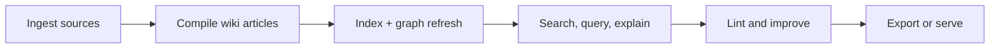

## Who This Is For

| Persona | Typical use |
|---|---|
| Engineering teams | Preserve architecture decisions and implementation context |
| Product/ops teams | Build searchable operational runbooks from mixed docs |
| AI-agent workflows | Provide a persistent knowledge surface for MCP tools |
| Individual researchers | Curate and query evolving topic maps |

## Use Cases

### Engineering decision memory

- ingest RFCs, PR notes, and design docs
- compile and query for historical decision rationale
- use Angela to capture why behind code changes

### Team onboarding acceleration

- compile internal docs into concept-linked pages
- run `lore explain` on unfamiliar components
- export to web/pdf for broader distribution

### Agent maintenance loop

- run MCP tools to discover gaps/orphans/ambiguity
- repair index, recompile, and re-lint
- ask targeted questions over refreshed graph state

## Quick Example

```bash
lore init
lore ingest ./docs
lore compile
lore query "How does compile lock recovery work?"
lore export web
```

## Related Docs

- [Installation](./installation.md)
- [Quickstart](./quickstart.md)
- [Architecture](../technical/architecture.md)


================================================
FILE: docs-site/docs/getting-started/quickstart.md
================================================
---
sidebar_position: 3
---

# Quickstart

This quickstart walks through the full Lore lifecycle: initialize, ingest, compile, retrieve, validate, and export.

## 1) Initialize

```bash
lore init
```

Expected result: `.lore/` is created with base config and storage layout.

## 2) Ingest content

```bash
# local file
lore ingest ./README.md

# URL
lore ingest https://example.com/article
```

Expected result: new `.lore/raw/<sha256>/` entries with `extracted.md` and `meta.json`.

## 3) Compile into wiki articles

```bash
lore compile
```

Expected result: `.lore/wiki/articles/*.md`, updated `.lore/wiki/index.md`, refreshed search/link index. Articles carry inline provenance markers tracking which sources contributed to each line.

After upgrading from an older Lore version, run `lore compile --concepts-only` to backfill provenance for existing articles.

## 4) Search and ask

```bash
# lexical discovery
lore search "concept"

# graph + LLM answer
lore query "What is the architecture?"
```

## 5) Validate graph health

```bash
lore lint --json
```

Use lint output to identify gaps, orphans, and ambiguous articles.

## 6) Export artifacts

```bash
lore export bundle
```

Default output location: `.lore/exports`.

## Optional: Auto-compile after ingest

```bash
# enable auto-compile — ingest automatically runs compile
lore settings set autoCompile true --scope repo
```

When enabled, `lore ingest` and `lore ingest-sessions` automatically run `lore compile` after ingestion completes. Disable with `lore settings set autoCompile false --scope repo`.

## Optional: Repair-first indexing

```bash
# useful after partial copies/interrupted operations
lore index --repair
```

## End-to-End Script

```bash
lore init
lore ingest ./README.md
lore ingest https://example.com/article
lore compile
lore index --repair
lore lint --json
lore query "What changed in architecture?"
lore export bundle
```

## Quickstart Flow

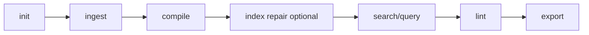

## Next Steps

- [Compiling Your Wiki](../guides/compiling-your-wiki.md)
- [Troubleshooting](../guides/troubleshooting.md)
- [Linting and Health](../guides/linting-and-health.md)
- [Exporting](../guides/exporting.md)
- [CLI Reference](../reference/cli-reference.md)


================================================
FILE: docs-site/docs/guides/best-practices.md
================================================
---
sidebar_position: 11
---

# Best Practices

These practices keep your Lore wiki useful as it scales.

## Operational Cadence

| Cadence | Actions |
|---|---|
| Daily active work | `lore ingest` for new sources, then `lore compile` |
| Before sharing answers | `lore index --repair`, then `lore lint` |
| Weekly maintenance | Review orphans, gaps, and ambiguous entries |
| Before export/publish | `lore compile --force` for deterministic artifacts |

## Recommended Maintenance Loop

```bash
lore ingest ./docs
lore compile
lore index --repair
lore lint --json
```

## Writing for Better Retrieval

Good retrieval starts with good article structure.

- Keep one primary concept per article
- Use explicit section headings (`##`) for major ideas
- Add `[[Wiki Links]]` to related concepts
- Avoid vague titles like "Notes" or "Misc"

A useful article shape:

```md
---
title: "Compile Locking"
tags: [runtime, reliability]
sources: [docs]
updated: 2026-04-10T00:00:00Z
confidence: extracted
---

# Compile Locking

## Why it exists

Prevents overlapping compile runs and stale writes.

## Operational behavior

Lore uses `.lore/compile.lock` and validates stale PID locks.

## Related

- [[Incremental Compile]]
- [[Watch Mode]]
```

## Linking and Naming Conventions

- Prefer stable concept names for long-lived pages
- Keep slug-friendly titles (clear, concise, specific)
- Use `[[Exact Concept Name]]` where possible
- Merge duplicate concepts instead of keeping near-identical pages

## Team Workflow Patterns

### Feature branch workflow

1. Ingest new design docs in branch
2. Compile and lint before PR
3. Run Angela on key commits for decision trail
4. Export bundle/pdf for reviewers if needed

### Long-running repository workflow

1. Scheduled ingest of docs/changelogs
2. Daily compile
3. Weekly lint + gap triage
4. Monthly graph analysis using `graphml` export

## Query and Explain Habits

- Use specific noun phrases in `lore search`
- Use `lore query` for direct answers tied to source slugs
- Use `lore explain` for concept deep dives and related context synthesis
- Enable `--normalize-question` when queries contain typos

## Export Strategy

| Audience | Recommended format |
|---|---|
| Engineers and maintainers | `bundle`, `web` |
| Non-technical stakeholders | `pdf`, `docx` |
| Presentations | `slides` |
| Graph analysis teams | `canvas`, `graphml` |

## Related Docs

- [Compiling Your Wiki](./compiling-your-wiki.md)
- [Searching and Querying](./searching-and-querying.md)
- [Explain Command](./explain-command.md)
- [Troubleshooting](./troubleshooting.md)


================================================
FILE: docs-site/docs/guides/compiling-your-wiki.md
================================================
---
sidebar_position: 4
---

# Compiling Your Wiki

```bash
lore compile [--force] [--concepts-only]
```

Compilation transforms raw extracted documents into structured wiki articles with `[[wiki-links]]`, YAML frontmatter, confidence labels, and paragraph-level provenance tracking.

## Compile Pipeline (6 Steps)

Each `lore compile` run executes a six-step pipeline:

1. **Diff** — Compare `extractedHash` in `manifest.json` against raw content. Only changed sources proceed. `--force` bypasses this check.
2. **Extract Concepts** — The LLM extracts named concepts with descriptions and confidence from each changed source.
3. **Match** — Each source's concepts are matched against existing wiki articles. Sources with no concepts skip to batch create. For wikis with 200+ articles, FTS pre-filters the candidate list.
4. **Generate Operations** — Per matched source, the LLM outputs a list of line-level operations describing how to edit the matched articles.
5. **Apply Operations** — Operations are applied to disk: articles are modified in-place, new articles are created, deprecated articles are soft-deleted to `.lore/wiki/deprecated/`.
6. **Reindex** — The FTS index, backlink graph, and `concepts.json` are rebuilt to reflect the updated article set.

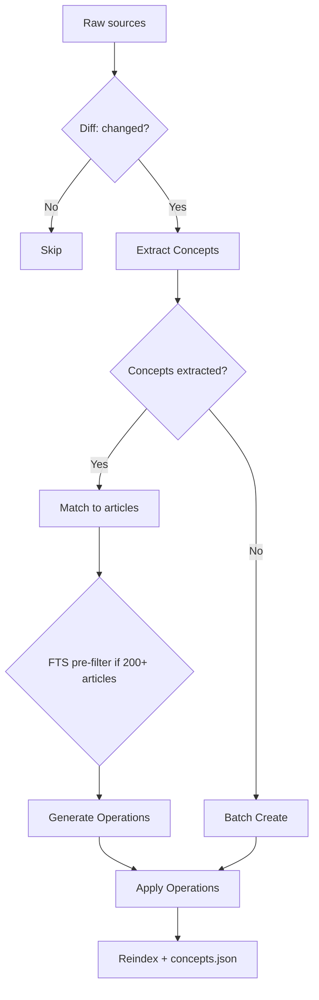

## Provenance Tracking

Lore tracks which sources contributed to every line of every article. Two mechanisms work together:

### Inline Provenance

Each line may carry an inline HTML comment recording source hashes and confidence:

```markdown
The authentication service uses JWT tokens. <!-- sources:abc123(extracted) def456(inferred) -->
```

The format is `<!-- sources:HASH(CONFIDENCE) ... -->`. Confidence labels are per-operation:

| Label | Meaning |
|---|---|
| `extracted` | Directly stated in source documents |
| `inferred` | Reasonable LLM deduction |

When the LLM reads article content for matching and operation generation, inline provenance comments are stripped. The LLM sees clean, numbered lines without source annotations.

### Cumulative References

Every article carries a `## References` section at the bottom, listing all source hashes ever merged into that article:

```markdown
## References
- abc123 (extracted)
- def456 (inferred)
- ghi789 (extracted)
```

This section is managed automatically by the system. When the LLM generates operations, `## References` and `## Related` sections are hidden from its context window.

### Related Section

The system auto-generates a `## Related` section from `[[wiki-links]]` found in the article body. Links are deduplicated and sorted.

## Operation Model

The LLM outputs a JSON array of line-level operations. Each operation targets specific lines in matched articles and includes a `sources` field for provenance tracking.

| Operation | Description |
|---|---|
| `replace` | Replace a single line's content |
| `insert-after` | Insert a new line after a target line |
| `delete-range` | Remove a range of lines (start to end, inclusive) |
| `replace-range` | Replace a range of lines with new content |
| `split` | Split an article into two: keep part at current slug, move remainder to a new slug |
| `append-source` | Add a source hash to existing lines without changing content (confidence-only update) |
| `soft-delete` | Mark an article as deprecated (renamed from its slug) |

### Operation Format

```json
[
  {
    "op": "replace",
    "line": "¶2",
    "content": "Updated content for line 2.",
    "sources": ["abc123(extracted)"],
    "confidence": "extracted"
  },
  {
    "op": "insert-after",
    "line": "¶3",
    "content": "New insight from source.",
    "sources": ["abc123(extracted)"],
    "confidence": "extracted"
  },
  {
    "op": "delete-range",
    "start": "¶5",
    "end": "¶7"
  }
]
```

Line references use the `¶` (pilcrow) symbol to distinguish from YAML frontmatter line numbers. The LLM sees articles with pilcrow-prefixed line numbers in context.

### Multi-Article Editing

A single source can generate operations targeting multiple existing articles. The system applies operations sequentially per source, refreshing the article list after each source's edits to handle splits and new articles.

### Soft Delete

When an article is no longer relevant, the LLM outputs a `soft-delete` operation. The article is renamed to a `.deprecated-{slug}-{timestamp}.md` path under `.lore/wiki/deprecated/`. It disappears from search and the link graph but the file is preserved for audit.

## Hash-Based Incremental Compile

Lore tracks an `extractedHash` per raw entry in `.lore/manifest.json`.

- Default behavior: compile only entries whose extracted content changed.
- First run after upgrade: previously compiled entries without `extractedHash` are recompiled once, then upgraded.
- `--force`: bypass hash checks and recompile all valid raw entries.

## Concepts-Only Mode

```bash
lore compile --concepts-only
```

Backfills provenance for articles that were compiled before provenance tracking was introduced. It:

1. Reads every article under `.lore/wiki/articles/`.
2. For articles without inline `<!-- sources:` comments, applies backfill logic (entire body marked with generic source hashes).
3. Rebuilds `concepts.json` and the search index.

Use this once after upgrading from a pre-provenance version of Lore. It does not recompile or change article content beyond adding provenance markers.

## Batch Retry Behavior

Compile processes sources sequentially (matching) and in batches (creating). If a response is retryable (truncated output, invalid JSON, unparseable operations), Lore retries once.

| Condition | Behavior |
|---|---|
| LLM response truncated | Retry once |
| Invalid JSON operation output | Retry once |
| Retry still fails | Skip the source, log error, continue compile |

The compile does not abort on individual source failures. Invalid operations are logged and the affected source is skipped.

## Compile Lock and Concurrency

Lore guards compile with `.lore/compile.lock` to prevent overlapping runs.

- If another live compile is active, `lore compile` fails fast with an actionable error.
- Stale or malformed lock payloads are reclaimed automatically.
- When `autoCompile` is enabled in the repo config, ingest commands automatically trigger compile and respect the same lock.

The lock file stores a process ID (PID). If that PID is no longer alive, Lore removes the stale lock and retries acquisition.

## Index Rebuild and Repair

After compile, keep search and graph state fresh:

```bash
lore index
```

If raw entries exist but `manifest.json` drifted (for example after partial copy or interrupted runs):

```bash
lore index --repair
```

`--repair` reconstructs missing manifest entries from `.lore/raw/` before index rebuild.

## Concept Metadata Output

After successful compile and index rebuild, Lore writes `.lore/wiki/concepts.json`:

- `updatedAt` — timestamp
- `concepts[]` entries with `slug`, `canonical`, `title`, `aliases`, `tags`, `confidence`

Alias generation is deterministic and includes slug aliases, conjunction-swap variants (`A and B` → `B and A`), and acronyms for 3+ word titles.

## Graph Guardrails

During index rebuild, Lore filters low-signal link targets (for example `[[it]]`, `[[the]]`) to avoid noisy graph edges.

- Benefit: better `lore path`, cleaner neighbor sets, higher-signal lint output.
- Tradeoff: intentionally generic links are dropped unless they map to meaningful concept tokens.

## Suggested Compile Workflow

```bash
# ingest and compile
lore ingest ./docs
lore compile

# refresh index and graph
lore index --repair

# inspect graph health
lore lint
```

After upgrading from an older version:

```bash
# backfill provenance for existing articles
lore compile --concepts-only
```

## Auto-Compile Setting

Set `autoCompile` in the repo config to automatically compile after every ingest:

```bash
lore settings set autoCompile true --scope repo
```

When enabled:

- `lore ingest` runs compile automatically after ingestion
- `lore ingest-sessions` runs compile once after all sessions are ingested
- The MCP `ingest` tool also auto-compiles when the setting is on
- The compile lock prevents overlapping runs — a compile already in progress blocks new ones
- Disable with `lore settings set autoCompile false --scope repo`

## Troubleshooting Compile Runs

| Symptom | Likely cause | Fix |
|---|---|---|
| Frequent retries | Malformed LLM output or oversized context | Allow retry to complete; tune model/maxTokens if persistent |
| Lock errors in automation | Another compile process active | Serialize compile jobs and retry later |
| No new articles written | Incremental hash skipping unchanged entries | Use `lore compile --force` |
| Index appears out of date after failures | Compile interrupted before index rebuild | Run `lore index --repair` manually |
| Sources skipped with zero concepts | LLM could not extract concepts from content | Content may need manual review; re-ingest with better metadata |
| Old articles lack provenance | Articles compiled before provenance was introduced | Run `lore compile --concepts-only` |

## Related Docs

- [Quickstart](../getting-started/quickstart.md)
- [Linting and Health](./linting-and-health.md)
- [Troubleshooting](./troubleshooting.md)
- [CLI Reference](../reference/cli-reference.md)
- [Architecture](../technical/architecture.md)
- [LLM Pipeline](../technical/llm-pipeline.md)


================================================
FILE: docs-site/docs/guides/configuration.md
================================================
---
sidebar_position: 1
---

# Configuration

Lore has two configuration scopes with explicit runtime precedence.

## Configuration Scopes

- **Global config** (`~/.config/lore/config.json`) -- non-secret global values (for example Cloudflare account ID)
- **Global secrets** (OS keychain) -- OpenRouter, Replicate, and Cloudflare token
- **Per-repo config** (`.lore/config.json`) -- model, temperature, optional maxTokens, export preferences

Use global scope for credentials and account-wide settings. Use repo scope for model/runtime behavior per project.

## Per-repo Settings

```json
{
  "model": "deepseek/deepseek-v4-pro",
  "temperature": 0.3,
  "maxTokens": 4096,
  "webExporter": "starlight"
}
```

Valid values:

| Key | Type | Notes |
|---|---|---|
| `model` | string | OpenRouter model identifier |
| `temperature` | number (`0` to `2`) | Creativity/randomness control |
| `maxTokens` | positive integer (optional) | If unset, Lore omits `max_tokens` |
| `webExporter` | `starlight` or `vitepress` (optional) | Export target preference |

`maxTokens` is optional. When omitted, Lore does not send `max_tokens` and uses the model/provider default completion limit.

## Runtime Precedence

Lore resolves values in this order:

1. Environment variables
2. Secure stored secrets (keychain)
3. Non-secret config files

Examples of effective precedence:

- `TELEPAT_OPENROUTER_KEY` overrides stored OpenRouter secret
- `TELEPAT_REPLICATE_TOKEN` (or legacy `TELEPAT_REPLICATE_TOKEN`) overrides stored Replicate secret
- `LORE_CF_TOKEN` overrides stored Cloudflare token
- `LORE_CF_ACCOUNT_ID` overrides global config Cloudflare account ID

## Interactive Editor

```bash
lore settings
```

In non-TTY environments, Lore prints current values and a reminder to use subcommands.

## Non-interactive Settings

### List and inspect

```bash
# list effective settings (secrets redacted)
lore settings list --scope all

# read one repo key
lore settings get model --scope repo

# read one global key
lore settings get cloudflareAccountId --scope global
```

### Write settings

```bash
# write global values
lore settings set openrouterApiKey <value> --scope global
lore settings set cloudflareAccountId <value> --scope global

# write repo values
lore settings set model deepseek/deepseek-v4-pro --scope repo
lore settings set temperature 0.3 --scope repo
lore settings set maxTokens 4096 --scope repo
lore settings set webExporter starlight --scope repo
```

### Unset settings

```bash
# unset global values
lore settings unset openrouterApiKey --scope global
lore settings unset cloudflareToken --scope global

# unset optional repo value
lore settings unset maxTokens --scope repo

# alternative maxTokens unset syntax via set
lore settings set maxTokens - --scope repo
```

## Team Profiles

### Stable production profile

```json
{
  "model": "openai/gpt-4o",
  "temperature": 0.2,
  "maxTokens": 4096,
  "webExporter": "starlight"
}
```

### Exploration profile

```json
{
  "model": "deepseek/deepseek-v4-pro",
  "temperature": 0.5
}
```

## Troubleshooting

| Symptom | Likely cause | Fix |
|---|---|---|
| `Unknown key for scope` | Key does not belong to provided scope | Use global keys for credentials, repo keys for model/runtime |
| `temperature must be a number` | Non-numeric value provided | Use a numeric temperature between `0` and `2` |
| `maxTokens must be an integer` | Non-integer value provided | Use a positive integer or unset it |
| Secret set fails in CI/container | Keychain unavailable or disabled | Use env vars and/or set `TELEPAT_DISABLE_KEYTAR=true` |

## Related Docs

- [Credentials and Secrets](./credentials-and-secrets.md)
- [LLM Models](../reference/llm-models.md)
- [CLI Reference](../reference/cli-reference.md)


================================================
FILE: docs-site/docs/guides/credentials-and-secrets.md
================================================
---
sidebar_position: 2
---

# Credentials and Secrets

API keys are stored globally (not per-repo) to avoid accidental git commits.

By default, Lore stores secrets in OS secure storage (for example macOS Keychain).

## Secret Storage Model

Lore keeps secret values in keychain-backed storage and does not write plaintext secret files.

- Stored secret keys: `openrouterApiKey`, `replicateApiToken`, `cloudflareToken`
- Stored non-secret global key: `cloudflareAccountId`
- Repo config contains model/runtime settings, not secret tokens

## Required

- **OpenRouter API key** -- for core LLM operations (compile, query, explain, and decision capture)

## Optional

- **Replicate API key** -- for PDF/DOCX parsing (marker) and image OCR (vision)
- **Cloudflare credentials** -- for Browser Rendering URL fetch (alternative to Jina)

## Runtime Resolution Order

1. Environment variables
2. Keychain secrets
3. Non-secret config values

Practical impact:

- Environment values can temporarily override stored credentials for CI jobs
- If keychain is unavailable, reads return no secret values and writes fail with guidance to use env vars

## Setting Keys

```bash
lore settings
```

Or use non-interactive commands:

```bash
lore settings set openrouterApiKey <value> --scope global
lore settings set replicateApiToken <value> --scope global
lore settings set cloudflareToken <value> --scope global
lore settings set cloudflareAccountId <value> --scope global
```

Unset examples:

```bash
lore settings unset openrouterApiKey --scope global
lore settings unset replicateApiToken --scope global
lore settings unset cloudflareToken --scope global
lore settings unset cloudflareAccountId --scope global
```

Environment variables are also supported:

- `TELEPAT_OPENROUTER_KEY`
- `TELEPAT_REPLICATE_TOKEN` (legacy alias supported: `TELEPAT_REPLICATE_TOKEN`)
- `LORE_CF_ACCOUNT_ID`
- `LORE_CF_TOKEN`
- `TELEPAT_DISABLE_KEYTAR` (set `true` to disable keychain access)

## CI and Container Pattern

For non-interactive environments, prefer env vars:

```bash
export TELEPAT_OPENROUTER_KEY="..."
export TELEPAT_REPLICATE_TOKEN="..."
export LORE_CF_ACCOUNT_ID="..."
export LORE_CF_TOKEN="..."
export TELEPAT_DISABLE_KEYTAR=true
```

This avoids keychain dependencies in ephemeral environments.

## Cloudflare vs Jina URL Parsing

- If `LORE_CF_ACCOUNT_ID` and `LORE_CF_TOKEN` are set, Lore tries Cloudflare Browser Rendering first
- On Cloudflare failure, Lore falls back to Jina automatically
- Without Cloudflare credentials, Lore uses Jina directly

## Troubleshooting

| Symptom | Likely cause | Fix |
|---|---|---|
| `No OpenRouter API key configured` | No key in env or keychain | Set `TELEPAT_OPENROUTER_KEY` or run settings command |
| Secret write fails with keychain error | Keychain unavailable in environment | Set env vars and `TELEPAT_DISABLE_KEYTAR=true` |
| Replicate parser fails on document/image ingest | `TELEPAT_REPLICATE_TOKEN` missing | Set Replicate token globally or via env var |
| Cloudflare URL fetch not used | Missing Cloudflare account ID or token | Set both `LORE_CF_ACCOUNT_ID` and `LORE_CF_TOKEN` |

When keychain access is disabled or unavailable, Lore does not fall back to plaintext secret files and will require env vars for secret values.

## Related Docs

- [Configuration](./configuration.md)
- [Supported Formats](../reference/supported-formats.md)
- [Environment Variables](../reference/environment-variables.md)


================================================
FILE: docs-site/docs/guides/explain-command.md
================================================
---
sidebar_position: 12
---

# Explain Command

```bash
lore explain "<concept>" [--json]
```

`lore explain` provides a deep concept walkthrough by combining the main matched article with nearby graph neighbors.

## Query vs Explain

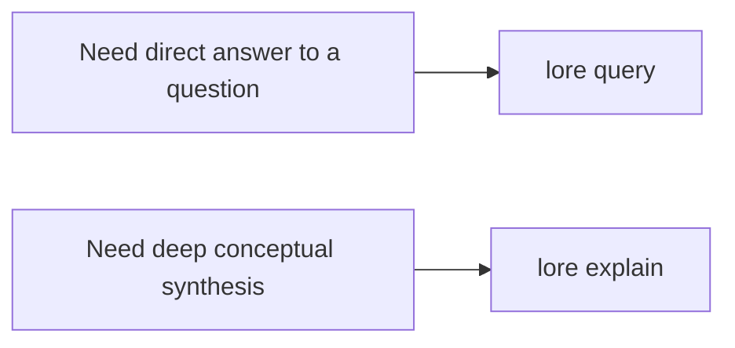

| Command | Best for | Output shape |
|---|---|---|
| `lore query` | Direct question answering | Answer text plus source slugs |
| `lore explain` | Concept deep dives | Long-form explanation plus related source slugs |

## How Explain Selects Context

1. Tries an exact slug match for the concept
2. Falls back to FTS match if exact slug is missing
3. Loads neighbor articles from graph links
4. Synthesizes a detailed explanation from combined context

## Examples

```bash
# human-readable deep dive
lore explain "Compile Lock"

# script-friendly
lore explain "MCP Server" --json
```

Example JSON response:

```json
{
  "explanation": "...long-form explanation...",
  "sources": ["compile-lock", "watch-mode", "index-repair"]
}
```

## Integration Use Cases

- Onboarding deep dives for new engineers
- Architecture review prep before design meetings
- Agent workflows that need broad conceptual context rather than one-off answers

## Troubleshooting

| Symptom | Likely cause | Fix |
|---|---|---|
| `No article found for <concept>` | Concept is not indexed yet | Run `lore compile`, then retry with precise concept name |
| Explanation is too shallow | Neighbor context is sparse | Improve wiki links and rerun compile/index |
| Sources look unrelated | FTS fallback matched broad term | Use a more specific concept name |

## Related Docs

- [Searching and Querying](./searching-and-querying.md)
- [Compiling Your Wiki](./compiling-your-wiki.md)
- [Troubleshooting](./troubleshooting.md)
- [CLI Reference](../reference/cli-reference.md)


================================================
FILE: docs-site/docs/guides/exporting.md
================================================
---
sidebar_position: 6
---

# Exporting

```bash
lore export <format> [--out <dir>] [--json]
```

Use exports when you need to share or analyze your wiki outside Lore.

- Default output directory: `.lore/exports`
- Custom output directory: `--out <dir>`
- Machine-readable result: `--json` returns `format`, `outputPath`, and `bytesWritten`

## Export Decision Flow

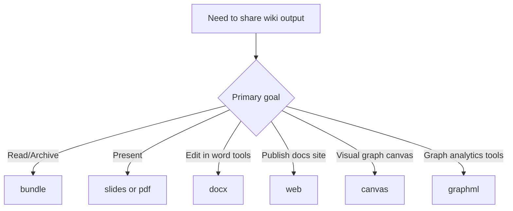

## Formats

| Format | Output | Best for | Notes |
|---|---|
| `bundle` | `bundle.md` | Archival, offline reading, quick sharing | Concatenates index + all article markdown |
| `slides` | `slides.md` | Presentations with Marp | Splits content into sections and slide breaks |
| `pdf` | `wiki.pdf` | Stakeholder review and snapshots | Uses a basic HTML renderer via Puppeteer |
| `docx` | `wiki.docx` | Editing in Word-like tools | Converts markdown headings/lists/paragraphs |
| `web` | `web/` project | Publishing a browsable wiki site | Scaffolds Astro + Starlight project |
| `canvas` | `wiki.canvas` | Node-link visualization workflows | JSON Canvas 1.0 with grid layout nodes |
| `graphml` | `wiki.graphml` | Gephi/yEd and graph analytics | Directed graph from wiki backlinks |

## Common Usage

```bash
# default output: .lore/exports
lore export bundle

# custom output directory
lore export web --out ./artifacts/wiki-web

# script-friendly response
lore export graphml --json
```

Example JSON response:

```json
{
	"format": "graphml",
	"outputPath": "/repo/.lore/exports/wiki.graphml",
	"bytesWritten": 84211
}
```

## Format Walkthroughs

### `bundle`

```bash
lore export bundle
```

Creates one markdown document containing your index followed by all articles separated with `---` breaks.

Use cases:

- Single-file review in editors
- Long-form archive snapshots
- Input to external markdown pipelines

### `slides`

```bash
lore export slides --out ./presentation
```

Generates Marp-compatible markdown with frontmatter and pagination enabled.

Use cases:

- Internal architecture briefings
- Knowledge transfer sessions
- Release demo decks

### `pdf`

```bash
lore export pdf
```

Builds a PDF by converting the markdown bundle through a lightweight HTML template and rendering with Puppeteer.

Use cases:

- Printable documents
- Static handoff artifacts
- Compliance snapshots

### `docx`

```bash
lore export docx
```

Converts wiki articles into a DOCX file with mapped headings and bullet lists.

Use cases:

- Collaborative editing in Office suites
- Formal review workflows
- Editorial cleanup passes

### `web`

```bash
lore export web
cd .lore/exports/web
npm install
npm run dev
```

Scaffolds an Astro Starlight site and copies your wiki pages into `src/content/docs`.

Use cases:

- Internal docs hosting
- Temporary preview sites
- Team onboarding portals

### `canvas`

```bash
lore export canvas
```

Generates JSON Canvas output with article nodes and backlink edges.

Use cases:

- Visual map of concept relationships
- Planning sessions in canvas tools
- Graph-oriented content audits

### `graphml`

```bash
lore export graphml
```

Exports a GraphML graph from your article/link tables for tools such as Gephi and yEd.

Use cases:

- Centrality/community analysis
- Graph debugging
- External data science workflows

## End-to-End Example

```bash
# 1) refresh wiki state
lore ingest ./docs
lore compile

# 2) produce multiple deliverables
lore export bundle --out ./dist/lore
lore export pdf --out ./dist/lore
lore export web --out ./dist/lore

# 3) inspect generated artifacts
ls -la ./dist/lore
```

## Troubleshooting

| Symptom | Likely cause | Fix |
|---|---|---|
| Export fails with missing article directory | Wiki has not been compiled yet | Run `lore compile` first |
| `pdf` export fails | Browser dependency issue with Puppeteer | Reinstall dependencies and retry `lore export pdf` |
| `web` export created project but site fails to start | Dependencies not installed in exported project | Run `npm install` inside the exported `web` folder |
| Output too large for sharing | Full wiki is large | Use `bundle` for text-only or segment content before export |

## Related Docs

- [Compiling Your Wiki](./compiling-your-wiki.md)
- [Searching and Querying](./searching-and-querying.md)
- [CLI Reference](../reference/cli-reference.md)


================================================
FILE: docs-site/docs/guides/ingesting-content.md
================================================
---
sidebar_position: 3
---

# Ingesting Content

```bash
lore ingest <path|url>
```

```bash
lore ingest-sessions [framework|all]
```

## Supported Formats

| Format | Method |
|---|---|
| `.md`, `.txt` | Direct |
| `.html` | rehype-parse |
| `.json`, `.jsonl` | JSON parser (auto-normalizes supported chat exports) |
| `.pdf`, `.docx`, `.pptx`, `.xlsx`, `.epub` | Replicate marker |
| Images (`.png`, `.jpg`, `.jpeg`, `.webp`, `.gif`, `.bmp`) | Replicate vision |
| URLs (web pages) | Cloudflare BR `/markdown` endpoint or Jina r.jina.ai |
| URLs (documents: `.pdf`, `.docx`, `.pptx`, `.xlsx`, `.epub`) | Temp download → Replicate Marker |
| URLs (images: `.png`, `.jpg`, `.jpeg`, `.webp`, `.gif`, `.bmp`) | Temp download → Replicate Vision |
| Video URLs | yt-dlp subtitles |

All ingested content is stored in `.lore/raw/<sha256>/` with `extracted.md` and `meta.json`.

## Framework Session Ingestion

Use `lore ingest-sessions` to pull session history from local framework storage.

Supported framework values:

- `claude-code`
- `codex-cli`
- `copilot-cli`
- `copilot-chat`
- `cursor`
- `gemini-cli`
- `obsidian`
- `all` (default)

Examples:

```bash
# ingest all supported framework session stores
lore ingest-sessions all

# ingest only Claude Code sessions
lore ingest-sessions claude-code

# run discovery only, no ingest writes
lore ingest-sessions all --dry-run --json

# override default roots and cap scan size
lore ingest-sessions copilot-chat --root ~/Library/Application\ Support/Code/User/workspaceStorage --max-files 200
```

Flags:

- `--root <path...>`: optional root path(s) to scan instead of defaults
- `--max-files <n>`: max discovered files per framework (default `500`)
- `--dry-run`: discover only, do not ingest
- `--json`: machine-readable summary with `runId`/`logPath`

## Ingest Flow

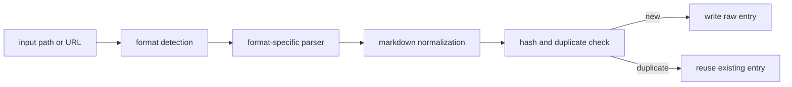

## Raw Entry Structure

Each raw entry is stored under:

```text
.lore/raw/<sha256>/
	extracted.md
	meta.json
	original.<ext> (or original.txt for URLs)
```

Example `meta.json`:

```json
{
	"sha256": "<sha256>",
	"format": "json",
	"title": "Conversation Transcript",
	"sourcePath": "/abs/path/to/file.json",
	"date": "2026-04-09T00:00:00.000Z",
	"tags": ["docs", "frontend", "decision"]
}
```

## Folder-Based Topical Tags

For local file ingest, Lore infers a small set of topic tags from directory names and writes them to `meta.json.tags`.

- Example mapped categories include `frontend`, `backend`, `docs`, `testing`, `tooling`, `infra`, `data`, `mobile`, and `design`.
- URL ingest does not infer folder tags and keeps `tags: []`.
- Tags are intentionally bounded and deduplicated so metadata stays concise.

Lore also applies lightweight content heuristics during ingest and can append semantic tags such as `decision`, `preference`, `problem`, `milestone`, and `emotional` when matching phrases are detected.

## Duplicate-Aware Ingest

Lore computes a SHA-256 digest from original input and reuses existing raw entries when the digest already exists.

- Duplicate hit behavior:
	- parse/extract is skipped
	- existing metadata is reused
	- manifest mtime is refreshed
- JSON output includes `duplicate: true` on duplicate hits.

Example:

```bash
lore ingest ./docs/architecture.md --json
```

Possible output fields:

```json
{
	"sha256": "...",
	"format": "md",
	"title": "Architecture",
	"duplicate": true
}
```

## How Conversation Export Ingestion Works (`.json` / `.jsonl`)

1. Lore first attempts to detect known conversation schemas.
2. When a supported schema is detected, Lore rewrites the content into transcript markdown:
	- user turns are prefixed with `>`
	- assistant turns are preserved as response blocks
3. Current auto-detection targets common exports such as role/content arrays, ChatGPT mapping exports, and Codex/Claude-style JSONL logs.
4. If no known schema is detected, Lore falls back to generic JSON-to-markdown conversion.

Supported conversation schema families include:

- role/content arrays (`[{"role":"user"...}]`)
- ChatGPT mapping exports
- Claude/Codex JSONL session logs
- Slack-style message arrays

## How PDF Ingestion Works

1. Lore detects a document extension such as `.pdf` or `.docx`.
2. The file is sent to Replicate Marker (`cuuupid/marker`) for markdown extraction.
3. The normalized markdown is written to `.lore/raw/<sha256>/extracted.md`.
4. Metadata and source tracking are written to `.lore/raw/<sha256>/meta.json`.

## How Web Document and Image URL Ingestion Works

Lore detects the file extension in the URL path to distinguish between web pages, documents, and images.

For **document URLs** (ending in `.pdf`, `.docx`, `.pptx`, `.xlsx`, `.epub`):

1. Lore downloads the file to a temporary directory.
2. Sends it through Replicate Marker — the same parser used for local documents.
3. Cleans up the temp file once extraction completes.
4. Stores result in the same raw pipeline (`extracted.md` + `meta.json`).

For **image URLs** (ending in `.png`, `.jpg`, `.jpeg`, `.webp`, `.gif`, `.bmp`):

1. Lore downloads the image to a temporary directory.
2. Sends it through Replicate Vision — the same parser used for local images.
3. Cleans up the temp file once extraction completes.
4. Stores result in the same raw pipeline.

For **all other URLs** (web pages, HTML, APIs, etc.):

1. Lore calls the Cloudflare Browser Run `/markdown` endpoint when `LORE_CF_ACCOUNT_ID` and `LORE_CF_TOKEN` are configured — this gives JavaScript-rendered markdown directly. By default, Lore waits for `networkidle2` (≤2 open connections) before capturing the page. Override with `--cf-wait-until networkidle0` for pages that open persistent connections.
2. On Cloudflare failure or missing credentials, Lore falls back to Jina `r.jina.ai`.

> **Requirements**: document/image URL ingestion requires the same credentials as local document/image ingestion — a `TELEPAT_REPLICATE_TOKEN`. Web page ingestion requires `LORE_CF_ACCOUNT_ID` + `LORE_CF_TOKEN` for Cloudflare (Jina is the credential-free fallback).

## How YouTube/Video Ingestion Works

1. Lore detects known video hosts (for example YouTube, Vimeo, Twitch).
2. It attempts subtitle extraction using `yt-dlp`.
3. Subtitles are cleaned from VTT into plain transcript text.
4. Transcript output is stored in the same raw pipeline (`extracted.md` + `meta.json`).
5. If `yt-dlp` is unavailable or subtitles are missing, Lore falls back to URL fetch ingestion.

Extractor provenance:

- `meta.json` for video ingests includes an `extractor` field.
- `extractor: yt-dlp` indicates subtitle extraction succeeded.
- Fallback values include `url-fallback-no-ytdlp`, `url-fallback-no-subs`, and `url-fallback-empty-transcript`.

## Related References

- [Supported Formats](../reference/supported-formats.md)
- [LLM Models](../reference/llm-models.md)
- [Credentials and Secrets](./credentials-and-secrets.md)

## Troubleshooting

- JSON did not normalize to transcript:
	- ensure file is valid JSON/JSONL
	- check that records contain both user/assistant style turns
	- if schema is unknown, Lore will intentionally fall back to generic JSON markdown
- Unexpected tags:
	- folder tags are path-derived and bounded
	- heuristic tags are phrase-driven and conservative
- URL ingestion path:
	- URLs ending in document or image extensions (`.pdf`, `.docx`, `.png`, etc.) trigger temp-download and local parser routing — same as local file ingestion
	- for web page URLs, with `LORE_CF_ACCOUNT_ID` + `LORE_CF_TOKEN`, Lore calls the Cloudflare Browser Run `/markdown` endpoint directly
	- on CF failure or missing credentials, Lore falls back to Jina fetch automatically


================================================
FILE: docs-site/docs/guides/linting-and-health.md
================================================
---
sidebar_position: 7
---

# Linting and Health

```bash
lore lint [--json]
```

Runs health checks on the wiki:

- **Orphans** -- articles with no incoming links
- **Gaps** -- concepts mentioned in multiple articles but without their own article
- **Ambiguous** -- articles with `confidence: ambiguous` in frontmatter
- **Suggested questions** -- follow-up prompts generated from gaps/orphans/ambiguity
- **Diagnostics** -- line-aware diagnostics for actionable fixes

## Why Lint Matters

Lint transforms wiki quality issues into a prioritized, machine-readable queue for maintenance.

- catches broken conceptual links early
- reveals weak coverage and disconnected pages
- helps drive follow-up compile and content work

## Diagnostics (JSON)

`lore lint --json` includes a `diagnostics` array while preserving legacy summary arrays.

Diagnostic shape:

```json
{
	"rule": "broken-wikilink",
	"severity": "error",
	"file": ".lore/wiki/articles/example.md",
	"line": 12,
	"message": "Wiki link target missing-topic has no corresponding article."
}
```

Current rules:

- `broken-wikilink` (`error`)
- `orphaned-article` (`warning`)
- `ambiguous-confidence` (`warning`)
- `missing-summary` (`warning`)
- `short-page` (`warning`)

### Rule Priority Matrix

| Rule | Severity | Typical action |
|---|---|---|
| `broken-wikilink` | `error` | Create missing target article or fix link target |
| `orphaned-article` | `warning` | Add incoming links from related articles |
| `ambiguous-confidence` | `warning` | Clarify claims and adjust confidence when warranted |
| `missing-summary` | `warning` | Add frontmatter summary |
| `short-page` | `warning` | Expand article body with meaningful context |

## Human Mode Output

Human mode prints classic summary counts and diagnostics counts:

- `Orphans: X, Gaps: Y, Ambiguous: Z`
- `Diagnostics: N (E errors, W warnings)`

## Recommended Maintenance Loop

```bash
# 1) gather machine-readable health findings
lore lint --json > lint.json

# 2) prioritize hard failures first
# (broken wikilinks are emitted as diagnostics with severity=error)

# 3) recompile/reindex after edits
lore compile
lore index --repair

# 4) re-check health
lore lint --json
```

## Suggested Remediation Workflow

1. fix all `broken-wikilink` diagnostics first
2. resolve high-impact orphans (core architecture concepts)
3. address ambiguous pages and add summaries
4. re-run compile/index if content changed substantially
5. re-run lint until diagnostic trend is decreasing

## Example Fix Patterns

### Broken wikilink

- before: `[[compile-locking-system]]`
- after: `[[Compile Locking]]` or create the missing article

### Orphaned article

- add backlinks from parent/adjacent concepts
- ensure article appears in at least one navigation-relevant page

### Missing summary

```yaml
summary: "Prevents overlapping compile runs and stale output writes."
```

## Using Lint in Automation

```bash
lore lint --json > lint.json

# treat errors as blockers in CI scripts
cat lint.json
```

For MCP-based maintenance loops, use `lint_summary`, `list_orphans`, `list_gaps`, and `list_ambiguous`.

## Related Docs

- [Compiling Your Wiki](./compiling-your-wiki.md)
- [Troubleshooting](./troubleshooting.md)
- [CLI Reference](../reference/cli-reference.md)
- [MCP Server](./mcp-server.md)
- [Architecture](../technical/architecture.md)


================================================
FILE: docs-site/docs/guides/lore-angela.md
================================================
---
sidebar_position: 8
---

# Lore Angela

Angela captures architecture decisions from recent git commits and writes them as wiki articles.

It is designed to preserve decision context that usually gets lost after merges.

## How Angela Works

1. Reads `git diff HEAD~1 HEAD`
2. Reads the latest commit message
3. Sends both to Lore's LLM pipeline with a decision-writing prompt
4. Writes the generated article to `.lore/wiki/articles/decisions/<slug>.md`

Angela expects at least two commits in history and a non-empty diff.

## Install Hook

```bash
lore angela install
```
This writes `.git/hooks/post-commit` with a call to `lore angela run`.

The hook runs best-effort and does not block your commit if capture fails.

## Run Manually

```bash
lore angela run
```
Run this when you want decision capture on demand, for example after squash merges or batched refactors.

## Example Workflow

```bash
# commit normally
git commit -m "refactor: split query normalization from retrieval"

# capture decision immediately
lore angela run

# inspect generated decision entry
ls .lore/wiki/articles/decisions
```

Typical output location:

```text
.lore/wiki/articles/decisions/refactor-split-query-normalization-from-retrieval.md
```

## Example Decision Entry Shape

Angela prompts the model to emit markdown with YAML frontmatter and wiki links.

```md
---
title: "Split Query Normalization From Retrieval"
tags: [decisions]
sources: [commit]
updated: 2026-04-10T12:30:00Z
confidence: extracted
---

# Split Query Normalization From Retrieval

Moved typo cleanup into a dedicated step before FTS so retrieval behavior is easier to reason about.

## Related

- [[Query Pipeline]]
- [[FTS5]]
```

## Commit Message Tips

Angela quality improves when commit messages clearly state intent.

- Prefer: `refactor: separate lock acquisition from compile batching`
- Avoid: `misc fixes`
- Include the why when possible, not only the what

## Integration Use Cases

- Post-commit architecture journal in active repos
- Weekly review of `decisions/` for onboarding and retros
- Agent-assisted synthesis through `lore query` and `lore explain` over decision history

## Troubleshooting

| Symptom | Likely cause | Fix |
|---|---|---|
| `Failed to read git history` | Repo has fewer than two commits or git not available | Create another commit and rerun |
| `No diff found between HEAD~1 and HEAD` | Latest two commits have no effective content diff | Run manually after a contentful commit |
| Hook installed but no new decision file appears | Hook execution suppressed errors | Run `lore angela run` manually to inspect behavior |
| Decision article quality is weak | Commit message is too vague or diff is noisy | Use focused commit messages and smaller logical commits |

## Related Docs

- [Compiling Your Wiki](./compiling-your-wiki.md)
- [Explain Command](./explain-command.md)
- [Searching and Querying](./searching-and-querying.md)


================================================
FILE: docs-site/docs/guides/mcp-server.md
================================================
---
sidebar_position: 9
---

# MCP Server

```bash
lore mcp
```

Starts an MCP server on stdio for agent access. Compatible with Claude Code, Cursor, and other MCP clients.

## When to Use MCP

Use MCP when you want agents or tools to query Lore programmatically instead of invoking CLI commands directly.

- Retrieval tools: search, ask, graph traversal
- Health tools: lint summary, orphan/gap/ambiguity checks
- Write tools: ingest and compile
- Maintenance tools: duplicate checks and index rebuild

## Tools

| Tool | Description |
|---|---|
| `search(query)` | BM25-ranked snippets |
| `ask(question)` | BFS/DFS + LLM answer |
| `explain(concept)` | Deep concept explanation from anchor article + neighbors |
| `list_articles()` | Slugs + titles from the article index |
| `get_article(slug)` | Full article markdown |
| `get_neighbors(slug)` | Related articles via backlinks |
| `path(from, to)` | Shortest conceptual path |
| `graph_stats()` | Article count, backlink density |
| `lint_summary()` | Orphans, gaps, ambiguity, suggestions, diagnostics |
| `ingest(input, tags?)` | Ingest a local path or URL into `.lore/raw` |
| `compile(force?, conceptsOnly?)` | Compile raw sources into wiki articles |
| `check_duplicate(content?, sha256?)` | Duplicate precheck against `.lore/raw/<sha>` |
| `list_raw_tags()` | Raw metadata taxonomy summary (formats + top tags) |
| `rebuild_index(repair?)` | Rebuild search index/backlinks (optional manifest repair) |
| `list_orphans()` | List articles with no incoming links |
| `list_gaps()` | List missing conceptual targets referenced by links |
| `list_ambiguous()` | List articles marked `confidence: ambiguous` |

## Tool Groups

- Retrieval: `search`, `ask`, `explain`, `list_articles`, `get_article`, `get_neighbors`, `path`
- Graph diagnostics: `graph_stats`, `lint_summary`, `list_orphans`, `list_gaps`, `list_ambiguous`
- Write: `ingest`, `compile`
- Ingest/index maintenance: `check_duplicate`, `list_raw_tags`, `rebuild_index`

## Integration Example Pattern

Run Lore MCP server from your project root:

```bash
lore mcp
```

Client pattern:

1. Connect to stdio transport
2. Call `list_tools`
3. Execute a tool request with JSON arguments
4. Parse text payload from response

## New Utility Tools

- `check_duplicate` accepts either raw `content` (hashed server-side) or a known `sha256` and returns whether an existing raw entry already exists.
- `ingest` accepts an `input` (path or URL) and optional `tags`, then runs Lore's ingest pipeline via MCP.
- `compile` accepts optional `force` and `conceptsOnly` flags and runs Lore's compile pipeline via MCP.
- `list_raw_tags` aggregates `meta.json` across `.lore/raw/` and returns:
	- total entry count
	- per-format counts
	- top inferred tags by frequency
- `rebuild_index` runs Lore's index rebuild through MCP; pass `repair: true` to recover missing manifest entries first.
- `list_orphans` returns a focused orphan-only view from lint diagnostics for graph maintenance workflows.
- `list_gaps` returns unresolved conceptual targets so agents can prioritize article creation.
- `list_ambiguous` returns uncertain articles for review and clarification workflows.
- `lint_summary` includes a `diagnostics` array with machine-readable findings (`rule`, `severity`, `file`, optional `line`, `message`).

## Example MCP Calls

Example duplicate precheck:

```json
{
	"name": "check_duplicate",
	"arguments": {
		"content": "Architecture migration notes..."
	}
}
```

Example ask call:

```json
{
	"name": "ask",
	"arguments": {
		"question": "How does compile lock recovery work?"
	}
}
```

Example explain call:

```json
{
	"name": "explain",
	"arguments": {
		"concept": "compile lock recovery"
	}
}
```

Example ingest call:

```json
{
	"name": "ingest",
	"arguments": {
		"input": "./README.md",
		"tags": ["docs", "architecture"]
	}
}
```

Example compile call:

```json
{
	"name": "compile",
	"arguments": {
		"force": false,
		"conceptsOnly": false
	}
}
```

Example graph stats call:

```json
{
	"name": "graph_stats",
	"arguments": {}
}
```

Example response:

```json
{
	"duplicate": true,
	"sha256": "...",
	"rawPath": ".../.lore/raw/...",
	"title": "Architecture Notes",
	"format": "md"
}
```

Example taxonomy summary call:

```json
{
	"name": "list_raw_tags",
	"arguments": {}
}
```

Example index rebuild with repair:

```json
{
	"name": "rebuild_index",
	"arguments": {
		"repair": true
	}
}
```

## Recommended Agent Maintenance Loop

1. `list_orphans` to find disconnected concepts.
2. `list_gaps` to find missing concept pages.
3. `list_ambiguous` to identify uncertain content.
4. `ingest` and `compile` to refresh knowledge.
5. `rebuild_index(repair=true)` to refresh graph/search state.

## End-to-End Maintenance Scenario

```text
1) check_duplicate(content)
2) rebuild_index(repair=true)
3) lint_summary()
4) list_gaps()
5) ask("What are the highest-priority wiki gaps?")
```

## Troubleshooting

| Symptom | Likely cause | Fix |
|---|---|---|
| Client cannot connect | Server not running from repo root | Start with `lore mcp` in initialized Lore repo |
| Tool returns missing article errors | Index/wiki state outdated | Run `rebuild_index(repair=true)` |
| `ask` answers are weak | Sparse wiki links or stale content | Recompile, reindex, and rerun |
| Duplicate check always false | Content differs after normalization | Provide exact raw content or known `sha256` |

## Related Docs

- [Searching and Querying](./searching-and-querying.md)
- [Compiling Your Wiki](./compiling-your-wiki.md)
- [Troubleshooting](./troubleshooting.md)


================================================
FILE: docs-site/docs/guides/searching-and-querying.md
================================================
---
sidebar_position: 5
---

# Searching and Querying

Use these commands together: `search` for discovery, `query` for answer synthesis, `path` for graph connectivity, and `explain` for deep conceptual walkthroughs.

## Search

```bash
lore search "term" [--limit N] [--json]
```

FTS5/BM25 full-text search with ranked snippets.

Tips:

- Prefer focused noun phrases (`"plugin lifecycle"`, `"ingest metadata"`).
- Increase recall with `--limit` when exploring broad topics.
- Search is lexical BM25, so vocabulary matters.

Examples:

```bash
# broad discovery
lore search "compile lock" --limit 15

# precise phrase
lore search "manifest repair" --limit 5
```

## Query

```bash
lore query "question" [--no-file-back] [--normalize-question] [--json]
```

BFS/DFS traversal of the backlinks graph + LLM Q&A. Answers can be filed back to `derived/qa/`.

`--normalize-question` enables conservative typo cleanup before retrieval while preserving technical tokens (for example paths, IDs, env vars, versioned terms).

Examples:

```bash
# keep exact query text
lore query "How is index rebuild implemented?"

# apply typo cleanup but preserve technical tokens
lore query "teh qurey about src/core/mcp.ts" --normalize-question

# disable file-back side effects
lore query "What are current gaps?" --no-file-back
```

Default normalization can also be enabled with:

```bash
export LORE_QUERY_NORMALIZE=true
```

When file-back is enabled (default), Lore writes a markdown artifact under `.lore/wiki/derived/qa/`.

## Path

```bash
lore path "Article A" "Article B" [--json]
```

Shortest conceptual path between two articles via the backlinks graph.

Example:

```bash
lore path "Compile Lock" "MCP Server"
```

If no path is found, the command returns an empty path with `hops: -1` in JSON mode.

## Explain

```bash
lore explain "concept" [--json]
```

Deep-dive on a concept with full context from related articles.

Use explain when you need synthesis across neighboring concepts rather than a short direct answer.

```bash
lore explain "Incremental Compile" --json
```

## Retrieval Notes

- Query flow uses index-first context, then FTS candidate articles, then graph-neighbor expansion.
- Answers include source slugs and can be persisted under `wiki/derived/qa/` unless disabled.
- `path` is graph-only and useful for inspecting conceptual connectivity independent of LLM generation.

### Query Retrieval Flow


Operational details:

- FTS stage selects top matches
- Neighbor expansion adds one-hop related articles
- Context is capped before LLM synthesis to keep responses stable

## Troubleshooting

- Query returns low-signal answer:
	- run `lore index --repair` then retry
	- verify source articles exist in `.lore/wiki/articles/`
- Path not found:
	- run `lore lint` and inspect `gaps` and `orphans`
	- confirm expected links are present in article markdown as `[[Wiki Links]]`

## Related Docs

- [Explain Command](./explain-command.md)
- [Compiling Your Wiki](./compiling-your-wiki.md)
- [Troubleshooting](./troubleshooting.md)


================================================
FILE: docs-site/docs/guides/troubleshooting.md
================================================
---
sidebar_position: 10
---

# Troubleshooting

Use this page when Lore commands succeed syntactically but outputs are missing, stale, or low quality.

## Quick Triage Flow

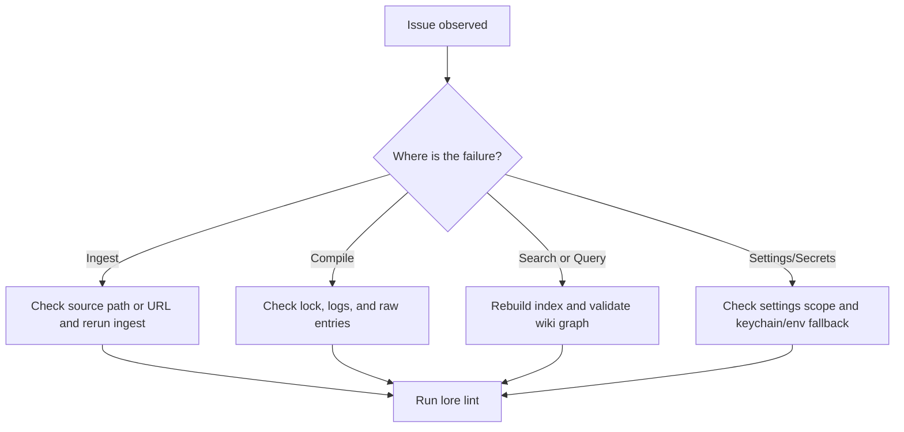

## Common Issues

| Symptom | Likely cause | What to do |
|---|---|---|
| `Another compile is already running` | `.lore/compile.lock` is held by a live process | Wait and rerun compile. If process died, rerun compile and Lore will reclaim stale lock |
| `Compiled 0 articles` unexpectedly | No extracted content changed and hash-based incremental compile skipped work | Use `lore compile --force` to reprocess all valid raw entries |
| Search results are stale or empty | Index drift or missing manifest entries | Run `lore index --repair`, then retry search/query |
| Query answer is low-signal | Retrieval context is weak or ambiguous | Run `lore lint`, inspect gaps/orphans, improve linking, then recompile |
| No QA file created from query | `--no-file-back` was used | Omit `--no-file-back` or check `.lore/wiki/derived/qa/` |
| Angela fails after install | Git history is too shallow or no diff between last two commits | Ensure at least two commits and rerun `lore angela run` manually |
| Export fails on `pdf` | Puppeteer/browser dependency issue | Reinstall dependencies and retry `lore export pdf` |
| Articles lack provenance markers | Articles were compiled before provenance was introduced | Run `lore compile --concepts-only` to backfill |
| Sources consistently produce zero concepts | Content too abstract or short for LLM concept extraction | Review raw content quality; re-ingest with richer source material |
| Soft-deleted articles reappear | Article was re-created by a later compile from fresh sources | Expected behavior; use `--force` recompile if needed |

## Recovery Playbooks

### Compile appears stuck

```bash
# 1) inspect active lore processes
ps aux | grep lore

# 2) retry compile
lore compile

# 3) if still blocked, run a full maintenance pass
lore index --repair
lore lint
```

### Search or query quality regressed

```bash
# 1) refresh index and manifest consistency
lore index --repair

# 2) check graph health
lore lint --json

# 3) ask a focused question again
lore query "How does compile locking work?" --normalize-question
```

### Export artifact missing expected content

```bash
# 1) ensure fresh wiki material exists
lore compile --force

# 2) export again in the target format
lore export bundle --out ./dist

# 3) inspect output quickly
wc -l ./dist/bundle.md
```

## Log-Driven Debugging

`lore ingest`, `lore compile`, and `lore query` produce JSONL logs in `.lore/logs/`.

Use these when a command fails without enough terminal detail:

```bash
# newest logs first
ls -lt .lore/logs | head

# inspect one run log
cat .lore/logs/<run-id>.jsonl
```

## Escalation Checklist

Before opening an issue or asking for help, collect:

1. Command and flags used
2. Whether `--json` output was captured
3. Relevant `.lore/logs/<run-id>.jsonl` snippet
4. Output of `lore lint --json`
5. Whether `lore index --repair` changed behavior

## Related Docs

- [Compiling Your Wiki](./compiling-your-wiki.md)
- [Searching and Querying](./searching-and-querying.md)
- [Exporting](./exporting.md)
- [CLI Reference](../reference/cli-reference.md)


================================================
FILE: docs-site/docs/reference/cli-reference.md
================================================
---
sidebar_position: 1
---

# CLI Reference

Every command supports `--json` for machine-readable output on stdout. Human-readable output goes to stderr.

## Commands

| Command | Description |
|---|---|
| `lore` | Launch interactive TUI |
| `lore init` | Initialize `.lore/` repository |
| `lore ingest <path\|url>` | Ingest file or URL into `raw/` |
| `lore compile [--force] [--concepts-only]` | Compile changed raw sources into wiki articles (6-step pipeline, hash-based incremental, lock-guarded) |
| `lore index [--repair]` | Rebuild FTS5 index + `index.md` (optional manifest repair from `raw/`) |
| `lore query "<q>" [--no-file-back] [--normalize-question]` | BFS/DFS + LLM Q&A |
| `lore search "<term>" [--limit N]` | FTS5/BM25 search |
| `lore path "<A>" "<B>"` | Shortest path between articles |
| `lore explain "<concept>"` | Deep-dive on a concept |
| `lore lint` | Wiki health checks + structured diagnostics |
| `lore angela [install\|run]` | Git commit capture |
| `lore export <format> [--out dir]` | Export wiki |
| `lore mcp` | Start MCP server |
| `lore status` | Repo health dashboard |
| `lore settings` | Configure API keys and model |

## Common Flags and Behaviors

- `--json`: structured machine output on stdout.
- human mode: operational summaries on stderr; primary text output on stdout where relevant.
- `lore ingest --json`: includes duplicate indicator when content already exists.
- `lore ingest --cf-wait-until <value>`: override the Cloudflare Browser Run `gotoOptions.waitUntil` value (default: `networkidle2`). Use `networkidle0` for pages that need every network request to settle.
- `lore compile`: uses hash-based incremental compile, skipping unchanged extracted content via `manifest.json` `extractedHash` values.
- `lore compile --force`: bypasses hash skipping and recompiles all valid raw entries.
- `lore compile --concepts-only`: backfills provenance for existing articles without recompiling. Rebuilds `concepts.json` and search index.
- `lore compile`: guarded by `.lore/compile.lock` to prevent concurrent runs.
- `lore index --repair`: reconstructs missing manifest entries before rebuild.
- `lore lint --json`: includes line-aware `diagnostics[]` entries with `rule`, `severity`, `file`, optional `line`, and `message`.
- `lore query --normalize-question`: conservative typo cleanup while preserving technical tokens.

Guide links:

- `lore init`: [Quickstart](../getting-started/quickstart.md)
- `lore ingest`: [Ingesting Content](../guides/ingesting-content.md)
- `lore compile`: [Compiling Your Wiki](../guides/compiling-your-wiki.md)
- `lore search`: [Searching and Querying](../guides/searching-and-querying.md)
- `lore query`: [Searching and Querying](../guides/searching-and-querying.md)
- `lore explain`: [Explain Command](../guides/explain-command.md)
- `lore lint`: [Linting and Health](../guides/linting-and-health.md)
- `lore export`: [Exporting](../guides/exporting.md)
- `lore angela`: [Lore Angela](../guides/lore-angela.md)
- `lore mcp`: [MCP Server](../guides/mcp-server.md)
- `lore settings`: [Configuration](../guides/configuration.md)
- troubleshooting workflows: [Troubleshooting](../guides/troubleshooting.md)
- repository operating patterns: [Best Practices](../guides/best-practices.md)

Examples:

```bash
lore ingest ./docs/architecture.md --json
lore index --repair --json
lore query "teh qurey about src/core/mcp.ts" --normalize-question --json
```

## Settings Command

Interactive mode:

```bash
lore settings
```

Non-interactive mode:

```bash
lore settings list [--scope global|repo|all] [--json]
lore settings get [key] [--scope global|repo|all] [--json]
lore settings set <key> <value> [--scope global|repo|all]
lore settings unset <key> [--scope global|repo|all]
```

Common keys:

- Global: `openrouterApiKey`, `replicateApiToken`, `cloudflareAccountId`, `cloudflareToken`
- Repo: `model`, `temperature`, `maxTokens` (optional), `webExporter`, `autoCompile` (true/false)

Notes:

- `lore settings unset maxTokens --scope repo` removes the explicit token cap.
- When `maxTokens` is unset, Lore omits `max_tokens` in LLM requests.

## Run Logs

- `lore ingest`, `lore compile`, and `lore query` create JSONL logs in `.lore/logs/<runId>.jsonl`.
- Human mode prints run start/end summaries (including `runId` and log path) to stderr.
- JSON mode includes `runId` and `logPath` in command output.
- Logs are rotated automatically; configure retention with `LORE_LOG_MAX_FILES`.

## Notes for Automation

- Prefer `--json` for scripting.
- Prefer `lore lint --json` and treat `diagnostics` `severity=error` findings as hard failures.
- For deterministic maintenance pipelines, run in this order:
	- `lore ingest ...`
	- `lore compile`
	- `lore index --repair`
	- `lore lint --json`
- Set `lore settings set autoCompile true --scope repo` to auto-compile after every ingest. When enabled, `lore ingest` and `lore ingest-sessions` automatically run compile.

## Exit Codes

- `0` -- success
- `1` -- error


================================================
FILE: docs-site/docs/reference/environment-variables.md
================================================
---
sidebar_position: 3
---

# Environment Variables

Environment variables have highest runtime precedence over keychain and config-file values.

| Variable | Description |
|---|---|
| `TELEPAT_OPENROUTER_KEY` | OpenRouter API key for compile/query/explain/angela |
| `TELEPAT_REPLICATE_TOKEN` | Replicate token for Marker/Vision ingest parsers |
| `TELEPAT_REPLICATE_TOKEN` | Legacy alias for Replicate token |
| `LORE_CF_ACCOUNT_ID` | Cloudflare account ID for Browser Rendering |
| `LORE_CF_TOKEN` | Cloudflare API token for Browser Rendering |
| `TELEPAT_DISABLE_KEYTAR` | When `true`, disables keychain access and requires env vars for secrets |
| `LORE_QUERY_NORMALIZE` | When `true`, enables conservative query text cleanup by default |
| `LORE_LOG_MAX_FILES` | Max number of `.lore/logs/*.jsonl` files to retain before rotation |

## Precedence Model

Lore resolves values in this order:

1. Environment variable
2. Stored secret/config value
3. Built-in defaults

Examples:

- `TELEPAT_OPENROUTER_KEY` overrides keychain-stored OpenRouter value
- `TELEPAT_REPLICATE_TOKEN` overrides keychain-stored Replicate value
- `LORE_CF_TOKEN` overrides keychain-stored Cloudflare token
- `LORE_CF_ACCOUNT_ID` overrides global config account ID

## Query Normalization

Enable normalization globally:

```bash
LORE_QUERY_NORMALIZE=true lore query "wat did we decied about deploy freeze"
```

Enable normalization explicitly per command:

```bash
lore query --normalize-question "wat did we decied about deploy freeze"
```

`lore query` does not expose a `--no-normalize-question` flag. If you enabled normalization through env vars, unset `LORE_QUERY_NORMALIZE` for runs where you want exact raw query text.

## Common Environment Profiles

### CI/container profile

```bash
export TELEPAT_OPENROUTER_KEY="..."
export TELEPAT_REPLICATE_TOKEN="..."
export LORE_CF_ACCOUNT_ID="..."
export LORE_CF_TOKEN="..."
export TELEPAT_DISABLE_KEYTAR=true
```

### Local power-user profile

```bash
export LORE_QUERY_NORMALIZE=true
export LORE_LOG_MAX_FILES=500
```

## Logging Retention Notes

`LORE_LOG_MAX_FILES` controls how many `.jsonl` run logs Lore keeps in `.lore/logs/`.

- invalid/non-positive values fall back to default retention
- pruning runs before each new run log is created

## Related Docs

- [Configuration](../guides/configuration.md)
- [Credentials and Secrets](../guides/credentials-and-secrets.md)
- [Run Logging](../technical/logging.md)


================================================
FILE: docs-site/docs/reference/llm-models.md
================================================
---
sidebar_position: 4
---

# LLM Models

Lore uses OpenRouter for core LLM operations (for example compile, query, explain, and angela decision capture). Configure the model in `.lore/config.json`:

```json
{
  "model": "deepseek/deepseek-v4-pro",
  "temperature": 0.3,
  "maxTokens": 4096
}
```

`maxTokens` is optional. If set, Lore sends `max_tokens` with that value. If unset, Lore omits `max_tokens` and relies on the provider/model default output limit.

## Model Selection Guide

Use this as a practical starting point, then tune based on your own latency/cost/quality goals.

| Workload | Suggested model style | Why |
|---|---|---|
| Large multi-document compile runs | Long-context, cost-efficient model | Better tolerance for larger source windows |
| Interactive query/explain loops | Balanced quality/speed model | Fast iteration while preserving answer quality |
| Decision capture (Angela) | High instruction-following model | Cleaner concise decision summaries |

## Suggested Defaults by Intent

| Intent | Example config |
|---|---|
| Stability-focused | `temperature: 0.2`, set `maxTokens` |
| Exploration-focused | `temperature: 0.4-0.6`, optional `maxTokens` |
| Cost control | Lower `maxTokens`, run incremental compile frequently |

## Recommended Models

- `deepseek/deepseek-v4-pro` -- strong long-context and multilingual performance
- `openai/gpt-4o` -- strong quality/speed balance
- `anthropic/claude-3.5-sonnet` -- strong reasoning
- `google/gemini-pro-1.5` -- large context window

## Configuration Examples

### Balanced default

```json
{
  "model": "openai/gpt-4o",
  "temperature": 0.3,
  "maxTokens": 4096
}
```

### Long-context compile emphasis

```json
{
  "model": "deepseek/deepseek-v4-pro",
  "temperature": 0.2
}
```

### Creative synthesis emphasis

```json
{
  "model": "anthropic/claude-3.5-sonnet",
  "temperature": 0.6,
  "maxTokens": 6000
}
```

## Temperature and maxTokens Tuning

| Setting | Lower value effect | Higher value effect |
|---|---|---|
| `temperature` | More deterministic outputs | More diverse wording and structure |
| `maxTokens` | Tighter responses, lower output cost | Longer responses, higher output cost |

Compile reliability note:

- If a compile batch response is truncated (`finish_reason=length`), Lore retries with smaller batches.
- Setting `maxTokens` too low can increase retry frequency on larger source sets.

## Replicate Models

- `cuuupid/marker` -- PDF/document extraction (`.pdf`, `.docx`, `.pptx`, `.xlsx`, `.epub`)
- `yorickvp/llava-13b` -- image OCR/captioning (`.png`, `.jpg`, `.jpeg`, `.webp`, `.gif`, `.bmp`)

Replicate models are used for ingest parsing, not for compile/query/explain generation.

## Notes

- OpenRouter model choice is per-repo (`.lore/config.json`).
- OpenRouter credentials can be set via `lore settings set openrouterApiKey <value> --scope global` or `TELEPAT_OPENROUTER_KEY`.
- Replicate credentials can be set via `lore settings set replicateApiToken <value> --scope global` or `TELEPAT_REPLICATE_TOKEN`.
- Environment variables take precedence over stored settings at runtime.

## Related Docs

- [Configuration](../guides/configuration.md)
- [Credentials and Secrets](../guides/credentials-and-secrets.md)
- [Compiling Your Wiki](../guides/compiling-your-wiki.md)


================================================
FILE: docs-site/docs/reference/supported-formats.md
================================================
---
sidebar_position: 2
---

# Supported Formats

This page is the ingest/export compatibility reference for Lore.

## Ingest Formats

| Format | Parser | Requirements | Notes |
|---|---|---|
| `.md` | Direct | None | Markdown preserved through normalization |
| `.txt` | Direct | None | Treated as plain text |
| `.html` / `.htm` | HTML parser | None | Converted to markdown before normalization |
| `.json` / `.jsonl` | JSON parser | None | Attempts conversation transcript detection first |
| `.pdf` | Replicate Marker | Replicate token | Uses Marker model on Replicate |
| `.docx` / `.pptx` / `.xlsx` / `.epub` | Replicate Marker | Replicate token | Parsed as document formats via Marker |
| Images (`.png`, `.jpg`, `.jpeg`, `.webp`, `.gif`, `.bmp`, `.tiff`) | Replicate Vision | Replicate token | OCR + descriptive extraction |
| Web page URLs | Cloudflare BR `/markdown` or Jina | Optional CF credentials | Cloudflare markdown endpoint when credentials are present; Jina fallback |
| Document URLs (`.pdf`, `.docx`, `.pptx`, `.xlsx`, `.epub`) | Temp download → Replicate Marker | Replicate token | Downloaded to temp dir, then processed like local documents |
| Image URLs (`.png`, `.jpg`, `.jpeg`, `.webp`, `.gif`, `.bmp`) | Temp download → Replicate Vision | Replicate token | Downloaded to temp dir, then processed like local images |
| Video URLs | `yt-dlp` subtitle pipeline | `yt-dlp` recommended | Falls back to URL parser when subtitles unavailable |

## Ingest Pipeline Overview

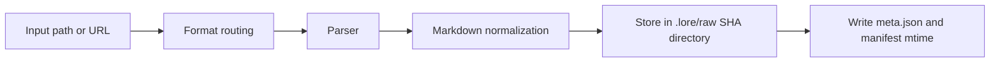

## Session Framework Sources

Lore can ingest local session history directly using:

```bash
lore ingest-sessions [framework|all]
```

| Framework key | Default source locations (OS-dependent) | Typical file types |
|---|---|---|
| `claude-code` | `~/.claude/projects/` | `.jsonl` |
| `codex-cli` | `~/.codex/sessions/`, `~/.codex/projects/` | `.jsonl` |
| `copilot-cli` | `~/.copilot/session-state/` (or `COPILOT_HOME`) | `events.jsonl` |
| `copilot-chat` | VS Code workspace storage `*/chatSessions/` | `.jsonl`, `.json` |
| `cursor` | Cursor workspace storage | `.jsonl`, `.json` |
| `gemini-cli` | `~/.gemini/`, `~/.config/gemini/` | `.jsonl`, `.json`, `.md` |
| `obsidian` | `~/Documents/Obsidian Vault/` (or custom roots) | `.md` |

Notes:

- Session imports run through the same raw ingest pipeline and produce `.lore/raw/<sha>/` entries.
- `meta.json` now includes `session` metadata for framework-ingested sources.
- `--dry-run` lets you audit discovery before writing ingest output.

## Conversation Export Support (`.json` / `.jsonl`)

Lore attempts schema detection before generic JSON rendering.

Recognized schema families:

- role/content message arrays (`user`/`assistant`, including `human`/`ai` role variants)
- ChatGPT mapping exports (`mapping` graph)
- Claude-style and Codex-style JSONL session events
- Slack-like message arrays

Conversation outputs are normalized as transcript markdown with quoted user lines and assistant response blocks.

### Schema Matrix

| Input shape | Detection result | Output |
|---|---|---|
| Array/object with role-content messages | Conversation transcript | `# Conversation Transcript` markdown |
| ChatGPT mapping object | Conversation transcript | Ordered user/assistant turns |
| JSONL session events | Conversation transcript | Ordered turns from event payloads |
| Slack message arrays | Conversation transcript | Heuristic alternating role mapping |
| No recognized schema | Generic JSON render | Heading/value markdown conversion |

If a file does not match known conversation patterns, Lore falls back to generic JSON-to-markdown conversion.

## URL and Video Behavior

### URL content

Lore routes URL ingestion based on the file extension in the URL path:

- **Document extensions** (`.pdf`, `.docx`, `.pptx`, `.xlsx`, `.epub`): downloaded to a temp file then processed via Replicate Marker — identical to local document ingestion. Requires `TELEPAT_REPLICATE_TOKEN`.
- **Image extensions** (`.png`, `.jpg`, `.jpeg`, `.webp`, `.gif`, `.bmp`): downloaded to a temp file then processed via Replicate Vision — identical to local image ingestion. Requires `TELEPAT_REPLICATE_TOKEN`.
- **All other URLs** (web pages, HTML, etc.):
  - When both `LORE_CF_ACCOUNT_ID` and `LORE_CF_TOKEN` are set, Lore calls the Cloudflare Browser Run `/markdown` endpoint, which returns markdown directly without local HTML conversion.
  - On Cloudflare failure or a non-string response, Lore logs the fallback and uses Jina.
  - Without Cloudflare credentials, Lore fetches through Jina directly.

### Video URLs

- Lore checks for `yt-dlp`
- If subtitles are available, Lore ingests cleaned transcript text
- If `yt-dlp` is missing or subtitles are unavailable/empty, Lore falls back to URL parsing

Extractor metadata is stored in `meta.json` for video ingests.

## Raw Metadata Notes

- all ingests create `.lore/raw/<sha256>/meta.json`
- local file ingests can infer folder-derived tags
- extracted text can append heuristic memory tags (`decision`, `preference`, `problem`, `milestone`, `emotional`)
- duplicate ingests reuse existing raw entries

## Export Formats

Lore supports these export targets:

- `bundle`
- `slides`
- `pdf`
- `docx`
- `web`
- `canvas`
- `graphml`

See [Exporting](../guides/exporting.md) for detailed use cases and output examples.

## Practical Examples

```bash
# ingest a mixed folder
lore ingest ./docs/architecture.md
lore ingest ./notes/session.jsonl
lore ingest ./assets/diagram.png

# ingest a URL and video URL
lore ingest https://example.com/post
lore ingest https://www.youtube.com/watch?v=<id>
```


================================================
FILE: docs-site/docs/technical/architecture.md
================================================
---
sidebar_position: 1
---

# Architecture

Lore combines markdown-first knowledge storage with an operational pipeline for ingest, compile, retrieval, and quality enforcement.

## 4-Layer Wiki

1. **Index** (`wiki/index.md`) — always consulted first
2. **Articles** (`wiki/articles/*.md`) — concept articles with backlinks and provenance
3. **Derived** (`wiki/derived/`) — Q&A answers, slides, charts
4. **Assets** (`wiki/assets/`) — local images

Supporting state lives in `.lore/`:

- `raw/` normalized ingest artifacts keyed by content hash
- `manifest.json` source-to-raw tracking, compile timestamps, extracted hashes
- `wiki/concepts.json` normalized concept metadata generated after compile
- `wiki/concepts/` per-concept detail pages (optional)
- `wiki/deprecated/` soft-deleted articles retained for audit
- `db.sqlite` FTS/backlink database
- `compile.lock` active compile mutex file

## Repository Layout Snapshot

| Path | Purpose |
|---|---|
| `.lore/raw/` | Source-derived extracted artifacts keyed by hash |
| `.lore/wiki/articles/` | Compiled concept pages with provenance |
| `.lore/wiki/deprecated/` | Soft-deleted articles (audit trail) |
| `.lore/wiki/index.md` | Canonical topic index |
| `.lore/wiki/concepts.json` | Concept index with aliases/tags/confidence |
| `.lore/wiki/derived/qa/` | Filed query answers |
| `.lore/db.sqlite` | FTS and link graph tables |
| `.lore/logs/` | JSONL command run logs |

## 4-Phase Pipeline

1. **Ingest** — `raw/` populated with `extracted.md` + `meta.json`
2. **Compile** — 6-step pipeline: diff → extract concepts → match → generate ops → apply → reindex
3. **Query** — Q&A via BFS/DFS traversal, filed to `derived/qa/`
4. **Lint** — orphans, gaps, ambiguous claims, and line-aware diagnostics surfaced

Operationally, these phases are idempotent and can be re-run incrementally.

Compile is hash-incremental by default: unchanged extracted content is skipped based on `manifest.json` `extractedHash` fields.

### Pipeline Diagram

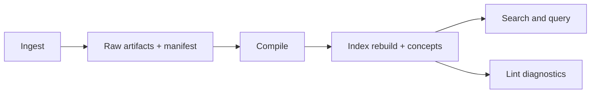

### Compile Sub-Pipeline

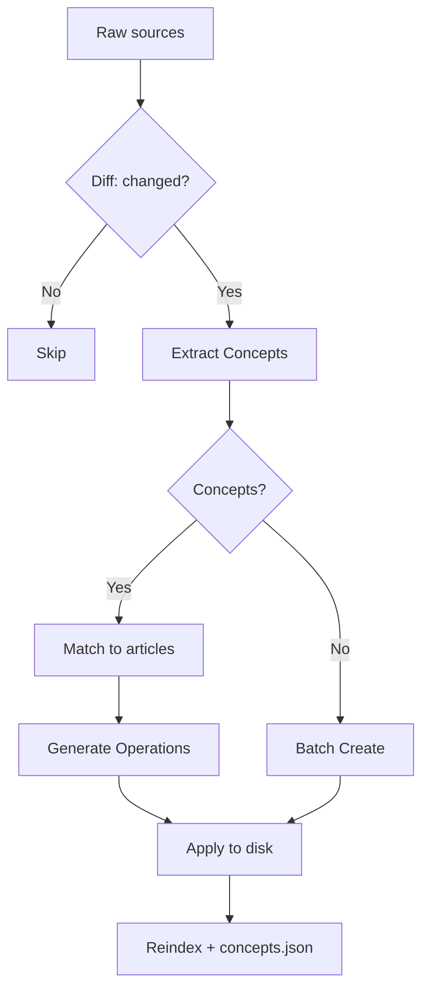

## Provenance Model

Every article tracks which sources contributed to which lines. Two mechanisms:

### Inline Provenance

Lines carry `<!-- sources:HASH(CONFIDENCE) -->` comments:

```markdown
The auth service uses JWT. <!-- sources:abc123(extracted) def456(inferred) -->
```

When the LLM reads articles for matching, provenance comments are stripped. The LLM sees clean, numbered lines.

### Cumulative References

Every article ends with a `## References` section listing all source hashes ever merged:

```markdown
## References
- abc123 (extracted)
- def456 (inferred)
```

This section is system-managed and hidden from LLM context.

### Related Section

`## Related` is auto-generated from `[[wiki-links]]` found in the article body.

## Operation Model

The LLM outputs line-level operations (JSON). Each operation carries a `sources` array for provenance:

| Operation | Effect |
|---|---|
| `replace` | Replace one line |
| `insert-after` | Insert after a target line |
| `delete-range` | Remove lines (validated: start ≤ end) |
| `replace-range` | Replace a span of lines |
| `split` | Split article into two |
| `append-source` | Add sources to existing lines (no content change) |
| `soft-delete` | Move article to deprecated |

Operations are applied sequentially per source. Line references use `¶` (pilcrow) prefixes to distinguish from YAML line numbers.

## Compile Reliability Controls

| Control | Purpose |
|---|---|
| PID lock file (`compile.lock`) | Prevent overlapping compile runs |
| Hash-based skipping | Avoid recompiling unchanged extracted content |
| Per-source retry (1 attempt) | Recover from malformed LLM output |
| Zero-concept skip | Sources without extractable concepts go to batch create |
| `start > end` validation | Range operations reject invalid spans |
| Post-compile index rebuild | Keep FTS/graph state aligned with article set |

## Ingest and Metadata Flow

Ingest writes `.lore/raw/<sha>/extracted.md` and `.lore/raw/<sha>/meta.json`.

Metadata can include:

- canonical source identity
- folder-derived topical tags
- heuristic memory type tags
- timestamps and provenance fields

Duplicate content is detected by hash and reuses existing raw entries.

Metadata tags can originate from path hints and memory-pattern heuristics to improve downstream classification and discovery.

## Query Flow and Normalization

`query` uses hybrid retrieval from FTS + graph context.

Question text normalization is optional and controlled by:

- CLI flags: `--normalize-question`, `--no-normalize-question`
- env default: `LORE_QUERY_NORMALIZE`

Normalization is intentionally conservative to avoid mutating technical tokens.

Retrieval sequence:

1. load index context
2. run FTS candidate selection
3. expand one-hop neighbors via link graph
4. synthesize answer through LLM

## Graph and Search Storage

SQLite structures:

- `fts`: full-text index (`slug`, `title`, `body`) with ranking/snippets
- `links`: conceptual edges (`from_slug`, `to_slug`)

`lore path` computes shortest conceptual paths via BFS over undirected adjacency derived from `links`.

## Index Integrity and Guardrails

Index rebuild can run in standard or repair mode:

- standard: regenerate DB artifacts from manifest/raw state
- repair: recover missing manifest entries from existing raw folders

Backlink indexing filters low-signal wiki-link targets (for example stopword-only links) to reduce graph noise.

Provenance comments are stripped from article bodies before FTS indexing so they do not pollute search results.

Guardrail benefits:

- fewer noisy edges in concept graph
- cleaner lint gap/orphan signals
- more stable path and neighbor exploration

## MCP Maintenance Surface

The MCP server exposes maintenance and diagnostics tools for automation loops, including:

- duplicate checks before ingest
- raw tag distribution summaries
- orphan/gap/ambiguity lint summaries
- index rebuild and repair triggers

## SQLite Schema

- `fts` — FTS5 virtual table (slug, title, body) with Porter stemming
- `links` — backlinks graph (from_slug, to_slug)

## Related Docs

- [Ingest Pipeline](./ingest-pipeline.md)
- [LLM Pipeline](./llm-pipeline.md)
- [Run Logging](./logging.md)
- [Compiling Your Wiki](../guides/compiling-your-wiki.md)


================================================
FILE: docs-site/docs/technical/ingest-pipeline.md
================================================
---
sidebar_position: 3
---

# Ingest Pipeline

Two stages: **format extraction** then **Unified.js normalization**.

Each successful ingest creates a deterministic raw entry in `.lore/raw/<sha256>/`.

## Stage 1: Format Extraction

Routes to the correct parser based on file type or URL pattern.

### Routing Matrix

| Input type | Parser path | Notes |
|---|---|---|
| markdown/text | direct text extraction | normalized by unified pipeline |
| html | HTML parser | converted to markdown |
| json/jsonl | conversation detection + JSON rendering fallback | transcript-first strategy |
| pdf/docx/pptx/xlsx/epub | Replicate Marker | requires Replicate token |
| image formats | Replicate Vision | OCR/caption prompt extraction |
| web page URL | Cloudflare BR `/markdown` endpoint if configured, otherwise Jina | returns markdown directly; Cloudflare failure falls back to Jina |
| document URL (`.pdf`, `.docx`, etc.) | temp download → Replicate Marker | identical path to local document files |
| image URL (`.png`, `.jpg`, etc.) | temp download → Replicate Vision | identical path to local image files |
| video URL | `yt-dlp` subtitle workflow | falls back to URL parsing when unavailable |

### Parser Selection

- Markdown and text-like files route through direct markdown normalization.
- Office/PDF/media formats route through specialized extractors.
- `.json` / `.jsonl` content is schema-checked first for conversation exports.
- URLs with document or image extensions are downloaded to a temp file and routed through the same local extractor (Marker or Vision).
- All other URLs route through fetch/browser extraction based on source and config.

### Video URL Fallback Behavior

1. check `yt-dlp` availability
2. attempt subtitle download and cleanup
3. if missing/empty subtitles, use URL parsing fallback

Extractor provenance is written into raw metadata (`meta.json`).

### Conversation Schema Detection

For JSON inputs, Lore attempts structured conversation extraction before generic rendering. Supported families include:

- role/content arrays
- ChatGPT mapping trees
- Codex/Claude-style JSONL sessions
- Slack-like message arrays

If detection fails, Lore falls back to generic JSON markdown output.

### Conversation Normalization Outcome

Recognized conversation schemas are emitted as transcript markdown under a standard heading (`# Conversation Transcript`) with user turns quoted and assistant turns preserved as prose.

## Stage 2: Unified.js Normalization

1. Parse to mdast AST (remark-parse)
2. Extract YAML frontmatter, resolve `[[wiki-links]]`
3. Normalize heading hierarchy, dedupe whitespace
4. Stringify to `extracted.md`

Normalization goal: produce stable markdown for deterministic hashing and cleaner compile inputs.

## Raw Entry Layout

Each raw directory contains:

- `source` copy (when available)
- `extracted.md` normalized markdown
- `meta.json` ingest metadata

Typical `meta.json` includes:

- content hash and format
- source path or URL provenance
- extraction date/time
- inferred topical and memory tags
- optional extractor identifier (video ingestion)

`meta.json` includes timing/provenance fields and tags that can come from:

- source frontmatter tags
- folder-path inferred topical tags
- heuristic memory signals (`decision`, `preference`, `problem`, `milestone`, `emotional`)

## Duplicate Detection

Ingest computes a source hash and short-circuits when the exact content has already been ingested.

- no duplicate raw directory is created
- existing raw entry is reused
- ingest result includes `duplicate=true`

This keeps `raw/` stable and prevents duplicate article churn downstream.

## Ingest Flow Diagram

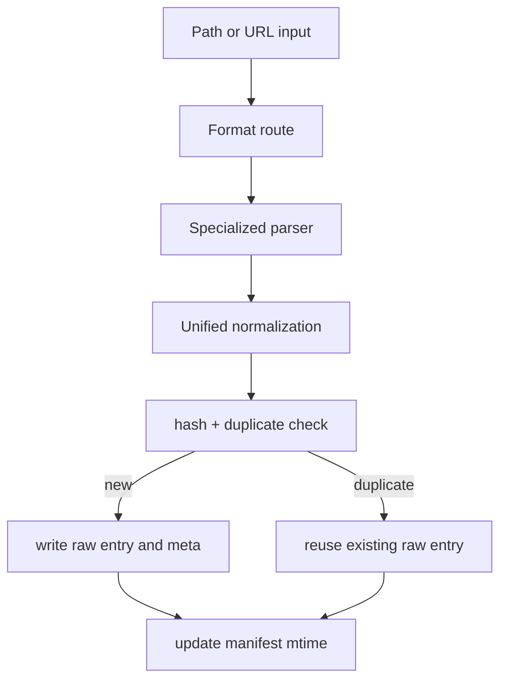

## Operational Guardrails

| Guardrail | Benefit |
|---|---|
| deterministic hash identity | duplicate prevention and stable manifest tracking |
| parser fallback chains | resilient ingestion in partially configured environments |
| metadata enrichment | better downstream indexing and maintenance workflows |

## Troubleshooting Signals

| Symptom | Likely cause | Fix |
|---|---|---|
| JSON file not treated as transcript | schema not recognized | inspect structure or rely on generic JSON markdown fallback |
| Video ingest has no transcript | `yt-dlp` unavailable or no subtitles | install `yt-dlp` or accept URL fallback output |
| URL extraction quality is weak | source rendering complexity | configure Cloudflare BR or ingest a local exported copy |

## Interaction With Indexing

`compile` and explicit `index` operations consume `meta.json` + `extracted.md` from `raw/`.

If older manifests reference missing raw directories, index repair mode (`lore index --repair`) rebuilds missing manifest entries by scanning existing raw folders.

## Related Docs

- [Supported Formats](../reference/supported-formats.md)
- [Compiling Your Wiki](../guides/compiling-your-wiki.md)
- [Troubleshooting](../guides/troubleshooting.md)


================================================
FILE: docs-site/docs/technical/llm-pipeline.md
================================================
---
sidebar_position: 2
---

# LLM Pipeline

Lore uses LLM calls in five primary operations, three of which compose the compile pipeline:

1. **Concept Extraction** — extracts named concepts with descriptions and confidence from raw source content
2. **Article Matching** — matches a source's concepts to existing wiki articles
3. **Operation Generation** — produces line-level operations describing how to edit matched articles
4. **Batch Create** — generates new articles for unmatched sources
5. **Q&A (`query`)** — loads `index.md` first, then relevant articles via FTS + graph neighbor expansion; answers question; optionally files result back
6. **Explain** — deep concept synthesis from a matched article plus graph neighbors

The first four compose the compile pipeline (→ concept extraction → matching → operations → creates). All LLM calls go through OpenRouter via the `openai` npm SDK.

`lint` and `index` are not LLM operations; they operate on local markdown and SQLite state.

## End-to-End LLM Flow

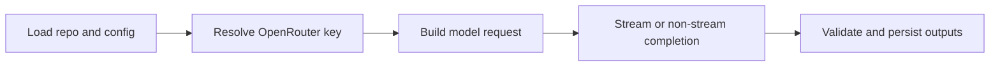

## Compile LLM Stages

### 1. Concept Extraction

Each changed source is sent to the LLM with instructions to extract concepts. The LLM returns a JSON array:

```json
[
  {
    "name": "Authentication",
    "description": "User authentication via JWT tokens and OAuth2 providers.",
    "confidence": "extracted",
    "for_source": "source_1"
  }
]
```

- **Batch**: All changed sources are sent in a single call.
- **Confidence**: LLM decides per concept (`extracted`, `inferred`, `ambiguous`).
- **`for_source`**: References the source index in the batch (1-based).
- **Zero concepts**: Sources with no extractable concepts proceed to batch create without matching.

### 2. Article Matching

Each source with concepts is matched against the existing article set. The LLM receives:

- Source title, content, and concepts
- List of candidate article slugs (up to 30 when FTS pre-filtered, or full list for small wikis)
- Article bodies with line numbers and provenance stripped

The LLM returns the slugs of matching articles (up to 3 per source) or an empty list if no match.

**Pre-filtering**: For wikis with 200+ articles, an FTS search on concept names narrows candidates to 30. For smaller wikis, all articles are candidates.

### 3. Operation Generation

Per matched source, the LLM generates a JSON array of operations:

```json
[
  {
    "op": "replace",
    "line": "¶2",
    "content": "Updated line content.",
    "sources": ["sha256(extracted)"],
    "confidence": "extracted"
  },
  {
    "op": "insert-after",
    "line": "¶5",
    "content": "New derived insight.",
    "sources": ["sha256(inferred)"],
    "confidence": "inferred"
  }
]
```

The LLM sees matched articles with:
- Line numbers prefixed with `¶` (pilcrow)
- Provenance comments stripped
- `## References` and `## Related` sections hidden

**Confidence per operation**: For edits to existing articles, the LLM sets `confidence` per operation (defaults to `inferred`). For new articles created via batch create, all lines default to `extracted`.

### 4. Batch Create

Unmatched sources (and sources with zero concepts) are batched together. The LLM generates a set of create operations:

```json
[
  {
    "op": "create",
    "slug": "jwt-authentication",
    "title": "JWT Authentication",
    "description": "How the system uses JWT tokens...",
    "lines": [
      { "content": "Line 1 content.", "sources": ["sha256(extracted)"] }
    ],
    "sources": ["sha256"],
    "confidence": "extracted"
  }
]
```

New articles are written with provenance comments and `## References` populated.

## Compile Truncation and Error Handling

Compile validates LLM output before writing files. Responses are retried once when:

- The provider reports truncation (`finish_reason=length`)
- JSON output is not parseable
- Operations are structurally invalid

On retryable failure, compile retries once. If the retry also fails, the source is skipped (logged) and compile continues with remaining sources. The compile does not abort on individual source failures.

## maxTokens Semantics

- `maxTokens` is optional in `.lore/config.json`.
- If set, Lore includes `max_tokens` in OpenRouter requests.
- If unset, Lore omits `max_tokens` and uses provider/model defaults.

## Retrieval-Side Prompting

### Query

- context composition: index + selected article bodies
- source tracking: slugs returned and optionally filed in derived QA markdown
- optional normalization: conservative query cleanup via flag or env default

### Explain

- exact slug lookup first, then FTS fallback
- neighbor expansion to enrich context window
- long-form synthesis with wiki-style references

## Runtime Controls

| Control | Effect |
|---|---|
| `temperature` | output diversity and determinism tradeoff |
| `maxTokens` | response length ceiling if configured |
| `LORE_QUERY_NORMALIZE` | default query normalization toggle |

## Failure Modes and Recovery

| Symptom | Likely cause | Recovery |
|---|---|---|
| compile retries frequently | malformed LLM output or token limits | allow retry; tune model/maxTokens if persistent |
| query result low quality | weak/limited retrieval context | run index repair, improve links, retry |
| explain misses concept | no exact/fts match | recompile and use clearer concept name |
| sources consistently get zero concepts | content too abstract or short for concept extraction | review raw content; may need manual curation |
| operations fail validation | LLM produced invalid line references | compile skips source and continues; review raw content |

## Run Logging

- Compile and query runs emit structured JSONL events in `.lore/logs/<runId>.jsonl`.
- Token stream events are logged with raw token text.
- Command stderr shows concise run start/end summaries with run ID and log path.

## Related Docs

- [LLM Models](../reference/llm-models.md)
- [Configuration](../guides/configuration.md)
- [Compiling Your Wiki](../guides/compiling-your-wiki.md)
- [Searching and Querying](../guides/searching-and-querying.md)
- [Architecture](./architecture.md)


================================================
FILE: docs-site/docs/technical/logging.md
================================================
---
sidebar_position: 3
---

# Run Logging

Lore emits structured JSONL logs for:

- `lore ingest`
- `lore compile`
- `lore query`

Each command run gets a unique run ID and log file at:

- `.lore/logs/<runId>.jsonl`

## Why Logging Matters

Run logs are the fastest way to diagnose pipeline behavior in automated and headless runs.

- reconstruct command execution order
- inspect retry/progress behavior
- capture source of runtime failures
- correlate token-heavy operations with model behavior

Log retention and rotation:

- Logs are rotated automatically before each new run log is created.
- Default retention is 200 files.
- Set `LORE_LOG_MAX_FILES` to override the retention count.

## JSONL Structure

Each line is one standalone JSON object. This makes logs stream-friendly and easy to process with line-oriented tools.

## Event Model

Each line is a standalone JSON object with fields such as:

- `runId`
- `command`
- `event`
- `timestamp`
- `step`
- `elapsedMs`
- `details`
- `error`

Common events include:

- `run_start`
- `step_start`
- `step_end`
- `progress`
- `token`
- `retry`
- `error`
- `run_end`

Example event line:

```json
{
	"runId": "2026-04-10T12-30-12-123Z-abcd1234",
	"command": "compile",
	"event": "step_end",
	"timestamp": "2026-04-10T12:30:14.201Z",
	"step": "compile.batch",
	"elapsedMs": 598,
	"details": {
		"written": 7
	}
}
```

## Step Coverage by Command

| Command | Typical high-signal steps |
|---|---|
| `ingest` | route selection, parser step, normalization, manifest update |
| `compile` | lock acquisition, batch llm call, retry, reindex, concepts write |
| `query` | index load, fts search, neighbor expansion, llm response, file-back |

## Console Summaries

Human-readable mode prints concise stderr summaries:

- run start with command and run ID
- run end with status, elapsed time, and log path

In `--json` mode, command output includes `runId` and `logPath` for direct log collection.

## Token Logging

Query and compile stream token events into JSONL logs with raw token text under `details.token`.

Treat run logs as sensitive because token payloads may contain source/context excerpts.

## Debugging Playbook

```bash
# list latest runs
ls -lt .lore/logs | head

# inspect one run
cat .lore/logs/<run-id>.jsonl

# isolate retry events
grep '"event":"retry"' .lore/logs/<run-id>.jsonl
```

## Operational Guardrails

- avoid sharing full logs externally when source content is sensitive
- rotate or purge logs in restricted environments
- use `LORE_LOG_MAX_FILES` to cap retained run history

## Related Docs

- [Troubleshooting](../guides/troubleshooting.md)
- [Compiling Your Wiki](../guides/compiling-your-wiki.md)
- [Searching and Querying](../guides/searching-and-querying.md)


================================================
FILE: docs-site/i18n/de/code.json
================================================
{
  "theme.ErrorPageContent.title": {
    "message": "Seite abgestürzt.",
    "description": "The title of the fallback page when the page crashed"
  },
  "theme.ErrorPageContent.tryAgain": {
    "message": "Erneut versuchen",
    "description": "The label of the button to try again"
  },
  "theme.BackToTopButton.buttonAriaLabel": {
    "message": "Nach oben",
    "description": "The ARIA label for the back to top button"
  },
  "theme.docs.breadcrumbs.navAriaLabel": {
    "message": "Seitenpfad",
    "description": "The ARIA label for the breadcrumbs"
  },
  "theme.docs.breadcrumbs.home": {
    "message": "Startseite",
    "description": "The ARIA label for the home page in the breadcrumbs"
  },
  "theme.docs.DocCard.categoryDescription.plurals": {
    "message": "{count} Elemente",
    "description": "The default description for a category card"
  },
  "theme.docs.paginator.navAriaLabel": {
    "message": "Dokumente-Navigation",
    "description": "The ARIA label for the docs pagination"
  },
  "theme.docs.paginator.previous": {
    "message": "Vorherige",
    "description": "The label used to navigate to the previous doc"
  },
  "theme.docs.paginator.next": {
    "message": "Nächste",
    "description": "The label used to navigate to the next doc"
  },
  "theme.docs.sidebar.navAriaLabel": {
    "message": "Dokumente-Seitenleiste",
    "description": "The ARIA label for the sidebar navigation"
  },
  "theme.docs.sidebar.collapseButtonTitle": {
    "message": "Seitenleiste einklappen",
    "description": "The title attribute for collapse button"
  },
  "theme.docs.sidebar.collapseButtonAriaLabel": {
    "message": "Seitenleiste einklappen",
    "description": "The ARIA label for collapse button"
  },
  "theme.docs.sidebar.expandButtonTitle": {
    "message": "Seitenleiste ausklappen",
    "description": "The ARIA label for expand button"
  },
  "theme.docs.sidebar.expandButtonAriaLabel": {
    "message": "Seitenleiste ausklappen",
    "description": "The ARIA label for expand button"
  },
  "theme.docs.sidebar.closeSidebarButtonAriaLabel": {
    "message": "Seitenleiste schließen",
    "description": "The ARIA label for close button"
  },
  "theme.docs.sidebar.toggleSidebarButtonAriaLabel": {
    "message": "Seitenleiste umschalten",
    "description": "The ARIA label for hamburger menu button"
  },
  "theme.docs.versionBadge.label": {
    "message": "Version: {versionLabel}"
  },
  "theme.docs.versions.unreleasedVersionLabel": {
    "message": "Dies sind die Dokumente für {siteTitle} {versionLabel}, die noch nicht veröffentlicht wurden.",
    "description": "The label for unreleased doc version"
  },
  "theme.docs.versions.unmaintainedVersionLabel": {
    "message": "Dies sind die Dokumente für {siteTitle} {versionLabel}, die nicht mehr aktiv gepflegt werden.",
    "description": "The label for unmaintained doc version"
  },
  "theme.docs.versions.latestVersionSuggestionLabel": {
    "message": "Die aktuellsten Dokumente finden Sie unter {latestVersionLink} ({versionLabel}).",
    "description": "The label to check the latest version"
  },
  "theme.docs.versions.latestVersionLinkLabel": {
    "message": "Neueste Version",
    "description": "The label for the latest version suggestion link"
  },
  "theme.common.editThisPage": {
    "message": "Diese Seite bearbeiten",
    "description": "The link label to edit the current page"
  },
  "theme.common.skipToMainContent": {
    "message": "Zum Hauptinhalt springen",
    "description": "The skip to content label"
  },
  "theme.common.headingLinkTitle": {
    "message": "Direktlink zu {heading}",
    "description": "Title for link to heading"
  },
  "theme.lastUpdated.atDate": {
    "message": "am {date} ",
    "description": "The words for date of last update"
  },
  "theme.lastUpdated.byUser": {
    "message": "von {user} ",
    "description": "The words for who updated"
  },
  "theme.lastUpdated.lastUpdatedAtBy": {
    "message": "Zuletzt aktualisiert von {user} am {date}",
    "description": "The sentence for last updated display"
  },
  "theme.NotFound.title": {
    "message": "Seite nicht gefunden",
    "description": "The title of the 404 page"
  },
  "theme.NotFound.p1": {
    "message": "Die gesuchte Seite konnte nicht gefunden werden.",
    "description": "The first paragraph of the 404 page"
  },
  "theme.NotFound.p2": {
    "message": "Bitte kontaktieren Sie den Eigentümer der ursprünglichen URL und teilen Sie ihm mit, dass der Link defekt ist.",
    "description": "The 2nd paragraph of the 404 page"
  },
  "theme.NavBar.navAriaLabel": {
    "message": "Hauptnavigation",
    "description": "The ARIA label for the main navigation"
  },
  "theme.navbar.mobileVersionsDropdown.label": {
    "message": "Version auswählen",
    "description": "The label for the navbar versions dropdown on mobile"
  },
  "theme.navbar.mobileLanguageDropdown.label": {
    "message": "Sprache auswählen",
    "description": "The label for the mobile language switcher dropdown"
  },
  "theme.navbar.mobileSidebarSecondaryMenu.backButtonLabel": {
    "message": "← Zurück zum Hauptmenü",
    "description": "The label of the back button in mobile sidebar"
  },
  "theme.navbar.mobileDropdown.collapseButton.expandAriaLabel": {
    "message": "Dropdown erweitern",
    "description": "The ARIA label to expand mobile dropdown"
  },
  "theme.navbar.mobileDropdown.collapseButton.collapseAriaLabel": {
    "message": "Dropdown einklappen",
    "description": "The ARIA label to collapse mobile dropdown"
  },
  "theme.TOCCollapsible.toggleButtonLabel": {
    "message": "Seitenübersicht",
    "description": "The label for the TOC collapsible button"
  },
  "theme.tags.tagsListLabel": {
    "message": "Schlagwörter:",
    "description": "The label alongside a tag list"
  },
  "theme.tags.tagsPageLink": {
    "message": "Alle Schlagwörter anzeigen",
    "description": "The label of the link to the tag list page"
  },
  "theme.tags.tagsPageTitle": {
    "message": "Schlagwörter",
    "description": "The title of the tag list page"
  },
  "theme.colorToggle.ariaLabel.mode.system": {
    "message": "Systemmodus",
    "description": "The name for system color mode"
  },
  "theme.colorToggle.ariaLabel.mode.light": {
    "message": "Heller Modus",
    "description": "The name for light color mode"
  },
  "theme.colorToggle.ariaLabel.mode.dark": {
    "message": "Dunkler Modus",
    "description": "The name for dark color mode"
  },
  "theme.colorToggle.ariaLabel": {
    "message": "Hellen/dunklen Modus umschalten (aktuell: {mode})",
    "description": "The ARIA label for color mode toggle"
  },
  "theme.admonition.note": {
    "message": "Hinweis",
    "description": "The default label for Note admonition"
  },
  "theme.admonition.tip": {
    "message": "Tipp",
    "description": "The default label for Tip admonition"
  },
  "theme.admonition.danger": {
    "message": "Gefahr",
    "description": "The default label for Danger admonition"
  },
  "theme.admonition.info": {
    "message": "Info",
    "description": "The default label for Info admonition"
  },
  "theme.admonition.caution": {
    "message": "Vorsicht",
    "description": "The default label for Caution admonition"
  },
  "theme.admonition.warning": {
    "message": "Warnung",
    "description": "The default label for Warning admonition"
  },
  "theme.CodeBlock.copy": {
    "message": "Kopieren",
    "description": "The copy button label on code blocks"
  },
  "theme.CodeBlock.copied": {
    "message": "Kopiert",
    "description": "The copied button label on code blocks"
  },
  "theme.CodeBlock.copyButtonAriaLabel": {
    "message": "Code in die Zwischenablage kopieren",
    "description": "The ARIA label for copy code button"
  },
  "theme.CodeBlock.wordWrapToggle": {
    "message": "Zeilenumbruch umschalten",
    "description": "The title for word wrap toggle button"
  },
  "theme.IconExternalLink.ariaLabel": {
    "message": "(öffnet in neuem Tab)",
    "description": "The ARIA label for external link icon"
  }
}


================================================
FILE: docs-site/i18n/de/docusaurus-plugin-content-docs/current.json
================================================
{
  "version.label": {
    "message": "Next",
    "description": "The label for version current"
  },
  "sidebar.docs.category.Getting Started": {
    "message": "Erste Schritte",
    "description": "The label for category 'Getting Started' in sidebar 'docs'"
  },
  "sidebar.docs.category.Guides": {
    "message": "Anleitungen",
    "description": "The label for category 'Guides' in sidebar 'docs'"
  },
  "sidebar.docs.category.Reference": {
    "message": "Referenz",
    "description": "The label for category 'Reference' in sidebar 'docs'"
  },
  "sidebar.docs.category.Technical": {
    "message": "Technik",
    "description": "The label for category 'Technical' in sidebar 'docs'"
  },
  "sidebar.docs.category.Contributing": {
    "message": "Beitragen",
    "description": "The label for category 'Contributing' in sidebar 'docs'"
  }
}


================================================
FILE: docs-site/i18n/de/docusaurus-plugin-content-docs/current/features.md
================================================
---
slug: /features
title: "Kompilierte Wikis, keine Vektor-Embeddings"
description: Was Lore für Teams leisten kann, die benötigen, dass LLMs echten architekturbezogenen Kontext behalten.
keywords: [lore, features, knowledge base, llm memory, markdown wiki, rag alternative]
sidebar_label: Funktionen
sidebar_position: 1
---

# Kompilierte Wikis, keine Vektor-Embeddings

Lore erstellt persistente LLM-Wissensbasen aus Ihren_projektbezogenen Inhalten — kompilierte Markdown-Wikis, organisiert von einem LLM-Bibliothekar. Keine Vektor-Embeddings. Kein Retrieval-Rauschen. Nur strukturiertes, menschenlesliches, git-freundliches Wissen, das über Sitzungen hinweg nützlich bleibt.

Gebaut für Teams, die benötigen, dass ihre LLMs echten architekturbezogenen Kontext ohne den zustandslosen Reset von RAG behalten.

---

## Kompilierte Markdown-Wikis, keine Vektor-Embeddings

Die meisten Wissensbasentools speichern Ihre Inhalte als undurchsichtige Vektor-Embeddings — unlesbar, uneditierbar und an ein bestimmtes Retrieval-Modell gebunden.

Lore kompiliert Ihre Inhalte in strukturierte Markdown-Wikis. Lesen Sie sie. Bearbeiten Sie sie. Committen Sie sie zu git. Ihr Wissen gehört Ihnen, in einem Format, das jedes Modell überdauert.

| | RAG | Lore |
|---|---|---|
| Format | Vektor-Embeddings | Strukturiertes Markdown |
| Retrieval | Ähnlichkeitssuche | Backlinks + FTS5/BM25 |
| Persistenz | Zustandslos | Weiterentwickelndes Wiki + git |
| Wartung | Manuell | LLM-gesteuerter Bibliothekar |

---

## LLM-gesteuerter Bibliothekar

Lore indexiert Ihre Inhalte nicht nur — ein LLM organisiert und verknüpft sie aktiv. Eine 6-Stufen-Kompilierungspipeline extrahiert Konzepte, ordnet sie bestehenden Artikeln zu, generiert zeilenweise Bearbeitungsvorgänge und wendet sie mit vollständiger Herkunftsnachverfolgung an. Jeder Satz weiß, woher er kommt.

Neue Konzepte werden benannt, kategorisiert und kreuzverknüpft. Verwaiste Seiten werden markiert. Mehrdeutigkeiten werden offengelegt. Multi-Artikel-Bearbeitungen und Aufteilungen werden automatisch behandelt. Es ist wie ein Vollzeit-Forschungsbibliothekar, der das institutionelle Wissen Ihres Projekts pflegt.

```bash
lore init           # ein Lore-Repository in Ihrem Projekt erstellen
lore ingest ./docs  # Quellmaterial hinzufügen
lore compile        # LLM organisiert und verknüpft Wissen
```

---

## Backlinks + FTS5/BM25-Suche

Finden Sie genau das, was Sie brauchen, ohne das Rauschen der Vektor-Ähnlichkeitssuche. Backlinks zeigen Ihnen, wie Konzepte zusammenhängen. FTS5/BM25 gibt Ihnen schnelle, präzise Textsuche. Query und Search lösen gleichzeitig über den Graphen und den Volltextindex auf.

```bash
lore search "architecture"
lore query "How does authentication work?"
lore path <concept>      # alle Pfade zu einem Konzept anzeigen
```

---

## Codegetriebene Pipeline

Lores Aufnahme, Kompilierung, Indexierung und Graph-Erstellung sind deterministischer Code. Ihre Tokens gehen in die Wissensorganisation ein — das Verstehen und Verknüpfen von Konzepten — nicht in den Infrastruktur-Overhead. Keine Kontextfenster werden für Datei-E/A verbrannt. Keine Tokens werden für Serialisierung verschwendet.

Inkrementelle Kompilierung überspringt unveränderte Inhalte über `manifest.json`. Eine Repository-Sperre verhindert überlappende Ausführungen. Jede Stufe ist auf Token-Effizienz optimiert.

---

## Absatzweiser Herkunftsnachweis

Jeder Artikel verfolgt genau, welche Quellen zu welchen Zeilen beigetragen haben. Inline `<!-- sources:HASH(CONFIDENCE) -->`-Kommentare markieren den Ursprung jedes Absatzes, während ein kumulativer `## References`-Abschnitt alle jemals zusammengeführten Quellen aufzeichnet. Die Herkunft ist organisch — Artikel erwerben sie bei der ersten Zusammenführung — mit einem `--concepts-only`-Flag zum Nachfüttern bestehender Wikis.

```markdown
The auth service uses JWT tokens. <!-- sources:abc123(extracted) def456(inferred) -->
```

Wenn das LLM Artikel für Aktualisierungen liest, werden Herkunftskommentare entfernt, sodass es sauberen, nummerierten Text sieht. Das System verwaltet die Herkunft automatisch — Sie bearbeiten einfach das Wissen.

---

## Mischquellen-Aufnahme

Lore normalisiert Inhalte von überall, wo Ihr Projektwissen lebt:

- Markdown, Code-Dateien und Projektdokumente
- URLs und Webseiten
- Chat-Transkripte (`.json`/`.jsonl` von unterstützten Agent-Frameworks)
- Video-Transkripte (via `yt-dlp`)

```bash
lore ingest ./README.md
lore ingest https://example.com/architecture
lore ingest-sessions claude     # Claude Code-Sitzungsverlauf aufnehmen
```

---

## Überall exportieren

Ihr Wiki ist nicht in einem proprietären Format eingeschlossen. Exportieren Sie es, was immer Sie brauchen:

```bash
lore export --format slides
lore export --format pdf
lore export --format docx
lore export --format web
lore export --format canvas
lore export --format graphml
```

Präsentationen, Dokumente, visuelle Graphen — Ihr Wissen geht dorthin, wo Sie es brauchen.

---

## Agent-fähiger MCP-Server

Lore wird mit einem erstklassigen MCP-Server geliefert, der 16 Tools über stdio bereitstellt:

- **Retrieval:** `search`, `ask`, `explain`, `list_articles`, `get_article`, `get_neighbors`, `path`
- **Graph-Diagnosen:** `graph_stats`, `lint_summary`, `list_orphans`, `list_gaps`, `list_ambiguous`
- **Schreiben:** `ingest`, `compile`
- **Wartung:** `check_duplicate`, `list_raw_tags`, `rebuild_index`

```bash
lore mcp   # MCP-Server für Claude Code, Cursor, VS Code Copilot oder jeden MCP-Host starten
```

Empfohlener Agent-Loop: `list_orphans` → `list_gaps` → `list_ambiguous` → `ingest`/`compile` → `rebuild_index(repair=true)`.

---

## Git-freundlich & portabel

Ihr gesamtes Wiki besteht aus einfachen Markdown-Dateien unter `.lore/wiki/`. Committen Sie es. Branchen Sie es. Nehmen Sie es in Ihr Projekt-Repository auf. Ihr Wissen reist mit Ihrem Code.

```bash
git add .lore/wiki/
git commit -m "Update project knowledge base"
```

---

## Bereit, Ihre Wissensbasis aufzubauen?

[Loslegen →](./getting-started/installation.md)

Oder springen Sie direkt zur [Wiki-Kompilierung](./guides/compiling-your-wiki.md) und der [CLI-Referenz](./reference/cli-reference.md).


================================================
FILE: docs-site/i18n/de/docusaurus-plugin-content-docs/current/index.md
================================================
---
slug: /
sidebar_position: 1
---

# Lore

Erstellen und pflegen Sie persistente LLM-Wissensbasen aus beliebigen Inhalten.

Lore löst das Problem der "zustandslosen KI" — den Kontext-Limit-Reset, bei dem Agents architekturbezogene Nuancen zwischen Sitzungen verlieren. Anstatt RAG (Vektor-Embeddings, Retrieval-Rauschen) baut Lore ein **kompiliertes Markdown-Wiki**: Ein LLM agiert als Vollzeit-Forschungsbibliothekar, organisiert und verknüpft Wissen aktiv.

## Schnellstart

```bash
npm install -g @telepat/lore
cd your-project
lore init
lore ingest ./docs/
lore compile
lore search "your query"
```

Weiter mit:

- [Ihr Wiki kompilieren](./guides/compiling-your-wiki.md)
- [Linting und Gesundheit](./guides/linting-and-health.md)
- [CLI-Referenz](./reference/cli-reference.md)
- [Architektur](./technical/architecture.md)

## Lernpfade

### Neu hier

1. [Übersicht](./getting-started/overview.md)
2. [Installation](./getting-started/installation.md)
3. [Schnellstart](./getting-started/quickstart.md)

### Wiki erstellen und pflegen

1. [Inhalte aufnehmen](./guides/ingesting-content.md)
2. [Ihr Wiki kompilieren](./guides/compiling-your-wiki.md)
3. [Suchen und Abfragen](./guides/searching-and-querying.md)
4. [Fehlerbehebung](./guides/troubleshooting.md)

### Veröffentlichen und Teilen

1. [Exportieren](./guides/exporting.md)
2. [MCP-Server](./guides/mcp-server.md)
3. [Explain-Befehl](./guides/explain-command.md)

### Team-Betrieb

1. [Lore Angela](./guides/lore-angela.md)
2. [Best Practices](./guides/best-practices.md)
3. [Linting und Gesundheit](./guides/linting-and-health.md)

## Docs-Theme-Verhalten

Die Docs-Website folgt standardmäßig Ihrem OS/Browser-Farbschema (`prefers-color-scheme`).

## Was ist neu

- Compile verwendet jetzt hash-basiertes inkrementelles Verhalten, um unveränderte extrahierte Inhalte über `manifest.json` zu überspringen.
- Compile verwendet jetzt eine Repository-Sperre (`.lore/compile.lock`), um überlappende Ausführungen zu verhindern.
- Watch-Modus kompiliert jetzt rohe Änderungen automatisch mit Entprellung und Warteschlangen-Nachfolgepass-Verhalten.
- Lint gibt jetzt zeilenbewusste Diagnosen im JSON-Modus neben orphan/gap/ambiguous-Zusammenfassungen aus.
- Compile generiert jetzt `.lore/wiki/concepts.json` für kanonische Konzeptmetadaten und Aliase.
- Ingest normalisierte unterstützte Chat-Exports (`.json`/`.jsonl`) jetzt automatisch in Transkript-Markdown.
- Ingest-Metadaten enthalten jetzt reichere Tags (ordnerabgeleitete und heuristische Speicherkategorien).
- Duplikat-Ingest umgeht wiederholte Quellen für schnellere, sauberere Pipelines.
- Index-Neuerstellung unterstützt Reparaturmodus (`lore index --repair`) zur Manifest-Wiederherstellung.
- Query unterstützt optionale Tippfehler-Normalisierung unter Beibehaltung technischer Tokens.
- MCP-Toolset umfasst jetzt ingest/compile-Schreibtools, Duplikatprüfungen, Taxonomie-Zusammenfassungen und lint-fokussierte Wartungstools.

## Schneller Wartungsloop

```bash
# 1) Quellen aufnehmen oder aktualisieren
lore ingest ./docs

# 2) Kompilieren und Index neu erstellen (fehlende Manifest-Einträge bei Bedarf reparieren)
lore compile
lore index --repair

# 3) Graph-Gesundheit validieren
lore lint

# 4) Fragen stellen
lore query "What changed in architecture?"
```

## So funktioniert es

| | RAG | Lore |
|---|---|---|
| Format | Vektor-Embeddings | Strukturiertes Markdown |
| Retrieval | Ähnlichkeitssuche | Backlinks + FTS5/BM25 |
| Persistenz | Zustandslos | Weiterentwickelndes Wiki + git |
| Wartung | Manuell | LLM-gesteuerter Bibliothekar |


================================================
FILE: docs-site/i18n/de/docusaurus-plugin-content-docs/current/contributing/development.md
================================================
---
sidebar_position: 1
---

# Entwicklung

## Einrichtung

```bash
git clone https://github.com/telepat-io/lore.git
cd lore
npm install
```

## Repository-Übersicht

| Pfad | Zweck |
|---|---|
| `src/bin/` | CLI-Einstiegspunkt |
| `src/commands/` | Befehls-Handler |
| `src/core/` | Ingest/Compile/Query/Search/Laufzeit-Module |
| `src/ui/` | Ink TUI-Ansichten |
| `src/utils/` | Parsing- und Hilfsverknüpfungen |
| `src/__tests__/` | Unit-Tests |
| `e2e/flows/` | End-to-End-Befehlsverhaltenstests |
| `docs-site/` | Docusaurus-Dokumentationsseite |

## Skripte

| Skript | Beschreibung |
|---|---|
| `npm run dev` | CLI im Entwicklungsmodus ausführen |
| `npm run build` | Mit tsup bauen |
| `npm run typecheck` | TypeScript-Typüberprüfung |
| `npm run lint` | Typecheck + ESLint |
| `npm test` | Unit-Tests |
| `npm run test:e2e` | E2E-Tests |
| `npm run test:all` | Alle Tests |
| `npm run docs:start` | Docs lokal ausführen |
| `npm run docs:build` | Docs-Seite bauen |

## Obligatorische Backpressure-Prüfungen

Führen Sie diese vor PR/Release-Übergabe aus:

```bash
npm run lint
npm run test:coverage
npm run build
npm run docs:build
```

Wenn sich Verhalten in Befehl/Core/UI/Integrationspfaden geändert hat, führen Sie auch aus:

```bash
npm run test:e2e
```

## Testen

- Unit-Tests: `src/__tests__/` — schnell, kein Netzwerk, gemockte Externe
- E2E-Tests: `e2e/` — echte `.lore/` Repos in tmpdir, HTTP abgefangen via msw

## Beitragender Workflow

1. Fokussierten Branch erstellen
2. Änderungen mit minimalem Geltungsbereich implementieren
3. Tests in relevanten Unit- oder E2E-Bereichen hinzufügen/aktualisieren
4. Docs für benutzerseitige Verhaltensänderungen aktualisieren
5. Obligatorische Prüfungen ausführen
6. PR mit Verhaltenszusammenfassung und Validierungshinweisen öffnen

## Dokumentationsbeitragsregeln

- aktualisieren Sie Root-Docs und Docs-Seiten für benutzerseitige Verhaltensänderungen
- fügen Sie praktische Beispiele für neue Befehlsverhalten hinzu
- stellen Sie sicher, dass neue Docs-Seiten von vorhandenen Navigationsoberflächen aus verlinkt sind

## Fehlerbehebung Entwicklungsumgebung

| Symptom | Wahrscheinliche Ursache | Lösung |
|---|---|---|
| Typecheck besteht lokal, aber CI schlägt fehl | Node/Versions-Mismatch | Verwenden Sie lokal Node 22+ |
| Jest ESM-Fehler | VM-Module-Flag fehlt | Verwenden Sie Package-Skripte statt rotem jest-Aufruf |
| Docs-Build bricht unerwartet | defekte Links/Sidebar-Einträge | Führen Sie `npm run docs:build` aus und korrigieren Sie Pfadreferenzen |

## Verwandte Dokumente

- [Releases und Docs-Deploy](./releasing-and-docs-deploy.md)
- [CLI-Referenz](../reference/cli-reference.md)
- [Architektur](../technical/architecture.md)


================================================
FILE: docs-site/i18n/de/docusaurus-plugin-content-docs/current/contributing/releasing-and-docs-deploy.md
================================================
---
sidebar_position: 2
---

# Releasing und Docs-Deploy

## Release-Prozess

Releases werden von [Release Please](https://github.com/googleapis/release-please) verwaltet.

Übergeordneter Flow:

1. Pushes an `main` lösen Release Please-Workflow aus
2. Release Please öffnet oder aktualisiert einen Release-PR
3. Zusammenführen des Release-PRs erstellt ein Release/Tag
4. Publish-Job führt Qualitätstore aus und veröffentlicht dann das npm-Paket

## Obligatorische Qualitätstore

Release- und CI-Workflows setzen beide durch:

```bash
npm run lint
npm run test:coverage
npm run build
npm run docs:build
```

## Publishing-Workflows

Es gibt zwei Publishing-Pfade:

| Workflow | Auslöser | Zweck |
|---|---|---|
| `release-please.yml` | Push an `main` mit Release-Erstellung | Standard-Automatisiertes Release + Publish |
| `npm-publish.yml` | manueller Dispatch | Kontrolliertes manuelles Publish mit Tag-Validierung |

Manueller Publish-Workflow validiert:

- Tag-Format (`vX.Y.Z`)
- Tag-Commit-Abstammung auf `main`
- Paketname und Versionskonsistenz
- vollständige Qualitätstore vor Publish

## Docs-Deployment

Docs werden mit Docusaurus gebaut und über [docs-pages.yml](https://github.com/telepat-io/lore/blob/main/.github/workflows/docs-pages.yml) auf GitHub Pages deployed.

Auslöserbedingungen:

- Push an `main`, der `docs-site/**` ändert
- Push an `main`, der die Docs-Workflow-Datei ändert
- manueller Workflow-Dispatch

Pipeline-Schritte:

1. Docs-Site-Abhängigkeiten installieren
2. Statische Docs bauen (`docs-site/build`)
3. Pages-Artefakt hochladen
4. Mit GitHub Pages-Action deployen

## Lokaler Vorabflug vor Release/Docs-Änderungen

```bash
npm ci
npm --prefix docs-site ci
npm run lint
npm run test:coverage
npm run build
npm run docs:build
```

## Fehlerbehebung

| Symptom | Wahrscheinliche Ursache | Lösung |
|---|---|---|
| Release-PR nicht erstellt | Keine releasefähigen konventionellen Änderungen erkannt | Commit-Format und Release Please-Konfiguration bestätigen |
| Publish-Job blockiert | Ein oder mehrere Qualitätstore fehlgeschlagen | Lokal nachbilden, beheben und erneut ausführen |
| Docs-Deploy nicht ausgelöst | Geänderte Dateien außerhalb der Auslöserpfade | Stellen Sie sicher, dass docs-site oder Workflow-Pfad geändert wurde, oder führen Sie manuellen Dispatch aus |
| Manuelles Publish abgelehnt | Tag/Version/Abstammungs-Validierung fehlgeschlagen | Verwenden Sie einen gültigen `vX.Y.Z`-Tag auf einem von `main` erreichbaren Commit |

## Verwandte Dokumente

- [Entwicklung](./development.md)
- [CLI-Referenz](../reference/cli-reference.md)


================================================
FILE: docs-site/i18n/de/docusaurus-plugin-content-docs/current/getting-started/installation.md
================================================
---
sidebar_position: 2
---

# Installation

## Voraussetzungen

- **Node.js >= 22** (erforderlich von Ink 6)
- **yt-dlp** (optional, für Video-Transkript-Aufnahme): `brew install yt-dlp`

## Plattformhinweise

| Plattform | Hinweise |
|---|---|
| macOS | Keychain-gestützte Secret-Speicherung ist standardmäßig verfügbar |
| Linux | Secret-Speicherung hängt von keyring/libsecret-Verfügbarkeit ab |
| CI/Container | Bevorzugen Sie Umgebungsvariablen und setzen Sie `TELEPAT_DISABLE_KEYTAR=true` |

## Installieren

```bash
npm install -g @telepat/lore
```

## Überprüfen

```bash
lore --version
lore --help
```

## Ersteinrichtungs-Checkliste

```bash
# Repository-Metadaten initialisieren
lore init

# erforderlichen OpenRouter-Schlüssel konfigurieren
lore settings set openrouterApiKey <value> --scope global

# effektive Einstellungen überprüfen
lore settings list --scope all
```

## Optionale Abhängigkeiten

| Funktion | Abhängigkeit | Erforderlich? |
|---|---|---|
| Video-Untertitel-Aufnahme | `yt-dlp` | Optional |
| PDF/DOCX/PPTX/XLSX/EPUB-Aufnahme | Replicate-Token | Optional |
| Bild-OCR-Aufnahme | Replicate-Token | Optional |

## Fehlerbehebung

| Symptom | Wahrscheinliche Ursache | Lösung |
|---|---|---|
| `command not found: lore` | Globale npm-Bin nicht im PATH | Stellen Sie sicher, dass npm-global bin im Shell-PATH ist |
| Secret-Set schlägt fehl in headloser Umgebung | Keychain nicht verfügbar | Verwenden Sie ENV-Variablen + `TELEPAT_DISABLE_KEYTAR=true` |
| Video-URL nimmt kein Transkript auf | `yt-dlp` fehlt oder keine Untertitel | Installieren Sie `yt-dlp` oder verwenden Sie URL-Fallback |

## Verwandte Dokumente

- [Schnellstart](./quickstart.md)
- [Konfiguration](../guides/configuration.md)
- [Anmeldedaten und Secrets](../guides/credentials-and-secrets.md)


================================================
FILE: docs-site/i18n/de/docusaurus-plugin-content-docs/current/getting-started/overview.md
================================================
---
sidebar_position: 1
---

# Übersicht

Lore ist ein CLI-Werkzeug, das persistente LLM-Wissensbasen aus beliebigen Inhalten erstellt. Es nimmt Dokumente auf, kompiliert sie in ein vernetztes Markdown-Wiki und bietet Volltextsuche, Q&A und Exportmöglichkeiten.

## Wofür Lore optimiert

- dauerhafte Wissensartefekte gegenüber flüchtigem Chat-Kontext
- Markdown-native Ausgaben, die einfach zu überprüfen und versionieren sind
- praktische Operations-Loops für Aufnahme, Kompilierung, Lint, Query und Export
- Agent-Interoperabilität über MCP und strukturierte Befehlsausgaben
- absatzweise Herkunftsnachverfolgung, sodass jeder Satz auf seine Quelle zurückgeführt werden kann

## Hauptfunktionen

- **Mehrformat-Aufnahme** — Markdown, PDF, DOCX, HTML, JSON, Bilder, URLs, Videos
- **LLM-Kompilierung** — 6-Stufen-Pipeline mit Konzeptextrahierung, Artikelzuordnung und zeilenweiser Operationsgenerierung; hash-basierte inkrementelle Kompilierung mit Compile-Lock-Sicherheit
- **Herkunftsnachverfolgung** — Inline-Quellenanmerkungen pro Absatz; kumulative `## References` pro Artikel; organische Akquise mit `--concepts-only`-Nachfüllunterstützung
- **Zeilenweise Operationen** — Ersetzen, Einfügen, Bereichslöschen, Bereichsersetzen, Aufteilen, Quelle anhängen, Soft-Delete — alles vom LLM generiert
- **FTS5/BM25-Suche** — schnelle Volltextsuche mit Ranking und Snippets
- **BFS/DFS-Traversierung** — Navigieren Sie den Wissensgraphen über Backlinks
- **Watch-Automatisierung** — entprellte Roherkennung mit Warteschlangen-Autokompilierung
- **Gesundheitsdiagnosen** — Lint-Zusammenfassung + zeilenbewusste Diagnosen für defekte Links und schwache Seiten
- **Konzeptmetadaten-Index** — generiertes `.lore/wiki/concepts.json` mit kanonischen Namen, Aliassen, Tags und Konfidenz
- **Obsidian-kompatibel** — `[[wiki-links]]`, YAML-Frontmatter, `.canvas`-Dateien
- **MCP-Server** — agent-zugängliche Suche und Abfrage
- **Mehrere Exporte** — Bundle, Folien, PDF, DOCX, Web, Canvas, GraphML

## Kern-Workflow


## Für wen ist das?

| Person | Typische Nutzung |
|---|---|
| Engineering-Teams | Architektur-Entscheidungen und Implementierungskontext bewahren |
| Produkt/Ops-Teams | durchsuchbare operationelle Handbücher aus gemischten Dokumenten erstellen |
| KI-Agent-Workflows | eine persistente Wissensoberfläche für MCP-Tools bereitstellen |
| Einzelne Forscher` kuratierte und abfragbare sich entwickelnde Themenkarten |

## Anwendungsfälle

### Engineering-Entcheidungsgedächtnis

- RFCs, PR-Notizen und designtechnische Dokumente aufnehmen
- und kompilieren Sie historische Entscheidungsbegründungen
- Verwenden Sie Angela, um das "Warum" hinter Code-Änderungen zu erfassen

### Team-Onboarding-Beschleunigung

- interne Dokumente in konzeptverknüpfte Seiten kompilieren
- `lore explain` auf unbekannte Komponenten ausführen
- zu web/pdf für breitere Verteilung exportieren

### Agent-Wartungsloop

- MCP-Tools ausführen, um Lücken/Waisen/Mehrdeutigkeiten zu entdecken
- Index reparieren, neu kompilieren und neu linten
- gezielte Fragen über aktualisierten Graphenzustand stellen

## Kurzes Beispiel

```bash
lore init
lore ingest ./docs
lore compile
lore query "How does compile lock recovery work?"
lore export web
```

## Verwandte Dokumente

- [Installation](./installation.md)
- [Schnellstart](./quickstart.md)
- [Architektur](../technical/architecture.md)


================================================
FILE: docs-site/i18n/de/docusaurus-plugin-content-docs/current/getting-started/quickstart.md
================================================
---
sidebar_position: 3
---

# Schnellstart

Dieser Schnellstart durchläuft den gesamten Lore-Lebenszyklus: Initialisieren, Aufnehmen, Kompilieren, Abrufen, Validieren und Exportieren.

## 1) Initialisieren

```bash
lore init
```

Erwartetes Ergebnis: `.lore/` wird mit Basis-Konfiguration und Speicherstruktur erstellt.

## 2) Inhalte aufnehmen

```bash
# lokale Datei
lore ingest ./README.md

# URL
lore ingest https://example.com/article
```

Erwartetes Ergebnis: neue `.lore/raw/<sha256>/`-Einträge mit `extracted.md` und `meta.json`.

## 3) Zu Wiki-Artikeln kompilieren

```bash
lore compile
```

Erwartetes Ergebnis: `.lore/wiki/articles/*.md`, aktualisiertes `.lore/wiki/index.md`, aktualisierter Suche/Link-Index. Artikel tragen inline-Herkunftsmarkierungen, die verfolgen, welche Quellen zu jeder Zeile beigetragen haben.

Nach einem Upgrade von einer älteren Lore-Version, führen Sie `lore compile --concepts-only` aus, um die Herkunft für vorhandene Artikel nachzufüttern.

## 4) Suchen und abfragen

```bash
# lexikalische Entdeckung
lore search "concept"

# Graph + LLM-Antwort
lore query "What is the architecture?"
```

## 5) Graph-Gesundheit validieren

```bash
lore lint --json
```

Verwenden Sie die Lint-Ausgabe, um Lücken, Waisen und mehrdeutige Artikel zu identifizieren.

## 6) Artefakte exportieren

```bash
lore export bundle
```

Standard-Ausgabeort: `.lore/exports`.

## Optional: Autokompilierung nach Aufnahme

```bash
# Autokompilierung aktivieren — Aufnahme führt automatisch Kompilierung aus
lore settings set autoCompile true --scope repo
```

Wenn aktiviert, führen `lore ingest` und `lore ingest-sessions` automatisch `lore compile` nach Abschluss der Aufnahme aus. Deaktivieren mit `lore settings set autoCompile false --scope repo`.

## Optional: Reparatur-first-Indexierung

```bash
# nützlich nach teilweisen Kopien/unterbrochenen Operationen
lore index --repair
```

## End-to-End-Skript

```bash
lore init
lore ingest ./README.md
lore ingest https://example.com/article
lore compile
lore index --repair
lore lint --json
lore query "What changed in architecture?"
lore export bundle
```

## Schnellstart-Flow


## Nächste Schritte

- [Ihr Wiki kompilieren](../guides/compiling-your-wiki.md)
- [Fehlerbehebung](../guides/troubleshooting.md)
- [Linting und Gesundheit](../guides/linting-and-health.md)
- [Exportieren](../guides/exporting.md)
- [CLI-Referenz](../reference/cli-reference.md)


================================================
FILE: docs-site/i18n/de/docusaurus-plugin-content-docs/current/guides/best-practices.md
================================================
---
sidebar_position: 11
---

# Best Practices

Diese Praktiken halten Ihr Lore-Wiki nützlich, wenn es skaliert.

## Betriebsrhythmus

| Rhythmus | Aktionen |
|---|---|
| Tägliche aktive Arbeit | `lore ingest` für neue Quellen, dann `lore compile` |
| Vor dem Teilen von Antworten | `lore index --repair`, dann `lore lint` |
| Wöchentliche Wartung | Waisen, Lücken und mehrdeutige Einträge überprüfen |
| Vor Export/Veröffentlichung | `lore compile --force` für deterministische Artefakte |

## Empfohlener Wartungsloop

```bash
lore ingest ./docs
lore compile
lore index --repair
lore lint --json
```

## Für besseres Retrieval schreiben

Gutes Retrieval beginnt mit guter Artikelstruktur.

- Ein Hauptkonzept pro Artikel beibehalten
- Explizite Abschnittsüberschriften (`##`) für Hauptideen verwenden
- `[[Wiki Links]]` zu verwandten Konzepten hinzufügen
- Vage Titel wie "Notizen" oder "Sonstiges" vermeiden

Nützliche Artikelform:

```md
---
title: "Compile Locking"
tags: [runtime, reliability]
sources: [docs]
updated: 2026-04-10T00:00:00Z
confidence: extracted
---

# Compile Locking

## Why it exists

Prevents overlapping compile runs and stale writes.

## Operational behavior

Lore uses `.lore/compile.lock` and validates stale PID locks.

## Related

- [[Incremental Compile]]
- [[Watch Mode]]
```

## Link- und Namenskonventionen

- Bevorzugen Sie stabile Konzeptnamen für langlebige Seiten
- Behalten Sie slug-freundliche Titel (klar, präzise, spezifisch)
- Verwenden Sie wo möglich `[[Exact Concept Name]]`
- Verschmelzen Sie duplizierte Konzepte statt nahezu identische Seiten beizubehalten

## Team-Workflow-Muster

### Feature-Branch-Workflow

1. Neue Designdokumente im Branch aufnehmen
2. Vor PR kompilieren und linten
3. Angela auf wichtige Commits für Entscheidungsverlauf ausführen
4. Bei Bedarf bundle/pdf für Reviewer exportieren

### Langlaufendes Repository-Workflow

1. Geplante Aufnahme von Docs/Changelogs
2. Tägliche Kompilierung
3. Wöchentliches Lint + Lücken-Triage
4. Monatliche Graph-Analyse mit `graphml`-Export

## Query- und Explain-Gewohnheiten

- Verwenden Sie spezifische Nominalphrasen in `lore search`
- Verwenden Sie `lore query` für direkte Antworten, die an Quellen-Slugs gebunden sind
- Verwenden Sie `lore explain` für konzeptuelle Tiefgänge und verwandte Kontextsynthese
- Aktivieren Sie `--normalize-question`, wenn Abfragen Tippfehler enthalten

## Export-Strategie

| Zielgruppe | Empfohlenes Format |
|---|---|
| Ingenieure und Maintainer | `bundle`, `web` |
| Nicht-technische Stakeholder | `pdf`, `docx` |
| Präsentationen | `slides` |
| Graph-Analyse-Teams | `canvas`, `graphml` |

## Verwandte Dokumente

- [Ihr Wiki kompilieren](./compiling-your-wiki.md)
- [Suchen und Abfragen](./searching-and-querying.md)
- [Explain-Befehl](./explain-command.md)
- [Fehlerbehebung](./troubleshooting.md)


================================================
FILE: docs-site/i18n/de/docusaurus-plugin-content-docs/current/guides/compiling-your-wiki.md
================================================
---
sidebar_position: 4
---

# Ihr Wiki kompilieren

```bash
lore compile [--force] [--concepts-only]
```

Die Kompilierung wandelt rohe extrahierte Dokumente in strukturierte Wiki-Artikel mit `[[wiki-links]]`, YAML-Frontmatter, Konfidenz-Labels und absatzweiser Herkunftsnachverfolgung um.

## Kompilierungspipeline (6 Schritte)

Jede `lore compile`-Ausführung führt eine sechsstufige Pipeline aus:

1. **Diff** — Vergleicht `extractedHash` in `manifest.json` mit rohem Inhalt. Nur geänderte Quellen fahren fort. `--force` umgeht diese Prüfung.
2. **Konzepte extrahieren** — Das LLM extrahiert benannte Konzepte mit Beschreibungen und Konfidenz aus jeder geänderten Quelle.
3. **Zuordnen** — Die Konzepte jeder Quelle werden mit bestehenden Wiki-Artikeln abgeglichen. Quellen ohne Konzepte überspringen zur Stapelerstellung. Für Wikis mit 200+ Artikeln filtert FTS die Kandidatenliste vor.
4. **Operationen generieren** — Für jede zugeordnete Quelle gibt das LLM eine Liste zeilenweiser Operationen aus, die beschreiben, wie die zugeordneten Artikel bearbeitet werden sollen.
5. **Operationen anwenden** — Operationen werden auf Datenträger angewendet: Artikel werden direkt modifiziert, neue Artikel erstellt, veraltete Artikel werden soft-deleted nach `.lore/wiki/deprecated/`.
6. **Re-Indexierung** — Der FTS-Index, Backlink-Graph und `concepts.json` werden neu erstellt, um den aktualisierten Artikelsatz widerzuspiegeln.

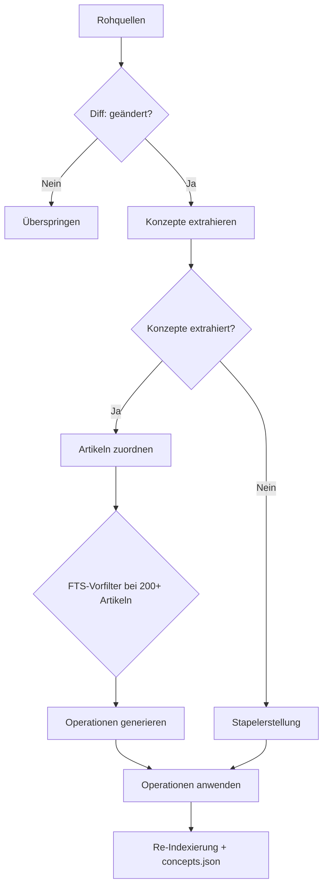

## Herkunftsnachverfolgung

Lore verfolgt, welche Quellen zu welchen Zeilen jedes Artikels beigetragen haben. Zwei Mechanismen arbeiten zusammen:

### Inline-Herkunft

Jede Zeile kann einen inline-HTML-Kommentar tragen, der Quellen-Hashes und Konfidenz aufzeichnet:

```markdown
The authentication service uses JWT tokens. <!-- sources:abc123(extracted) def456(inferred) -->
```

Das Format ist `<!-- sources:HASH(CONFIDENCE) ... -->`. Konfidenz-Labels sind pro Operation:

| Label | Bedeutung |
|---|---|
| `extracted` | Direkt in Quelldokumenten angegeben |
| `inferred` | Angemessene LLM-Ableitung |

Wenn das LLM Artikeleinhalt für Zuordnung und Operationserstellung liest, werden inline-Herkunftskommentare entfernt. Das LLM sieht saubere, nummerierte Zeilen ohne Quellenanmerkungen.

### Kumulative Referenzen

Jeder Artikel enthält einen `## References`-Abschnitt am Ende, der alle jemals in diesen Artikel zusammengeführten Quellen-Hashes auflistet:

```markdown
## References
- abc123 (extracted)
- def456 (inferred)
- ghi789 (extracted)
```

Dieser Abschnitt wird vom System automatisch verwaltet. Wenn das LLM Operationen generiert, werden `## References` und `## Related`-Abschnitte aus seinem Kontextfenster ausgeblendet.

### Verwandter Abschnitt

Das System generiert automatisch einen `## Related`-Abschnitt aus `[[wiki-links]]`, die im Artikelkörper gefunden werden. Links werden dedupliziert und sortiert.

## Operationsmodell

Das LLM gibt ein JSON-Array zeilenweiser Operationen aus. Jede Operation zielt auf bestimmte Zeilen in zugeordneten Artikeln ab und enthält ein `sources`-Feld zur Herkunftsnachverfolgung.

| Operation | Beschreibung |
|---|---|
| `replace` | Inhalt einer einzelnen Zeile ersetzen |
| `insert-after` | Eine neue Zeile nach einer Zielzeile einfügen |
| `delete-range` | Einen Zeilenbereich entfernen (Anfang bis Ende, inklusiv) |
| `replace-range` | Einen Zeilenbereich mit neuem Inhalt ersetzen |
| `split` | Einen Artikel in zwei aufteilen: Teil am aktuellen Slug beibehalten, Rest in neuen Slug verschieben |
| `append-source` | Einen Quellen-Hash zu vorhandenen Zeilen hinzufügen, ohne Inhalt zu ändern (nur Konfidenz-Aktualisierung) |
| `soft-delete` | Einen Artikel als veraltet markieren (umbenannt von seinem Slug) |

### Operationsformat

```json
[
  {
    "op": "replace",
    "line": "¶2",
    "content": "Updated content for line 2.",
    "sources": ["abc123(extracted)"],
    "confidence": "extracted"
  },
  {
    "op": "insert-after",
    "line": "¶3",
    "content": "New insight from source.",
    "sources": ["abc123(extracted)"],
    "confidence": "extracted"
  },
  {
    "op": "delete-range",
    "start": "¶5",
    "end": "¶7"
  }
]
```

Zeilenreferenzen verwenden das `¶` (Pilcrow)-Symbol, um sie von YAML-Frontmatter-Zeilennummern zu unterscheiden. Das LLM sieht Artikel mit pilcrow-präfigierten Zeilennummern im Kontext.

### Multi-Artikel-Bearbeitung

Eine einzige Quelle kann Operationen generieren, die mehrere vorhandene Artikel betreffen. Das System wendet Operationen sequenziell pro Quelle an und aktualisiert die Artikelliste nach den Bearbeitungen jeder Quelle, um Aufteilungen und neue Artikel zu behandeln.

### Soft Delete

Wenn ein Artikel nicht mehr relevant ist, gibt das LLM eine `soft-delete`-Operation aus. Der Artikel wird in einen `.deprecated-{slug}-{timestamp}.md`-Pfad unter `.lore/wiki/deprecated/` umbenannt. Er verschwindet aus der Suche und dem Link-Graphen, aber die Datei wird für Audit-Zwecke aufbewahrt.

## Hash-basierte inkrementelle Kompilierung

Lore verfolgt ein `extractedHash` pro Roh-Eintrag in `.lore/manifest.json`.

- Standardverhalten: kompiliert nur Einträge, deren extrahierter Inhalt geändert wurde.
- Erste Ausführung nach Upgrade: zuvor kompilierte Einträge ohne `extractedHash` werden einmal neu kompiliert und dann aktualisiert.
- `--force`: umgeht Hash-Prüfungen und kompiliert alle gültigen Roh-Einträge neu.

## Concepts-Only-Modus

```bash
lore compile --concepts-only
```

Füllt Herkunft für Artikel nach, die vor der Einführung der Herkunftsnachverfolgung kompiliert wurden. Es:

1. Liest jeden Artikel unter `.lore/wiki/articles/`.
2. Für Artikel ohne inline `<!-- sources:`-Kommentare wendet es Nachfüll-Logik an (gesamter Körper mit generischen Quellen-Hashes markiert).
3. Erstellt `concepts.json` und den Suchindex neu.

Verwenden Sie dies einmal nach dem Upgrade von einer pre-Herkunft-Version von Lore. Es kompiliert Artikel nicht neu oder ändert den Artikeleinhalt über das Hinzufügen von Herkunftsmarkierungen hinaus.

## Stapel-Verhaltenswiederholung

Compile verarbeitet Quellen sequenziell (Zuordnung) und stapelweise (Erstellung). Wenn eine Antwort wiederholbar ist (abgeschnittene Ausgabe, ungültiges JSON, unparstbare Operationen), wiederholt Lore einmal.

| Bedingung | Verhalten |
|---|---|
| LLM-Antwort abgeschnitten | Einmal wiederholen |
| Ungültige JSON-Operationsausgabe | Einmal wiederholen |
| Wiederholung schlägt immer noch fehl | Quelle überspringen, Fehler protokollieren, Kompilierung fortsetzen |

Die Kompilierung bricht nicht bei individuellen Quellenfehlern ab. Ungültige Operationen werden protokolliert und die betroffene Quelle wird übersprungen.

## Compile-Lock und Parallelität

Lore schützt Compile mit `.lore/compile.lock`, um überlappende Ausführungen zu verhindern.

- Wenn ein anderes aktives Compile läuft, schlägt `lore compile` schnell mit einer umsetzbaren Fehlermeldung fehl.
- Veraltete oder fehlerhafte Lock-Inhalte werden automatisch zurückgewonnen.
- Wenn `autoCompile` in der Repo-Konfiguration aktiviert ist, lösen Ingest-Befehle automatisch Compile aus und respektieren dasselbe Lock.

Die Lock-Datei speichert eine Prozess-ID (PID). Wenn diese PID nicht mehr aktiv ist, entfernt Lore das veraltete Lock und versucht die Erneuerung.

## Index-Neuerstellung und Reparatur

Halten Sie nach Compile den Suche- und Graphenzustand frisch:

```bash
lore index
```

Wenn Roh-Einträge existieren, aber `manifest.json` abgewichen ist (z.B. nach teilweiser Kopie oder unterbrochenen Ausführungen):

```bash
lore index --repair
```

`--repair` rekonstruiert fehlende Manifest-Einträge aus `.lore/raw/` vor der Index-Neuerstellung.

## Konzeptmetadaten-Ausgabe

Nach erfolgreicher Kompilierung und Index-Neuerstellung schreibt Lore `.lore/wiki/concepts.json`:

- `updatedAt` — Zeitstempel
- `concepts[]` Einträge mit `slug`, `canonical`, `title`, `aliases`, `tags`, `confidence`

Die Alias-Generierung ist deterministisch und umfasst Slug-Aliase, Konjunktions-Swap-Varianten (`A and B` → `B and A`) und Akronyme für Titel mit 3+ Wörtern.

## Graph-Schutzmaßnahmen

Bei der Index-Neuerstellung filtert Lore Link-Ziele mit geringem Signal (z.B. `[[it]]`, `[[the]]`), um rauschhafte Graphkanten zu vermeiden.

- Vorteil: besseres `lore path`, sauberere Nachbarschaftsmengen, lint-Ausgabe mit höherem Signal.
- Kompromiss: bewusst generische Links werden verworfen, es sei denn, sie werden bedeutungsvollen Konzept-Token zugeordnet.

## Empfohlener Kompilierungs-Workflow

```bash
# aufnehmen und kompilieren
lore ingest ./docs
lore compile

# Index und Graph aktualisieren
lore index --repair

# Graph-Gesundheit inspizieren
lore lint
```

Nach Upgrade von einer älteren Version:

```bash
# Herkunft für vorhandene Artikel nachfüttern
lore compile --concepts-only
```

## Autokompilierung-Einstellung

Setzen Sie `autoCompile` in der Repo-Konfiguration, um nach jeder Aufnahme automatisch zu kompilieren:

```bash
lore settings set autoCompile true --scope repo
```

Wenn aktiviert:

- `lore ingest` führt Compile nach Abschluss der Aufnahme automatisch aus
- `lore ingest-sessions` führt Compile einmal aus, nachdem alle Sitzungen aufgenommen wurden
- Das MCP `ingest`-Tool kompiliert ebenfalls automatisch, wenn die Einstellung aktiv ist
- Das Compile-Lock verhindert überlappende Ausführungen — ein bereits laufendes Compile blockiert neue
- Deaktivieren mit `lore settings set autoCompile false --scope repo`

## Fehlerbehebung bei Compile-Ausführungen

| Symptom | Wahrscheinliche Ursache | Lösung |
|---|---|---|
| Häufige Wiederholungen | Fehlformatierte LLM-Ausgabe oder übergroßer Kontext | Lassen Sie die Wiederholung ablaufen; stimmen Sie Modell/maxTokens bei andauerndem Problem ab |
| Lock-Fehler in Automatisierung | Ein anderer Compile-Prozess aktiv | Serialisieren Sie Compile-Jobs und versuchen Sie es später erneut |
| Keine neuen Artikel geschrieben | Inkrementeller Hash überspringt unveränderte Einträge | Verwenden Sie `lore compile --force` |
| Index erscheint nach Fehlern veraltet | Compile vor Index-Neuerstellung unterbrochen | Führen Sie `lore index --repair` manuell aus |
| Quellen mit null Konzepten übersprungen | LLM konnte keine Konzepte aus Inhalt extrahieren | Inhalt muss möglicherweise manuell überprüft werden; mit reicherem Quellmaterial neu aufnehmen |
| Alte Artikel ohne Herkunft | Artikel vor Einführung der Herkunft kompiliert | Führen Sie `lore compile --concepts-only` aus |

## Verwandte Dokumente

- [Schnellstart](../getting-started/quickstart.md)
- [Linting und Gesundheit](./linting-and-health.md)
- [Fehlerbehebung](./troubleshooting.md)
- [CLI-Referenz](../reference/cli-reference.md)
- [Architektur](../technical/architecture.md)
- [LLM-Pipeline](../technical/llm-pipeline.md)


================================================
FILE: docs-site/i18n/de/docusaurus-plugin-content-docs/current/guides/configuration.md
================================================
---
sidebar_position: 1
---

# Konfiguration

Lore hat zwei Konfigurationsbereiche mit expliziter Laufzeitpräzedenz.

## Konfigurationsbereiche

- **Globale Konfiguration** (`~/.config/lore/config.json`) — nicht-geheime globale Werte (z.B. Cloudflare-Konto-ID)
- **Globale Secrets** (OS-Schlüsselbund) — OpenRouter-, Replicate- und Cloudflare-Token
- **Repo-spezifische Konfiguration** (`.lore/config.json`) — Modell, Temperatur, optionales maxTokens, Exportpräferenzen

Verwenden Sie den globalen Bereich für Anmeldedaten und kontoumweite Einstellungen. Verwenden Sie den Repo-Bereich für Modell/Laufzeit-Verhalten pro Projekt.

## Repo-spezifische Einstellungen

```json
{
  "model": "deepseek/deepseek-v4-pro",
  "temperature": 0.3,
  "maxTokens": 4096,
  "webExporter": "starlight"
}
```

Gültige Werte:

| Schlüssel | Typ | Hinweise |
|---|---|---|
| `model` | string | OpenRouter-Modellkennung |
| `temperature` | number (`0` bis `2`) | Kreativitäts/Zufallssteuerung |
| `maxTokens` | positive Ganzzahl (optional) | Wenn nicht gesetzt, lässt Lore `max_tokens` weg |
| `webExporter` | `starlight` oder `vitepress` (optional) | Export-Ziel-Präferenz |

`maxTokens` ist optional. Wenn weggelassen, sendet Lore kein `max_tokens` und verwendet den Modell/Anbieter-Standard-Vervollständigungslimit.

## Laufzeitpräzedenz

Lore löst Werte in dieser Reihenfolge auf:

1. Umgebungsvariablen
2. Sicher gespeicherte Secrets (Schlüsselbund)
3. Nicht-geime Konfigurationsdateien

Beispiele für effektive Präzedenz:

- `TELEPAT_OPENROUTER_KEY` überschreibt gespeicherten OpenRouter-Secret
- `TELEPAT_REPLICATE_TOKEN` (oder Legacy `TELEPAT_REPLICATE_TOKEN`) überschreibt gespeicherten Replicate-Secret
- `LORE_CF_TOKEN` überschreibt gespeicherten Cloudflare-Token
- `LORE_CF_ACCOUNT_ID` überschreibt globale Konfiguration Cloudflare-Konto-ID

## Interaktiver Editor

```bash
lore settings
```

In Nicht-TTY-Umgebungen gibt Lore aktuelle Werte und eine Erinnerung zur Verwendung von Unterbefehlen aus.

## Nicht-interaktive Einstellungen

### Auflisten und inspizieren

```bash
# effektive Einstellungen auflisten (Secrets geschwärzt)
lore settings list --scope all

# einen Repo-Schlüssel lesen
lore settings get model --scope repo

# einen globalen Schlüssel lesen
lore settings get cloudflareAccountId --scope global
```

### Einstellungen schreiben

```bash
# globale Werte schreiben
lore settings set openrouterApiKey <value> --scope global
lore settings set cloudflareAccountId <value> --scope global

# Repo-Werte schreiben
lore settings set model deepseek/deepseek-v4-pro --scope repo
lore settings set temperature 0.3 --scope repo
lore settings set maxTokens 4096 --scope repo
lore settings set webExporter starlight --scope repo
```

### Einstellungen entfernen

```bash
# globale Werte entfernen
lore settings unset openrouterApiKey --scope global
lore settings unset cloudflareToken --scope global

# optionale Repo-Werte entfernen
lore settings unset maxTokens --scope repo

# alternative maxTokens-Entfernungssyntax via set
lore settings set maxTokens - --scope repo
```

## Team-Profile

### Stabiles Produktionsprofil

```json
{
  "model": "openai/gpt-4o",
  "temperature": 0.2,
  "maxTokens": 4096,
  "webExporter": "starlight"
}
```

### Erkundungsprofil

```json
{
  "model": "deepseek/deepseek-v4-pro",
  "temperature": 0.5
}
```

## Fehlerbehebung

| Symptom | Wahrscheinliche Ursache | Lösung |
|---|---|---|
| `Unknown key for scope` | Schlüssel gehört nicht zum bereitgestellten Bereich | Verwenden Sie globale Schlüssel für Anmeldedaten, Repo-Schlüssel für Modell/Laufzeit |
| `temperature must be a number` | Nicht-numerischer Wert bereitgestellt | Verwenden Sie eine numerische Temperatur zwischen `0` und `2` |
| `maxTokens must be an integer` | Nicht-ganzzahliger Wert bereitgestellt | Verwenden Sie eine positive Ganzzahl oder entfernen Sie sie |
| Secret-Set schlägt fehl in CI/Container | Keychain nicht verfügbar oder deaktiviert | Verwenden Sie ENV-Variablen und/oder setzen Sie `TELEPAT_DISABLE_KEYTAR=true` |

## Verwandte Dokumente

- [Anmeldedaten und Secrets](./credentials-and-secrets.md)
- [LLM-Modelle](../reference/llm-models.md)
- [CLI-Referenz](../reference/cli-reference.md)


================================================
FILE: docs-site/i18n/de/docusaurus-plugin-content-docs/current/guides/credentials-and-secrets.md
================================================
---
sidebar_position: 2
---

# Anmeldedaten und Secrets

API-Schlüssel werden global gespeichert (nicht pro Repo), um versehentliche Git-Commits zu vermeiden.

Standardmäßig speichert Lore Secrets in der sicheren OS-Speicherung (z.B. macOS Keychain).

## Secret-Speichermodell

Lore speichert Secret-Werte in keychain-gestützter Speicherung und schreibt keine Klartext-Secret-Dateien.

- Gespeicherte Secret-Schlüssel: `openrouterApiKey`, `replicateApiToken`, `cloudflareToken`
- Gespeicherter nicht-geheimer globaler Schlüssel: `cloudflareAccountId`
- Repo-Konfiguration enthält Modell/Laufzeit-Einstellungen, keine Secret-Tokens

## Erforderlich

- **OpenRouter-API-Schlüssel** — für Kern-LLM-Operationen (Kompilierung, Abfrage, Erklärung und Entscheidungserfassung)

## Optional

- **Replicate-API-Schlüssel** — für PDF/DOCX-Parsing (marker) und Bild-OCR (vision)
- **Cloudflare-Anmeldedaten** — für Browser-Rendering-URL-Abruf (Alternative zu Jina)

## Laufzeit-Auflösungsreihenfolge

1. Umgebungsvariablen
2. Schlüsselbund-Secrets
3. Nicht-geime Konfigurationswerte

Praktische Auswirkungen:

- Umgebungswerte können gespeicherte Anmeldedaten vorübergehend für CI-Jobs überschreiben
- Wenn der Schlüsselbund nicht verfügbar ist, geben Lesevorgänge keine Secret-Werte zurück und Schreibvorgänge schlagen mit Anleitung zur Verwendung von ENV-Variablen fehl

## Schlüssel setzen

```bash
lore settings
```

Oder verwenden Sie nicht-interaktive Befehle:

```bash
lore settings set openrouterApiKey <value> --scope global
lore settings set replicateApiToken <value> --scope global
lore settings set cloudflareToken <value> --scope global
lore settings set cloudflareAccountId <value> --scope global
```

Entfernungsbeispiele:

```bash
lore settings unset openrouterApiKey --scope global
lore settings unset replicateApiToken --scope global
lore settings unset cloudflareToken --scope global
lore settings unset cloudflareAccountId --scope global
```

Umgebungsvariablen werden ebenfalls unterstützt:

- `TELEPAT_OPENROUTER_KEY`
- `TELEPAT_REPLICATE_TOKEN` (Legacy-Alias unterstützt: `TELEPAT_REPLICATE_TOKEN`)
- `LORE_CF_ACCOUNT_ID`
- `LORE_CF_TOKEN`
- `TELEPAT_DISABLE_KEYTAR` (auf `true` setzen, um Schlüsselbundzugriff zu deaktivieren)

## CI- und Container-Muster

Für nicht-interaktive Umgebungen bevorzugen Sie ENV-Variablen:

```bash
export TELEPAT_OPENROUTER_KEY="..."
export TELEPAT_REPLICATE_TOKEN="..."
export LORE_CF_ACCOUNT_ID="..."
export LORE_CF_TOKEN="..."
export TELEPAT_DISABLE_KEYTAR=true
```

Dies vermeidet Schlüsselbund-Abhängigkeiten in flüchtigen Umgebungen.

## Cloudflare vs. Jina URL-Parsing

- Wenn `LORE_CF_ACCOUNT_ID` und `LORE_CF_TOKEN` gesetzt sind, versucht Lore zuerst Cloudflare Browser Rendering
- Bei Cloudflare-Fehler fällt Lore automatisch auf Jina zurück
- Ohne Cloudflare-Anmeldedaten verwendet Lore direkt Jina

## Fehlerbehebung

| Symptom | Wahrscheinliche Ursache | Lösung |
|---|---|---|
| `No OpenRouter API key configured` | Kein Schlüssel in ENV oder Schlüsselbund | Setzen Sie `TELEPAT_OPENROUTER_KEY` oder führen Sie den Settings-Befehl aus |
| Secret-Schreiben schlägt fehl mit Schlüsselbundfehler | Schlüsselbund in Umgebung nicht verfügbar | Setzen Sie ENV-Variablen und `TELEPAT_DISABLE_KEYTAR=true` |
| Replicate-Parser schlägt fehl bei Dokument/Bild-Aufnahme | `TELEPAT_REPLICATE_TOKEN` fehlt | Setzen Sie Replicate-Token global oder via ENV-Variable |
| Cloudflare-URL-Abruf nicht verwendet | Cloudflare-Konto-ID oder Token fehlt | Setzen Sie beides `LORE_CF_ACCOUNT_ID` und `LORE_CF_TOKEN` |

Wenn der Schlüsselbundzugriff deaktiviert oder nicht verfügbar ist, fällt Lore nicht auf Klartext-Secret-Dateien zurück und benötigt ENV-Variablen für Secret-Werte.

## Verwandte Dokumente

- [Konfiguration](./configuration.md)
- [Unterstützte Formate](../reference/supported-formats.md)
- [Umgebungsvariablen](../reference/environment-variables.md)


================================================
FILE: docs-site/i18n/de/docusaurus-plugin-content-docs/current/guides/explain-command.md
================================================
---
sidebar_position: 12
---

# Explain-Befehl

```bash
lore explain "<concept>" [--json]
```

`lore explain` bietet eine tiefgehende Konzeptdurchführung, indem der Haupt-Zugeordnete Artikel mit nahegelegenen Graph-Nachbarn kombiniert wird.

## Query vs. Explain

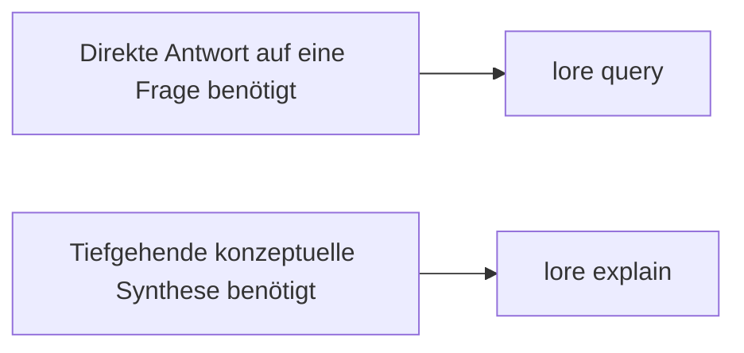

| Befehl | Am besten für | Ausgabeform |
|---|---|---|
| `lore query` | Direkte Fragenbeantwortung | Antworttext plus Quellen-Slugs |
| `lore explain` | Konzept-Tiefgänge | Langform-Erklärung plus verwandte Quellen-Slugs |

## So wählt Explain Kontext aus

1. Versucht exakten Slug-Match für das Konzept
2. Fällt auf FTS-Match zurück, wenn exakter Slug fehlt
3. Lädt Nachbarartikel aus Graph-Links
4. Synthetisiert eine detaillierte Erklärung aus kombiniertem Kontext

## Beispiele

```bash
# menschenlesbarer Tiefgang
lore explain "Compile Lock"

# skriptfreundlich
lore explain "MCP Server" --json
```

Beispiel JSON-Antwort:

```json
{
  "explanation": "...long-form explanation...",
  "sources": ["compile-lock", "watch-mode", "index-repair"]
}
```

## Integrations-Anwendungsfälle

- Onboarding-Tiefgänge für neue Ingenieure
- Architektur-Review-Vorbereitung vor Designbesprechungen
- Agent-Workflows, die breiten konzeptuellen Kontext statt einmaliger Antworten benötigen

## Fehlerbehebung

| Symptom | Wahrscheinliche Ursache | Lösung |
|---|---|---|
| `No article found for <concept>` | Konzept ist noch nicht indexiert | Führen Sie `lore compile` aus, dann mit präzisem Konzeptnamen erneut versuchen |
| Erklärung zu flach | Nachbarschaftskontext spärlich | Wiki-Links verbessern und compile/index erneut ausführen |
| Quellen scheinen nicht verwandt | FTS-Fallback hat breiten Begriff zugeordnet | Verwenden Sie einen spezifischeren Konzeptnamen |

## Verwandte Dokumente

- [Suchen und Abfragen](./searching-and-querying.md)
- [Ihr Wiki kompilieren](./compiling-your-wiki.md)
- [Fehlerbehebung](./troubleshooting.md)
- [CLI-Referenz](../reference/cli-reference.md)


================================================
FILE: docs-site/i18n/de/docusaurus-plugin-content-docs/current/guides/exporting.md
================================================
---
sidebar_position: 6
---

# Exportieren

```bash
lore export <format> [--out <dir>] [--json]
```

Verwenden Sie Exporte, wenn Sie Ihr Wiki außerhalb von Lore teilen oder analysieren möchten.

- Standard-Ausgabeverzeichnis: `.lore/exports`
- Benutzerdefiniertes Ausgabeverzeichnis: `--out <dir>`
- Maschinenlesbare Ausgabe: `--json` gibt `format`, `outputPath` und `bytesWritten` zurück

## Export-Entscheidungsflow

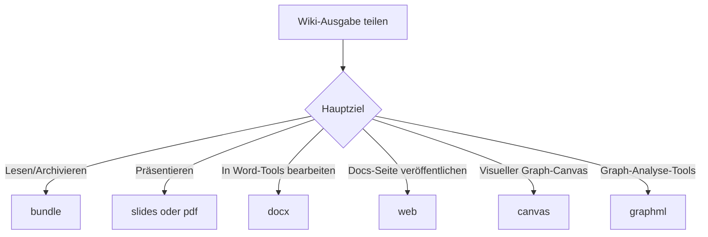

## Formate

| Format | Ausgabe | Am besten für | Hinweise |
|---|---|---|---|
| `bundle` | `bundle.md` | Archivierung, Offline-Lesen, schnelles Teilen | Verkettet Index + alle Artikel-Markdown |
| `slides` | `slides.md` | Präsentationen mit Marp | Teilt Inhalt in Abschnitte und Folienumbrüche |
| `pdf` | `wiki.pdf` | Stakeholder-Review und Schnappschüsse | Verwendet einen grundlegenden HTML-Renderer über Puppeteer |
| `docx` | `wiki.docx` | Bearbeitung in Word-ähnlichen Tools | Konvertiert Markdown-Überschriften/Aufzählungen/Absätze |
| `web` | `web/` Projekt | Veröffentlichen einer durchsuchbaren Wiki-Seite | Erstellt Astro + Starlight-Projekt |
| `canvas` | `wiki.canvas` | Knoten-Link-Visualisierung | JSON Canvas 1.0 mit Rasterlayout-Knoten |
| `graphml` | `wiki.graphml` | Gephi/yEd und Graph-Analyse | Gerichteter Graph aus Wiki-Backlinks |

## Häufige Nutzung

```bash
# Standard-Ausgabe: .lore/exports
lore export bundle

# benutzerdefiniertes Ausgabeverzeichnis
lore export web --out ./artifacts/wiki-web

# skriptfreundliche Antwort
lore export graphml --json
```

Beispiel JSON-Antwort:

```json
{
	"format": "graphml",
	"outputPath": "/repo/.lore/exports/wiki.graphml",
	"bytesWritten": 84211
}
```

## Format-Durchgänge

### `bundle`

```bash
lore export bundle
```

Erstellt ein Markdown-Dokument mit Ihrem Index gefolgt von allen Artikeln, getrennt durch `---`-Trennzeichen.

Anwendungsfälle:

- Einzeldatei-Review in Editoren
- Langform-Archivschnappschüsse
- Eingabe für externe Markdown-Pipelines

### `slides`

```bash
lore export slides --out ./presentation
```

Generiert Marp-kompatibles Markdown mit Frontmatter und aktivierter Paginierung.

Anwendungsfälle:

- Interne Architektur-Briefings
- Wissensübertragungssitzungen
- Release-Demo-Decks

### `pdf`

```bash
lore export pdf
```

Erstellt ein PDF durch Konvertierung des Markdown-Bundles über eine leichtgewichtige HTML-Vorlage und Rendering mit Puppeteer.

Anwendungsfälle:

- Druckfähige Dokumente
- Statische Übergabeartefakte
- Compliance-Schnappschüsse

### `docx`

```bash
lore export docx
```

Konvertiert Wiki-Artikel in eine DOCX-Datei mit zugeordneten Überschriften und Aufzählungslisten.

Anwendungsfälle:

- Gemeinsame Bearbeitung in Office-Suiten
- Formale Review-Workflows
- Redaktionelle Bereinigungsläufe

### `web`

```bash
lore export web
cd .lore/exports/web
npm install
npm run dev
```

Erstellt eine Astro Starlight-Seite und kopiert Ihre Wiki-Seiten in `src/content/docs`.

Anwendungsfälle:

- Interne Docs-Hosting
- Temporäre Vorschauseiten
- Team-Onboarding-Portale

### `canvas`

```bash
lore export canvas
```

Generiert JSON-Canvas-Ausgabe mit Artikelknoten und Backlink-Kanten.

Anwendungsfälle:

- Visuelle Karte von Konzeptbeziehungen
- Planungssitzungen in Canvas-Tools
- Graphorientierte Inhaltsaudits

### `graphml`

```bash
lore export graphml
```

Exportiert einen GraphML-Graphen aus Ihren Artikel/Link-Tabellen für Tools wie Gephi und yEd.

Anwendungsfälle:

- Zentralitäts/Community-Analyse
- Graph-Debugging
- Externe Data-Science-Workflows

## End-to-End-Beispiel

```bash
# 1) Wiki-Zustand aktualisieren
lore ingest ./docs
lore compile

# 2) mehrere Lieferobjekte erstellen
lore export bundle --out ./dist/lore
lore export pdf --out ./dist/lore
lore export web --out ./dist/lore

# 3) generierte Artefakte inspizieren
ls -la ./dist/lore
```

## Fehlerbehebung

| Symptom | Wahrscheinliche Ursache | Lösung |
|---|---|---|
| Export schlägt fehl mit fehlendem Artikelverzeichnis | Wiki wurde noch nicht kompiliert | Führen Sie zuerst `lore compile` aus |
| `pdf`-Export schlägt fehl | Browser-Abhängigkeitsproblem mit Puppeteer | Installieren Sie Abhängigkeiten neu und versuchen Sie `lore export pdf` erneut |
| `web`-Export erstellte Projekt, aber Seite startet nicht | Abhängigkeiten im exportierten Projekt nicht installiert | Führen Sie `npm install` im exportierten `web`-Ordner aus |
| Ausgabe zu groß zum Teilen | Vollständiges Wiki ist groß | Verwenden Sie `bundle` für reinen Text oder segmentieren Sie den Inhalt vor dem Export |

## Verwandte Dokumente

- [Ihr Wiki kompilieren](./compiling-your-wiki.md)
- [Suchen und Abfragen](./searching-and-querying.md)
- [CLI-Referenz](../reference/cli-reference.md)


================================================
FILE: docs-site/i18n/de/docusaurus-plugin-content-docs/current/guides/ingesting-content.md
================================================
---
sidebar_position: 3
---

# Inhalte aufnehmen

```bash
lore ingest <path|url>
```

```bash
lore ingest-sessions [framework|all]
```

## Unterstützte Formate

| Format | Methode |
|---|---|
| `.md`, `.txt` | Direkt |
| `.html` | rehype-parse |
| `.json`, `.jsonl` | JSON-Parser (normalisierte unterstützte Chat-Exports automatisch) |
| `.pdf`, `.docx`, `.pptx`, `.xlsx`, `.epub` | Replicate marker |
| Bilder (`.png`, `.jpg`, `.jpeg`, `.webp`, `.gif`, `.bmp`) | Replicate vision |
| URLs (Webseiten) | Cloudflare BR `/markdown`-Endpunkt oder Jina r.jina.ai |
| URLs (Dokumente: `.pdf`, `.docx`, `.pptx`, `.xlsx`, `.epub`) | Temporärer Download → Replicate Marker |
| URLs (Bilder: `.png`, `.jpg`, `.jpeg`, `.webp`, `.gif`, `.bmp`) | Temporärer Download → Replicate Vision |
| Video-URLs | yt-dlp-Untertitel |

Alle aufgenommenen Inhalte werden in `.lore/raw/<sha256>/` mit `extracted.md` und `meta.json` gespeichert.

## Framework-Sitzungs-Aufnahme

Verwenden Sie `lore ingest-sessions`, um den Sitzungsverlauf aus dem lokalen Framework-Speicher zu ziehen.

Unterstützte Framework-Werte:

- `claude-code`
- `codex-cli`
- `copilot-cli`
- `copilot-chat`
- `cursor`
- `gemini-cli`
- `obsidian`
- `all` (Standard)

Beispiele:

```bash
# alle unterstützten Framework-Sitzungsspeicher aufnehmen
lore ingest-sessions all

# nur Claude Code-Sitzungen aufnehmen
lore ingest-sessions claude-code

# nur Discovery ausführen, keine Ingest-Schreibvorgänge
lore ingest-sessions all --dry-run --json

# Standard-Roots überschreiben und Scan-Größe begrenzen
lore ingest-sessions copilot-chat --root ~/Library/Application\ Support/Code/User/workspaceStorage --max-files 200
```

Flags:

- `--root <path...>`: optionaler Root-Pfad zum Scannen statt Standardwerte
- `--max-files <n>`: max. entdeckte Dateien pro Framework (Standard `500`)
- `--dry-run`: nur entdecken, nicht aufnehmen
- `json`: maschinenlesbare Zusammenfassung mit `runId`/`logPath`

## Aufnahme-Flow

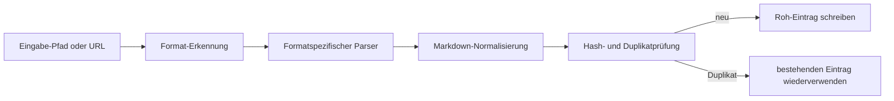

## Roh-Eintrag-Struktur

Jeder Roh-Eintrag wird gespeichert unter:

```text
.lore/raw/<sha256>/
	extracted.md
	meta.json
	original.<ext> (oder original.txt für URLs)
```

Beispiel `meta.json`:

```json
{
	"sha256": "<sha256>",
	"format": "json",
	"title": "Conversation Transcript",
	"sourcePath": "/abs/path/to/file.json",
	"date": "2026-04-09T00:00:00.000Z",
	"tags": ["docs", "frontend", "decision"]
}
```

## Ordnerbasierte Themen-Tags

Für lokale Datei-Aufnahme leitet Lore eine kleine Menge Themen-Tags aus Verzeichnisnamen ab und schreibt sie in `meta.json.tags`.

- Beispiele zugeordneter Kategorien sind `frontend`, `backend`, `docs`, `testing`, `tooling`, `infra`, `data`, `mobile` und `design`.
- URL-Aufnahme leitet keine Ordner-Tags ab und behält `tags: []`.
- Tags sind bewusst begrenzt und dedupliziert, sodass Metadaten präzise bleiben.

Lore wendet während der Aufnahme auch leichte Inhaltsheuristiken an und kann semantische Tags wie `decision`, `preference`, `problem`, `milestone` und `emotional` anhängen, wenn übereinstimmende Phrasen erkannt werden.

## Duplikatbewusste Aufnahme

Lore berechnet einen SHA-256-Digest aus der ursprünglichen Eingabe und wiederverwendet vorhandene Roh-Einträge, wenn der Digest bereits existiert.

- Duplikat-Treffer-Verhalten:
	- Parsen/Extrahieren wird übersprungen
	- vorhandene Metadaten werden wiederverwendet
	- manifest-mtime wird aktualisiert
- JSON-Ausgabe enthält `duplicate: true` bei Duplikat-Treffern.

Beispiel:

```bash
lore ingest ./docs/architecture.md --json
```

Mögliche Ausgabefelder:

```json
{
	"sha256": "...",
	"format": "md",
	"title": "Architecture",
	"duplicate": true
}
```

## So funktioniert die Konversations-Export-Aufnahme (`.json` / `.jsonl`)

1. Lore versucht zuerst, bekannte Konversations-Schemas zu erkennen.
2. Wenn ein unterstütztes Schema erkannt wird, schreibt Lore den Inhalt in Transkript-Markdown um:
	- Benutzerzüge werden mit `>` präfigiert
	- Assistentenzüge werden als Antwortblöcke beibehalten
3. Die aktuelle automatische Erkennung zielt auf gängige Exports wie role/content-Arrays, ChatGPT-Mapping-Exports und Codex/Claude-ähnliche JSONL-Logs ab.
4. Wenn kein bekanntes Schema erkannt wird, fällt Lore auf generische JSON-zu-Markdown-Umwandlung zurück.

Unterstützte Konversations-Schema-Familien umfassen:

- role/content-Arrays (`[{"role":"user"...}]`)
- ChatGPT-Mapping-Exports
- Claude/Codex JSONL-Sitzungslogs
- Slack-ähnliche Nachrichten-Arrays

## So funktioniert die PDF-Aufnahme

1. Lore erkennt eine Dokument-Erweiterung wie `.pdf` oder `.docx`.
2. Die Datei wird an Replicate Marker (`cuuupid/marker`) zur Markdown-Extraktion gesendet.
3. Das normalisierte Markdown wird in `.lore/raw/<sha256>/extracted.md` geschrieben.
4. Metadaten und Quellenverfolgung werden in `.lore/raw/<sha256>/meta.json` geschrieben.

## So funktioniert die Webdokument- und Bild-URL-Aufnahme

Lore erkennt die Dateierweiterung im URL-Pfad, um zwischen Webseiten, Dokumenten und Bildern zu unterscheiden.

Für **Dokument-URLs** (endend auf `.pdf`, `.docx`, `.pptx`, `.xlsx`, `.epub`):

1. Lore lädt die Datei in ein temporäres Verzeichnis herunter.
2. Sendet sie durch Replicate Marker — denselben Parser, der für lokale Dokumente verwendet wird.
3. Räumt die temporäre Datei auf, sobald die Extraktion abgeschlossen ist.
4. Speichert das Ergebnis in derselben Roh-Pipeline (`extracted.md` + `meta.json`).

Für **Bild-URLs** (endend auf `.png`, `.jpg`, `.jpeg`, `.webp`, `.gif`, `.bmp`):

1. Lore lädt das Bild in ein temporäres Verzeichnis herunter.
2. Sendet es durch Replicate Vision — denselben Parser, der für lokale Bilder verwendet wird.
3. Räumt die temporäre Datei auf, sobald die Extraktion abgeschlossen ist.
4. Speichert das Ergebnis in derselben Roh-Pipeline.

Für **alle anderen URLs** (Webseiten, HTML, APIs usw.):

1. Ruft Lore den Cloudflare Browser Run `/markdown`-Endpunkt auf, wenn `LORE_CF_ACCOUNT_ID` und `LORE_CF_TOKEN` konfiguriert sind — dies gibt JavaScript-gerendertes Markdown direkt zurück. Standardmäßig wartet Lore auf `networkidle2` (≤2 offene Verbindungen), bevor die Seite erfasst wird. Überschreiben Sie mit `--cf-wait-until networkidle0` für Seiten, die persistente Verbindungen öffnen.
2. Bei Cloudflare-Fehler oder fehlenden Anmeldedaten fällt Lore auf Jina `r.jina.ai` zurück.

> **Anforderungen**: Dokument/Bild-URL-Aufnahme erfordert dieselben Anmeldedaten wie die lokale Dokument/Bild-Aufnahme — ein `TELEPAT_REPLICATE_TOKEN`. Webseiten-Aufnahme erfordert `LORE_CF_ACCOUNT_ID` + `LORE_CF_TOKEN` für Cloudflare (Jina ist die anmeldefreie Alternative).

## So funktioniert die YouTube/Video-Aufnahme

1. Erkennt Lore bekannte Video-Hosts (z.B. YouTube, Vimeo, Twitch).
2. Es versucht die Untertitelextraktion mit `yt-dlp`.
3. Untertitel werden aus VTT in Klartext-Transkript bereinigt.
4. Transkript-Ausgabe wird in derselben Roh-Pipeline gespeichert (`extracted.md` + `meta.json`).
5. Wenn `yt-dlp` nicht verfügbar ist oder Untertitel fehlen, fällt Lore auf URL-Aufnahme-Aufnahme zurück.

Extraktor-Herkunft:

- `meta.json` für Video-Aufnahmen enthält ein `extractor`-Feld.
- `extractor: yt-dlp` zeigt an, dass die Untertitelextraktion erfolgreich war.
- Fallback-Werte umfassen `url-fallback-no-ytdlp`, `url-fallback-no-subs` und `url-fallback-empty-transcript`.

## Verwandte Referenzen

- [Unterstützte Formate](../reference/supported-formats.md)
- [LLM-Modelle](../reference/llm-models.md)
- [Anmeldedaten und Secrets](./credentials-and-secrets.md)

## Fehlerbehebung

- JSON wurde nicht zu Transkript normalisiert:
	- stellen Sie sicher, dass die Datei gültiges JSON/JSONL ist
	- prüfen Sie, ob Datensätze sowohl user/assistant-artige Züge enthalten
	- wenn das Schema unbekannt ist, fällt Lore bewusst auf generisches JSON-Markdown zurück
- Unerwartete Tags:
	- Ordner-Tags sind pfadabgeleitet und begrenzt
	- Heuristische Tags sind phrasengetrieben und konservativ
- URL-Aufnahme-Pfad:
	- URLs, die auf Dokument- oder Bild-Erweiterungen enden (`.pdf`, `.docx`, `.png` usw.), lösen temporären Download und lokalen Parser-Routing aus — identisch mit lokaler Datei-Aufnahme
	- für Webseiten-URLs mit `LORE_CF_ACCOUNT_ID` + `LORE_CF_TOKEN` ruft Lore den Cloudflare Browser Run `/markdown`-Endpunkt direkt auf
	- bei CF-Fehler oder fehlenden Anmeldedaten fällt Lore automatisch auf Jina-Abruf zurück


================================================
FILE: docs-site/i18n/de/docusaurus-plugin-content-docs/current/guides/linting-and-health.md
================================================
---
sidebar_position: 7
---

# Linting und Gesundheit

```bash
lore lint [--json]
```

Führt Gesundheitsprüfungen am Wiki durch:

- **Waisen** — Artikel ohne eingehende Links
- **Lücken** — Konzepte, die in mehreren Artikeln erwähnt werden, aber keinen eigenen Artikel haben
- **Mehrdeutige** — Artikel mit `confidence: ambiguous` im Frontmatter
- **Vorgeschlagene Fragen** — Nachfolge-Aufforderungen, die aus Lücken/Waisen/Mehrdeutigkeit generiert werden
- **Diagnosen** — zeilenbewusste Diagnosen für umsetzbare Korrekturen

## Warum Lint wichtig ist

Lint verwandelt Wiki-Qualitätsprobleme in eine priorisierte, maschinenlesbare Wartungswarteschlange.

- erkennt defekte konzeptuelle Links früh
- enthüllt schwache Abdeckung und disconnectede Seiten
- hilft, nachfolgende Kompilierungs- und Inhaltsarbeit zu steuern

## Diagnosen (JSON)

`lore lint --json` enthält ein `diagnostics`-Array und bewahrt dabei Legacy-Zusammenfassungsarrays.

Diagnose-Form:

```json
{
	"rule": "broken-wikilink",
	"severity": "error",
	"file": ".lore/wiki/articles/example.md",
	"line": 12,
	"message": "Wiki link target missing-topic has no corresponding article."
}
```

Aktuelle Regeln:

- `broken-wikilink` (`error`)
- `orphaned-article` (`warning`)
- `ambiguous-confidence` (`warning`)
- `missing-summary` (`warning`)
- `short-page` (`warning`)

### Regelprioritätsmatrix

| Regel | Schweregrad | Typische Aktion |
|---|---|---|
| `broken-wikilink` | `error` | Fehlenden Zielartikel erstellen oder Link-Ziel korrigieren |
| `orphaned-article` | `warning` | Eingehende Links von verwandten Artikeln hinzufügen |
| `ambiguous-confidence` | `warning` | Behauptungen klären und Konfidenz bei Bedarf anpassen |
| `missing-summary` | `warning` | Frontmatter-Zusammenfassung hinzufügen |
| `short-page` | `warning` | Artikeleinhalt mit sinnvollem Kontext erweitern |

## Mensch-Modus-Ausgabe

Der Mensch-Modus druckt klassische Zusammenfassungszahlen und Diagnosezahlen:

- `Orphans: X, Gaps: Y, Ambiguous: Z`
- `Diagnostics: N (E errors, W warnings)`

## Empfohlener Wartungsloop

```bash
# 1) maschinenlesbare Gesundheitsergebnisse sammeln
lore lint --json > lint.json

# 2) harte Fehler zuerst priorisieren
# (defekte Wikilinks werden als Diagnosen mit severity=error ausgegeben)

# 3) nach Bearbeitungen neu kompilieren/neu indexieren
lore compile
lore index --repair

# 4) Gesundheit erneut prüfen
lore lint --json
```

## Empfohlener Remediations-Workflow

1. korrigieren Sie zuerst alle `broken-wikilink`-Diagnosen
2. lösen Sie hochwirksame Waisen (Kernarchitektur-Konzepte)
3. behandeln Sie mehrdeutige Seiten und fügen Sie Zusammenfassungen hinzu
4. führen Sie Compile/Index bei wesentlichen Inhaltsänderungen erneut aus
5. führen Sie Lint erneut aus, bis der Diagnosetrend sinkt

## Beispielbehebungsmuster

### Defekter Wikilink

- vorher: `[[compile-locking-system]]`
- nachher: `[[Compile Locking]]` oder den fehlenden Artikel erstellen

### Verwaister Artikel

- Backlinks von Elternteil/angrenzenden Konzepten hinzufügen
- sicherstellen, dass der Artikel in mindestens einer navigationsrelevanten Seite erscheint

### Fehlende Zusammenfassung

```yaml
summary: "Prevents overlapping compile runs and stale output writes."
```

## Lint in Automatisierung verwenden

```bash
lore lint --json > lint.json

# Fehler in CI-Skripten als Blocker behandeln
cat lint.json
```

Für MCP-basierte Wartungsloops verwenden Sie `lint_summary`, `list_orphans`, `list_gaps` und `list_ambiguous`.

## Verwandte Dokumente

- [Ihr Wiki kompilieren](./compiling-your-wiki.md)
- [Fehlerbehebung](./troubleshooting.md)
- [CLI-Referenz](../reference/cli-reference.md)
- [MCP-Server](./mcp-server.md)
- [Architektur](../technical/architecture.md)


================================================
FILE: docs-site/i18n/de/docusaurus-plugin-content-docs/current/guides/lore-angela.md
================================================
---
sidebar_position: 8
---

# Lore Angela

Angela erfasst Architektur-Entscheidungen aus aktuellen Git-Commits und schreibt sie als Wiki-Artikel.

Es ist dafür konzipiert, den Entscheidungskontext zu bewahren, der nach Zusammenführungen normalerweise verloren geht.

## So funktioniert Angela

1. Liest `git diff HEAD~1 HEAD`
2. Liest die aktuelle Commit-Nachricht
3. Sendet beides an Lores LLM-Pipeline mit einem entscheidungsschreibenden Prompt
4. Schreibt den generierten Artikel nach `.lore/wiki/articles/decisions/<slug>.md`

Angela erwartet mindestens zwei Commits im Verlauf und einen nicht-leeren Diff.

## Hook installieren

```bash
lore angela install
```

Dies schreibt `.git/hooks/post-commit` mit einem Aufruf von `lore angela run`.

Der Hook läuft mit Best-Effekt und blockiert Ihren Commit nicht, wenn die Erfassung fehlschlägt.

## Manuell ausführen

```bash
lore angela run
```

Führen Sie dies aus, wenn Sie Entscheidungserfassung nach Bedarf wünschen, z.B. nach Squash-Zusammenführungen oder gestaffelten Refactorings.

## Beispiel-Workflow

```bash
# normal committen
git commit -m "refactor: split query normalization from retrieval"

# Entscheidung sofort erfassen
lore angela run

# generierten Entscheidungseintrag inspizieren
ls .lore/wiki/articles/decisions
```

Typischer Ausgabeort:

```text
.lore/wiki/articles/decisions/refactor-split-query-normalization-from-retrieval.md
```

## Beispiel Entscheidungseintrag-Form

Angela fordert das Modell auf, Markdown mit YAML-Frontmatter und Wiki-Links auszugeben.

```md
---
title: "Split Query Normalization From Retrieval"
tags: [decisions]
sources: [commit]
updated: 2026-04-10T12:30:00Z
confidence: extracted
---

# Split Query Normalization From Retrieval

Moved typo cleanup into a dedicated step before FTS so retrieval behavior is easier to reason about.

## Related

- [[Query Pipeline]]
- [[FTS5]]
```

## Commit-Nachricht-Tipps

Die Angela-Qualität verbessert sich, wenn Commit-Nachrichten die Absicht klar ausdrücken.

- Bevorzugen: `refactor: separate lock acquisition from compile batching`
- Vermeiden: `misc fixes`
- Fügen Sie wenn möglich das Warum hinzu, nicht nur das Was

## Integrations-Anwendungsfälle

- Post-Commit-Architekturtagebuch in aktiven Repos
- Wöchentliche Überprüfung von `decisions/` für Onboarding und Retrospektiven
- Agent-unterstützte Synthese über `lore query` und `lore explain` über den Entscheidungsverlauf

## Fehlerbehebung

| Symptom | Wahrscheinliche Ursache | Lösung |
|---|---|---|
| `Failed to read git history` | Repo hat weniger als zwei Commits oder Git nicht verfügbar | Erstellen Sie einen weiteren Commit und führen Sie erneut aus |
| `No diff found between HEAD~1 and HEAD` | Die letzten zwei Commits haben keinen effektiven Inhaltsdiff | Führen Sie manuell nach einem inhaltlichen Commit aus |
| Hook installiert, aber keine neue Entscheidungsdatei erscheint | Hook-Ausführung unterdrückte Fehler | Führen Sie `lore angela run` manuell aus, um das Verhalten zu inspizieren |
| Entscheidungsartikelqualität ist schwach | Commit-Nachricht zu vage oder Diff ist rauschhaft | Verwenden Sie fokussierte Commit-Nachrichten und kleinere logische Commits |

## Verwandte Dokumente

- [Ihr Wiki kompilieren](./compiling-your-wiki.md)
- [Explain-Befehl](./explain-command.md)
- [Suchen und Abfragen](./searching-and-querying.md)


================================================
FILE: docs-site/i18n/de/docusaurus-plugin-content-docs/current/guides/mcp-server.md
================================================
---
sidebar_position: 9
---

# MCP-Server

```bash
lore mcp
```

Startet einen MCP-Server auf stdio für Agent-Zugriff. Kompatibel mit Claude Code, Cursor und anderen MCP-Clients.

## Wann MCP verwenden

Verwenden Sie MCP, wenn Sie möchten, dass Agents oder Tools Lore programmatisch abfragen, anstatt CLI-Befehle direkt aufzurufen.

- Retrieval-Tools: Suche, Abfrage, Graph-Traversierung
- Gesundheitstools: Lint-Zusammenfassung, Waisen/Lücken/Mehrdeutigkeitsprüfungen
- Schreib-Tools: Aufnahme und Kompilierung
- Wartungstools: Duplikatprüfungen und Index-Neuerstellung

## Tools

| Tool | Beschreibung |
|---|---|
| `search(query)` | BM25-gerangte Snippets |
| `ask(question)` | BFS/DFS + LLM-Antwort |
| `explain(concept)` | Tiefgehende Konzeptklärung aus Ankerartikel + Nachbarn |
| `list_articles()` | Slugs + Titel aus dem Artikelindex |
| `get_article(slug)` | Vollständiges Artikel-Markdown |
| `get_neighbors(slug)` | Verwandte Artikel über Backlinks |
| `path(from, to)` | Kürzester konzeptueller Pfad |
| `graph_stats()` | Artikelanzahl, Backlink-Dichte |
| `lint_summary()` | Waisen, Lücken, Mehrdeutigkeit, Vorschläge, Diagnosen |
| `ingest(input, tags?)` | Lokalen Pfad oder URL in `.lore/raw` aufnehmen |
| `compile(force?, conceptsOnly?)` | Rohquellen zu Wiki-Artikeln kompilieren |
| `check_duplicate(content?, sha256?)` | Duplikat-Vorprüfung gegen `.lore/raw/<sha>` |
| `list_raw_tags()` | Roh-Metadaten-Taxonomie-Zusammenfassung (Formate + Top-Tags) |
| `rebuild_index(repair?)` | Suchindex/Backlinks neu erstellen (optionale Manifest-Reparatur) |
| `list_orphans()` | Artikel ohne eingehende Links auflisten |
| `list_gaps()` | Fehlende konzeptuelle Ziele auflisten, auf die von Links verwiesen wird |
| `list_ambiguous()` | Als `confidence: ambiguous` markierte Artikel auflisten |

## Tool-Gruppen

- Retrieval: `search`, `ask`, `explain`, `list_articles`, `get_article`, `get_neighbors`, `path`
- Graph-Diagnosen: `graph_stats`, `lint_summary`, `list_orphans`, `list_gaps`, `list_ambiguous`
- Schreiben: `ingest`, `compile`
- Ingest/Index-Wartung: `check_duplicate`, `list_raw_tags`, `rebuild_index`

## Integrationsbeispiel-Muster

Lore MCP-Server von Ihrem Projektstamm aus ausführen:

```bash
lore mcp
```

Client-Muster:

1. Mit stdio-Transport verbinden
2. `list_tools` aufrufen
3. Tool-Anfrage mit JSON-Argumenten ausführen
4. Text-Nutzlast aus Antwort parsen

## Neue Verknüpfungstools

- `check_duplicate` akzeptiert entweder rohen `content` (serverseitig gehasht) oder einen bekannten `sha256` und gibt zurück, ob ein vorhandener Roh-Eintrag bereits existiert.
- `ingest` akzeptiert eine `Eingabe` (Pfad oder URL) und optionale `tags` und führt then Lores Ingest-Pipeline via MCP aus.
- `compile` akzeptiert optionale `force` und `conceptsOnly`-Flags und führt Lores Compile-Pipeline via MCP aus.
- `list_raw_tags` aggregiert `meta.json` über `.lore/raw/` und gibt zurück:
	- Gesamte Eintragsanzahl
	- pro-Format-Zählungen
	- top-heuristische Tags nach Häufigkeit
- `rebuild_index` führt Lores Index-Neuerstellung über MCP aus; übergeben Sie `repair: true`, um fehlende Manifest-Einträge zuerst wiederherzustellen.
- `list_orphans` gibt eine fokussierte Waisen-Ansicht aus Lint-Diagnosen für Graph-Wartungsworkflows zurück.
- `list_gaps` gibt nicht aufgelöste konzeptuelle Ziele zurück, damit Agents die Artikerstellung priorisieren können.
- `list_ambiguous` gibt unsichere Artikel für Review- und Klärungsworkflows zurück.
- `lint_summary` enthält ein `diagnostics`-Array mit maschinenlesbaren Ergebnissen (`rule`, `severity`, `file`, optionale `line`, `message`).

## Beispiel MCP-Aufrufe

Beispiel Duplikat-Vorprüfung:

```json
{
	"name": "check_duplicate",
	"arguments": {
		"content": "Architecture migration notes..."
	}
}
```

Beispiel ask-Aufruf:

```json
{
	"name": "ask",
	"arguments": {
		"question": "How does compile lock recovery work?"
	}
}
```

Beispiel explain-Aufruf:

```json
{
	"name": "explain",
	"arguments": {
		"concept": "compile lock recovery"
	}
}
```

Beispiel ingest-Aufruf:

```json
{
	"name": "ingest",
	"arguments": {
		"input": "./README.md",
		"tags": ["docs", "architecture"]
	}
}
```

Beispiel compile-Aufruf:

```json
{
	"name": "compile",
	"arguments": {
		"force": false,
		"conceptsOnly": false
	}
}
```

Beispiel graph-stats-Aufruf:

```json
{
	"name": "graph_stats",
	"arguments": {}
}
```

Beispiel Antwort:

```json
{
	"duplicate": true,
	"sha256": "...",
	"rawPath": ".../.lore/raw/...",
	"title": "Architecture Notes",
	"format": "md"
}
```

Beispiel Taxonomie-Zusammenfassungs-Aufruf:

```json
{
	"name": "list_raw_tags",
	"arguments": {}
}
```

Beispiel Index-Neuerstellung mit Reparatur:

```json
{
	"name": "rebuild_index",
	"arguments": {
		"repair": true
	}
}
```

## Empfohlener Agent-Wartungsloop

1. `list_orphans` um disconnectede Konzepte zu finden.
2. `list_gaps` um fehlende Konzeptseiten zu finden.
3. `list_ambiguous` um unsichere Inhalte zu identifizieren.
4. `ingest` und `compile` um Wissen zu aktualisieren.
5. `rebuild_index(repair=true)` um Graph/Suche-Zustand zu aktualisieren.

## End-to-End-Wartungsszenario

```text
1) check_duplicate(content)
2) rebuild_index(repair=true)
3) lint_summary()
4) list_gaps()
5) ask("What are the highest-priority wiki gaps?")
```

## Fehlerbehebung

| Symptom | Wahrscheinliche Ursache | Lösung |
|---|---|---|
| Client kann nicht verbinden | Server läuft nicht vom Repo-Stamm | Starten Sie mit `lore mcp` in initialisiertem Lore-Repo |
| Tool gibt fehlende Artikel-Fehler aus | Index/Wiki-Zustand veraltet | `rebuild_index(repair=true)` ausführen |
| `ask`-Antworten sind schwach | Sparse Wiki-Links oder veralteter Inhalt | Neu kompilieren, neu indexieren und erneut ausführen |
| Duplikat-Prüfung immer false | Inhalt unterscheidet sich nach Normalisierung | Geben Sie den genauen Roh-Inhalt oder bekannten `sha256` an |

## Verwandte Dokumente

- [Suchen und Abfragen](./searching-and-querying.md)
- [Ihr Wiki kompilieren](./compiling-your-wiki.md)
- [Fehlerbehebung](./troubleshooting.md)


================================================
FILE: docs-site/i18n/de/docusaurus-plugin-content-docs/current/guides/searching-and-querying.md
================================================
---
sidebar_position: 5
---

# Suchen und Abfragen

Verwenden Sie diese Befehle zusammen: `search` für Entdeckung, `query` für Antwort-Synthese, `path` für Graph-Konnektivität und `explain` für tiefe konzeptuelle Durchgänge.

## Suche

```bash
lore search "term" [--limit N] [--json]
```

FTS5/BM25-Volltextsuche mit rangfolge-Snippets.

Tipps:

- Bevorzugen Sie fokussierte Nominalphrasen (`"plugin lifecycle"`, `"ingest metadata"`).
- Erhöhen Sie den Recall mit `--limit` bei breiten Themen.
- Suche ist lexikalisch BM25, daher ist Vokabular wichtig.

Beispiele:

```bash
# breite Entdeckung
lore search "compile lock" --limit 15

# präziser Ausdruck
lore search "manifest repair" --limit 5
```

## Abfrage

```bash
lore query "question" [--no-file-back] [--normalize-question] [--json]
```

BFS/DFS-Traversierung des Backlink-Graphen + LLM-Q&A. Antworten können nach `derived/qa/` abgelegt werden.

`--normalize-question` aktiviert konservative Tippfehlerbereinigung vor dem Retrieval unter Beibehaltung technischer Token (z.B. Pfade, IDs, ENV-Variablen, versionierte Begriffe).

Beispiele:

```bash
# genauen Abfragetext beibehalten
lore query "How is index rebuild implemented?"

# Tippfehlerbereinigung anwenden, aber technische Token beibehalten
lore query "teh qurey about src/core/mcp.ts" --normalize-question

# file-back-Nebeneffekte deaktivieren
lore query "What are current gaps?" --no-file-back
```

Die Standardnormalisierung kann auch aktiviert werden mit:

```bash
export LORE_QUERY_NORMALIZE=true
```

Wenn file-back aktiviert ist (Standard), schreibt Lore ein Markdown-Artefakt unter `.lore/wiki/derived/qa/`.

## Pfad

```bash
lore path "Article A" "Article B" [--json]
```

Kürzester konzeptueller Pfad zwischen zwei Artikeln über den Backlink-Graphen.

Beispiel:

```bash
lore path "Compile Lock" "MCP Server"
```

Wenn kein Pfad gefunden wird, gibt der Befehl einen leeren Pfad mit `hops: -1` im JSON-Modus zurück.

## Erklären

```bash
lore explain "concept" [--json]
```

Tiefgehende Erklärung eines Konzepts mit vollständigem Kontext aus verwandten Artikeln.

Verwenden Sie explain, wenn Sie Synthese über benachbarte Konzepte benötigen, statt einer kurzen direkten Antwort.

```bash
lore explain "Incremental Compile" --json
```

## Retrieval-Hinweise

- Query-Flow verwendet index-first-Kontext, dann FTS-Kandidatenartikel, dann Graph-Nachbarschaftserweiterung.
- Antworten enthalten Quellen-Slugs und können unter `wiki/derived/qa/` persistiert werden, sofern nicht deaktiviert.
- `path` ist nur Graph-nützlich und zur Inspektion konzeptueller Konnektivität unabhängig von der LLM-Generierung.

### Query-Retrieval-Flow

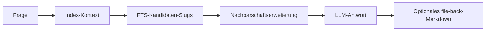

Operationelle Details:

- FTS-Stufe wählt Top-Treffer aus
- Nachbarschaftserweiterung fügt One-Hop-verwandte Artikel hinzu
- Kontext wird vor LLM-Synthese begrenzt, um Antworten stabil zu halten

## Fehlerbehebung

- Query gibt低信号 Antwort zurück:
	- `lore index --repair` ausführen und erneut versuchen
	- überprüfen Sie, ob Quellartikel in `.lore/wiki/articles/` vorhanden sind
- Pfad nicht gefunden:
	- `lore lint` ausführen und `gaps` und `orphans` inspizieren
	- bestätigen Sie, dass erwartete Links im Artikel-Markdown als `[[Wiki Links]]` vorhanden sind

## Verwandte Dokumente

- [Explain-Befehl](./explain-command.md)
- [Ihr Wiki kompilieren](./compiling-your-wiki.md)
- [Fehlerbehebung](./troubleshooting.md)


================================================
FILE: docs-site/i18n/de/docusaurus-plugin-content-docs/current/guides/troubleshooting.md
================================================
---
sidebar_position: 10
---

# Fehlerbehebung

Verwenden Sie diese Seite, wenn Lore-Befehle syntaktisch erfolgreich sind, aber Ausgaben fehlen, veraltet oder von niedriger Qualität sind.

## Schneller Triagierungs-Flow

```mermaid
flowchart TD
  A[Problem beobachtet] --> B{Wo ist der Fehler?}
  B -->|Aufnahme| C[Quell-Pfad oder URL prüfen und ingest erneut ausführen]
  B -->|Kompilierung| D[Lock, Logs und Roh-Einträge prüfen]
  B -->|Suche oder Abfrage| E[Index neu erstellen und Wiki-Graph validieren]
  B -->|Einstellungen/Secrets| F[Einstellungsbereich und Keychain/ENV-Fallback prüfen]
  C --> G[lore lint ausführen]
  D --> G
  E --> G
  F --> G
```

## Häufige Probleme

| Symptom | Wahrscheinliche Ursache | Was zu tun ist |
|---|---|---|
| `Another compile is already running` | `.lore/compile.lock` wird von einem aktiven Prozess gehalten | Warten und compile erneut ausführen. Wenn der Prozess abgestürzt ist, compile erneut ausführen und Lore wird das veraltete Lock zurückgewinnen |
| `Compiled 0 articles` unerwartet | Kein extrahierter Inhalt geändert und hash-basierte inkrementelle Kompilierung hat Arbeit übersprungen | Verwenden Sie `lore compile --force`, um alle gültigen Roh-Einträge neu zu verarbeiten |
| Suchergebnisse veraltet oder leer | Index-Abweichung oder fehlende Manifest-Einträge | Führen Sie `lore index --repair` aus, dann search/query erneut versuchen |
| Query-Antwort低信号 | Retrieval-Kontext schwach oder mehrdeutig | Führen Sie `lore lint` aus, inspizieren Sie Lücken/Waisen, verbessern Sie das Verlinken, dann neu kompilieren |
| Keine QA-Datei aus Query erstellt | `--no-file-back` wurde verwendet | Lassen Sie `--no-file-back` weg oder prüfen Sie `.lore/wiki/derived/qa/` |
| Angela schlägt nach Installation fehl | Git-Verlauf zu flach oder kein Diff zwischen letzten zwei Commits | Stellen Sie sicher, dass es mindestens zwei Commits gibt und führen Sie `lore angela run` manuell erneut aus |
| Export schlägt bei `pdf` fehl | Puppeteer/Browser-Abhängigkeitsproblem | Installieren Sie Abhängigkeiten neu und versuchen Sie `lore export pdf` erneut |
| Artikel ohne Herkunftsmarkierungen | Artikel wurden vor Einführung der Herkunft kompiliert | Führen Sie `lore compile --concepts-only` aus, um nachzufüttern |
| Quellen produzieren konsequent null Konzepte | Inhalt zu abstrakt oder kurz für LLM-Konzeptextraktion | Überprüfen Sie die Roh-Inhaltsqualität; mit reicherem Quellmaterial neu aufnehmen |
| Soft-gelöschte Artikel erscheinen wieder | Artikel wurde durch spätere Kompilierung aus frischen Quellen neu erstellt | Erwartetes Verhalten; verwenden Sie bei Bedarf `--force`-Neukompilierung |

## Wiederherstellungs-Playbooks

### Kompilierung scheint steckengeblieben

```bash
# 1) aktive lore-Prozesse inspizieren
ps aux | grep lore

# 2) compile erneut versuchen
lore compile

# 3) wenn immer noch blockiert, vollständigen Wartungslauf ausführen
lore index --repair
lore lint
```

### Such- oder Abfrage-Qualität ist zurückgegangen

```bash
# 1) Index und Manifest-Konsistenz aktualisieren
lore index --repair

# 2) Graph-Gesundheit prüfen
lore lint --json

# 3) erneut eine fokussierte Frage stellen
lore query "How does compile locking work?" --normalize-question
```

### Export-Artefakt fehlt erwarteter Inhalt

```bash
# 1) sicherstellen, dass frisches Wiki-Material existiert
lore compile --force

# 2) erneut im Zielformat exportieren
lore export bundle --out ./dist

# 3) Ausgabe schnell inspizieren
wc -l ./dist/bundle.md
```

## Log-gesteuertes Debugging

`lore ingest`, `lore compile` und `lore query` erzeugen JSONL-Logs in `.lore/logs/`.

Verwenden Sie diese, wenn ein Befehl ohne genügend Terminal-Details fehlschlägt:

```bash
# neueste Logs zuerst
ls -lt .lore/logs | head

# einen Ausführungslog inspizieren
cat .lore/logs/<run-id>.jsonl
```

## Eskalations-Checkliste

Bevor Sie ein Problem melden oder Hilfe anfragen, sammeln Sie:

1. Verwendeter Befehl und Flags
2. Ob `--json`-Ausgabe erfasst wurde
3. Relevanter `.lore/logs/<run-id>.jsonl`-Ausschnitt
4. Ausgabe von `lore lint --json`
5. Ob `lore index --repair` das Verhalten geändert hat

## Verwandte Dokumente

- [Ihr Wiki kompilieren](./compiling-your-wiki.md)
- [Suchen und Abfragen](./searching-and-querying.md)
- [Exportieren](./exporting.md)
- [CLI-Referenz](../reference/cli-reference.md)


================================================
FILE: docs-site/i18n/de/docusaurus-plugin-content-docs/current/reference/cli-reference.md
================================================
---
sidebar_position: 1
---

# CLI-Referenz

Jeder Befehl unterstützt `--json` für maschinenlesbare Ausgabe auf stdout. Menschenlesbare Ausgabe geht nach stderr.

## Befehle

| Befehl | Beschreibung |
|---|---|
| `lore` | Interaktiven TUI starten |
| `lore init` | `.lore/`-Repository initialisieren |
| `lore ingest <path\|url>` | Datei oder URL in `raw/` aufnehmen |
| `lore compile [--force] [--concepts-only]` | Geänderte Rohquellen zu Wiki-Artikeln kompilieren (6-Stufen-Pipeline, hash-basiert inkrementell, lock-geschützt) |
| `lore index [--repair]` | FTS5-Index + `index.md` neu erstellen (optionale Manifest-Reparatur aus `raw/`) |
| `lore query "<q>" [--no-file-back] [--normalize-question]` | BFS/DFS + LLM-Q&A |
| `lore search "<term>" [--limit N]` | FTS5/BM25-Suche |
| `lore path "<A>" "<B>"` | Kürzester Pfad zwischen Artikeln |
| `lore explain "<concept>"` | Tiefgang zu einem Konzept |
| `lore lint` | Wiki-Gesundheitsprüfungen + strukturierte Diagnosen |
| `lore angela [install\|run]` | Git-Commit-Erfassung |
| `lore export <format> [--out dir]` | Wiki exportieren |
| `lore mcp` | MCP-Server starten |
| `lore status` | Repo-Gesundheits-Dashboard |
| `lore settings` | API-Schlüssel und Modell konfigurieren |

## Häufige Flags und Verhalten

- `--json`: strukturierte Maschinenausgabe auf stdout.
- Mensch-Modus: operationelle Zusammenfassungen auf stderr; primäre Textausgabe auf stdout, wo relevant.
- `lore ingest --json`: enthält Duplikat-Indikator, wenn Inhalt bereits existiert.
- `lore ingest --cf-wait-until <value>`: überschreibt den Cloudflare Browser Run `gotoOptions.waitUntil`-Wert (Standard: `networkidle2`). Verwenden Sie `networkidle0` für Seiten, die auf jede Netzwerkanfrage warten müssen.
- `lore compile`: verwendet hash-basierte inkrementelle Kompilierung, überspringt unveränderte extrahierte Inhalte über `manifest.json` `extractedHash`-Werte.
- `lore compile --force`: umgeht Hash-Überspringen und kompiliert alle gültigen Roh-Einträge neu.
- `lore compile --concepts-only`: füllt Herkunft für vorhandene Artikel ohne Neu-kompilieren nach. Erstellt `concepts.json` und Suchindex neu.
- `lore compile`: geschützt durch `.lore/compile.lock`, um parallele Ausführungen zu verhindern.
- `lore index --repair`: rekonstruiert fehlende Manifest-Einträge vor der Neuerstellung.
- `lore lint --json`: enthält zeilenbewusste `diagnostics[]`-Einträge mit `rule`, `severity`, `file`, optionaler `line` und `message`.
- `lore query --normalize-question`: konservative Tippfehlerbereinigung unter Beibehaltung technischer Token.

Befehls-Links:

- `lore init`: [Schnellstart](../getting-started/quickstart.md)
- `lore ingest`: [Inhalte aufnehmen](../guides/ingesting-content.md)
- `lore compile`: [Ihr Wiki kompilieren](../guides/compiling-your-wiki.md)
- `lore search`: [Suchen und Abfragen](../guides/searching-and-querying.md)
- `lore query`: [Suchen und Abfragen](../guides/searching-and-querying.md)
- `lore explain`: [Explain-Befehl](../guides/explain-command.md)
- `lore lint`: [Linting und Gesundheit](../guides/linting-and-health.md)
- `lore export`: [Exportieren](../guides/exporting.md)
- `lore angela`: [Lore Angela](../guides/lore-angela.md)
- `lore mcp`: [MCP-Server](../guides/mcp-server.md)
- `lore settings`: [Konfiguration](../guides/configuration.md)
- Fehlerbehandlungs-Workflows: [Fehlerbehebung](../guides/troubleshooting.md)
- Repository-Betriebsmuster: [Best Practices](../guides/best-practices.md)

Beispiele:

```bash
lore ingest ./docs/architecture.md --json
lore index --repair --json
lore query "teh qurey about src/core/mcp.ts" --normalize-question --json
```

## Settings-Befehl

Interaktiver Modus:

```bash
lore settings
```

Nicht-interaktiver Modus:

```bash
lore settings list [--scope global|repo|all] [--json]
lore settings get [key] [--scope global|repo|all] [--json]
lore settings set <key> <value> [--scope global|repo|all]
lore settings unset <key> [--scope global|repo|all]
```

Häufige Schlüssel:

- Global: `openrouterApiKey`, `replicateApiToken`, `cloudflareAccountId`, `cloudflareToken`
- Repo: `model`, `temperature`, `maxTokens` (optional), `webExporter`, `autoCompile` (true/false)

Hinweise:

- `lore settings unset maxTokens --scope repo` entfernt das explizite Token-Limit.
- Wenn `maxTokens` nicht gesetzt ist, lässt Lore `max_tokens` in LLM-Anfragen weg.

## Ausführungslogs

- `lore ingest`, `lore compile` und `lore query` erstellen JSONL-Logs in `.lore/logs/<runId>.jsonl`.
- Der Mensch-Modus druckt Ausführungs-Start/Ende-Zusammenfassungen (einschließlich `runId` und Log-Pfad) nach stderr.
- JSON-Modus enthält `runId` und `logPath` in der Befehlsausgabe.
- Logs werden automatisch rotiert; konfigurieren Sie die Aufbewahrung mit `LORE_LOG_MAX_FILES`.

## Hinweise für Automatisierung

- Bevorzugen Sie `--json` für Skripte.
- Bevorzugen Sie `lore lint --json` und behandeln Sie `diagnostics` `severity=error`-Ergebnisse als harte Fehler.
- Führen Sie für deterministische Wartungspipelines in dieser Reihenfolge aus:
	- `lore ingest ...`
	- `lore compile`
	- `lore index --repair`
	- `lore lint --json`
- Setzen Sie `lore settings set autoCompile true --scope repo`, um nach jeder Aufnahme automatisch zu kompilieren. Wenn aktiviert, führen `lore ingest` und `lore ingest-sessions` automatisch Compile aus.

## Beendigungscodes

- `0` — Erfolg
- `1` — Fehler


================================================
FILE: docs-site/i18n/de/docusaurus-plugin-content-docs/current/reference/environment-variables.md
================================================
---
sidebar_position: 3
---

# Umgebungsvariablen

Umgebungsvariablen haben die höchste Laufzeitpräzedenz über Schlüsselbund- und Konfigurationsdateiwerte.

| Variable | Beschreibung |
|---|---|
| `TELEPAT_OPENROUTER_KEY` | OpenRouter-API-Schlüssel für compile/query/explain/angela |
| `TELEPAT_REPLICATE_TOKEN` | Replicate-Token für Marker/Vision-Ingest-Parser |
| `TELEPAT_REPLICATE_TOKEN` | Legacy-Alias für Replicate-Token |
| `LORE_CF_ACCOUNT_ID` | Cloudflare-Konto-ID für Browser-Rendering |
| `LORE_CF_TOKEN` | Cloudflare-API-Token für Browser-Rendering |
| `TELEPAT_DISABLE_KEYTAR` | Wenn `true`, deaktiviert Schlüsselbundzugriff und erfordert ENV-Variablen für Secrets |
| `LORE_QUERY_NORMALIZE` | Wenn `true`, aktiviert standardmäßig konservative Abfragetext-Bereinigung |
| `LORE_LOG_MAX_FILES` | Maximale Anzahl der `.lore/logs/*.jsonl`-Dateien, die vor Rotation aufbewahrt werden |

## Präzedenzmodell

Lore löst Werte in dieser Reihenfolge auf:

1. Umgebungsvariable
2. Gespeicherter Secret/Konfigurationswert
3. Integrierte Standardwerte

Beispiele:

- `TELEPAT_OPENROUTER_KEY` überschreibt schlüsselbund-gespeicherten OpenRouter-Wert
- `TELEPAT_REPLICATE_TOKEN` überschreibt schlüsselbund-gespeicherten Replicate-Wert
- `LORE_CF_TOKEN` überschreibt schlüsselbund-gespeicherten Cloudflare-Token
- `LORE_CF_ACCOUNT_ID` überschreibt globale Konfiguration Konto-ID

## Abfrage-Normalisierung

Normalisierung global aktivieren:

```bash
LORE_QUERY_NORMALIZE=true lore query "wat did we decied about deploy freeze"
```

Normalisierung explizit pro Befehl aktivieren:

```bash
lore query --normalize-question "wat did we decied about deploy freeze"
```

`lore query` stellt kein `--no-normalize-question`-Flag bereit. Wenn Sie Normalisierung über ENV-Variablen aktiviert haben, entfernen Sie `LORE_QUERY_NORMALIZE` für Ausführungen, bei denen Sie den genauen rohen Abfragetext wünschen.

## Häufige Umgebungsprofile

### CI/Container-Profil

```bash
export TELEPAT_OPENROUTER_KEY="..."
export TELEPAT_REPLICATE_TOKEN="..."
export LORE_CF_ACCOUNT_ID="..."
export LORE_CF_TOKEN="..."
export TELEPAT_DISABLE_KEYTAR=true
```

### Lokales Power-User-Profil

```bash
export LORE_QUERY_NORMALIZE=true
export LORE_LOG_MAX_FILES=500
```

## Log-Aufbewahrungshinweise

`LORE_LOG_MAX_FILES` steuert, wie viele `.jsonl`-Ausführungslogs Lore in `.lore/logs/` aufbewahrt.

- ungültige/nicht-positive Werte fallen auf Standard-Aufbewahrung zurück
- Bereinigung läuft vor jedem neuen Ausführungslog

## Verwandte Dokumente

- [Konfiguration](../guides/configuration.md)
- [Anmeldedaten und Secrets](../guides/credentials-and-secrets.md)
- [Ausführungs-Logging](../technical/logging.md)


================================================
FILE: docs-site/i18n/de/docusaurus-plugin-content-docs/current/reference/llm-models.md
================================================
---
sidebar_position: 4
---

# LLM-Modelle

Lore verwendet OpenRouter für Kern-LLM-Operationen (z.B. Kompilierung, Abfrage, Erklärung und Angela-Entscheidungserfassung). Konfigurieren Sie das Modell in `.lore/config.json`:

```json
{
  "model": "deepseek/deepseek-v4-pro",
  "temperature": 0.3,
  "maxTokens": 4096
}
```

`maxTokens` ist optional. Wenn gesetzt, sendet Lore `max_tokens` mit diesem Wert. Wenn nicht gesetzt, lässt Lore `max_tokens` weg und verlässt sich auf die Standard-Ausgabelimit des Anbieters/Modells.

## Modellauswahl-Leitfaden

Verwenden Sie dies als praktischen Ausgangspunkt und stimmen Sie es dann auf Ihre Latenz/Kosten/Qualitäts-Ziele ab.

| Arbeitslast | Vorgeschlagener Modellstil | Warum |
|---|---|---|
| Große Multi-Dokument-Kompilierungsläufe | Lang-Kontext, kosteneffizientes Modell | Bessere Toleranz für größere Quellenfenster |
| Interaktive query/explain-Loops | Ausgewogenes Qualität/Geschwindigkeit-Modell | Schnelle Iteration unter Beibehaltung der Antwortqualität |
| Entscheidungserfassung (Angela) | Hoches Instruktionsfolge-Modell | Klarere präzise Entscheidungszusammenfassungen |

## Vorgeschlagene Standardwerte nach Absicht

| Absicht | Beispielkonfiguration |
|---|---|
| Stabilitätsfokussiert | `temperature: 0.2`, `maxTokens` setzen |
| Erkundungsfokussiert | `temperature: 0.4-0.6`, optionales `maxTokens` |
| Kostenkontrolle | Niedrigeres `maxTokens`, inkrementelle Kompilierung häufig ausführen |

## Empfohlene Modelle

- `deepseek/deepseek-v4-pro` — starkes Lang-Kontext- und mehrsprachiges Leistungsvermögen
- `openai/gpt-4o` — starkes Qualitäts/Geschwindigkeits-Gleichgewicht
- `anthropic/claude-3.5-sonnet` — starkes Reasoning
- `google/gemini-pro-1.5` — großes Kontextfenster

## Konfigurationsbeispiele

### Ausgewogener Standard

```json
{
  "model": "openai/gpt-4o",
  "temperature": 0.3,
  "maxTokens": 4096
}
```

### Lang-Kontext-Kompilierungsschwerpunkt

```json
{
  "model": "deepseek/deepseek-v4-pro",
  "temperature": 0.2
}
```

### Kreative Synthese-Betonung

```json
{
  "model": "anthropic/claude-3.5-sonnet",
  "temperature": 0.6,
  "maxTokens": 6000
}
```

## Temperatur- und maxTokens-Abstimmung

| Einstellung | Niedrigerer Wert-Effekt | Höherer Wert-Effekt |
|---|---|---|
| `temperature` | Deterministischere Ausgaben | Vielfältigere Wortwahl und Struktur |
| `maxTokens` | Engere Antworten, niedrigere Ausgabekosten | Längere Antworten, höhere Ausgabekosten |

Compile-Zuverlässigkeits-Hinweis:

- Wenn eine Compile-Stapel-Antwort abgeschnitten ist (`finish_reason=length`), wiederholt Lore mit kleineren Stapeln.
- Zu niedriges `maxTokens` kann die Wiederholungshäufigkeit bei größeren Quellensätzen erhöhen.

## Replicate-Modelle

- `cuuupid/marker` — PDF/Dokument-Extraktion (`.pdf`, `.docx`, `.pptx`, `.xlsx`, `.epub`)
- `yorickvp/llava-13b` — Bild-OCR/Bildunterschrift (`.png`, `.jpg`, `.jpeg`, `.webp`, `.gif`, `.bmp`)

Replicate-Modelle werden für Ingest-Parsing verwendet, nicht für Compile/Query/Explain-Generierung.

## Hinweise

- OpenRouter-Modellauswahl ist pro-Repo (`.lore/config.json`).
- OpenRouter-Anmeldedaten können über `lore settings set openrouterApiKey <value> --scope global` oder `TELEPAT_OPENROUTER_KEY` gesetzt werden.
- Replicate-Anmeldedaten können über `lore settings set replicateApiToken <value> --scope global` oder `TELEPAT_REPLICATE_TOKEN` gesetzt werden.
- Umgebungsvariablen haben bei der Laufzeit Vorrang vor gespeicherten Einstellungen.

## Verwandte Dokumente

- [Konfiguration](../guides/configuration.md)
- [Anmeldedaten und Secrets](../guides/credentials-and-secrets.md)
- [Ihr Wiki kompilieren](../guides/compiling-your-wiki.md)


================================================
FILE: docs-site/i18n/de/docusaurus-plugin-content-docs/current/reference/supported-formats.md
================================================
---
sidebar_position: 2
---

# Unterstützte Formate

Diese Seite ist die Ingest/Export-Kompatibilitätsreferenz für Lore.

## Ingest-Formate

| Format | Parser | Anforderungen | Hinweise |
|---|---|---|---|
| `.md` | Direkt | Keine | Markdown wird durch Normalisierung beibehalten |
| `.txt` | Direkt | Keine | Als Klartext behandelt |
| `.html` / `.htm` | HTML-Parser | Keine | Vor Normalisierung in Markdown konvertiert |
| `.json` / `.jsonl` | JSON-Parser | Keine | Versucht zuerst Konversations-Transkript-Erkennung |
| `.pdf` | Replicate Marker | Replicate-Token | Verwendet Marker-Modell auf Replicate |
| `.docx` / `.pptx` / `.xlsx` / `.epub` | Replicate Marker | Replicate-Token | Als Dokumentformate über Marker geparst |
| Bilder (`.png`, `.jpg`, `.jpeg`, `.webp`, `.gif`, `.bmp`, `.tiff`) | Replicate Vision | Replicate-Token | OCR + beschreibende Extraktion |
| Webseiten-URLs | Cloudflare BR `/markdown` oder Jina | Optionale CF-Anmeldedaten | Cloudflare-Markdown-Endpunkt bei vorhandenen Anmeldedaten; Jina-Fallback |
| Dokument-URLs (`.pdf`, `.docx`, `.pptx`, `.xlsx`, `.epub`) | Temporärer Download → Replicate Marker | Replicate-Token | In temporäres Verzeichnis heruntergeladen und dann wie lokale Dokumente verarbeitet |
| Bild-URLs (`.png`, `.jpg`, `.jpeg`, `.webp`, `.gif`, `.bmp`) | Temporärer Download → Replicate Vision | Replicate-Token | In temporäres Verzeichnis heruntergeladen und dann wie lokale Bilder verarbeitet |
| Video-URLs | `yt-dlp`-Untertitel-Pipeline | `yt-dlp` empfohlen | Fällt auf URL-Parser zurück, wenn Untertitel nicht verfügbar sind |

## Ingest-Pipeline-Überblick

```mermaid
flowchart LR
	A[Eingabe-Pfad oder URL] --> B[Format-Routing]
	B --> C[Parser]
	C --> D[Markdown-Normalisierung]
	D --> E[In .lore/raw SHA-Verzeichnis speichern]
	E --> F[meta.json und manifest-mtime schreiben]
```

## Sitzungs-Framework-Quellen

Lore kann lokalen Sitzungsverlauf direkt aufnehmen mit:

```bash
lore ingest-sessions [framework|all]
```

| Framework-Schlüssel | Standard-Quell-Orte (OS-abhängig) | Typische Dateitypen |
|---|---|---|
| `claude-code` | `~/.claude/projects/` | `.jsonl` |
| `codex-cli` | `~/.codex/sessions/`, `~/.codex/projects/` | `.jsonl` |
| `copilot-cli` | `~/.copilot/session-state/` (oder `COPILOT_HOME`) | `events.jsonl` |
| `copilot-chat` | VS Code Workspace-Speicher `*/chatSessions/` | `.jsonl`, `.json` |
| `cursor` | Cursor Workspace-Speicher | `.jsonl`, `.json` |
| `gemini-cli` | `~/.gemini/`, `~/.config/gemini/` | `.jsonl`, `.json`, `.md` |
| `obsidian` | `~/Documents/Obsidian Vault/` (oder benutzerdefinierte Roots) | `.md` |

Hinweise:

- Sitzungsimporte laufen durch dieselbe Roh-Ingest-Pipeline und erzeugen `.lore/raw/<sha>/`-Einträge.
- `meta.json` enthält jetzt `session`-Metadaten für framework-aufgenommene Quellen.
- `--dry-run` lässt Sie die Entdeckung inspizieren, bevor Ingest-Ausgaben geschrieben werden.

## Konversations-Export-Unterstützung (`.json` / `.jsonl`)

Lore versucht vor generischer JSON-Renderung eine Schema-Erkennung.

Erkannte Schema-Familien:

- role/content-Nachrichten-Arrays (`user`/`assistant`, einschließlich `human`/`ai`-Rollenversionen)
- ChatGPT-Mapping-Exports (`mapping`-Graph)
- Claude-ähnliche und Codex-ähnliche JSONL-Sitzungsereignisse
- Slack-ähnliche Nachrichten-Arrays

Konversationsausgaben werden als Transkript-Markdown mit zitierten Benutzerzeilen und Assistenten-Antwortblöcken normalisiert.

### Schema-Matrix

| Eingabeform | Erkennungsergebnis | Ausgabe |
|---|---|---|
| Array/Object mit role-content-Nachrichten | Konversations-Transkript | `# Conversation Transcript` Markdown |
| ChatGPT-Mapping-Objekt | Konversations-Transkript | Geordnete user/assistant-Züge |
| JSONL-Sitzungsereignisse | Konversations-Transkript | Geordnete Züge aus Ereignis-Nutzlasten |
| Slack-Nachrichten-Arrays | Konversations-Transkript | Heuristisches alternierendes Rollen-Mapping |
| Kein erkanntes Schema | Generische JSON-Renderung | Überschrift/Wert-Markdown-Umwandlung |

Wenn eine Datei nicht auf bekannte Konversationsmuster passt, fällt Lore auf generische JSON-zu-Markdown-Umwandlung zurück.

## URL- und Video-Verhalten

### URL-Inhalt

Lore routet URL-Aufnahme basierend auf der Dateierweiterung im URL-Pfad:

- **Dokument-Erweiterungen** (`.pdf`, `.docx`, `.pptx`, `.xlsx`, `.epub`): in temporäre Datei heruntergeladen und dann über Replicate Marker verarbeitet — identisch mit lokaler Dokumentaufnahme. Erfordert `TELEPAT_REPLICATE_TOKEN`.
- **Bild-Erweiterungen** (`.png`, `.jpg`, `.jpeg`, `.webp`, `.gif`, `.bmp`): in temporäre Datei heruntergeladen und dann über Replicate Vision verarbeitet — identisch mit lokaler Bildaufnahme. Erfordert `TELEPAT_REPLICATE_TOKEN`.
- **Alle anderen URLs** (Webseiten, HTML usw.):
  - Wenn beide `LORE_CF_ACCOUNT_ID` und `LORE_CF_TOKEN` gesetzt sind, ruft Lore den Cloudflare Browser Run `/markdown`-Endpunkt auf, der Markdown direkt ohne lokale HTML-Konvertierung zurückgibt.
  - Bei Cloudflare-Fehler oder nicht-string-Antwort protokolliert Lore den Fallback und verwendet Jina.
  - Ohne Cloudflare-Anmeldedaten ruft Lore direkt über Jina ab.

### Video-URLs

- Lore prüft auf `yt-dlp`
- Wenn Untertitel verfügbar sind, nimmt Lore bereinigten Transkripttext auf
- Wenn `yt-dlp` fehlt oder Untertitel nicht verfügbar/leer sind, fällt Lore auf URL-Parsing zurück

Extraktor-Metadaten werden in `meta.json` für Video-Aufnahmen gespeichert.

## Roh-Metadaten-Hinweise

- alle Ingests erstellen `.lore/raw/<sha256>/meta.json`
- lokale Datei-Ingests können ordnerabgeleitete Tags ableiten
- extrahierter Text kann heuristische Speicher-Tags anhängen (`decision`, `preference`, `problem`, `milestone`, `emotional`)
- Duplikat-Ingests wiederverwendet vorhandene Roh-Einträge

## Export-Formate

Lore unterstützt diese Exportziele:

- `bundle`
- `slides`
- `pdf`
- `docx`
- `web`
- `canvas`
- `graphml`

Siehe [Exportieren](../guides/exporting.md) für detaillierte Anwendungsfälle und Ausgabebeispiele.

## Praktische Beispiele

```bash
# gemischten Ordner aufnehmen
lore ingest ./docs/architecture.md
lore ingest ./notes/session.jsonl
lore ingest ./assets/diagram.png

# eine URL und eine Video-URL aufnehmen
lore ingest https://example.com/post
lore ingest https://www.youtube.com/watch?v=<id>
```


================================================
FILE: docs-site/i18n/de/docusaurus-plugin-content-docs/current/technical/architecture.md
================================================
---
sidebar_position: 1
---

# Architektur

Lore kombiniert markdown-primäre Wissensspeicherung mit einer Operations-Pipeline für Aufnahme, Kompilierung, Retrieval und Qualitätsdurchsetzung.

## 4-Schicht-Wiki

1. **Index** (`wiki/index.md`) — wird zuerst konsultiert
2. **Artikel** (`wiki/articles/*.md`) — Konzeptartikel mit Backlinks und Herkunft
3. **Abgeleitet** (`wiki/derived/`) — Q&A-Antworten, Folien, Diagramme
4. **Assets** (`wiki/assets/`) — lokale Bilder

Unterstützter Zustand lebt in `.lore/`:

- `raw/` normalisierte Ingest-Artefakte, Schlüssel nach Inhaltshash
- `manifest.json` Quelle-zu-Roh-Verfolgung, Kompilierungszeitstempel, extrahierte Hashes
- `wiki/concepts.json` normalisierte Konzeptmetadaten, die nach Kompilierung generiert werden
- `wiki/concepts/` konzeptdetaillierte Seiten (optional)
- `wiki/deprecated/` soft-gelöschte Artikel, die für Audit aufbewahrt werden
- `db.sqlite` FTS/Backlink-Datenbank
- `compile.lock` aktive Kompilierungs-Mutex-Datei

## Repository-Layout-Übersicht

| Pfad | Zweck |
|---|---|
| `.lore/raw/` | Quell-abgeleitete extrahierte Artefakte, Schlüssel nach Hash |
| `.lore/wiki/articles/` | Kompilierte Konzeptseiten mit Herkunft |
| `.lore/wiki/deprecated/` | Soft-gelöschte Artikel (Audit-Trail) |
| `.lore/wiki/index.md` | Kanonischer Themenindex |
| `.lore/wiki/concepts.json` | Konzeptindex mit Aliassen/Tags/Konfidenz |
| `.lore/wiki/derived/qa/` | Abgelegte Abfrage-Antworten |
| `.lore/db.sqlite` | FTS- und Link-Graph-Tabellen |
| `.lore/logs/` | JSONL-Befehls-Ausführungslogs |

## 4-Phasen-Pipeline

1. **Aufnahme** — `raw/` wird mit `extracted.md` + `meta.json` befüllt
2. **Kompilierung** — 6-Stufen-Pipeline: Diff → Konzepte extrahieren → Zuordnen → Ops generieren → Anwenden → Neu indexieren
3. **Abfrage** — Q&A über BFS/DFS-Traversierung, abgelegt nach `derived/qa/`
4. **Lint** — Waisen, Lücken, mehrdeutige Behauptungen und zeilenbewusste Diagnosen werden offengelegt

Operativ sind diese Phasen idempotent und können inkrementell erneut ausgeführt werden.

Compile ist standardmäßig hash-inkrementell: unveränderte extrahierte Inhalte werden basierend auf `manifest.json` `extractedHash`-Feldern übersprungen.

### Pipeline-Diagramm

```mermaid
flowchart LR
    A[Aufnahme] --> B[Roh-Artefakte + Manifest]
    B --> C[Kompilierung]
    C --> D[Index-Neuerstellung + Konzepte]
    D --> E[Suche und Abfrage]
    D --> F[Lint-Diagnosen]
```

### Compile-Unterpipeline

```mermaid
flowchart TD
    A[Rohquellen] --> B{Diff: geändert?}
    B -->|Nein| C[Überspringen]
    B -->|Ja| D[Konzepte extrahieren]
    D --> E{Konzepte?}
    E -->|Nein| F[Stapelerstellung]
    E -->|Ja| G[Artikeln zuordnen]
    G --> H[Operationen generieren]
    H --> I[Auf Datenträger anwenden]
    F --> I
    I --> J[Re-Indexierung + concepts.json]
```

## Herkunftsmodell

Jeder Artikel verfolgt, welche Quellen zu welchen Zeilen beigetragen haben. Zwei Mechanismen:

### Inline-Herkunft

Zeilen tragen `<!-- sources:HASH(CONFIDENCE) -->`-Kommentare:

```markdown
The auth service uses JWT. <!-- sources:abc123(extracted) def456(inferred) -->
```

Wenn das LLM Artikel für Zuordnung liest, werden Herkunftskommentare entfernt. Das LLM sieht saubere, nummerierte Zeilen.

### Kumulative Referenzen

Jeder Artikel endet mit einem `## References`-Abschnitt, der alle jemals zusammengeführten Quellen-Hashes auflistet:

```markdown
## References
- abc123 (extracted)
- def456 (inferred)
```

Dieser Abschnitt wird vom System verwaltet und aus dem LLM-Kontext ausgeblendet.

### Verwandter Abschnitt

`## Related` wird automatisch aus `[[wiki-links]]` generiert, die im Artikelkörper gefunden werden.

## Operationsmodell

Das LLM gibt zeilenweise Operationen (JSON) aus. Jede Operation trägt ein `sources`-Array zur Herkunft:

| Operation | Wirkung |
|---|---|
| `replace` | Eine Zeile ersetzen |
| `insert-after` | Nach einer Zielzeile einfügen |
| `delete-range` | Zeilen entfernen (validiert: start ≤ end) |
| `replace-range` | Einen Zeilenbereich ersetzen |
| `split` | Artikel in zwei aufteilen |
| `append-source` | Quellen zu vorhandenen Zeilen hinzufügen (keine Inhaltsänderung) |
| `soft-delete` | Artikel in veraltet verschieben |

Operationen werden sequenziell pro Quelle angewendet. Zeilenreferenzen verwenden `¶` (Pilcrow)-Präfixe, um sie von YAML-Zeilennummern zu unterscheiden.

## Compile-Zuverlässigkeitskontrollen

| Kontrolle | Zweck |
|---|---|
| PID-Lock-Datei (`compile.lock`) | Überlappende Kompilierungsläufe verhindern |
| Hash-basiertes Überspringen | Vermeidet Neu-kompilieren unveränderter extrahierter Inhalte |
| Pro-Quelle-Wiederholung (1 Versuch) | Erholung von fehlerhafter LLM-Ausgabe |
| Null-Konzept-Überspringen | Quellen ohne extrahierbare Konzepte gehen zur Stapelerstellung |
| `start > end`-Validierung | Bereichsoperationen verwerfen ungültige Bereiche |
| Nach-Compile-Index-Neuerstellung | Hält FTS/Graph-Zustand mit Artikelsatz synchron |

## Ingest- und Metadaten-Flow

Ingest schreibt `.lore/raw/<sha>/extracted.md` und `.lore/raw/<sha>/meta.json`.

Metadaten können enthalten:

- kanonische Quellenidentität
- ordnerabgeleitete Themen-Tags
- heuristische Speichertyp-Tags
- Zeitstempel und Herkunftsfelder

Duplikat-Inhalt wird per Hash erkannt und wiederverwendet vorhandene Roh-Einträge.

Metadaten-Tags können von Pfad-Hinweisen und Speichermuster-Heuristiken stammen, um nachgelagerte Klassifizierung und Entdeckung zu verbessern.

## Abfrage-Flow und Normalisierung

`query` verwendet hybrides Retrieval aus FTS + Graph-Kontext.

Frage-Text-Normalisierung ist optional und wird gesteuert durch:

- CLI-Flags: `--normalize-question`, `--no-normalize-question`
- ENV-Standard: `LORE_QUERY_NORMALIZE`

Normalisierung ist bewusst konservativ, um technische Token nicht zu verändern.

Retrieval-Sequenz:

1. Index-Kontext laden
2. FTS-Kandidatenausführung starten
3. One-Hop-Nachbarn über Link-Graph erweitern
4. Antwort über LLM synthetisieren

## Graph- und Suchspeicher

SQLite-Strukturen:

- `fts`: Volltextindex (`slug`, `title`, `body`) mit Ranking/Snippets
- `links`: konzeptuelle Kanten (`from_slug`, `to_slug`)

`lore path` berechnet kürzeste konzeptuelle Pfade über BFS über ungerichtete Adjazanz, die aus `links` abgeleitet ist.

## Index-Integrität und Schutzmaßnahmen

Index-Neuerstellung kann im Standard- oder Reparaturmodus laufen:

- Standard: DB-Artefakte aus Manifest/Roh-Zustand neu generieren
- Reparatur: fehlende Manifest-Einträge aus vorhandenen Roh-Ordnern wiederherstellen

Backlink-Indexierung filtert Link-Ziele mit geringem Signal (z.B. nur-Stoppwort-Links) um Graph-Rauschen zu reduzieren.

Herkunftskommentare werden aus Artikelelementen vor FTS-Indexierung entfernt, damit sie Suchergebnisse nicht verschmutzen.

Schutzmaßnahmen-Vorteile:

- weniger rauschhafte Kanten im Konzept-Graphen
- sauberere Lint-Lücken/Waisen-Signale
- stabilere Pfad- und Nachbarschaftserkundung

## MCP-Wartungsoberfläche

Der MCP-Server stellt Wartungs- und Diagnosetools für Automatisierungsloops bereit, einschließlich:

- Duplikatprüfungen vor Aufnahme
- Roh-Tag-Verteilungszusammenfassungen
- Waisen/Lücken/Mehrdeutigkeit-Lint-Zusammenfassungen
- Index-Neuerstellungs- und Reparaturauslöser

## SQLite-Schema

- `fts` — FTS5-Virtuelle Tabelle (slug, title, body) mit Porter-Stemming
- `links` — Backlink-Graph (from_slug, to_slug)

## Verwandte Dokumente

- [Ingest-Pipeline](./ingest-pipeline.md)
- [LLM-Pipeline](./llm-pipeline.md)
- [Ausführungs-Logging](./logging.md)
- [Ihr Wiki kompilieren](../guides/compiling-your-wiki.md)


================================================
FILE: docs-site/i18n/de/docusaurus-plugin-content-docs/current/technical/ingest-pipeline.md
================================================
---
sidebar_position: 3
---

# Ingest-Pipeline

Zwei Stufen: **Formatextrahierung** dann **Unified.js-Normalisierung**.

Jede erfolgreiche Aufnahme erstellt einen deterministischen Roh-Eintrag in `.lore/raw/<sha256>/`.

## Stufe 1: Formatextrahierung

Routet zum richtigen Parser basierend auf Dateityp oder URL-Muster.

### Routing-Matrix

| Eingabetyp | Parser-Pfad | Hinweise |
|---|---|---|
| Markdown/Text | direkte Textextraktion | normalisiert von unified-Pipeline |
| HTML | HTML-Parser | in Markdown konvertiert |
| JSON/JSONL | Konversationserkennung + JSON-Renderung Fallback | Transkript-erste-Strategie |
| PDF/DOCX/PPTX/XLSX/EPUB | Replicate Marker | erfordert Replicate-Token |
| Bildformate | Replicate Vision | OCR/Bildunterschrift-Prompt-Extraktion |
| Webseiten-URL | Cloudflare BR `/markdown`-Endpunkt bei Konfiguration, sonst Jina | gibt Markdown direkt zurück; Cloudflare-Fehler fällt auf Jina zurück |
| Dokument-URL (`.pdf`, `.docx` usw.) | temporärer Download → Replicate Marker | identischer Pfad wie lokale Dokumentdateien |
| Bild-URL (`.png`, `.jpg` usw.) | temporärer Download → Replicate Vision | identischer Pfad wie lokale Bilddateien |
| Video-URL | `yt-dlp`-Untertitel-Workflow | fällt auf URL-Parsing zurück, wenn nicht verfügbar |

### Parser-Auswahl

- Markdown und textähnliche Dateien werden durch direkte Markdown-Normalisierung geroutet.
- Office/PDF/Medienformate werden durch spezialisierte Extraktoren geroutet.
- `.json` / `.jsonl`-Inhalt wird zuerst auf Konversations-Exports schema-geprüft.
- URLs mit Dokument- oder Bild-Erweiterungen werden in eine temporäre Datei heruntergeladen und durch denselben lokalen Extraktor (Marker oder Vision) geroutet.
- Alle anderen URLs werden basierend auf Quelle und Konfiguration durch Fetch/Browser-Extraktion geroutet.

### Video-URL-Fallback-Verhalten

1. `yt-dlp`-Verfügbarkeit prüfen
2. Untertitel-Download und Bereinigung versuchen
3. bei fehlenden/leeren Untertiteln URL-Parsing-Fallback verwenden

Extraktor-Herkunft wird in Roh-Metadaten (`meta.json`) geschrieben.

### Konversations-Schema-Erkennung

Für JSON-Eingaben versucht Lore vor generischer Renderung eine strukturierte Konversations-Extraktion. Unterstützte Familien umfassen:

- role/content-Arrays
- ChatGPT-Mapping-Bäume
- Codex/Claude-ähnliche JSONL-Sitzungen
- Slack-ähnliche Nachrichten-Arrays

Wenn die Erkennung fehlschlägt, fällt Lore auf generische JSON-Markdown-Ausgabe zurück.

### Konversations-Normalisierungsergebnis

Erkannte Konversations-Schemata werden als Transkript-Markdown unter einer Standardüberschrift (`# Conversation Transcript`) mit zitierten Benutzerzügen und als Fließtext beibehaltenen Assistentenzügen ausgegeben.

## Stufe 2: Unified.js-Normalisierung

1. In mdast-AST parsen (remark-parse)
2. YAML-Frontmatter extrahieren, `[[wiki-links]]` auflösen
3. Überschriftshierarchie normalisieren, Whitespace deduplizieren
4. Zu `extracted.md` stringifizieren

Normalisierungsziel: stabiles Markdown für deterministisches Hashing und sauberere Compile-Eingaben.

## Roh-Eintrag-Layout

Jedes Rohverzeichnis enthält:

- `source`-Kopie (wenn verfügbar)
- `extracted.md` normalisiertes Markdown
- `meta.json` Ingest-Metadaten

Typisches `meta.json` enthält:

- Inhaltshash und Format
- Quellpfad oder URL-Herkunft
- Extraktionsdatum/-uhrzeit
- abgeleitete Themen- und Speicher-Tags
- optionale Extraktor-Kennung (Video-Aufnahme)

`meta.json` enthält Zeit-/Herkunftsfelder und Tags, die stammen können aus:

- Quell-Frontmatter-Tags
- Pfad-abgeleitete Themen-Tags
- Heuristische Speichersignale (`decision`, `preference`, `problem`, `milestone`, `emotional`)

## Duplikaterkennung

Ingest berechnet einen Quellen-Hash und umgeht, wenn der genaue Inhalt bereits aufgenommen wurde.

- es wird kein dupliziertes Rohverzeichnis erstellt
- vorhandener Roh-Eintrag wird wiederverwendet
- Ingest-Ergebnis enthält `duplicate=true`

Dies hält `raw/` stabil und verhindert duplizierten Artikelchurn downstream.

## Ingest-Flow-Diagramm

```mermaid
flowchart TD
	A[Pfad- oder URL-Eingabe] --> B[Format-Route]
	B --> C[Spezialisierter Parser]
	C --> D[Unified-Normalisierung]
	D --> E[Hash + Duplikatprüfung]
	E -->|neu| F[Roh-Eintrag und Meta schreiben]
	E -->|Duplikat| G[Vorhandenen Roh-Eintrag wiederverwenden]
	F --> H[manifest-mtime aktualisieren]
	G --> H
```

## Operationelle Schutzmaßnahmen

| Schutzmaßnahme | Vorteil |
|---|---|
| deterministische Hash-Identität | Duplikatverhinderung und stabile Manifest-Verfolgung |
| Parser-Fallback-Ketten | widerstandsfähige Aufnahme in teilweise konfigurierten Umgebungen |
| Metadatenanreicherung | bessere nachgelagerte Indexierungs- und Wartungsworkflows |

## Fehlerbehebungssignale

| Symptom | Wahrscheinliche Ursache | Lösung |
|---|---|---|
| JSON-Datei nicht als Transkript behandelt | Schema nicht erkannt | Struktur inspizieren oder auf generisches JSON-Markdown-Fallback vertrauen |
| Video-Aufnahme hat kein Transkript | `yt-dlp` nicht verfügbar oder keine Untertitel | `yt-dlp` installieren oder URL-Fallback-Ausgabe akzeptieren |
| URL-Extraktionsqualität低 | Rendering-Komplexität der Quelle | Cloudflare BR konfigurieren oder eine lokal exportierte Kopie aufnehmen |

## Interaktion mit Indexierung

`compile` und explizite `index`-Operationen verbrauchen `meta.json` + `extracted.md` aus `raw/`.

Wenn ältere Manifeste auf fehlende Rohverzeichnisse verweisen,重建t der Index-Reparaturmodus (`lore index --repair`) fehlende Manifest-Einträge durch Scannen vorhandener Roh-Ordner.

## Verwandte Dokumente

- [Unterstützte Formate](../reference/supported-formats.md)
- [Ihr Wiki kompilieren](../guides/compiling-your-wiki.md)
- [Fehlerbehebung](../guides/troubleshooting.md)


================================================
FILE: docs-site/i18n/de/docusaurus-plugin-content-docs/current/technical/llm-pipeline.md
================================================
---
sidebar_position: 2
---

# LLM-Pipeline

Lore verwendet LLM-Aufrufe in fünf primären Operationen, von denen drei die Kompilierungspipeline bilden:

1. **Konzeptextrahierung** — extrahiert benannte Konzepte mit Beschreibungen und Konfidenz aus rohem Quelleninhalt
2. **Artikelzuordnung** — ordnet die Konzepte einer Quelle bestehenden Wiki-Artikeln zu
3. **Operationserstellung** — erzeugt zeilenweise Operationen, die beschreiben, wie zugeordnete Artikel bearbeitet werden
4. **Stapelerstellung** — generiert neue Artikel für nicht zugeordnete Quellen
5. **Q&A (`query`)** — lädt zuerst `index.md`, dann relevante Artikel über FTS + Graph-Nachbarschaftserweiterung; beantwortet optional die Frage; legt optional das Ergebnis zurück
6. **Explain** — tiefgehende Konzept-Synthese aus einem zugeordneten Artikel plus Graph-Nachbarn

Die ersten vier bilden die Kompilierungspipeline (→ Konzeptextrahierung → Zuordnung → Operationen → Erstellungen). Alle LLM-Aufrufe laufen über OpenRouter via dem `openai` npm-SDK.

`lint` und `index` sind keine LLM-Operationen; sie arbeiten mit lokalem Markdown und SQLite-Zustand.

## End-to-End-LLM-Flow

```mermaid
flowchart LR
    A[Repo und Konfiguration laden] --> B[OpenRouter-Schlüssel auflösen]
    B --> C[Modellanfrage erstellen]
    C --> D[Stream- oder Non-Stream-Vervollständigung]
    D --> E[Ausgaben validieren und persistieren]
```

## Compile-LLM-Stufen

### 1. Konzeptextrahierung

Jede geänderte Quelle wird an das LLM mit Anweisungen zur Konzeptextrahierung gesendet. Das LLM gibt ein JSON-Array zurück:

```json
[
  {
    "name": "Authentication",
    "description": "User authentication via JWT tokens and OAuth2 providers.",
    "confidence": "extracted",
    "for_source": "source_1"
  }
]
```

- **Stapel**: Alle geänderten Quellen werden in einem einzelnen Aufruf gesendet.
- **Konfidenz**: LLM entscheidet pro Konzept (`extracted`, `inferred`, `ambiguous`).
- **`for_source`**: Verweist auf den Quellenindex im Stapel (1-basiert).
- **Null Konzepte**: Quellen ohne extrahierbare Konzepte gehen zur Stapelerstellung ohne Zuordnung.

### 2. Artikelzuordnung

Jede Quelle mit Konzepten wird mit dem vorhandenen Artikelsatz abgeglichen. Das LLM erhält:

- Quellentitel, Inhalt und Konzepte
- Liste von Kandidatenartikel-Slugs (bis zu 30 bei FTS-Vorfilterung oder vollständige Liste für kleine Wikis)
- Artikelelemente mit Zeilennummern und entfernter Herkunft

Das LLM gibt die Slugs zugeordneter Artikel zurück (bis zu 3 pro Quelle) oder eine leere Liste bei keiner Übereinstimmung.

**Vorfilterung**: Für Wikis mit 200+ Artikeln schränkt eine FTS-Suche nach Konzeptnamen die Kandidaten auf 30 ein. Für kleinere Wikis sind alle Artikel Kandidaten.

### 3. Operationserstellung

Für jede zugeordnete Quelle generiert das LLM ein JSON-Array von Operationen:

```json
[
  {
    "op": "replace",
    "line": "¶2",
    "content": "Updated line content.",
    "sources": ["sha256(extracted)"],
    "confidence": "extracted"
  },
  {
    "op": "insert-after",
    "line": "¶5",
    "content": "New derived insight.",
    "sources": ["sha256(inferred)"],
    "confidence": "inferred"
  }
]
```

Das LLM sieht zugeordnete Artikel mit:
- Zeilennummern präfigiert mit `¶` (Pilcrow)
- entfernten Herkunftskommentaren
- ausgeblendeten `## References` und `## Related`-Abschnitten

**Konfidenz pro Operation**: Für Bearbeitungen vorhandener Artikel setzt das LLM `confidence` pro Operation (Standard: `inferred`). Für neue Artikel, die per Stapelerstellung erstellt wurden, ist der Standard aller Zeilen `extracted`.

### 4. Stapelerstellung

Nicht zugeordnete Quellen (und Quellen mit null Konzepten) werden gestapelt. Das LLM generiert einen Satz von Erstellungsoperationen:

```json
[
  {
    "op": "create",
    "slug": "jwt-authentication",
    "title": "JWT Authentication",
    "description": "How the system uses JWT tokens...",
    "lines": [
      { "content": "Line 1 content.", "sources": ["sha256(extracted)"] }
    ],
    "sources": ["sha256"],
    "confidence": "extracted"
  }
]
```

Neue Artikel werden mit Herkunftskommentaren und befüllten `## References` geschrieben.

## Compile-Abbruch und Fehlerbehandlung

Compile validiert LLM-Ausgabe vor dem Schreiben von Dateien. Antworten werden einmal wiederholt, wenn:

- Der Anbieter Abbruch meldet (`finish_reason=length`)
- JSON-Ausgabe nicht parstbar ist
- Operationen strukturell ungültig sind

Bei wiederholbarem Fehler wiederholt Compile einmal. Wenn die Wiederholung ebenfalls fehlschlägt, wird die Quelle übersprungen (protokolliert) und Compile fährt mit verbleibenden Quellen fort. Die Kompilierung bricht nicht bei individuellen Quellenfehlern ab.

## maxTokens-Semantik

- `maxTokens` ist optional in `.lore/config.json`.
- Wenn gesetzt, fügt Lore `max_tokens` in OpenRouter-Anfragen hinzu.
- Wenn nicht gesetzt, lässt Lore `max_tokens` weg und verwendet Anbieter/Modell-Standardwerte.

## Retrieval-seitiges Prompting

### Query

- Kontextzusammensetzung: Index + ausgewählte Artikelelemente
- Quellenverfolgung: zurückgegebene Slugs und optional abgelegte QA-Markdown
- optionale Normalisierung: konservative Abfrage-Bereinigung via Flag oder ENV-Standard

### Explain

- zuerst exakte Slug-Nachschlage, dann FTS-Fallback
- Nachbarschaftserweiterung zur Anreicherung des Kontextfensters
- Langform-Synthese mit Wiki-Stil-Referenzen

## Laufzeitkontrollen

| Kontrolle | Wirkung |
|---|---|
| `temperature` | Ausgabe-Vielfalt und Determinismus-Tradeoff |
| `maxTokens` | Antwortlängendecke bei Konfiguration |
| `LORE_QUERY_NORMALIZE` | Standard-Abfrage-Normalisierungsschalter |

## Fehlermodi und Wiederherstellung

| Symptom | Wahrscheinliche Ursache | Wiederherstellung |
|---|---|---|
| Compile wiederholt häufig | fehlerhafte LLM-Ausgabe oder Token-Limits | Wiederholung zulassen; Modell/maxTokens bei andauerndem Problem abstimmen |
| Query-Ergebnis低信号 | schwacher/limitierter Retrieval-Kontext | Index-Reparatur ausführen, Links verbessern, erneut versuchen |
| Explain verpasst Konzept | kein exakter/FTS-Match | neu kompilieren und klareren Konzeptnamen verwenden |
| Quellen erhalten konsequent null Konzepte | Inhalt zu abstrakt oder kurz für Konzeptextrahierung | Roh-Inhalt überprüfen; möglicherweise manuelle Kuratierung erforderlich |
| Operationen schlagen Validierung fehl | LLM erzeugte ungültige Zeilenreferenzen | Compile überspringt Quelle und fährt fort; Roh-Inhalt überprüfen |

## Ausführungs-Logging

- Compile- und Query-Ausführungen erzeugen strukturierte JSONL-Ereignisse in `.lore/logs/<runId>.jsonl`.
- Token-Stream-Ereignisse werden mit rohem Token-Text protokolliert.
- Befehls-stderr zeigt knappe Ausführungs-Start/Ende-Zusammenfassungen mit Ausführungs-ID und Log-Pfad.

## Verwandte Dokumente

- [LLM-Modelle](../reference/llm-models.md)
- [Konfiguration](../guides/configuration.md)
- [Ihr Wiki kompilieren](../guides/compiling-your-wiki.md)
- [Suchen und Abfragen](../guides/searching-and-querying.md)
- [Architektur](./architecture.md)


================================================
FILE: docs-site/i18n/de/docusaurus-plugin-content-docs/current/technical/logging.md
================================================
---
sidebar_position: 3
---

# Ausführungs-Logging

Lore erzeugt strukturierte JSONL-Logs für:

- `lore ingest`
- `lore compile`
- `lore query`

Jede Befehlsausführung erhält eine eindeutige Ausführungs-ID und Log-Datei unter:

- `.lore/logs/<runId>.jsonl`

## Warum Logging wichtig ist

Ausführungslogs sind der schnellste Weg, Pipeline-Verhalten in automatisierten und headlosen Ausführungen zu diagnostizieren.

- Befehlsausführungsreihenfolge rekonstruieren
- Wiederholungs/Fortschritts-Verhalten inspizieren
- Quelle von Laufzeitfehlern erfassen
- token-schwere Operationen mit Modellverhalten korrelieren

Log-Aufbewahrung und -Rotation:

- Logs werden automatisch vor jedem neuen Ausführungslog rotiert.
- Standard-Aufbewahrung ist 200 Dateien.
- Setzen Sie `LORE_LOG_MAX_FILES`, um die Aufbewahrungszahl zu überschreiben.

## JSONL-Struktur

Jede Zeile ist ein eigenständiges JSON-Objekt. Dies macht Logs streamfreundlich und einfach mit zeilenorientierten Tools zu verarbeiten.

## Ereignismodell

Jede Zeile ist ein eigenständiges JSON-Objekt mit Feldern wie:

- `runId`
- `command`
- `event`
- `timestamp`
- `step`
- `elapsedMs`
- `details`
- `error`

Häufige Ereignisse umfassen:

- `run_start`
- `step_start`
- `step_end`
- `progress`
- `token`
- `retry`
- `error`
- `run_end`

Beispiel-Ereigniszeile:

```json
{
	"runId": "2026-04-10T12-30-12-123Z-abcd1234",
	"command": "compile",
	"event": "step_end",
	"timestamp": "2026-04-10T12:30:14.201Z",
	"step": "compile.batch",
	"elapsedMs": 598,
	"details": {
		"written": 7
	}
}
```

## Stufenabdeckung nach Befehl

| Befehl | Typische Signalstufen |
|---|---|
| `ingest` | Routerauswahl, Parser-Stufe, Normalisierung, Manifest-Aktualisierung |
| `compile` | Lock-Erwerb, Stapel-LLM-Aufruf, Wiederholung, Re-Indexierung, Konzepte schreiben |
| `query` | Index-Laden, FTS-Suche, Nachbarschaftserweiterung, LLM-Antwort, file-back |

## Konsolen-Zusammenfassungen

Menschenlesbarer Modus druckt knappe stderr-Zusammenfassungen:

- Ausführungsstart mit Befehl und Ausführungs-ID
- Ausführungsende mit Status, vergangener Zeit und Log-Pfad

Im `--json`-Modus enthält die Befehlsausgabe `runId` und `logPath` für direkte Log-Sammlung.

## Token-Logging

Query und Compile streamen Token-Ereignisse in JSONL-Logs mit rohem Token-Text unter `details.token`.

Behandeln Sie Ausführungslogs als sensibel, da Token-Nutzlasten Quellen/Kontext-Auszüge enthalten können.

## Debugging-Playbook

```bash
# neueste Ausführungen auflisten
ls -lt .lore/logs | head

# eine Ausführung inspizieren
cat .lore/logs/<run-id>.jsonl

# Wiederholungs-Ereignisse isolieren
grep '"event":"retry"' .lore/logs/<run-id>.jsonl
```

## Operationelle Schutzmaßnahmen

- vermeiden Sie das Teilen voller Logs extern, wenn Quelleninhalt sensibel ist
- rotieren oder löschen Sie Logs in eingeschränkten Umgebungen
- verwenden Sie `LORE_LOG_MAX_FILES`, um aufbewahrte Ausführungshistorie zu begrenzen

## Verwandte Dokumente

- [Fehlerbehebung](../guides/troubleshooting.md)
- [Ihr Wiki kompilieren](../guides/compiling-your-wiki.md)
- [Suchen und Abfragen](../guides/searching-and-querying.md)


================================================
FILE: docs-site/i18n/de/docusaurus-theme-classic/footer.json
================================================
{
  "link.title.Docs": {
    "message": "Dokumentation",
    "description": "The title of the footer links column with title=Docs"
  },
  "link.title.More": {
    "message": "Mehr",
    "description": "The title of the footer links column with title=More"
  },
  "link.item.label.Getting Started": {
    "message": "Erste Schritte",
    "description": "The label of footer link with label=Getting Started"
  },
  "link.item.label.CLI Reference": {
    "message": "CLI-Referenz",
    "description": "The label of footer link with label=CLI Reference"
  },
  "link.item.label.GitHub": {
    "message": "GitHub",
    "description": "The label of footer link with label=GitHub"
  },
  "copyright": {
    "message": "Copyright © 2026 Telepat. Erstellt mit Docusaurus.",
    "description": "The footer copyright"
  }
}


================================================
FILE: docs-site/i18n/de/docusaurus-theme-classic/navbar.json
================================================
{
  "title": {
    "message": "Lore",
    "description": "The title in the navbar"
  },
  "logo.alt": {
    "message": "Lore-Logo",
    "description": "The alt text of navbar logo"
  },
  "item.label.Docs": {
    "message": "Dokumentation",
    "description": "Navbar item with label Docs"
  },
  "item.label.GitHub": {
    "message": "GitHub",
    "description": "Navbar item with label GitHub"
  }
}


================================================
FILE: docs-site/i18n/zh-CN/code.json
================================================
{
  "theme.ErrorPageContent.title": {
    "message": "页面已崩溃。",
    "description": "The title of the fallback page when the page crashed"
  },
  "theme.ErrorPageContent.tryAgain": {
    "message": "重试",
    "description": "The label of the button to try again rendering when the React error boundary captures an error"
  },
  "theme.BackToTopButton.buttonAriaLabel": {
    "message": "回到顶部",
    "description": "The ARIA label for the back to top button"
  },
  "theme.docs.breadcrumbs.navAriaLabel": {
    "message": "页面路径",
    "description": "The ARIA label for the breadcrumbs"
  },
  "theme.docs.breadcrumbs.home": {
    "message": "主页面",
    "description": "The ARIA label for the home page in the breadcrumbs"
  },
  "theme.docs.DocCard.categoryDescription.plurals": {
    "message": "{count} 个项目",
    "description": "The default description for a category card"
  },
  "theme.docs.paginator.navAriaLabel": {
    "message": "文件选项卡",
    "description": "The ARIA label for the docs pagination"
  },
  "theme.docs.paginator.previous": {
    "message": "上一页",
    "description": "The label used to navigate to the previous doc"
  },
  "theme.docs.paginator.next": {
    "message": "下一页",
    "description": "The label used to navigate to the next doc"
  },
  "theme.docs.sidebar.navAriaLabel": {
    "message": "文档侧边栏",
    "description": "The ARIA label for the sidebar navigation"
  },
  "theme.docs.sidebar.collapseButtonTitle": {
    "message": "收起侧边栏",
    "description": "The title attribute for collapse button of doc sidebar"
  },
  "theme.docs.sidebar.collapseButtonAriaLabel": {
    "message": "收起侧边栏",
    "description": "The title attribute for collapse button of doc sidebar"
  },
  "theme.docs.sidebar.expandButtonTitle": {
    "message": "展开侧边栏",
    "description": "The ARIA label and title attribute for expand button of doc sidebar"
  },
  "theme.docs.sidebar.expandButtonAriaLabel": {
    "message": "展开侧边栏",
    "description": "The ARIA label and title attribute for expand button of doc sidebar"
  },
  "theme.docs.sidebar.closeSidebarButtonAriaLabel": {
    "message": "关闭导航栏",
    "description": "The ARIA label for close button of mobile sidebar"
  },
  "theme.docs.sidebar.toggleSidebarButtonAriaLabel": {
    "message": "切换导航栏",
    "description": "The ARIA label for hamburger menu button of mobile navigation"
  },
  "theme.docs.versionBadge.label": {
    "message": "版本：{versionLabel}"
  },
  "theme.docs.versions.unreleasedVersionLabel": {
    "message": "此为 {siteTitle} {versionLabel} 版尚未发行的文档。",
    "description": "The label for unreleased doc version"
  },
  "theme.docs.versions.unmaintainedVersionLabel": {
    "message": "此为 {siteTitle} {versionLabel} 版的文档，现已不再积极维护。",
    "description": "The label for unmaintained doc version"
  },
  "theme.docs.versions.latestVersionSuggestionLabel": {
    "message": "最新的文档请参阅 {latestVersionLink} ({versionLabel})。",
    "description": "The label to check the latest version"
  },
  "theme.docs.versions.latestVersionLinkLabel": {
    "message": "最新版本",
    "description": "The label for the latest version suggestion link"
  },
  "theme.common.editThisPage": {
    "message": "编辑此页",
    "description": "The link label to edit the current page"
  },
  "theme.common.skipToMainContent": {
    "message": "跳到主要内容",
    "description": "The skip to content label"
  },
  "theme.common.headingLinkTitle": {
    "message": "{heading}的直接链接",
    "description": "Title for link to heading"
  },
  "theme.lastUpdated.atDate": {
    "message": "于 {date} ",
    "description": "The words for date of last update"
  },
  "theme.lastUpdated.byUser": {
    "message": "由 {user} ",
    "description": "The words for who updated"
  },
  "theme.lastUpdated.lastUpdatedAtBy": {
    "message": "最后{byUser}{atDate}更新",
    "description": "The sentence for last updated display"
  },
  "theme.NotFound.title": {
    "message": "找不到页面",
    "description": "The title of the 404 page"
  },
  "theme.NotFound.p1": {
    "message": "我们找不到您要找的页面。",
    "description": "The first paragraph of the 404 page"
  },
  "theme.NotFound.p2": {
    "message": "请联系原始链接来源网站的所有者，并告知他们链接已损坏。",
    "description": "The 2nd paragraph of the 404 page"
  },
  "theme.NavBar.navAriaLabel": {
    "message": "主导航",
    "description": "The ARIA label for the main navigation"
  },
  "theme.navbar.mobileVersionsDropdown.label": {
    "message": "选择版本",
    "description": "The label for the navbar versions dropdown on mobile"
  },
  "theme.navbar.mobileLanguageDropdown.label": {
    "message": "选择语言",
    "description": "The label for the mobile language switcher dropdown"
  },
  "theme.navbar.mobileSidebarSecondaryMenu.backButtonLabel": {
    "message": "← 回到主菜单",
    "description": "The label of the back button in mobile sidebar"
  },
  "theme.navbar.mobileDropdown.collapseButton.expandAriaLabel": {
    "message": "展开下拉菜单",
    "description": "The ARIA label to expand mobile dropdown"
  },
  "theme.navbar.mobileDropdown.collapseButton.collapseAriaLabel": {
    "message": "收起下拉菜单",
    "description": "The ARIA label to collapse mobile dropdown"
  },
  "theme.TOCCollapsible.toggleButtonLabel": {
    "message": "本页总览",
    "description": "The label for the TOC collapsible button"
  },
  "theme.tags.tagsListLabel": {
    "message": "标签：",
    "description": "The label alongside a tag list"
  },
  "theme.tags.tagsPageLink": {
    "message": "查看所有标签",
    "description": "The label of the link to the tag list page"
  },
  "theme.tags.tagsPageTitle": {
    "message": "标签",
    "description": "The title of the tag list page"
  },
  "theme.colorToggle.ariaLabel.mode.system": {
    "message": "系统模式",
    "description": "The name for system color mode"
  },
  "theme.colorToggle.ariaLabel.mode.light": {
    "message": "浅色模式",
    "description": "The name for light color mode"
  },
  "theme.colorToggle.ariaLabel.mode.dark": {
    "message": "暗黑模式",
    "description": "The name for dark color mode"
  },
  "theme.colorToggle.ariaLabel": {
    "message": "切换浅色/暗黑模式（当前为{mode}）",
    "description": "The ARIA label for color mode toggle"
  },
  "theme.admonition.note": {
    "message": "备注",
    "description": "The default label for Note admonition"
  },
  "theme.admonition.tip": {
    "message": "提示",
    "description": "The default label for Tip admonition"
  },
  "theme.admonition.danger": {
    "message": "危险",
    "description": "The default label for Danger admonition"
  },
  "theme.admonition.info": {
    "message": "信息",
    "description": "The default label for Info admonition"
  },
  "theme.admonition.caution": {
    "message": "警告",
    "description": "The default label for Caution admonition"
  },
  "theme.admonition.warning": {
    "message": "注意",
    "description": "The default label for Warning admonition"
  },
  "theme.CodeBlock.copy": {
    "message": "复制",
    "description": "The copy button label on code blocks"
  },
  "theme.CodeBlock.copied": {
    "message": "复制成功",
    "description": "The copied button label on code blocks"
  },
  "theme.CodeBlock.copyButtonAriaLabel": {
    "message": "复制代码到剪贴板",
    "description": "The ARIA label for copy code button"
  },
  "theme.CodeBlock.wordWrapToggle": {
    "message": "切换自动换行",
    "description": "The title for word wrap toggle button"
  },
  "theme.IconExternalLink.ariaLabel": {
    "message": "（在新标签页中打开）",
    "description": "The ARIA label for external link icon"
  }
}


================================================
FILE: docs-site/i18n/zh-CN/docusaurus-plugin-content-docs/current.json
================================================
{
  "version.label": {
    "message": "Next",
    "description": "The label for version current"
  },
  "sidebar.docs.category.Getting Started": {
    "message": "入门指南",
    "description": "The label for category 'Getting Started' in sidebar 'docs'"
  },
  "sidebar.docs.category.Guides": {
    "message": "指南",
    "description": "The label for category 'Guides' in sidebar 'docs'"
  },
  "sidebar.docs.category.Reference": {
    "message": "参考",
    "description": "The label for category 'Reference' in sidebar 'docs'"
  },
  "sidebar.docs.category.Technical": {
    "message": "技术",
    "description": "The label for category 'Technical' in sidebar 'docs'"
  },
  "sidebar.docs.category.Contributing": {
    "message": "贡献",
    "description": "The label for category 'Contributing' in sidebar 'docs'"
  }
}


================================================
FILE: docs-site/i18n/zh-CN/docusaurus-plugin-content-docs/current/features.md
================================================
---
slug: /features
title: "编译后的 Wiki，而非向量嵌入"
description: Lore 能为需要 LLM 保留真实架构上下文的团队带来什么。
keywords: [lore, features, knowledge base, llm memory, markdown wiki, rag alternative]
sidebar_label: 功能特性
sidebar_position: 1
---

# 编译后的 Wiki，而非向量嵌入

Lore 从你的项目内容构建持久化的 LLM 知识库——由 LLM 图书员组织的编译后 Markdown Wiki。没有向量嵌入。没有检索噪声。只有结构化、人类可读、git 友好的知识，在整个会话期间保持有用。

专为需要 LLM 保留真实架构上下文而无需无状态重置的团队打造。

---

## 编译后的 Markdown Wiki，而非向量嵌入

大多数知识库工具将你的内容存储为不透明的向量嵌入——不可读、不可编辑，且锁定到特定的检索模型。

Lore 将你的内容编译成结构化的 Markdown Wiki。阅读它们。编辑它们。提交到 git。你的知识属于你，采用比任何模型都持久的格式。

| | RAG | Lore |
|---|---|---|
| 格式 | 向量嵌入 | 结构化 Markdown |
| 检索 | 相似性搜索 | 反向链接 + FTS5/BM25 |
| 持久化 | 无状态 | 演进式 Wiki + git |
| 维护 | 手动 | LLM 驱动的图书馆员 |

---

## LLM 驱动的图书馆员

Lore 不仅仅是索引你的内容——LLM 主动组织和交叉链接它。6 步编译管道提取概念，匹配现有文章，生成行级编辑操作，并应用完整的来源跟踪。每个句子都知道它的来源。

新概念被命名、分类和交叉引用。孤立页面被标记。歧义被揭示。多文章编辑和拆分自动处理。就像拥有一名全职研究图书馆员维护你项目的机构知识。

```bash
lore init           # 在你的项目中创建 lore 仓库
lore ingest ./docs  # 添加源材料
lore compile        # LLM 组织和交叉链接知识
```

---

## 反向链接 + FTS5/BM25 搜索

无需向量相似性搜索的噪声即可精确找到你需要的内容。反向链接显示概念之间的连接方式。FTS5/BM25 提供快速、精确的文本检索。查询和搜索通过图和全文索引同时解析。

```bash
lore search "architecture"
lore query "How does authentication work?"
lore path <concept>      # 显示到概念的所有路径
```

---

## 代码驱动的管道

Lore 的摄入、编译、索引和图构建都是确定性代码。你的代币用于知识组织——理解和链接概念——而不是基础设施开销。没有上下文窗口浪费在文件 I/O 上。没有代币浪费在序列化上。

增量编译通过 `manifest.json` 跳过未更改的内容。仓库锁防止重叠运行。每个阶段都针对代币效率进行了优化。

---

## 段落级来源跟踪

每篇文章精确跟踪哪些源贡献了哪些行。内联 `<!-- sources:HASH(CONFIDENCE) -->` 注释标记每个段落的来源，而累积的 `## References` 部分记录所有曾经合并的来源。来源是有机的——文章在首次合并时获得它——并且提供 `--concepts-only` 标志用于回填现有 Wiki。

```markdown
The auth service uses JWT tokens. <!-- sources:abc123(extracted) def456(inferred) -->
```

当 LLM 读取文章进行更新时，来源注释会被剥离，以便它看到干净的编号文本。系统自动管理来源——你只需编辑知识。

---

## 混合源摄入

Lore 标准化来自你项目知识所在位置的内容：

- Markdown、代码文件和项目文档
- URL 和网页
- 聊天记录（来自支持的代理框架的 `.json`/`.jsonl`）
- 视频记录（通过 `yt-dlp`）

```bash
lore ingest ./README.md
lore ingest https://example.com/architecture
lore ingest-sessions claude     # 摄入 Claude Code 会话历史
```

---

## 随处导出

你的 Wiki 不会被锁定在专有格式中。导出你需要的任何格式：

```bash
lore export --format slides
lore export --format pdf
lore export --format docx
lore export --format web
lore export --format canvas
lore export --format graphml
```

演示文稿、文档、可视化图表——你的知识去往你需要的地方。

---

## 代理就绪的 MCP 服务器

Lore 提供一流的 MCP 服务器，通过 stdio 暴露 16 个工具：

- **检索：** `search`、`ask`、`explain`、`list_articles`、`get_article`、`get_neighbors`、`path`
- **图诊断：** `graph_stats`、`lint_summary`、`list_orphans`、`list_gaps`、`list_ambiguous`
- **写入：** `ingest`、`compile`
- **维护：** `check_duplicate`、`list_raw_tags`、`rebuild_index`

```bash
lore mcp   # 为 Claude Code、Cursor、VS Code Copilot 或任何 MCP 主机启动 MCP 服务器
```

推荐的代理循环：`list_orphans` → `list_gaps` → `list_ambiguous` → `ingest`/`compile` → `rebuild_index(repair=true)`。

---

## Git 友好且可移植

你的整个 Wiki 是 `.lore/wiki/` 下的纯 Markdown 文件。提交它。分支它。包含在你的项目仓库中。你的知识随你的代码一起移动。

```bash
git add .lore/wiki/
git commit -m "Update project knowledge base"
```

---

## 准备构建你的知识库？

[开始使用 →](./getting-started/installation.md)

或直接跳转到[编译你的 Wiki](./guides/compiling-your-wiki.md)和 [CLI 参考](./reference/cli-reference.md)。


================================================
FILE: docs-site/i18n/zh-CN/docusaurus-plugin-content-docs/current/index.md
================================================
---
slug: /
sidebar_position: 1
---

# Lore

从任何内容构建和维护持久化的 LLM 知识库。

Lore 解决了"无状态 AI"问题——即代理在会话之间丢失架构细节的上下文限制重置问题。Lore 不使用 RAG（向量嵌入、检索噪声），而是构建**编译后的 Markdown Wiki**：LLM 作为全职研究图书馆员，主动组织和交叉链接知识。

## 快速开始

```bash
npm install -g @telepat/lore
cd your-project
lore init
lore ingest ./docs/
lore compile
lore search "your query"
```

继续阅读：

- [编译你的 Wiki](./guides/compiling-your-wiki.md)
- [代码检查与健康状态](./guides/linting-and-health.md)
- [CLI 参考](./reference/cli-reference.md)
- [架构](./technical/architecture.md)

## 学习路径

### 新手入门

1. [概述](./getting-started/overview.md)
2. [安装](./getting-started/installation.md)
3. [快速开始](./getting-started/quickstart.md)

### 构建和维护 Wiki

1. [摄入内容](./guides/ingesting-content.md)
2. [编译你的 Wiki](./guides/compiling-your-wiki.md)
3. [搜索与查询](./guides/searching-and-querying.md)
4. [故障排除](./guides/troubleshooting.md)

### 发布与分享

1. [导出](./guides/exporting.md)
2. [MCP 服务器](./guides/mcp-server.md)
3. [解释命令](./guides/explain-command.md)

### 团队操作

1. [Lore Angela](./guides/lore-angela.md)
2. [最佳实践](./guides/best-practices.md)
3. [代码检查与健康状态](./guides/linting-and-health.md)

## 文档主题行为

文档站点默认遵循操作系统/浏览器的配色方案（`prefers-color-scheme`）。

## 更新内容

- 编译现在使用基于哈希的增量行为，通过 `manifest.json` 跳过未更改的提取内容。
- 编译现在使用仓库锁（`.lore/compile.lock`）防止重叠运行。
- 监视模式现在自动编译原始更改，支持防抖和排队后续处理。
- 代码检查现在在 JSON 模式下输出行感知诊断信息，以及孤立/间隙/歧义摘要。
- 编译现在生成 `.lore/wiki/concepts.json`，包含规范概念元数据和别名。
- 摄入现在自动标准化支持的聊天导出（`.json`/`.jsonl`）为转录 Markdown。
- 摄入元数据现在包含更丰富的标签（文件夹派生和启发式内存类别）。
- 重复摄入会短路重复源，实现更快、更干净的管道。
- 索引重建支持修复模式（`lore index --repair`）用于清单恢复。
- 查询支持可选的拼写错误标准化，同时保留技术标记。
- MCP 工具集现在包括摄入/编译写入工具、重复检查、分类摘要和代码检查维护工具。

## 快速维护循环

```bash
# 1) 摄入或刷新源
lore ingest ./docs

# 2) 编译并重建索引（修复缺失的清单条目）
lore compile
lore index --repair

# 3) 验证图健康状态
lore lint

# 4) 提问问题
lore query "What changed in architecture?"
```

## 工作原理

| | RAG | Lore |
|---|---|---|
| 格式 | 向量嵌入 | 结构化 Markdown |
| 检索 | 相似性搜索 | 反向链接 + FTS5/BM25 |
| 持久化 | 无状态 | 演进式 Wiki + git |
| 维护 | 手动 | LLM 驱动的图书馆员 |


================================================
FILE: docs-site/i18n/zh-CN/docusaurus-plugin-content-docs/current/contributing/development.md
================================================
---
sidebar_position: 1
---

# 开发

## 设置

```bash
git clone https://github.com/telepat-io/lore.git
cd lore
npm install
```

## 仓库地图

| 路径 | 用途 |
|---|---|
| `src/bin/` | CLI 入口 |
| `src/commands/` | 命令处理器 |
| `src/core/` | 摄入/编译/查询/搜索/运行时模块 |
| `src/ui/` | Ink TUI 视图 |
| `src/utils/` | 解析和辅助实用程序 |
| `src/__tests__/` | 单元测试 |
| `e2e/flows/` | 端到端命令行为测试 |
| `docs-site/` | Docusaurus 文档站点 |

## 脚本

| 脚本 | 描述 |
|---|---|
| `npm run dev` | 在开发模式下运行 CLI |
| `npm run build` | 使用 tsup 构建 |
| `npm run typecheck` | TypeScript 类型检查 |
| `npm run lint` | 类型检查 + ESLint |
| `npm test` | 单元测试 |
| `npm run test:e2e` | E2E 测试 |
| `npm run test:all` | 所有测试 |
| `npm run docs:start` | 在本地运行文档 |
| `npm run docs:build` | 构建文档站点 |

## 强制反压检查

在 PR/发布交付前运行这些：

```bash
npm run lint
npm run test:coverage
npm run build
npm run docs:build
```

当命令/核心/UI/集成路径中的行为发生更改时，也运行：

```bash
npm run test:e2e
```

## 测试

- 单元测试：`src/__tests__/` -- 快速、无网络、模拟外部依赖
- E2E 测试：`e2e/` -- tmpdir 中的真实 `.lore/` 仓库，通过 msw 拦截 HTTP

## 贡献者工作流

1. 创建专注分支
2. 以最小范围实现更改
3. 在相关的单元或 e2e 区域添加/更新测试
4. 为用户可见的行为更改更新文档
5. 运行强制检查
6. 打开包含行为摘要和验证说明的 PR

## 文档贡献规则

- 为用户可见的行为更改更新根文档和文档站点页面
- 为新命令行为包含实际示例
- 确保新文档页面从现有导航表面链接

## 开发环境故障排除

| 症状 | 可能原因 | 修复方法 |
|---|---|---|
| Typecheck 本地通过但 CI 失败 | Node/版本不匹配 | 本地使用 Node 22+ |
| Jest ESM 错误 | VM 模块标志缺失 | 使用包脚本而非原始 jest 调用 |
| 文档构建意外中断 | 断开的链接/侧边栏条目 | 运行 `npm run docs:build` 并修复路径引用 |

## 相关文档

- [发布和文档部署](./releasing-and-docs-deploy.md)
- [CLI 参考](../reference/cli-reference.md)
- [架构](../technical/architecture.md)


================================================
FILE: docs-site/i18n/zh-CN/docusaurus-plugin-content-docs/current/contributing/releasing-and-docs-deploy.md
================================================
---
sidebar_position: 2
---

# 发布和文档部署

## 发布流程

发布由 [Release Please](https://github.com/googleapis/release-please) 管理。

高级流程：

1. 推送到 `main` 触发 Release Please 工作流
2. Release Please 打开或更新发布 PR
3. 合并发布 PR 创建发布/标签
4. 发布作业运行质量门，然后发布 npm 包

## 强制质量门

发布和 CI 工作流都强制执行：

```bash
npm run lint
npm run test:coverage
npm run build
npm run docs:build
```

## 发布工作流

存在两个发布路径：

| 工作流 | 触发器 | 用途 |
|---|---|---|
| `release-please.yml` | 推送到 `main` 并创建发布 | 标准自动化发布 + 发布 |
| `npm-publish.yml` | 手动分发 | 带标签验证的受控手动发布 |

手动发布工作流验证：

- 标签格式（`vX.Y.Z`）
- `main` 上的标签提交祖先关系
- 包名和版本一致性
- 发布前的完整质量门

## 文档部署

文档使用 Docusaurus 构建，并通过 [docs-pages.yml](https://github.com/telepat-io/lore/blob/main/.github/workflows/docs-pages.yml) 部署到 GitHub Pages。

触发条件：

- 推送到 `main` 并更改 `docs-site/**`
- 推送到 `main` 并更改文档工作流文件
- 手动工作流分发

管道步骤：

1. 安装文档站点依赖
2. 构建静态文档（`docs-site/build`）
3. 上传 Pages 产物
4. 使用 GitHub Pages 操作部署

## 发布/文档更改前的本地预检

```bash
npm ci
npm --prefix docs-site ci
npm run lint
npm run test:coverage
npm run build
npm run docs:build
```

## 故障排除

| 症状 | 可能原因 | 修复方法 |
|---|---|---|
| 未创建发布 PR | 未检测到可发布的常规更改 | 确认提交格式和 Release Please 配置 |
| 发布作业被阻止 | 一个或多个质量门失败 | 本地重现、修复并重新运行 |
| 文档部署未触发 | 更改的文件在触发路径之外 | 确保文档站点或工作流路径已更改，或运行手动分发 |
| 手动发布被拒绝 | 标签/版本/祖先关系验证失败 | 使用有效的 `vX.Y.Z` 标签，位于从 `main` 可达的提交上 |

## 相关文档

- [开发](./development.md)
- [CLI 参考](../reference/cli-reference.md)


================================================
FILE: docs-site/i18n/zh-CN/docusaurus-plugin-content-docs/current/getting-started/installation.md
================================================
---
sidebar_position: 2
---

# 安装

## 前提条件

- **Node.js >= 22**（Ink 6 所需）
- **yt-dlp**（可选，用于视频字幕摄入）：`brew install yt-dlp`

## 平台说明

| 平台 | 说明 |
|---|---|
| macOS | 默认支持基于钥匙串的密钥存储 |
| Linux | 密钥存储取决于钥匙环/libsecret 的可用性 |
| CI/容器 | 建议使用环境变量并设置 `TELEPAT_DISABLE_KEYTAR=true` |

## 安装

```bash
npm install -g @telepat/lore
```

## 验证

```bash
lore --version
lore --help
```

## 首次设置清单

```bash
# 初始化仓库元数据
lore init

# 设置所需的 OpenRouter 密钥
lore settings set openrouterApiKey <value> --scope global

# 验证有效设置
lore settings list --scope all
```

## 可选依赖

| 功能 | 依赖项 | 是否必需 |
|---|---|---|
| 视频字幕摄入 | `yt-dlp` | 可选 |
| PDF/DOCX/PPTX/XLSX/EPUB 摄入 | Replicate 令牌 | 可选 |
| 图像 OCR 摄入 | Replicate 令牌 | 可选 |

## 故障排除

| 症状 | 可能原因 | 修复方法 |
|---|---|---|
| `command not found: lore` | 全局 npm bin 不在 PATH 中 | 确保 npm 全局 bin 在 shell PATH 中 |
| 无头环境中密钥设置失败 | 钥匙串不可用 | 使用环境变量 + `TELEPAT_DISABLE_KEYTAR=true` |
| 视频 URL 摄入无字幕 | `yt-dlp` 缺失或无字幕 | 安装 `yt-dlp` 或依赖 URL 回退 |

## 相关文档

- [快速开始](./quickstart.md)
- [配置](../guides/configuration.md)
- [凭证与密钥](../guides/credentials-and-secrets.md)


================================================
FILE: docs-site/i18n/zh-CN/docusaurus-plugin-content-docs/current/getting-started/overview.md
================================================
---
sidebar_position: 1
---

# 概述

Lore 是一个 CLI 工具，用于从任何内容构建持久化的 LLM 知识库。它摄入文档，将其编译成交叉链接的 Markdown Wiki，并提供全文搜索、问答和导出功能。

## Lore 优化目标

- 持久化的知识产物，而非临时的聊天上下文
- Markdown 原生输出，易于审查和版本控制
- 实用的操作循环：摄入、编译、代码检查、查询和导出
- 通过 MCP 和结构化命令输出实现代理互操作性
- 段落级来源跟踪，使每个句子都能追溯到其来源

## 核心功能

- **多格式摄入** -- Markdown、PDF、DOCX、HTML、JSON、图像、URL、视频
- **LLM 编译** -- 6 步管道，包含概念提取、文章匹配和逐行操作生成；基于哈希的增量编译，支持编译锁安全
- **来源跟踪** -- 每段内联源注释；每篇文章累积 `## References`；有机获取，支持 `--concepts-only` 回填
- **逐行操作** -- 替换、插入、删除范围、替换范围、拆分、追加源、软删除 -- 全部由 LLM 生成
- **FTS5/BM25 搜索** -- 快速全文搜索，支持排名和摘要
- **BFS/DFS 遍历** -- 通过反向链接导航知识图
- **监视自动化** -- 防抖的原始变更检测，支持排队的自动编译协调
- **健康诊断** -- 代码检查摘要 + 行感知诊断，用于检测断开的链接和薄弱页面
- **概念元数据索引** -- 生成的 `.lore/wiki/concepts.json`，包含规范名称、别名、标签和置信度
- **Obsidian 兼容** -- `[[wiki-links]]`、YAML frontmatter、`.canvas` 文件
- **MCP 服务器** -- 代理可访问的搜索和查询
- **多种导出** -- bundle、slides、PDF、DOCX、web、canvas、GraphML

## 核心工作流

```mermaid
flowchart LR
	A[摄入源] --> B[编译 Wiki 文章]
	B --> C[索引 + 图刷新]
	C --> D[搜索、查询、解释]
	D --> E[代码检查与改进]
	E --> F[导出或服务]
```

## 适用人群

| 角色 | 典型用途 |
|---|---|
| 工程团队 | 保留架构决策和实现上下文 |
| 产品/运营团队 | 从混合文档构建可搜索的操作手册 |
| AI 代理工作流 | 为 MCP 工具提供持久化的知识表面 |
| 个人研究者 | 策划和查询演进的主题地图 |

## 使用场景

### 工程决策记忆

- 摄入 RFC、PR 说明和设计文档
- 编译和查询历史决策理由
- 使用 Angela 捕获代码更改背后的原因

### 团队入职加速

- 将内部文档编译成概念链接的页面
- 对不熟悉的组件运行 `lore explain`
- 导出为 web/pdf 以进行更广泛的分发

### 代理维护循环

- 运行 MCP 工具发现间隙/孤立/歧义
- 修复索引、重新编译和重新代码检查
- 在刷新的图状态上提出针对性问题

## 快速示例

```bash
lore init
lore ingest ./docs
lore compile
lore query "How does compile lock recovery work?"
lore export web
```

## 相关文档

- [安装](./installation.md)
- [快速开始](./quickstart.md)
- [架构](../technical/architecture.md)


================================================
FILE: docs-site/i18n/zh-CN/docusaurus-plugin-content-docs/current/getting-started/quickstart.md
================================================
---
sidebar_position: 3
---

# 快速开始

本快速开始指南将引导你完成完整的 Lore 生命周期：初始化、摄入、编译、检索、验证和导出。

## 1) 初始化

```bash
lore init
```

预期结果：创建 `.lore/` 目录，包含基础配置和存储布局。

## 2) 摄入内容

```bash
# 本地文件
lore ingest ./README.md

# URL
lore ingest https://example.com/article
```

预期结果：新的 `.lore/raw/<sha256>/` 条目，包含 `extracted.md` 和 `meta.json`。

## 3) 编译为 Wiki 文章

```bash
lore compile
```

预期结果：`.lore/wiki/articles/*.md`、更新的 `.lore/wiki/index.md`、刷新的搜索/链接索引。文章包含内联来源标记，跟踪哪些源贡献了每一行。

从旧版 Lore 升级后，运行 `lore compile --concepts-only` 为现有文章回填来源。

## 4) 搜索和提问

```bash
# 词汇发现
lore search "concept"

# 图 + LLM 答案
lore query "What is the architecture?"
```

## 5) 验证图健康状态

```bash
lore lint --json
```

使用代码检查输出识别间隙、孤立和歧义文章。

## 6) 导出产物

```bash
lore export bundle
```

默认输出位置：`.lore/exports`。

## 可选：摄入后自动编译

```bash
# 启用自动编译 — 摄入自动运行编译
lore settings set autoCompile true --scope repo
```

启用后，`lore ingest` 和 `lore ingest-sessions` 在摄入完成后自动运行 `lore compile`。使用 `lore settings set autoCompile false --scope repo` 禁用。

## 可选：修复优先索引

```bash
# 在部分复制/中断操作后有用
lore index --repair
```

## 端到端脚本

```bash
lore init
lore ingest ./README.md
lore ingest https://example.com/article
lore compile
lore index --repair
lore lint --json
lore query "What changed in architecture?"
lore export bundle
```

## 快速开始流程

```mermaid
flowchart LR
	A[init] --> B[ingest]
	B --> C[compile]
	C --> D[index repair optional]
	D --> E[search/query]
	E --> F[lint]
	F --> G[export]
```

## 下一步

- [编译你的 Wiki](../guides/compiling-your-wiki.md)
- [故障排除](../guides/troubleshooting.md)
- [代码检查与健康状态](../guides/linting-and-health.md)
- [导出](../guides/exporting.md)
- [CLI 参考](../reference/cli-reference.md)


================================================
FILE: docs-site/i18n/zh-CN/docusaurus-plugin-content-docs/current/guides/best-practices.md
================================================
---
sidebar_position: 11
---

# 最佳实践

这些实践可使你的 Lore Wiki 在扩展时保持有用。

## 操作节奏

| 节奏 | 操作 |
|---|---|
| 每日活跃工作 | 对新源进行 `lore ingest`，然后 `lore compile` |
| 分享答案前 | `lore index --repair`，然后 `lore lint` |
| 每周维护 | 审查孤立、间隙和歧义条目 |
| 导出/发布前 | `lore compile --force` 以获得确定性产物 |

## 推荐的维护循环

```bash
lore ingest ./docs
lore compile
lore index --repair
lore lint --json
```

## 编写以改善检索

良好的检索始于良好的文章结构。

- 每篇文章保持一个主要概念
- 使用明确的节标题（`##`）表示主要思想
- 为相关概念添加 `[[Wiki Links]]`
- 避免模糊的标题，如"Notes"或"Misc"

有用的文章形状：

```md
---
title: "Compile Locking"
tags: [runtime, reliability]
sources: [docs]
updated: 2026-04-10T00:00:00Z
confidence: extracted
---

# Compile Locking

## Why it exists

Prevents overlapping compile runs and stale writes.

## Operational behavior

Lore uses `.lore/compile.lock` and validates stale PID locks.

## Related

- [[Incremental Compile]]
- [[Watch Mode]]
```

## 链接和命名约定

- 对长期页面偏好使用稳定的概念名称
- 保持 slug 友好的标题（清晰、简洁、具体）
- 尽可能使用 `[[Exact Concept Name]]`
- 合并重复概念，而不是保留几乎相同的页面

## 团队工作流模式

### 功能分支工作流

1. 在分支中摄入新的设计文档
2. PR 前编译和代码检查
3. 在关键提交上运行 Angela 以获取决策跟踪
4. 如果需要，为审查者导出 bundle/pdf

### 长期运行的仓库工作流

1. 定期摄入文档/更新日志
2. 每日编译
3. 每周代码检查 + 间隙分类
4. 使用 `graphml` 导出每月图分析

## 查询和解释习惯

- 在 `lore search` 中使用具体的名词短语
- 使用 `lore query` 获取与源 slug 关联的直接答案
- 使用 `lore explain` 进行概念深度研究和相关上下文综合
- 当查询包含拼写错误时启用 `--normalize-question`

## 导出策略

| 受众 | 推荐格式 |
|---|---|
| 工程师和维护者 | `bundle`、`web` |
| 非技术利益相关者 | `pdf`、`docx` |
| 演示文稿 | `slides` |
| 图分析团队 | `canvas`、`graphml` |

## 相关文档

- [编译你的 Wiki](./compiling-your-wiki.md)
- [搜索与查询](./searching-and-querying.md)
- [解释命令](./explain-command.md)
- [故障排除](./troubleshooting.md)


================================================
FILE: docs-site/i18n/zh-CN/docusaurus-plugin-content-docs/current/guides/compiling-your-wiki.md
================================================
---
sidebar_position: 4
---

# 编译你的 Wiki

```bash
lore compile [--force] [--concepts-only]
```

编译将原始提取的文档转换为结构化的 Wiki 文章，包含 `[[wiki-links]]`、YAML frontmatter、置信度标签和段落级来源跟踪。

## 编译管道（6 步）

每次 `lore compile` 运行执行六步管道：

1. **差异** -- 比较 `manifest.json` 中的 `extractedHash` 与原始内容。只有更改的源继续。`--force` 绕过此检查。
2. **提取概念** -- LLM 从每个更改的源中提取命名概念，包含描述和置信度。
3. **匹配** -- 每个源的概念与现有 Wiki 文章匹配。没有概念的源跳转到批量创建。对于包含 200+ 篇文章的 Wiki，FTS 预过滤候选列表。
4. **生成操作** -- 对于每个匹配的源，LLM 输出一系列行级操作，描述如何编辑匹配的文章。
5. **应用操作** -- 操作应用到磁盘：文章就地修改，新文章创建，已弃用的文章软删除到 `.lore/wiki/deprecated/`。
6. **重建索引** -- 重建 FTS 索引、反向链接图和 `concepts.json` 以反映更新的文章集。

```mermaid
flowchart TD
    A[原始源] --> B{差异：已更改？}
    B -->|否| C[跳过]
    B -->|是| D[提取概念]
    D --> E{已提取概念？}
    E -->|否| F[批量创建]
    E -->|是| G[匹配文章]
    G --> H{如果 200+ 篇文章则 FTS 预过滤}
    H --> I[生成操作]
    I --> J[应用操作]
    F --> J
    J --> K[重建索引 + concepts.json]
```

## 来源跟踪

Lore 跟踪哪些源贡献了每篇文章的每一行。两种机制协同工作：

### 内联来源

每行可能携带内联 HTML 注释，记录源哈希和置信度：

```markdown
The authentication service uses JWT tokens. <!-- sources:abc123(extracted) def456(inferred) -->
```

格式为 `<!-- sources:HASH(CONFIDENCE) ... -->`。置信度标签是按操作的：

| 标签 | 含义 |
|---|---|
| `extracted` | 直接在源文档中陈述 |
| `inferred` | 合理的 LLM 推断 |

当 LLM 读取文章内容进行匹配和操作生成时，内联来源注释会被剥离。LLM 看到干净的编号行，没有源注释。

### 累积引用

每篇文章末尾都有一个 `## References` 部分，列出所有曾经合并到该文章的源哈希：

```markdown
## References
- abc123 (extracted)
- def456 (inferred)
- ghi789 (extracted)
```

此部分由系统自动管理。当 LLM 生成操作时，`## References` 和 `## Related` 部分在其上下文窗口中被隐藏。

### 相关部分

系统从文章主体中找到的 `[[wiki-links]]` 自动生成 `## Related` 部分。链接去重并排序。

## 操作模型

LLM 输出行级操作的 JSON 数组。每个操作针对匹配文章中的特定行，并包含 `sources` 字段用于来源跟踪。

| 操作 | 描述 |
|---|---|
| `replace` | 替换单行内容 |
| `insert-after` | 在目标行后插入新行 |
| `delete-range` | 删除范围行（起始到结束，包含） |
| `replace-range` | 用新内容替换范围行 |
| `split` | 将文章拆分为两部分：保留部分在当前 slug，移动其余部分到新 slug |
| `append-source` | 向现有行添加源哈希而不更改内容（仅更新置信度） |
| `soft-delete` | 将文章标记为已弃用（从其 slug 重命名） |

### 操作格式

```json
[
  {
    "op": "replace",
    "line": "¶2",
    "content": "Updated content for line 2.",
    "sources": ["abc123(extracted)"],
    "confidence": "extracted"
  },
  {
    "op": "insert-after",
    "line": "¶3",
    "content": "New insight from source.",
    "sources": ["abc123(extracted)"],
    "confidence": "extracted"
  },
  {
    "op": "delete-range",
    "start": "¶5",
    "end": "¶7"
  }
]
```

行引用使用 `¶`（段落符号）以区别于 YAML frontmatter 行号。LLM 在上下文中看到带有段落前缀行号的文章。

### 多文章编辑

单个源可以生成针对多个现有文章的操作。系统按源顺序应用操作，在每次源编辑后刷新文章列表以处理拆分和新文章。

### 软删除

当文章不再相关时，LLM 输出 `soft-delete` 操作。文章重命名为 `.lore/wiki/deprecated/` 下的 `.deprecated-{slug}-{timestamp}.md` 路径。它从搜索和链接图中消失，但文件保留用于审计。

## 基于哈希的增量编译

Lore 在 `.lore/manifest.json` 中跟踪每个原始条目的 `extractedHash`。

- 默认行为：仅编译提取内容已更改的条目。
- 升级后首次运行：之前编译的条目如果没有 `extractedHash` 会重新编译一次，然后升级。
- `--force`：绕过哈希检查并重新编译所有有效的原始条目。

## 仅概念模式

```bash
lore compile --concepts-only
```

为在引入来源跟踪之前编译的文章回填来源。它：

1. 读取 `.lore/wiki/articles/` 下的每篇文章。
2. 对于没有内联 `<!-- sources:` 注释的文章，应用回退逻辑（整个主体标记为通用源哈希）。
3. 重建 `concepts.json` 和搜索索引。

在从旧版 Lore 升级后使用一次。它不会重新编译或更改文章内容，只是添加来源标记。

## 批量重试行为

编译按顺序处理源（匹配）和按批处理（创建）。如果响应可重试（输出截断、无效 JSON、无法解析的操作），Lore 重试一次。

| 条件 | 行为 |
|---|---|
| LLM 响应截断 | 重试一次 |
| 无效 JSON 操作输出 | 重试一次 |
| 重试仍然失败 | 跳过源，记录错误，继续编译 |

编译不会在单个源失败时中止。无效操作被记录，受影响的源被跳过。

## 编译锁和并发

Lore 使用 `.lore/compile.lock` 保护编译以防止重叠运行。

- 如果另一个实时编译处于活动状态，`lore compile` 会快速失败并提供可操作的错误。
- 过期或格式错误的锁有效负载会自动回收。
- 当仓库配置中启用 `autoCompile` 时，摄入命令自动触发编译并遵守相同的锁。

锁文件存储进程 ID（PID）。如果该 PID 不再存活，Lore 会删除过期锁并重试获取。

## 索引重建和修复

编译后，保持搜索和图状态最新：

```bash
lore index
```

如果原始条目存在但 `manifest.json` 漂移（例如在部分复制或中断运行后）：

```bash
lore index --repair
```

`--repair` 在索引重建前从 `.lore/raw/` 重建缺失的清单条目。

## 概念元数据输出

成功编译和索引重建后，Lore 写入 `.lore/wiki/concepts.json`：

- `updatedAt` -- 时间戳
- `concepts[]` 条目，包含 `slug`、`canonical`、`title`、`aliases`、`tags`、`confidence`

别名生成是确定性的，包括 slug 别名、连词交换变体（`A and B` → `B and A`）和 3+ 个单词标题的首字母缩略词。

## 图防护栏

在索引重建期间，Lore 过滤低信号链接目标（例如 `[[it]]`、`[[the]]`）以避免嘈杂的图边。

- 好处：更好的 `lore path`、更干净的邻居集、更高信号的代码检查输出。
- 权衡：除非映射到有意义的概念标记，否则故意通用的链接会被丢弃。

## 建议的编译工作流

```bash
# 摄入和编译
lore ingest ./docs
lore compile

# 刷新索引和图
lore index --repair

# 检查图健康状态
lore lint
```

从旧版本升级后：

```bash
# 为现有文章回填来源
lore compile --concepts-only
```

## 自动编译设置

在仓库配置中设置 `autoCompile`，在每次摄入后自动编译：

```bash
lore settings set autoCompile true --scope repo
```

启用后：

- `lore ingest` 在摄入后自动运行编译
- `lore ingest-sessions` 在所有会话摄入后运行一次编译
- MCP `ingest` 工具在设置开启时也会自动编译
- 编译锁防止重叠运行——正在进行的编译会阻止新的编译
- 使用 `lore settings set autoCompile false --scope repo` 禁用

## 编译运行故障排除

| 症状 | 可能原因 | 修复方法 |
|---|---|---|
| 频繁重试 | LLM 输出格式错误或上下文过大 | 允许重试完成；如果持续则调整 model/maxTokens |
| 自动化中的锁错误 | 另一个编译进程处于活动状态 | 序列化编译作业并稍后重试 |
| 未写入新文章 | 增量哈希跳过未更改条目 | 使用 `lore compile --force` |
| 失败后索引似乎过期 | 编译在索引重建前中断 | 手动运行 `lore index --repair` |
| 源跳过且零概念 | LLM 无法从内容中提取概念 | 内容可能需要手动审查；使用更好的元数据重新摄入 |
| 旧文章缺少来源 | 在引入来源之前编译的文章 | 运行 `lore compile --concepts-only` |

## 相关文档

- [快速开始](../getting-started/quickstart.md)
- [代码检查与健康状态](./linting-and-health.md)
- [故障排除](./troubleshooting.md)
- [CLI 参考](../reference/cli-reference.md)
- [架构](../technical/architecture.md)
- [LLM 管道](../technical/llm-pipeline.md)


================================================
FILE: docs-site/i18n/zh-CN/docusaurus-plugin-content-docs/current/guides/configuration.md
================================================
---
sidebar_position: 1
---

# 配置

Lore 有两个配置范围，具有明确的运行时优先级。

## 配置范围

- **全局配置** (`~/.config/lore/config.json`) -- 非密钥全局值（例如 Cloudflare 账户 ID）
- **全局密钥**（操作系统钥匙串）-- OpenRouter、Replicate 和 Cloudflare 令牌
- **每仓库配置** (`.lore/config.json`) -- 模型、温度、可选 maxTokens、导出偏好

对凭证和账户范围设置使用全局范围。对每个项目的模型/运行时行为使用仓库范围。

## 每仓库设置

```json
{
  "model": "deepseek/deepseek-v4-pro",
  "temperature": 0.3,
  "maxTokens": 4096,
  "webExporter": "starlight"
}
```

有效值：

| 键 | 类型 | 说明 |
|---|---|---|
| `model` | string | OpenRouter 模型标识符 |
| `temperature` | number (`0` 到 `2`) | 创造性/随机性控制 |
| `maxTokens` | 正整数（可选） | 未设置时，Lore 省略 `max_tokens` |
| `webExporter` | `starlight` 或 `vitepress`（可选） | 导出目标偏好 |

`maxTokens` 是可选的。省略时，Lore 不发送 `max_tokens`，使用模型/提供商默认完成限制。

## 运行时优先级

Lore 按此顺序解析值：

1. 环境变量
2. 安全存储的密钥（钥匙串）
3. 非密钥配置文件

有效优先级示例：

- `TELEPAT_OPENROUTER_KEY` 覆盖存储的 OpenRouter 密钥
- `TELEPAT_REPLICATE_TOKEN`（或旧版 `TELEPAT_REPLICATE_TOKEN`）覆盖存储的 Replicate 密钥
- `LORE_CF_TOKEN` 覆盖存储的 Cloudflare 令牌
- `LORE_CF_ACCOUNT_ID` 覆盖全局配置的 Cloudflare 账户 ID

## 交互式编辑器

```bash
lore settings
```

在非 TTY 环境中，Lore 打印当前值并提醒使用子命令。

## 非交互式设置

### 列出和检查

```bash
# 列出有效设置（密钥已编辑）
lore settings list --scope all

# 读取一个仓库键
lore settings get model --scope repo

# 读取一个全局键
lore settings get cloudflareAccountId --scope global
```

### 写入设置

```bash
# 写入全局值
lore settings set openrouterApiKey <value> --scope global
lore settings set cloudflareAccountId <value> --scope global

# 写入仓库值
lore settings set model deepseek/deepseek-v4-pro --scope repo
lore settings set temperature 0.3 --scope repo
lore settings set maxTokens 4096 --scope repo
lore settings set webExporter starlight --scope repo
```

### 取消设置

```bash
# 取消全局值
lore settings unset openrouterApiKey --scope global
lore settings unset cloudflareToken --scope global

# 取消可选仓库值
lore settings unset maxTokens --scope repo

# 通过 set 取消 maxTokens 的替代语法
lore settings set maxTokens - --scope repo
```

## 团队配置文件

### 稳定生产配置文件

```json
{
  "model": "openai/gpt-4o",
  "temperature": 0.2,
  "maxTokens": 4096,
  "webExporter": "starlight"
}
```

### 探索配置文件

```json
{
  "model": "deepseek/deepseek-v4-pro",
  "temperature": 0.5
}
```

## 故障排除

| 症状 | 可能原因 | 修复方法 |
|---|---|---|
| `Unknown key for scope` | 键不属于提供的范围 | 使用全局键设置凭证，仓库键设置模型/运行时 |
| `temperature must be a number` | 提供了非数字值 | 使用 `0` 到 `2` 之间的数字温度 |
| `maxTokens must be an integer` | 提供了非整数值 | 使用正整数或取消设置 |
| CI/容器中密钥设置失败 | 钥匙串不可用或已禁用 | 使用环境变量和/或设置 `TELEPAT_DISABLE_KEYTAR=true` |

## 相关文档

- [凭证与密钥](./credentials-and-secrets.md)
- [LLM 模型](../reference/llm-models.md)
- [CLI 参考](../reference/cli-reference.md)


================================================
FILE: docs-site/i18n/zh-CN/docusaurus-plugin-content-docs/current/guides/credentials-and-secrets.md
================================================
---
sidebar_position: 2
---

# 凭证与密钥

API 密钥全局存储（而非每仓库），以避免意外的 git 提交。

默认情况下，Lore 将密钥存储在操作系统安全存储中（例如 macOS 钥匙串）。

## 密钥存储模型

Lore 将密钥值存储在基于钥匙串的存储中，不写入明文密钥文件。

- 存储的密钥键：`openrouterApiKey`、`replicateApiToken`、`cloudflareToken`
- 存储的非密钥全局键：`cloudflareAccountId`
- 仓库配置包含模型/运行时设置，不包含密钥令牌

## 必需

- **OpenRouter API 密钥** -- 用于核心 LLM 操作（编译、查询、解释和决策捕获）

## 可选

- **Replicate API 密钥** -- 用于 PDF/DOCX 解析（marker）和图像 OCR（vision）
- **Cloudflare 凭证** -- 用于浏览器渲染 URL 获取（Jina 的替代方案）

## 运行时解析顺序

1. 环境变量
2. 钥匙串密钥
3. 非密钥配置值

实际影响：

- 环境值可以临时覆盖存储的凭证，用于 CI 作业
- 如果钥匙串不可用，读取不会返回密钥值，写入会失败并提示使用环境变量

## 设置密钥

```bash
lore settings
```

或使用非交互式命令：

```bash
lore settings set openrouterApiKey <value> --scope global
lore settings set replicateApiToken <value> --scope global
lore settings set cloudflareToken <value> --scope global
lore settings set cloudflareAccountId <value> --scope global
```

取消设置示例：

```bash
lore settings unset openrouterApiKey --scope global
lore settings unset replicateApiToken --scope global
lore settings unset cloudflareToken --scope global
lore settings unset cloudflareAccountId --scope global
```

也支持环境变量：

- `TELEPAT_OPENROUTER_KEY`
- `TELEPAT_REPLICATE_TOKEN`（支持旧版别名：`TELEPAT_REPLICATE_TOKEN`）
- `LORE_CF_ACCOUNT_ID`
- `LORE_CF_TOKEN`
- `TELEPAT_DISABLE_KEYTAR`（设置 `true` 以禁用钥匙串访问）

## CI 和容器模式

对于非交互式环境，建议使用环境变量：

```bash
export TELEPAT_OPENROUTER_KEY="..."
export TELEPAT_REPLICATE_TOKEN="..."
export LORE_CF_ACCOUNT_ID="..."
export LORE_CF_TOKEN="..."
export TELEPAT_DISABLE_KEYTAR=true
```

这避免了在临时环境中依赖钥匙串。

## Cloudflare 与 Jina URL 解析

- 如果设置了 `LORE_CF_ACCOUNT_ID` 和 `LORE_CF_TOKEN`，Lore 会首先尝试 Cloudflare 浏览器渲染
- Cloudflare 失败时，Lore 自动回退到 Jina
- 没有 Cloudflare 凭证时，Lore 直接使用 Jina

## 故障排除

| 症状 | 可能原因 | 修复方法 |
|---|---|---|
| `No OpenRouter API key configured` | 环境或钥匙串中无密钥 | 设置 `TELEPAT_OPENROUTER_KEY` 或运行设置命令 |
| 密钥写入失败，钥匙串错误 | 环境中钥匙串不可用 | 设置环境变量和 `TELEPAT_DISABLE_KEYTAR=true` |
| Replicate 解析器在文档/图像摄入时失败 | `TELEPAT_REPLICATE_TOKEN` 缺失 | 全局设置 Replicate 令牌或通过环境变量 |
| Cloudflare URL 获取未使用 | 缺少 Cloudflare 账户 ID 或令牌 | 同时设置 `LORE_CF_ACCOUNT_ID` 和 `LORE_CF_TOKEN` |

当钥匙串访问被禁用或不可用时，Lore 不会回退到明文密钥文件，需要环境变量来提供密钥值。

## 相关文档

- [配置](./configuration.md)
- [支持的格式](../reference/supported-formats.md)
- [环境变量](../reference/environment-variables.md)


================================================
FILE: docs-site/i18n/zh-CN/docusaurus-plugin-content-docs/current/guides/explain-command.md
================================================
---
sidebar_position: 12
---

# 解释命令

```bash
lore explain "<concept>" [--json]
```

`lore explain` 通过结合主要匹配文章和附近的图邻居，提供深度概念演练。

## 查询与解释

```mermaid
flowchart LR
  A[需要问题的直接答案] --> B[lore query]
  C[需要深度概念综合] --> D[lore explain]
```

| 命令 | 最佳用途 | 输出形状 |
|---|---|---|
| `lore query` | 直接问题回答 | 答案文本加源 slug |
| `lore explain` | 概念深度研究 | 长篇解释加相关源 slug |

## 解释如何选择上下文

1. 尝试概念的精确 slug 匹配
2. 如果精确 slug 缺失，回退到 FTS 匹配
3. 从图链接加载邻居文章
4. 从组合上下文综合详细解释

## 示例

```bash
# 人类可读的深度研究
lore explain "Compile Lock"

# 脚本友好
lore explain "MCP Server" --json
```

示例 JSON 响应：

```json
{
  "explanation": "...long-form explanation...",
  "sources": ["compile-lock", "watch-mode", "index-repair"]
}
```

## 集成用例

- 新工程师的入职深度研究
- 设计会议前的架构审查准备
- 需要广泛概念上下文而非一次性答案的代理工作流

## 故障排除

| 症状 | 可能原因 | 修复方法 |
|---|---|---|
| `No article found for <concept>` | 概念尚未索引 | 运行 `lore compile`，然后使用精确概念名称重试 |
| 解释太浅 | 邻居上下文稀疏 | 改进 Wiki 链接并重新运行编译/索引 |
| 源看起来不相关 | FTS 回退匹配了广泛术语 | 使用更具体的概念名称 |

## 相关文档

- [搜索与查询](./searching-and-querying.md)
- [编译你的 Wiki](./compiling-your-wiki.md)
- [故障排除](./troubleshooting.md)
- [CLI 参考](../reference/cli-reference.md)


================================================
FILE: docs-site/i18n/zh-CN/docusaurus-plugin-content-docs/current/guides/exporting.md
================================================
---
sidebar_position: 6
---

# 导出

```bash
lore export <format> [--out <dir>] [--json]
```

当你需要在 Lore 之外分享或分析 Wiki 时使用导出。

- 默认输出目录：`.lore/exports`
- 自定义输出目录：`--out <dir>`
- 机器可读结果：`--json` 返回 `format`、`outputPath` 和 `bytesWritten`

## 导出决策流程

```mermaid
flowchart TD
	A[需要分享 Wiki 输出] --> B{主要目标}
	B -->|阅读/归档| C[bundle]
	B -->|演示| D[slides 或 pdf]
	B -->|在 Word 工具中编辑| E[docx]
	B -->|发布文档站点| F[web]
	B -->|可视化图布| G[canvas]
	B -->|图分析工具| H[graphml]
```

## 格式

| 格式 | 输出 | 最佳用途 | 说明 |
|---|---|---|---|
| `bundle` | `bundle.md` | 归档、离线阅读、快速分享 | 连接索引 + 所有文章 Markdown |
| `slides` | `slides.md` | 使用 Marp 的演示文稿 | 将内容分割为部分和幻灯片分隔 |
| `pdf` | `wiki.pdf` | 利益相关者审查和快照 | 通过 Puppeteer 使用基本 HTML 渲染器 |
| `docx` | `wiki.docx` | 在 Word 类工具中编辑 | 转换 Markdown 标题/列表/段落 |
| `web` | `web/` 项目 | 发布可浏览的 Wiki 站点 | 脚手架 Astro + Starlight 项目 |
| `canvas` | `wiki.canvas` | 节点链接可视化工作流 | JSON Canvas 1.0，包含网格布局节点 |
| `graphml` | `wiki.graphml` | Gephi/yEd 和图分析 | 来自 Wiki 反向链接的有向图 |

## 常用用法

```bash
# 默认输出：.lore/exports
lore export bundle

# 自定义输出目录
lore export web --out ./artifacts/wiki-web

# 脚本友好响应
lore export graphml --json
```

示例 JSON 响应：

```json
{
	"format": "graphml",
	"outputPath": "/repo/.lore/exports/wiki.graphml",
	"bytesWritten": 84211
}
```

## 格式演练

### `bundle`

```bash
lore export bundle
```

创建一个 Markdown 文档，包含你的索引，后跟所有文章，用 `---` 分隔。

用例：

- 在编辑器中单文件审查
- 长篇归档快照
- 外部 Markdown 管道的输入

### `slides`

```bash
lore export slides --out ./presentation
```

生成兼容 Marp 的 Markdown，启用 frontmatter 和分页。

用例：

- 内部架构简报
- 知识转移会议
- 发布演示文稿

### `pdf`

```bash
lore export pdf
```

通过轻量级 HTML 模板转换 Markdown 包并使用 Puppeteer 渲染来构建 PDF。

用例：

- 可打印文档
- 静态交付物
- 合规快照

### `docx`

```bash
lore export docx
```

将 Wiki 文章转换为 DOCX 文件，包含映射的标题和项目符号列表。

用例：

- 在 Office 套件中协作编辑
- 正式审查工作流
- 编辑清理过程

### `web`

```bash
lore export web
cd .lore/exports/web
npm install
npm run dev
```

脚手架 Astro Starlight 站点并将你的 Wiki 页面复制到 `src/content/docs`。

用例：

- 内部文档托管
- 临时预览站点
- 团队入职门户

### `canvas`

```bash
lore export canvas
```

生成 JSON Canvas 输出，包含文章节点和反向链接边。

用例：

- 概念关系可视化地图
- 在画布工具中的规划会议
- 图导向的内容审计

### `graphml`

```bash
lore export graphml
```

从你的文章/链接表导出 GraphML 图，用于 Gephi 和 yEd 等工具。

用例：

- 中心性/社区分析
- 图调试
- 外部数据科学工作流

## 端到端示例

```bash
# 1) 刷新 Wiki 状态
lore ingest ./docs
lore compile

# 2) 生成多个交付物
lore export bundle --out ./dist/lore
lore export pdf --out ./dist/lore
lore export web --out ./dist/lore

# 3) 检查生成的产物
ls -la ./dist/lore
```

## 故障排除

| 症状 | 可能原因 | 修复方法 |
|---|---|---|
| 导出失败，缺少文章目录 | Wiki 尚未编译 | 先运行 `lore compile` |
| `pdf` 导出失败 | Puppeteer 浏览器依赖问题 | 重新安装依赖并重试 `lore export pdf` |
| `web` 导出创建了项目但站点启动失败 | 导出项目中未安装依赖 | 在导出的 `web` 文件夹中运行 `npm install` |
| 输出过大无法分享 | 完整 Wiki 很大 | 使用 `bundle` 获取纯文本或在导出前分割内容 |

## 相关文档

- [编译你的 Wiki](./compiling-your-wiki.md)
- [搜索与查询](./searching-and-querying.md)
- [CLI 参考](../reference/cli-reference.md)


================================================
FILE: docs-site/i18n/zh-CN/docusaurus-plugin-content-docs/current/guides/ingesting-content.md
================================================
---
sidebar_position: 3
---

# 摄入内容

```bash
lore ingest <path|url>
```

```bash
lore ingest-sessions [framework|all]
```

## 支持的格式

| 格式 | 方法 |
|---|---|
| `.md`、`.txt` | 直接 |
| `.html` | rehype-parse |
| `.json`、`.jsonl` | JSON 解析器（自动标准化支持的聊天导出） |
| `.pdf`、`.docx`、`.pptx`、`.xlsx`、`.epub` | Replicate marker |
| 图像（`.png`、`.jpg`、`.jpeg`、`.webp`、`.gif`、`.bmp`） | Replicate vision |
| URL（网页） | Cloudflare BR `/markdown` 端点或 Jina r.jina.ai |
| URL（文档：`.pdf`、`.docx`、`.pptx`、`.xlsx`、`.epub`） | 临时下载 → Replicate Marker |
| URL（图像：`.png`、`.jpg`、`.jpeg`、`.webp`、`.gif`、`.bmp`） | 临时下载 → Replicate Vision |
| 视频 URL | yt-dlp 字幕 |

所有摄入的内容存储在 `.lore/raw/<sha256>/` 中，包含 `extracted.md` 和 `meta.json`。

## 框架会话摄入

使用 `lore ingest-sessions` 从本地框架存储中提取会话历史。

支持的框架值：

- `claude-code`
- `codex-cli`
- `copilot-cli`
- `copilot-chat`
- `cursor`
- `gemini-cli`
- `obsidian`
- `all`（默认）

示例：

```bash
# 摄入所有支持的框架会话存储
lore ingest-sessions all

# 仅摄入 Claude Code 会话
lore ingest-sessions claude-code

# 仅运行发现，不写入摄入
lore ingest-sessions all --dry-run --json

# 覆盖默认根路径并限制扫描大小
lore ingest-sessions copilot-chat --root ~/Library/Application\ Support/Code/User/workspaceStorage --max-files 200
```

标志：

- `--root <path...>`：可选的根路径，用于替代默认路径
- `--max-files <n>`：每个框架的最大发现文件数（默认 `500`）
- `--dry-run`：仅发现，不摄入
- `--json`：机器可读的摘要，包含 `runId`/`logPath`

## 摄入流程

```mermaid
flowchart LR
	A[输入路径或 URL] --> B[格式检测]
	B --> C[格式特定解析器]
	C --> D[Markdown 标准化]
	D --> E[哈希和重复检查]
	E -->|新| F[写入原始条目]
	E -->|重复| G[重用现有条目]
```

## 原始条目结构

每个原始条目存储在：

```text
.lore/raw/<sha256>/
	extracted.md
	meta.json
	original.<ext>（或 URL 的 original.txt）
```

示例 `meta.json`：

```json
{
	"sha256": "<sha256>",
	"format": "json",
	"title": "Conversation Transcript",
	"sourcePath": "/abs/path/to/file.json",
	"date": "2026-04-09T00:00:00.000Z",
	"tags": ["docs", "frontend", "decision"]
}
```

## 基于文件夹的主题标签

对于本地文件摄入，Lore 从目录名称推断一组小的主题标签，并将其写入 `meta.json.tags`。

- 示例映射类别包括 `frontend`、`backend`、`docs`、`testing`、`tooling`、`infra`、`data`、`mobile` 和 `design`。
- URL 摄入不推断文件夹标签，保持 `tags: []`。
- 标签故意有限且去重，以保持元数据简洁。

Lore 还在摄入期间应用轻量级内容启发式，并在检测到匹配短语时附加语义标签，如 `decision`、`preference`、`problem`、`milestone` 和 `emotional`。

## 重复感知摄入

Lore 从原始输入计算 SHA-256 摘要，并在摘要已存在时重用现有原始条目。

- 重复命中行为：
	- 跳过解析/提取
	- 重用现有元数据
	- 刷新清单 mtime
- JSON 输出在重复命中时包含 `duplicate: true`。

示例：

```bash
lore ingest ./docs/architecture.md --json
```

可能的输出字段：

```json
{
	"sha256": "...",
	"format": "md",
	"title": "Architecture",
	"duplicate": true
}
```

## 对话导出摄入工作原理（`.json` / `.jsonl`）

1. Lore 首先尝试检测已知的对话模式。
2. 当检测到支持的模式时，Lore 将内容重写为转录 Markdown：
	- 用户回合以 `>` 为前缀
	- 助手回合保留为响应块
3. 当前自动检测目标是常见的导出，如 role/content 数组、ChatGPT 映射导出和 Codex/Claude 风格的 JSONL 日志。
4. 如果未检测到已知模式，Lore 回退到通用 JSON 到 Markdown 转换。

支持的对话模式家族包括：

- role/content 数组（`[{"role":"user"...}]`）
- ChatGPT 映射导出
- Claude/Codex JSONL 会话日志
- Slack 风格的消息数组

## PDF 摄入工作原理

1. Lore 检测文档扩展名，如 `.pdf` 或 `.docx`。
2. 文件发送到 Replicate Marker（`cuuupid/marker`）进行 Markdown 提取。
3. 标准化的 Markdown 写入 `.lore/raw/<sha256>/extracted.md`。
4. 元数据和源跟踪写入 `.lore/raw/<sha256>/meta.json`。

## 网页文档和图像 URL 摄入工作原理

Lore 检测 URL 路径中的文件扩展名，以区分网页、文档和图像。

对于**文档 URL**（以 `.pdf`、`.docx`、`.pptx`、`.xlsx`、`.epub` 结尾）：

1. Lore 将文件下载到临时目录。
2. 通过 Replicate Marker 发送——与本地文档使用相同的解析器。
3. 提取完成后清理临时文件。
4. 将结果存储在相同的原始管道中（`extracted.md` + `meta.json`）。

对于**图像 URL**（以 `.png`、`.jpg`、`.jpeg`、`.webp`、`.gif`、`.bmp` 结尾）：

1. Lore 将图像下载到临时目录。
2. 通过 Replicate Vision 发送——与本地图像使用相同的解析器。
3. 提取完成后清理临时文件。
4. 将结果存储在相同的原始管道中。

对于**所有其他 URL**（网页、HTML、API 等）：

1. 当配置了 `LORE_CF_ACCOUNT_ID` 和 `LORE_CF_TOKEN` 时，Lore 调用 Cloudflare 浏览器运行 `/markdown` 端点——这直接提供 JavaScript 渲染的 Markdown。默认情况下，Lore 在捕获页面前等待 `networkidle2`（≤2 个打开的连接）。使用 `--cf-wait-until networkidle0` 覆盖打开持久连接的页面。
2. Cloudflare 失败或凭证缺失时，Lore 回退到 Jina `r.jina.ai`。

> **要求**：文档/图像 URL 摄入需要与本地文档/图像摄入相同的凭证——`TELEPAT_REPLICATE_TOKEN`。网页摄入需要 Cloudflare 的 `LORE_CF_ACCOUNT_ID` + `LORE_CF_TOKEN`（Jina 是无需凭证的回退）。

## YouTube/视频摄入工作原理

1. Lore 检测已知的视频主机（例如 YouTube、Vimeo、Twitch）。
2. 尝试使用 `yt-dlp` 提取字幕。
3. 字幕从 VTT 清理为纯转录文本。
4. 转录输出存储在相同的原始管道中（`extracted.md` + `meta.json`）。
5. 如果 `yt-dlp` 不可用或字幕缺失，Lore 回退到 URL 获取摄入。

提取器来源：

- 视频摄入的 `meta.json` 包含 `extractor` 字段。
- `extractor: yt-dlp` 表示字幕提取成功。
- 回退值包括 `url-fallback-no-ytdlp`、`url-fallback-no-subs` 和 `url-fallback-empty-transcript`。

## 相关参考

- [支持的格式](../reference/supported-formats.md)
- [LLM 模型](../reference/llm-models.md)
- [凭证与密钥](./credentials-and-secrets.md)

## 故障排除

- JSON 未标准化为转录：
	- 确保文件是有效的 JSON/JSONL
	- 检查记录是否包含 user/assistant 风格的回合
	- 如果模式未知，Lore 会故意回退到通用 JSON Markdown
- 意外标签：
	- 文件夹标签是路径派生的且有限的
	- 启发式标签是短语驱动的且保守的
- URL 摄入路径：
	- 以文档或图像扩展名（`.pdf`、`.docx`、`.png` 等）结尾的 URL 触发临时下载和本地解析器路由——与本地文件摄入相同
	- 对于网页 URL，使用 `LORE_CF_ACCOUNT_ID` + `LORE_CF_TOKEN`，Lore 直接调用 Cloudflare 浏览器运行 `/markdown` 端点
	- CF 失败或凭证缺失时，Lore 自动回退到 Jina 获取


================================================
FILE: docs-site/i18n/zh-CN/docusaurus-plugin-content-docs/current/guides/linting-and-health.md
================================================
---
sidebar_position: 7
---

# 代码检查与健康状态

```bash
lore lint [--json]
```

运行 Wiki 健康检查：

- **孤立文章** -- 没有传入链接的文章
- **间隙** -- 在多篇文章中提及但没有自己文章的概念
- **歧义** -- frontmatter 中标记为 `confidence: ambiguous` 的文章
- **建议问题** -- 从间隙/孤立/歧义生成的后续提示
- **诊断** -- 行感知诊断，用于可操作的修复

## 为什么代码检查很重要

代码检查将 Wiki 质量问题转化为优先级排序的、机器可读的维护队列。

- 尽早捕获断开的概念链接
- 揭示薄弱的覆盖和断开的页面
- 帮助推动后续编译和内容工作

## 诊断（JSON）

`lore lint --json` 包含 `diagnostics` 数组，同时保留旧版摘要数组。

诊断结构：

```json
{
	"rule": "broken-wikilink",
	"severity": "error",
	"file": ".lore/wiki/articles/example.md",
	"line": 12,
	"message": "Wiki link target missing-topic has no corresponding article."
}
```

当前规则：

- `broken-wikilink`（`error`）
- `orphaned-article`（`warning`）
- `ambiguous-confidence`（`warning`）
- `missing-summary`（`warning`）
- `short-page`（`warning`）

### 规则优先级矩阵

| 规则 | 严重性 | 典型操作 |
|---|---|---|
| `broken-wikilink` | `error` | 创建缺失的目标文章或修复链接目标 |
| `orphaned-article` | `warning` | 从相关文章添加传入链接 |
| `ambiguous-confidence` | `warning` | 在有理由时澄清声明并调整置信度 |
| `missing-summary` | `warning` | 添加 frontmatter 摘要 |
| `short-page` | `warning` | 用有意义的上下文扩展文章主体 |

## 人类模式输出

人类模式打印经典摘要计数和诊断计数：

- `Orphans: X, Gaps: Y, Ambiguous: Z`
- `Diagnostics: N (E errors, W warnings)`

## 推荐的维护循环

```bash
# 1) 收集机器可读的健康发现
lore lint --json > lint.json

# 2) 优先处理严重失败
# （断开的 wiki 链接作为严重性=error 的诊断发出）

# 3) 编辑后重新编译/重建索引
lore compile
lore index --repair

# 4) 重新检查健康状态
lore lint --json
```

## 建议的修复工作流

1. 首先修复所有 `broken-wikilink` 诊断
2. 解决高影响的孤立文章（核心架构概念）
3. 处理歧义页面并添加摘要
4. 如果内容发生重大变化，重新运行编译/索引
5. 重新运行代码检查，直到诊断趋势下降

## 示例修复模式

### 断开的 wiki 链接

- 之前：`[[compile-locking-system]]`
- 之后：`[[Compile Locking]]` 或创建缺失的文章

### 孤立文章

- 从父/相邻概念添加反向链接
- 确保文章出现在至少一个与导航相关的页面中

### 缺少摘要

```yaml
summary: "Prevents overlapping compile runs and stale output writes."
```

## 在自动化中使用代码检查

```bash
lore lint --json > lint.json

# 在 CI 脚本中将错误视为阻塞器
cat lint.json
```

对于基于 MCP 的维护循环，使用 `lint_summary`、`list_orphans`、`list_gaps` 和 `list_ambiguous`。

## 相关文档

- [编译你的 Wiki](./compiling-your-wiki.md)
- [故障排除](./troubleshooting.md)
- [CLI 参考](../reference/cli-reference.md)
- [MCP 服务器](./mcp-server.md)
- [架构](../technical/architecture.md)


================================================
FILE: docs-site/i18n/zh-CN/docusaurus-plugin-content-docs/current/guides/lore-angela.md
================================================
---
sidebar_position: 8
---

# Lore Angela

Angela 从最近的 git 提交中捕获架构决策，并将其写入 Wiki 文章。

它旨在保留合并后通常丢失的决策上下文。

## Angela 工作原理

1. 读取 `git diff HEAD~1 HEAD`
2. 读取最新提交消息
3. 将两者与决策编写提示一起发送到 Lore 的 LLM 管道
4. 将生成的文章写入 `.lore/wiki/articles/decisions/<slug>.md`

Angela 需要历史记录中至少两个提交和非空差异。

## 安装钩子

```bash
lore angela install
```
这会写入 `.git/hooks/post-commit`，调用 `lore angela run`。

钩子尽力运行，如果捕获失败不会阻止你的提交。

## 手动运行

```bash
lore angela run
```

当你需要按需捕获决策时运行此命令，例如在压缩合并或批量重构后。

## 示例工作流

```bash
# 正常提交
git commit -m "refactor: split query normalization from retrieval"

# 立即捕获决策
lore angela run

# 检查生成的决策条目
ls .lore/wiki/articles/decisions
```

典型输出位置：

```text
.lore/wiki/articles/decisions/refactor-split-query-normalization-from-retrieval.md
```

## 示例决策条目结构

Angela 提示模型输出带有 YAML frontmatter 和 Wiki 链接的 Markdown。

```md
---
title: "Split Query Normalization From Retrieval"
tags: [decisions]
sources: [commit]
updated: 2026-04-10T12:30:00Z
confidence: extracted
---

# Split Query Normalization From Retrieval

Moved typo cleanup into a dedicated step before FTS so retrieval behavior is easier to reason about.

## Related

- [[Query Pipeline]]
- [[FTS5]]
```

## 提交消息提示

当提交消息清晰地陈述意图时，Angela 质量会提高。

- 偏好：`refactor: separate lock acquisition from compile batching`
- 避免：`misc fixes`
- 尽可能包含原因，而不仅仅是内容

## 集成用例

- 活跃仓库中的提交后架构日志
- 每周审查 `decisions/` 用于入职和回顾
- 通过 `lore query` 和 `lore explain` 对决策历史进行代理辅助综合

## 故障排除

| 症状 | 可能原因 | 修复方法 |
|---|---|---|
| `Failed to read git history` | 仓库提交少于两个或 git 不可用 | 创建另一个提交并重新运行 |
| `No diff found between HEAD~1 and HEAD` | 最近两个提交没有有效内容差异 | 在有内容的提交后手动运行 |
| 钩子已安装但未出现新决策文件 | 钩子执行抑制了错误 | 手动运行 `lore angela run` 检查行为 |
| 决策文章质量差 | 提交消息太模糊或差异嘈杂 | 使用专注的提交消息和更小的逻辑提交 |

## 相关文档

- [编译你的 Wiki](./compiling-your-wiki.md)
- [解释命令](./explain-command.md)
- [搜索与查询](./searching-and-querying.md)


================================================
FILE: docs-site/i18n/zh-CN/docusaurus-plugin-content-docs/current/guides/mcp-server.md
================================================
---
sidebar_position: 9
---

# MCP 服务器

```bash
lore mcp
```

在 stdio 上启动 MCP 服务器以供代理访问。兼容 Claude Code、Cursor 和其他 MCP 客户端。

## 何时使用 MCP

当你希望代理或工具以编程方式查询 Lore 而不是直接调用 CLI 命令时使用 MCP。

- 检索工具：搜索、提问、图遍历
- 健康工具：代码检查摘要、孤立/间隙/歧义检查
- 写入工具：摄入和编译
- 维护工具：重复检查和索引重建

## 工具

| 工具 | 描述 |
|---|---|
| `search(query)` | BM25 排名摘要 |
| `ask(question)` | BFS/DFS + LLM 答案 |
| `explain(concept)` | 从锚定文章 + 邻居进行深度概念解释 |
| `list_articles()` | 来自文章索引的 slug + 标题 |
| `get_article(slug)` | 完整文章 Markdown |
| `get_neighbors(slug)` | 通过反向链接的相关文章 |
| `path(from, to)` | 最短概念路径 |
| `graph_stats()` | 文章计数、反向链接密度 |
| `lint_summary()` | 孤立、间隙、歧义、建议、诊断 |
| `ingest(input, tags?)` | 将本地路径或 URL 摄入到 `.lore/raw` |
| `compile(force?, conceptsOnly?)` | 将原始源编译为 Wiki 文章 |
| `check_duplicate(content?, sha256?)` | 针对 `.lore/raw/<sha>` 的重复预检查 |
| `list_raw_tags()` | 原始元数据分类摘要（格式 + 热门标签） |
| `rebuild_index(repair?)` | 重建搜索索引/反向链接（可选清单修复） |
| `list_orphans()` | 列出没有传入链接的文章 |
| `list_gaps()` | 列出被链接引用的缺失概念目标 |
| `list_ambiguous()` | 列出标记为 `confidence: ambiguous` 的文章 |

## 工具组

- 检索：`search`、`ask`、`explain`、`list_articles`、`get_article`、`get_neighbors`、`path`
- 图诊断：`graph_stats`、`lint_summary`、`list_orphans`、`list_gaps`、`list_ambiguous`
- 写入：`ingest`、`compile`
- 摄入/索引维护：`check_duplicate`、`list_raw_tags`、`rebuild_index`

## 集成示例模式

从项目根目录运行 Lore MCP 服务器：

```bash
lore mcp
```

客户端模式：

1. 连接到 stdio 传输
2. 调用 `list_tools`
3. 使用 JSON 参数执行工具请求
4. 从响应解析文本负载

## 新实用工具

- `check_duplicate` 接受原始 `content`（在服务器端哈希）或已知的 `sha256`，并返回是否存在现有原始条目。
- `ingest` 接受 `input`（路径或 URL）和可选的 `tags`，然后通过 MCP 运行 Lore 的摄入管道。
- `compile` 接受可选的 `force` 和 `conceptsOnly` 标志，通过 MCP 运行 Lore 的编译管道。
- `list_raw_tags` 聚合 `.lore/raw/` 中的 `meta.json`，返回：
	- 总条目计数
	- 每种格式的计数
	- 按频率排列的热门推断标签
- `rebuild_index` 通过 MCP 运行 Lore 的索引重建；传递 `repair: true` 以先恢复缺失的清单条目。
- `list_orphans` 从代码检查诊断中返回专注的孤立视图，用于图维护工作流。
- `list_gaps` 返回未解析的概念目标，以便代理可以优先创建文章。
- `list_ambiguous` 返回不确定的文章，用于审查和澄清工作流。
- `lint_summary` 包含 `diagnostics` 数组，包含机器可读的发现（`rule`、`severity`、`file`、可选 `line`、`message`）。

## 示例 MCP 调用

示例重复预检查：

```json
{
	"name": "check_duplicate",
	"arguments": {
		"content": "Architecture migration notes..."
	}
}
```

示例提问调用：

```json
{
	"name": "ask",
	"arguments": {
		"question": "How does compile lock recovery work?"
	}
}
```

示例解释调用：

```json
{
	"name": "explain",
	"arguments": {
		"concept": "compile lock recovery"
	}
}
```

示例摄入调用：

```json
{
	"name": "ingest",
	"arguments": {
		"input": "./README.md",
		"tags": ["docs", "architecture"]
	}
}
```

示例编译调用：

```json
{
	"name": "compile",
	"arguments": {
		"force": false,
		"conceptsOnly": false
	}
}
```

示例图统计调用：

```json
{
	"name": "graph_stats",
	"arguments": {}
}
```

示例响应：

```json
{
	"duplicate": true,
	"sha256": "...",
	"rawPath": ".../.lore/raw/...",
	"title": "Architecture Notes",
	"format": "md"
}
```

示例分类摘要调用：

```json
{
	"name": "list_raw_tags",
	"arguments": {}
}
```

示例带修复的索引重建：

```json
{
	"name": "rebuild_index",
	"arguments": {
		"repair": true
	}
}
```

## 推荐的代理维护循环

1. `list_orphans` 查找断开的概念。
2. `list_gaps` 查找缺失的概念页面。
3. `list_ambiguous` 识别不确定的内容。
4. `ingest` 和 `compile` 刷新知识。
5. `rebuild_index(repair=true)` 刷新图/搜索状态。

## 端到端维护场景

```text
1) check_duplicate(content)
2) rebuild_index(repair=true)
3) lint_summary()
4) list_gaps()
5) ask("What are the highest-priority wiki gaps?")
```

## 故障排除

| 症状 | 可能原因 | 修复方法 |
|---|---|---|
| 客户端无法连接 | 服务器未从仓库根目录运行 | 在初始化的 Lore 仓库中使用 `lore mcp` 启动 |
| 工具返回缺失文章错误 | 索引/Wiki 状态过期 | 运行 `rebuild_index(repair=true)` |
| `ask` 答案质量差 | Wiki 链接稀疏或内容过期 | 重新编译、重建索引并重新运行 |
| 重复检查始终为 false | 标准化后内容不同 | 提供精确的原始内容或已知的 `sha256` |

## 相关文档

- [搜索与查询](./searching-and-querying.md)
- [编译你的 Wiki](./compiling-your-wiki.md)
- [故障排除](./troubleshooting.md)


================================================
FILE: docs-site/i18n/zh-CN/docusaurus-plugin-content-docs/current/guides/searching-and-querying.md
================================================
---
sidebar_position: 5
---

# 搜索与查询

结合使用这些命令：`search` 用于发现，`query` 用于答案合成，`path` 用于图连接性，`explain` 用于深度概念演练。

## 搜索

```bash
lore search "term" [--limit N] [--json]
```

FTS5/BM25 全文搜索，支持排名摘要。

提示：

- 偏好使用专注的名词短语（`"plugin lifecycle"`、`"ingest metadata"`）。
- 探索广泛主题时使用 `--limit` 增加召回率。
- 搜索是词汇 BM25，因此词汇很重要。

示例：

```bash
# 广泛发现
lore search "compile lock" --limit 15

# 精确短语
lore search "manifest repair" --limit 5
```

## 查询

```bash
lore query "question" [--no-file-back] [--normalize-question] [--json]
```

BFS/DFS 遍历反向链接图 + LLM 问答。答案可以归档到 `derived/qa/`。

`--normalize-question` 在检索前启用保守的拼写错误清理，同时保留技术标记（例如路径、ID、环境变量、版本术语）。

示例：

```bash
# 保留精确查询文本
lore query "How is index rebuild implemented?"

# 应用拼写清理但保留技术标记
lore query "teh qurey about src/core/mcp.ts" --normalize-question

# 禁用文件回退副作用
lore query "What are current gaps?" --no-file-back
```

默认标准化也可以通过以下方式启用：

```bash
export LORE_QUERY_NORMALIZE=true
```

当文件回退启用时（默认），Lore 在 `.lore/wiki/derived/qa/` 下写入 Markdown 产物。

## 路径

```bash
lore path "Article A" "Article B" [--json]
```

通过反向链接图找到两篇文章之间的最短概念路径。

示例：

```bash
lore path "Compile Lock" "MCP Server"
```

如果未找到路径，命令在 JSON 模式下返回空路径和 `hops: -1`。

## 解释

```bash
lore explain "concept" [--json]
```

从相关文章的完整上下文深入研究概念。

当你需要跨相邻概念的综合信息而非简短直接答案时，使用 explain。

```bash
lore explain "Incremental Compile" --json
```

## 检索说明

- 查询流程使用索引优先上下文，然后 FTS 候选文章，最后图邻居扩展。
- 答案包含源 slug，可以持久化到 `wiki/derived/qa/`，除非禁用。
- `path` 仅限图，用于独立于 LLM 生成检查概念连接性。

### 查询检索流程

```mermaid
flowchart LR
	A[问题] --> B[索引上下文]
	B --> C[FTS 候选 slug]
	C --> D[邻居扩展]
	D --> E[LLM 答案]
	E --> F[可选文件回退 Markdown]
```

操作细节：

- FTS 阶段选择最佳匹配
- 邻居扩展添加一跳相关文章
- 在 LLM 综合前限制上下文以保持响应稳定

## 故障排除

- 查询返回低信号答案：
	- 运行 `lore index --repair` 然后重试
	- 验证源文章存在于 `.lore/wiki/articles/` 中
- 未找到路径：
	- 运行 `lore lint` 并检查 `gaps` 和 `orphans`
	- 确认预期链接作为 `[[Wiki Links]]` 存在于文章 Markdown 中

## 相关文档

- [解释命令](./explain-command.md)
- [编译你的 Wiki](./compiling-your-wiki.md)
- [故障排除](./troubleshooting.md)


================================================
FILE: docs-site/i18n/zh-CN/docusaurus-plugin-content-docs/current/guides/troubleshooting.md
================================================
---
sidebar_position: 10
---

# 故障排除

当 Lore 命令在语法上成功但输出缺失、过期或质量低下时，使用此页面。

## 快速分类流程

```mermaid
flowchart TD
  A[观察到问题] --> B{失败在哪里？}
  B -->|摄入| C[检查源路径或 URL 并重新运行摄入]
  B -->|编译| D[检查锁、日志和原始条目]
  B -->|搜索或查询| E[重建索引并验证 Wiki 图]
  B -->|设置/密钥| F[检查设置范围和钥匙串/环境回退]
  C --> G[运行 lore lint]
  D --> G
  E --> G
  F --> G
```

## 常见问题

| 症状 | 可能原因 | 解决方法 |
|---|---|---|
| `Another compile is already running` | `.lore/compile.lock` 被实时进程持有 | 等待并重新运行编译。如果进程已死亡，重新运行编译，Lore 会回收过期锁 |
| `Compiled 0 articles` 意外 | 没有提取内容更改，基于哈希的增量编译跳过了工作 | 使用 `lore compile --force` 重新处理所有有效原始条目 |
| 搜索结果过期或为空 | 索引漂移或缺失清单条目 | 运行 `lore index --repair`，然后重试搜索/查询 |
| 查询答案质量低 | 检索上下文薄弱或模糊 | 运行 `lore lint`，检查间隙/孤立，改进链接，然后重新编译 |
| 查询未创建 QA 文件 | 使用了 `--no-file-back` | 省略 `--no-file-back` 或检查 `.lore/wiki/derived/qa/` |
| Angela 安装后失败 | Git 历史太浅或最后两个提交之间没有差异 | 确保至少两个提交并手动重新运行 `lore angela run` |
| `pdf` 导出失败 | Puppeteer/浏览器依赖问题 | 重新安装依赖并重试 `lore export pdf` |
| 文章缺少来源标记 | 在引入来源之前编译的文章 | 运行 `lore compile --concepts-only` 回填 |
| 源持续产生零概念 | 内容太抽象或太短，无法进行 LLM 概念提取 | 审查原始内容质量；使用更丰富的源材料重新摄入 |
| 软删除的文章重新出现 | 文章被后续编译从新源重新创建 | 预期行为；如果需要使用 `--force` 重新编译 |

## 恢复手册

### 编译似乎卡住

```bash
# 1) 检查活动的 lore 进程
ps aux | grep lore

# 2) 重试编译
lore compile

# 3) 如果仍然阻塞，运行完整维护过程
lore index --repair
lore lint
```

### 搜索或查询质量下降

```bash
# 1) 刷新索引和清单一致性
lore index --repair

# 2) 检查图健康状态
lore lint --json

# 3) 再次提出一个专注的问题
lore query "How does compile locking work?" --normalize-question
```

### 导出产物缺少预期内容

```bash
# 1) 确保存在新鲜的 Wiki 材料
lore compile --force

# 2) 以目标格式再次导出
lore export bundle --out ./dist

# 3) 快速检查输出
wc -l ./dist/bundle.md
```

## 基于日志的调试

`lore ingest`、`lore compile` 和 `lore query` 在 `.lore/logs/` 中生成 JSONL 日志。

当命令失败且终端细节不足时使用这些：

```bash
# 最新的日志优先
ls -lt .lore/logs | head

# 检查一次运行日志
cat .lore/logs/<run-id>.jsonl
```

## 升级清单

在提交问题或寻求帮助之前，收集：

1. 使用的命令和标志
2. 是否捕获了 `--json` 输出
3. 相关的 `.lore/logs/<run-id>.jsonl` 片段
4. `lore lint --json` 的输出
5. `lore index --repair` 是否改变了行为

## 相关文档

- [编译你的 Wiki](./compiling-your-wiki.md)
- [搜索与查询](./searching-and-querying.md)
- [导出](./exporting.md)
- [CLI 参考](../reference/cli-reference.md)


================================================
FILE: docs-site/i18n/zh-CN/docusaurus-plugin-content-docs/current/reference/cli-reference.md
================================================
---
sidebar_position: 1
---

# CLI 参考

每个命令都支持 `--json` 用于 stdout 上的机器可读输出。人类可读输出输出到 stderr。

## 命令

| 命令 | 描述 |
|---|---|
| `lore` | 启动交互式 TUI |
| `lore init` | 初始化 `.lore/` 仓库 |
| `lore ingest <path\|url>` | 将文件或 URL 摄入到 `raw/` |
| `lore compile [--force] [--concepts-only]` | 将更改的原始源编译为 Wiki 文章（6 步管道、基于哈希增量、锁保护） |
| `lore index [--repair]` | 重建 FTS5 索引 + `index.md`（可选从 `raw/` 修复清单） |
| `lore query "<q>" [--no-file-back] [--normalize-question]` | BFS/DFS + LLM 问答 |
| `lore search "<term>" [--limit N]` | FTS5/BM25 搜索 |
| `lore path "<A>" "<B>"` | 文章之间的最短路径 |
| `lore explain "<concept>"` | 概念深度研究 |
| `lore lint` | Wiki 健康检查 + 结构化诊断 |
| `lore angela [install\|run]` | Git 提交捕获 |
| `lore export <format> [--out dir]` | 导出 Wiki |
| `lore mcp` | 启动 MCP 服务器 |
| `lore status` | 仓库健康仪表板 |
| `lore settings` | 配置 API 密钥和模型 |

## 常用标志和行为

- `--json`：stdout 上的结构化机器输出。
- 人类模式：stderr 上的操作摘要；相关时 stdout 上的主要文本输出。
- `lore ingest --json`：当内容已存在时包含重复指示器。
- `lore ingest --cf-wait-until <value>`：覆盖 Cloudflare 浏览器运行 `gotoOptions.waitUntil` 值（默认：`networkidle2`）。对需要每个网络请求都稳定的页面使用 `networkidle0`。
- `lore compile`：使用基于哈希的增量编译，通过 `manifest.json` `extractedHash` 值跳过未更改的提取内容。
- `lore compile --force`：绕过哈希跳过并重新编译所有有效原始条目。
- `lore compile --concepts-only`：为现有文章回填来源而不重新编译。重建 `concepts.json` 和搜索索引。
- `lore compile`：由 `.lore/compile.lock` 保护以防止并发运行。
- `lore index --repair`：在重建前重建缺失的清单条目。
- `lore lint --json`：包含行感知 `diagnostics[]` 条目，包含 `rule`、`severity`、`file`、可选 `line` 和 `message`。
- `lore query --normalize-question`：在保留技术标记的同时进行保守的拼写错误清理。

指南链接：

- `lore init`：[快速开始](../getting-started/quickstart.md)
- `lore ingest`：[摄入内容](../guides/ingesting-content.md)
- `lore compile`：[编译你的 Wiki](../guides/compiling-your-wiki.md)
- `lore search`：[搜索与查询](../guides/searching-and-querying.md)
- `lore query`：[搜索与查询](../guides/searching-and-querying.md)
- `lore explain`：[解释命令](../guides/explain-command.md)
- `lore lint`：[代码检查与健康状态](../guides/linting-and-health.md)
- `lore export`：[导出](../guides/exporting.md)
- `lore angela`：[Lore Angela](../guides/lore-angela.md)
- `lore mcp`：[MCP 服务器](../guides/mcp-server.md)
- `lore settings`：[配置](../guides/configuration.md)
- 故障排除工作流：[故障排除](../guides/troubleshooting.md)
- 仓库操作模式：[最佳实践](../guides/best-practices.md)

示例：

```bash
lore ingest ./docs/architecture.md --json
lore index --repair --json
lore query "teh qurey about src/core/mcp.ts" --normalize-question --json
```

## 设置命令

交互式模式：

```bash
lore settings
```

非交互式模式：

```bash
lore settings list [--scope global|repo|all] [--json]
lore settings get [key] [--scope global|repo|all] [--json]
lore settings set <key> <value> [--scope global|repo|all]
lore settings unset <key> [--scope global|repo|all]
```

常用键：

- 全局：`openrouterApiKey`、`replicateApiToken`、`cloudflareAccountId`、`cloudflareToken`
- 仓库：`model`、`temperature`、`maxTokens`（可选）、`webExporter`、`autoCompile`（true/false）

说明：

- `lore settings unset maxTokens --scope repo` 移除显式令牌限制。
- 当 `maxTokens` 未设置时，Lore 在 LLM 请求中省略 `max_tokens`。

## 运行日志

- `lore ingest`、`lore compile` 和 `lore query` 在 `.lore/logs/<runId>.jsonl` 中创建 JSONL 日志。
- 人类模式将运行开始/结束摘要（包括 `runId` 和日志路径）打印到 stderr。
- JSON 模式在命令输出中包含 `runId` 和 `logPath`。
- 日志自动轮换；使用 `LORE_LOG_MAX_FILES` 配置保留期。

## 自动化说明

- 对脚本偏好使用 `--json`。
- 偏好 `lore lint --json` 并将 `diagnostics` `severity=error` 发现视为严重失败。
- 对于确定性维护管道，按此顺序运行：
	- `lore ingest ...`
	- `lore compile`
	- `lore index --repair`
	- `lore lint --json`
- 设置 `lore settings set autoCompile true --scope repo` 以在每次摄入后自动编译。启用后，`lore ingest` 和 `lore ingest-sessions` 自动运行编译。

## 退出码

- `0` -- 成功
- `1` -- 错误


================================================
FILE: docs-site/i18n/zh-CN/docusaurus-plugin-content-docs/current/reference/environment-variables.md
================================================
---
sidebar_position: 3
---

# 环境变量

环境变量在运行时对钥匙串和配置文件值具有最高优先级。

| 变量 | 描述 |
|---|---|
| `TELEPAT_OPENROUTER_KEY` | 用于编译/查询/解释/angela 的 OpenRouter API 密钥 |
| `TELEPAT_REPLICATE_TOKEN` | 用于 Marker/Vision 摄入解析器的 Replicate 令牌 |
| `TELEPAT_REPLICATE_TOKEN` | Replicate 令牌的旧版别名 |
| `LORE_CF_ACCOUNT_ID` | 用于浏览器渲染的 Cloudflare 账户 ID |
| `LORE_CF_TOKEN` | 用于浏览器渲染的 Cloudflare API 令牌 |
| `TELEPAT_DISABLE_KEYTAR` | 设置为 `true` 时，禁用钥匙串访问并需要环境变量提供密钥 |
| `LORE_QUERY_NORMALIZE` | 设置为 `true` 时，默认启用保守的查询文本清理 |
| `LORE_LOG_MAX_FILES` | 轮换前保留的最大 `.lore/logs/*.jsonl` 文件数 |

## 优先级模型

Lore 按此顺序解析值：

1. 环境变量
2. 存储的密钥/配置值
3. 内置默认值

示例：

- `TELEPAT_OPENROUTER_KEY` 覆盖钥匙串存储的 OpenRouter 值
- `TELEPAT_REPLICATE_TOKEN` 覆盖钥匙串存储的 Replicate 值
- `LORE_CF_TOKEN` 覆盖钥匙串存储的 Cloudflare 令牌
- `LORE_CF_ACCOUNT_ID` 覆盖全局配置账户 ID

## 查询标准化

全局启用标准化：

```bash
LORE_QUERY_NORMALIZE=true lore query "wat did we decied about deploy freeze"
```

每个命令显式启用标准化：

```bash
lore query --normalize-question "wat did we decied about deploy freeze"
```

`lore query` 不暴露 `--no-normalize-question` 标志。如果你通过环境变量启用了标准化，对于需要精确原始查询文本的运行，请取消设置 `LORE_QUERY_NORMALIZE`。

## 常见环境配置文件

### CI/容器配置文件

```bash
export TELEPAT_OPENROUTER_KEY="..."
export TELEPAT_REPLICATE_TOKEN="..."
export LORE_CF_ACCOUNT_ID="..."
export LORE_CF_TOKEN="..."
export TELEPAT_DISABLE_KEYTAR=true
```

### 本地高级用户配置文件

```bash
export LORE_QUERY_NORMALIZE=true
export LORE_LOG_MAX_FILES=500
```

## 日志保留说明

`LORE_LOG_MAX_FILES` 控制 Lore 在 `.lore/logs/` 中保留多少个 `.jsonl` 运行日志。

- 无效/非正值回退到默认保留
- 在创建每个新运行日志前运行清理

## 相关文档

- [配置](../guides/configuration.md)
- [凭证与密钥](../guides/credentials-and-secrets.md)
- [运行日志](../technical/logging.md)


================================================
FILE: docs-site/i18n/zh-CN/docusaurus-plugin-content-docs/current/reference/llm-models.md
================================================
---
sidebar_position: 4
---

# LLM 模型

Lore 使用 OpenRouter 进行核心 LLM 操作（例如编译、查询、解释和 angela 决策捕获）。在 `.lore/config.json` 中配置模型：

```json
{
  "model": "deepseek/deepseek-v4-pro",
  "temperature": 0.3,
  "maxTokens": 4096
}
```

`maxTokens` 是可选的。如果设置，Lore 使用该值发送 `max_tokens`。如果未设置，Lore 省略 `max_tokens` 并依赖提供商/模型默认输出限制。

## 模型选择指南

将其作为实用的起点，然后根据你自己的延迟/成本/质量目标进行调整。

| 工作负载 | 建议模型风格 | 原因 |
|---|---|---|
| 大型多文档编译运行 | 长上下文、成本高效的模型 | 更好地容忍更大的源窗口 |
| 交互式查询/解释循环 | 平衡质量/速度的模型 | 快速迭代同时保持答案质量 |
| 决策捕获（Angela） | 高指令遵循模型 | 更清晰简洁的决策摘要 |

## 按意图建议的默认值

| 意图 | 示例配置 |
|---|---|
| 稳定性优先 | `temperature: 0.2`，设置 `maxTokens` |
| 探索优先 | `temperature: 0.4-0.6`，可选 `maxTokens` |
| 成本控制 | 较低的 `maxTokens`，频繁运行增量编译 |

## 推荐模型

- `deepseek/deepseek-v4-pro` -- 强大的长上下文和多语言性能
- `openai/gpt-4o` -- 强大的质量/速度平衡
- `anthropic/claude-3.5-sonnet` -- 强大的推理能力
- `google/gemini-pro-1.5` -- 大上下文窗口

## 配置示例

### 平衡默认

```json
{
  "model": "openai/gpt-4o",
  "temperature": 0.3,
  "maxTokens": 4096
}
```

### 长上下文编译重点

```json
{
  "model": "deepseek/deepseek-v4-pro",
  "temperature": 0.2
}
```

### 创造性综合重点

```json
{
  "model": "anthropic/claude-3.5-sonnet",
  "temperature": 0.6,
  "maxTokens": 6000
}
```

## 温度和 maxTokens 调整

| 设置 | 较低值效果 | 较高值效果 |
|---|---|---|
| `temperature` | 更确定性的输出 | 更多样化的措辞和结构 |
| `maxTokens` | 更紧凑的响应，更低的输出成本 | 更长的响应，更高的输出成本 |

编译可靠性说明：

- 如果编译批处理响应被截断（`finish_reason=length`），Lore 会使用更小的批处理重试。
- 将 `maxTokens` 设置得太低可能会增加大型源集的重试频率。

## Replicate 模型

- `cuuupid/marker` -- PDF/文档提取（`.pdf`、`.docx`、`.pptx`、`.xlsx`、`.epub`）
- `yorickvp/llava-13b` -- 图像 OCR/说明（`.png`、`.jpg`、`.jpeg`、`.webp`、`.gif`、`.bmp`）

Replicate 模型用于摄入解析，而非编译/查询/解释生成。

## 说明

- OpenRouter 模型选择是每仓库的（`.lore/config.json`）。
- OpenRouter 凭证可通过 `lore settings set openrouterApiKey <value> --scope global` 或 `TELEPAT_OPENROUTER_KEY` 设置。
- Replicate 凭证可通过 `lore settings set replicateApiToken <value> --scope global` 或 `TELEPAT_REPLICATE_TOKEN` 设置。
- 环境变量在运行时优先于存储的设置。

## 相关文档

- [配置](../guides/configuration.md)
- [凭证与密钥](../guides/credentials-and-secrets.md)
- [编译你的 Wiki](../guides/compiling-your-wiki.md)


================================================
FILE: docs-site/i18n/zh-CN/docusaurus-plugin-content-docs/current/reference/supported-formats.md
================================================
---
sidebar_position: 2
---

# 支持的格式

此页面是 Lore 的摄入/导出兼容性参考。

## 摄入格式

| 格式 | 解析器 | 要求 | 说明 |
|---|---|---|---|
| `.md` | 直接 | 无 | 通过标准化保留 Markdown |
| `.txt` | 直接 | 无 | 视为纯文本 |
| `.html` / `.htm` | HTML 解析器 | 无 | 标准化前转换为 Markdown |
| `.json` / `.jsonl` | JSON 解析器 | 无 | 首先尝试对话转录检测 |
| `.pdf` | Replicate Marker | Replicate 令牌 | 在 Replicate 上使用 Marker 模型 |
| `.docx` / `.pptx` / `.xlsx` / `.epub` | Replicate Marker | Replicate 令牌 | 通过 Marker 解析为文档格式 |
| 图像（`.png`、`.jpg`、`.jpeg`、`.webp`、`.gif`、`.bmp`、`.tiff`） | Replicate Vision | Replicate 令牌 | OCR + 描述性提取 |
| 网页 URL | Cloudflare BR `/markdown` 或 Jina | 可选 CF 凭证 | 凭证存在时使用 Cloudflare Markdown 端点；Jina 回退 |
| 文档 URL（`.pdf`、`.docx`、`.pptx`、`.xlsx`、`.epub`） | 临时下载 → Replicate Marker | Replicate 令牌 | 下载到临时目录，然后像本地文档一样处理 |
| 图像 URL（`.png`、`.jpg`、`.jpeg`、`.webp`、`.gif`、`.bmp`） | 临时下载 → Replicate Vision | Replicate 令牌 | 下载到临时目录，然后像本地图像一样处理 |
| 视频 URL | `yt-dlp` 字幕管道 | 推荐 `yt-dlp` | 字幕不可用时回退到 URL 解析器 |

## 摄入管道概述

```mermaid
flowchart LR
	A[输入路径或 URL] --> B[格式路由]
	B --> C[解析器]
	C --> D[Markdown 标准化]
	D --> E[存储在 .lore/raw SHA 目录中]
	E --> F[写入 meta.json 和清单 mtime]
```

## 会话框架源

Lore 可以使用以下命令直接摄入本地会话历史：

```bash
lore ingest-sessions [framework|all]
```

| 框架键 | 默认源位置（取决于操作系统） | 典型文件类型 |
|---|---|---|
| `claude-code` | `~/.claude/projects/` | `.jsonl` |
| `codex-cli` | `~/.codex/sessions/`、`~/.codex/projects/` | `.jsonl` |
| `copilot-cli` | `~/.copilot/session-state/`（或 `COPILOT_HOME`） | `events.jsonl` |
| `copilot-chat` | VS Code 工作区存储 `*/chatSessions/` | `.jsonl`、`.json` |
| `cursor` | Cursor 工作区存储 | `.jsonl`、`.json` |
| `gemini-cli` | `~/.gemini/`、`~/.config/gemini/` | `.jsonl`、`.json`、`.md` |
| `obsidian` | `~/Documents/Obsidian Vault/`（或自定义根目录） | `.md` |

说明：

- 会话导入通过相同的原始摄入管道运行，生成 `.lore/raw/<sha>/` 条目。
- `meta.json` 现在包含框架摄入源的 `session` 元数据。
- `--dry-run` 允许你在写入摄入输出前审计发现。

## 对话导出支持（`.json` / `.jsonl`）

Lore 在通用 JSON 渲染前尝试模式检测。

识别的模式家族：

- role/content 消息数组（`user`/`assistant`，包括 `human`/`ai` 角色变体）
- ChatGPT 映射导出（`mapping` 图）
- Claude 风格和 Codex 风格的 JSONL 会话事件
- Slack 风格的消息数组

对话输出标准化为转录 Markdown，包含带引号的用户行和助手响应块。

### 模式矩阵

| 输入形状 | 检测结果 | 输出 |
|---|---|---|
| 带 role-content 消息的数组/对象 | 对话转录 | `# Conversation Transcript` Markdown |
| ChatGPT 映射对象 | 对话转录 | 有序的 user/assistant 回合 |
| JSONL 会话事件 | 对话转录 | 来自事件负载的有序回合 |
| Slack 消息数组 | 对话转录 | 启发式交替角色映射 |
| 未识别的模式 | 通用 JSON 渲染 | 标题/值 Markdown 转换 |

如果文件不匹配已知的对话模式，Lore 会回退到通用 JSON 到 Markdown 转换。

## URL 和视频行为

### URL 内容

Lore 根据 URL 路径中的文件扩展名路由 URL 摄入：

- **文档扩展名**（`.pdf`、`.docx`、`.pptx`、`.xlsx`、`.epub`）：下载到临时文件，然后通过 Replicate Marker 处理——与本地文档摄入相同。需要 `TELEPAT_REPLICATE_TOKEN`。
- **图像扩展名**（`.png`、`.jpg`、`.jpeg`、`.webp`、`.gif`、`.bmp`）：下载到临时文件，然后通过 Replicate Vision 处理——与本地图像摄入相同。需要 `TELEPAT_REPLICATE_TOKEN`。
- **所有其他 URL**（网页、HTML 等）：
  - 当同时设置了 `LORE_CF_ACCOUNT_ID` 和 `LORE_CF_TOKEN` 时，Lore 调用 Cloudflare 浏览器运行 `/markdown` 端点，直接返回 Markdown 而无需本地 HTML 转换。
  - Cloudflare 失败或非字符串响应时，Lore 记录回退并使用 Jina。
  - 没有 Cloudflare 凭证时，Lore 直接通过 Jina 获取。

### 视频 URL

- Lore 检查 `yt-dlp`
- 如果字幕可用，Lore 摄入清理后的转录文本
- 如果 `yt-dlp` 缺失或字幕不可用/为空，Lore 回退到 URL 解析

提取器元数据存储在视频摄入的 `meta.json` 中。

## 原始元数据说明

- 所有摄入创建 `.lore/raw/<sha256>/meta.json`
- 本地文件摄入可以推断文件夹派生的标签
- 提取的文本可以附加启发式内存标签（`decision`、`preference`、`problem`、`milestone`、`emotional`）
- 重复摄入重用现有原始条目

## 导出格式

Lore 支持这些导出目标：

- `bundle`
- `slides`
- `pdf`
- `docx`
- `web`
- `canvas`
- `graphml`

参见[导出](../guides/exporting.md)了解详细用例和输出示例。

## 实际示例

```bash
# 摄入混合文件夹
lore ingest ./docs/architecture.md
lore ingest ./notes/session.jsonl
lore ingest ./assets/diagram.png

# 摄入 URL 和视频 URL
lore ingest https://example.com/post
lore ingest https://www.youtube.com/watch?v=<id>
```


================================================
FILE: docs-site/i18n/zh-CN/docusaurus-plugin-content-docs/current/technical/architecture.md
================================================
---
sidebar_position: 1
---

# 架构

Lore 将 Markdown 优先的知识存储与用于摄入、编译、检索和质量执行的操作管道相结合。

## 4 层 Wiki

1. **索引** (`wiki/index.md`) -- 始终首先被查阅
2. **文章** (`wiki/articles/*.md`) -- 包含反向链接和来源的概念文章
3. **派生** (`wiki/derived/`) -- 问答答案、幻灯片、图表
4. **资产** (`wiki/assets/`) -- 本地图像

支持状态存储在 `.lore/` 中：

- `raw/` 按内容哈希键控的标准化摄入产物
- `manifest.json` 源到原始跟踪、编译时间戳、提取的哈希
- `wiki/concepts.json` 编译后生成的标准化概念元数据
- `wiki/concepts/` 每个概念的详细页面（可选）
- `wiki/deprecated/` 为审计保留的已软删除文章
- `db.sqlite` FTS/反向链接数据库
- `compile.lock` 活动编译互斥文件

## 仓库布局快照

| 路径 | 用途 |
|---|---|
| `.lore/raw/` | 按哈希键控的源派生提取产物 |
| `.lore/wiki/articles/` | 包含来源的编译后概念页面 |
| `.lore/wiki/deprecated/` | 已软删除的文章（审计跟踪） |
| `.lore/wiki/index.md` | 规范主题索引 |
| `.lore/wiki/concepts.json` | 包含别名/标签/置信度的概念索引 |
| `.lore/wiki/derived/qa/` | 归档的查询答案 |
| `.lore/db.sqlite` | FTS 和链接图表 |
| `.lore/logs/` | JSONL 命令运行日志 |

## 4 阶段管道

1. **摄入** -- `raw/` 填充 `extracted.md` + `meta.json`
2. **编译** -- 6 步管道：差异 → 提取概念 → 匹配 → 生成操作 → 应用 → 重建索引
3. **查询** -- 通过 BFS/DFS 遍历进行问答，归档到 `derived/qa/`
4. **代码检查** -- 揭示孤立、间隙、模糊声明和行感知诊断

在操作上，这些阶段是幂等的，可以增量重新运行。

编译默认是哈希增量的：未更改的提取内容基于 `manifest.json` `extractedHash` 字段跳过。

### 管道图

```mermaid
flowchart LR
    A[摄入] --> B[原始产物 + 清单]
    B --> C[编译]
    C --> D[索引重建 + 概念]
    D --> E[搜索和查询]
    D --> F[代码检查诊断]
```

### 编译子管道

```mermaid
flowchart TD
    A[原始源] --> B{差异：已更改？}
    B -->|否| C[跳过]
    B -->|是| D[提取概念]
    D --> E{概念？}
    E -->|否| F[批量创建]
    E -->|是| G[匹配文章]
    G --> H[生成操作]
    H --> I[应用到磁盘]
    F --> I
    I --> J[重建索引 + concepts.json]
```

## 来源模型

每篇文章跟踪哪些源贡献了哪些行。两种机制：

### 内联来源

行携带 `<!-- sources:HASH(CONFIDENCE) -->` 注释：

```markdown
The auth service uses JWT. <!-- sources:abc123(extracted) def456(inferred) -->
```

当 LLM 读取文章进行匹配时，来源注释被剥离。LLM 看到干净的编号行。

### 累积引用

每篇文章以 `## References` 部分结束，列出所有曾经合并的源哈希：

```markdown
## References
- abc123 (extracted)
- def456 (inferred)
```

此部分由系统管理，在 LLM 上下文中被隐藏。

### 相关部分

`## Related` 从文章主体中找到的 `[[wiki-links]]` 自动生成。

## 操作模型

LLM 输出行级操作（JSON）。每个操作携带 `sources` 数组用于来源跟踪：

| 操作 | 效果 |
|---|---|
| `replace` | 替换一行 |
| `insert-after` | 在目标行后插入 |
| `delete-range` | 删除行（验证：start ≤ end） |
| `replace-range` | 替换一段行 |
| `split` | 将文章拆分为两部分 |
| `append-source` | 向现有行添加源（无内容更改） |
| `soft-delete` | 将文章移动到已弃用 |

操作按源顺序应用。行引用使用 `¶`（段落符号）前缀以区别于 YAML 行号。

## 编译可靠性控制

| 控制 | 目的 |
|---|---|
| PID 锁文件（`compile.lock`） | 防止重叠编译运行 |
| 基于哈希的跳过 | 避免重新编译未更改的提取内容 |
| 每源重试（1 次尝试） | 从格式错误的 LLM 输出中恢复 |
| 零概念跳过 | 没有可提取概念的源进入批量创建 |
| `start > end` 验证 | 范围操作拒绝无效跨度 |
| 编译后索引重建 | 保持 FTS/图状态与文章集对齐 |

## 摄入和元数据流

摄入写入 `.lore/raw/<sha>/extracted.md` 和 `.lore/raw/<sha>/meta.json`。

元数据可以包括：

- 规范源标识
- 文件夹派生的主题标签
- 启发式内存类型标签
- 时间戳和来源字段

重复内容通过哈希检测并重用现有原始条目。

元数据标签可以来自路径提示和内存模式启发式，以改善下游分类和发现。

## 查询流和标准化

`query` 使用来自 FTS + 图上下文的混合检索。

问题文本标准化是可选的，由以下控制：

- CLI 标志：`--normalize-question`、`--no-normalize-question`
- 环境默认值：`LORE_QUERY_NORMALIZE`

标准化故意保守，以避免修改技术标记。

检索序列：

1. 加载索引上下文
2. 运行 FTS 候选选择
3. 通过链接图扩展一跳邻居
4. 通过 LLM 综合答案

## 图和搜索存储

SQLite 结构：

- `fts`：全文索引（`slug`、`title`、`body`），支持排名/摘要
- `links`：概念边（`from_slug`、`to_slug`）

`lore path` 通过无向邻接的 BFS 计算最短概念路径，该邻接来自 `links`。

## 索引完整性和防护栏

索引重建可以在标准或修复模式下运行：

- 标准：从清单/原始状态重新生成数据库产物
- 修复：从现有原始文件夹恢复缺失的清单条目

反向链接索引过滤低信号 wiki 链接目标（例如仅停用词链接）以减少图噪声。

来源注释在 FTS 索引前从文章主体中剥离，以免污染搜索结果。

防护栏好处：

- 概念图中更少的噪声边
- 更干净的代码检查间隙/孤立信号
- 更稳定的路径和邻居探索

## MCP 维护表面

MCP 服务器为自动化循环暴露维护和诊断工具，包括：

- 摄入前重复检查
- 原始标签分布摘要
- 孤立/间隙/歧义代码检查摘要
- 索引重建和修复触发器

## SQLite 模式

- `fts` -- FTS5 虚拟表（slug、title、body），支持 Porter 词干提取
- `links` -- 反向链接图（from_slug、to_slug）

## 相关文档

- [摄入管道](./ingest-pipeline.md)
- [LLM 管道](./llm-pipeline.md)
- [运行日志](./logging.md)
- [编译你的 Wiki](../guides/compiling-your-wiki.md)


================================================
FILE: docs-site/i18n/zh-CN/docusaurus-plugin-content-docs/current/technical/ingest-pipeline.md
================================================
---
sidebar_position: 3
---

# 摄入管道

两个阶段：**格式提取** 然后 **Unified.js 标准化**。

每次成功的摄入在 `.lore/raw/<sha256>/` 中创建一个确定性的原始条目。

## 阶段 1：格式提取

根据文件类型或 URL 模式路由到正确的解析器。

### 路由矩阵

| 输入类型 | 解析器路径 | 说明 |
|---|---|---|
| markdown/text | 直接文本提取 | 由 unified 管道标准化 |
| html | HTML 解析器 | 转换为 markdown |
| json/jsonl | 对话检测 + JSON 渲染回退 | 转录优先策略 |
| pdf/docx/pptx/xlsx/epub | Replicate Marker | 需要 Replicate 令牌 |
| 图像格式 | Replicate Vision | OCR/说明提示提取 |
| 网页 URL | 如果配置了 Cloudflare BR `/markdown` 端点，否则 Jina | 直接返回 markdown；Cloudflare 失败回退到 Jina |
| 文档 URL（`.pdf`、`.docx` 等） | 临时下载 → Replicate Marker | 与本地文档文件相同的路径 |
| 图像 URL（`.png`、`.jpg` 等） | 临时下载 → Replicate Vision | 与本地图像文件相同的路径 |
| 视频 URL | `yt-dlp` 字幕工作流 | 不可用时回退到 URL 解析 |

### 解析器选择

- Markdown 和类似文本的文件通过直接 markdown 标准化路由。
- Office/PDF/媒体格式通过专门的提取器路由。
- `.json` / `.jsonl` 内容首先进行模式检查，用于对话导出。
- 带有文档或图像扩展名的 URL 下载到临时文件，并通过相同的本地提取器（Marker 或 Vision）路由。
- 所有其他 URL 根据源和配置通过获取/浏览器提取路由。

### 视频 URL 回退行为

1. 检查 `yt-dlp` 可用性
2. 尝试字幕下载和清理
3. 如果字幕缺失/为空，使用 URL 解析回退

提取器来源写入原始元数据（`meta.json`）。

### 对话模式检测

对于 JSON 输入，Lore 在通用渲染前尝试结构化对话提取。支持的家族包括：

- role/content 数组
- ChatGPT 映射树
- Codex/Claude 风格 JSONL 会话
- Slack 风格的消息数组

如果检测失败，Lore 回退到通用 JSON Markdown 输出。

### 对话标准化结果

识别的对话模式作为转录 Markdown 在标准标题（`# Conversation Transcript`）下发出，用户回合带引号，助手回合保留为散文。

## 阶段 2：Unified.js 标准化

1. 解析为 mdast AST（remark-parse）
2. 提取 YAML frontmatter，解析 `[[wiki-links]]`
3. 标准化标题层次结构，去重空白
4. 序列化为 `extracted.md`

标准化目标：为确定性哈希和更干净的编译输入生成稳定的 markdown。

## 原始条目布局

每个原始目录包含：

- `source` 副本（可用时）
- `extracted.md` 标准化 markdown
- `meta.json` 摄入元数据

典型的 `meta.json` 包括：

- 内容哈希和格式
- 源路径或 URL 来源
- 提取日期/时间
- 推断的主题和内存标签
- 可选的提取器标识符（视频摄入）

`meta.json` 包含来自以下来源的计时/来源字段和标签：

- 源 frontmatter 标签
- 文件夹路径推断的主题标签
- 启发式内存信号（`decision`、`preference`、`problem`、`milestone`、`emotional`）

## 重复检测

摄入计算源哈希，并在精确内容已摄入时短路。

- 不创建重复的原始目录
- 重用现有原始条目
- 摄入结果包含 `duplicate=true`

这保持 `raw/` 稳定并防止下游的重复文章流失。

## 摄入流程图

```mermaid
flowchart TD
	A[路径或 URL 输入] --> B[格式路由]
	B --> C[专门解析器]
	C --> D[Unified 标准化]
	D --> E[哈希 + 重复检查]
	E -->|新| F[写入原始条目和元数据]
	E -->|重复| G[重用现有原始条目]
	F --> H[更新清单 mtime]
	G --> H
```

## 操作防护栏

| 防护栏 | 好处 |
|---|---|
| 确定性哈希标识 | 防止重复和稳定的清单跟踪 |
| 解析器回退链 | 在部分配置的环境中弹性摄入 |
| 元数据丰富 | 更好的下游索引和维护工作流 |

## 故障排除信号

| 症状 | 可能原因 | 修复方法 |
|---|---|---|
| JSON 文件未视为转录 | 模式未识别 | 检查结构或依赖通用 JSON markdown 回退 |
| 视频摄入无转录 | `yt-dlp` 不可用或无字幕 | 安装 `yt-dlp` 或接受 URL 回退输出 |
| URL 提取质量差 | 源渲染复杂性 | 配置 Cloudflare BR 或摄入本地导出副本 |

## 与索引的交互

`compile` 和显式 `index` 操作从 `raw/` 消费 `meta.json` + `extracted.md`。

如果旧清单引用缺失的原始目录，索引修复模式（`lore index --repair`）通过扫描现有原始文件夹重建缺失的清单条目。

## 相关文档

- [支持的格式](../reference/supported-formats.md)
- [编译你的 Wiki](../guides/compiling-your-wiki.md)
- [故障排除](../guides/troubleshooting.md)


================================================
FILE: docs-site/i18n/zh-CN/docusaurus-plugin-content-docs/current/technical/llm-pipeline.md
================================================
---
sidebar_position: 2
---

# LLM 管道

Lore 在五个主要操作中使用 LLM 调用，其中三个组合了编译管道：

1. **概念提取** -- 从原始源内容中提取命名概念，包含描述和置信度
2. **文章匹配** -- 将源的概念与现有 Wiki 文章匹配
3. **操作生成** -- 产生行级操作，描述如何编辑匹配的文章
4. **批量创建** -- 为未匹配的源生成新文章
5. **问答（`query`）** -- 首先加载 `index.md`，然后通过 FTS + 图邻居扩展加载相关文章；回答问题；可选地将结果归档
6. **解释** -- 从匹配文章 + 图邻居进行深度概念综合

前四个组合了编译管道（→ 概念提取 → 匹配 → 操作 → 创建）。所有 LLM 调用通过 OpenRouter 使用 `openai` npm SDK 进行。

`lint` 和 `index` 不是 LLM 操作；它们在本地 Markdown 和 SQLite 状态上运行。

## 端到端 LLM 流

```mermaid
flowchart LR
    A[加载仓库和配置] --> B[解析 OpenRouter 密钥]
    B --> C[构建模型请求]
    C --> D[流式或非流式完成]
    D --> D[验证和持久化输出]
```

## 编译 LLM 阶段

### 1. 概念提取

每个更改的源与提取概念的指令一起发送到 LLM。LLM 返回 JSON 数组：

```json
[
  {
    "name": "Authentication",
    "description": "User authentication via JWT tokens and OAuth2 providers.",
    "confidence": "extracted",
    "for_source": "source_1"
  }
]
```

- **批处理**：所有更改的源在单个调用中发送。
- **置信度**：LLM 按概念决定（`extracted`、`inferred`、`ambiguous`）。
- **`for_source`**：引用批处理中的源索引（从 1 开始）。
- **零概念**：没有可提取概念的源无需匹配即可进入批量创建。

### 2. 文章匹配

每个有概念的源与现有文章集匹配。LLM 接收：

- 源标题、内容和概念
- 候选文章 slug 列表（FTS 预过滤时最多 30 个，或小型 Wiki 的完整列表）
- 带行号和来源剥离的文章主体

LLM 返回匹配文章的 slug（每个源最多 3 个）或空列表（如果没有匹配）。

**预过滤**：对于包含 200+ 篇文章的 Wiki，对概念名称的 FTS 搜索将候选项缩小到 30 个。对于较小的 Wiki，所有文章都是候选项。

### 3. 操作生成

对于每个匹配的源，LLM 生成操作的 JSON 数组：

```json
[
  {
    "op": "replace",
    "line": "¶2",
    "content": "Updated line content.",
    "sources": ["sha256(extracted)"],
    "confidence": "extracted"
  },
  {
    "op": "insert-after",
    "line": "¶5",
    "content": "New derived insight.",
    "sources": ["sha256(inferred)"],
    "confidence": "inferred"
  }
]
```

LLM 看到带有以下标记的匹配文章：
- 带有 `¶`（段落符号）前缀的行号
- 来源注释被剥离
- `## References` 和 `## Related` 部分被隐藏

**每个操作的置信度**：对于编辑现有文章，LLM 按操作设置 `confidence`（默认为 `inferred`）。对于通过批量创建创建的新文章，所有行默认为 `extracted`。

### 4. 批量创建

未匹配的源（以及零概念的源）被批量组合。LLM 生成一组创建操作：

```json
[
  {
    "op": "create",
    "slug": "jwt-authentication",
    "title": "JWT Authentication",
    "description": "How the system uses JWT tokens...",
    "lines": [
      { "content": "Line 1 content.", "sources": ["sha256(extracted)"] }
    ],
    "sources": ["sha256"],
    "confidence": "extracted"
  }
]
```

新文章写入时包含来源注释和填充的 `## References`。

## 编译截断和错误处理

编译在写入文件前验证 LLM 输出。在以下情况下响应重试一次：

- 提供商报告截断（`finish_reason=length`）
- JSON 输出无法解析
- 操作在结构上无效

在可重试失败时，编译重试一次。如果重试也失败，源被跳过（记录），编译继续处理剩余源。编译不会在单个源失败时中止。

## maxTokens 语义

- `maxTokens` 在 `.lore/config.json` 中是可选的。
- 如果设置，Lore 在 OpenRouter 请求中包含 `max_tokens`。
- 如果未设置，Lore 省略 `max_tokens` 并使用提供商/模型默认值。

## 检索侧提示

### 查询

- 上下文组合：索引 + 选定的文章主体
- 源跟踪：返回的 slug 可选地归档在派生 QA Markdown 中
- 可选标准化：通过标志或环境默认值进行保守查询清理

### 解释

- 首先精确 slug 查找，然后 FTS 回退
- 邻居扩展以丰富上下文窗口
- 带有 wiki 风格引用的长篇综合

## 运行时控制

| 控制 | 效果 |
|---|---|
| `temperature` | 输出多样性和确定性权衡 |
| `maxTokens` | 如果配置，响应长度上限 |
| `LORE_QUERY_NORMALIZE` | 默认查询标准化切换 |

## 故障模式和恢复

| 症状 | 可能原因 | 恢复方法 |
|---|---|---|
| 编译频繁重试 | LLM 输出格式错误或令牌限制 | 允许重试；如果持续则调整 model/maxTokens |
| 查询结果质量差 | 检索上下文薄弱/有限 | 运行索引修复，改进链接，重试 |
| 解释遗漏概念 | 无精确/FTS 匹配 | 重新编译并使用更清晰的概念名称 |
| 源持续获得零概念 | 内容太抽象或太短，无法进行概念提取 | 审查原始内容；可能需要手动整理 |
| 操作验证失败 | LLM 产生了无效行引用 | 编译跳过源并继续；审查原始内容 |

## 运行日志

- 编译和查询运行在 `.lore/logs/<runId>.jsonl` 中发出结构化 JSONL 事件。
- 令牌流事件记录原始令牌文本。
- 命令 stderr 显示简洁的运行开始/结束摘要，包含运行 ID 和日志路径。

## 相关文档

- [LLM 模型](../reference/llm-models.md)
- [配置](../guides/configuration.md)
- [编译你的 Wiki](../guides/compiling-your-wiki.md)
- [搜索与查询](../guides/searching-and-querying.md)
- [架构](./architecture.md)


================================================
FILE: docs-site/i18n/zh-CN/docusaurus-plugin-content-docs/current/technical/logging.md
================================================
---
sidebar_position: 3
---

# 运行日志

Lore 为以下命令发出结构化 JSONL 日志：

- `lore ingest`
- `lore compile`
- `lore query`

每次命令运行都有唯一的运行 ID 和日志文件，位于：

- `.lore/logs/<runId>.jsonl`

## 为什么日志很重要

运行日志是在自动化和无头运行中诊断管道行为的最快方式。

- 重建命令执行顺序
- 检查重试/进度行为
- 捕获运行时失败的来源
- 将令牌密集操作与模型行为关联

日志保留和轮换：

- 日志在创建每个新运行日志前自动轮换。
- 默认保留 200 个文件。
- 设置 `LORE_LOG_MAX_FILES` 以覆盖保留计数。

## JSONL 结构

每行是一个独立的 JSON 对象。这使日志适合流式处理，易于使用面向行的工具处理。

## 事件模型

每行是一个独立的 JSON 对象，包含以下字段：

- `runId`
- `command`
- `event`
- `timestamp`
- `step`
- `elapsedMs`
- `details`
- `error`

常见事件包括：

- `run_start`
- `step_start`
- `step_end`
- `progress`
- `token`
- `retry`
- `error`
- `run_end`

示例事件行：

```json
{
	"runId": "2026-04-10T12-30-12-123Z-abcd1234",
	"command": "compile",
	"event": "step_end",
	"timestamp": "2026-04-10T12:30:14.201Z",
	"step": "compile.batch",
	"elapsedMs": 598,
	"details": {
		"written": 7
	}
}
```

## 按命令的步骤覆盖

| 命令 | 典型高信号步骤 |
|---|---|
| `ingest` | 路由选择、解析器步骤、标准化、清单更新 |
| `compile` | 锁获取、批量 LLM 调用、重试、重建索引、概念写入 |
| `query` | 索引加载、FTS 搜索、邻居扩展、LLM 响应、文件回退 |

## 控制台摘要

人类可读模式打印简洁的 stderr 摘要：

- 运行开始，包含命令和运行 ID
- 运行结束，包含状态、经过时间和日志路径

在 `--json` 模式下，命令输出包含 `runId` 和 `logPath`，用于直接日志收集。

## 令牌日志

查询和编译将令牌事件流式传输到 JSONL 日志中，原始令牌文本在 `details.token` 下。

将运行日志视为敏感信息，因为令牌负载可能包含源/上下文摘录。

## 调试手册

```bash
# 列出最新运行
ls -lt .lore/logs | head

# 检查一次运行
cat .lore/logs/<run-id>.jsonl

# 隔离重试事件
grep '"event":"retry"' .lore/logs/<run-id>.jsonl
```

## 操作防护栏

- 当源内容敏感时避免共享完整日志
- 在受限环境中轮换或清除日志
- 使用 `LORE_LOG_MAX_FILES` 限制保留的运行历史

## 相关文档

- [故障排除](../guides/troubleshooting.md)
- [编译你的 Wiki](../guides/compiling-your-wiki.md)
- [搜索与查询](../guides/searching-and-querying.md)


================================================
FILE: docs-site/i18n/zh-CN/docusaurus-theme-classic/footer.json
================================================
{
  "link.title.Docs": {
    "message": "文档",
    "description": "The title of the footer links column with title=Docs"
  },
  "link.title.More": {
    "message": "更多",
    "description": "The title of the footer links column with title=More"
  },
  "link.item.label.Getting Started": {
    "message": "入门指南",
    "description": "The label of footer link with label=Getting Started"
  },
  "link.item.label.CLI Reference": {
    "message": "CLI 参考",
    "description": "The label of footer link with label=CLI Reference"
  },
  "link.item.label.GitHub": {
    "message": "GitHub",
    "description": "The label of footer link with label=GitHub"
  },
  "copyright": {
    "message": "Copyright © 2026 Telepat. 由 Docusaurus 构建。",
    "description": "The footer copyright"
  }
}


================================================
FILE: docs-site/i18n/zh-CN/docusaurus-theme-classic/navbar.json
================================================
{
  "title": {
    "message": "Lore",
    "description": "The title in the navbar"
  },
  "logo.alt": {
    "message": "Lore 标志",
    "description": "The alt text of navbar logo"
  },
  "item.label.Docs": {
    "message": "文档",
    "description": "Navbar item with label Docs"
  },
  "item.label.GitHub": {
    "message": "GitHub",
    "description": "Navbar item with label GitHub"
  }
}


================================================
FILE: docs-site/src/css/custom.css
================================================
:root {
  --ifm-color-primary: #2e8555;
  --ifm-color-primary-dark: #29784c;
  --ifm-color-primary-darker: #277148;
  --ifm-color-primary-darkest: #205d3b;
  --ifm-color-primary-light: #33925d;
  --ifm-color-primary-lighter: #359962;
  --ifm-color-primary-lightest: #3cad6e;
  --ifm-code-font-size: 95%;
  --docusaurus-highlighted-code-line-bg: rgba(0, 0, 0, 0.1);
}

[data-theme='dark'] {
  --ifm-color-primary: #25c2a0;
  --ifm-color-primary-dark: #21af90;
  --ifm-color-primary-darker: #1fa588;
  --ifm-color-primary-darkest: #1a8870;
  --ifm-color-primary-light: #29d5b0;
  --ifm-color-primary-lighter: #32d8b4;
  --ifm-color-primary-lightest: #4fddbf;
  --docusaurus-highlighted-code-line-bg: rgba(0, 0, 0, 0.3);
}


================================================
FILE: docs-site/static/.nojekyll
================================================


================================================
FILE: docs-site/static/img/lore-avatar.webp
================================================
[Non-text file]


================================================
FILE: docs-site/static/img/.gitkeep
================================================


================================================
FILE: e2e/tsconfig.json
================================================
{
  "extends": "../tsconfig.json",
  "compilerOptions": {
    "noEmit": true,
    "rootDir": ".",
    "types": ["node", "jest"]
  },
  "include": ["**/*.ts", "**/*.tsx"],
  "exclude": []
}


================================================
FILE: e2e/fixtures/sample.json
================================================
{
  "title": "Sample JSON Document",
  "description": "A test fixture for JSON ingestion",
  "tags": ["test", "fixture"],
  "content": {
    "section1": "This is the first section of content.",
    "section2": "This is the second section with more detail."
  }
}


================================================
FILE: e2e/fixtures/sample.md
================================================
# Sample Article

This is a test article about **knowledge management**.

## Key Concepts

- [[Backlinks]] enable bidirectional navigation
- [[FTS5]] provides full-text search capabilities
- [[BM25]] ranking produces relevant results

## Details

Knowledge bases benefit from structured organization. Each article should focus on a single concept and link to related concepts using `[[wiki-links]]`.


================================================
FILE: e2e/fixtures/sample.vtt
================================================
WEBVTT
Kind: captions
Language: en

00:00:01.000 --> 00:00:05.000
Welcome to this video about knowledge management.

00:00:05.000 --> 00:00:10.000
We'll discuss how to build persistent knowledge bases.

00:00:10.000 --> 00:00:15.000
The key insight is that structured markdown outperforms vector embeddings.


================================================
FILE: e2e/flows/angela.e2e.ts
================================================
describe('lore angela (e2e)', () => {
  it.todo('install: creates post-commit hook');
  it.todo('run: creates decision wiki entry');
});


================================================
FILE: e2e/flows/compile.e2e.ts
================================================
describe('lore compile (e2e)', () => {
  it.todo('compiles raw entries into wiki articles');
  it.todo('writes articles with YAML frontmatter and backlinks');
  it.todo('skips already-compiled entries');
});


================================================
FILE: e2e/flows/export.e2e.ts
================================================
describe('lore export (e2e)', () => {
  it.todo('bundle: creates single .md file');
  it.todo('canvas: creates .canvas JSON file');
  it.todo('graphml: creates .graphml XML file');
});


================================================
FILE: e2e/flows/ingest.e2e.ts
================================================
describe('lore ingest (e2e)', () => {
  it.todo('ingests markdown file into raw/');
  it.todo('ingests URL via Jina mock');
  it.todo('creates extracted.md and meta.json');
});


================================================
FILE: e2e/flows/init.e2e.ts
================================================
import { createTmpRepo, cleanup, assertDir } from '../helpers/setup.js';

let tmpDir: string;

beforeEach(async () => {
  tmpDir = await createTmpRepo();
});

afterEach(async () => {
  await cleanup(tmpDir);
});

describe('lore init (e2e)', () => {
  it('creates full .lore/ directory structure', async () => {
    const entries = await assertDir(`${tmpDir}/.lore`);
    expect(entries).toContain('raw');
    expect(entries).toContain('wiki');
    expect(entries).toContain('config.json');
    expect(entries).toContain('manifest.json');
    expect(entries).toContain('exports');
  });
});


================================================
FILE: e2e/flows/lint.e2e.ts
================================================
describe('lore lint (e2e)', () => {
  it.todo('reports orphan articles');
  it.todo('reports gaps');
  it.todo('reports suggested questions');
});


================================================
FILE: e2e/flows/path.e2e.ts
================================================
describe('lore path (e2e)', () => {
  it.todo('finds shortest path between two articles');
});


================================================
FILE: e2e/flows/pipeline.e2e.ts
================================================
import fs from 'fs/promises';
import path from 'path';
import { createTmpRepo, cleanup, assertFile } from '../helpers/setup.js';
import { ingest } from '../../src/core/ingest.js';
import { rebuildIndex } from '../../src/core/index.js';
import { search } from '../../src/core/search.js';
import { lintWiki } from '../../src/core/lint.js';
import { exportWiki } from '../../src/core/export.js';

describe('full pipeline smoke test (e2e)', () => {
  let tmpDir: string;

  beforeEach(async () => {
    tmpDir = await createTmpRepo();
  });

  afterEach(async () => {
    await cleanup(tmpDir);
  });

  it('init → ingest → index → search → lint → export', async () => {
    // 1. Verify init created structure
    const config = JSON.parse(await assertFile(path.join(tmpDir, '.lore', 'config.json')));
    expect(config.model).toBeTruthy();

    // 2. Ingest a markdown file
    const mdFile = path.join(tmpDir, 'test-article.md');
    await fs.writeFile(mdFile, `# Knowledge Management

Knowledge management is the systematic process of organizing information.

## Key Concepts

- [[Backlinks]] enable bidirectional navigation
- [[Full Text Search]] provides ranked results

## Benefits

Structured wikis outperform vector embeddings for persistent knowledge.
`);

    const ingestResult = await ingest(tmpDir, mdFile);
    expect(ingestResult.sha256).toMatch(/^[a-f0-9]{64}$/);
    expect(ingestResult.format).toBe('md');

    // Verify raw/ structure
    const rawDir = path.join(tmpDir, '.lore', 'raw', ingestResult.sha256);
    await assertFile(path.join(rawDir, 'extracted.md'));
    await assertFile(path.join(rawDir, 'meta.json'));

    // 3. Create a wiki article manually (compile needs LLM, so we simulate)
    const articlesDir = path.join(tmpDir, '.lore', 'wiki', 'articles');
    await fs.writeFile(path.join(articlesDir, 'knowledge-management.md'), `---
title: Knowledge Management
tags: [core]
sources: [${ingestResult.sha256}]
updated: ${new Date().toISOString()}
confidence: extracted
---

# Knowledge Management

Knowledge management is the systematic process of organizing information.

## Key Concepts

- [[Backlinks]] enable bidirectional navigation
- [[Full Text Search]] provides ranked results

## Related

- [[Backlinks]]
- [[Full Text Search]]
`);

    // 4. Rebuild index
    const indexResult = await rebuildIndex(tmpDir);
    expect(indexResult.articlesIndexed).toBe(1);
    expect(indexResult.linksIndexed).toBeGreaterThan(0);

    // Verify index.md was generated
    const indexMd = await assertFile(path.join(tmpDir, '.lore', 'wiki', 'index.md'));
    expect(indexMd).toContain('Knowledge Management');

    // 5. Search
    const searchResults = await search(tmpDir, 'knowledge management');
    expect(searchResults.length).toBe(1);
    expect(searchResults[0]!.slug).toBe('knowledge-management');

    // 6. Lint
    const lintResult = await lintWiki(tmpDir);
    // The article is an orphan (no incoming links) and has gaps (backlinks, full-text-search don't exist)
    expect(lintResult.orphans).toContain('knowledge-management');
    expect(lintResult.gaps.length).toBeGreaterThan(0);

    // 7. Export — bundle
    const bundleResult = await exportWiki(tmpDir, 'bundle');
    expect(bundleResult.bytesWritten).toBeGreaterThan(0);
    const bundle = await assertFile(bundleResult.outputPath);
    expect(bundle).toContain('Knowledge Management');

    // 8. Export — canvas
    const canvasResult = await exportWiki(tmpDir, 'canvas');
    const canvas = JSON.parse(await assertFile(canvasResult.outputPath));
    expect(canvas.nodes.length).toBe(1);

    // 9. Export — graphml
    const graphmlResult = await exportWiki(tmpDir, 'graphml');
    const graphml = await assertFile(graphmlResult.outputPath);
    expect(graphml).toContain('<graphml');
    expect(graphml).toContain('knowledge-management');
  });
});


================================================
FILE: e2e/flows/query.e2e.ts
================================================
describe('lore query (e2e)', () => {
  it.todo('answers question from wiki content');
  it.todo('creates derived/qa/ entry when fileBack enabled');
});


================================================
FILE: e2e/flows/search.e2e.ts
================================================
describe('lore search (e2e)', () => {
  it.todo('returns BM25-ranked results after indexing');
  it.todo('returns empty for unmatched terms');
});


================================================
FILE: e2e/helpers/setup.ts
================================================
import fs from 'fs/promises';
import os from 'os';
import path from 'path';
import { initRepo } from '../../src/core/repo.js';

export async function createTmpRepo(): Promise<string> {
  const tmpDir = await fs.mkdtemp(path.join(os.tmpdir(), 'lore-e2e-'));
  await initRepo(tmpDir);
  return tmpDir;
}

export async function cleanup(dir: string): Promise<void> {
  await fs.rm(dir, { recursive: true, force: true });
}

export async function assertFile(filePath: string): Promise<string> {
  const content = await fs.readFile(filePath, 'utf-8');
  return content;
}

export async function assertDir(dirPath: string): Promise<string[]> {
  return fs.readdir(dirPath);
}


================================================
FILE: e2e/mocks/cloudflare.ts
================================================
import { http, HttpResponse } from 'msw';

export const cloudflareHandlers = [
  http.post('https://api.cloudflare.com/client/v4/accounts/*/browser-rendering', () => {
    return HttpResponse.json({
      success: true,
      result: { content: '<html><body><h1>Mock CF Page</h1><p>Content.</p></body></html>' },
    });
  }),
];


================================================
FILE: e2e/mocks/jina.ts
================================================
import { http, HttpResponse } from 'msw';

export const jinaHandlers = [
  http.get('https://r.jina.ai/*', () => {
    return new HttpResponse('# Mock Page\n\nThis is mock Jina output for a fetched URL.', {
      headers: { 'Content-Type': 'text/markdown' },
    });
  }),
];


================================================
FILE: e2e/mocks/openrouter.ts
================================================
import { http, HttpResponse } from 'msw';

export const openrouterHandlers = [
  http.post('https://openrouter.ai/api/v1/chat/completions', () => {
    return HttpResponse.json({
      id: 'mock-chat-1',
      object: 'chat.completion',
      choices: [
        {
          index: 0,
          message: {
            role: 'assistant',
            content: '# Mock Article\n\nThis is a mock LLM response.\n\n## Related\n\n- [[Concept A]]\n- [[Concept B]]',
          },
          finish_reason: 'stop',
        },
      ],
      usage: { prompt_tokens: 100, completion_tokens: 50, total_tokens: 150 },
    });
  }),
];


================================================
FILE: e2e/mocks/replicate.ts
================================================
import { http, HttpResponse } from 'msw';

export const replicateHandlers = [
  http.post('https://api.replicate.com/v1/predictions', () => {
    return HttpResponse.json({
      id: 'mock-prediction-1',
      status: 'succeeded',
      output: '# Extracted Content\n\nThis is mock marker output.',
    });
  }),
];


================================================
FILE: e2e/mocks/ytdlp.ts
================================================
import fs from 'fs/promises';
import path from 'path';

const FIXTURE_VTT = `WEBVTT
Kind: captions
Language: en

00:00:01.000 --> 00:00:05.000
This is the first caption line.

00:00:05.000 --> 00:00:10.000
This is the second caption line.
`;

/** Write a fixture VTT file to simulate yt-dlp output */
export async function writeFixtureVtt(dir: string, id: string): Promise<string> {
  const vttPath = path.join(dir, `${id}.en.vtt`);
  await fs.writeFile(vttPath, FIXTURE_VTT);
  return vttPath;
}


================================================
FILE: src/__tests__/tsconfig.json
================================================
{
  "extends": "../../tsconfig.json",
  "compilerOptions": {
    "noEmit": true,
    "types": ["node", "jest"]
  },
  "include": ["**/*.ts", "**/*.tsx"],
  "exclude": []
}


================================================
FILE: src/__tests__/commands/angela.test.ts
================================================
import { beforeEach, describe, expect, it, jest } from '@jest/globals';

const mockInstallAngelaHook = jest.fn<(...args: any[]) => any>();
const mockRunAngela = jest.fn<(...args: any[]) => any>();

async function loadAngelaCommand() {
  jest.resetModules();

  jest.unstable_mockModule('../../core/angela.js', () => ({
    installAngelaHook: mockInstallAngelaHook,
    runAngela: mockRunAngela,
  }));

  return import('../../commands/angela.js');
}

describe('angelaCommand', () => {
  beforeEach(() => {
    mockInstallAngelaHook.mockReset();
    mockRunAngela.mockReset();
    jest.restoreAllMocks();

    mockRunAngela.mockResolvedValue({ articlePath: '/tmp/wiki/decision.md' });
  });

  it('routes "install" to installAngelaHook', async () => {
    const { angelaCommand } = await loadAngelaCommand();

    await angelaCommand('install', {});

    expect(mockInstallAngelaHook).toHaveBeenCalledTimes(1);
    expect(mockRunAngela).not.toHaveBeenCalled();
  });

  it('routes "run" to runAngela', async () => {
    const { angelaCommand } = await loadAngelaCommand();

    await angelaCommand('run', {});

    expect(mockRunAngela).toHaveBeenCalledTimes(1);
  });

  it('outputs JSON when --json flag set', async () => {
    const { angelaCommand } = await loadAngelaCommand();
    const stdoutSpy = jest.spyOn(process.stdout, 'write').mockImplementation(() => true);

    await angelaCommand('run', { json: true });

    expect(String(stdoutSpy.mock.calls[0]?.[0] ?? '')).toContain('"articlePath":"/tmp/wiki/decision.md"');
  });
});


================================================
FILE: src/__tests__/commands/compile.test.ts
================================================
import { beforeEach, describe, expect, it, jest } from '@jest/globals';

const mockCompile = jest.fn<(...args: any[]) => any>();
const mockLoggerClose = jest.fn<(...args: any[]) => any>();
const mockLoggerError = jest.fn<(...args: any[]) => any>();

async function loadCompileCommand() {
  jest.resetModules();

  jest.unstable_mockModule('../../core/compile.js', () => ({
    compile: mockCompile,
  }));

  jest.unstable_mockModule('../../core/logger.js', () => ({
    RunLogger: {
      create: jest.fn<(...args: any[]) => any>().mockResolvedValue({
        runId: 'run-compile',
        logPath: '/tmp/compile.jsonl',
        close: mockLoggerClose,
        error: mockLoggerError,
      }),
    },
  }));

  return import('../../commands/compile.js');
}

describe('compileCommand', () => {
  beforeEach(() => {
    mockCompile.mockReset();
    mockLoggerClose.mockReset();
    mockLoggerError.mockReset();
    jest.restoreAllMocks();

    mockCompile.mockResolvedValue({
      articlesWritten: 2,
      articlesSkipped: 0,
      rawProcessed: 2,
    });
  });

  it('calls compile with cwd and logger', async () => {
    const { compileCommand } = await loadCompileCommand();

    await compileCommand({});

    expect(mockCompile).toHaveBeenCalledTimes(1);
    expect(mockCompile.mock.calls[0]?.[0]).toBe(process.cwd());
    expect(mockCompile.mock.calls[0]?.[1]).toEqual(expect.objectContaining({ force: false }));
  });

  it('passes --force flag through options', async () => {
    const { compileCommand } = await loadCompileCommand();

    await compileCommand({ force: true });

    expect(mockCompile.mock.calls[0]?.[1]).toEqual(expect.objectContaining({ force: true }));
  });

  it('outputs JSON when --json is enabled', async () => {
    const { compileCommand } = await loadCompileCommand();
    const stdoutSpy = jest.spyOn(process.stdout, 'write').mockImplementation(() => true);

    await compileCommand({ json: true });

    const output = String(stdoutSpy.mock.calls[0]?.[0] ?? '');
    expect(output).toContain('"articlesWritten":2');
    expect(output).toContain('"runId":"run-compile"');
    expect(output).toContain('"logPath":"/tmp/compile.jsonl"');
  });
});


================================================
FILE: src/__tests__/commands/explain.test.ts
================================================
import { beforeEach, describe, expect, it, jest } from '@jest/globals';

const mockExplain = jest.fn<(...args: any[]) => any>();

async function loadExplainCommand() {
  jest.resetModules();

  jest.unstable_mockModule('../../core/query.js', () => ({
    explain: mockExplain,
  }));

  return import('../../commands/explain.js');
}

describe('explainCommand', () => {
  beforeEach(() => {
    mockExplain.mockReset();
    jest.restoreAllMocks();
    mockExplain.mockResolvedValue({ explanation: 'Deep explanation', sources: ['alpha'] });
  });

  it('calls explain with concept', async () => {
    const { explainCommand } = await loadExplainCommand();

    await explainCommand('Architecture', {});

    expect(mockExplain).toHaveBeenCalledTimes(1);
    expect(mockExplain.mock.calls[0]?.[1]).toBe('Architecture');
  });

  it('outputs JSON when --json flag set', async () => {
    const { explainCommand } = await loadExplainCommand();
    const stdoutSpy = jest.spyOn(process.stdout, 'write').mockImplementation(() => true);

    await explainCommand('Architecture', { json: true });

    expect(String(stdoutSpy.mock.calls[0]?.[0] ?? '')).toContain('"sources":["alpha"]');
  });

  it('prints explanation in human mode', async () => {
    const { explainCommand } = await loadExplainCommand();
    const stdoutSpy = jest.spyOn(process.stdout, 'write').mockImplementation(() => true);

    await explainCommand('Architecture', {});

    expect(String(stdoutSpy.mock.calls[0]?.[0] ?? '')).toContain('Deep explanation');
  });
});


================================================
FILE: src/__tests__/commands/export.test.ts
================================================
import { beforeEach, describe, expect, it, jest } from '@jest/globals';

const mockExportWiki = jest.fn<(...args: any[]) => any>();

async function loadExportCommand() {
  jest.resetModules();

  jest.unstable_mockModule('../../core/export.js', () => ({
    exportWiki: mockExportWiki,
  }));

  return import('../../commands/export.js');
}

describe('exportCommand', () => {
  beforeEach(() => {
    mockExportWiki.mockReset();
    jest.restoreAllMocks();
    mockExportWiki.mockResolvedValue({ outputPath: '/tmp/wiki.bundle' });
  });

  it('calls exportWiki with format', async () => {
    const { exportCommand } = await loadExportCommand();

    await exportCommand('bundle', {});

    expect(mockExportWiki).toHaveBeenCalledTimes(1);
    expect(mockExportWiki.mock.calls[0]?.[1]).toBe('bundle');
  });

  it('passes --out option', async () => {
    const { exportCommand } = await loadExportCommand();

    await exportCommand('web', { out: '/tmp/out' });

    expect(mockExportWiki.mock.calls[0]?.[2]).toEqual({ outDir: '/tmp/out' });
  });

  it('outputs JSON when --json flag set', async () => {
    const { exportCommand } = await loadExportCommand();
    const stdoutSpy = jest.spyOn(process.stdout, 'write').mockImplementation(() => true);

    await exportCommand('bundle', { json: true });

    expect(String(stdoutSpy.mock.calls[0]?.[0] ?? '')).toContain('"outputPath":"/tmp/wiki.bundle"');
  });

  it('exits with code 1 on unknown format', async () => {
    const { exportCommand } = await loadExportCommand();
    const stderrSpy = jest.spyOn(process.stderr, 'write').mockImplementation(() => true);
    const exitSpy = jest.spyOn(process, 'exit').mockImplementation((() => {
      throw new Error('exit called');
    }) as never);

    await expect(exportCommand('unknown', {})).rejects.toThrow('exit called');
    expect(stderrSpy.mock.calls[0]?.[0]).toContain('Unknown format');
    expect(exitSpy).toHaveBeenCalledWith(1);
  });
});


================================================
FILE: src/__tests__/commands/index.test.ts
================================================
import { beforeEach, describe, expect, it, jest } from '@jest/globals';

const mockRebuildIndex = jest.fn<(...args: any[]) => any>();

async function loadIndexCommand() {
  jest.resetModules();

  jest.unstable_mockModule('../../core/index.js', () => ({
    rebuildIndex: mockRebuildIndex,
  }));

  return import('../../commands/index.js');
}

describe('indexCommand', () => {
  beforeEach(() => {
    mockRebuildIndex.mockReset();
    jest.restoreAllMocks();

    mockRebuildIndex.mockResolvedValue({
      articlesIndexed: 5,
      linksIndexed: 8,
      repairedManifestEntries: 0,
    });
  });

  it('calls rebuildIndex with repair=false by default', async () => {
    const { indexCommand } = await loadIndexCommand();

    await indexCommand({});

    expect(mockRebuildIndex).toHaveBeenCalledTimes(1);
    expect(mockRebuildIndex.mock.calls[0]?.[1]).toEqual({ repair: false });
  });

  it('calls rebuildIndex with repair=true when requested', async () => {
    const { indexCommand } = await loadIndexCommand();

    await indexCommand({ repair: true });

    expect(mockRebuildIndex.mock.calls[0]?.[1]).toEqual({ repair: true });
  });

  it('outputs json when --json is set', async () => {
    const { indexCommand } = await loadIndexCommand();
    const stdoutSpy = jest.spyOn(process.stdout, 'write').mockImplementation(() => true);

    await indexCommand({ json: true });

    expect(String(stdoutSpy.mock.calls[0]?.[0] ?? '')).toContain('"articlesIndexed":5');
  });
});


================================================
FILE: src/__tests__/commands/ingest-sessions.test.ts
================================================
import { beforeEach, describe, expect, it, jest } from '@jest/globals';

const mockIngestSessions = jest.fn<(...args: any[]) => any>();
const mockResolveFrameworkInput = jest.fn<(...args: any[]) => any>();
const mockReadRepoConfig = jest.fn<(...args: any[]) => any>();
const mockCompile = jest.fn<(...args: any[]) => any>();
const mockLoggerClose = jest.fn<(...args: any[]) => any>();
const mockLoggerError = jest.fn<(...args: any[]) => any>();

async function loadIngestSessionsCommand() {
  jest.resetModules();

  jest.unstable_mockModule('../../core/sessionIngest.js', () => ({
    ingestSessions: mockIngestSessions,
    resolveFrameworkInput: mockResolveFrameworkInput,
  }));

  jest.unstable_mockModule('../../core/config.js', () => ({
    readRepoConfig: mockReadRepoConfig,
  }));

  jest.unstable_mockModule('../../core/compile.js', () => ({
    compile: mockCompile,
  }));

  jest.unstable_mockModule('../../core/logger.js', () => ({
    RunLogger: {
      create: jest.fn<(...args: any[]) => any>().mockResolvedValue({
        runId: 'run-ingest-sessions',
        logPath: '/tmp/ingest-sessions.jsonl',
        close: mockLoggerClose,
        error: mockLoggerError,
      }),
    },
  }));

  return import('../../commands/ingestSessions.js');
}

describe('ingestSessionsCommand', () => {
  beforeEach(() => {
    mockIngestSessions.mockReset();
    mockResolveFrameworkInput.mockReset();
    mockReadRepoConfig.mockReset();
    mockCompile.mockReset();
    mockLoggerClose.mockReset();
    mockLoggerError.mockReset();
    jest.restoreAllMocks();

    mockResolveFrameworkInput.mockReturnValue(['claude-code']);
    mockIngestSessions.mockResolvedValue({
      frameworks: [{ framework: 'claude-code', discovered: 2, ingested: 1, duplicates: 1, failed: 0 }],
      discovered: 2,
      ingested: 1,
      duplicates: 1,
      failed: 0,
      dryRun: false,
    });
    mockCompile.mockResolvedValue({ articlesWritten: 3, articlesSkipped: 0, rawProcessed: 2 });
    mockReadRepoConfig.mockRejectedValue(new Error('no repo'));
  });

  it('resolves framework input and calls ingestSessions', async () => {
    const { ingestSessionsCommand } = await loadIngestSessionsCommand();

    await ingestSessionsCommand('claude-code', { maxFiles: '25' });

    expect(mockResolveFrameworkInput).toHaveBeenCalledWith('claude-code');
    expect(mockIngestSessions).toHaveBeenCalledTimes(1);
    expect(mockIngestSessions.mock.calls[0]?.[1]).toEqual(
      expect.objectContaining({ frameworks: ['claude-code'], maxFiles: 25, dryRun: false }),
    );
  });

  it('writes JSON output when --json is enabled', async () => {
    const { ingestSessionsCommand } = await loadIngestSessionsCommand();
    const stdoutSpy = jest.spyOn(process.stdout, 'write').mockImplementation(() => true);

    await ingestSessionsCommand('all', { json: true, maxFiles: '10' });

    const output = String(stdoutSpy.mock.calls[0]?.[0] ?? '');
    expect(output).toContain('"discovered":2');
    expect(output).toContain('"runId":"run-ingest-sessions"');
  });

  it('passes root list and dry-run options', async () => {
    const { ingestSessionsCommand } = await loadIngestSessionsCommand();

    await ingestSessionsCommand(undefined, {
      root: ['/tmp/a', '/tmp/b'],
      dryRun: true,
      maxFiles: '9',
    });

    expect(mockIngestSessions.mock.calls[0]?.[1]).toEqual(
      expect.objectContaining({ roots: ['/tmp/a', '/tmp/b'], dryRun: true, maxFiles: 9 }),
    );
  });

  it('auto-compiles when autoCompile is true', async () => {
    mockReadRepoConfig.mockResolvedValue({ model: 'x', temperature: 0.3, autoCompile: true });
    const { ingestSessionsCommand } = await loadIngestSessionsCommand();

    await ingestSessionsCommand('all', { maxFiles: '10' });

    expect(mockCompile).toHaveBeenCalledTimes(1);
  });

  it('does not auto-compile when autoCompile is false', async () => {
    mockReadRepoConfig.mockResolvedValue({ model: 'x', temperature: 0.3, autoCompile: false });
    const { ingestSessionsCommand } = await loadIngestSessionsCommand();

    await ingestSessionsCommand('all', { maxFiles: '10' });

    expect(mockCompile).not.toHaveBeenCalled();
  });

  it('does not auto-compile on dry-run', async () => {
    mockIngestSessions.mockResolvedValue({
      frameworks: [{ framework: 'claude-code', discovered: 2, ingested: 1, duplicates: 1, failed: 0 }],
      discovered: 2,
      ingested: 1,
      duplicates: 1,
      failed: 0,
      dryRun: true,
    });
    mockReadRepoConfig.mockResolvedValue({ model: 'x', temperature: 0.3, autoCompile: true });
    const { ingestSessionsCommand } = await loadIngestSessionsCommand();

    await ingestSessionsCommand('all', { dryRun: true, maxFiles: '10' });

    expect(mockCompile).not.toHaveBeenCalled();
  });

  it('includes compile result in JSON output when autoCompile is enabled', async () => {
    mockReadRepoConfig.mockResolvedValue({ model: 'x', temperature: 0.3, autoCompile: true });
    const { ingestSessionsCommand } = await loadIngestSessionsCommand();
    const stdoutSpy = jest.spyOn(process.stdout, 'write').mockImplementation(() => true);

    await ingestSessionsCommand('all', { json: true, maxFiles: '10' });

    const output = String(stdoutSpy.mock.calls[0]?.[0] ?? '');
    expect(output).toContain('"compile"');
    expect(output).toContain('"articlesWritten":3');
  });
});


================================================
FILE: src/__tests__/commands/ingest.test.ts
================================================
import { beforeEach, describe, expect, it, jest } from '@jest/globals';

const mockIngest = jest.fn<(...args: any[]) => any>();
const mockCompile = jest.fn<(...args: any[]) => any>();
const mockReadRepoConfig = jest.fn<(...args: any[]) => any>();
const mockLoggerClose = jest.fn<(...args: any[]) => any>();
const mockLoggerError = jest.fn<(...args: any[]) => any>();

async function loadIngestCommand() {
  jest.resetModules();

  jest.unstable_mockModule('../../core/ingest.js', () => ({
    ingest: mockIngest,
  }));

  jest.unstable_mockModule('../../core/compile.js', () => ({
    compile: mockCompile,
  }));

  jest.unstable_mockModule('../../core/config.js', () => ({
    readRepoConfig: mockReadRepoConfig,
  }));

  jest.unstable_mockModule('../../core/logger.js', () => ({
    RunLogger: {
      create: jest.fn<(...args: any[]) => any>().mockResolvedValue({
        runId: 'run-ingest',
        logPath: '/tmp/ingest.jsonl',
        close: mockLoggerClose,
        error: mockLoggerError,
      }),
    },
  }));

  return import('../../commands/ingest.js');
}

describe('ingestCommand', () => {
  beforeEach(() => {
    mockIngest.mockReset();
    mockCompile.mockReset();
    mockReadRepoConfig.mockReset();
    mockLoggerClose.mockReset();
    mockLoggerError.mockReset();
    jest.restoreAllMocks();

    mockIngest.mockResolvedValue({
      sha256: 'a'.repeat(64),
      format: 'md',
      title: 'Doc',
      extractedPath: '/tmp/extracted.md',
    });
    mockCompile.mockResolvedValue({ articlesWritten: 2, articlesSkipped: 0, rawProcessed: 1 });
    mockReadRepoConfig.mockRejectedValue(new Error('no repo'));
  });

  it('calls ingest with path argument', async () => {
    const { ingestCommand } = await loadIngestCommand();

    await ingestCommand('./README.md', {});

    expect(mockIngest).toHaveBeenCalledTimes(1);
    expect(mockIngest.mock.calls[0]?.[1]).toBe('./README.md');
  });

  it('prints duplicate marker in human output when duplicate=true', async () => {
    mockIngest.mockResolvedValue({
      sha256: 'b'.repeat(64),
      format: 'md',
      title: 'Doc',
      extractedPath: '/tmp/extracted.md',
      duplicate: true,
    });

    const { ingestCommand } = await loadIngestCommand();
    const stderrSpy = jest.spyOn(process.stderr, 'write').mockImplementation(() => true);

    await ingestCommand('./README.md', {});

    expect(String(stderrSpy.mock.calls[0]?.[0] ?? '')).toContain('duplicate=true');
  });

  it('outputs JSON when --json flag set', async () => {
    const { ingestCommand } = await loadIngestCommand();
    const stdoutSpy = jest.spyOn(process.stdout, 'write').mockImplementation(() => true);

    await ingestCommand('./README.md', { json: true });

    const output = String(stdoutSpy.mock.calls[0]?.[0] ?? '');
    expect(output).toContain('"sha256"');
    expect(output).toContain('"runId":"run-ingest"');
  });

  it('auto-compiles when autoCompile is true', async () => {
    mockReadRepoConfig.mockResolvedValue({ model: 'x', temperature: 0.3, autoCompile: true });
    const { ingestCommand } = await loadIngestCommand();

    await ingestCommand('./README.md', {});

    expect(mockCompile).toHaveBeenCalledTimes(1);
  });

  it('does not auto-compile when autoCompile is false', async () => {
    mockReadRepoConfig.mockResolvedValue({ model: 'x', temperature: 0.3, autoCompile: false });
    const { ingestCommand } = await loadIngestCommand();

    await ingestCommand('./README.md', {});

    expect(mockCompile).not.toHaveBeenCalled();
  });

  it('does not auto-compile when readRepoConfig throws', async () => {
    mockReadRepoConfig.mockRejectedValue(new Error('no repo'));
    const { ingestCommand } = await loadIngestCommand();

    await ingestCommand('./README.md', {});

    expect(mockCompile).not.toHaveBeenCalled();
  });

  it('includes compile result in JSON output when autoCompile is enabled', async () => {
    mockReadRepoConfig.mockResolvedValue({ model: 'x', temperature: 0.3, autoCompile: true });
    const { ingestCommand } = await loadIngestCommand();
    const stdoutSpy = jest.spyOn(process.stdout, 'write').mockImplementation(() => true);

    await ingestCommand('./README.md', { json: true });

    const output = String(stdoutSpy.mock.calls[0]?.[0] ?? '');
    expect(output).toContain('"compile"');
    expect(output).toContain('"articlesWritten":2');
  });
});


================================================
FILE: src/__tests__/commands/init.test.ts
================================================
import { beforeEach, describe, expect, it, jest } from '@jest/globals';

const mockInitRepo = jest.fn<(...args: any[]) => any>();

async function loadInitCommand() {
  jest.resetModules();

  jest.unstable_mockModule('../../core/repo.js', () => ({
    initRepo: mockInitRepo,
  }));

  return import('../../commands/init.js');
}

describe('initCommand', () => {
  beforeEach(() => {
    mockInitRepo.mockReset();
    jest.restoreAllMocks();
    mockInitRepo.mockResolvedValue({ path: '/tmp/lore-repo' });
  });

  it('calls initRepo and outputs result', async () => {
    const { initCommand } = await loadInitCommand();

    await initCommand({});

    expect(mockInitRepo).toHaveBeenCalledTimes(1);
    expect(mockInitRepo.mock.calls[0]?.[0]).toBe(process.cwd());
  });

  it('outputs JSON when --json flag set', async () => {
    const { initCommand } = await loadInitCommand();
    const stdoutSpy = jest.spyOn(process.stdout, 'write').mockImplementation(() => true);

    await initCommand({ json: true });

    expect(String(stdoutSpy.mock.calls[0]?.[0] ?? '')).toContain('"path":"/tmp/lore-repo"');
  });

  it('outputs human-readable to stderr', async () => {
    const { initCommand } = await loadInitCommand();
    const stderrSpy = jest.spyOn(process.stderr, 'write').mockImplementation(() => true);

    await initCommand({});

    expect(String(stderrSpy.mock.calls[0]?.[0] ?? '')).toContain('Initialized lore repository at /tmp/lore-repo');
  });
});


================================================
FILE: src/__tests__/commands/lint.test.ts
================================================
import { beforeEach, describe, expect, it, jest } from '@jest/globals';

const mockLintWiki = jest.fn<(...args: any[]) => any>();

async function loadLintCommand() {
  jest.resetModules();

  jest.unstable_mockModule('../../core/lint.js', () => ({
    lintWiki: mockLintWiki,
  }));

  return import('../../commands/lint.js');
}

describe('lintCommand', () => {
  beforeEach(() => {
    mockLintWiki.mockReset();
    jest.restoreAllMocks();
    mockLintWiki.mockResolvedValue({
      orphans: ['orphan-a'],
      gaps: ['missing-b'],
      ambiguous: ['uncertain-c'],
      suggestedQuestions: ['What is missing b?'],
      diagnostics: [
        {
          rule: 'broken-wikilink',
          severity: 'error',
          file: '.lore/wiki/articles/orphan-a.md',
          line: 2,
          message: 'Broken link',
        },
      ],
    });
  });

  it('calls lintWiki', async () => {
    const { lintCommand } = await loadLintCommand();

    await lintCommand({});

    expect(mockLintWiki).toHaveBeenCalledTimes(1);
  });

  it('outputs JSON when --json flag set', async () => {
    const { lintCommand } = await loadLintCommand();
    const stdoutSpy = jest.spyOn(process.stdout, 'write').mockImplementation(() => true);

    await lintCommand({ json: true });

    expect(String(stdoutSpy.mock.calls[0]?.[0] ?? '')).toContain('"orphans":["orphan-a"]');
  });

  it('prints summary and suggested questions in human mode', async () => {
    const { lintCommand } = await loadLintCommand();
    const stderrSpy = jest.spyOn(process.stderr, 'write').mockImplementation(() => true);
    const stdoutSpy = jest.spyOn(process.stdout, 'write').mockImplementation(() => true);

    await lintCommand({});

    expect(String(stderrSpy.mock.calls[0]?.[0] ?? '')).toContain('Orphans: 1, Gaps: 1, Ambiguous: 1');
    expect(String(stderrSpy.mock.calls[1]?.[0] ?? '')).toContain('Diagnostics: 1 (1 errors, 0 warnings)');
    expect(String(stdoutSpy.mock.calls[0]?.[0] ?? '')).toContain('? What is missing b?');
  });
});


================================================
FILE: src/__tests__/commands/path.test.ts
================================================
import { beforeEach, describe, expect, it, jest } from '@jest/globals';

const mockFindPath = jest.fn<(...args: any[]) => any>();

async function loadPathCommand() {
  jest.resetModules();

  jest.unstable_mockModule('../../core/search.js', () => ({
    findPath: mockFindPath,
  }));

  return import('../../commands/path.js');
}

describe('pathCommand', () => {
  beforeEach(() => {
    mockFindPath.mockReset();
    jest.restoreAllMocks();
    mockFindPath.mockResolvedValue({ path: ['alpha', 'beta'], hops: 1 });
  });

  it('calls findPath with from and to slugs', async () => {
    const { pathCommand } = await loadPathCommand();

    await pathCommand('Alpha', 'Beta', {});

    expect(mockFindPath).toHaveBeenCalledTimes(1);
    expect(mockFindPath.mock.calls[0]?.[1]).toBe('Alpha');
    expect(mockFindPath.mock.calls[0]?.[2]).toBe('Beta');
  });

  it('outputs JSON when --json flag set', async () => {
    const { pathCommand } = await loadPathCommand();
    const stdoutSpy = jest.spyOn(process.stdout, 'write').mockImplementation(() => true);

    await pathCommand('Alpha', 'Beta', { json: true });

    expect(String(stdoutSpy.mock.calls[0]?.[0] ?? '')).toContain('"hops":1');
  });

  it('prints no-path message when graph path is empty', async () => {
    mockFindPath.mockResolvedValue({ path: [], hops: -1 });
    const { pathCommand } = await loadPathCommand();
    const stdoutSpy = jest.spyOn(process.stdout, 'write').mockImplementation(() => true);

    await pathCommand('Alpha', 'Beta', {});

    expect(String(stdoutSpy.mock.calls[0]?.[0] ?? '')).toContain('No path found');
  });
});


================================================
FILE: src/__tests__/commands/query.test.ts
================================================
import { beforeEach, describe, expect, it, jest } from '@jest/globals';

const mockQuery = jest.fn<(...args: any[]) => any>();
const mockLoggerClose = jest.fn<(...args: any[]) => any>();
const mockLoggerError = jest.fn<(...args: any[]) => any>();

async function loadQueryCommand() {
  jest.resetModules();

  jest.unstable_mockModule('../../core/query.js', () => ({
    query: mockQuery,
  }));

  jest.unstable_mockModule('../../core/logger.js', () => ({
    RunLogger: {
      create: jest.fn<(...args: any[]) => any>().mockResolvedValue({
        runId: 'run-query',
        logPath: '/tmp/query.jsonl',
        close: mockLoggerClose,
        error: mockLoggerError,
      }),
    },
  }));

  return import('../../commands/query.js');
}

describe('queryCommand', () => {
  beforeEach(() => {
    mockQuery.mockReset();
    mockLoggerClose.mockReset();
    mockLoggerError.mockReset();
    jest.restoreAllMocks();

    mockQuery.mockResolvedValue({
      answer: 'A test answer',
      sources: ['alpha'],
      filedBackPath: '/tmp/qa.md',
    });
  });

  it('calls query with question', async () => {
    const { queryCommand } = await loadQueryCommand();

    await queryCommand('what changed?', {});

    expect(mockQuery).toHaveBeenCalledTimes(1);
    expect(mockQuery.mock.calls[0]?.[1]).toBe('what changed?');
  });

  it('passes fileBack=false when --no-file-back is set', async () => {
    const { queryCommand } = await loadQueryCommand();

    await queryCommand('what changed?', { fileBack: false });

    expect(mockQuery.mock.calls[0]?.[2]).toEqual(expect.objectContaining({ fileBack: false }));
  });

  it('passes normalizeQuestion=true when --normalize-question is set', async () => {
    const { queryCommand } = await loadQueryCommand();

    await queryCommand('teh qurey', { normalizeQuestion: true });

    expect(mockQuery.mock.calls[0]?.[2]).toEqual(expect.objectContaining({ normalizeQuestion: true }));
  });

  it('enables normalizeQuestion when LORE_QUERY_NORMALIZE=true', async () => {
    const prev = process.env['LORE_QUERY_NORMALIZE'];
    process.env['LORE_QUERY_NORMALIZE'] = 'true';

    const { queryCommand } = await loadQueryCommand();
    await queryCommand('teh qurey', {});

    expect(mockQuery.mock.calls[0]?.[2]).toEqual(expect.objectContaining({ normalizeQuestion: true }));
    process.env['LORE_QUERY_NORMALIZE'] = prev;
  });

  it('outputs JSON when --json flag set', async () => {
    const { queryCommand } = await loadQueryCommand();
    const stdoutSpy = jest.spyOn(process.stdout, 'write').mockImplementation(() => true);

    await queryCommand('what changed?', { json: true });

    const output = String(stdoutSpy.mock.calls[0]?.[0] ?? '');
    expect(output).toContain('"answer":"A test answer"');
    expect(output).toContain('"runId":"run-query"');
  });
});


================================================
FILE: src/__tests__/commands/search.test.ts
================================================
import { beforeEach, describe, expect, it, jest } from '@jest/globals';

const mockSearch = jest.fn<(...args: any[]) => any>();

async function loadSearchCommand() {
  jest.resetModules();

  jest.unstable_mockModule('../../core/search.js', () => ({
    search: mockSearch,
  }));

  return import('../../commands/search.js');
}

describe('searchCommand', () => {
  beforeEach(() => {
    mockSearch.mockReset();
    jest.restoreAllMocks();
    mockSearch.mockResolvedValue([
      { slug: 'alpha', title: 'Alpha', snippet: 'alpha snippet', rank: -1.2 },
    ]);
  });

  it('calls search with the provided term', async () => {
    const { searchCommand } = await loadSearchCommand();

    await searchCommand('architecture', {});

    expect(mockSearch).toHaveBeenCalledTimes(1);
    expect(mockSearch.mock.calls[0]?.[1]).toBe('architecture');
  });

  it('passes --limit option to search', async () => {
    const { searchCommand } = await loadSearchCommand();

    await searchCommand('architecture', { limit: '3' });

    expect(mockSearch.mock.calls[0]?.[2]).toEqual({ limit: 3 });
  });

  it('outputs JSON when --json flag is set', async () => {
    const { searchCommand } = await loadSearchCommand();
    const stdoutSpy = jest.spyOn(process.stdout, 'write').mockImplementation(() => true);

    await searchCommand('architecture', { json: true });

    expect(String(stdoutSpy.mock.calls[0]?.[0] ?? '')).toContain('"slug":"alpha"');
  });
});


================================================
FILE: src/__tests__/commands/settings.test.ts
================================================
import { beforeEach, describe, expect, it, jest } from '@jest/globals';

const mockReadGlobalConfig = jest.fn<(...args: any[]) => any>();
const mockReadRepoConfig = jest.fn<(...args: any[]) => any>();
const mockRenderSettings = jest.fn<(...args: any[]) => any>();
const mockSetGlobalSetting = jest.fn<(...args: any[]) => any>();
const mockUnsetGlobalSetting = jest.fn<(...args: any[]) => any>();
const mockWriteRepoConfig = jest.fn<(...args: any[]) => any>();
const mockRequireRepo = jest.fn<(...args: any[]) => any>();

async function loadSettingsCommands() {
  jest.resetModules();

  jest.unstable_mockModule('../../core/config.js', () => ({
    readGlobalConfig: mockReadGlobalConfig,
    readRepoConfig: mockReadRepoConfig,
    renderSettings: mockRenderSettings,
    setGlobalSetting: mockSetGlobalSetting,
    unsetGlobalSetting: mockUnsetGlobalSetting,
    writeRepoConfig: mockWriteRepoConfig,
  }));

  jest.unstable_mockModule('../../core/repo.js', () => ({
    requireRepo: mockRequireRepo,
  }));

  return import('../../commands/settings.js');
}

describe('settings commands', () => {
  beforeEach(() => {
    mockReadGlobalConfig.mockReset();
    mockReadRepoConfig.mockReset();
    mockRenderSettings.mockReset();
    mockSetGlobalSetting.mockReset();
    mockUnsetGlobalSetting.mockReset();
    mockWriteRepoConfig.mockReset();
    mockRequireRepo.mockReset();
    jest.restoreAllMocks();
  });

  it('settingsCommand calls interactive renderer', async () => {
    const { settingsCommand } = await loadSettingsCommands();
    await settingsCommand();
    expect(mockRenderSettings).toHaveBeenCalledTimes(1);
  });

  it('settingsListCommand redacts secret values in json output', async () => {
    mockReadGlobalConfig.mockResolvedValue({
      openrouterApiKey: 'real-openrouter',
      replicateApiToken: 'real-replicate',
      cloudflareAccountId: 'acct-1',
      cloudflareToken: 'real-cf-token',
    });
    mockRequireRepo.mockResolvedValue('/tmp/repo');
    mockReadRepoConfig.mockResolvedValue({ model: 'deepseek/deepseek-v4-pro', temperature: 0.3, maxTokens: 4096 });

    const { settingsListCommand } = await loadSettingsCommands();
    const stdoutSpy = jest.spyOn(process.stdout, 'write').mockImplementation(() => true);

    await settingsListCommand({ json: true, scope: 'all' });

    const output = String(stdoutSpy.mock.calls[0]?.[0] ?? '');
    expect(output).toContain('***configured***');
    expect(output).not.toContain('real-openrouter');
    expect(output).not.toContain('real-replicate');
    expect(output).not.toContain('real-cf-token');
  });

  it('settingsGetCommand returns repo value', async () => {
    mockRequireRepo.mockResolvedValue('/tmp/repo');
    mockReadRepoConfig.mockResolvedValue({ model: 'anthropic/claude-3.5-sonnet', temperature: 0.4, maxTokens: 8192 });

    const { settingsGetCommand } = await loadSettingsCommands();
    const stdoutSpy = jest.spyOn(process.stdout, 'write').mockImplementation(() => true);

    await settingsGetCommand('model', { scope: 'repo' });

    expect(String(stdoutSpy.mock.calls[0]?.[0] ?? '')).toContain('model=anthropic/claude-3.5-sonnet');
  });

  it('settingsSetCommand delegates global key writes', async () => {
    const { settingsSetCommand } = await loadSettingsCommands();

    await settingsSetCommand('cloudflareAccountId', 'acct-2', { scope: 'global' });

    expect(mockSetGlobalSetting).toHaveBeenCalledWith('cloudflareAccountId', 'acct-2');
  });

  it('settingsSetCommand parses numeric repo values before writing', async () => {
    mockRequireRepo.mockResolvedValue('/tmp/repo');
    mockReadRepoConfig.mockResolvedValue({ model: 'deepseek/deepseek-v4-pro', temperature: 0.3, maxTokens: 4096 });

    const { settingsSetCommand } = await loadSettingsCommands();

    await settingsSetCommand('temperature', '0.8', { scope: 'repo' });

    expect(mockWriteRepoConfig).toHaveBeenCalledWith('/tmp/repo', {
      model: 'deepseek/deepseek-v4-pro',
      temperature: 0.8,
      maxTokens: 4096,
    });
  });

  it('settingsSetCommand unsets maxTokens when value is -', async () => {
    mockRequireRepo.mockResolvedValue('/tmp/repo');
    mockReadRepoConfig.mockResolvedValue({ model: 'deepseek/deepseek-v4-pro', temperature: 0.3, maxTokens: 4096 });

    const { settingsSetCommand } = await loadSettingsCommands();

    await settingsSetCommand('maxTokens', '-', { scope: 'repo' });

    expect(mockWriteRepoConfig).toHaveBeenCalledWith('/tmp/repo', {
      model: 'deepseek/deepseek-v4-pro',
      temperature: 0.3,
    });
  });

  it('settingsUnsetCommand delegates global key unsets', async () => {
    const { settingsUnsetCommand } = await loadSettingsCommands();

    await settingsUnsetCommand('cloudflareToken', { scope: 'global' });

    expect(mockUnsetGlobalSetting).toHaveBeenCalledWith('cloudflareToken');
  });

  it('settingsSetCommand parses autoCompile boolean', async () => {
    mockRequireRepo.mockResolvedValue('/tmp/repo');
    mockReadRepoConfig.mockResolvedValue({ model: 'deepseek/deepseek-v4-pro', temperature: 0.3, autoCompile: false });

    const { settingsSetCommand } = await loadSettingsCommands();

    await settingsSetCommand('autoCompile', 'true', { scope: 'repo' });

    expect(mockWriteRepoConfig).toHaveBeenCalledWith('/tmp/repo', {
      model: 'deepseek/deepseek-v4-pro',
      temperature: 0.3,
      autoCompile: true,
    });
  });

  it('settingsSetCommand rejects invalid autoCompile value', async () => {
    mockRequireRepo.mockResolvedValue('/tmp/repo');
    mockReadRepoConfig.mockResolvedValue({ model: 'deepseek/deepseek-v4-pro', temperature: 0.3, autoCompile: false });

    const { settingsSetCommand } = await loadSettingsCommands();

    const spy = jest.spyOn(process, 'exit').mockImplementation((() => {}) as any);
    try {
      await settingsSetCommand('autoCompile', 'yes', { scope: 'repo' });
    } catch {
      // Expected to throw due to process.exit
    }
    expect(spy).toHaveBeenCalledWith(1);
    spy.mockRestore();
  });

  it('settingsSetCommand accepts autoCompile=false', async () => {
    mockRequireRepo.mockResolvedValue('/tmp/repo');
    mockReadRepoConfig.mockResolvedValue({ model: 'deepseek/deepseek-v4-pro', temperature: 0.3, autoCompile: true });

    const { settingsSetCommand } = await loadSettingsCommands();

    await settingsSetCommand('autoCompile', 'false', { scope: 'repo' });

    expect(mockWriteRepoConfig).toHaveBeenCalledWith('/tmp/repo', {
      model: 'deepseek/deepseek-v4-pro',
      temperature: 0.3,
      autoCompile: false,
    });
  });

  it('settingsGetCommand returns autoCompile value', async () => {
    mockRequireRepo.mockResolvedValue('/tmp/repo');
    mockReadRepoConfig.mockResolvedValue({ model: 'deepseek/deepseek-v4-pro', temperature: 0.3, autoCompile: true });

    const { settingsGetCommand } = await loadSettingsCommands();
    const stdoutSpy = jest.spyOn(process.stdout, 'write').mockImplementation(() => true);

    await settingsGetCommand('autoCompile', { scope: 'repo' });

    expect(String(stdoutSpy.mock.calls[0]?.[0] ?? '')).toContain('autoCompile=true');
  });
});


================================================
FILE: src/__tests__/core/applyOps.test.ts
================================================
import fs from 'fs/promises';
import os from 'os';
import path from 'path';
import { beforeEach, describe, expect, it, jest } from '@jest/globals';
import { applyCompileOperations } from '../../core/applyOps.js';

let tmpDir: string;
let root: string;

beforeEach(async () => {
  tmpDir = await fs.mkdtemp(path.join(os.tmpdir(), 'lore-applyops-test-'));
  root = tmpDir;
  await fs.mkdir(path.join(root, '.lore', 'wiki', 'articles'), { recursive: true });
  await fs.mkdir(path.join(root, '.lore', 'wiki', 'deprecated'), { recursive: true });
});

describe('applyCompileOperations', () => {
  it('returns 0 for empty operations array', async () => {
    const result = await applyCompileOperations(root, [], 'abc', []);
    expect(result).toBe(0);
  });

  it('returns 0 for null operations', async () => {
    const result = await applyCompileOperations(root, null as unknown as [], 'abc', []);
    expect(result).toBe(0);
  });

  it('returns 0 for non-array operations', async () => {
    const result = await applyCompileOperations(root, 'not-array' as unknown as [], 'abc', []);
    expect(result).toBe(0);
  });

  it('creates a new article', async () => {
    const ops = [
      {
        action: 'create' as const,
        filename: 'test-article.md',
        content: '---\ntitle: Test Article\n---\n\n# Test Article\n\nContent here.',
        sources: ['abc123'],
      },
    ];

    const result = await applyCompileOperations(root, ops, 'abc', []);
    expect(result).toBe(1);

    const filePath = path.join(root, '.lore', 'wiki', 'articles', 'test-article.md');
    const content = await fs.readFile(filePath, 'utf-8');
    expect(content).toContain('Test Article');
    expect(content).toContain('## References');
    expect(content).toContain('abc123');
  });

  it('creates article with default trigger sha when no sources specified', async () => {
    const ops = [
      {
        action: 'create' as const,
        filename: 'default-src.md',
        content: '---\ntitle: Default\n---\n\n# Default\n\nContent.',
      },
    ];

    await applyCompileOperations(root, ops, 'trigger-sha', []);
    const content = await fs.readFile(path.join(root, '.lore', 'wiki', 'articles', 'default-src.md'), 'utf-8');
    expect(content).toContain('trigger-sha');
  });

  it('creates article with wiki links and auto-generated Related section', async () => {
    const ops = [
      {
        action: 'create' as const,
        filename: 'linked.md',
        content: '---\ntitle: Linked\n---\n\n# Linked\n\nSee [[Other Article]].',
        sources: ['abc'],
      },
    ];

    await applyCompileOperations(root, ops, 'abc', []);
    const content = await fs.readFile(path.join(root, '.lore', 'wiki', 'articles', 'linked.md'), 'utf-8');
    expect(content).toContain('## Related');
    expect(content).toContain('[[Other Article]]');
  });

  it('edits an existing article from matchedArticles', async () => {
    const articleContent = `---
title: Edit Me
tags: [test]
updated: 2026-01-01T00:00:00Z
---

# Edit Me

<!-- sources:old(extracted) -->
Old content line.

## Related

- [[Other]]

## References
1. old — "Old Source" (ingested 2026-01-01)`;

    const ops = [
      {
        action: 'edit' as const,
        target: 'edit-me.md',
        operations: [
          { op: 'replace' as const, line: '¶5', content: 'New content line.', sources: ['new123'], confidence: 'extracted' },
        ],
      },
    ];

    const result = await applyCompileOperations(root, ops, 'new123', [
      {
        slug: 'edit-me',
        content: articleContent,
        stripped: {
          lines: [
            { num: 1, content: '---', sources: [] },
            { num: 2, content: 'title: Edit Me', sources: [] },
            { num: 3, content: 'tags: [test]', sources: [] },
            { num: 4, content: 'updated: 2026-01-01T00:00:00Z', sources: [] },
            { num: 5, content: '---', sources: [] },
            { num: 6, content: '', sources: [] },
            { num: 7, content: '# Edit Me', sources: [] },
            { num: 8, content: '', sources: [] },
            { num: 9, content: 'Old content line.', sources: [{ sha256: 'old', confidence: 'extracted' }] },
          ],
          title: 'Edit Me',
          frontmatter: 'title: Edit Me\ntags: [test]\nupdated: 2026-01-01T00:00:00Z',
          bodyStart: 5,
        },
      },
    ]);

    expect(result).toBe(1);
    const filePath = path.join(root, '.lore', 'wiki', 'articles', 'edit-me.md');
    const updated = await fs.readFile(filePath, 'utf-8');
    expect(updated).toContain('New content line.');
  });

  it('skips edit when article not found on disk and not in matchedArticles', async () => {
    const mockLogger = { error: jest.fn() } as any;
    const ops = [
      {
        action: 'edit' as const,
        target: 'missing.md',
        operations: [],
      },
    ];

    const result = await applyCompileOperations(root, ops, 'abc', [], mockLogger);
    expect(result).toBe(0);
    expect(mockLogger.error).toHaveBeenCalled();
  });

  it('skips edit when operations have invalid line references', async () => {
    const articleContent = `---
title: Test
---

# Test

Content.`;

    const mockLogger = { error: jest.fn() } as any;
    const ops = [
      {
        action: 'edit' as const,
        target: 'test.md',
        operations: [
          { op: 'replace' as const, line: '¶999', content: 'New.', sources: ['abc'] },
        ],
      },
    ];

    await fs.writeFile(path.join(root, '.lore', 'wiki', 'articles', 'test.md'), articleContent);
    const result = await applyCompileOperations(root, ops, 'abc', [], mockLogger);
    expect(result).toBe(0);
    expect(mockLogger.error).toHaveBeenCalledWith(
      'compile.apply.validate',
      expect.any(Error),
    );
  });

  it('soft-deletes an article by moving to deprecated/', async () => {
    const filePath = path.join(root, '.lore', 'wiki', 'articles', 'old-article.md');
    await fs.writeFile(filePath, '---\ntitle: Old\n---\n\n# Old');

    const ops = [
      {
        action: 'soft-delete' as const,
        target: 'old-article.md',
      },
    ];

    await applyCompileOperations(root, ops, 'abc', []);

    const deprecatedPath = path.join(root, '.lore', 'wiki', 'deprecated', 'old-article.md');
    await expect(fs.access(deprecatedPath)).resolves.toBeUndefined();
    await expect(fs.access(filePath)).rejects.toThrow();
  });

  it('soft-delete does not throw when file does not exist', async () => {
    const ops = [
      {
        action: 'soft-delete' as const,
        target: 'does-not-exist.md',
      },
    ];

    await expect(applyCompileOperations(root, ops, 'abc', [])).resolves.toBe(0);
  });

  it('splits an article into children and moves original to deprecated/', async () => {
    const parentContent = `---
title: Big Article
---

# Big Article

Part one content.

Part two content.

## References
1. src1 — "Source 1" (ingested 2026-01-01)`;

    const parentPath = path.join(root, '.lore', 'wiki', 'articles', 'big-article.md');
    await fs.writeFile(parentPath, parentContent);

    const ops = [
      {
        action: 'split' as const,
        target: 'big-article.md',
        into: [
          {
            filename: 'part-one.md',
            content: '---\ntitle: Part One\n---\n\n# Part One\n\nPart one content.',
            sources: ['src1'],
          },
          {
            filename: 'part-two.md',
            content: '---\ntitle: Part Two\n---\n\n# Part Two\n\nPart two content.',
            sources: ['src1'],
          },
        ],
      },
    ];

    const result = await applyCompileOperations(root, ops, 'src1', []);
    expect(result).toBe(2);

    await expect(fs.access(path.join(root, '.lore', 'wiki', 'articles', 'part-one.md'))).resolves.toBeUndefined();
    await expect(fs.access(path.join(root, '.lore', 'wiki', 'articles', 'part-two.md'))).resolves.toBeUndefined();

    const deprecatedPath = path.join(root, '.lore', 'wiki', 'deprecated', 'big-article.md');
    await expect(fs.access(deprecatedPath)).resolves.toBeUndefined();

    const partOne = await fs.readFile(path.join(root, '.lore', 'wiki', 'articles', 'part-one.md'), 'utf-8');
    expect(partOne).toContain('## References');
    expect(partOne).toContain('src1');
  });

  it('split skips when parent article not found', async () => {
    const mockLogger = { error: jest.fn() } as any;
    const ops = [
      {
        action: 'split' as const,
        target: 'missing-parent.md',
        into: [
          { filename: 'child.md', content: '---\ntitle: Child\n---\n\n# Child\n\nContent.', sources: ['abc'] },
        ],
      },
    ];

    const result = await applyCompileOperations(root, ops, 'abc', [], mockLogger);
    expect(result).toBe(0);
    expect(mockLogger.error).toHaveBeenCalled();
  });

  it('handles multiple operations in sequence', async () => {
    const ops = [
      {
        action: 'create' as const,
        filename: 'first.md',
        content: '---\ntitle: First\n---\n\n# First\n\nContent.',
        sources: ['abc'],
      },
      {
        action: 'create' as const,
        filename: 'second.md',
        content: '---\ntitle: Second\n---\n\n# Second\n\nContent.',
        sources: ['def'],
      },
    ];

    const result = await applyCompileOperations(root, ops, 'abc', []);
    expect(result).toBe(2);
  });

  it('uses matchedArticles content when available instead of reading from disk', async () => {
    const diskContent = '---\ntitle: Disk\n---\n\n# Disk\n\nDisk content.';
    const matchedContent = '---\ntitle: Memory\n---\n\n# Memory\n\nMemory content.';

    await fs.writeFile(path.join(root, '.lore', 'wiki', 'articles', 'test.md'), diskContent);

    const ops = [
      {
        action: 'edit' as const,
        target: 'test.md',
        operations: [
          { op: 'replace' as const, line: '¶5', content: 'Updated.', sources: ['abc'] },
        ],
      },
    ];

    const result = await applyCompileOperations(root, ops, 'abc', [
      {
        slug: 'test',
        content: matchedContent,
        stripped: {
          lines: [
            { num: 1, content: '---', sources: [] },
            { num: 2, content: 'title: Memory', sources: [] },
            { num: 3, content: '---', sources: [] },
            { num: 4, content: '', sources: [] },
            { num: 5, content: 'Memory content.', sources: [] },
          ],
          title: 'Memory',
          frontmatter: 'title: Memory',
          bodyStart: 3,
        },
      },
    ]);

    expect(result).toBe(1);
    const updated = await fs.readFile(path.join(root, '.lore', 'wiki', 'articles', 'test.md'), 'utf-8');
    expect(updated).toContain('Updated.');
  });

  it('accepts array of trigger sha256s', async () => {
    const ops = [
      {
        action: 'create' as const,
        filename: 'multi-trigger.md',
        content: '---\ntitle: Multi\n---\n\n# Multi\n\nContent.',
      },
    ];

    await applyCompileOperations(root, ops, ['sha1', 'sha2'], []);
    const content = await fs.readFile(path.join(root, '.lore', 'wiki', 'articles', 'multi-trigger.md'), 'utf-8');
    expect(content).toContain('sha1');
  });

  it('edit generates Related section when article has wiki links', async () => {
    const articleContent = `---
title: Linked
---

# Linked

See [[Other Article]].

## Related

- [[Old Link]]`;

    const ops = [
      {
        action: 'edit' as const,
        target: 'linked.md',
        operations: [
          { op: 'replace' as const, line: '¶5', content: 'See [[New Article]].', sources: ['abc'] },
        ],
      },
    ];

    await fs.writeFile(path.join(root, '.lore', 'wiki', 'articles', 'linked.md'), articleContent);
    await applyCompileOperations(root, ops, 'abc', [
      {
        slug: 'linked',
        content: articleContent,
        stripped: {
          lines: [
            { num: 1, content: '---', sources: [] },
            { num: 2, content: 'title: Linked', sources: [] },
            { num: 3, content: '---', sources: [] },
            { num: 4, content: '', sources: [] },
            { num: 5, content: 'See [[Other Article]].', sources: [] },
          ],
          title: 'Linked',
          frontmatter: 'title: Linked',
          bodyStart: 3,
        },
      },
    ]);

    const updated = await fs.readFile(path.join(root, '.lore', 'wiki', 'articles', 'linked.md'), 'utf-8');
    expect(updated).toContain('## Related');
    expect(updated).toContain('[[New Article]]');
  });

  it('create with source string containing parentheses parses correctly', async () => {
    const ops = [
      {
        action: 'create' as const,
        filename: 'paren-sources.md',
        content: '---\ntitle: Parens\n---\n\n# Parens\n\nContent.',
        sources: ['abc123(extracted)', 'def456(inferred)'],
      },
    ];

    await applyCompileOperations(root, ops, 'abc', []);
    const content = await fs.readFile(path.join(root, '.lore', 'wiki', 'articles', 'paren-sources.md'), 'utf-8');
    expect(content).toContain('abc123(extracted)');
    expect(content).toContain('def456(inferred)');
  });

  it('split with source string containing parentheses parses correctly', async () => {
    const parentContent = '---\ntitle: Parent\n---\n\n# Parent\n\nContent.';
    const parentPath = path.join(root, '.lore', 'wiki', 'articles', 'parent.md');
    await fs.writeFile(parentPath, parentContent);

    const ops = [
      {
        action: 'split' as const,
        target: 'parent.md',
        into: [
          {
            filename: 'child-parens.md',
            content: '---\ntitle: Child\n---\n\n# Child\n\nContent with [[Link]].',
            sources: ['abc123(extracted)'],
          },
        ],
      },
    ];

    await applyCompileOperations(root, ops, 'abc', []);
    const childContent = await fs.readFile(path.join(root, '.lore', 'wiki', 'articles', 'child-parens.md'), 'utf-8');
    expect(childContent).toContain('abc123(extracted)');
    expect(childContent).toContain('## Related');
  });

  it('split generates Related section when child has wiki links', async () => {
    const parentContent = '---\ntitle: Parent\n---\n\n# Parent\n\nContent.';
    const parentPath = path.join(root, '.lore', 'wiki', 'articles', 'parent-split.md');
    await fs.writeFile(parentPath, parentContent);

    const ops = [
      {
        action: 'split' as const,
        target: 'parent-split.md',
        into: [
          {
            filename: 'child-linked.md',
            content: '---\ntitle: Child Linked\n---\n\n# Child Linked\n\nSee [[Other]].',
            sources: ['abc'],
          },
        ],
      },
    ];

    await applyCompileOperations(root, ops, 'abc', []);
    const childContent = await fs.readFile(path.join(root, '.lore', 'wiki', 'articles', 'child-linked.md'), 'utf-8');
    expect(childContent).toContain('## Related');
    expect(childContent).toContain('[[Other]]');
  });

  it('skips edit when article content cannot be parsed', async () => {
    const mockLogger = { error: jest.fn() } as any;
    const ops = [
      {
        action: 'edit' as const,
        target: 'error-test.md',
        operations: [
          { op: 'replace' as const, line: '¶5', content: 'New.', sources: ['abc'] },
        ],
      },
    ];

    await fs.writeFile(path.join(root, '.lore', 'wiki', 'articles', 'error-test.md'), 'not valid markdown ---');
    const result = await applyCompileOperations(root, ops, 'abc', [], mockLogger);
    expect(result).toBe(0);
    expect(mockLogger.error).toHaveBeenCalled();
  });
});

describe('validateOperations', () => {
  it('returns valid for correct replace-range line refs', async () => {
    const { applyCompileOperations } = await import('../../core/applyOps.js');
    const articleContent = `---
title: Valid
---

# Valid

Line one.

Line two.`;

    const ops = [
      {
        action: 'edit' as const,
        target: 'valid.md',
        operations: [
          { op: 'replace-range' as const, start: '¶5', end: '¶7', content: 'Replaced.', sources: ['abc'] },
        ],
      },
    ];

    await fs.writeFile(path.join(root, '.lore', 'wiki', 'articles', 'valid.md'), articleContent);
    const result = await applyCompileOperations(root, ops, 'abc', [
      {
        slug: 'valid',
        content: articleContent,
        stripped: {
          lines: [
            { num: 1, content: '---', sources: [] },
            { num: 2, content: 'title: Valid', sources: [] },
            { num: 3, content: '---', sources: [] },
            { num: 4, content: '', sources: [] },
            { num: 5, content: '# Valid', sources: [] },
            { num: 6, content: '', sources: [] },
            { num: 7, content: 'Line one.', sources: [] },
          ],
          title: 'Valid',
          frontmatter: 'title: Valid',
          bodyStart: 3,
        },
      },
    ]);

    expect(result).toBe(1);
  });

  it('skips edit when replace-range has invalid start line', async () => {
    const mockLogger = { error: jest.fn() } as any;
    const articleContent = '---\ntitle: Test\n---\n\n# Test\n\nContent.';

    const ops = [
      {
        action: 'edit' as const,
        target: 'test.md',
        operations: [
          { op: 'replace-range' as const, start: '¶999', end: '¶5', content: 'Bad.', sources: ['abc'] },
        ],
      },
    ];

    await fs.writeFile(path.join(root, '.lore', 'wiki', 'articles', 'test.md'), articleContent);
    const result = await applyCompileOperations(root, ops, 'abc', [
      {
        slug: 'test',
        content: articleContent,
        stripped: {
          lines: [
            { num: 1, content: '---', sources: [] },
            { num: 2, content: 'title: Test', sources: [] },
            { num: 3, content: '---', sources: [] },
            { num: 4, content: '', sources: [] },
            { num: 5, content: '# Test', sources: [] },
            { num: 6, content: '', sources: [] },
            { num: 7, content: 'Content.', sources: [] },
          ],
          title: 'Test',
          frontmatter: 'title: Test',
          bodyStart: 3,
        },
      },
    ], mockLogger);

    expect(result).toBe(0);
  });

  it('skips edit when replace-range has invalid end line', async () => {
    const mockLogger = { error: jest.fn() } as any;
    const articleContent = '---\ntitle: Test\n---\n\n# Test\n\nContent.';

    const ops = [
      {
        action: 'edit' as const,
        target: 'test.md',
        operations: [
          { op: 'replace-range' as const, start: '¶5', end: '¶999', content: 'Bad.', sources: ['abc'] },
        ],
      },
    ];

    await fs.writeFile(path.join(root, '.lore', 'wiki', 'articles', 'test.md'), articleContent);
    const result = await applyCompileOperations(root, ops, 'abc', [
      {
        slug: 'test',
        content: articleContent,
        stripped: {
          lines: [
            { num: 1, content: '---', sources: [] },
            { num: 2, content: 'title: Test', sources: [] },
            { num: 3, content: '---', sources: [] },
            { num: 4, content: '', sources: [] },
            { num: 5, content: '# Test', sources: [] },
            { num: 6, content: '', sources: [] },
            { num: 7, content: 'Content.', sources: [] },
          ],
          title: 'Test',
          frontmatter: 'title: Test',
          bodyStart: 3,
        },
      },
    ], mockLogger);

    expect(result).toBe(0);
  });

  it('skips edit when append-source has invalid end line', async () => {
    const mockLogger = { error: jest.fn() } as any;
    const articleContent = '---\ntitle: Test\n---\n\n# Test\n\nContent.';

    const ops = [
      {
        action: 'edit' as const,
        target: 'test.md',
        operations: [
          { op: 'append-source' as const, start: '¶5', end: '¶999', sources: ['abc'] },
        ],
      },
    ];

    await fs.writeFile(path.join(root, '.lore', 'wiki', 'articles', 'test.md'), articleContent);
    const result = await applyCompileOperations(root, ops, 'abc', [
      {
        slug: 'test',
        content: articleContent,
        stripped: {
          lines: [
            { num: 1, content: '---', sources: [] },
            { num: 2, content: 'title: Test', sources: [] },
            { num: 3, content: '---', sources: [] },
            { num: 4, content: '', sources: [] },
            { num: 5, content: '# Test', sources: [] },
            { num: 6, content: '', sources: [] },
            { num: 7, content: 'Content.', sources: [] },
          ],
          title: 'Test',
          frontmatter: 'title: Test',
          bodyStart: 3,
        },
      },
    ], mockLogger);

    expect(result).toBe(0);
  });

  it('skips edit when append-source has invalid start line', async () => {
    const mockLogger = { error: jest.fn() } as any;
    const articleContent = '---\ntitle: Test\n---\n\n# Test\n\nContent.';

    const ops = [
      {
        action: 'edit' as const,
        target: 'test.md',
        operations: [
          { op: 'append-source' as const, start: '¶999', end: '¶5', sources: ['abc'] },
        ],
      },
    ];

    await fs.writeFile(path.join(root, '.lore', 'wiki', 'articles', 'test.md'), articleContent);
    const result = await applyCompileOperations(root, ops, 'abc', [
      {
        slug: 'test',
        content: articleContent,
        stripped: {
          lines: [
            { num: 1, content: '---', sources: [] },
            { num: 2, content: 'title: Test', sources: [] },
            { num: 3, content: '---', sources: [] },
            { num: 4, content: '', sources: [] },
            { num: 5, content: '# Test', sources: [] },
            { num: 6, content: '', sources: [] },
            { num: 7, content: 'Content.', sources: [] },
          ],
          title: 'Test',
          frontmatter: 'title: Test',
          bodyStart: 3,
        },
      },
    ], mockLogger);

    expect(result).toBe(0);
  });
});


================================================
FILE: src/__tests__/core/articleMatch.test.ts
================================================
import fs from 'fs/promises';
import os from 'os';
import path from 'path';
import { beforeEach, describe, expect, it, jest } from '@jest/globals';

const mockStreamChat = jest.fn<(...args: any[]) => any>();

async function loadArticleMatch() {
  jest.resetModules();

  jest.unstable_mockModule('../../core/llm.js', () => ({
    streamChat: mockStreamChat,
  }));

  return import('../../core/articleMatch.js');
}

beforeEach(() => {
  mockStreamChat.mockReset();
});

describe('matchSourceToArticles', () => {
  it('returns empty array when no articles exist', async () => {
    const { matchSourceToArticles } = await loadArticleMatch();
    const result = await matchSourceToArticles('/fake', {
      sha256: 'abc',
      title: 'Test',
      content: 'Test content.',
      concepts: [],
    }, []);
    expect(result).toEqual([]);
    expect(mockStreamChat).not.toHaveBeenCalled();
  });

  it('returns matched article slugs from LLM response', async () => {
    mockStreamChat.mockResolvedValue({
      content: JSON.stringify(['auth-flow', 'token-management']),
      tokensUsed: 30,
      finishReason: 'stop',
      wasTruncated: false,
    });

    const { matchSourceToArticles } = await loadArticleMatch();
    const result = await matchSourceToArticles('/fake', {
      sha256: 'abc',
      title: 'Auth Update',
      content: 'Updated auth system.',
      concepts: [{ name: 'Authentication', description: 'Auth', confidence: 'extracted', for_source: 'source_1' }],
    }, ['auth-flow', 'token-management', 'database']);

    expect(result).toEqual(['auth-flow', 'token-management']);
  });

  it('filters out slugs not in the article list', async () => {
    mockStreamChat.mockResolvedValue({
      content: JSON.stringify(['auth-flow', 'non-existent']),
      tokensUsed: 30,
      finishReason: 'stop',
      wasTruncated: false,
    });

    const { matchSourceToArticles } = await loadArticleMatch();
    const result = await matchSourceToArticles('/fake', {
      sha256: 'abc',
      title: 'Test',
      content: 'Content.',
      concepts: [{ name: 'Auth', description: 'Auth', confidence: 'extracted', for_source: 'source_1' }],
    }, ['auth-flow']);

    expect(result).toEqual(['auth-flow']);
  });

  it('returns empty array when LLM response has no JSON array', async () => {
    mockStreamChat.mockResolvedValue({
      content: 'No JSON here.',
      tokensUsed: 10,
      finishReason: 'stop',
      wasTruncated: false,
    });

    const { matchSourceToArticles } = await loadArticleMatch();
    const result = await matchSourceToArticles('/fake', {
      sha256: 'abc',
      title: 'Test',
      content: 'Content.',
      concepts: [],
    }, ['auth-flow']);

    expect(result).toEqual([]);
  });

  it('returns empty array when LLM response is invalid JSON', async () => {
    mockStreamChat.mockResolvedValue({
      content: '["broken',
      tokensUsed: 10,
      finishReason: 'stop',
      wasTruncated: false,
    });

    const { matchSourceToArticles } = await loadArticleMatch();
    const result = await matchSourceToArticles('/fake', {
      sha256: 'abc',
      title: 'Test',
      content: 'Content.',
      concepts: [],
    }, ['auth-flow']);

    expect(result).toEqual([]);
  });

  it('returns empty array when LLM response has JSON brackets but parse fails', async () => {
    mockStreamChat.mockResolvedValue({
      content: '["broken json without closing quote]',
      tokensUsed: 10,
      finishReason: 'stop',
      wasTruncated: false,
    });

    const { matchSourceToArticles } = await loadArticleMatch();
    const result = await matchSourceToArticles('/fake', {
      sha256: 'abc',
      title: 'Test',
      content: 'Content.',
      concepts: [],
    }, ['auth-flow']);

    expect(result).toEqual([]);
  });

  it('truncates source content to 2000 chars and notes truncation', async () => {
    const longContent = 'x'.repeat(5000);

    mockStreamChat.mockResolvedValue({
      content: '[]',
      tokensUsed: 10,
      finishReason: 'stop',
      wasTruncated: false,
    });

    const { matchSourceToArticles } = await loadArticleMatch();
    await matchSourceToArticles('/fake', {
      sha256: 'abc',
      title: 'Long',
      content: longContent,
      concepts: [],
    }, ['auth-flow']);

    const callArgs = mockStreamChat.mock.calls[0]![1] as { messages: Array<{ content: string }> };
    const userContent = callArgs.messages[1]!.content;
    expect(userContent).toContain('(truncated)');
  });

  it('includes concept names as none extracted when empty', async () => {
    mockStreamChat.mockResolvedValue({
      content: '[]',
      tokensUsed: 10,
      finishReason: 'stop',
      wasTruncated: false,
    });

    const { matchSourceToArticles } = await loadArticleMatch();
    await matchSourceToArticles('/fake', {
      sha256: 'abc',
      title: 'Test',
      content: 'Content.',
      concepts: [],
    }, ['auth-flow']);

    const callArgs = mockStreamChat.mock.calls[0]![1] as { messages: Array<{ content: string }> };
    const userContent = callArgs.messages[1]!.content;
    expect(userContent).toContain('none extracted');
  });

  it('includes article list when allArticleSlugs is non-empty', async () => {
    mockStreamChat.mockResolvedValue({
      content: '[]',
      tokensUsed: 10,
      finishReason: 'stop',
      wasTruncated: false,
    });

    const { matchSourceToArticles } = await loadArticleMatch();
    await matchSourceToArticles('/fake', {
      sha256: 'abc',
      title: 'Test',
      content: 'Content.',
      concepts: [],
    }, ['auth-flow', 'token-mgmt']);

    const callArgs = mockStreamChat.mock.calls[0]![1] as { messages: Array<{ content: string }> };
    const userContent = callArgs.messages[1]!.content;
    expect(userContent).toContain('auth-flow');
    expect(userContent).toContain('token-mgmt');
  });
});

describe('generateOperations', () => {
  it('returns operations from LLM response', async () => {
    mockStreamChat.mockResolvedValue({
      content: JSON.stringify([
        { action: 'edit', target: 'auth.md', operations: [{ op: 'replace', line: '¶5', content: 'New.', sources: ['abc'] }] },
      ]),
      tokensUsed: 50,
      finishReason: 'stop',
      wasTruncated: false,
    });

    const { generateOperations } = await loadArticleMatch();
    const result = await generateOperations('/fake', {
      sha256: 'abc',
      title: 'Auth Update',
      content: 'Updated auth.',
    }, [], ['auth']);

    expect(result).toHaveLength(1);
    expect(result[0]!.action).toBe('edit');
  });

  it('returns empty array when LLM response has no JSON array', async () => {
    mockStreamChat.mockResolvedValue({
      content: 'No JSON.',
      tokensUsed: 10,
      finishReason: 'stop',
      wasTruncated: false,
    });

    const { generateOperations } = await loadArticleMatch();
    const result = await generateOperations('/fake', {
      sha256: 'abc',
      title: 'Test',
      content: 'Content.',
    }, [], []);

    expect(result).toEqual([]);
  });

  it('filters out operations with invalid action values', async () => {
    mockStreamChat.mockResolvedValue({
      content: JSON.stringify([
        { action: 'edit', target: 'auth.md', operations: [] },
        { action: 'invalid-action', target: 'x.md', operations: [] },
        { action: 'create', filename: 'new.md', content: '---\ntitle: New\n---\n\n# New\n\nContent.' },
      ]),
      tokensUsed: 50,
      finishReason: 'stop',
      wasTruncated: false,
    });

    const { generateOperations } = await loadArticleMatch();
    const result = await generateOperations('/fake', {
      sha256: 'abc',
      title: 'Test',
      content: 'Content.',
    }, [], ['auth']);

    expect(result).toHaveLength(2);
    expect(result.map((r) => r.action)).toContain('edit');
    expect(result.map((r) => r.action)).toContain('create');
  });

  it('truncates source content to 4000 chars and notes truncation', async () => {
    const longContent = 'x'.repeat(6000);

    mockStreamChat.mockResolvedValue({
      content: '[]',
      tokensUsed: 10,
      finishReason: 'stop',
      wasTruncated: false,
    });

    const { generateOperations } = await loadArticleMatch();
    await generateOperations('/fake', {
      sha256: 'abc',
      title: 'Long',
      content: longContent,
    }, [], []);

    const callArgs = mockStreamChat.mock.calls[0]![1] as { messages: Array<{ content: string }> };
    const userContent = callArgs.messages[1]!.content;
    expect(userContent).toContain('(truncated)');
  });

  it('includes matched articles context when provided', async () => {
    mockStreamChat.mockResolvedValue({
      content: '[]',
      tokensUsed: 10,
      finishReason: 'stop',
      wasTruncated: false,
    });

    const { generateOperations } = await loadArticleMatch();
    await generateOperations('/fake', {
      sha256: 'abc',
      title: 'Test',
      content: 'Content.',
    }, [
      {
        slug: 'auth',
        content: '---\ntitle: Auth\n---\n\n# Auth\n\nContent.',
        stripped: {
          lines: [
            { num: 1, content: '---', sources: [] },
            { num: 2, content: 'title: Auth', sources: [] },
            { num: 3, content: '---', sources: [] },
            { num: 4, content: '', sources: [] },
            { num: 5, content: '# Auth', sources: [] },
            { num: 6, content: '', sources: [] },
            { num: 7, content: 'Content.', sources: [] },
          ],
          title: 'Auth',
          frontmatter: 'title: Auth',
          bodyStart: 3,
        },
      },
    ], ['auth']);

    const callArgs = mockStreamChat.mock.calls[0]![1] as { messages: Array<{ content: string }> };
    const userContent = callArgs.messages[1]!.content;
    expect(userContent).toContain('<file: auth.md>');
    expect(userContent).toContain('¶1 ---');
  });

  it('returns empty array when LLM response is invalid JSON', async () => {
    mockStreamChat.mockResolvedValue({
      content: '["broken',
      tokensUsed: 10,
      finishReason: 'stop',
      wasTruncated: false,
    });

    const { generateOperations } = await loadArticleMatch();
    const result = await generateOperations('/fake', {
      sha256: 'abc',
      title: 'Test',
      content: 'Content.',
    }, [], []);

    expect(result).toEqual([]);
  });

  it('returns empty array when JSON parse fails', async () => {
    mockStreamChat.mockResolvedValue({
      content: '{invalid json}',
      tokensUsed: 10,
      finishReason: 'stop',
      wasTruncated: false,
    });

    const { generateOperations } = await loadArticleMatch();
    const result = await generateOperations('/fake', {
      sha256: 'abc',
      title: 'Test',
      content: 'Content.',
    }, [], []);

    expect(result).toEqual([]);
  });

  it('returns empty array when JSON brackets match but parse fails', async () => {
    mockStreamChat.mockResolvedValue({
      content: '[broken json]',
      tokensUsed: 10,
      finishReason: 'stop',
      wasTruncated: false,
    });

    const { generateOperations } = await loadArticleMatch();
    const result = await generateOperations('/fake', {
      sha256: 'abc',
      title: 'Test',
      content: 'Content.',
    }, [], []);

    expect(result).toEqual([]);
  });
});

describe('generateCreates', () => {
  it('returns create operations from LLM response', async () => {
    mockStreamChat.mockResolvedValue({
      content: JSON.stringify([
        { action: 'create', filename: 'new-article.md', content: '---\ntitle: New\n---\n\n# New\n\nContent.', sources: ['abc'] },
      ]),
      tokensUsed: 50,
      finishReason: 'stop',
      wasTruncated: false,
    });

    const { generateCreates } = await loadArticleMatch();
    const result = await generateCreates('/fake', [
      { sha256: 'abc', title: 'New Source', content: 'New content.' },
    ]);

    expect(result).toHaveLength(1);
    expect(result[0]!.action).toBe('create');
  });

  it('returns empty array for empty sources', async () => {
    const { generateCreates } = await loadArticleMatch();
    const result = await generateCreates('/fake', []);
    expect(result).toEqual([]);
    expect(mockStreamChat).not.toHaveBeenCalled();
  });

  it('filters out non-create operations', async () => {
    mockStreamChat.mockResolvedValue({
      content: JSON.stringify([
        { action: 'create', filename: 'new.md', content: '---\ntitle: New\n---\n\n# New\n\nContent.' },
        { action: 'edit', target: 'old.md', operations: [] },
      ]),
      tokensUsed: 50,
      finishReason: 'stop',
      wasTruncated: false,
    });

    const { generateCreates } = await loadArticleMatch();
    const result = await generateCreates('/fake', [
      { sha256: 'abc', title: 'Source', content: 'Content.' },
    ]);

    expect(result).toHaveLength(1);
    expect(result[0]!.action).toBe('create');
  });

  it('returns empty array when LLM response is invalid JSON', async () => {
    mockStreamChat.mockResolvedValue({
      content: '["broken',
      tokensUsed: 10,
      finishReason: 'stop',
      wasTruncated: false,
    });

    const { generateCreates } = await loadArticleMatch();
    const result = await generateCreates('/fake', [
      { sha256: 'abc', title: 'Source', content: 'Content.' },
    ]);

    expect(result).toEqual([]);
  });

  it('returns empty array when JSON parse fails', async () => {
    mockStreamChat.mockResolvedValue({
      content: '{invalid json}',
      tokensUsed: 10,
      finishReason: 'stop',
      wasTruncated: false,
    });

    const { generateCreates } = await loadArticleMatch();
    const result = await generateCreates('/fake', [
      { sha256: 'abc', title: 'Source', content: 'Content.' },
    ]);

    expect(result).toEqual([]);
  });

  it('returns empty array when JSON brackets match but parse fails', async () => {
    mockStreamChat.mockResolvedValue({
      content: '[broken json]',
      tokensUsed: 10,
      finishReason: 'stop',
      wasTruncated: false,
    });

    const { generateCreates } = await loadArticleMatch();
    const result = await generateCreates('/fake', [
      { sha256: 'abc', title: 'Source', content: 'Content.' },
    ]);

    expect(result).toEqual([]);
  });

  it('truncates source content to 3000 chars and notes truncation', async () => {
    const longContent = 'x'.repeat(5000);

    mockStreamChat.mockResolvedValue({
      content: '[]',
      tokensUsed: 10,
      finishReason: 'stop',
      wasTruncated: false,
    });

    const { generateCreates } = await loadArticleMatch();
    await generateCreates('/fake', [
      { sha256: 'abc', title: 'Long', content: longContent },
    ]);

    const callArgs = mockStreamChat.mock.calls[0]![1] as { messages: Array<{ content: string }> };
    const userContent = callArgs.messages[1]!.content;
    expect(userContent).toContain('(truncated)');
  });
});

describe('loadArticleContent', () => {
  let tmpDir: string;

  beforeEach(async () => {
    tmpDir = await fs.mkdtemp(path.join(os.tmpdir(), 'lore-loadcontent-test-'));
    await fs.mkdir(path.join(tmpDir, 'articles'), { recursive: true });
  });

  it('loads article content and strips it', async () => {
    const content = `---
title: Test Article
---

# Test Article

<!-- sources:abc(extracted) -->
Content here.`;

    await fs.writeFile(path.join(tmpDir, 'articles', 'test-article.md'), content);

    const { loadArticleContent } = await loadArticleMatch();
    const result = await loadArticleContent(path.join(tmpDir, 'articles'), ['test-article']);

    expect(result).toHaveLength(1);
    expect(result[0]!.slug).toBe('test-article');
    expect(result[0]!.content).toBe(content);
    expect(result[0]!.stripped.title).toBe('Test Article');
  });

  it('skips articles that do not exist on disk', async () => {
    const { loadArticleContent } = await loadArticleMatch();
    const result = await loadArticleContent(path.join(tmpDir, 'articles'), ['missing-article']);
    expect(result).toEqual([]);
  });

  it('loads multiple articles', async () => {
    await fs.writeFile(path.join(tmpDir, 'articles', 'one.md'), '---\ntitle: One\n---\n\n# One\n\nContent.');
    await fs.writeFile(path.join(tmpDir, 'articles', 'two.md'), '---\ntitle: Two\n---\n\n# Two\n\nContent.');

    const { loadArticleContent } = await loadArticleMatch();
    const result = await loadArticleContent(path.join(tmpDir, 'articles'), ['one', 'two']);

    expect(result).toHaveLength(2);
    expect(result.map((r) => r.slug)).toEqual(['one', 'two']);
  });
});


================================================
FILE: src/__tests__/core/canvas.test.ts
================================================
import fs from 'fs/promises';
import os from 'os';
import path from 'path';
import { generateCanvas } from '../../core/canvas.js';
import { initRepo } from '../../core/repo.js';

let tmpDir: string;

beforeEach(async () => {
  tmpDir = await fs.mkdtemp(path.join(os.tmpdir(), 'lore-test-'));
  await initRepo(tmpDir);
});

afterEach(async () => {
  await fs.rm(tmpDir, { recursive: true, force: true });
});

describe('generateCanvas', () => {
  it('currently rejects before producing nodes or edges', async () => {
    await expect(generateCanvas(tmpDir)).rejects.toThrow('Not implemented');
  });

  it('preserves explicit contract that feature is pending implementation', async () => {
    await expect(generateCanvas(tmpDir)).rejects.toThrow(/Not implemented/);
  });
});


================================================
FILE: src/__tests__/core/compile.test.ts
================================================
import fs from 'fs/promises';
import os from 'os';
import path from 'path';
import { createHash } from 'crypto';
import { beforeEach, describe, expect, it, jest } from '@jest/globals';

const mockExtractConcepts = jest.fn<(...args: any[]) => any>();
const mockMatchSourceToArticles = jest.fn<(...args: any[]) => any>();
const mockGenerateOperations = jest.fn<(...args: any[]) => any>();
const mockGenerateCreates = jest.fn<(...args: any[]) => any>();
const mockRebuildIndex = jest.fn<(...args: any[]) => any>();
const mockWriteConceptsIndex = jest.fn<(...args: any[]) => any>().mockResolvedValue({ concepts: [] });
const mockLoadArticleContent = jest.fn<(...args: any[]) => any>().mockResolvedValue([]);

async function loadCompile() {
  jest.resetModules();

  jest.unstable_mockModule('../../core/conceptExtract.js', () => ({
    extractConcepts: mockExtractConcepts,
  }));

  jest.unstable_mockModule('../../core/articleMatch.js', () => ({
    matchSourceToArticles: mockMatchSourceToArticles,
    generateOperations: mockGenerateOperations,
    generateCreates: mockGenerateCreates,
    loadArticleContent: mockLoadArticleContent,
  }));

  jest.unstable_mockModule('../../core/index.js', () => ({
    rebuildIndex: mockRebuildIndex,
  }));

  jest.unstable_mockModule('../../core/concepts.js', () => ({
    writeConceptsIndex: mockWriteConceptsIndex,
  }));

  jest.unstable_mockModule('../../core/llm.js', () => ({
    streamChat: jest.fn(),
    createClient: jest.fn(),
  }));

  return import('../../core/compile.js');
}

async function writeRawEntry(root: string, sha: string, title: string, extracted: string): Promise<void> {
  const dir = path.join(root, '.lore', 'raw', sha);
  await fs.mkdir(dir, { recursive: true });
  await fs.writeFile(path.join(dir, 'extracted.md'), extracted);
  await fs.writeFile(path.join(dir, 'meta.json'), JSON.stringify({ title }));
}

function sha256(content: string): string {
  return createHash('sha256').update(content).digest('hex');
}

let tmpDir: string;

beforeEach(async () => {
  tmpDir = await fs.mkdtemp(path.join(os.tmpdir(), 'lore-compile-test-'));
  mockExtractConcepts.mockReset();
  mockMatchSourceToArticles.mockReset();
  mockGenerateOperations.mockReset();
  mockGenerateCreates.mockReset();
  mockRebuildIndex.mockReset();
  mockWriteConceptsIndex.mockReset().mockResolvedValue({ concepts: [] });
  mockLoadArticleContent.mockReset().mockResolvedValue([]);

  await fs.mkdir(path.join(tmpDir, '.lore', 'raw'), { recursive: true });
  await fs.mkdir(path.join(tmpDir, '.lore', 'wiki', 'articles'), { recursive: true });
  await fs.mkdir(path.join(tmpDir, '.lore', 'wiki', 'deprecated'), { recursive: true });
  await fs.writeFile(path.join(tmpDir, '.lore', 'manifest.json'), '{}');
});

describe('compile', () => {
  it('creates articles for unmatched sources', async () => {
    await writeRawEntry(tmpDir, 'a1', 'Alpha source', 'alpha content');

    mockExtractConcepts.mockResolvedValue([]);
    mockMatchSourceToArticles.mockResolvedValue([]);
    mockGenerateCreates.mockResolvedValue([
      {
        action: 'create',
        filename: 'alpha-concept.md',
        content: '---\ntitle: "Alpha Concept"\n---\n\n# Alpha Concept\n\nalpha content.',
        sources: ['a1'],
      },
    ]);

    const { compile } = await loadCompile();
    const result = await compile(tmpDir);

    expect(result.articlesWritten).toBe(1);
    expect(result.rawProcessed).toBe(1);
    expect(mockRebuildIndex).toHaveBeenCalledTimes(1);

    const files = await fs.readdir(path.join(tmpDir, '.lore', 'wiki', 'articles'));
    expect(files).toContain('alpha-concept.md');
  });

  it('edits existing articles when matched', async () => {
    await writeRawEntry(tmpDir, 'b2', 'Beta source', 'beta content');

    const existingArticle = '---\ntitle: "Beta"\n---\n\n# Beta\n\nOld content.';
    await fs.writeFile(
      path.join(tmpDir, '.lore', 'wiki', 'articles', 'beta.md'),
      existingArticle,
    );

    mockExtractConcepts.mockResolvedValue([
      { name: 'Beta', description: 'Beta concept', confidence: 'extracted', for_source: 'source_1' },
    ]);
    mockMatchSourceToArticles.mockResolvedValue(['beta']);
    mockGenerateOperations.mockResolvedValue([
      {
        action: 'edit',
        target: 'beta.md',
        operations: [
          { op: 'replace', line: '¶5', content: 'Updated beta content.', sources: ['b2'], confidence: 'extracted' },
        ],
      },
    ]);

    const { compile } = await loadCompile();
    const result = await compile(tmpDir);

    expect(result.articlesWritten).toBe(1);
    expect(mockRebuildIndex).toHaveBeenCalledTimes(1);
  });

  it('skips entries already compiled at the same extracted content hash', async () => {
    const extracted = 'same content';
    await writeRawEntry(tmpDir, 'd4', 'Delta source', extracted);
    const manifest = {
      d4: {
        mtime: '2026-04-08T00:00:00.000Z',
        compiledAt: '2026-04-08T00:00:00.000Z',
        extractedHash: sha256(extracted),
      },
    };
    await fs.writeFile(path.join(tmpDir, '.lore', 'manifest.json'), JSON.stringify(manifest, null, 2));

    const { compile } = await loadCompile();
    const result = await compile(tmpDir);

    expect(result).toEqual({ articlesWritten: 0, articlesSkipped: 1, rawProcessed: 0 });
    expect(mockExtractConcepts).not.toHaveBeenCalled();
    expect(mockRebuildIndex).not.toHaveBeenCalled();
  });

  it('recompiles entries when extracted content hash changes', async () => {
    const extracted = 'fresh content';
    await writeRawEntry(tmpDir, 'e5', 'Epsilon source', extracted);
    await fs.writeFile(
      path.join(tmpDir, '.lore', 'manifest.json'),
      JSON.stringify({
        e5: {
          mtime: '2026-04-08T00:00:00.000Z',
          compiledAt: '2026-04-08T00:00:00.000Z',
          extractedHash: 'outdated-hash',
        },
      }, null, 2),
    );

    mockExtractConcepts.mockResolvedValue([]);
    mockMatchSourceToArticles.mockResolvedValue([]);
    mockGenerateCreates.mockResolvedValue([
      {
        action: 'create',
        filename: 'epsilon-concept.md',
        content: '---\ntitle: "Epsilon Concept"\n---\n\n# Epsilon Concept\n\nfresh content.',
        sources: ['e5'],
      },
    ]);

    const { compile } = await loadCompile();
    const result = await compile(tmpDir);

    expect(result.articlesWritten).toBe(1);
    expect(result.rawProcessed).toBe(1);
    expect(mockRebuildIndex).toHaveBeenCalledTimes(1);

    const manifestRaw = await fs.readFile(path.join(tmpDir, '.lore', 'manifest.json'), 'utf-8');
    const manifest = JSON.parse(manifestRaw) as Record<string, { extractedHash?: string; compiledAt?: string }>;
    expect(manifest['e5']?.compiledAt).toBeDefined();
    expect(manifest['e5']?.extractedHash).toBe(sha256(extracted));
  });

  it('fails fast when another compile process holds the lock', async () => {
    await writeRawEntry(tmpDir, 'f6', 'Locked source', 'locked content');
    await fs.writeFile(path.join(tmpDir, '.lore', 'compile.lock'), String(process.pid));

    const { compile } = await loadCompile();
    await expect(compile(tmpDir)).rejects.toThrow('Another compile is already running');

    expect(mockExtractConcepts).not.toHaveBeenCalled();
    expect(mockRebuildIndex).not.toHaveBeenCalled();
  });

  it('soft-deletes articles when operation specifies', async () => {
    await writeRawEntry(tmpDir, 'g7', 'Gamma source', 'gamma content');

    await fs.writeFile(
      path.join(tmpDir, '.lore', 'wiki', 'articles', 'old-article.md'),
      '---\ntitle: "Old"\n---\n\n# Old\n\nOld content.',
    );

    mockExtractConcepts.mockResolvedValue([
      { name: 'Old', description: 'Old article', confidence: 'extracted', for_source: 'source_1' },
    ]);
    mockMatchSourceToArticles.mockResolvedValue(['old-article']);
    mockGenerateOperations.mockResolvedValue([
      { action: 'soft-delete', target: 'old-article.md' },
    ]);

    const { compile } = await loadCompile();
    await compile(tmpDir);

    const deprecatedFiles = await fs.readdir(path.join(tmpDir, '.lore', 'wiki', 'deprecated'));
    expect(deprecatedFiles).toContain('old-article.md');
  });

  it('skips sources with zero extracted concepts as unmatched', async () => {
    await writeRawEntry(tmpDir, 'h8', 'No concepts', 'no conceptual content');

    mockExtractConcepts.mockResolvedValue([]);
    mockGenerateCreates.mockResolvedValue([
      {
        action: 'create',
        filename: 'no-concepts.md',
        content: '---\ntitle: "No Concepts"\n---\n\n# No Concepts\n\nno conceptual content.',
        sources: ['h8'],
      },
    ]);

    const { compile } = await loadCompile();
    const result = await compile(tmpDir);

    expect(result.rawProcessed).toBe(1);
    expect(mockMatchSourceToArticles).not.toHaveBeenCalled();
    expect(mockGenerateCreates).toHaveBeenCalled();
  });
});

describe('compile --concepts-only', () => {
  it('regenerates concepts without modifying articles', async () => {
    await fs.writeFile(
      path.join(tmpDir, '.lore', 'wiki', 'articles', 'existing.md'),
      '---\ntitle: Existing\n---\n\n# Existing\n\nContent.',
    );

    mockRebuildIndex.mockResolvedValue({ articlesIndexed: 1, linksIndexed: 0, repairedManifestEntries: 0 });
    mockWriteConceptsIndex.mockResolvedValue({ concepts: [{ slug: 'existing', canonical: 'Existing', aliases: [], tags: [], confidence: 'unknown' }] });

    const { compile } = await loadCompile();
    const result = await compile(tmpDir, { conceptsOnly: true });

    expect(result.articlesWritten).toBe(0);
    expect(result.rawProcessed).toBe(0);
    expect(mockRebuildIndex).toHaveBeenCalledTimes(1);
    expect(mockWriteConceptsIndex).toHaveBeenCalledTimes(1);
  });
});


================================================
FILE: src/__tests__/core/conceptExtract.test.ts
================================================
import { beforeEach, describe, expect, it, jest } from '@jest/globals';

const mockStreamChat = jest.fn<(...args: any[]) => any>();

async function loadConceptExtract() {
  jest.resetModules();

  jest.unstable_mockModule('../../core/llm.js', () => ({
    streamChat: mockStreamChat,
  }));

  return import('../../core/conceptExtract.js');
}

beforeEach(() => {
  mockStreamChat.mockReset();
});

describe('extractConcepts', () => {
  it('returns empty array for empty sources', async () => {
    const { extractConcepts } = await loadConceptExtract();
    const result = await extractConcepts('/fake', []);
    expect(result).toEqual([]);
    expect(mockStreamChat).not.toHaveBeenCalled();
  });

  it('extracts concepts from a single source', async () => {
    mockStreamChat.mockResolvedValue({
      content: JSON.stringify([
        { name: 'Authentication', description: 'User login system', confidence: 'extracted', for_source: 'source_1' },
      ]),
      tokensUsed: 50,
      finishReason: 'stop',
      wasTruncated: false,
    });

    const { extractConcepts } = await loadConceptExtract();
    const result = await extractConcepts('/fake', [
      { sha256: 'abc123', title: 'Auth Docs', content: 'Users authenticate via OAuth 2.0 with PKCE.' },
    ]);

    expect(result).toHaveLength(1);
    expect(result[0]!.name).toBe('Authentication');
    expect(result[0]!.description).toBe('User login system');
    expect(result[0]!.confidence).toBe('extracted');
    expect(result[0]!.for_source).toBe('source_1');
  });

  it('extracts concepts from multiple sources', async () => {
    mockStreamChat.mockResolvedValue({
      content: JSON.stringify([
        { name: 'Auth', description: 'Auth system', confidence: 'extracted', for_source: 'source_1' },
        { name: 'Database', description: 'DB layer', confidence: 'inferred', for_source: 'source_2' },
      ]),
      tokensUsed: 80,
      finishReason: 'stop',
      wasTruncated: false,
    });

    const { extractConcepts } = await loadConceptExtract();
    const result = await extractConcepts('/fake', [
      { sha256: 'aaa', title: 'Auth', content: 'Auth content.' },
      { sha256: 'bbb', title: 'DB', content: 'DB content.' },
    ]);

    expect(result).toHaveLength(2);
    expect(result[0]!.for_source).toBe('source_1');
    expect(result[1]!.for_source).toBe('source_2');
  });

  it('defaults confidence to inferred when invalid', async () => {
    mockStreamChat.mockResolvedValue({
      content: JSON.stringify([
        { name: 'Test', description: 'Test concept', confidence: 'invalid', for_source: 'source_1' },
      ]),
      tokensUsed: 30,
      finishReason: 'stop',
      wasTruncated: false,
    });

    const { extractConcepts } = await loadConceptExtract();
    const result = await extractConcepts('/fake', [
      { sha256: 'abc', title: 'Test', content: 'Test content.' },
    ]);

    expect(result[0]!.confidence).toBe('inferred');
  });

  it('defaults for_source to source_1 when missing', async () => {
    mockStreamChat.mockResolvedValue({
      content: JSON.stringify([
        { name: 'Test', description: 'Test concept', confidence: 'extracted' },
      ]),
      tokensUsed: 30,
      finishReason: 'stop',
      wasTruncated: false,
    });

    const { extractConcepts } = await loadConceptExtract();
    const result = await extractConcepts('/fake', [
      { sha256: 'abc', title: 'Test', content: 'Test content.' },
    ]);

    expect(result[0]!.for_source).toBe('source_1');
  });

  it('returns empty array when LLM response has no JSON array', async () => {
    mockStreamChat.mockResolvedValue({
      content: 'No JSON here, just text.',
      tokensUsed: 10,
      finishReason: 'stop',
      wasTruncated: false,
    });

    const { extractConcepts } = await loadConceptExtract();
    const result = await extractConcepts('/fake', [
      { sha256: 'abc', title: 'Test', content: 'Test content.' },
    ]);

    expect(result).toEqual([]);
  });

  it('returns empty array when LLM response is invalid JSON', async () => {
    mockStreamChat.mockResolvedValue({
      content: '["not valid json',
      tokensUsed: 10,
      finishReason: 'stop',
      wasTruncated: false,
    });

    const { extractConcepts } = await loadConceptExtract();
    const result = await extractConcepts('/fake', [
      { sha256: 'abc', title: 'Test', content: 'Test content.' },
    ]);

    expect(result).toEqual([]);
  });

  it('filters out items without name or description', async () => {
    mockStreamChat.mockResolvedValue({
      content: JSON.stringify([
        { name: 'Valid', description: 'Has both fields', confidence: 'extracted', for_source: 'source_1' },
        { name: 'Missing Desc' },
        { description: 'Missing Name' },
        'not an object',
      ]),
      tokensUsed: 50,
      finishReason: 'stop',
      wasTruncated: false,
    });

    const { extractConcepts } = await loadConceptExtract();
    const result = await extractConcepts('/fake', [
      { sha256: 'abc', title: 'Test', content: 'Test content.' },
    ]);

    expect(result).toHaveLength(1);
    expect(result[0]!.name).toBe('Valid');
  });

  it('truncates source content to 3000 chars and notes truncation', async () => {
    const longContent = 'x'.repeat(5000);

    mockStreamChat.mockResolvedValue({
      content: '[]',
      tokensUsed: 10,
      finishReason: 'stop',
      wasTruncated: false,
    });

    const { extractConcepts } = await loadConceptExtract();
    await extractConcepts('/fake', [
      { sha256: 'abc', title: 'Long', content: longContent },
    ]);

    const callArgs = mockStreamChat.mock.calls[0]![1] as { messages: Array<{ content: string }> };
    const userContent = callArgs.messages[1]!.content;
    expect(userContent).toContain('(truncated to 3000 chars)');
    expect(userContent).not.toContain('x'.repeat(3001));
  });

  it('returns empty array when LLM response is invalid JSON', async () => {
    mockStreamChat.mockResolvedValue({
      content: '["broken',
      tokensUsed: 10,
      finishReason: 'stop',
      wasTruncated: false,
    });

    const { extractConcepts } = await loadConceptExtract();
    const result = await extractConcepts('/fake', [
      { sha256: 'abc', title: 'Test', content: 'Test content.' },
    ]);

    expect(result).toEqual([]);
  });

  it('returns empty array when JSON parse fails', async () => {
    mockStreamChat.mockResolvedValue({
      content: '{invalid json}',
      tokensUsed: 10,
      finishReason: 'stop',
      wasTruncated: false,
    });

    const { extractConcepts } = await loadConceptExtract();
    const result = await extractConcepts('/fake', [
      { sha256: 'abc', title: 'Test', content: 'Test content.' },
    ]);

    expect(result).toEqual([]);
  });

  it('defaults for_source to source_1 when not a string', async () => {
    mockStreamChat.mockResolvedValue({
      content: JSON.stringify([
        { name: 'Test', description: 'Test concept', confidence: 'extracted', for_source: 123 },
      ]),
      tokensUsed: 30,
      finishReason: 'stop',
      wasTruncated: false,
    });

    const { extractConcepts } = await loadConceptExtract();
    const result = await extractConcepts('/fake', [
      { sha256: 'abc', title: 'Test', content: 'Test content.' },
    ]);

    expect(result[0]!.for_source).toBe('source_1');
  });

  it('returns empty array when JSON is not an array', async () => {
    mockStreamChat.mockResolvedValue({
      content: '{"not": "an array"}',
      tokensUsed: 10,
      finishReason: 'stop',
      wasTruncated: false,
    });

    const { extractConcepts } = await loadConceptExtract();
    const result = await extractConcepts('/fake', [
      { sha256: 'abc', title: 'Test', content: 'Test content.' },
    ]);

    expect(result).toEqual([]);
  });

  it('returns empty array when JSON brackets match but parse fails', async () => {
    mockStreamChat.mockResolvedValue({
      content: '[broken json]',
      tokensUsed: 10,
      finishReason: 'stop',
      wasTruncated: false,
    });

    const { extractConcepts } = await loadConceptExtract();
    const result = await extractConcepts('/fake', [
      { sha256: 'abc', title: 'Test', content: 'Test content.' },
    ]);

    expect(result).toEqual([]);
  });
});


================================================
FILE: src/__tests__/core/concepts.test.ts
================================================
import fs from 'fs/promises';
import os from 'os';
import path from 'path';
import { afterEach, beforeEach, describe, expect, it } from '@jest/globals';
import { extractConceptMetadata, writeConceptsIndex } from '../../core/concepts.js';

let tmpDir: string;

beforeEach(async () => {
  tmpDir = await fs.mkdtemp(path.join(os.tmpdir(), 'lore-concepts-test-'));
});

afterEach(async () => {
  await fs.rm(tmpDir, { recursive: true, force: true });
});

describe('extractConceptMetadata', () => {
  it('extracts canonical metadata from frontmatter and content', () => {
    const content = `---
title: Retrieval Augmented Generation
tags: [ml, retrieval]
confidence: extracted
---

# Retrieval Augmented Generation

RAG combines retrieval and generation.
`;

    const meta = extractConceptMetadata('retrieval-augmented-generation.md', content);
    expect(meta).not.toBeNull();
    expect(meta?.canonical).toBe('Retrieval Augmented Generation');
    expect(meta?.tags).toEqual(['ml', 'retrieval']);
    expect(meta?.confidence).toBe('extracted');
    expect(meta?.aliases).toContain('RAG');
    expect(meta?.aliases).toContain('retrieval-augmented-generation');
  });

  it('generates swapped conjunction alias for title with and/or', () => {
    const content = `---
title: Ingestion and Compilation Pipeline
tags: [pipeline]
confidence: inferred
---

# Ingestion and Compilation Pipeline

Pipeline docs.
`;

    const meta = extractConceptMetadata('ingestion-and-compilation-pipeline.md', content);
    expect(meta?.aliases).toContain('Compilation Pipeline and Ingestion');
    expect(meta?.confidence).toBe('inferred');
  });

  it('falls back to unknown confidence and h1 title when frontmatter is missing', () => {
    const content = '# Distributed Index\n\nBody.';
    const meta = extractConceptMetadata('distributed-index.md', content);

    expect(meta).not.toBeNull();
    expect(meta?.title).toBe('Distributed Index');
    expect(meta?.confidence).toBe('unknown');
  });

  it('parses multiline tags and ambiguous confidence values with quotes', () => {
    const content = `---
title: "Memory or Retrieval"
tags:
  - "memory"
  - retrieval
notes: ignored
confidence: "ambiguous"
---

# Memory or Retrieval
`;

    const meta = extractConceptMetadata('memory-or-retrieval.md', content);
    expect(meta?.tags).toEqual(['memory', 'retrieval']);
    expect(meta?.confidence).toBe('ambiguous');
    expect(meta?.aliases).toContain('Retrieval or Memory');
  });

  it('returns null when file slug is empty and no title exists', () => {
    const meta = extractConceptMetadata('.md', '');
    expect(meta).toBeNull();
  });

  it('does not add slug alias when title already equals slug text', () => {
    const content = `---
title: alpha-beta
confidence: extracted
---

# alpha-beta
`;
    const meta = extractConceptMetadata('alpha-beta.md', content);
    expect(meta?.aliases).not.toContain('alpha-beta');
  });
});

describe('writeConceptsIndex', () => {
  it('writes a sorted concepts index for article markdown files', async () => {
    const articlesDir = path.join(tmpDir, '.lore', 'wiki', 'articles');
    await fs.mkdir(articlesDir, { recursive: true });
    await fs.writeFile(path.join(articlesDir, 'zeta.md'), '# Zeta\n');
    await fs.writeFile(path.join(articlesDir, 'alpha.md'), '# Alpha\n');
    await fs.writeFile(path.join(articlesDir, 'note.txt'), 'ignore me');

    const result = await writeConceptsIndex(tmpDir);
    expect(result.concepts.map(c => c.slug)).toEqual(['alpha', 'zeta']);

    const raw = await fs.readFile(path.join(tmpDir, '.lore', 'wiki', 'concepts.json'), 'utf-8');
    const parsed = JSON.parse(raw) as { concepts: Array<{ slug: string }> };
    expect(parsed.concepts.map(c => c.slug)).toEqual(['alpha', 'zeta']);
  });

  it('handles missing articles directory by writing an empty concepts index', async () => {
    const result = await writeConceptsIndex(tmpDir);
    expect(result.concepts).toEqual([]);

    const raw = await fs.readFile(path.join(tmpDir, '.lore', 'wiki', 'concepts.json'), 'utf-8');
    const parsed = JSON.parse(raw) as { concepts: unknown[] };
    expect(parsed.concepts).toEqual([]);
  });

  it('skips markdown entries that cannot produce concept metadata', async () => {
    const articlesDir = path.join(tmpDir, '.lore', 'wiki', 'articles');
    await fs.mkdir(articlesDir, { recursive: true });
    await fs.writeFile(path.join(articlesDir, '.md'), '');
    await fs.writeFile(path.join(articlesDir, 'valid.md'), '# Valid Concept\n');

    const result = await writeConceptsIndex(tmpDir);
    expect(result.concepts.map(c => c.slug)).toEqual(['valid']);
  });
});


================================================
FILE: src/__tests__/core/config-global.test.ts
================================================
import fs from 'fs/promises';
import os from 'os';
import path from 'path';
import { beforeEach, afterEach, describe, expect, it, jest } from '@jest/globals';

const mockLoadSecrets = jest.fn<(...args: any[]) => any>();
const mockSaveSecrets = jest.fn<(...args: any[]) => Promise<void>>().mockResolvedValue(undefined);
const mockRequireRepo = jest.fn<() => Promise<string>>();

let tmpDir: string;

async function loadConfigModule(configDir: string) {
  jest.resetModules();

  jest.unstable_mockModule('env-paths', () => ({
    default: () => ({ config: configDir }),
  }));

  jest.unstable_mockModule('../../core/secretStore.js', () => ({
    loadSecrets: mockLoadSecrets,
    saveSecrets: mockSaveSecrets,
  }));

  jest.unstable_mockModule('../../core/repo.js', () => ({
    requireRepo: mockRequireRepo,
  }));

  return import('../../core/config.js');
}

function setTty(stdinTty: boolean, stdoutTty: boolean) {
  Object.defineProperty(process.stdin, 'isTTY', { configurable: true, value: stdinTty });
  Object.defineProperty(process.stdout, 'isTTY', { configurable: true, value: stdoutTty });
}

beforeEach(async () => {
  tmpDir = await fs.mkdtemp(path.join(os.tmpdir(), 'lore-config-test-'));
  mockLoadSecrets.mockReset();
  mockSaveSecrets.mockReset();
  mockSaveSecrets.mockResolvedValue(undefined);
  mockRequireRepo.mockReset();
  delete process.env['TELEPAT_DISABLE_KEYTAR'];
  delete process.env['TELEPAT_OPENROUTER_KEY'];
  delete process.env['TELEPAT_REPLICATE_TOKEN'];
  delete process.env['LORE_CF_ACCOUNT_ID'];
  delete process.env['LORE_CF_TOKEN'];
});

afterEach(async () => {
  jest.restoreAllMocks();
  await fs.rm(tmpDir, { recursive: true, force: true });
});

describe('config global settings', () => {
  it('reads config and secrets with env var precedence', async () => {
    const configDir = path.join(tmpDir, 'config');
    await fs.mkdir(configDir, { recursive: true });
    await fs.writeFile(path.join(configDir, 'config.json'), JSON.stringify({ cloudflareAccountId: 'from-file' }));

    mockLoadSecrets.mockResolvedValue({
      openrouterApiKey: 'from-secrets',
      replicateApiToken: 'replicate-secret',
      cloudflareToken: 'cf-secret',
    });

    process.env['TELEPAT_OPENROUTER_KEY'] = 'from-env';
    process.env['TELEPAT_REPLICATE_TOKEN'] = 'replicate-env';
    process.env['LORE_CF_TOKEN'] = 'cf-env';

    const { readGlobalConfig } = await loadConfigModule(configDir);
    const config = await readGlobalConfig();

    expect(config).toEqual({
      cloudflareAccountId: 'from-file',
      openrouterApiKey: 'from-env',
      replicateApiToken: 'replicate-env',
      cloudflareToken: 'cf-env',
    });
  });

  it('returns empty global config when file is invalid and no secrets', async () => {
    const configDir = path.join(tmpDir, 'config');
    await fs.mkdir(configDir, { recursive: true });
    await fs.writeFile(path.join(configDir, 'config.json'), '{not-json');

    mockLoadSecrets.mockResolvedValue({
      openrouterApiKey: null,
      replicateApiToken: null,
      cloudflareToken: null,
    });

    const { readGlobalConfig } = await loadConfigModule(configDir);
    const config = await readGlobalConfig();

    expect(config.cloudflareAccountId).toBeUndefined();
    expect(config.openrouterApiKey).toBeUndefined();
    expect(config.replicateApiToken).toBeUndefined();
    expect(config.cloudflareToken).toBeUndefined();
  });

  it('writes non-secret config and persists secrets separately', async () => {
    const configDir = path.join(tmpDir, 'config');
    const { writeGlobalConfig } = await loadConfigModule(configDir);

    await writeGlobalConfig({
      cloudflareAccountId: 'acc',
      openrouterApiKey: 'o',
      replicateApiToken: 'r',
      cloudflareToken: 'c',
    });

    const written = JSON.parse(await fs.readFile(path.join(configDir, 'config.json'), 'utf-8')) as {
      cloudflareAccountId: string;
    };
    expect(written).toEqual({ cloudflareAccountId: 'acc' });
    expect(mockSaveSecrets).toHaveBeenCalledWith(
      {
        openrouterApiKey: 'o',
        replicateApiToken: 'r',
        cloudflareToken: 'c',
      },
      { disableKeytar: false },
    );
  });

  it('sets and unsets each supported global key', async () => {
    const configDir = path.join(tmpDir, 'config');
    await fs.mkdir(configDir, { recursive: true });
    await fs.writeFile(path.join(configDir, 'config.json'), JSON.stringify({ cloudflareAccountId: 'old' }));
    mockLoadSecrets.mockResolvedValue({
      openrouterApiKey: 'o',
      replicateApiToken: 'r',
      cloudflareToken: 'c',
    });

    const { setGlobalSetting, unsetGlobalSetting, readGlobalConfig } = await loadConfigModule(configDir);

    await setGlobalSetting('openrouterApiKey', 'new-openrouter');
    await setGlobalSetting('replicateApiToken', 'new-replicate');
    await setGlobalSetting('cloudflareToken', 'new-cf');
    await setGlobalSetting('cloudflareAccountId', 'new-acc');

    await unsetGlobalSetting('openrouterApiKey');
    await unsetGlobalSetting('replicateApiToken');
    await unsetGlobalSetting('cloudflareToken');
    await unsetGlobalSetting('cloudflareAccountId');

    const next = await readGlobalConfig();
    expect(next.cloudflareAccountId).toBeUndefined();
    expect(mockSaveSecrets).toHaveBeenCalledWith({ openrouterApiKey: 'new-openrouter' }, { disableKeytar: false });
    expect(mockSaveSecrets).toHaveBeenCalledWith({ replicateApiToken: 'new-replicate' }, { disableKeytar: false });
    expect(mockSaveSecrets).toHaveBeenCalledWith({ cloudflareToken: 'new-cf' }, { disableKeytar: false });
    expect(mockSaveSecrets).toHaveBeenCalledWith({ openrouterApiKey: null }, { disableKeytar: false });
    expect(mockSaveSecrets).toHaveBeenCalledWith({ replicateApiToken: null }, { disableKeytar: false });
    expect(mockSaveSecrets).toHaveBeenCalledWith({ cloudflareToken: null }, { disableKeytar: false });
  });

  it('throws for unknown global keys', async () => {
    const configDir = path.join(tmpDir, 'config');
    mockLoadSecrets.mockResolvedValue({
      openrouterApiKey: null,
      replicateApiToken: null,
      cloudflareToken: null,
    });

    const { setGlobalSetting, unsetGlobalSetting } = await loadConfigModule(configDir);

    await expect(setGlobalSetting('unknown', 'x')).rejects.toThrow('Unknown global key');
    await expect(unsetGlobalSetting('unknown')).rejects.toThrow('Unknown global key');
  });
});

describe('renderSettings', () => {
  it('renders non-interactive output and includes repo settings when available', async () => {
    const configDir = path.join(tmpDir, 'config');
    const repoDir = path.join(tmpDir, 'repo');
    await fs.mkdir(path.join(repoDir, '.lore'), { recursive: true });
    await fs.writeFile(
      path.join(repoDir, '.lore', 'config.json'),
      JSON.stringify({ model: 'm', temperature: 0.1, maxTokens: 128, webExporter: 'starlight' }),
    );

    mockLoadSecrets.mockResolvedValue({
      openrouterApiKey: 'o',
      replicateApiToken: null,
      cloudflareToken: null,
    });
    mockRequireRepo.mockResolvedValue(repoDir);

    setTty(false, false);
    const writeSpy = jest.spyOn(process.stdout, 'write').mockImplementation(() => true);
    const { renderSettings } = await loadConfigModule(configDir);

    await renderSettings();

    const output = writeSpy.mock.calls.map((call) => String(call[0])).join('');
    expect(output).toContain('Settings');
    expect(output).toContain('openrouterApiKey: configured');
    expect(output).toContain('model: m');
    expect(output).toContain('Use `lore settings list|get|set|unset`');
  });

  it('renders non-interactive output without repo settings when outside repo', async () => {
    const configDir = path.join(tmpDir, 'config');
    mockLoadSecrets.mockResolvedValue({
      openrouterApiKey: null,
      replicateApiToken: null,
      cloudflareToken: null,
    });
    mockRequireRepo.mockRejectedValue(new Error('not repo'));

    setTty(false, false);
    const writeSpy = jest.spyOn(process.stdout, 'write').mockImplementation(() => true);
    const { renderSettings } = await loadConfigModule(configDir);

    await renderSettings();

    const output = writeSpy.mock.calls.map((call) => String(call[0])).join('');
    expect(output).toContain('Settings');
    expect(output).not.toContain('- model:');
  });

  it('handles interactive flow cancellation', async () => {
    const configDir = path.join(tmpDir, 'config');
    mockLoadSecrets.mockResolvedValue({
      openrouterApiKey: null,
      replicateApiToken: null,
      cloudflareToken: null,
    });
    mockRequireRepo.mockRejectedValue(new Error('not repo'));

    jest.unstable_mockModule('react', () => ({
      createElement: (_component: unknown, props: Record<string, unknown>) => ({ props }),
    }));
    jest.unstable_mockModule('ink', () => ({
      render: (element: { props: { onDone: (value: null) => void } }) => {
        element.props.onDone(null);
        return { waitUntilExit: async () => undefined };
      },
    }));
    jest.unstable_mockModule('../../ui/SettingsCliFlow.js', () => ({
      SettingsCliFlow: () => null,
    }));

    setTty(true, true);
    const writeSpy = jest.spyOn(process.stdout, 'write').mockImplementation(() => true);
    const { renderSettings } = await loadConfigModule(configDir);

    await renderSettings();

    const output = writeSpy.mock.calls.map((call) => String(call[0])).join('');
    expect(output).toContain('Settings unchanged.');
  });

  it('handles interactive flow when app exits without onDone callback', async () => {
    const configDir = path.join(tmpDir, 'config');
    mockLoadSecrets.mockResolvedValue({
      openrouterApiKey: null,
      replicateApiToken: null,
      cloudflareToken: null,
    });
    mockRequireRepo.mockRejectedValue(new Error('not repo'));

    jest.unstable_mockModule('react', () => ({
      createElement: (_component: unknown, props: Record<string, unknown>) => ({ props }),
    }));
    jest.unstable_mockModule('ink', () => ({
      render: () => ({ waitUntilExit: async () => undefined }),
    }));
    jest.unstable_mockModule('../../ui/SettingsCliFlow.js', () => ({
      SettingsCliFlow: () => null,
    }));

    setTty(true, true);
    const writeSpy = jest.spyOn(process.stdout, 'write').mockImplementation(() => true);
    const { renderSettings } = await loadConfigModule(configDir);

    await renderSettings();

    const output = writeSpy.mock.calls.map((call) => String(call[0])).join('');
    expect(output).toContain('Settings unchanged.');
  });

  it('applies interactive global and repo updates', async () => {
    const configDir = path.join(tmpDir, 'config');
    const repoDir = path.join(tmpDir, 'repo');
    await fs.mkdir(path.join(repoDir, '.lore'), { recursive: true });
    await fs.writeFile(
      path.join(repoDir, '.lore', 'config.json'),
      JSON.stringify({ model: 'base-model', temperature: 0.2, maxTokens: 1000 }),
    );

    mockLoadSecrets.mockResolvedValue({
      openrouterApiKey: null,
      replicateApiToken: null,
      cloudflareToken: null,
    });
    mockRequireRepo.mockResolvedValue(repoDir);

    jest.unstable_mockModule('react', () => ({
      createElement: (_component: unknown, props: Record<string, unknown>) => ({ props }),
    }));
    jest.unstable_mockModule('ink', () => ({
      render: (element: { props: { onDone: (value: unknown) => void } }) => {
        element.props.onDone({
          global: {
            openrouterApiKey: 'new-openrouter',
            cloudflareToken: null,
          },
          repo: {
            model: 'new-model',
            temperature: 0.9,
            maxTokens: 4096,
            webExporter: 'vitepress',
          },
        });
        return { waitUntilExit: async () => undefined };
      },
    }));
    jest.unstable_mockModule('../../ui/SettingsCliFlow.js', () => ({
      SettingsCliFlow: () => null,
    }));

    setTty(true, true);
    const writeSpy = jest.spyOn(process.stdout, 'write').mockImplementation(() => true);
    const { renderSettings } = await loadConfigModule(configDir);

    await renderSettings();

    const output = writeSpy.mock.calls.map((call) => String(call[0])).join('');
    expect(output).toContain('Settings updated.');

    const repoConfig = JSON.parse(await fs.readFile(path.join(repoDir, '.lore', 'config.json'), 'utf-8')) as {
      model: string;
      temperature: number;
      maxTokens?: number;
      webExporter?: string;
    };
    expect(repoConfig.model).toBe('new-model');
    expect(repoConfig.temperature).toBe(0.9);
    expect(repoConfig.maxTokens).toBe(4096);
    expect(repoConfig.webExporter).toBe('vitepress');
  });
});


================================================
FILE: src/__tests__/core/config.test.ts
================================================
import fs from 'fs/promises';
import os from 'os';
import path from 'path';
import { jest } from '@jest/globals';
import { readRepoConfig, writeRepoConfig } from '../../core/config.js';
import { initRepo } from '../../core/repo.js';

let tmpDir: string;

beforeEach(async () => {
  tmpDir = await fs.mkdtemp(path.join(os.tmpdir(), 'lore-test-'));
  await initRepo(tmpDir);
});

afterEach(async () => {
  await fs.rm(tmpDir, { recursive: true, force: true });
});

describe('readRepoConfig', () => {
  it('reads default config after init', async () => {
    const config = await readRepoConfig(tmpDir);
    expect(config.model).toBe('deepseek/deepseek-v4-pro');
    expect(config.temperature).toBe(0.3);
    expect(config.maxTokens).toBeUndefined();
    expect(config.autoCompile).toBe(false);
  });

  it('reads autoCompile true', async () => {
    await fs.writeFile(
      path.join(tmpDir, '.lore', 'config.json'),
      JSON.stringify({ model: 'x', temperature: 0.5, autoCompile: true }),
    );
    const config = await readRepoConfig(tmpDir);
    expect(config.autoCompile).toBe(true);
  });

  it('defaults autoCompile to false when missing from config', async () => {
    await fs.writeFile(
      path.join(tmpDir, '.lore', 'config.json'),
      JSON.stringify({ model: 'x', temperature: 0.5 }),
    );
    const config = await readRepoConfig(tmpDir);
    expect(config.autoCompile).toBe(false);
  });
});

describe('writeRepoConfig', () => {
  it('persists config changes', async () => {
    await writeRepoConfig(tmpDir, { model: 'anthropic/claude-3.5-sonnet', temperature: 0.7, maxTokens: 8192, autoCompile: false });
    const config = await readRepoConfig(tmpDir);
    expect(config.model).toBe('anthropic/claude-3.5-sonnet');
    expect(config.temperature).toBe(0.7);
    expect(config.maxTokens).toBe(8192);
    expect(config.autoCompile).toBe(false);
  });

  it('persists config when maxTokens is unset', async () => {
    await writeRepoConfig(tmpDir, { model: 'anthropic/claude-3.5-sonnet', temperature: 0.7, autoCompile: false });
    const config = await readRepoConfig(tmpDir);
    expect(config.model).toBe('anthropic/claude-3.5-sonnet');
    expect(config.temperature).toBe(0.7);
    expect(config.maxTokens).toBeUndefined();
    expect(config.autoCompile).toBe(false);
  });

  it('overwrites existing config completely', async () => {
    await writeRepoConfig(tmpDir, { model: 'a', temperature: 0.1, maxTokens: 100, autoCompile: false });
    await writeRepoConfig(tmpDir, { model: 'b', temperature: 0.9, maxTokens: 9000, autoCompile: false });
    const config = await readRepoConfig(tmpDir);
    expect(config.model).toBe('b');
  });

  it('rejects invalid temperature values', async () => {
    await expect(writeRepoConfig(tmpDir, { model: 'x', temperature: -1, maxTokens: 1024, autoCompile: false })).rejects.toThrow();
  });

  it('rejects invalid maxTokens values', async () => {
    await expect(writeRepoConfig(tmpDir, { model: 'x', temperature: 0.2, maxTokens: 0, autoCompile: false })).rejects.toThrow();
  });
});

describe('readRepoConfig validation', () => {
  it('throws when repo config shape is invalid', async () => {
    await fs.writeFile(path.join(tmpDir, '.lore', 'config.json'), JSON.stringify({ model: 'x' }));
    await expect(readRepoConfig(tmpDir)).rejects.toThrow();
  });
});

describe('global config', () => {
  let globalTmp: string;

  beforeEach(async () => {
    globalTmp = await fs.mkdtemp(path.join(os.tmpdir(), 'lore-global-config-'));
  });

  afterEach(async () => {
    await fs.rm(globalTmp, { recursive: true, force: true });
    delete process.env['LORE_CF_ACCOUNT_ID'];
    delete process.env['LORE_CF_TOKEN'];
    delete process.env['TELEPAT_OPENROUTER_KEY'];
    delete process.env['TELEPAT_REPLICATE_TOKEN'];
    delete process.env['TELEPAT_DISABLE_KEYTAR'];
  });

  async function loadConfigModule(
    secrets: { openrouterApiKey?: string | null; replicateApiToken?: string | null; cloudflareToken?: string | null } = {},
    envOverrides: Record<string, string | undefined> = {},
  ) {
    jest.resetModules();

    jest.unstable_mockModule('env-paths', () => ({
      default: () => ({ config: globalTmp, data: globalTmp, log: globalTmp }),
    }));

    jest.unstable_mockModule('../../core/secretStore.js', () => ({
      loadSecrets: async () => ({
        openrouterApiKey: secrets.openrouterApiKey ?? null,
        replicateApiToken: secrets.replicateApiToken ?? null,
        cloudflareToken: secrets.cloudflareToken ?? null,
      }),
      saveSecrets: async () => undefined,
    }));

    for (const [key, value] of Object.entries(envOverrides)) {
      if (value === undefined) {
        delete process.env[key];
      } else {
        process.env[key] = value;
      }
    }

    return import('../../core/config.js');
  }

  it('reads global config from env variables', async () => {
    const { readGlobalConfig } = await loadConfigModule({}, {
      LORE_CF_ACCOUNT_ID: 'cf-account',
      TELEPAT_OPENROUTER_KEY: 'openrouter-key',
      TELEPAT_REPLICATE_TOKEN: 'replicate-token',
      LORE_CF_TOKEN: 'cf-token',
    });

    const config = await readGlobalConfig();
    expect(config.cloudflareAccountId).toBe('cf-account');
    expect(config.openrouterApiKey).toBe('openrouter-key');
    expect(config.replicateApiToken).toBe('replicate-token');
    expect(config.cloudflareToken).toBe('cf-token');
  });

  it('reads global config from file when env is absent', async () => {
    await fs.mkdir(globalTmp, { recursive: true });
    await fs.writeFile(path.join(globalTmp, 'config.json'), JSON.stringify({ cloudflareAccountId: 'file-cf' }));

    const { readGlobalConfig } = await loadConfigModule();
    const config = await readGlobalConfig();
    expect(config.cloudflareAccountId).toBe('file-cf');
  });

  it('writes global config and secrets', async () => {
    const { writeGlobalConfig } = await loadConfigModule();

    await writeGlobalConfig({ cloudflareAccountId: 'written-cf', openrouterApiKey: 'key' });
    const raw = await fs.readFile(path.join(globalTmp, 'config.json'), 'utf-8');
    const parsed = JSON.parse(raw);
    expect(parsed.cloudflareAccountId).toBe('written-cf');
  });

  it('setGlobalSetting updates known keys', async () => {
    const { setGlobalSetting, readGlobalConfig } = await loadConfigModule();

    await setGlobalSetting('cloudflareAccountId', 'set-cf');
    const config = await readGlobalConfig();
    expect(config.cloudflareAccountId).toBe('set-cf');
  });

  it('unsetGlobalSetting removes known keys', async () => {
    const { setGlobalSetting, unsetGlobalSetting, readGlobalConfig } = await loadConfigModule();

    await setGlobalSetting('cloudflareAccountId', 'unset-cf');
    await unsetGlobalSetting('cloudflareAccountId');
    const config = await readGlobalConfig();
    expect(config.cloudflareAccountId).toBeUndefined();
  });

  it('setGlobalSetting throws for unknown keys', async () => {
    const { setGlobalSetting } = await loadConfigModule();
    await expect(setGlobalSetting('unknown', 'x')).rejects.toThrow('Unknown global key');
  });

  it('renderSettings prints non-interactive output with secrets and repo', async () => {
    await initRepo(globalTmp);
    await fs.writeFile(
      path.join(globalTmp, '.lore', 'config.json'),
      JSON.stringify({ model: 'test-model', temperature: 0.5 }),
    );

    const originalStdin = process.stdin.isTTY;
    const originalStdout = process.stdout.isTTY;
    const originalCwd = process.cwd;
    Object.defineProperty(process.stdin, 'isTTY', { value: false, configurable: true });
    Object.defineProperty(process.stdout, 'isTTY', { value: false, configurable: true });
    process.cwd = () => globalTmp;

    const writeSpy = jest.spyOn(process.stdout, 'write').mockImplementation(() => true);

    const { renderSettings } = await loadConfigModule(
      { openrouterApiKey: 'key', replicateApiToken: 'token', cloudflareToken: 'cf' },
    );
    await renderSettings();

    expect(writeSpy).toHaveBeenCalledWith(expect.stringContaining('Settings\n'));
    expect(writeSpy).toHaveBeenCalledWith(expect.stringContaining('configured'));
    expect(writeSpy).toHaveBeenCalledWith(expect.stringContaining('test-model'));

    writeSpy.mockRestore();
    Object.defineProperty(process.stdin, 'isTTY', { value: originalStdin, configurable: true });
    Object.defineProperty(process.stdout, 'isTTY', { value: originalStdout, configurable: true });
    process.cwd = originalCwd;
  });

  it('renderSettings prints not-set when secrets are missing', async () => {
    Object.defineProperty(process.stdin, 'isTTY', { value: false, configurable: true });
    Object.defineProperty(process.stdout, 'isTTY', { value: false, configurable: true });
    const originalCwd = process.cwd;
    process.cwd = () => globalTmp;

    const writeSpy = jest.spyOn(process.stdout, 'write').mockImplementation(() => true);

    const { renderSettings } = await loadConfigModule();
    await renderSettings();

    expect(writeSpy).toHaveBeenCalledWith(expect.stringContaining('not set'));
    expect(writeSpy).toHaveBeenCalledWith(expect.stringContaining('not set'));

    writeSpy.mockRestore();
    Object.defineProperty(process.stdin, 'isTTY', { value: process.stdin.isTTY, configurable: true });
    Object.defineProperty(process.stdout, 'isTTY', { value: process.stdout.isTTY, configurable: true });
    process.cwd = originalCwd;
  });

  it('renderSettings processes interactive flow result', async () => {
    await initRepo(globalTmp);
    await fs.writeFile(
      path.join(globalTmp, '.lore', 'config.json'),
      JSON.stringify({ model: 'original-model', temperature: 0.5, maxTokens: 4096 }),
    );

    Object.defineProperty(process.stdin, 'isTTY', { value: true, configurable: true });
    Object.defineProperty(process.stdout, 'isTTY', { value: true, configurable: true });
    const originalCwd = process.cwd;
    process.cwd = () => globalTmp;

    const writeSpy = jest.spyOn(process.stdout, 'write').mockImplementation(() => true);

    const flowResult = {
      global: { openrouterApiKey: 'new-key', cloudflareAccountId: null },
      repo: { model: 'updated-model', temperature: 0.8, autoCompile: true },
    };

    jest.resetModules();

    jest.unstable_mockModule('env-paths', () => ({
      default: () => ({ config: globalTmp, data: globalTmp, log: globalTmp }),
    }));

    const saveSecretsMock = jest.fn(async () => undefined);
    jest.unstable_mockModule('../../core/secretStore.js', () => ({
      loadSecrets: async () => ({
        openrouterApiKey: null,
        replicateApiToken: null,
        cloudflareToken: null,
      }),
      saveSecrets: saveSecretsMock,
    }));

    jest.unstable_mockModule('react', () => ({
      createElement: jest.fn((_type: any, props: any) => ({ props })),
    }));

    jest.unstable_mockModule('ink', () => ({
      render: jest.fn((element: any) => {
        element.props.onDone(flowResult);
        return { waitUntilExit: () => Promise.resolve() };
      }),
    }));

    jest.unstable_mockModule('../../ui/SettingsCliFlow.js', () => ({
      SettingsCliFlow: jest.fn(),
    }));

    const { renderSettings } = await import('../../core/config.js');
    await renderSettings();

    expect(writeSpy).toHaveBeenCalledWith(expect.stringContaining('Settings updated'));

    const updatedConfig = await readRepoConfig(globalTmp);
    expect(updatedConfig.model).toBe('updated-model');
    expect(updatedConfig.temperature).toBe(0.8);
    expect(updatedConfig.maxTokens).toBe(4096);

    writeSpy.mockRestore();
    Object.defineProperty(process.stdin, 'isTTY', { value: process.stdin.isTTY, configurable: true });
    Object.defineProperty(process.stdout, 'isTTY', { value: process.stdout.isTTY, configurable: true });
    process.cwd = originalCwd;
  });
});


================================================
FILE: src/__tests__/core/db.test.ts
================================================
import fs from 'fs/promises';
import os from 'os';
import path from 'path';
import { openDb, resetDb } from '../../core/db.js';
import { initRepo } from '../../core/repo.js';

let tmpDir: string;

beforeEach(async () => {
  tmpDir = await fs.mkdtemp(path.join(os.tmpdir(), 'lore-test-'));
  await initRepo(tmpDir);
});

afterEach(async () => {
  await fs.rm(tmpDir, { recursive: true, force: true });
});

describe('openDb', () => {
  it('creates tables on first open', () => {
    const db = openDb(tmpDir);
    try {
      const tables = db.prepare("SELECT name FROM sqlite_master WHERE type='table'").all() as { name: string }[];
      const names = tables.map(t => t.name);
      expect(names).toContain('articles');
      expect(names).toContain('links');
    } finally {
      db.close();
    }
  });

  it('creates FTS5 virtual table', () => {
    const db = openDb(tmpDir);
    try {
      const tables = db.prepare("SELECT name FROM sqlite_master WHERE type='table'").all() as { name: string }[];
      const names = tables.map(t => t.name);
      expect(names).toContain('fts');
    } finally {
      db.close();
    }
  });

  it('inserts and queries articles', () => {
    const db = openDb(tmpDir);
    try {
      db.prepare('INSERT INTO articles (slug, title, body) VALUES (?, ?, ?)').run('test', 'Test Article', 'Hello world');
      const row = db.prepare('SELECT * FROM articles WHERE slug = ?').get('test') as { slug: string; title: string; body: string };
      expect(row.title).toBe('Test Article');
    } finally {
      db.close();
    }
  });

  it('FTS5 search works after insert', () => {
    const db = openDb(tmpDir);
    try {
      db.prepare('INSERT INTO articles (slug, title, body) VALUES (?, ?, ?)').run('test', 'Test', 'knowledge management system');
      const rows = db.prepare("SELECT slug FROM fts WHERE fts MATCH 'knowledge'").all() as { slug: string }[];
      expect(rows).toHaveLength(1);
      expect(rows[0]!.slug).toBe('test');
    } finally {
      db.close();
    }
  });

  it('links table works', () => {
    const db = openDb(tmpDir);
    try {
      db.prepare('INSERT INTO links (from_slug, to_slug) VALUES (?, ?)').run('a', 'b');
      db.prepare('INSERT INTO links (from_slug, to_slug) VALUES (?, ?)').run('a', 'c');
      const rows = db.prepare('SELECT to_slug FROM links WHERE from_slug = ?').all('a') as { to_slug: string }[];
      expect(rows).toHaveLength(2);
    } finally {
      db.close();
    }
  });
});

describe('resetDb', () => {
  it('clears all data', () => {
    const db = openDb(tmpDir);
    try {
      db.prepare('INSERT INTO articles (slug, title, body) VALUES (?, ?, ?)').run('test', 'Test', 'Body');
      db.prepare('INSERT INTO links (from_slug, to_slug) VALUES (?, ?)').run('a', 'b');
      resetDb(db);
      const articles = db.prepare('SELECT COUNT(*) as cnt FROM articles').get() as { cnt: number };
      const links = db.prepare('SELECT COUNT(*) as cnt FROM links').get() as { cnt: number };
      expect(articles.cnt).toBe(0);
      expect(links.cnt).toBe(0);
    } finally {
      db.close();
    }
  });
});


================================================
FILE: src/__tests__/core/export-pdf.test.ts
================================================
import fs from 'fs/promises';
import os from 'os';
import path from 'path';
import { beforeEach, afterEach, describe, expect, it, jest } from '@jest/globals';
import { initRepo } from '../../core/repo.js';
import { rebuildIndex } from '../../core/index.js';

let tmpDir: string;

beforeEach(async () => {
  tmpDir = await fs.mkdtemp(path.join(os.tmpdir(), 'lore-export-pdf-test-'));
  await initRepo(tmpDir);

  const dir = path.join(tmpDir, '.lore', 'wiki', 'articles');
  await fs.writeFile(path.join(dir, 'article.md'), `---
title: PDF Article
tags: [docs]
---

# Heading

## Subheading

### Tiny Heading

- Bullet one

Some **bold** text with *emphasis* and \`code\`.

[[Linked Concept]]
`);
  await rebuildIndex(tmpDir);
});

afterEach(async () => {
  jest.restoreAllMocks();
  await fs.rm(tmpDir, { recursive: true, force: true });
});

describe('exportWiki pdf', () => {
  it('renders PDF through mocked puppeteer and returns output metadata', async () => {
    const setContentMock = jest.fn<() => Promise<void>>().mockResolvedValue(undefined);
    const pdfMock = jest.fn<(opts: { path: string }) => Promise<void>>().mockImplementation(async (opts) => {
      await fs.writeFile(opts.path, 'pdf-bytes');
    });
    const closeMock = jest.fn<() => Promise<void>>().mockResolvedValue(undefined);

    jest.resetModules();
    jest.unstable_mockModule('puppeteer', () => ({
      default: {
        launch: async () => ({
          newPage: async () => ({
            setContent: setContentMock,
            pdf: pdfMock,
          }),
          close: closeMock,
        }),
      },
    }));

    const { exportWiki } = await import('../../core/export.js');
    const result = await exportWiki(tmpDir, 'pdf');

    expect(result.format).toBe('pdf');
    expect(result.bytesWritten).toBeGreaterThan(0);
    expect(setContentMock).toHaveBeenCalled();
    expect(pdfMock).toHaveBeenCalled();
    expect(closeMock).toHaveBeenCalled();
  });
});


================================================
FILE: src/__tests__/core/export.test.ts
================================================
import fs from 'fs/promises';
import os from 'os';
import path from 'path';
import { exportWiki } from '../../core/export.js';
import { rebuildIndex } from '../../core/index.js';
import { initRepo } from '../../core/repo.js';

let tmpDir: string;

beforeEach(async () => {
  tmpDir = await fs.mkdtemp(path.join(os.tmpdir(), 'lore-test-'));
  await initRepo(tmpDir);

  // Seed articles
  const dir = path.join(tmpDir, '.lore', 'wiki', 'articles');
  await fs.writeFile(path.join(dir, 'concept-a.md'), `---
title: Concept A
tags: [core]
---

# Concept A

### Deep Dive

- First bullet

This is about concept A. See [[Concept B]].
`);
  await fs.writeFile(path.join(dir, 'concept-b.md'), `---
title: Concept B
tags: [core]
---

# Concept B

This is about concept B.
`);
  await rebuildIndex(tmpDir);
});

afterEach(async () => {
  await fs.rm(tmpDir, { recursive: true, force: true });
});

describe('exportWiki', () => {
  it('bundle: concatenates all articles into one .md', async () => {
    const result = await exportWiki(tmpDir, 'bundle');
    expect(result.format).toBe('bundle');
    expect(result.bytesWritten).toBeGreaterThan(0);
    const content = await fs.readFile(result.outputPath, 'utf-8');
    expect(content).toContain('Concept A');
    expect(content).toContain('Concept B');
  });

  it('slides: generates Marp-compatible markdown', async () => {
    const result = await exportWiki(tmpDir, 'slides');
    expect(result.format).toBe('slides');
    const content = await fs.readFile(result.outputPath, 'utf-8');
    expect(content).toContain('marp: true');
    expect(content).toContain('---');
  });

  it('canvas: generates JSON Canvas', async () => {
    const result = await exportWiki(tmpDir, 'canvas');
    expect(result.format).toBe('canvas');
    const canvas = JSON.parse(await fs.readFile(result.outputPath, 'utf-8'));
    expect(canvas.nodes).toBeDefined();
    expect(canvas.edges).toBeDefined();
    expect(canvas.nodes.length).toBe(2);
  });

  it('graphml: generates valid GraphML XML', async () => {
    const result = await exportWiki(tmpDir, 'graphml');
    expect(result.format).toBe('graphml');
    const xml = await fs.readFile(result.outputPath, 'utf-8');
    expect(xml).toContain('<?xml');
    expect(xml).toContain('<graphml');
    expect(xml).toContain('<node');
    expect(xml).toContain('</graphml>');
  });

  it('docx: generates DOCX file', async () => {
    const result = await exportWiki(tmpDir, 'docx');
    expect(result.format).toBe('docx');
    expect(result.bytesWritten).toBeGreaterThan(0);
    await expect(fs.access(result.outputPath)).resolves.toBeUndefined();
  });

  it('web: scaffolds Astro project', async () => {
    const result = await exportWiki(tmpDir, 'web');
    expect(result.format).toBe('web');
    const pkg = await fs.readFile(path.join(result.outputPath, 'package.json'), 'utf-8');
    expect(JSON.parse(pkg).dependencies.astro).toBeTruthy();
    const docs = await fs.readdir(path.join(result.outputPath, 'src', 'content', 'docs'));
    expect(docs.length).toBeGreaterThan(0);
  });

  it('web: works even when index.md is missing', async () => {
    await fs.rm(path.join(tmpDir, '.lore', 'wiki', 'index.md'), { force: true });

    const result = await exportWiki(tmpDir, 'web');
    expect(result.format).toBe('web');
    await expect(fs.access(path.join(result.outputPath, 'package.json'))).resolves.toBeUndefined();
  });

  it('respects custom outDir', async () => {
    const customDir = path.join(tmpDir, 'my-exports');
    const result = await exportWiki(tmpDir, 'bundle', { outDir: customDir });
    expect(result.outputPath.startsWith(customDir)).toBe(true);
  });
});


================================================
FILE: src/__tests__/core/index.test.ts
================================================
import fs from 'fs/promises';
import os from 'os';
import path from 'path';
import { rebuildIndex } from '../../core/index.js';
import { initRepo } from '../../core/repo.js';
import { openDb } from '../../core/db.js';

let tmpDir: string;

beforeEach(async () => {
  tmpDir = await fs.mkdtemp(path.join(os.tmpdir(), 'lore-test-'));
  await initRepo(tmpDir);
});

afterEach(async () => {
  await fs.rm(tmpDir, { recursive: true, force: true });
});

describe('rebuildIndex', () => {
  it('returns zero counts for empty wiki', async () => {
    const result = await rebuildIndex(tmpDir);
    expect(result.articlesIndexed).toBe(0);
    expect(result.linksIndexed).toBe(0);
  });

  it('indexes articles into FTS5', async () => {
    const articlesDir = path.join(tmpDir, '.lore', 'wiki', 'articles');
    await fs.writeFile(path.join(articlesDir, 'test-concept.md'), `---
title: Test Concept
tags: [testing]
confidence: extracted
---

# Test Concept

This is about knowledge management and [[Related Topic]].
`);

    const result = await rebuildIndex(tmpDir);
    expect(result.articlesIndexed).toBe(1);
    expect(result.linksIndexed).toBe(1);

    // Verify FTS works
    const db = openDb(tmpDir);
    try {
      const rows = db.prepare("SELECT slug FROM fts WHERE fts MATCH 'knowledge'").all() as { slug: string }[];
      expect(rows).toHaveLength(1);
      expect(rows[0]!.slug).toBe('test-concept');
    } finally {
      db.close();
    }
  });

  it('extracts [[backlinks]] into links table', async () => {
    const articlesDir = path.join(tmpDir, '.lore', 'wiki', 'articles');
    await fs.writeFile(path.join(articlesDir, 'article-a.md'), '# A\n\nSee [[Article B]] and [[Article C]].');
    await fs.writeFile(path.join(articlesDir, 'article-b.md'), '# B\n\nRelated to [[Article A]].');

    await rebuildIndex(tmpDir);

    const db = openDb(tmpDir);
    try {
      const links = db.prepare('SELECT from_slug, to_slug FROM links ORDER BY from_slug, to_slug').all() as { from_slug: string; to_slug: string }[];
      expect(links.length).toBeGreaterThanOrEqual(3);
    } finally {
      db.close();
    }
  });

  it('filters low-signal wiki-link targets from graph edges', async () => {
    const articlesDir = path.join(tmpDir, '.lore', 'wiki', 'articles');
    await fs.writeFile(
      path.join(articlesDir, 'signals.md'),
      '# Signals\n\nKeep [[System Architecture]] but drop [[it]] and [[the]].'
    );

    await rebuildIndex(tmpDir);

    const db = openDb(tmpDir);
    try {
      const links = db
        .prepare('SELECT from_slug, to_slug FROM links ORDER BY to_slug')
        .all() as { from_slug: string; to_slug: string }[];

      expect(links).toEqual([{ from_slug: 'signals', to_slug: 'system-architecture' }]);
    } finally {
      db.close();
    }
  });

  it('generates index.md', async () => {
    const articlesDir = path.join(tmpDir, '.lore', 'wiki', 'articles');
    await fs.writeFile(path.join(articlesDir, 'concept.md'), `---
title: My Concept
tags: [architecture]
---

# My Concept

Content here.
`);

    await rebuildIndex(tmpDir);

    const indexMd = await fs.readFile(path.join(tmpDir, '.lore', 'wiki', 'index.md'), 'utf-8');
    expect(indexMd).toContain('Knowledge Base Index');
    expect(indexMd).toContain('My Concept');
    expect(indexMd).toContain('architecture');
  });

  it('repairs missing manifest entries when repair mode is enabled', async () => {
    const sha = 'aaaaaaaaaaaaaaaaaaaaaaaaaaaaaaaaaaaaaaaaaaaaaaaaaaaaaaaaaaaaaaaa';
    const rawEntryDir = path.join(tmpDir, '.lore', 'raw', sha);
    await fs.mkdir(rawEntryDir, { recursive: true });
    await fs.writeFile(path.join(rawEntryDir, 'extracted.md'), '# Repaired\n\nContent.');
    await fs.writeFile(path.join(rawEntryDir, 'meta.json'), JSON.stringify({
      sha256: sha,
      format: 'md',
      title: 'Repaired',
      date: new Date().toISOString(),
      tags: [],
      sourcePath: path.join(tmpDir, 'repaired.md'),
    }, null, 2));

    await fs.writeFile(path.join(tmpDir, '.lore', 'manifest.json'), JSON.stringify({}, null, 2));

    const result = await rebuildIndex(tmpDir, { repair: true });
    expect(result.repairedManifestEntries).toBe(1);

    const manifest = JSON.parse(await fs.readFile(path.join(tmpDir, '.lore', 'manifest.json'), 'utf-8')) as Record<string, unknown>;
    expect(manifest[sha]).toBeTruthy();
  });

  it('does not repair manifest entries that already exist', async () => {
    const sha = 'bbbbbbbbbbbbbbbbbbbbbbbbbbbbbbbbbbbbbbbbbbbbbbbbbbbbbbbbbbbbbbbb';
    const rawEntryDir = path.join(tmpDir, '.lore', 'raw', sha);
    await fs.mkdir(rawEntryDir, { recursive: true });
    await fs.writeFile(path.join(tmpDir, '.lore', 'manifest.json'), JSON.stringify({ [sha]: { mtime: 'x' } }, null, 2));

    const result = await rebuildIndex(tmpDir, { repair: true });
    expect(result.repairedManifestEntries).toBe(0);
  });

  it('filters one-word short tokens and one-character links', async () => {
    const articlesDir = path.join(tmpDir, '.lore', 'wiki', 'articles');
    await fs.writeFile(path.join(articlesDir, 'short-links.md'), '# Short\n\nDrop [[a]] and [[ab]], keep [[v2]].');

    await rebuildIndex(tmpDir);

    const db = openDb(tmpDir);
    try {
      const links = db.prepare('SELECT to_slug FROM links ORDER BY to_slug').all() as { to_slug: string }[];
      expect(links).toEqual([{ to_slug: 'v2' }]);
    } finally {
      db.close();
    }
  });

  it('handles missing articles directory gracefully', async () => {
    await fs.rm(path.join(tmpDir, '.lore', 'wiki', 'articles'), { recursive: true, force: true });
    const result = await rebuildIndex(tmpDir);
    expect(result.articlesIndexed).toBe(0);
    expect(result.linksIndexed).toBe(0);
  });

  it('keeps title as slug when no frontmatter or H1 exists', async () => {
    const articlesDir = path.join(tmpDir, '.lore', 'wiki', 'articles');
    await fs.writeFile(path.join(articlesDir, 'plain.md'), 'Just body text with [[Link]].');

    await rebuildIndex(tmpDir);

    const db = openDb(tmpDir);
    try {
      const row = db.prepare("SELECT title FROM articles WHERE slug = 'plain'").get() as { title: string };
      expect(row.title).toBe('plain');
    } finally {
      db.close();
    }
  });

  it('repairs manifest with corrupt manifest file', async () => {
    const sha = 'cccccccccccccccccccccccccccccccccccccccccccccccccccccccccccccccc';
    const rawEntryDir = path.join(tmpDir, '.lore', 'raw', sha);
    await fs.mkdir(rawEntryDir, { recursive: true });
    await fs.writeFile(path.join(tmpDir, '.lore', 'manifest.json'), 'not-json');

    const result = await rebuildIndex(tmpDir, { repair: true });
    expect(result.repairedManifestEntries).toBe(1);
  });

  it('repairs manifest when raw directory is missing', async () => {
    await fs.rm(path.join(tmpDir, '.lore', 'raw'), { recursive: true, force: true });
    const result = await rebuildIndex(tmpDir, { repair: true });
    expect(result.repairedManifestEntries).toBe(0);
  });
});


================================================
FILE: src/__tests__/core/ingest-video-provenance.test.ts
================================================
import fs from 'fs/promises';
import os from 'os';
import path from 'path';
import { beforeEach, describe, expect, it, jest } from '@jest/globals';
import { initRepo } from '../../core/repo.js';

const mockParseVideo = jest.fn<(...args: any[]) => any>();

async function loadIngestWithVideoMock() {
  jest.resetModules();

  jest.unstable_mockModule('../../utils/parsers/video.js', () => ({
    isVideoUrl: () => true,
    parseVideo: mockParseVideo,
  }));

  return import('../../core/ingest.js');
}

let tmpDir: string;

beforeEach(async () => {
  tmpDir = await fs.mkdtemp(path.join(os.tmpdir(), 'lore-ingest-video-test-'));
  await initRepo(tmpDir);
  mockParseVideo.mockReset();
});

describe('ingest video provenance', () => {
  it('stores extractor provenance in result and meta.json', async () => {
    mockParseVideo.mockResolvedValue({
      markdown: '# Video Transcript\n\nSource: https://www.youtube.com/watch?v=abc\n\nhello world',
      extractor: 'yt-dlp',
    });

    const { ingest } = await loadIngestWithVideoMock();
    const result = await ingest(tmpDir, 'https://www.youtube.com/watch?v=abc');

    expect(result.format).toBe('video');
    expect(result.extractor).toBe('yt-dlp');

    const metaPath = path.join(tmpDir, '.lore', 'raw', result.sha256, 'meta.json');
    const metaRaw = await fs.readFile(metaPath, 'utf-8');
    const meta = JSON.parse(metaRaw) as { extractor?: string; sourceUrl?: string };

    expect(meta.extractor).toBe('yt-dlp');
    expect(meta.sourceUrl).toBe('https://www.youtube.com/watch?v=abc');
  });
});


================================================
FILE: src/__tests__/core/ingest.test.ts
================================================
import fs from 'fs/promises';
import os from 'os';
import path from 'path';
import { jest } from '@jest/globals';
import { ingest } from '../../core/ingest.js';
import { initRepo } from '../../core/repo.js';

let tmpDir: string;

beforeEach(async () => {
  tmpDir = await fs.mkdtemp(path.join(os.tmpdir(), 'lore-test-'));
  await initRepo(tmpDir);
});

afterEach(async () => {
  await fs.rm(tmpDir, { recursive: true, force: true });
});

describe('ingest', () => {
  it('ingests a markdown file', async () => {
    const mdFile = path.join(tmpDir, 'test.md');
    await fs.writeFile(mdFile, '# Test Article\n\nThis is test content about [[Backlinks]].\n');

    const result = await ingest(tmpDir, mdFile);
    expect(result.format).toBe('md');
    expect(result.title).toBe('Test Article');
    expect(result.sha256).toMatch(/^[a-f0-9]{64}$/);

    // Verify raw directory structure
    const rawDir = path.join(tmpDir, '.lore', 'raw', result.sha256);
    await expect(fs.access(rawDir)).resolves.toBeUndefined();
    await expect(fs.access(path.join(rawDir, 'extracted.md'))).resolves.toBeUndefined();
    await expect(fs.access(path.join(rawDir, 'meta.json'))).resolves.toBeUndefined();
  });

  it('creates correct meta.json', async () => {
    const mdFile = path.join(tmpDir, 'doc.md');
    await fs.writeFile(mdFile, '# Doc\n\nSome content.');

    const result = await ingest(tmpDir, mdFile);
    const meta = JSON.parse(await fs.readFile(
      path.join(tmpDir, '.lore', 'raw', result.sha256, 'meta.json'), 'utf-8'
    ));
    expect(meta.format).toBe('md');
    expect(meta.title).toBe('Doc');
    expect(meta.sha256).toBe(result.sha256);
    expect(meta.date).toBeTruthy();
  });

  it('updates manifest.json', async () => {
    const mdFile = path.join(tmpDir, 'doc.md');
    await fs.writeFile(mdFile, '# Doc\n\nContent.');

    const result = await ingest(tmpDir, mdFile);
    const manifest = JSON.parse(await fs.readFile(
      path.join(tmpDir, '.lore', 'manifest.json'), 'utf-8'
    ));
    expect(manifest[result.sha256]).toBeTruthy();
    expect(manifest[result.sha256].mtime).toBeTruthy();
  });

  it('ingests a text file', async () => {
    const txtFile = path.join(tmpDir, 'plain.txt');
    await fs.writeFile(txtFile, 'Plain text content here.');

    const result = await ingest(tmpDir, txtFile);
    expect(result.format).toBe('txt');
  });

  it('ingests a JSON file', async () => {
    const jsonFile = path.join(tmpDir, 'data.json');
    await fs.writeFile(jsonFile, JSON.stringify({ title: 'JSON Doc', content: 'Structured data' }));

    const result = await ingest(tmpDir, jsonFile);
    expect(result.format).toBe('json');
  });

  it('normalizes conversation export JSON during ingest', async () => {
    const jsonFile = path.join(tmpDir, 'chat-export.json');
    await fs.writeFile(
      jsonFile,
      JSON.stringify([
        { role: 'user', content: 'How should we ingest this?' },
        { role: 'assistant', content: 'Lore will normalize this into transcript markdown.' },
      ])
    );

    const result = await ingest(tmpDir, jsonFile);
    expect(result.format).toBe('json');
    expect(result.title).toBe('Conversation Transcript');

    const extracted = await fs.readFile(
      path.join(tmpDir, '.lore', 'raw', result.sha256, 'extracted.md'),
      'utf-8'
    );
    expect(extracted).toContain('> How should we ingest this?');
    expect(extracted).toContain('Lore will normalize this into transcript markdown.');
  });

  it('ingests an HTML file', async () => {
    const htmlFile = path.join(tmpDir, 'page.html');
    await fs.writeFile(htmlFile, '<html><body><h1>Web Page</h1><p>Content here.</p></body></html>');

    const result = await ingest(tmpDir, htmlFile);
    expect(result.format).toBe('html');
  });

  it('stores original file copy', async () => {
    const mdFile = path.join(tmpDir, 'original.md');
    const content = '# Original\n\nOriginal content.';
    await fs.writeFile(mdFile, content);

    const result = await ingest(tmpDir, mdFile);
    const original = await fs.readFile(
      path.join(tmpDir, '.lore', 'raw', result.sha256, 'original.md'), 'utf-8'
    );
    expect(original).toBe(content);
  });

  it('returns duplicate=true on re-ingest of same local file', async () => {
    const mdFile = path.join(tmpDir, 'dupe.md');
    await fs.writeFile(mdFile, '# Duplicate\n\nSame content.');

    const first = await ingest(tmpDir, mdFile);
    const second = await ingest(tmpDir, mdFile);

    expect(first.duplicate).toBeUndefined();
    expect(second.duplicate).toBe(true);
    expect(second.sha256).toBe(first.sha256);
    expect(second.title).toBe(first.title);
  });

  it('infers folder-based tags for local file ingests', async () => {
    const nestedDir = path.join(tmpDir, 'docs', 'frontend', 'api');
    await fs.mkdir(nestedDir, { recursive: true });

    const mdFile = path.join(nestedDir, 'guide.md');
    await fs.writeFile(mdFile, '# Guide\n\nLocal content.');

    const result = await ingest(tmpDir, mdFile);
    const meta = JSON.parse(await fs.readFile(
      path.join(tmpDir, '.lore', 'raw', result.sha256, 'meta.json'), 'utf-8'
    )) as { tags: string[] };

    expect(meta.tags).toEqual(expect.arrayContaining(['docs', 'frontend', 'backend']));
  });

  it('keeps tags empty for URL ingests', async () => {
    const parseUrlMock = jest.fn<() => Promise<string>>().mockResolvedValue('# URL Content\n\nHello world.');

    jest.resetModules();
    jest.unstable_mockModule('../../utils/parsers/url.js', () => ({
      parseUrl: parseUrlMock,
    }));

    const ingestModule = await import('../../core/ingest.js');
    const result = await ingestModule.ingest(tmpDir, 'https://example.com/article');

    const meta = JSON.parse(await fs.readFile(
      path.join(tmpDir, '.lore', 'raw', result.sha256, 'meta.json'), 'utf-8'
    )) as { tags: string[]; sourceUrl?: string };

    expect(meta.tags).toEqual([]);
    expect(meta.sourceUrl).toBe('https://example.com/article');
  });

  it('adds memory-type tags when content matches heuristic patterns', async () => {
    const mdFile = path.join(tmpDir, 'notes.md');
    await fs.writeFile(
      mdFile,
      '# Sprint Notes\n\nWe decided to ship this today.\nI prefer this architecture.\nThe bug is finally fixed and it works.'
    );

    const result = await ingest(tmpDir, mdFile);
    const meta = JSON.parse(await fs.readFile(
      path.join(tmpDir, '.lore', 'raw', result.sha256, 'meta.json'), 'utf-8'
    )) as { tags: string[] };

    expect(meta.tags).toEqual(expect.arrayContaining(['decision', 'preference', 'problem', 'milestone']));
  });

  it('routes marker-supported extensions to Marker parser', async () => {
    const pdfFile = path.join(tmpDir, 'slides.pdf');
    await fs.writeFile(pdfFile, 'pdf-placeholder');

    const parseWithMarkerMock = jest.fn<() => Promise<string>>().mockResolvedValue('# Marker Output');
    jest.resetModules();
    jest.unstable_mockModule('../../utils/parsers/marker.js', () => ({ parseWithMarker: parseWithMarkerMock }));

    const ingestModule = await import('../../core/ingest.js');
    const result = await ingestModule.ingest(tmpDir, pdfFile);

    expect(result.format).toBe('pdf');
    expect(parseWithMarkerMock).toHaveBeenCalled();
  });

  it('downloads document URLs and routes them to Marker parser', async () => {
    const fetchMock = jest.fn<(...args: any[]) => Promise<any>>(async () => ({
      ok: true,
      arrayBuffer: async () => new TextEncoder().encode('pdf-from-url').buffer,
    }));
    (globalThis as { fetch?: typeof fetch }).fetch = fetchMock as unknown as typeof fetch;

    const parseWithMarkerMock = jest.fn<() => Promise<string>>().mockResolvedValue('# Marker URL Output');
    jest.resetModules();
    jest.unstable_mockModule('../../utils/parsers/marker.js', () => ({ parseWithMarker: parseWithMarkerMock }));

    const ingestModule = await import('../../core/ingest.js');
    const result = await ingestModule.ingest(tmpDir, 'https://example.com/slides.pdf');

    expect(result.format).toBe('pdf');
    expect(parseWithMarkerMock).toHaveBeenCalled();
    expect(fetchMock).toHaveBeenCalledWith('https://example.com/slides.pdf');
  });

  it('routes image extensions to vision parser', async () => {
    const imageFile = path.join(tmpDir, 'diagram.png');
    await fs.writeFile(imageFile, 'png-placeholder');

    const parseImageMock = jest.fn<() => Promise<string>>().mockResolvedValue('# Image Output');
    jest.resetModules();
    jest.unstable_mockModule('../../utils/parsers/vision.js', () => ({ parseImage: parseImageMock }));

    const ingestModule = await import('../../core/ingest.js');
    const result = await ingestModule.ingest(tmpDir, imageFile);

    expect(result.format).toBe('png');
    expect(parseImageMock).toHaveBeenCalled();
  });

  it('downloads image URLs and routes them to vision parser', async () => {
    const fetchMock = jest.fn<(...args: any[]) => Promise<any>>(async () => ({
      ok: true,
      arrayBuffer: async () => new TextEncoder().encode('png-from-url').buffer,
    }));
    (globalThis as { fetch?: typeof fetch }).fetch = fetchMock as unknown as typeof fetch;

    const parseImageMock = jest.fn<() => Promise<string>>().mockResolvedValue('# Image URL Output');
    jest.resetModules();
    jest.unstable_mockModule('../../utils/parsers/vision.js', () => ({ parseImage: parseImageMock }));

    const ingestModule = await import('../../core/ingest.js');
    const result = await ingestModule.ingest(tmpDir, 'https://example.com/diagram.png');

    expect(result.format).toBe('png');
    expect(parseImageMock).toHaveBeenCalled();
    expect(fetchMock).toHaveBeenCalledWith('https://example.com/diagram.png');
  });

  it('falls back to text for unknown file extensions', async () => {
    const blobFile = path.join(tmpDir, 'payload.xyz');
    await fs.writeFile(blobFile, 'opaque content');

    const result = await ingest(tmpDir, blobFile);
    expect(result.format).toBe('xyz');
  });

  it('ignores incomplete existing meta and re-ingests content', async () => {
    const mdFile = path.join(tmpDir, 'broken-meta.md');
    await fs.writeFile(mdFile, '# Broken Meta\n\nContent');

    const first = await ingest(tmpDir, mdFile);
    const rawDir = path.join(tmpDir, '.lore', 'raw', first.sha256);
    await fs.writeFile(path.join(rawDir, 'meta.json'), JSON.stringify({ format: 'md' }));

    const second = await ingest(tmpDir, mdFile);
    expect(second.duplicate).toBeUndefined();
    expect(second.sha256).toBe(first.sha256);
  });

  it('caps merged inferred tags at 12 items', async () => {
    const nestedDir = path.join(
      tmpDir,
      'alpha',
      'bravo',
      'charlie',
      'delta',
      'echo',
      'foxtrot',
      'golf',
      'hotel',
      'india',
      'juliet',
    );
    await fs.mkdir(nestedDir, { recursive: true });

    const mdFile = path.join(nestedDir, 'tags.md');
    await fs.writeFile(
      mdFile,
      '# Notes\n\nWe decided this approach and I prefer it. There is an error, but it works and shipped as a milestone.',
    );

    const result = await ingest(tmpDir, mdFile);
    const meta = JSON.parse(await fs.readFile(path.join(tmpDir, '.lore', 'raw', result.sha256, 'meta.json'), 'utf-8')) as {
      tags: string[];
    };

    expect(meta.tags.length).toBeLessThanOrEqual(12);
  });
});


================================================
FILE: src/__tests__/core/lint.test.ts
================================================
import fs from 'fs/promises';
import os from 'os';
import path from 'path';
import { lintWiki } from '../../core/lint.js';
import { rebuildIndex } from '../../core/index.js';
import { initRepo } from '../../core/repo.js';

let tmpDir: string;

beforeEach(async () => {
  tmpDir = await fs.mkdtemp(path.join(os.tmpdir(), 'lore-test-'));
  await initRepo(tmpDir);
});

afterEach(async () => {
  await fs.rm(tmpDir, { recursive: true, force: true });
});

describe('lintWiki', () => {
  it('returns empty results for empty wiki', async () => {
    const result = await lintWiki(tmpDir);
    expect(result.orphans).toEqual([]);
    expect(result.gaps).toEqual([]);
    expect(result.ambiguous).toEqual([]);
    expect(result.diagnostics).toEqual([]);
  });

  it('finds orphan articles with no incoming links', async () => {
    const dir = path.join(tmpDir, '.lore', 'wiki', 'articles');
    await fs.writeFile(path.join(dir, 'orphan.md'), '# Orphan\n\nNo one links to me.');
    await fs.writeFile(path.join(dir, 'linked.md'), '# Linked\n\nSee [[Other]].');
    await rebuildIndex(tmpDir);

    const result = await lintWiki(tmpDir);
    expect(result.orphans).toContain('orphan');
    expect(result.orphans).toContain('linked');
  });

  it('finds gaps — link targets without articles', async () => {
    const dir = path.join(tmpDir, '.lore', 'wiki', 'articles');
    await fs.writeFile(path.join(dir, 'existing.md'), '# Existing\n\nSee [[Missing Concept]].');
    await rebuildIndex(tmpDir);

    const result = await lintWiki(tmpDir);
    expect(result.gaps).toContain('missing-concept');
    expect(result.diagnostics).toEqual(expect.arrayContaining([
      expect.objectContaining({
        rule: 'broken-wikilink',
        severity: 'error',
        line: 3,
      }),
    ]));
  });

  it('finds articles with ambiguous confidence', async () => {
    const dir = path.join(tmpDir, '.lore', 'wiki', 'articles');
    await fs.writeFile(path.join(dir, 'uncertain.md'), `---
title: Uncertain
confidence: ambiguous
---

# Uncertain

This claim is not well-supported.
`);
    await rebuildIndex(tmpDir);

    const result = await lintWiki(tmpDir);
    expect(result.ambiguous).toContain('uncertain');
    expect(result.diagnostics).toEqual(expect.arrayContaining([
      expect.objectContaining({
        rule: 'ambiguous-confidence',
        severity: 'warning',
      }),
    ]));
  });

  it('generates suggested questions', async () => {
    const dir = path.join(tmpDir, '.lore', 'wiki', 'articles');
    await fs.writeFile(path.join(dir, 'article.md'), '# Article\n\nSee [[Missing Topic]].');
    await rebuildIndex(tmpDir);

    const result = await lintWiki(tmpDir);
    expect(result.suggestedQuestions.length).toBeGreaterThan(0);
  });

  it('handles missing articles directory gracefully', async () => {
    const articlesDir = path.join(tmpDir, '.lore', 'wiki', 'articles');
    await fs.rm(articlesDir, { recursive: true, force: true });

    const result = await lintWiki(tmpDir);
    expect(result.orphans).toEqual([]);
    expect(result.gaps).toEqual([]);
    expect(result.ambiguous).toEqual([]);
    expect(result.diagnostics).toEqual([]);
  });

  it('skips non-orphans, existing targets, and non-ambiguous frontmatter', async () => {
    const dir = path.join(tmpDir, '.lore', 'wiki', 'articles');
    await fs.writeFile(path.join(dir, 'article-a.md'), '# A\n\nSee [[Article B]].');
    await fs.writeFile(path.join(dir, 'article-b.md'), `---\ntitle: B\nconfidence: high\n---\n\n# B\n\nSee [[Article C]].`);
    await fs.writeFile(path.join(dir, 'article-c.md'), '# C\n\nSee [[Article A]].');
    await rebuildIndex(tmpDir);

    const result = await lintWiki(tmpDir);
    expect(result.orphans).toEqual([]);
    expect(result.gaps).toEqual([]);
    expect(result.ambiguous).toEqual([]);
    expect(result.diagnostics).toEqual(expect.arrayContaining([
      expect.objectContaining({ rule: 'missing-summary', severity: 'warning' }),
    ]));
  });

  it('reports short-page diagnostics for very small article bodies', async () => {
    const dir = path.join(tmpDir, '.lore', 'wiki', 'articles');
    await fs.writeFile(path.join(dir, 'tiny.md'), `---
title: Tiny
summary: Small one
---

# Tiny

Hi.
`);
    await rebuildIndex(tmpDir);

    const result = await lintWiki(tmpDir);
    expect(result.diagnostics).toEqual(expect.arrayContaining([
      expect.objectContaining({
        rule: 'short-page',
        severity: 'warning',
        file: '.lore/wiki/articles/tiny.md',
      }),
    ]));
  });

  it('ignores non-sluggable wikilinks when generating broken-link diagnostics', async () => {
    const dir = path.join(tmpDir, '.lore', 'wiki', 'articles');
    await fs.writeFile(path.join(dir, 'symbols.md'), '# Symbols\n\nSee [[!!!]] and [[???]].');
    await rebuildIndex(tmpDir);

    const result = await lintWiki(tmpDir);
    expect(result.diagnostics.find(d => d.rule === 'broken-wikilink')).toBeUndefined();
  });

  it('uses line 1 for short-page diagnostics when frontmatter is absent', async () => {
    const dir = path.join(tmpDir, '.lore', 'wiki', 'articles');
    await fs.writeFile(path.join(dir, 'plain-short.md'), '# Plain\n\nYo');
    await rebuildIndex(tmpDir);

    const result = await lintWiki(tmpDir);
    expect(result.diagnostics).toEqual(expect.arrayContaining([
      expect.objectContaining({
        rule: 'short-page',
        file: '.lore/wiki/articles/plain-short.md',
        line: 1,
      }),
    ]));
  });

  it('does not emit short-page diagnostic for empty body content', async () => {
    const dir = path.join(tmpDir, '.lore', 'wiki', 'articles');
    await fs.writeFile(path.join(dir, 'empty-body.md'), `---
title: Empty Body
summary: Has summary but no body
---
`);
    await rebuildIndex(tmpDir);

    const result = await lintWiki(tmpDir);
    expect(result.diagnostics.find(d => d.file === '.lore/wiki/articles/empty-body.md' && d.rule === 'short-page')).toBeUndefined();
  });

  it('sorts diagnostics by severity then file then line', async () => {
    const dir = path.join(tmpDir, '.lore', 'wiki', 'articles');
    await fs.writeFile(path.join(dir, 'alpha.md'), '# Alpha\n\nSee [[Missing Zeta]].\n\nSee [[Missing Beta]].');
    await fs.writeFile(path.join(dir, 'beta.md'), `---
title: Beta
summary: Present
confidence: ambiguous
---

# Beta

This body is intentionally long enough to avoid short-page diagnostics and only test sort ordering output.
`);
    await rebuildIndex(tmpDir);

    const result = await lintWiki(tmpDir);
    const alphaBroken = result.diagnostics.filter(d => d.file === '.lore/wiki/articles/alpha.md' && d.rule === 'broken-wikilink');
    expect(alphaBroken).toHaveLength(2);
    expect((alphaBroken[0]?.line ?? 0)).toBeLessThan(alphaBroken[1]?.line ?? 0);

    // Errors should be sorted before warnings globally.
    const firstWarningIdx = result.diagnostics.findIndex(d => d.severity === 'warning');
    const lastErrorIdx = result.diagnostics.map(d => d.severity).lastIndexOf('error');
    expect(lastErrorIdx).toBeGreaterThanOrEqual(0);
    expect(firstWarningIdx).toBeGreaterThanOrEqual(0);
    expect(lastErrorIdx).toBeLessThan(firstWarningIdx);
  });
});


================================================
FILE: src/__tests__/core/llm.test.ts
================================================
import { beforeEach, describe, expect, it, jest } from '@jest/globals';

const mockReadGlobalConfig = jest.fn<(...args: any[]) => any>();
const mockReadRepoConfig = jest.fn<(...args: any[]) => any>();
const mockRequireRepo = jest.fn<(...args: any[]) => any>();
const mockCreate = jest.fn<(...args: any[]) => any>();
const mockOpenAI = jest.fn<(...args: any[]) => any>();

async function loadLlmModule() {
  jest.resetModules();

  jest.unstable_mockModule('../../core/config.js', () => ({
    readGlobalConfig: mockReadGlobalConfig,
    readRepoConfig: mockReadRepoConfig,
  }));

  jest.unstable_mockModule('../../core/repo.js', () => ({
    requireRepo: mockRequireRepo,
  }));

  jest.unstable_mockModule('openai', () => ({
    default: mockOpenAI,
  }));

  return import('../../core/llm.js');
}

describe('createClient', () => {
  beforeEach(() => {
    mockReadGlobalConfig.mockReset();
    mockReadRepoConfig.mockReset();
    mockRequireRepo.mockReset();
    mockCreate.mockReset();
    mockOpenAI.mockReset();
    jest.restoreAllMocks();

    mockRequireRepo.mockResolvedValue('/tmp/repo');
    mockReadGlobalConfig.mockResolvedValue({ openrouterApiKey: 'token' });
    mockReadRepoConfig.mockResolvedValue({ model: 'm', temperature: 0.2, maxTokens: 123 });

    mockOpenAI.mockImplementation(() => ({
      chat: { completions: { create: mockCreate } },
    }));
  });

  it('creates OpenAI client with OpenRouter base URL', async () => {
    const { createClient } = await loadLlmModule();

    const result = await createClient('/tmp/repo');

    expect(mockOpenAI).toHaveBeenCalledWith(expect.objectContaining({
      apiKey: 'token',
      baseURL: 'https://openrouter.ai/api/v1',
    }));
    expect(result.model).toBe('m');
    expect(result.temperature).toBe(0.2);
    expect(result.maxTokens).toBe(123);
  });

  it('throws when no API key configured', async () => {
    mockReadGlobalConfig.mockResolvedValue({ openrouterApiKey: undefined });
    const prev = process.env['TELEPAT_OPENROUTER_KEY'];
    delete process.env['TELEPAT_OPENROUTER_KEY'];

    const { createClient } = await loadLlmModule();
    await expect(createClient('/tmp/repo')).rejects.toThrow('No OpenRouter API key configured');

    process.env['TELEPAT_OPENROUTER_KEY'] = prev;
  });

  it('reads model config from repo config', async () => {
    mockReadRepoConfig.mockResolvedValue({ model: 'moonshot/model', temperature: 0.5, maxTokens: undefined });
    const { createClient } = await loadLlmModule();

    const result = await createClient('/tmp/repo');
    expect(result.model).toBe('moonshot/model');
    expect(result.temperature).toBe(0.5);
    expect(result.maxTokens).toBeUndefined();
  });
});

describe('streamChat', () => {
  beforeEach(() => {
    mockReadGlobalConfig.mockReset();
    mockReadRepoConfig.mockReset();
    mockRequireRepo.mockReset();
    mockCreate.mockReset();
    mockOpenAI.mockReset();
    jest.restoreAllMocks();

    mockRequireRepo.mockResolvedValue('/tmp/repo');
    mockReadGlobalConfig.mockResolvedValue({ openrouterApiKey: 'token' });
    mockReadRepoConfig.mockResolvedValue({ model: 'm', temperature: 0.3, maxTokens: 42 });

    mockOpenAI.mockImplementation(() => ({
      chat: { completions: { create: mockCreate } },
    }));
  });

  it('streams tokens via onToken callback and returns accumulated content', async () => {
    async function* stream() {
      yield { choices: [{ delta: { content: 'Hello ' }, finish_reason: null }], usage: { total_tokens: 5 } };
      yield { choices: [{ delta: { content: 'world' }, finish_reason: 'stop' }], usage: { total_tokens: 7 } };
    }
    mockCreate.mockResolvedValue(stream());

    const { streamChat } = await loadLlmModule();
    const tokens: string[] = [];
    const result = await streamChat('/tmp/repo', {
      messages: [{ role: 'user', content: 'hi' }],
      onToken: (token) => tokens.push(token),
    });

    expect(tokens).toEqual(['Hello ', 'world']);
    expect(result.content).toBe('Hello world');
    expect(result.tokensUsed).toBe(7);
    expect(result.wasTruncated).toBe(false);
  });

  it('marks truncation when finish_reason is length', async () => {
    async function* stream() {
      yield { choices: [{ delta: { content: 'partial' }, finish_reason: 'length' }], usage: { total_tokens: 3 } };
    }
    mockCreate.mockResolvedValue(stream());

    const { streamChat } = await loadLlmModule();
    const result = await streamChat('/tmp/repo', { messages: [{ role: 'user', content: 'hi' }] });

    expect(result.wasTruncated).toBe(true);
    expect(result.finishReason).toBe('length');
  });
});

describe('chat', () => {
  beforeEach(() => {
    mockReadGlobalConfig.mockReset();
    mockReadRepoConfig.mockReset();
    mockRequireRepo.mockReset();
    mockCreate.mockReset();
    mockOpenAI.mockReset();
    jest.restoreAllMocks();

    mockRequireRepo.mockResolvedValue('/tmp/repo');
    mockReadGlobalConfig.mockResolvedValue({ openrouterApiKey: 'token' });
    mockReadRepoConfig.mockResolvedValue({ model: 'm', temperature: 0.2, maxTokens: 9 });

    mockOpenAI.mockImplementation(() => ({
      chat: { completions: { create: mockCreate } },
    }));
  });

  it('returns non-streaming response', async () => {
    mockCreate.mockResolvedValue({
      choices: [{ finish_reason: 'stop', message: { content: 'Complete answer' } }],
      usage: { total_tokens: 15 },
    });

    const { chat } = await loadLlmModule();
    const result = await chat('/tmp/repo', [{ role: 'user', content: 'q' }]);

    expect(result.content).toBe('Complete answer');
    expect(result.tokensUsed).toBe(15);
    expect(result.wasTruncated).toBe(false);
  });

  it('handles API errors by rejecting', async () => {
    mockCreate.mockRejectedValue(new Error('network down'));

    const { chat } = await loadLlmModule();
    await expect(chat('/tmp/repo', [{ role: 'user', content: 'q' }])).rejects.toThrow('network down');
  });
});


================================================
FILE: src/__tests__/core/lock.test.ts
================================================
import fs from 'fs/promises';
import os from 'os';
import path from 'path';
import { afterEach, beforeEach, describe, expect, it, jest } from '@jest/globals';
import { acquireCompileLock, releaseCompileLock } from '../../core/lock.js';

let tmpDir: string;
let loreDir: string;
let lockPath: string;

beforeEach(async () => {
  tmpDir = await fs.mkdtemp(path.join(os.tmpdir(), 'lore-lock-test-'));
  loreDir = path.join(tmpDir, '.lore');
  lockPath = path.join(loreDir, 'compile.lock');
  await fs.mkdir(loreDir, { recursive: true });
});

afterEach(async () => {
  await fs.rm(tmpDir, { recursive: true, force: true });
});

describe('compile lock', () => {
  it('acquires and releases lock', async () => {
    await expect(acquireCompileLock(tmpDir)).resolves.toBe(true);
    await expect(fs.access(lockPath)).resolves.toBeUndefined();

    await releaseCompileLock(tmpDir);
    await expect(fs.access(lockPath)).rejects.toThrow();
  });

  it('returns false when lock is held by a live process', async () => {
    await fs.writeFile(lockPath, String(process.pid));

    await expect(acquireCompileLock(tmpDir)).resolves.toBe(false);
  });

  it('reclaims stale lock when pid payload is invalid', async () => {
    await fs.writeFile(lockPath, 'not-a-number');

    await expect(acquireCompileLock(tmpDir)).resolves.toBe(true);
    const currentPid = await fs.readFile(lockPath, 'utf-8');
    expect(currentPid.trim()).toBe(String(process.pid));
  });

  it('reclaims stale lock when the owning process is dead', async () => {
    const { spawn } = await import('child_process');
    const child = spawn(process.execPath, ['-e', 'process.exit(0)']);
    await new Promise<void>((resolve) => child.on('exit', () => resolve()));
    await fs.writeFile(lockPath, String(child.pid!));

    await expect(acquireCompileLock(tmpDir)).resolves.toBe(true);
  });

  it('rethrows unexpected errors from tryCreateLock', async () => {
    const openSpy = jest.spyOn(fs, 'open').mockRejectedValue(new Error('disk full'));

    await expect(acquireCompileLock(tmpDir)).rejects.toThrow('disk full');

    openSpy.mockRestore();
  });
});


================================================
FILE: src/__tests__/core/logger.test.ts
================================================
import fs from 'fs/promises';
import os from 'os';
import path from 'path';
import { beforeEach, describe, expect, it } from '@jest/globals';
import { initRepo } from '../../core/repo.js';
import { RunLogger } from '../../core/logger.js';

let tmpDir: string;

beforeEach(async () => {
  tmpDir = await fs.mkdtemp(path.join(os.tmpdir(), 'lore-logger-test-'));
  await initRepo(tmpDir);
});

describe('RunLogger', () => {
  it('writes structured events to .lore/logs jsonl', async () => {
    const logger = await RunLogger.create(tmpDir, 'ingest');
    logger.stepStart('ingest.parse.video', { source: 'youtube' });
    logger.stepEnd('ingest.parse.video', { extractor: 'yt-dlp' });
    logger.token('ingest.mock.token', 'hello');
    await logger.close('ok', { status: 'done' });

    const raw = await fs.readFile(logger.logPath, 'utf-8');
    const lines = raw.trim().split('\n').map((line) => JSON.parse(line) as { event: string; details?: Record<string, unknown> });

    expect(lines.length).toBeGreaterThanOrEqual(4);
    expect(lines[0]?.event).toBe('run_start');
    expect(lines.some((line) => line.event === 'step_start')).toBe(true);
    expect(lines.some((line) => line.event === 'token' && line.details?.['token'] === 'hello')).toBe(true);
    expect(lines[lines.length - 1]?.event).toBe('run_end');
  });

  it('rotates old logs based on LORE_LOG_MAX_FILES', async () => {
    const previousValue = process.env['LORE_LOG_MAX_FILES'];
    process.env['LORE_LOG_MAX_FILES'] = '2';

    try {
      const logger1 = await RunLogger.create(tmpDir, 'ingest');
      await logger1.close('ok');

      const logger2 = await RunLogger.create(tmpDir, 'compile');
      await logger2.close('ok');

      const logger3 = await RunLogger.create(tmpDir, 'query');
      await logger3.close('ok');

      const logsDir = path.join(tmpDir, '.lore', 'logs');
      const files = (await fs.readdir(logsDir)).filter((file) => file.endsWith('.jsonl'));
      expect(files.length).toBe(2);
      expect(files.includes(path.basename(logger3.logPath))).toBe(true);
    } finally {
      if (previousValue === undefined) {
        delete process.env['LORE_LOG_MAX_FILES'];
      } else {
        process.env['LORE_LOG_MAX_FILES'] = previousValue;
      }
    }
  });

  it('records progress, retry, info, and unknown-error events', async () => {
    const logger = await RunLogger.create(tmpDir, 'query');
    logger.progress('query.fetch', 1, 3, { source: 'db' });
    logger.progress('query.fetch', 2, 3);
    logger.retry('query.fetch', { attempt: 2 });
    logger.info('query.fetch', { detail: 'continuing' });
    logger.error('query.fetch', 'plain-string-error', { code: 'E_UNKNOWN' });
    logger.error('query.fetch', new Error('typed error'));
    await logger.close('error', { status: 'failed' });

    const raw = await fs.readFile(logger.logPath, 'utf-8');
    const lines = raw
      .trim()
      .split('\n')
      .map((line) => JSON.parse(line) as { event: string; error?: { name: string; message: string } });

    expect(lines.some((line) => line.event === 'progress')).toBe(true);
    expect(lines.some((line) => line.event === 'retry')).toBe(true);
    expect(lines.some((line) => line.event === 'info')).toBe(true);
    expect(lines.some((line) => line.event === 'error' && line.error?.name === 'UnknownError')).toBe(true);
    expect(lines.some((line) => line.event === 'error' && line.error?.name === 'Error')).toBe(true);
  });

  it('uses default max logs when LORE_LOG_MAX_FILES is invalid', async () => {
    const previousValue = process.env['LORE_LOG_MAX_FILES'];
    process.env['LORE_LOG_MAX_FILES'] = '0';

    try {
      const logger = await RunLogger.create(tmpDir, 'ingest');
      logger.stepEnd('never-started');
      await logger.close('ok');

      await expect(fs.access(logger.logPath)).resolves.toBeUndefined();
    } finally {
      if (previousValue === undefined) {
        delete process.env['LORE_LOG_MAX_FILES'];
      } else {
        process.env['LORE_LOG_MAX_FILES'] = previousValue;
      }
    }
  });
});


================================================
FILE: src/__tests__/core/mcp-server.test.ts
================================================
import { beforeEach, describe, expect, it, jest } from '@jest/globals';

const mockRequireRepo = jest.fn<(...args: any[]) => any>();
const mockLintWiki = jest.fn<(...args: any[]) => any>();
const mockRebuildIndex = jest.fn<(...args: any[]) => any>();
const mockSearch = jest.fn<(...args: any[]) => any>();
const mockFindPath = jest.fn<(...args: any[]) => any>();
const mockQuery = jest.fn<(...args: any[]) => any>();
const mockExplain = jest.fn<(...args: any[]) => any>();
const mockIngest = jest.fn<(...args: any[]) => any>();
const mockCompile = jest.fn<(...args: any[]) => any>();
const mockReadRepoConfig = jest.fn<(...args: any[]) => any>();

const mockConnect = jest.fn<(...args: any[]) => any>();

let listHandler: ((request: unknown) => Promise<unknown>) | undefined;
let callHandler: ((request: unknown) => Promise<unknown>) | undefined;

const ListToolsRequestSchema = Symbol('ListToolsRequestSchema');
const CallToolRequestSchema = Symbol('CallToolRequestSchema');

async function loadMcpModule() {
  jest.resetModules();

  listHandler = undefined;
  callHandler = undefined;
  mockConnect.mockReset();

  jest.unstable_mockModule('@modelcontextprotocol/sdk/server/index.js', () => ({
    Server: class {
      setRequestHandler(schema: unknown, handler: (request: unknown) => Promise<unknown>) {
        if (schema === ListToolsRequestSchema) {
          listHandler = handler;
        }
        if (schema === CallToolRequestSchema) {
          callHandler = handler;
        }
      }

      connect = mockConnect;
    },
  }));

  jest.unstable_mockModule('@modelcontextprotocol/sdk/server/stdio.js', () => ({
    StdioServerTransport: class {},
  }));

  jest.unstable_mockModule('@modelcontextprotocol/sdk/types.js', () => ({
    ListToolsRequestSchema,
    CallToolRequestSchema,
  }));

  jest.unstable_mockModule('../../core/repo.js', () => ({
    requireRepo: mockRequireRepo,
  }));

  jest.unstable_mockModule('../../core/lint.js', () => ({
    lintWiki: mockLintWiki,
  }));

  jest.unstable_mockModule('../../core/index.js', () => ({
    rebuildIndex: mockRebuildIndex,
  }));

  jest.unstable_mockModule('../../core/search.js', () => ({
    search: mockSearch,
    findPath: mockFindPath,
  }));

  jest.unstable_mockModule('../../core/query.js', () => ({
    query: mockQuery,
    explain: mockExplain,
  }));

  jest.unstable_mockModule('../../core/ingest.js', () => ({
    ingest: mockIngest,
  }));

  jest.unstable_mockModule('../../core/compile.js', () => ({
    compile: mockCompile,
  }));

  jest.unstable_mockModule('../../core/config.js', () => ({
    readRepoConfig: mockReadRepoConfig,
  }));

  return import('../../core/mcp.js');
}

describe('startMcpServer integration', () => {
  beforeEach(() => {
    jest.restoreAllMocks();

    mockRequireRepo.mockReset();
    mockLintWiki.mockReset();
    mockRebuildIndex.mockReset();
    mockSearch.mockReset();
    mockFindPath.mockReset();
    mockQuery.mockReset();
    mockExplain.mockReset();
    mockIngest.mockReset();
    mockCompile.mockReset();
    mockReadRepoConfig.mockReset();

    mockRequireRepo.mockResolvedValue('/tmp/repo');
    mockLintWiki.mockResolvedValue({
      orphans: ['orphan-a'],
      gaps: ['missing-b'],
      ambiguous: ['uncertain-c'],
      suggestedQuestions: [],
    });
    mockRebuildIndex.mockResolvedValue({
      articlesIndexed: 5,
      linksIndexed: 8,
      repairedManifestEntries: 2,
    });
    mockIngest.mockResolvedValue({
      sha256: 'a'.repeat(64),
      format: 'md',
      title: 'Doc',
      extractedPath: '/tmp/repo/.lore/raw/a/extracted.md',
    });
    mockCompile.mockResolvedValue({
      articlesWritten: 1,
      articlesSkipped: 0,
      rawProcessed: 1,
    });
    mockExplain.mockResolvedValue({
      explanation: 'Deep explanation',
      sources: ['architecture'],
    });
    mockReadRepoConfig.mockResolvedValue({ model: 'x', temperature: 0.3, autoCompile: false });
  });

  it('registers list/call handlers and exposes new lint-maintenance tools', async () => {
    const { startMcpServer } = await loadMcpModule();

    await startMcpServer('/tmp/repo');

    expect(mockConnect).toHaveBeenCalledTimes(1);
    expect(listHandler).toBeDefined();
    expect(callHandler).toBeDefined();

    const listResult = await listHandler?.({});
    const tools = (listResult as { tools: Array<{ name: string }> }).tools;
    const names = tools.map((tool) => tool.name);

    expect(names).toEqual(expect.arrayContaining([
      'explain',
      'list_orphans',
      'list_gaps',
      'list_ambiguous',
      'ingest',
      'compile',
      'rebuild_index',
    ]));
  });

  it('routes explain tool and returns explanation text', async () => {
    const { startMcpServer } = await loadMcpModule();
    await startMcpServer('/tmp/repo');

    const response = await callHandler?.({
      params: {
        name: 'explain',
        arguments: { concept: 'architecture' },
      },
    });

    const text = (response as { content: Array<{ text: string }> }).content[0]?.text ?? '';

    expect(mockExplain).toHaveBeenCalledWith('/tmp/repo', 'architecture');
    expect(text).toBe('Deep explanation');
  });

  it('routes ingest tool and forwards input/tags', async () => {
    const { startMcpServer } = await loadMcpModule();
    await startMcpServer('/tmp/repo');

    const response = await callHandler?.({
      params: {
        name: 'ingest',
        arguments: { input: './README.md', tags: ['docs', 'kb'] },
      },
    });

    const text = (response as { content: Array<{ text: string }> }).content[0]?.text ?? '{}';
    const body = JSON.parse(text) as { format: string; title: string };

    expect(mockIngest).toHaveBeenCalledWith('/tmp/repo', './README.md', { tags: ['docs', 'kb'] });
    expect(body.format).toBe('md');
    expect(body.title).toBe('Doc');
  });

  it('routes compile tool and forwards options', async () => {
    const { startMcpServer } = await loadMcpModule();
    await startMcpServer('/tmp/repo');

    const response = await callHandler?.({
      params: {
        name: 'compile',
        arguments: { force: true, conceptsOnly: false },
      },
    });

    const text = (response as { content: Array<{ text: string }> }).content[0]?.text ?? '{}';
    const body = JSON.parse(text) as { articlesWritten: number };

    expect(mockCompile).toHaveBeenCalledWith('/tmp/repo', { force: true, conceptsOnly: false });
    expect(body.articlesWritten).toBe(1);
  });

  it('routes list_gaps tool through lintWiki and returns focused payload', async () => {
    const { startMcpServer } = await loadMcpModule();
    await startMcpServer('/tmp/repo');

    const response = await callHandler?.({
      params: { name: 'list_gaps', arguments: {} },
    });

    const text = (response as { content: Array<{ text: string }> }).content[0]?.text ?? '{}';
    const body = JSON.parse(text) as { count: number; gaps: string[] };

    expect(mockLintWiki).toHaveBeenCalledWith('/tmp/repo');
    expect(body.count).toBe(1);
    expect(body.gaps).toEqual(['missing-b']);
  });

  it('routes list_ambiguous tool through lintWiki and returns focused payload', async () => {
    const { startMcpServer } = await loadMcpModule();
    await startMcpServer('/tmp/repo');

    const response = await callHandler?.({
      params: { name: 'list_ambiguous', arguments: {} },
    });

    const text = (response as { content: Array<{ text: string }> }).content[0]?.text ?? '{}';
    const body = JSON.parse(text) as { count: number; ambiguous: string[] };

    expect(body.count).toBe(1);
    expect(body.ambiguous).toEqual(['uncertain-c']);
  });

  it('routes rebuild_index tool and forwards repair option', async () => {
    const { startMcpServer } = await loadMcpModule();
    await startMcpServer('/tmp/repo');

    const response = await callHandler?.({
      params: { name: 'rebuild_index', arguments: { repair: true } },
    });

    const text = (response as { content: Array<{ text: string }> }).content[0]?.text ?? '{}';
    const body = JSON.parse(text) as { repairedManifestEntries: number };

    expect(mockRebuildIndex).toHaveBeenCalledWith('/tmp/repo', { repair: true });
    expect(body.repairedManifestEntries).toBe(2);
  });

  it('auto-compiles after MCP ingest when autoCompile is true', async () => {
    mockReadRepoConfig.mockResolvedValue({ model: 'x', temperature: 0.3, autoCompile: true });
    const { startMcpServer } = await loadMcpModule();
    await startMcpServer('/tmp/repo');

    const response = await callHandler?.({
      params: {
        name: 'ingest',
        arguments: { input: './doc.md' },
      },
    });

    const text = (response as { content: Array<{ text: string }> }).content[0]?.text ?? '{}';
    const body = JSON.parse(text) as { format: string; compile?: Record<string, unknown> };

    expect(mockCompile).toHaveBeenCalledWith('/tmp/repo');
    expect(body.compile).toBeDefined();
    expect(body.compile?.articlesWritten).toBe(1);
  });

  it('does not auto-compile after MCP ingest when autoCompile is false', async () => {
    mockReadRepoConfig.mockResolvedValue({ model: 'x', temperature: 0.3, autoCompile: false });
    const { startMcpServer } = await loadMcpModule();
    await startMcpServer('/tmp/repo');

    await callHandler?.({
      params: {
        name: 'ingest',
        arguments: { input: './doc.md' },
      },
    });

    expect(mockCompile).not.toHaveBeenCalled();
  });

  it('throws for unknown tools', async () => {
    const { startMcpServer } = await loadMcpModule();
    await startMcpServer('/tmp/repo');

    await expect(callHandler?.({
      params: { name: 'does_not_exist', arguments: {} },
    })).rejects.toThrow('Unknown tool');
  });
});


================================================
FILE: src/__tests__/core/mcp.test.ts
================================================
import fs from 'fs/promises';
import os from 'os';
import path from 'path';
import { checkDuplicateInRaw, summarizeRawMetadata, MCP_TOOLS } from '../../core/mcp.js';
import { hashContent } from '../../utils/hash.js';
import { initRepo } from '../../core/repo.js';

let tmpDir: string;

beforeEach(async () => {
  tmpDir = await fs.mkdtemp(path.join(os.tmpdir(), 'lore-mcp-test-'));
  await initRepo(tmpDir);
});

afterEach(async () => {
  await fs.rm(tmpDir, { recursive: true, force: true });
});

describe('checkDuplicateInRaw', () => {
  it('returns duplicate=false when raw entry does not exist', async () => {
    const result = await checkDuplicateInRaw(tmpDir, { content: 'not indexed yet' });
    expect(result.duplicate).toBe(false);
    expect(result.sha256).toHaveLength(64);
  });

  it('returns duplicate metadata when entry exists', async () => {
    const content = 'already indexed';
    const sha = hashContent(content);
    const rawDir = path.join(tmpDir, '.lore', 'raw', sha);
    await fs.mkdir(rawDir, { recursive: true });
    await fs.writeFile(path.join(rawDir, 'extracted.md'), '# Existing\n\nBody.');
    await fs.writeFile(
      path.join(rawDir, 'meta.json'),
      JSON.stringify({
        sha256: sha,
        format: 'txt',
        title: 'Existing Entry',
        date: new Date().toISOString(),
        tags: [],
      }, null, 2)
    );

    const result = await checkDuplicateInRaw(tmpDir, { content });
    expect(result.duplicate).toBe(true);
    expect(result.sha256).toBe(sha);
    expect(result.format).toBe('txt');
    expect(result.title).toBe('Existing Entry');
  });
});

describe('summarizeRawMetadata', () => {
  it('aggregates format counts and top tags', async () => {
    const rawRoot = path.join(tmpDir, '.lore', 'raw');

    const a = hashContent('a');
    const b = hashContent('b');
    await fs.mkdir(path.join(rawRoot, a), { recursive: true });
    await fs.mkdir(path.join(rawRoot, b), { recursive: true });

    await fs.writeFile(path.join(rawRoot, a, 'meta.json'), JSON.stringify({
      format: 'md',
      tags: ['docs', 'frontend'],
    }, null, 2));

    await fs.writeFile(path.join(rawRoot, b, 'meta.json'), JSON.stringify({
      format: 'json',
      tags: ['docs', 'decision'],
    }, null, 2));

    const summary = await summarizeRawMetadata(tmpDir);
    expect(summary.entries).toBe(2);
    expect(summary.byFormat['md']).toBe(1);
    expect(summary.byFormat['json']).toBe(1);
    expect(summary.topTags).toEqual(
      expect.arrayContaining([
        { tag: 'docs', count: 2 },
        { tag: 'frontend', count: 1 },
        { tag: 'decision', count: 1 },
      ])
    );
  });
});

describe('MCP_TOOLS', () => {
  it('contains expected maintenance and lint tool names', () => {
    const names = MCP_TOOLS.map((tool) => tool.name);

    expect(names).toEqual(expect.arrayContaining([
      'check_duplicate',
      'explain',
      'ingest',
      'compile',
      'list_raw_tags',
      'rebuild_index',
      'list_orphans',
      'list_gaps',
      'list_ambiguous',
    ]));
  });

  it('defines object input schemas for all tools', () => {
    for (const tool of MCP_TOOLS) {
      expect(tool.inputSchema.type).toBe('object');
      expect(typeof tool.description).toBe('string');
      expect(tool.description.length).toBeGreaterThan(0);
    }
  });
});


================================================
FILE: src/__tests__/core/query.test.ts
================================================
import { beforeEach, describe, expect, it, jest } from '@jest/globals';

const mockRequireRepo = jest.fn<(...args: any[]) => any>();
const mockOpenDb = jest.fn<(...args: any[]) => any>();
const mockStreamChat = jest.fn<(...args: any[]) => any>();
const mockBuildSafeFtsQuery = jest.fn<(...args: any[]) => any>();

const mockReadFile = jest.fn<(...args: any[]) => any>();
const mockMkdir = jest.fn<(...args: any[]) => any>();
const mockWriteFile = jest.fn<(...args: any[]) => any>();

function createDbMock() {
  return {
    close: jest.fn<(...args: any[]) => any>(),
    prepare: jest.fn((sql: string) => {
      if (sql.includes('SELECT slug FROM fts WHERE fts MATCH') && sql.includes('LIMIT 5')) {
        return { all: jest.fn(() => [{ slug: 'alpha' }]) };
      }
      if (sql.includes('SELECT DISTINCT to_slug')) {
        return { all: jest.fn(() => [{ to_slug: 'beta' }]) };
      }
      if (sql.includes('SELECT slug FROM fts WHERE fts MATCH ? LIMIT 1')) {
        return { all: jest.fn(() => [{ slug: 'alpha' }]) };
      }
      if (sql.includes('SELECT to_slug AS slug FROM links')) {
        return { all: jest.fn(() => [{ slug: 'beta' }]) };
      }
      return { all: jest.fn(() => []) };
    }),
  };
}

async function loadQueryModule() {
  jest.resetModules();

  jest.unstable_mockModule('../../core/repo.js', () => ({
    requireRepo: mockRequireRepo,
  }));

  jest.unstable_mockModule('../../core/db.js', () => ({
    openDb: mockOpenDb,
  }));

  jest.unstable_mockModule('../../core/llm.js', () => ({
    streamChat: mockStreamChat,
  }));

  jest.unstable_mockModule('../../utils/fts.js', () => ({
    buildSafeFtsQuery: mockBuildSafeFtsQuery,
  }));

  jest.unstable_mockModule('fs/promises', () => ({
    default: {
      readFile: mockReadFile,
      mkdir: mockMkdir,
      writeFile: mockWriteFile,
    },
  }));

  return import('../../core/query.js');
}

describe('query', () => {
  beforeEach(() => {
    jest.restoreAllMocks();
    mockRequireRepo.mockReset();
    mockOpenDb.mockReset();
    mockStreamChat.mockReset();
    mockBuildSafeFtsQuery.mockReset();
    mockReadFile.mockReset();
    mockMkdir.mockReset();
    mockWriteFile.mockReset();

    mockRequireRepo.mockResolvedValue('/tmp/repo');
    mockOpenDb.mockReturnValue(createDbMock());
    mockBuildSafeFtsQuery.mockReturnValue('query*');
    mockStreamChat.mockResolvedValue({
      content: 'Answer from context',
      tokensUsed: 123,
      finishReason: 'stop',
    });

    mockReadFile.mockImplementation(async (filePath: string) => {
      if (filePath.endsWith('/wiki/index.md')) {
        return '# Index\n\n- [[Alpha]]';
      }
      if (filePath.endsWith('/wiki/articles/alpha.md')) {
        return '# Alpha\n\nAlpha body.';
      }
      if (filePath.endsWith('/wiki/articles/beta.md')) {
        return '# Beta\n\nBeta body.';
      }
      return '';
    });
  });

  it('loads index.md as initial context and uses FTS for retrieval', async () => {
    const { query } = await loadQueryModule();

    const result = await query('/tmp/repo', 'How does it work?', { fileBack: false });

    expect(mockBuildSafeFtsQuery).toHaveBeenCalledWith('How does it work?');
    expect(result.sources).toEqual(expect.arrayContaining(['alpha', 'beta']));
    expect(result.answer).toBe('Answer from context');
  });

  it('calls LLM with gathered context and files answer back when enabled', async () => {
    const { query } = await loadQueryModule();

    const result = await query('/tmp/repo', 'What changed?', { fileBack: true });

    expect(mockStreamChat).toHaveBeenCalledTimes(1);
    const llmArgs = mockStreamChat.mock.calls[0]?.[1] as { messages: Array<{ role: string; content: string }> };
    expect(llmArgs.messages[1]?.content).toContain('=== INDEX ===');
    expect(llmArgs.messages[1]?.content).toContain('=== alpha ===');
    expect(result.filedBackPath).toContain('/tmp/repo/.lore/wiki/derived/qa/');
    expect(mockWriteFile).toHaveBeenCalled();
  });
});

describe('explain', () => {
  beforeEach(() => {
    jest.restoreAllMocks();
    mockRequireRepo.mockReset();
    mockOpenDb.mockReset();
    mockStreamChat.mockReset();
    mockBuildSafeFtsQuery.mockReset();
    mockReadFile.mockReset();
    mockMkdir.mockReset();
    mockWriteFile.mockReset();

    mockRequireRepo.mockResolvedValue('/tmp/repo');
    mockOpenDb.mockReturnValue(createDbMock());
    mockBuildSafeFtsQuery.mockReturnValue('alpha*');
    mockStreamChat.mockResolvedValue({
      content: 'Synthesized explanation',
      tokensUsed: 99,
      finishReason: 'stop',
    });

    mockReadFile.mockImplementation(async (filePath: string) => {
      if (filePath.endsWith('/wiki/articles/alpha.md')) {
        return '# Alpha\n\nMain content.';
      }
      if (filePath.endsWith('/wiki/articles/beta.md')) {
        return '# Beta\n\nNeighbor content.';
      }
      throw new Error('not found');
    });
  });

  it('finds article content and loads neighbors before synthesis', async () => {
    const { explain } = await loadQueryModule();

    const result = await explain('/tmp/repo', 'alpha');

    expect(mockStreamChat).toHaveBeenCalledTimes(1);
    const llmArgs = mockStreamChat.mock.calls[0]?.[1] as { messages: Array<{ role: string; content: string }> };
    expect(llmArgs.messages[1]?.content).toContain('Main article');
    expect(llmArgs.messages[1]?.content).toContain('Related articles');
    expect(result.explanation).toBe('Synthesized explanation');
    expect(result.sources).toEqual(expect.arrayContaining(['alpha', 'beta']));
  });
});


================================================
FILE: src/__tests__/core/repo.test.ts
================================================
import fs from 'fs/promises';
import os from 'os';
import path from 'path';
import { initRepo, findRepo, requireRepo, getStatus } from '../../core/repo.js';

let tmpDir: string;

beforeEach(async () => {
  tmpDir = await fs.mkdtemp(path.join(os.tmpdir(), 'lore-test-'));
});

afterEach(async () => {
  await fs.rm(tmpDir, { recursive: true, force: true });
});

describe('initRepo', () => {
  it('creates .lore/ directory structure', async () => {
    const result = await initRepo(tmpDir);
    expect(result.alreadyExists).toBe(false);
    expect(result.path).toBe(path.join(tmpDir, '.lore'));

    const dirs = ['raw', 'wiki/articles', 'wiki/derived/qa', 'wiki/derived/slides', 'wiki/derived/charts', 'wiki/assets', 'wiki/canvas', 'exports'];
    for (const dir of dirs) {
      await expect(fs.access(path.join(tmpDir, '.lore', dir))).resolves.toBeUndefined();
    }
  });

  it('creates config.json with defaults', async () => {
    await initRepo(tmpDir);
    const config = JSON.parse(await fs.readFile(path.join(tmpDir, '.lore', 'config.json'), 'utf-8'));
    expect(config.model).toBe('deepseek/deepseek-v4-pro');
    expect(config.temperature).toBe(0.3);
    expect(config.autoCompile).toBe(false);
  });

  it('creates manifest.json', async () => {
    await initRepo(tmpDir);
    const manifest = JSON.parse(await fs.readFile(path.join(tmpDir, '.lore', 'manifest.json'), 'utf-8'));
    expect(manifest).toEqual({});
  });

  it('creates SQLite database', async () => {
    await initRepo(tmpDir);
    await expect(fs.access(path.join(tmpDir, '.lore', 'db.sqlite'))).resolves.toBeUndefined();
  });

  it('returns alreadyExists: true on second init', async () => {
    await initRepo(tmpDir);
    const result = await initRepo(tmpDir);
    expect(result.alreadyExists).toBe(true);
  });

  it('does not overwrite existing config', async () => {
    await initRepo(tmpDir);
    const configPath = path.join(tmpDir, '.lore', 'config.json');
    await fs.writeFile(configPath, JSON.stringify({ model: 'custom' }));
    await initRepo(tmpDir);
    const config = JSON.parse(await fs.readFile(configPath, 'utf-8'));
    expect(config.model).toBe('custom');
  });

  it('does not overwrite existing manifest', async () => {
    await initRepo(tmpDir);
    const manifestPath = path.join(tmpDir, '.lore', 'manifest.json');
    await fs.writeFile(manifestPath, JSON.stringify({ keep: { compiledAt: '2026-04-09T00:00:00Z' } }));

    await initRepo(tmpDir);

    const manifest = JSON.parse(await fs.readFile(manifestPath, 'utf-8')) as Record<string, { compiledAt?: string }>;
    expect(manifest['keep']?.compiledAt).toBe('2026-04-09T00:00:00Z');
  });
});

describe('findRepo', () => {
  it('finds .lore/ in current directory', async () => {
    await initRepo(tmpDir);
    const root = await findRepo(tmpDir);
    expect(root).toBe(tmpDir);
  });

  it('finds .lore/ in parent directory', async () => {
    await initRepo(tmpDir);
    const child = path.join(tmpDir, 'nested', 'deep');
    await fs.mkdir(child, { recursive: true });
    const root = await findRepo(child);
    expect(root).toBe(tmpDir);
  });

  it('returns null when no .lore/ found', async () => {
    const isolated = await fs.mkdtemp(path.join(os.tmpdir(), 'lore-norepo-'));
    try {
      const root = await findRepo(isolated);
      expect(root).toBeNull();
    } finally {
      await fs.rm(isolated, { recursive: true, force: true });
    }
  });
});

describe('requireRepo', () => {
  it('throws when no .lore/ found', async () => {
    const isolated = await fs.mkdtemp(path.join(os.tmpdir(), 'lore-norepo-'));
    try {
      await expect(requireRepo(isolated)).rejects.toThrow('Not inside a lore repository');
    } finally {
      await fs.rm(isolated, { recursive: true, force: true });
    }
  });

  it('returns repo root when found', async () => {
    await initRepo(tmpDir);
    const root = await requireRepo(tmpDir);
    expect(root).toBe(tmpDir);
  });
});

describe('getStatus', () => {
  it('returns zeroed stats for empty repo', async () => {
    await initRepo(tmpDir);
    const status = await getStatus(tmpDir);
    expect(status.articleCount).toBe(0);
    expect(status.rawCount).toBe(0);
    expect(status.lastCompile).toBeNull();
  });

  it('counts articles', async () => {
    await initRepo(tmpDir);
    const articlesDir = path.join(tmpDir, '.lore', 'wiki', 'articles');
    await fs.writeFile(path.join(articlesDir, 'test.md'), '# Test');
    const status = await getStatus(tmpDir);
    expect(status.articleCount).toBe(1);
  });

  it('reads lastCompile from manifest', async () => {
    await initRepo(tmpDir);
    const manifest = { 'abc123': { mtime: '2024-01-01', compiledAt: '2024-01-02T00:00:00Z' } };
    await fs.writeFile(path.join(tmpDir, '.lore', 'manifest.json'), JSON.stringify(manifest));
    const status = await getStatus(tmpDir);
    expect(status.lastCompile).toBe('2024-01-02T00:00:00Z');
  });

  it('returns null lastCompile when manifest is invalid JSON', async () => {
    await initRepo(tmpDir);
    await fs.writeFile(path.join(tmpDir, '.lore', 'manifest.json'), '{broken-json');

    const status = await getStatus(tmpDir);
    expect(status.lastCompile).toBeNull();
  });

  it('gracefully handles missing raw/articles directories', async () => {
    await initRepo(tmpDir);
    await fs.rm(path.join(tmpDir, '.lore', 'raw'), { recursive: true, force: true });
    await fs.rm(path.join(tmpDir, '.lore', 'wiki', 'articles'), { recursive: true, force: true });

    const status = await getStatus(tmpDir);
    expect(status.rawCount).toBe(0);
    expect(status.articleCount).toBe(0);
  });
});


================================================
FILE: src/__tests__/core/search.test.ts
================================================
import fs from 'fs/promises';
import os from 'os';
import path from 'path';
import { search, findPath } from '../../core/search.js';
import { rebuildIndex } from '../../core/index.js';
import { initRepo } from '../../core/repo.js';

let tmpDir: string;

beforeEach(async () => {
  tmpDir = await fs.mkdtemp(path.join(os.tmpdir(), 'lore-test-'));
  await initRepo(tmpDir);
});

afterEach(async () => {
  await fs.rm(tmpDir, { recursive: true, force: true });
});

async function seedArticles() {
  const dir = path.join(tmpDir, '.lore', 'wiki', 'articles');
  await fs.writeFile(path.join(dir, 'knowledge-management.md'), `---
title: Knowledge Management
tags: [core]
---

# Knowledge Management

Knowledge management is the practice of organizing information.
See [[Backlinks]] for navigation.
`);
  await fs.writeFile(path.join(dir, 'backlinks.md'), `---
title: Backlinks
tags: [core]
---

# Backlinks

Backlinks enable bidirectional navigation between [[Knowledge Management]] articles.
`);
  await fs.writeFile(path.join(dir, 'search-engine.md'), `---
title: Search Engine
tags: [tech]
---

# Search Engine

FTS5 provides full-text search. Related to [[Knowledge Management]].
`);
  await rebuildIndex(tmpDir);
}

describe('search', () => {
  it('returns BM25-ranked results', async () => {
    await seedArticles();
    const results = await search(tmpDir, 'knowledge management');
    expect(results.length).toBeGreaterThan(0);
    expect(results[0]!.slug).toBe('knowledge-management');
  });

  it('extracts snippets', async () => {
    await seedArticles();
    const results = await search(tmpDir, 'backlinks navigation');
    expect(results.length).toBeGreaterThan(0);
    expect(results[0]!.snippet).toBeTruthy();
  });

  it('respects limit option', async () => {
    await seedArticles();
    const results = await search(tmpDir, 'knowledge', { limit: 1 });
    expect(results).toHaveLength(1);
  });

  it('returns empty array for no matches', async () => {
    await seedArticles();
    const results = await search(tmpDir, 'xyznonexistent');
    expect(results).toHaveLength(0);
  });

  it('handles punctuation in search term', async () => {
    await seedArticles();
    const results = await search(tmpDir, 'what is knowledge?');
    expect(results.length).toBeGreaterThan(0);
    expect(results.some(r => r.slug === 'knowledge-management')).toBe(true);
  });

  it('returns empty array when term sanitizes to empty FTS query', async () => {
    await seedArticles();
    const results = await search(tmpDir, '!!! ???');
    expect(results).toEqual([]);
  });
});

describe('findPath', () => {
  it('finds direct path between linked articles', async () => {
    await seedArticles();
    const result = await findPath(tmpDir, 'knowledge-management', 'backlinks');
    expect(result.path).toContain('knowledge-management');
    expect(result.path).toContain('backlinks');
    expect(result.hops).toBeGreaterThan(0);
  });

  it('finds path through intermediate articles', async () => {
    await seedArticles();
    const result = await findPath(tmpDir, 'backlinks', 'search-engine');
    expect(result.path.length).toBeGreaterThan(0);
    expect(result.hops).toBeGreaterThan(0);
  });

  it('returns same slug for self-path', async () => {
    await seedArticles();
    const result = await findPath(tmpDir, 'backlinks', 'backlinks');
    expect(result.path).toEqual(['backlinks']);
    expect(result.hops).toBe(0);
  });

  it('normalizes slug-like inputs before traversing graph', async () => {
    await seedArticles();
    const result = await findPath(tmpDir, 'Knowledge Management', 'Search Engine!');
    expect(result.path[0]).toBe('knowledge-management');
    expect(result.path[result.path.length - 1]).toBe('search-engine');
    expect(result.hops).toBeGreaterThan(0);
  });

  it('returns no path when nodes are disconnected', async () => {
    await seedArticles();
    const dir = path.join(tmpDir, '.lore', 'wiki', 'articles');
    await fs.writeFile(path.join(dir, 'isolated.md'), '# Isolated\n\nNo links.');
    await rebuildIndex(tmpDir);

    const result = await findPath(tmpDir, 'isolated', 'search-engine');
    expect(result.path).toEqual([]);
    expect(result.hops).toBe(-1);
  });
});


================================================
FILE: src/__tests__/core/secretStore.test.ts
================================================
import { beforeEach, describe, expect, it, jest } from '@jest/globals';

const mockGetPassword = jest.fn<(...args: any[]) => any>();
const mockSetPassword = jest.fn<(...args: any[]) => any>();
const mockDeletePassword = jest.fn<(...args: any[]) => any>();

async function loadSecretStore() {
  jest.resetModules();

  jest.unstable_mockModule('keytar', () => ({
    default: {
      getPassword: mockGetPassword,
      setPassword: mockSetPassword,
      deletePassword: mockDeletePassword,
    },
  }));

  return import('../../core/secretStore.js');
}

describe('secretStore', () => {
  beforeEach(() => {
    mockGetPassword.mockReset();
    mockSetPassword.mockReset();
    mockDeletePassword.mockReset();
    jest.restoreAllMocks();
  });

  it('loadSecrets returns keychain values', async () => {
    mockGetPassword
      .mockResolvedValueOnce('openrouter-secret')
      .mockResolvedValueOnce('replicate-secret')
      .mockResolvedValueOnce('cloudflare-secret');

    const { loadSecrets } = await loadSecretStore();
    const result = await loadSecrets();

    expect(result).toEqual({
      openrouterApiKey: 'openrouter-secret',
      replicateApiToken: 'replicate-secret',
      cloudflareToken: 'cloudflare-secret',
    });
  });

  it('loadSecrets gracefully falls back when keychain is unavailable', async () => {
    mockGetPassword.mockRejectedValue(new Error('Keychain unavailable in this environment'));

    const warnSpy = jest.spyOn(console, 'warn').mockImplementation(() => undefined);
    const { loadSecrets } = await loadSecretStore();
    const result = await loadSecrets();

    expect(result).toEqual({
      openrouterApiKey: null,
      replicateApiToken: null,
      cloudflareToken: null,
    });
    expect(warnSpy).toHaveBeenCalled();
  });

  it('saveSecrets writes and deletes selected credentials', async () => {
    const { saveSecrets } = await loadSecretStore();

    await saveSecrets({
      openrouterApiKey: 'new-openrouter',
      replicateApiToken: null,
      cloudflareToken: 'new-cloudflare',
    });

    expect(mockSetPassword).toHaveBeenCalledWith('lore', 'openrouter-api-key', 'new-openrouter');
    expect(mockDeletePassword).toHaveBeenCalledWith('lore', 'replicate-api-token');
    expect(mockSetPassword).toHaveBeenCalledWith('lore', 'cloudflare-token', 'new-cloudflare');
  });

  it('saveSecrets throws a typed error when keytar is disabled', async () => {
    const { saveSecrets, KeytarUnavailableError } = await loadSecretStore();

    await expect(saveSecrets({ openrouterApiKey: 'x' }, { disableKeytar: true })).rejects.toBeInstanceOf(
      KeytarUnavailableError,
    );
  });

  it('loadSecrets returns nulls when keytar is disabled', async () => {
    const { loadSecrets } = await loadSecretStore();

    const result = await loadSecrets({ disableKeytar: true });

    expect(result).toEqual({
      openrouterApiKey: null,
      replicateApiToken: null,
      cloudflareToken: null,
    });
    expect(mockGetPassword).not.toHaveBeenCalled();
  });

  it('saveSecrets writes nothing when no fields are provided', async () => {
    const { saveSecrets } = await loadSecretStore();

    await saveSecrets({});

    expect(mockSetPassword).not.toHaveBeenCalled();
    expect(mockDeletePassword).not.toHaveBeenCalled();
  });

  it('loadSecrets rethrows unknown keytar errors', async () => {
    mockGetPassword.mockRejectedValue(new Error('network timeout'));

    const { loadSecrets } = await loadSecretStore();

    await expect(loadSecrets()).rejects.toThrow('network timeout');
  });

  it('saveSecrets wraps availability errors from keychain writes', async () => {
    mockSetPassword.mockRejectedValue(new Error('Secret Service not supported in this environment'));

    const { saveSecrets, KeytarUnavailableError } = await loadSecretStore();

    await expect(saveSecrets({ openrouterApiKey: 'abc' })).rejects.toBeInstanceOf(KeytarUnavailableError);
  });

  it('saveSecrets rethrows unknown write errors', async () => {
    mockSetPassword.mockRejectedValue(new Error('disk full'));

    const { saveSecrets } = await loadSecretStore();

    await expect(saveSecrets({ openrouterApiKey: 'abc' })).rejects.toThrow('disk full');
  });

  it('saveSecrets wraps keytar load failures as typed error', async () => {
    jest.resetModules();
    jest.unstable_mockModule('keytar', () => {
      throw new Error('Cannot find module keytar');
    });

    const warnSpy = jest.spyOn(console, 'warn').mockImplementation(() => undefined);
    const { saveSecrets, KeytarUnavailableError } = await import('../../core/secretStore.js');

    await expect(saveSecrets({ openrouterApiKey: 'abc' })).rejects.toBeInstanceOf(KeytarUnavailableError);
    expect(warnSpy).toHaveBeenCalled();
  });

  it('loadSecrets falls back when keytar module cannot be loaded', async () => {
    jest.resetModules();
    jest.unstable_mockModule('keytar', () => {
      throw new Error('cannot open shared object file');
    });

    const warnSpy = jest.spyOn(console, 'warn').mockImplementation(() => undefined);
    const { loadSecrets } = await import('../../core/secretStore.js');

    const result = await loadSecrets();

    expect(result).toEqual({
      openrouterApiKey: null,
      replicateApiToken: null,
      cloudflareToken: null,
    });
    expect(warnSpy).toHaveBeenCalled();
  });

  it('loadSecrets rethrows non-Error thrown values', async () => {
    mockGetPassword.mockRejectedValue('plain-failure');

    const { loadSecrets } = await loadSecretStore();

    await expect(loadSecrets()).rejects.toBe('plain-failure');
  });

  it('loadSecrets rethrows non-Error keytar import failures', async () => {
    jest.resetModules();
    jest.unstable_mockModule('keytar', () => {
      throw 'plain-import-failure';
    });

    const { loadSecrets } = await import('../../core/secretStore.js');
    await expect(loadSecrets()).rejects.toBe('plain-import-failure');
  });

  it('warns only once for repeated keychain availability failures', async () => {
    mockGetPassword.mockRejectedValue(new Error('dbus unavailable'));

    const warnSpy = jest.spyOn(console, 'warn').mockImplementation(() => undefined);
    const { loadSecrets } = await loadSecretStore();

    await loadSecrets();
    await loadSecrets();

    expect(warnSpy).toHaveBeenCalledTimes(1);
  });
});


================================================
FILE: src/__tests__/core/sessionAdapters.test.ts
================================================
import fs from 'fs/promises';
import os from 'os';
import path from 'path';
import { afterEach, beforeEach, describe, expect, it } from '@jest/globals';
import { ClaudeCodeAdapter } from '../../core/sessionAdapters/claudeCode.js';
import { CodexCliAdapter } from '../../core/sessionAdapters/codexCli.js';
import { CopilotCliAdapter } from '../../core/sessionAdapters/copilotCli.js';
import { CopilotChatAdapter } from '../../core/sessionAdapters/copilotChat.js';
import { CursorAdapter } from '../../core/sessionAdapters/cursor.js';
import { GeminiCliAdapter } from '../../core/sessionAdapters/geminiCli.js';
import { ObsidianAdapter } from '../../core/sessionAdapters/obsidian.js';
import { discoverFiles } from '../../core/sessionAdapters/filesystem.js';
import {
  getSessionAdapter,
  isSessionFramework,
  listSessionFrameworks,
} from '../../core/sessionAdapters/index.js';

describe('session adapter filesystem helpers', () => {
  let tmpDir: string;

  beforeEach(async () => {
    tmpDir = await fs.mkdtemp(path.join(os.tmpdir(), 'lore-session-adapter-'));
  });

  afterEach(async () => {
    await fs.rm(tmpDir, { recursive: true, force: true });
    delete process.env['COPILOT_HOME'];
  });

  it('discoverFiles finds matching extensions and respects max files', async () => {
    const root = path.join(tmpDir, 'root');
    await fs.mkdir(path.join(root, 'a', 'b'), { recursive: true });
    await fs.writeFile(path.join(root, 'a', 'one.jsonl'), '{}');
    await fs.writeFile(path.join(root, 'a', 'b', 'two.jsonl'), '{}');
    await fs.writeFile(path.join(root, 'a', 'b', 'ignore.txt'), 'x');

    const found = await discoverFiles({
      roots: [root],
      extensions: new Set(['.jsonl']),
      maxFiles: 1,
      maxDepth: 5,
    });

    expect(found.length).toBe(1);
    expect(found[0]?.endsWith('.jsonl')).toBe(true);
  });

  it('discoverFiles skips hidden directories except .claude and obeys depth', async () => {
    const root = path.join(tmpDir, 'root-depth');
    await fs.mkdir(path.join(root, '.hidden', 'x'), { recursive: true });
    await fs.mkdir(path.join(root, '.claude', 'projects'), { recursive: true });
    await fs.mkdir(path.join(root, 'deep', 'level1', 'level2'), { recursive: true });
    await fs.writeFile(path.join(root, '.hidden', 'x', 'bad.jsonl'), '{}');
    await fs.writeFile(path.join(root, '.claude', 'projects', 'ok.jsonl'), '{}');
    await fs.writeFile(path.join(root, 'deep', 'level1', 'level2', 'too-deep.jsonl'), '{}');

    const found = await discoverFiles({
      roots: [root],
      extensions: new Set(['.jsonl']),
      maxFiles: 10,
      maxDepth: 2,
    });

    expect(found.some((entry) => entry.includes('bad.jsonl'))).toBe(false);
    expect(found.some((entry) => entry.includes('ok.jsonl'))).toBe(true);
    expect(found.some((entry) => entry.includes('too-deep.jsonl'))).toBe(false);
  });

  it('discoverFiles skips known cache and node_modules directories', async () => {
    const root = path.join(tmpDir, 'root-skip');
    await fs.mkdir(path.join(root, 'node_modules', 'pkg'), { recursive: true });
    await fs.mkdir(path.join(root, 'Library', 'Caches', 'tmp'), { recursive: true });
    await fs.mkdir(path.join(root, 'ok'), { recursive: true });
    await fs.writeFile(path.join(root, 'node_modules', 'pkg', 'skip.jsonl'), '{}');
    await fs.writeFile(path.join(root, 'Library', 'Caches', 'tmp', 'skip-too.jsonl'), '{}');
    await fs.writeFile(path.join(root, 'ok', 'keep.jsonl'), '{}');

    const found = await discoverFiles({
      roots: [root],
      extensions: new Set(['.jsonl']),
      maxFiles: 10,
      maxDepth: 6,
    });

    expect(found.some((entry) => entry.includes('skip.jsonl'))).toBe(false);
    expect(found.some((entry) => entry.includes('skip-too.jsonl'))).toBe(false);
    expect(found.some((entry) => entry.includes('keep.jsonl'))).toBe(true);
  });

  it('discoverFiles tolerates unreadable roots and symlinks', async () => {
    const root = path.join(tmpDir, 'root-unreadable');
    await fs.mkdir(path.join(root, 'a'), { recursive: true });
    await fs.writeFile(path.join(root, 'a', 'one.jsonl'), '{}');
    await fs.writeFile(path.join(root, 'not-dir'), '{}');
    await fs.symlink(path.join(root, 'a', 'one.jsonl'), path.join(root, 'a', 'link.jsonl'));

    const found = await discoverFiles({
      roots: [path.join(root, 'not-dir'), root],
      extensions: new Set(['.jsonl']),
      maxFiles: 10,
      maxDepth: 3,
    });

    expect(found.some((entry) => entry.endsWith('one.jsonl'))).toBe(true);
    expect(found.some((entry) => entry.includes('link.jsonl'))).toBe(false);
  });

  it('discoverFiles respects maxFiles and maxDepth', async () => {
    const root = path.join(tmpDir, 'root-limits');
    await fs.mkdir(path.join(root, 'd1', 'd2', 'd3'), { recursive: true });
    await fs.writeFile(path.join(root, 'a.jsonl'), '{}');
    await fs.writeFile(path.join(root, 'b.jsonl'), '{}');
    await fs.writeFile(path.join(root, 'd1', 'c.jsonl'), '{}');
    await fs.writeFile(path.join(root, 'd1', 'd2', 'd3', 'deep.jsonl'), '{}');

    const found = await discoverFiles({
      roots: [root],
      extensions: new Set(['.jsonl']),
      maxFiles: 2,
      maxDepth: 1,
    });

    expect(found.length).toBe(2);
    expect(found.some((entry) => entry.includes('deep.jsonl'))).toBe(false);
  });

  it('discovers Claude Code sessions and infers project from marker path', async () => {
    const root = path.join(tmpDir, '.claude', 'projects', 'demo-proj');
    await fs.mkdir(root, { recursive: true });
    const file = path.join(root, 'session.jsonl');
    await fs.writeFile(file, '{}');

    const adapter = new ClaudeCodeAdapter();
    const sessions = await adapter.discover({ roots: [path.join(tmpDir, '.claude', 'projects')], maxFiles: 10 });

    expect(sessions).toHaveLength(1);
    expect(sessions[0]?.filePath).toBe(file);
    expect(sessions[0]?.sessionMeta['framework']).toBe('claude-code');
    expect(sessions[0]?.sessionMeta['project']).toBe('demo-proj');
  });

  it('falls back project inference for Claude path without marker', async () => {
    const root = path.join(tmpDir, 'claude-fallback', 'x');
    await fs.mkdir(root, { recursive: true });
    await fs.writeFile(path.join(root, 'session.jsonl'), '{}');

    const adapter = new ClaudeCodeAdapter();
    const sessions = await adapter.discover({ roots: [path.join(tmpDir, 'claude-fallback')], maxFiles: 10 });

    expect(sessions[0]?.sessionMeta['project']).toBe('x');
  });

  it('handles missing Claude default roots without error', async () => {
    const adapter = new ClaudeCodeAdapter();
    const sessions = await adapter.discover({ maxFiles: 10 });
    expect(Array.isArray(sessions)).toBe(true);
  });

  it('discovers Codex sessions and infers project for project-root layout', async () => {
    const sessionsRoot = path.join(tmpDir, '.codex', 'sessions');
    const projectsRoot = path.join(tmpDir, '.codex', 'projects', 'myproj');
    await fs.mkdir(sessionsRoot, { recursive: true });
    await fs.mkdir(projectsRoot, { recursive: true });
    await fs.writeFile(path.join(sessionsRoot, 's1.jsonl'), '{}');
    await fs.writeFile(path.join(projectsRoot, 's2.jsonl'), '{}');

    const adapter = new CodexCliAdapter();
    const sessions = await adapter.discover({ roots: [path.join(tmpDir, '.codex')], maxFiles: 10 });

    expect(sessions).toHaveLength(2);
    const projectEntry = sessions.find((entry) => entry.filePath.endsWith('s2.jsonl'));
    expect(projectEntry?.sessionMeta['project']).toBe('myproj');
  });

  it('falls back codex project inference when marker not present', async () => {
    const root = path.join(tmpDir, 'codex-fallback', 'folder');
    await fs.mkdir(root, { recursive: true });
    await fs.writeFile(path.join(root, 'session.jsonl'), '{}');

    const adapter = new CodexCliAdapter();
    const sessions = await adapter.discover({ roots: [path.join(tmpDir, 'codex-fallback')], maxFiles: 10 });

    expect(sessions[0]?.sessionMeta['project']).toBe('folder');
  });

  it('handles missing Codex default roots without error', async () => {
    const adapter = new CodexCliAdapter();
    const sessions = await adapter.discover({ maxFiles: 10 });
    expect(Array.isArray(sessions)).toBe(true);
  });

  it('discovers Copilot CLI events and uses COPILOT_HOME when roots omitted', async () => {
    const home = path.join(tmpDir, 'copilot-home');
    process.env['COPILOT_HOME'] = home;
    const eventsDir = path.join(home, 'session-state', 'abc');
    await fs.mkdir(eventsDir, { recursive: true });
    await fs.writeFile(path.join(eventsDir, 'events.jsonl'), '{}');
    await fs.writeFile(path.join(eventsDir, 'other.jsonl'), '{}');

    const adapter = new CopilotCliAdapter();
    const sessions = await adapter.discover({ maxFiles: 10 });

    expect(sessions).toHaveLength(1);
    expect(path.basename(sessions[0]!.filePath)).toBe('events.jsonl');
    expect(sessions[0]?.sessionMeta['framework']).toBe('copilot-cli');
  });

  it('handles missing Copilot default root when env is unset', async () => {
    delete process.env['COPILOT_HOME'];
    const adapter = new CopilotCliAdapter();
    const sessions = await adapter.discover({ maxFiles: 5 });
    expect(Array.isArray(sessions)).toBe(true);
  });

  it('uses explicit Copilot roots when provided', async () => {
    const root = path.join(tmpDir, 'custom-copilot', 'nested');
    await fs.mkdir(root, { recursive: true });
    await fs.writeFile(path.join(root, 'events.jsonl'), '{}');

    const adapter = new CopilotCliAdapter();
    const sessions = await adapter.discover({ roots: [path.join(tmpDir, 'custom-copilot')], maxFiles: 5 });

    expect(sessions).toHaveLength(1);
    expect(sessions[0]?.filePath.endsWith('events.jsonl')).toBe(true);
  });

  it('discovers Copilot Chat files only under chatSessions subpaths', async () => {
    const root = path.join(tmpDir, 'workspaceStorage', 'hash1');
    await fs.mkdir(path.join(root, 'chatSessions'), { recursive: true });
    await fs.mkdir(path.join(root, 'otherFolder'), { recursive: true });
    await fs.writeFile(path.join(root, 'chatSessions', 'one.jsonl'), '{}');
    await fs.writeFile(path.join(root, 'otherFolder', 'two.jsonl'), '{}');

    const adapter = new CopilotChatAdapter();
    const sessions = await adapter.discover({ roots: [path.join(tmpDir, 'workspaceStorage')], maxFiles: 10 });

    expect(sessions).toHaveLength(1);
    expect(sessions[0]?.sessionMeta['framework']).toBe('copilot-chat');
    expect(sessions[0]?.sessionMeta['source']).toBe('workspaceStorage');
  });

  it('handles missing Copilot Chat default roots without error', async () => {
    const adapter = new CopilotChatAdapter();
    const sessions = await adapter.discover({ maxFiles: 5 });
    expect(Array.isArray(sessions)).toBe(true);
  });

  it('discovers Cursor chat/session files and ignores unrelated names', async () => {
    const root = path.join(tmpDir, 'cursor', 'workspaceStorage', 'h');
    await fs.mkdir(root, { recursive: true });
    await fs.writeFile(path.join(root, 'chat-data.json'), '{}');
    await fs.writeFile(path.join(root, 'session-data.jsonl'), '{}');
    await fs.writeFile(path.join(root, 'ignore.json'), '{}');

    const adapter = new CursorAdapter();
    const sessions = await adapter.discover({ roots: [path.join(tmpDir, 'cursor', 'workspaceStorage')], maxFiles: 10 });

    expect(sessions).toHaveLength(2);
    expect(sessions.every((entry) => entry.sessionMeta['framework'] === 'cursor')).toBe(true);
  });

  it('handles missing Cursor default roots without error', async () => {
    const adapter = new CursorAdapter();
    const sessions = await adapter.discover({ maxFiles: 5 });
    expect(Array.isArray(sessions)).toBe(true);
  });

  it('discovers Gemini CLI files across supported extensions', async () => {
    const root = path.join(tmpDir, 'gemini');
    await fs.mkdir(root, { recursive: true });
    await fs.writeFile(path.join(root, 'a.jsonl'), '{}');
    await fs.writeFile(path.join(root, 'b.json'), '{}');
    await fs.writeFile(path.join(root, 'c.md'), '# note');

    const adapter = new GeminiCliAdapter();
    const sessions = await adapter.discover({ roots: [root], maxFiles: 10 });

    expect(sessions).toHaveLength(3);
    expect(sessions.every((entry) => entry.sessionMeta['framework'] === 'gemini-cli')).toBe(true);
  });

  it('handles missing Gemini default roots without error', async () => {
    const adapter = new GeminiCliAdapter();
    const sessions = await adapter.discover({ maxFiles: 5 });
    expect(Array.isArray(sessions)).toBe(true);
  });

  it('discovers Obsidian markdown files while excluding .obsidian internals', async () => {
    const root = path.join(tmpDir, 'vault');
    await fs.mkdir(path.join(root, '.obsidian', 'plugins'), { recursive: true });
    await fs.mkdir(path.join(root, 'notes'), { recursive: true });
    await fs.writeFile(path.join(root, '.obsidian', 'plugins', 'hidden.md'), '# hidden');
    await fs.writeFile(path.join(root, 'notes', 'session.md'), '# session');

    const adapter = new ObsidianAdapter();
    const sessions = await adapter.discover({ roots: [root], maxFiles: 10 });

    expect(sessions).toHaveLength(1);
    expect(sessions[0]?.filePath.endsWith('session.md')).toBe(true);
    expect(sessions[0]?.sessionMeta['framework']).toBe('obsidian');
  });

  it('handles missing Obsidian default root without error', async () => {
    const adapter = new ObsidianAdapter();
    const sessions = await adapter.discover({ maxFiles: 5 });
    expect(Array.isArray(sessions)).toBe(true);
  });
});

describe('session adapter registry', () => {
  it('lists and validates known framework names', () => {
    const frameworks = listSessionFrameworks();
    expect(frameworks).toContain('claude-code');
    expect(frameworks).toContain('obsidian');
    expect(isSessionFramework('claude-code')).toBe(true);
    expect(isSessionFramework('not-real')).toBe(false);
  });

  it('returns adapter instances for known frameworks', () => {
    const adapter = getSessionAdapter('codex-cli');
    expect(adapter.framework).toBe('codex-cli');
  });
});


================================================
FILE: src/__tests__/core/sessionIngest.test.ts
================================================
import fs from 'fs/promises';
import os from 'os';
import path from 'path';
import { afterEach, describe, expect, it } from '@jest/globals';
import { resolveFrameworkInput } from '../../core/sessionIngest.js';
import { initRepo } from '../../core/repo.js';

describe('resolveFrameworkInput', () => {
  it('returns all frameworks when input is omitted', () => {
    const frameworks = resolveFrameworkInput(undefined);
    expect(frameworks.length).toBeGreaterThan(1);
    expect(frameworks).toContain('claude-code');
    expect(frameworks).toContain('obsidian');
  });

  it('returns all frameworks for explicit all', () => {
    const frameworks = resolveFrameworkInput('all');
    expect(frameworks).toContain('codex-cli');
    expect(frameworks).toContain('copilot-chat');
  });

  it('returns a single framework for valid input', () => {
    expect(resolveFrameworkInput('gemini-cli')).toEqual(['gemini-cli']);
  });

  it('throws for unknown framework names', () => {
    expect(() => resolveFrameworkInput('unknown-framework')).toThrow('Unknown framework');
  });
});

describe('ingestSessions orchestration', () => {
  const cleanup: string[] = [];

  afterEach(async () => {
    while (cleanup.length > 0) {
      const dir = cleanup.pop();
      if (!dir) {
        continue;
      }
      await fs.rm(dir, { recursive: true, force: true });
    }
  });

  it('supports dry-run discovery without calling ingest', async () => {
    const { ingestSessions } = await import('../../core/sessionIngest.js');
    const { getSessionAdapter } = await import('../../core/sessionAdapters/index.js');

    const adapter = getSessionAdapter('claude-code');
    const original = adapter.discover.bind(adapter);

    adapter.discover = async () => [
      { filePath: '/tmp/a.jsonl', sessionMeta: { framework: 'claude-code' } },
      { filePath: '/tmp/b.jsonl', sessionMeta: { framework: 'claude-code' } },
    ];

    try {
      const result = await ingestSessions(process.cwd(), {
        frameworks: ['claude-code'],
        maxFiles: 10,
        dryRun: true,
      });

      expect(result.discovered).toBe(2);
      expect(result.ingested).toBe(0);
      expect(result.dryRun).toBe(true);
      expect(result.frameworks[0]?.discovered).toBe(2);
    } finally {
      adapter.discover = original;
    }
  });

  it('counts ingested, duplicate, and failed records', async () => {
    const { ingestSessions } = await import('../../core/sessionIngest.js');
    const { getSessionAdapter } = await import('../../core/sessionAdapters/index.js');
    const repoDir = await fs.mkdtemp(path.join(os.tmpdir(), 'lore-session-ingest-'));
    cleanup.push(repoDir);
    await initRepo(repoDir);

    const sourceFile = path.join(repoDir, 'sample-session.md');
    await fs.writeFile(sourceFile, '# Sample Session\n\nHello from a framework session.\n');

    const adapter = getSessionAdapter('codex-cli');
    const originalDiscover = adapter.discover.bind(adapter);

    adapter.discover = async () => [
      { filePath: sourceFile, sessionMeta: { framework: 'codex-cli' } },
      { filePath: sourceFile, sessionMeta: { framework: 'codex-cli' } },
      { filePath: path.join(repoDir, 'missing.md'), sessionMeta: { framework: 'codex-cli' } },
    ];

    try {
      const result = await ingestSessions(repoDir, {
        frameworks: ['codex-cli'],
        maxFiles: 10,
      });

      expect(result.discovered).toBe(3);
      expect(result.ingested).toBe(1);
      expect(result.duplicates).toBe(1);
      expect(result.failed).toBe(1);
      expect(result.frameworks[0]).toEqual(
        expect.objectContaining({ discovered: 3, ingested: 1, duplicates: 1, failed: 1 }),
      );
    } finally {
      adapter.discover = originalDiscover;
    }
  });
});


================================================
FILE: src/__tests__/parsers/fts.test.ts
================================================
import { buildSafeFtsQuery } from '../../utils/fts.js';

describe('buildSafeFtsQuery', () => {
  it('returns null when input has no alphanumeric tokens', () => {
    expect(buildSafeFtsQuery('   ... !!!   ')).toBeNull();
  });

  it('quotes and joins extracted tokens with OR', () => {
    expect(buildSafeFtsQuery('alpha beta')).toBe('"alpha" OR "beta"');
  });

  it('extracts alphanumeric unicode tokens and ignores punctuation', () => {
    expect(buildSafeFtsQuery('naive cafe 2026 #topic')).toBe('"naive" OR "cafe" OR "2026" OR "topic"');
  });
});


================================================
FILE: src/__tests__/parsers/hash.test.ts
================================================
import fs from 'fs/promises';
import os from 'os';
import path from 'path';
import { hashFile, hashContent } from '../../utils/hash.js';

describe('hashContent', () => {
  it('returns consistent SHA256 for same input', () => {
    const h1 = hashContent('hello world');
    const h2 = hashContent('hello world');
    expect(h1).toBe(h2);
  });

  it('returns 64-char hex string', () => {
    const h = hashContent('test');
    expect(h).toMatch(/^[a-f0-9]{64}$/);
  });

  it('returns different hash for different input', () => {
    expect(hashContent('a')).not.toBe(hashContent('b'));
  });
});

describe('hashFile', () => {
  it('hashes file contents', async () => {
    const tmp = path.join(os.tmpdir(), `lore-hash-test-${Date.now()}.txt`);
    await fs.writeFile(tmp, 'file content');
    try {
      const h = await hashFile(tmp);
      expect(h).toMatch(/^[a-f0-9]{64}$/);
      expect(h).toBe(hashContent('file content'));
    } finally {
      await fs.unlink(tmp);
    }
  });
});


================================================
FILE: src/__tests__/parsers/html.test.ts
================================================
import { parseHtml } from '../../utils/parsers/html.js';

describe('parseHtml', () => {
  it('converts simple HTML to markdown', async () => {
    const md = await parseHtml('<h1>Title</h1><p>Body text</p>');
    expect(md).toContain('Title');
    expect(md).toContain('Body text');
  });

  it('converts links', async () => {
    const md = await parseHtml('<a href="https://example.com">Link</a>');
    expect(md).toContain('[Link]');
    expect(md).toContain('https://example.com');
  });
});


================================================
FILE: src/__tests__/parsers/json.test.ts
================================================
import { parseJson } from '../../utils/parsers/json.js';

describe('parseJson', () => {
  it('converts flat JSON object to markdown', () => {
    const md = parseJson('{"name": "test", "value": 42}');
    expect(md).toContain('**name:**');
    expect(md).toContain('test');
    expect(md).toContain('**value:**');
    expect(md).toContain('42');
  });

  it('handles JSONL input', () => {
    const md = parseJson('{"a": 1}\n{"a": 2}');
    expect(md).toContain('Entry 1');
    expect(md).toContain('Entry 2');
  });

  it('normalizes role/content JSON arrays into transcript markdown', () => {
    const input = JSON.stringify([
      { role: 'user', content: 'How do we set this up?' },
      { role: 'assistant', content: 'Start with lore init.' },
    ]);

    const md = parseJson(input);

    expect(md).toContain('# Conversation Transcript');
    expect(md).toContain('> How do we set this up?');
    expect(md).toContain('Start with lore init.');
  });

  it('normalizes Codex-style JSONL sessions into transcript markdown', () => {
    const lines = [
      JSON.stringify({ type: 'session_meta', session_id: 'abc' }),
      JSON.stringify({ type: 'event_msg', payload: { type: 'user_message', message: 'Need a plan' } }),
      JSON.stringify({ type: 'event_msg', payload: { type: 'agent_message', message: 'Here is the plan' } }),
    ];

    const md = parseJson(lines.join('\n'));

    expect(md).toContain('# Conversation Transcript');
    expect(md).toContain('> Need a plan');
    expect(md).toContain('Here is the plan');
  });

  it('normalizes ChatGPT mapping export into transcript markdown', () => {
    const input = JSON.stringify({
      mapping: {
        root: { id: 'root', parent: null, message: null, children: ['u1'] },
        u1: {
          id: 'u1',
          parent: 'root',
          message: {
            author: { role: 'user' },
            content: { parts: ['What changed?'] },
          },
          children: ['a1'],
        },
        a1: {
          id: 'a1',
          parent: 'u1',
          message: {
            author: { role: 'assistant' },
            content: { parts: ['Ingest now supports transcript normalization.'] },
          },
          children: [],
        },
      },
    });

    const md = parseJson(input);

    expect(md).toContain('# Conversation Transcript');
    expect(md).toContain('> What changed?');
    expect(md).toContain('Ingest now supports transcript normalization.');
  });

  it('normalizes Claude-style JSONL messages', () => {
    const lines = [
      JSON.stringify({ type: 'human', message: { content: 'Can this normalize?' } }),
      JSON.stringify({ type: 'assistant', message: { content: 'Yes, it can.' } }),
    ];

    const md = parseJson(lines.join('\n'));
    expect(md).toContain('# Conversation Transcript');
    expect(md).toContain('> Can this normalize?');
    expect(md).toContain('Yes, it can.');
  });

  it('normalizes Slack-style exports', () => {
    const input = JSON.stringify([
      { type: 'message', user: 'U1', text: 'Morning sync?' },
      { type: 'message', user: 'U2', text: 'All green.' },
    ]);

    const md = parseJson(input);
    expect(md).toContain('# Conversation Transcript');
    expect(md).toContain('> Morning sync?');
    expect(md).toContain('All green.');
  });

  it('falls back to generic JSON markdown when not conversation-shaped', () => {
    const md = parseJson(JSON.stringify({ build: { status: 'ok' } }));
    expect(md).not.toContain('# Conversation Transcript');
    expect(md).toContain('build');
    expect(md).toContain('status');
  });

  it('keeps assistant-first messages in transcript formatting', () => {
    const input = JSON.stringify([
      { role: 'assistant', content: 'System note first.' },
      { role: 'user', content: 'Understood.' },
      { role: 'assistant', content: 'Proceeding.' },
    ]);

    const md = parseJson(input);
    expect(md).toContain('# Conversation Transcript');
    expect(md).toContain('System note first.');
    expect(md).toContain('> Understood.');
    expect(md).toContain('Proceeding.');
  });

  it('falls back for user-only message arrays', () => {
    const input = JSON.stringify([
      { role: 'user', content: 'Only one side here.' },
      { role: 'user', content: 'Still only user.' },
    ]);

    const md = parseJson(input);
    expect(md).not.toContain('# Conversation Transcript');
    expect(md).toContain('role');
  });

  it('supports role aliases and array/object text content payloads', () => {
    const input = JSON.stringify([
      { role: 'human', content: [{ type: 'text', text: 'Can you summarize?' }, 'Please keep it brief.'] },
      { role: 'ai', content: { text: 'Sure. Summary complete.' } },
    ]);

    const md = parseJson(input);
    expect(md).toContain('# Conversation Transcript');
    expect(md).toContain('> Can you summarize? Please keep it brief.');
    expect(md).toContain('Sure. Summary complete.');
  });

  it('ignores unsupported roles while still forming transcript from valid user/assistant turns', () => {
    const input = JSON.stringify([
      { role: 'system', content: 'System setup message' },
      { role: 'user', content: 'Actual question' },
      { role: 'assistant', content: 'Actual answer' },
    ]);

    const md = parseJson(input);
    expect(md).toContain('# Conversation Transcript');
    expect(md).toContain('> Actual question');
    expect(md).toContain('Actual answer');
    expect(md).not.toContain('System setup message');
  });

  it('skips role messages whose content is non-text primitives', () => {
    const input = JSON.stringify([
      { role: 'user', content: 123 },
      { role: 'assistant', content: true },
      { role: 'user', content: 'real prompt' },
      { role: 'assistant', content: 'real answer' },
    ]);

    const md = parseJson(input);
    expect(md).toContain('# Conversation Transcript');
    expect(md).toContain('> real prompt');
    expect(md).toContain('real answer');
    expect(md).not.toContain('123');
  });

  it('handles chatgpt mapping with assistant-only parts by falling back', () => {
    const input = JSON.stringify({
      mapping: {
        root: { id: 'root', parent: null, message: null, children: ['a1'] },
        a1: {
          id: 'a1',
          parent: 'root',
          message: {
            author: { role: 'assistant' },
            content: { parts: ['Only assistant here'] },
          },
          children: [],
        },
      },
    });

    const md = parseJson(input);
    expect(md).not.toContain('# Conversation Transcript');
    expect(md).toContain('mapping');
  });

  it('throws when generic JSONL fallback contains invalid JSON lines', () => {
    expect(() => parseJson(' {"name": "ok"}\nnot-json-line')).toThrow();
  });

  it('converts arrays and nested objects in generic json markdown mode', () => {
    const input = JSON.stringify({
      list: [1, { nested: true }],
      flag: false,
    });

    const md = parseJson(input);
    expect(md).toContain('list');
    expect(md).toContain('1.');
    expect(md).toContain('nested');
    expect(md).toContain('**flag:** false');
  });

  it('handles jsonl with blank lines and trims text parts', () => {
    const lines = [
      '   ',
      JSON.stringify({ type: 'human', message: { content: '   first question   ' } }),
      JSON.stringify({ type: 'assistant', message: { content: [{ type: 'text', text: ' second answer ' }] } }),
      '',
    ];

    const md = parseJson(lines.join('\n'));
    expect(md).toContain('# Conversation Transcript');
    expect(md).toContain('> first question');
    expect(md).toContain('second answer');
  });

  it('normalizes claude privacy export arrays', () => {
    const input = JSON.stringify([
      {
        chat_messages: [
          { role: 'human', content: 'Can this parse privacy export?' },
          { role: 'assistant', content: 'Yes, privacy export parsed.' },
        ],
      },
      { chat_messages: 'invalid-shape' },
    ]);

    const md = parseJson(input);
    expect(md).toContain('# Conversation Transcript');
    expect(md).toContain('> Can this parse privacy export?');
    expect(md).toContain('Yes, privacy export parsed.');
  });

  it('falls back when codex jsonl lacks required payload message text', () => {
    const lines = [
      JSON.stringify({ type: 'session_meta', session_id: 'abc' }),
      JSON.stringify({ type: 'event_msg', payload: { type: 'user_message' } }),
      JSON.stringify({ type: 'event_msg', payload: { type: 'agent_message', message: '' } }),
    ];

    const md = parseJson(lines.join('\n'));
    expect(md).not.toContain('# Conversation Transcript');
    expect(md).toContain('Entry 1');
  });

  it('handles chatgpt mapping fallback root and non-string children safely', () => {
    const input = JSON.stringify({
      mapping: {
        root: {
          id: 'root',
          parent: null,
          message: { author: { role: 'user' }, content: { parts: ['Question only'] } },
          children: [42],
        },
      },
    });

    const md = parseJson(input);
    expect(md).not.toContain('# Conversation Transcript');
    expect(md).toContain('mapping');
  });

  it('falls back when chatgpt mapping content parts are invalid', () => {
    const input = JSON.stringify({
      mapping: {
        root: { id: 'root', parent: null, message: null, children: ['u1'] },
        u1: {
          id: 'u1',
          parent: 'root',
          message: {
            author: { role: 'user' },
            content: { parts: ['Question text'] },
          },
          children: ['a1'],
        },
        a1: {
          id: 'a1',
          parent: 'u1',
          message: {
            author: { role: 'assistant' },
            content: { parts: 'not-an-array' },
          },
          children: [],
        },
      },
    });

    const md = parseJson(input);
    expect(md).not.toContain('# Conversation Transcript');
    expect(md).toContain('mapping');
  });

  it('formats consecutive user turns when assistant reply is delayed', () => {
    const input = JSON.stringify([
      { role: 'user', content: 'first question' },
      { role: 'user', content: 'follow up before answer' },
      { role: 'assistant', content: 'combined answer' },
    ]);

    const md = parseJson(input);
    expect(md).toContain('# Conversation Transcript');
    expect(md).toContain('> first question');
    expect(md).toContain('> follow up before answer');
    expect(md).toContain('combined answer');
  });

  it('falls back to generic JSONL when JSONL contains non-object lines', () => {
    const md = parseJson('123\n456');
    expect(md).toContain('Entry 1');
    expect(md).toContain('Entry 2');
  });

  it('skips Claude JSONL lines missing type or message', () => {
    const lines = [
      JSON.stringify({ type: 'human', message: { content: 'q' } }),
      JSON.stringify({ type: 'human' }),
      JSON.stringify({ type: 'assistant', message: { content: 'a' } }),
    ];
    const md = parseJson(lines.join('\n'));
    expect(md).toContain('# Conversation Transcript');
    expect(md).toContain('> q');
    expect(md).toContain('a');
  });

  it('falls back for record with messages array lacking conversation shape', () => {
    const md = parseJson(JSON.stringify({ messages: [{ role: 'user', content: 'hi' }] }));
    expect(md).not.toContain('# Conversation Transcript');
    expect(md).toContain('messages');
  });

  it('falls back for primitive JSON values', () => {
    const md = parseJson(JSON.stringify(42));
    expect(md).not.toContain('# Conversation Transcript');
    expect(md).toContain('42');
  });

  it('ignores non-record nodes in ChatGPT mapping', () => {
    const input = JSON.stringify({
      mapping: {
        root: { id: 'root', parent: null, message: null, children: ['u1'] },
        u1: { id: 'u1', parent: 'root', message: { author: { role: 'user' }, content: { parts: ['Q'] } }, children: ['a1'] },
        notRecord: 'bad',
        a1: { id: 'a1', parent: 'u1', message: { author: { role: 'assistant' }, content: { parts: ['A'] } }, children: [] },
      },
    });
    const md = parseJson(input);
    expect(md).toContain('# Conversation Transcript');
    expect(md).toContain('> Q');
    expect(md).toContain('A');
  });

  it('falls back when ChatGPT mapping has no root node', () => {
    const input = JSON.stringify({
      mapping: {
        u1: { id: 'u1', parent: 'root', message: { author: { role: 'user' }, content: { parts: ['Q'] } }, children: [] },
      },
    });
    const md = parseJson(input);
    expect(md).not.toContain('# Conversation Transcript');
    expect(md).toContain('mapping');
  });

  it('falls back when ChatGPT traversal hits a non-record node', () => {
    const input = JSON.stringify({
      mapping: {
        root: { id: 'root', parent: null, message: null, children: ['bad'] },
        bad: 'not-a-record',
      },
    });
    const md = parseJson(input);
    expect(md).not.toContain('# Conversation Transcript');
    expect(md).toContain('mapping');
  });

  it('ignores Slack messages missing speaker or text', () => {
    const input = JSON.stringify([
      { type: 'message', user: 'U1', text: 'Hello' },
      { type: 'message', user: '', text: 'missing speaker' },
      { type: 'message', user: 'U2', text: '' },
      { type: 'message', username: 'U3', text: 'World' },
    ]);
    const md = parseJson(input);
    expect(md).toContain('# Conversation Transcript');
    expect(md).toContain('> Hello');
    expect(md).toContain('World');
  });

  it('skips non-record items in role/content arrays', () => {
    const input = JSON.stringify([
      { role: 'user', content: 'hi' },
      123,
      { role: 'assistant', content: 'hello' },
    ]);
    const md = parseJson(input);
    expect(md).toContain('# Conversation Transcript');
    expect(md).toContain('> hi');
    expect(md).toContain('hello');
  });
});


================================================
FILE: src/__tests__/parsers/marker.test.ts
================================================
import { beforeEach, describe, expect, it, jest } from '@jest/globals';

const mockRun = jest.fn<(...args: any[]) => any>();
const mockReplicate = jest.fn<(...args: any[]) => any>();
const mockReadFile = jest.fn<(...args: any[]) => any>();

async function loadMarkerModule() {
  jest.resetModules();

  jest.unstable_mockModule('replicate', () => ({
    default: mockReplicate,
  }));

  jest.unstable_mockModule('fs/promises', () => ({
    default: {
      readFile: mockReadFile,
    },
  }));

  return import('../../utils/parsers/marker.js');
}

describe('parseWithMarker', () => {
  beforeEach(() => {
    jest.restoreAllMocks();
    mockRun.mockReset();
    mockReplicate.mockReset();
    mockReadFile.mockReset();

    process.env['TELEPAT_REPLICATE_TOKEN'] = 'replicate-token';
    mockReadFile.mockResolvedValue(Buffer.from('file-bytes'));
    mockReplicate.mockImplementation(() => ({ run: mockRun }));
  });

  it('sends file to Replicate cuuupid/marker model', async () => {
    mockRun.mockResolvedValue('# Parsed doc');
    const { parseWithMarker } = await loadMarkerModule();

    await parseWithMarker('/tmp/doc.pdf');

    expect(mockReplicate).toHaveBeenCalledWith({ auth: 'replicate-token' });
    expect(String(mockRun.mock.calls[0]?.[0] ?? '')).toContain('cuuupid/marker');
  });

  it('returns markdown output', async () => {
    mockRun.mockResolvedValue('# Parsed doc');
    const { parseWithMarker } = await loadMarkerModule();

    const result = await parseWithMarker('/tmp/doc.pdf');
    expect(result).toBe('# Parsed doc');
  });

  it('handles API errors by rejecting', async () => {
    mockRun.mockRejectedValue(new Error('replicate failed'));
    const { parseWithMarker } = await loadMarkerModule();

    await expect(parseWithMarker('/tmp/doc.pdf')).rejects.toThrow('replicate failed');
  });
});


================================================
FILE: src/__tests__/parsers/queryText.test.ts
================================================
import { normalizeQueryText } from '../../utils/queryText.js';

describe('normalizeQueryText', () => {
  it('returns empty string for whitespace-only input', () => {
    expect(normalizeQueryText('   \n\t  ')).toBe('');
  });

  it('fixes common misspellings for natural language queries', () => {
    const normalized = normalizeQueryText('teh qurey should recieve better results');
    expect(normalized).toBe('the query should receive better results');
  });

  it('preserves technical tokens and paths', () => {
    const normalized = normalizeQueryText('debug src/core/query.ts and OPENROUTER_API_KEY in v2');
    expect(normalized).toBe('debug src/core/query.ts and OPENROUTER_API_KEY in v2');
  });

  it('keeps punctuation and capitalization when replacing', () => {
    const normalized = normalizeQueryText('Teh seach, please.');
    expect(normalized).toBe('The search, please.');
  });

  it('preserves full uppercase replacements', () => {
    const normalized = normalizeQueryText('TEH QUERY');
    expect(normalized).toBe('THE QUERY');
  });

  it('collapses excessive whitespace', () => {
    const normalized = normalizeQueryText('  teh    query   ');
    expect(normalized).toBe('the query');
  });

  it('preserves url, dotted terms, and short technical tokens', () => {
    const normalized = normalizeQueryText('fix teh at https://example.com and foo.bar in x');
    expect(normalized).toBe('fix the at https://example.com and foo.bar in x');
  });
});


================================================
FILE: src/__tests__/parsers/unified.test.ts
================================================
import { normalizeMarkdown } from '../../utils/parsers/unified.js';

describe('normalizeMarkdown', () => {
  it('passes through simple markdown', async () => {
    const result = await normalizeMarkdown('# Hello\n\nWorld');
    expect(result.markdown).toContain('Hello');
    expect(result.title).toBe('Hello');
  });

  it('extracts [[wiki-links]]', async () => {
    const result = await normalizeMarkdown('See [[Concept A]] and [[Concept B]].');
    expect(result.links).toEqual(['Concept A', 'Concept B']);
  });

  it('returns Untitled when no H1', async () => {
    const result = await normalizeMarkdown('Just some text.');
    expect(result.title).toBe('Untitled');
  });
});


================================================
FILE: src/__tests__/parsers/url.test.ts
================================================
import { beforeEach, describe, expect, it, jest } from '@jest/globals';

describe('parseUrl', () => {
  beforeEach(() => {
    jest.restoreAllMocks();
    delete process.env['LORE_CF_ACCOUNT_ID'];
    delete process.env['LORE_CF_TOKEN'];
  });

  it('fetches URL via Jina r.jina.ai', async () => {
    const fetchMock = jest.fn<(...args: any[]) => Promise<any>>(async () => ({
      ok: true,
      text: async () => '# Jina markdown',
    }));
    (globalThis as { fetch?: typeof fetch }).fetch = fetchMock as unknown as typeof fetch;

    const { parseUrl } = await import('../../utils/parsers/url.js');
    const md = await parseUrl('https://example.com');

    expect(md).toBe('# Jina markdown');
    expect(String(fetchMock.mock.calls[0]?.[0] ?? '')).toContain('https://r.jina.ai/https://example.com');
  });

  it('falls back to Jina when Cloudflare fails', async () => {
    process.env['LORE_CF_ACCOUNT_ID'] = 'acct';
    process.env['LORE_CF_TOKEN'] = 'token';

    const fetchMock = jest
      .fn<(...args: any[]) => Promise<any>>()
      .mockResolvedValueOnce({ ok: false, status: 500 })
      .mockResolvedValueOnce({ ok: true, text: async () => '# fallback jina' });
    (globalThis as { fetch?: typeof fetch }).fetch = fetchMock as unknown as typeof fetch;

    const { parseUrl } = await import('../../utils/parsers/url.js');
    const md = await parseUrl('https://example.com');

    expect(md).toBe('# fallback jina');
    expect(fetchMock).toHaveBeenCalledTimes(2);
  });

  it('throws on Jina fetch failure', async () => {
    const fetchMock = jest.fn<(...args: any[]) => Promise<any>>(async () => ({
      ok: false,
      status: 502,
      statusText: 'Bad Gateway',
    }));
    (globalThis as { fetch?: typeof fetch }).fetch = fetchMock as unknown as typeof fetch;

    const { parseUrl } = await import('../../utils/parsers/url.js');
    await expect(parseUrl('https://example.com')).rejects.toThrow('Jina fetch failed');
  });

  it('uses Cloudflare markdown endpoint when successful', async () => {
    process.env['LORE_CF_ACCOUNT_ID'] = 'acct';
    process.env['LORE_CF_TOKEN'] = 'token';

    const fetchMock = jest.fn<(...args: any[]) => Promise<any>>(async () => ({
      ok: true,
      json: async () => ({ result: '# Cloudflare markdown' }),
    }));
    (globalThis as { fetch?: typeof fetch }).fetch = fetchMock as unknown as typeof fetch;

    const { parseUrl } = await import('../../utils/parsers/url.js');
    const md = await parseUrl('https://example.com');

    expect(md).toBe('# Cloudflare markdown');
    const [cfUrl, cfInit] = fetchMock.mock.calls[0] as [string, RequestInit];
    expect(cfUrl).toContain('/browser-rendering/markdown');
    const body = JSON.parse(cfInit.body as string) as { gotoOptions?: { waitUntil?: string } };
    expect(body.gotoOptions?.waitUntil).toBe('networkidle2');
  });

  it('sends custom waitUntil when provided', async () => {
    process.env['LORE_CF_ACCOUNT_ID'] = 'acct';
    process.env['LORE_CF_TOKEN'] = 'token';

    const fetchMock = jest.fn<(...args: any[]) => Promise<any>>(async () => ({
      ok: true,
      json: async () => ({ result: '# CF markdown' }),
    }));
    (globalThis as { fetch?: typeof fetch }).fetch = fetchMock as unknown as typeof fetch;

    const { parseUrl } = await import('../../utils/parsers/url.js');
    await parseUrl('https://example.com', { waitUntil: 'networkidle0' });

    const [, cfInit] = fetchMock.mock.calls[0] as [string, RequestInit];
    const body = JSON.parse(cfInit.body as string) as { gotoOptions?: { waitUntil?: string } };
    expect(body.gotoOptions?.waitUntil).toBe('networkidle0');
  });
});


================================================
FILE: src/__tests__/parsers/video.test.ts
================================================
import fs from 'fs/promises';
import path from 'path';
import { beforeEach, describe, expect, it, jest } from '@jest/globals';
import { cleanVtt, isVideoUrl } from '../../utils/parsers/video.js';

const mockExeca = jest.fn<(...args: any[]) => any>();
const mockParseUrl = jest.fn<() => Promise<string>>();

async function loadVideoModule() {
  jest.resetModules();

  jest.unstable_mockModule('execa', () => ({ execa: mockExeca }));
  jest.unstable_mockModule('../../utils/parsers/url.js', () => ({ parseUrl: mockParseUrl }));

  return import('../../utils/parsers/video.js');
}

beforeEach(() => {
  mockExeca.mockReset();
  mockParseUrl.mockReset();
  jest.restoreAllMocks();
});

describe('cleanVtt', () => {
  it('strips timestamps and cue markers', () => {
    const vtt = `WEBVTT
Kind: captions
Language: en

00:00:01.000 --> 00:00:03.000
Hello world

00:00:03.000 --> 00:00:05.000
This is a test`;

    const result = cleanVtt(vtt);
    expect(result).toBe('Hello world This is a test');
  });

  it('strips HTML tags', () => {
    const result = cleanVtt('<c>Hello</c> world');
    expect(result).toBe('Hello world');
  });
});

describe('isVideoUrl', () => {
  it('matches known video hosts and subdomains', () => {
    expect(isVideoUrl('https://youtube.com/watch?v=abc')).toBe(true);
    expect(isVideoUrl('https://www.youtube.com/watch?v=abc')).toBe(true);
    expect(isVideoUrl('https://m.twitch.tv/somechannel')).toBe(true);
  });

  it('returns false for invalid URLs or unknown hosts', () => {
    expect(isVideoUrl('notaurl')).toBe(false);
    expect(isVideoUrl('https://example.com/video')).toBe(false);
  });
});

describe('parseVideo', () => {
  it('falls back when yt-dlp is unavailable', async () => {
    mockExeca.mockRejectedValueOnce(new Error('not found'));
    mockParseUrl.mockResolvedValue('# Fallback');

    const stderrSpy = jest.spyOn(process.stderr, 'write').mockImplementation(() => true);
    const { parseVideo } = await loadVideoModule();

    const result = await parseVideo('https://youtube.com/watch?v=abc');

    expect(result).toEqual({ markdown: '# Fallback', extractor: 'url-fallback-no-ytdlp' });
    expect(stderrSpy).toHaveBeenCalled();
  });

  it('falls back when no subtitle file is produced', async () => {
    mockExeca.mockResolvedValueOnce({}).mockResolvedValueOnce({});
    mockParseUrl.mockResolvedValue('# No Subs');

    const stderrSpy = jest.spyOn(process.stderr, 'write').mockImplementation(() => true);
    const { parseVideo } = await loadVideoModule();

    const result = await parseVideo('https://youtu.be/abc');

    expect(result).toEqual({ markdown: '# No Subs', extractor: 'url-fallback-no-subs' });
    expect(stderrSpy).toHaveBeenCalled();
  });

  it('falls back when cleaned subtitles are empty', async () => {
    mockExeca
      .mockResolvedValueOnce({})
      .mockImplementationOnce(async (_cmd: string, args: string[]) => {
        const outIndex = args.indexOf('-o');
        const template = args[outIndex + 1] ?? '';
        const dir = path.dirname(template);
        await fs.writeFile(path.join(dir, 'clip.vtt'), 'WEBVTT\n\n00:00:00.000 --> 00:00:01.000\n');
        return {};
      });
    mockParseUrl.mockResolvedValue('# Empty Transcript');

    const stderrSpy = jest.spyOn(process.stderr, 'write').mockImplementation(() => true);
    const { parseVideo } = await loadVideoModule();

    const result = await parseVideo('https://vimeo.com/123');

    expect(result).toEqual({ markdown: '# Empty Transcript', extractor: 'url-fallback-empty-transcript' });
    expect(stderrSpy).toHaveBeenCalled();
  });

  it('returns transcript markdown when subtitles are available', async () => {
    mockExeca
      .mockResolvedValueOnce({})
      .mockImplementationOnce(async (_cmd: string, args: string[]) => {
        const outIndex = args.indexOf('-o');
        const template = args[outIndex + 1] ?? '';
        const dir = path.dirname(template);
        await fs.writeFile(path.join(dir, 'clip.vtt'), 'WEBVTT\n\n00:00:00.000 --> 00:00:01.000\nHello world');
        return {};
      });

    const { parseVideo } = await loadVideoModule();
    const url = 'https://www.youtube.com/watch?v=123';
    const result = await parseVideo(url);

    expect(result.extractor).toBe('yt-dlp');
    expect(result.markdown).toContain('# Video Transcript');
    expect(result.markdown).toContain(`Source: ${url}`);
    expect(result.markdown).toContain('Hello world');
  });
});


================================================
FILE: src/__tests__/parsers/vision.test.ts
================================================
import { beforeEach, describe, expect, it, jest } from '@jest/globals';

const mockRun = jest.fn<(...args: any[]) => any>();
const mockReplicate = jest.fn<(...args: any[]) => any>();
const mockReadFile = jest.fn<(...args: any[]) => any>();

async function loadVisionModule() {
  jest.resetModules();

  jest.unstable_mockModule('replicate', () => ({
    default: mockReplicate,
  }));

  jest.unstable_mockModule('fs/promises', () => ({
    default: {
      readFile: mockReadFile,
    },
  }));

  return import('../../utils/parsers/vision.js');
}

describe('parseImage', () => {
  beforeEach(() => {
    jest.restoreAllMocks();
    mockRun.mockReset();
    mockReplicate.mockReset();
    mockReadFile.mockReset();

    process.env['TELEPAT_REPLICATE_TOKEN'] = 'replicate-token';
    mockReadFile.mockResolvedValue(Buffer.from('image-bytes'));
    mockReplicate.mockImplementation(() => ({ run: mockRun }));
  });

  it('sends image to Replicate vision model', async () => {
    mockRun.mockResolvedValue('A diagram');
    const { parseImage } = await loadVisionModule();

    await parseImage('/tmp/image.png');

    expect(mockReplicate).toHaveBeenCalledWith({ auth: 'replicate-token' });
    expect(String(mockRun.mock.calls[0]?.[0] ?? '')).toContain('yorickvp/llava-13b');
  });

  it('returns structured markdown with description', async () => {
    mockRun.mockResolvedValue('A whiteboard sketch');
    const { parseImage } = await loadVisionModule();

    const result = await parseImage('/tmp/diagram.png');
    expect(result).toContain('# Image Analysis');
    expect(result).toContain('/tmp/diagram.png');
    expect(result).toContain('A whiteboard sketch');
  });

  it('handles OCR-like array output by joining text', async () => {
    mockRun.mockResolvedValue(['Line 1', ' and line 2']);
    const { parseImage } = await loadVisionModule();

    const result = await parseImage('/tmp/scan.jpg');
    expect(result).toContain('Line 1 and line 2');
  });
});


================================================
FILE: src/__tests__/utils/provenance.test.ts
================================================
import { describe, it, expect } from '@jest/globals';
import {
  parseSourceComment,
  parseSourcesString,
  serializeSources,
  buildSourceComment,
  stripArticleForLLM,
  formatArticleForLLM,
  applyOperations,
  parseReferences,
  addReferences,
  formatReferencesSection,
  stripProvenanceForSearch,
  extractWikiLinks,
  backfillProvenance,
  type StrippedLine,
  type SourceEntry,
  type ReplaceRangeOp,
  type InsertAfterOp,
  type DeleteRangeOp,
  type AppendSourceOp,
  type ReplaceOp,
} from '../../utils/provenance.js';

describe('parseSourcesString', () => {
  it('parses sources with confidence', () => {
    const result = parseSourcesString('abc123(extracted),def456(inferred)');
    expect(result).toEqual([
      { sha256: 'abc123', confidence: 'extracted' },
      { sha256: 'def456', confidence: 'inferred' },
    ]);
  });

  it('parses sources without confidence', () => {
    const result = parseSourcesString('abc123,def456');
    expect(result).toEqual([
      { sha256: 'abc123', confidence: 'unknown' },
      { sha256: 'def456', confidence: 'unknown' },
    ]);
  });

  it('parses mixed sources', () => {
    const result = parseSourcesString('abc123(extracted),def456');
    expect(result).toEqual([
      { sha256: 'abc123', confidence: 'extracted' },
      { sha256: 'def456', confidence: 'unknown' },
    ]);
  });

  it('returns empty for empty string', () => {
    expect(parseSourcesString('')).toEqual([]);
  });
});

describe('serializeSources', () => {
  it('serializes sources with confidence', () => {
    const result = serializeSources([
      { sha256: 'abc123', confidence: 'extracted' },
      { sha256: 'def456', confidence: 'inferred' },
    ]);
    expect(result).toBe('abc123(extracted),def456(inferred)');
  });
});

describe('buildSourceComment', () => {
  it('builds HTML comment with sources', () => {
    const result = buildSourceComment([
      { sha256: 'abc123', confidence: 'extracted' },
    ]);
    expect(result).toBe('<!-- sources:abc123(extracted) --> ');
  });

  it('returns empty string for no sources', () => {
    expect(buildSourceComment([])).toBe('');
  });
});

describe('parseSourceComment', () => {
  it('parses source from HTML comment', () => {
    const result = parseSourceComment('<!-- sources:abc123(extracted) --> Some text');
    expect(result).toEqual([{ sha256: 'abc123', confidence: 'extracted' }]);
  });

  it('returns empty for no comment', () => {
    expect(parseSourceComment('Plain text')).toEqual([]);
  });
});

describe('stripArticleForLLM', () => {
  it('strips provenance and numbers lines', () => {
    const content = `---
title: Test Article
---

# Test Article

<!-- sources:abc123(extracted) --> Some content here.

More text.`;

    const result = stripArticleForLLM(content);
    expect(result.title).toBe('Test Article');
    expect(result.lines.length).toBeGreaterThan(0);
    expect(result.lines.some((l) => l.sources.length > 0)).toBe(true);
  });

  it('strips ## Related section', () => {
    const content = `---
title: Test
---

# Test

Content.

## Related

- [[Other]]`;

    const result = stripArticleForLLM(content);
    const relatedLines = result.lines.filter((l) => l.content.includes('[[Other]]'));
    expect(relatedLines).toEqual([]);
  });

  it('strips ## References section', () => {
    const content = `---
title: Test
---

# Test

Content.

## References
1. abc123 — "Title" (ingested 2026-01-01)`;

    const result = stripArticleForLLM(content);
    const refLines = result.lines.filter((l) => l.content.includes('abc123'));
    expect(refLines).toEqual([]);
  });

  it('handles article without frontmatter', () => {
    const content = '# No Frontmatter\n\nJust content.';
    const result = stripArticleForLLM(content);
    expect(result.lines.length).toBeGreaterThan(0);
  });
});

describe('formatArticleForLLM', () => {
  it('formats lines with paragraph numbers and provenance', () => {
    const article = {
      lines: [
        { num: 1, content: '---', sources: [] as SourceEntry[] },
        { num: 2, content: 'title: Test', sources: [] as SourceEntry[] },
        { num: 3, content: '---', sources: [] as SourceEntry[] },
        { num: 4, content: '', sources: [] as SourceEntry[] },
        { num: 5, content: 'Some content', sources: [{ sha256: 'abc', confidence: 'extracted' }] },
      ],
      title: 'Test',
      frontmatter: 'title: Test',
      bodyStart: 3,
    };

    const result = formatArticleForLLM(article);
    expect(result).toContain('¶5 <!-- sources:abc(extracted) --> Some content');
    expect(result).toContain('¶1 ---');
  });
});

describe('applyOperations', () => {
  const makeArticle = (lines: StrippedLine[]): { lines: StrippedLine[]; title: string; frontmatter: string; bodyStart: number } => ({
    lines,
    title: 'Test',
    frontmatter: '',
    bodyStart: 0,
  });

  it('applies a replace operation', () => {
    const article = makeArticle([
      { num: 1, content: 'Hello', sources: [] },
      { num: 2, content: 'World', sources: [] },
    ]);

    const op: ReplaceOp = { op: 'replace', line: '¶1', content: 'Hi', sources: ['sha1'], confidence: 'extracted' };
    const result = applyOperations(article, [op], 'trigger', 'inferred');
    expect(result).toContain('Hi');
  });

  it('applies an insert-after operation', () => {
    const article = makeArticle([
      { num: 1, content: 'Line 1', sources: [] },
      { num: 2, content: 'Line 2', sources: [] },
    ]);

    const op: InsertAfterOp = { op: 'insert-after', line: '¶1', content: 'Inserted', sources: ['sha1'], confidence: 'inferred' };
    const result = applyOperations(article, [op], 'trigger', 'inferred');
    const lines = result.split('\n');
    expect(lines.some((l) => l.includes('Inserted'))).toBe(true);
  });

  it('applies a delete-range operation', () => {
    const article = makeArticle([
      { num: 1, content: 'Line 1', sources: [] },
      { num: 2, content: 'Line 2', sources: [] },
      { num: 3, content: 'Line 3', sources: [] },
    ]);

    const op: DeleteRangeOp = { op: 'delete-range', start: '¶2', end: '¶3' };
    const result = applyOperations(article, [op], 'trigger', 'inferred');
    expect(result).not.toContain('Line 2');
    expect(result).not.toContain('Line 3');
    expect(result).toContain('Line 1');
  });

  it('applies a replace-range operation', () => {
    const article = makeArticle([
      { num: 1, content: 'Line 1', sources: [] },
      { num: 2, content: 'Line 2', sources: [] },
      { num: 3, content: 'Line 3', sources: [] },
    ]);

    const op: ReplaceRangeOp = { op: 'replace-range', start: '¶1', end: '¶2', content: 'Replaced', sources: ['sha1'], confidence: 'extracted' };
    const result = applyOperations(article, [op], 'trigger', 'inferred');
    expect(result).toContain('Replaced');
  });

  it('applies an append-source operation', () => {
    const article = makeArticle([
      { num: 1, content: 'Line 1', sources: [{ sha256: 'abc', confidence: 'extracted' }] },
      { num: 2, content: 'Line 2', sources: [] },
    ]);

    const op: AppendSourceOp = { op: 'append-source', start: '¶1', end: '¶2', sources: ['def456(inferred)'] };
    const result = applyOperations(article, [op], 'trigger', 'inferred');
    expect(result).toContain('def456');
  });

  it('applies operations in reverse line order to preserve positions', () => {
    const article = makeArticle([
      { num: 1, content: 'Line 1', sources: [] },
      { num: 2, content: 'Line 2', sources: [] },
      { num: 3, content: 'Line 3', sources: [] },
    ]);

    const ops: (ReplaceOp | DeleteRangeOp)[] = [
      { op: 'replace', line: '¶2', content: 'Replaced 2', sources: ['s1'], confidence: 'extracted' },
      { op: 'delete-range', start: '¶3', end: '¶3' },
    ];

    const result = applyOperations(article, ops, 'trigger', 'inferred');
    expect(result).toContain('Replaced 2');
    expect(result).not.toContain('Line 3');
  });
});

describe('parseReferences', () => {
  it('parses reference entries', () => {
    const content = `# Article

Content.

## References
1. abc123 — "Auth Guide" (ingested 2026-01-15)
2. def456 — "API Docs" (ingested 2026-02-01)`;

    const refs = parseReferences(content);
    expect(refs).toEqual([
      { sha256: 'abc123', title: 'Auth Guide', ingested: '2026-01-15' },
      { sha256: 'def456', title: 'API Docs', ingested: '2026-02-01' },
    ]);
  });

  it('returns empty array when no references section', () => {
    const content = '# Article\n\nContent.';
    expect(parseReferences(content)).toEqual([]);
  });
});

describe('addReferences', () => {
  it('adds new references without duplicating', () => {
    const existing = [{ sha256: 'abc123', title: 'Auth', ingested: '2026-01-01' }];
    const newEntries = [
      { sha256: 'def456', title: 'API', ingested: '2026-02-01' },
      { sha256: 'abc123', title: 'Auth', ingested: '2026-01-01' },
    ];

    const result = addReferences(existing, newEntries);
    expect(result).toHaveLength(2);
    expect(result[1]!.sha256).toBe('def456');
  });
});

describe('formatReferencesSection', () => {
  it('formats references section', () => {
    const refs = [
      { sha256: 'abc123', title: 'Auth Guide', ingested: '2026-01-15' },
      { sha256: 'def456', title: 'API Docs', ingested: '2026-02-01' },
    ];

    const result = formatReferencesSection(refs);
    expect(result).toContain('## References');
    expect(result).toContain('1. abc123 — "Auth Guide" (ingested 2026-01-15)');
    expect(result).toContain('2. def456 — "API Docs" (ingested 2026-02-01)');
  });

  it('returns empty string for no references', () => {
    expect(formatReferencesSection([])).toBe('');
  });
});

describe('stripProvenanceForSearch', () => {
  it('strips provenance comments', () => {
    const content = '<!-- sources:abc123(extracted) --> Some text.\nOther line.';
    const result = stripProvenanceForSearch(content);
    expect(result).not.toContain('<!-- sources:');
    expect(result).toContain('Some text.');
    expect(result).toContain('Other line.');
  });
});

describe('extractWikiLinks', () => {
  it('extracts wiki links', () => {
    const content = 'See [[Authentication]] and [[Token Management]].';
    const links = extractWikiLinks(content);
    expect(links).toEqual(['Authentication', 'Token Management']);
  });

  it('returns unique links', () => {
    const content = 'See [[Auth]] and [[Auth]].';
    const links = extractWikiLinks(content);
    expect(links).toEqual(['Auth']);
  });
});

describe('backfillProvenance', () => {
  it('adds provenance comments to content lines without them', () => {
    const content = `# Title

Some content here.

More text.`;

    const result = backfillProvenance(content, 'abc123', 'unknown');
    expect(result).toContain('<!-- sources:abc123(unknown) --> Some content here.');
    expect(result).toContain('<!-- sources:abc123(unknown) --> More text.');
    expect(result).not.toContain('<!-- sources:abc123(unknown) --> # Title');
  });

  it('does not overwrite existing provenance', () => {
    const content = '<!-- sources:existing(extracted) --> Some content.';
    const result = backfillProvenance(content, 'abc123', 'unknown');
    expect(result).toContain('<!-- sources:existing(extracted) -->');
  });

  it('skips ## Related and ## References sections', () => {
    const content = `# Title

Some content.

## Related

- [[Other]]

## References
1. abc123 — "Source" (ingested 2026-01-01)`;

    const result = backfillProvenance(content, 'abc123', 'unknown');
    expect(result).toContain('<!-- sources:abc123(unknown) --> Some content.');
    expect(result).toContain('## Related');
    expect(result).toContain('## References');
    expect(result).not.toContain('<!-- sources:abc123(unknown) --> ## Related');
    expect(result).not.toContain('<!-- sources:abc123(unknown) --> ## References');
  });
});

describe('addProvenanceToNewArticle', () => {
  it('adds provenance to content lines', async () => {
    const { addProvenanceToNewArticle } = await import('../../utils/provenance.js');
    const content = '---\ntitle: Test\n---\n\n# Test\n\nContent here.';
    const result = addProvenanceToNewArticle(content, [{ sha256: 'abc', confidence: 'extracted' }]);
    expect(result).toContain('<!-- sources:abc(extracted) --> Content here.');
  });

  it('skips frontmatter lines', async () => {
    const { addProvenanceToNewArticle } = await import('../../utils/provenance.js');
    const content = '---\ntitle: Test\ntags: [test]\n---\n\n# Test\n\nContent.';
    const result = addProvenanceToNewArticle(content, [{ sha256: 'abc', confidence: 'extracted' }]);
    expect(result).not.toContain('<!-- sources:abc(extracted) --> title:');
    expect(result).not.toContain('<!-- sources:abc(extracted) --> tags:');
  });

  it('skips ## Related and ## References sections', async () => {
    const { addProvenanceToNewArticle } = await import('../../utils/provenance.js');
    const content = '---\ntitle: Test\n---\n\n# Test\n\nContent.\n\n## Related\n\n- [[Other]]\n\n## References\n1. abc — "Src" (ingested 2026-01-01)';
    const result = addProvenanceToNewArticle(content, [{ sha256: 'abc', confidence: 'extracted' }]);
    expect(result).toContain('<!-- sources:abc(extracted) --> Content.');
    expect(result).toContain('## Related');
    expect(result).toContain('## References');
    expect(result).not.toContain('<!-- sources:abc(extracted) --> ## Related');
    expect(result).not.toContain('<!-- sources:abc(extracted) --> ## References');
  });

  it('skips lines that already have provenance', async () => {
    const { addProvenanceToNewArticle } = await import('../../utils/provenance.js');
    const content = '---\ntitle: Test\n---\n\n# Test\n\n<!-- sources:existing(extracted) --> Already has provenance.';
    const result = addProvenanceToNewArticle(content, [{ sha256: 'abc', confidence: 'extracted' }]);
    expect(result).toContain('<!-- sources:existing(extracted) --> Already has provenance.');
    expect(result).not.toContain('<!-- sources:abc(extracted) --> <!-- sources:existing');
  });
});

describe('stripArticleForLLM', () => {
  it('strips ## Related section followed by ## References section', () => {
    const content = `---
title: Test
---

# Test

Content.

## Related

- [[Other]]

## References
1. abc — "Src" (ingested 2026-01-01)`;

    const result = stripArticleForLLM(content);
    const hasRelated = result.lines.some((l) => l.content.includes('## Related'));
    const hasRefs = result.lines.some((l) => l.content.includes('## References'));
    expect(hasRelated).toBe(false);
    expect(hasRefs).toBe(false);
  });

  it('strips ## Related section when followed by another heading', () => {
    const content = `---
title: Test
---

# Test

Content.

## Related

- [[Other]]

## Next Section

More content.`;

    const result = stripArticleForLLM(content);
    const hasRelated = result.lines.some((l) => l.content.includes('## Related'));
    const hasNextSection = result.lines.some((l) => l.content.includes('## Next Section'));
    expect(hasRelated).toBe(false);
    expect(hasNextSection).toBe(true);
  });

  it('strips ## References section when followed by another heading', () => {
    const content = `---
title: Test
---

# Test

Content.

## References
1. abc — "Src" (ingested 2026-01-01)

## Next Section

More content.`;

    const result = stripArticleForLLM(content);
    const hasRefs = result.lines.some((l) => l.content.includes('## References'));
    const hasNextSection = result.lines.some((l) => l.content.includes('## Next Section'));
    expect(hasRefs).toBe(false);
    expect(hasNextSection).toBe(true);
  });
});

describe('applyOperations', () => {
  it('applies delete-range operation', async () => {
    const { applyOperations } = await import('../../utils/provenance.js');
    const article = {
      lines: [
        { num: 1, content: 'Line 1', sources: [] },
        { num: 2, content: 'Line 2', sources: [] },
        { num: 3, content: 'Line 3', sources: [] },
      ],
      title: 'Test',
      frontmatter: '',
      bodyStart: 0,
    };

    const ops = [
      { op: 'delete-range' as const, start: '¶2', end: '¶3' },
    ];

    const result = applyOperations(article, ops, 'trigger', 'inferred');
    expect(result).not.toContain('Line 2');
    expect(result).not.toContain('Line 3');
    expect(result).toContain('Line 1');
  });

  it('applies append-source operation with parentheses in source string', async () => {
    const { applyOperations } = await import('../../utils/provenance.js');
    const article = {
      lines: [
        { num: 1, content: 'Line 1', sources: [{ sha256: 'abc', confidence: 'extracted' }] },
      ],
      title: 'Test',
      frontmatter: '',
      bodyStart: 0,
    };

    const ops = [
      { op: 'append-source' as const, start: '¶1', end: '¶1', sources: ['def456(inferred)'] },
    ];

    const result = applyOperations(article, ops, 'trigger', 'inferred');
    expect(result).toContain('def456(inferred)');
  });

  it('applies append-source operation without parentheses in source string', async () => {
    const { applyOperations } = await import('../../utils/provenance.js');
    const article = {
      lines: [
        { num: 1, content: 'Line 1', sources: [{ sha256: 'abc', confidence: 'extracted' }] },
      ],
      title: 'Test',
      frontmatter: '',
      bodyStart: 0,
    };

    const ops = [
      { op: 'append-source' as const, start: '¶1', end: '¶1', sources: ['def456'] },
    ];

    const result = applyOperations(article, ops, 'trigger', 'inferred');
    expect(result).toContain('def456');
  });

  it('throws when delete-range has start after end', async () => {
    const { applyOperations } = await import('../../utils/provenance.js');
    const article = {
      lines: [
        { num: 1, content: 'Line 1', sources: [] },
        { num: 2, content: 'Line 2', sources: [] },
      ],
      title: 'Test',
      frontmatter: '',
      bodyStart: 0,
    };

    const ops = [
      { op: 'delete-range' as const, start: '¶2', end: '¶1' },
    ];

    expect(() => applyOperations(article, ops, 'trigger', 'inferred')).toThrow('delete-range: start');
  });

  it('throws when replace-range has start after end', async () => {
    const { applyOperations } = await import('../../utils/provenance.js');
    const article = {
      lines: [
        { num: 1, content: 'Line 1', sources: [] },
        { num: 2, content: 'Line 2', sources: [] },
      ],
      title: 'Test',
      frontmatter: '',
      bodyStart: 0,
    };

    const ops = [
      { op: 'replace-range' as const, start: '¶2', end: '¶1', content: 'Bad.', sources: ['abc'] },
    ];

    expect(() => applyOperations(article, ops, 'trigger', 'inferred')).toThrow('replace-range: start');
  });
});


================================================
FILE: src/bin/lore.ts
================================================
#!/usr/bin/env node
import { Command } from 'commander/esm.mjs';
import { render } from 'ink';
import React from 'react';
import { initCommand } from '../commands/init.js';
import { ingestCommand } from '../commands/ingest.js';
import { ingestSessionsCommand } from '../commands/ingestSessions.js';
import { compileCommand } from '../commands/compile.js';
import { indexCommand } from '../commands/index.js';
import { queryCommand } from '../commands/query.js';
import { searchCommand } from '../commands/search.js';
import { pathCommand } from '../commands/path.js';
import { explainCommand } from '../commands/explain.js';
import { lintCommand } from '../commands/lint.js';
import { angelaCommand } from '../commands/angela.js';
import { exportCommand } from '../commands/export.js';
import { mcpCommand } from '../commands/mcp.js';
import { statusCommand } from '../commands/status.js';
import {
  settingsCommand,
  settingsGetCommand,
  settingsListCommand,
  settingsSetCommand,
  settingsUnsetCommand,
} from '../commands/settings.js';
import { App } from '../ui/App.js';

const program = new Command();

program
  .name('lore')
  .description('Build persistent LLM knowledge bases from any content — compiled markdown wikis, not vector embeddings.')
  .version('0.1.0');

program
  .command('init')
  .description('Initialize a lore repository in the current directory')
  .option('--json', 'Output JSON')
  .action(initCommand);

program
  .command('ingest <path>')
  .description('Ingest a file or URL into the knowledge base')
  .option('--json', 'Output JSON')
  .option('--cf-wait-until <value>', 'Cloudflare gotoOptions.waitUntil value (default: networkidle2)')
  .action(ingestCommand);

program
  .command('ingest-sessions [framework]')
  .description('Ingest session history from supported agent frameworks (default: all)')
  .option('--root <path...>', 'Optional custom root path(s) to scan instead of framework defaults')
  .option('--max-files <n>', 'Maximum number of session files to ingest per framework', '500')
  .option('--dry-run', 'Discover files without ingesting')
  .option('--json', 'Output JSON')
  .action(ingestSessionsCommand);

program
  .command('compile')
  .description('Compile raw sources into wiki articles using LLM')
  .option('--force', 'Recompile all, ignoring manifest')
  .option('--concepts-only', 'Regenerate concepts and index without modifying articles')
  .option('--json', 'Output JSON')
  .action(compileCommand);

program
  .command('index')
  .description('Rebuild the FTS5 search index and regenerate index.md')
  .option('--repair', 'Repair missing manifest entries from .lore/raw before indexing')
  .option('--json', 'Output JSON')
  .action(indexCommand);

program
  .command('query <question>')
  .description('Answer a question from the wiki via BFS/DFS + LLM')
  .option('--no-file-back', 'Do not file the answer back into derived/qa/')
  .option('--normalize-question', 'Apply conservative query text cleanup before retrieval')
  .option('--json', 'Output JSON')
  .action(queryCommand);

program
  .command('search <term>')
  .description('Full-text search the wiki (FTS5/BM25)')
  .option('--limit <n>', 'Max results', '10')
  .option('--json', 'Output JSON')
  .action(searchCommand);

program
  .command('path <from> <to>')
  .description('Find the shortest conceptual path between two wiki articles')
  .option('--json', 'Output JSON')
  .action(pathCommand);

program
  .command('explain <concept>')
  .description('Deep-dive on a concept with full context from related articles')
  .option('--json', 'Output JSON')
  .action(explainCommand);

program
  .command('lint')
  .description('Run wiki health checks: orphans, gaps, ambiguous claims, suggested questions')
  .option('--json', 'Output JSON')
  .action(lintCommand);

program
  .command('angela [subcommand]')
  .description('Git commit capture: install hook or run manually (subcommand: install | run)')
  .option('--json', 'Output JSON')
  .action(angelaCommand);

program
  .command('export <format>')
  .description('Export the wiki (formats: bundle, slides, pdf, docx, web, canvas, graphml)')
  .option('--out <dir>', 'Output directory (default: .lore/exports/)')
  .option('--json', 'Output JSON')
  .action(exportCommand);

program
  .command('mcp')
  .description('Start the MCP server on stdio for agent access')
  .action(mcpCommand);

program
  .command('status')
  .description('Show repository health dashboard')
  .option('--json', 'Output JSON')
  .action(statusCommand);

const settings = program
  .command('settings')
  .description('Configure API keys, model, and parameters');

settings
  .option('--scope <scope>', 'Scope for command: global|repo|all', 'all')
  .option('--json', 'Output JSON')
  .action(settingsCommand);

settings
  .command('list')
  .description('List settings values')
  .option('--scope <scope>', 'Scope for command: global|repo|all', 'all')
  .option('--json', 'Output JSON')
  .action(settingsListCommand);

settings
  .command('get [key]')
  .description('Get a setting by key, or all when key omitted')
  .option('--scope <scope>', 'Scope for command: global|repo|all', 'all')
  .option('--json', 'Output JSON')
  .action(settingsGetCommand);

settings
  .command('set <key> <value>')
  .description('Set a setting value')
  .option('--scope <scope>', 'Scope for command: global|repo|all', 'all')
  .action(settingsSetCommand);

settings
  .command('unset <key>')
  .description('Unset a global setting key')
  .option('--scope <scope>', 'Scope for command: global|repo|all', 'all')
  .action(settingsUnsetCommand);

// No subcommand + TTY → launch TUI
if (process.argv.length === 2 && process.stdout.isTTY) {
  render(React.createElement(App));
} else {
  program.parse();
}


================================================
FILE: src/commands/angela.ts
================================================
import type { OptionValues } from 'commander';
import { installAngelaHook, runAngela } from '../core/angela.js';

export async function angelaCommand(subcommand: string | undefined, opts: OptionValues): Promise<void> {
  // TODO: install = write .git/hooks/post-commit; run = capture commit diff → wiki entry
  if (subcommand === 'install') {
    await installAngelaHook(process.cwd());
    process.stderr.write('Git post-commit hook installed.\n');
  } else {
    const result = await runAngela(process.cwd());
    if (opts['json']) {
      process.stdout.write(JSON.stringify(result) + '\n');
    } else {
      process.stderr.write(`Decision captured: ${result.articlePath}\n`);
    }
  }
}


================================================
FILE: src/commands/compile.ts
================================================
import type { OptionValues } from 'commander';
import { compile } from '../core/compile.js';
import { RunLogger } from '../core/logger.js';

export async function compileCommand(opts: OptionValues): Promise<void> {
  const logger = await RunLogger.create(process.cwd(), 'compile');
  try {
    const result = await compile(process.cwd(), { force: !!opts['force'], conceptsOnly: !!opts['conceptsOnly'], logger });
    await logger.close('ok', { articlesWritten: result.articlesWritten, rawProcessed: result.rawProcessed });

    if (opts['json']) {
      process.stdout.write(JSON.stringify({ ...result, runId: logger.runId, logPath: logger.logPath }) + '\n');
    } else {
      process.stderr.write(`Compiled ${result.articlesWritten} articles\n`);
    }
  } catch (error) {
    logger.error('compile.command', error);
    await logger.close('error');
    throw error;
  }
}


================================================
FILE: src/commands/explain.ts
================================================
import type { OptionValues } from 'commander';
import { explain } from '../core/query.js';

export async function explainCommand(concept: string, opts: OptionValues): Promise<void> {
  // TODO: Load article + neighbors, synthesize deep-dive explanation via LLM
  const result = await explain(process.cwd(), concept);
  if (opts['json']) {
    process.stdout.write(JSON.stringify(result) + '\n');
  } else {
    process.stdout.write(result.explanation + '\n');
  }
}


================================================
FILE: src/commands/export.ts
================================================
import type { OptionValues } from 'commander';
import { exportWiki, type ExportFormat } from '../core/export.js';

const VALID_FORMATS: ExportFormat[] = ['bundle', 'slides', 'pdf', 'docx', 'web', 'canvas', 'graphml'];

export async function exportCommand(format: string, opts: OptionValues): Promise<void> {
  // TODO: Generate output artifact in requested format
  if (!VALID_FORMATS.includes(format as ExportFormat)) {
    process.stderr.write(`Unknown format "${format}". Valid: ${VALID_FORMATS.join(', ')}\n`);
    process.exit(1);
  }
  const result = await exportWiki(process.cwd(), format as ExportFormat, { outDir: opts['out'] });
  if (opts['json']) {
    process.stdout.write(JSON.stringify(result) + '\n');
  } else {
    process.stderr.write(`Exported: ${result.outputPath}\n`);
  }
}


================================================
FILE: src/commands/index.ts
================================================
import type { OptionValues } from 'commander';
import { rebuildIndex } from '../core/index.js';

export async function indexCommand(opts: OptionValues): Promise<void> {
  const result = await rebuildIndex(process.cwd(), { repair: Boolean(opts['repair']) });
  if (opts['json']) {
    process.stdout.write(JSON.stringify(result) + '\n');
  } else {
    const repairInfo = opts['repair'] ? ` repaired=${result.repairedManifestEntries}` : '';
    process.stderr.write(`Indexed ${result.articlesIndexed} articles${repairInfo}\n`);
  }
}


================================================
FILE: src/commands/ingest.ts
================================================
import type { OptionValues } from 'commander';
import { ingest } from '../core/ingest.js';
import { compile } from '../core/compile.js';
import { readRepoConfig } from '../core/config.js';
import { RunLogger } from '../core/logger.js';

export async function ingestCommand(path: string, opts: OptionValues): Promise<void> {
  const cwd = process.cwd();
  const logger = await RunLogger.create(cwd, 'ingest');
  try {
    const result = await ingest(cwd, path, { logger, cfWaitUntil: opts['cfWaitUntil'] as string | undefined });

    let compileResult;
    try {
      const repoConfig = await readRepoConfig(cwd);
      if (repoConfig.autoCompile) {
        process.stderr.write('Auto-compiling...\n');
        compileResult = await compile(cwd, { logger });
      }
    } catch {
      // No repo config or compile failed — continue normally
    }

    await logger.close('ok', {
      sha256: result.sha256,
      format: result.format,
      ...(compileResult ? { compile: { articlesWritten: compileResult.articlesWritten, rawProcessed: compileResult.rawProcessed } } : {}),
    });

    if (opts['json']) {
      const output: Record<string, unknown> = { ...result, runId: logger.runId, logPath: logger.logPath };
      if (compileResult) output.compile = compileResult;
      process.stdout.write(JSON.stringify(output) + '\n');
    } else {
      const extractorInfo = result.extractor ? ` extractor=${result.extractor}` : '';
      const duplicateInfo = result.duplicate ? ' duplicate=true' : '';
      process.stderr.write(`Ingested: ${result.sha256} (${result.format})${extractorInfo}${duplicateInfo}\n`);
      if (compileResult) {
        process.stderr.write(`Compiled ${compileResult.articlesWritten} articles\n`);
      }
    }
  } catch (error) {
    logger.error('ingest.command', error);
    await logger.close('error');
    throw error;
  }
}


================================================
FILE: src/commands/ingestSessions.ts
================================================
import type { OptionValues } from 'commander';
import { RunLogger } from '../core/logger.js';
import { readRepoConfig } from '../core/config.js';
import { compile } from '../core/compile.js';
import { ingestSessions, resolveFrameworkInput } from '../core/sessionIngest.js';

function parseMaxFiles(value: unknown): number {
  const raw = typeof value === 'string' ? value : '500';
  const parsed = Number.parseInt(raw, 10);
  if (!Number.isFinite(parsed) || parsed <= 0) {
    throw new Error('max-files must be a positive integer');
  }
  return parsed;
}

function parseRoots(value: unknown): string[] | undefined {
  if (value === undefined) {
    return undefined;
  }
  if (Array.isArray(value)) {
    return value.map((entry) => String(entry)).filter((entry) => entry.length > 0);
  }
  const single = String(value).trim();
  return single.length > 0 ? [single] : undefined;
}

export async function ingestSessionsCommand(frameworkInput: string | undefined, opts: OptionValues): Promise<void> {
  const logger = await RunLogger.create(process.cwd(), 'ingest-sessions');
  try {
    const frameworks = resolveFrameworkInput(frameworkInput);
    const result = await ingestSessions(process.cwd(), {
      frameworks,
      roots: parseRoots(opts['root']),
      maxFiles: parseMaxFiles(opts['maxFiles']),
      dryRun: Boolean(opts['dryRun']),
      logger,
    });

    let compileResult;
    if (!result.dryRun) {
      try {
        const repoConfig = await readRepoConfig(process.cwd());
        if (repoConfig.autoCompile) {
          process.stderr.write('Auto-compiling...\n');
          compileResult = await compile(process.cwd(), { logger });
        }
      } catch {
        // No repo config or compile failed — continue normally
      }
    }

    await logger.close('ok', {
      frameworks,
      discovered: result.discovered,
      ingested: result.ingested,
      duplicates: result.duplicates,
      failed: result.failed,
      ...(compileResult ? { compile: { articlesWritten: compileResult.articlesWritten, rawProcessed: compileResult.rawProcessed } } : {}),
    });

    if (opts['json']) {
      const output: Record<string, unknown> = { ...result, runId: logger.runId, logPath: logger.logPath };
      if (compileResult) output.compile = compileResult;
      process.stdout.write(JSON.stringify(output) + '\n');
      return;
    }

    const suffix = result.dryRun ? ' (dry-run)' : '';
    process.stderr.write(
      `Session ingest${suffix}: discovered=${result.discovered} ingested=${result.ingested} duplicates=${result.duplicates} failed=${result.failed}\n`,
    );
    if (compileResult) {
      process.stderr.write(`Compiled ${compileResult.articlesWritten} articles\n`);
    }
  } catch (error) {
    logger.error('ingest-sessions.command', error);
    await logger.close('error');
    throw error;
  }
}


================================================
FILE: src/commands/init.ts
================================================
import type { OptionValues } from 'commander';
import { initRepo } from '../core/repo.js';

export async function initCommand(opts: OptionValues): Promise<void> {
  // TODO: Initialize .lore/ directory structure
  const result = await initRepo(process.cwd());
  if (opts['json']) {
    process.stdout.write(JSON.stringify(result) + '\n');
  } else {
    process.stderr.write(`Initialized lore repository at ${result.path}\n`);
  }
}


================================================
FILE: src/commands/lint.ts
================================================
import type { OptionValues } from 'commander';
import { lintWiki } from '../core/lint.js';

export async function lintCommand(opts: OptionValues): Promise<void> {
  const result = await lintWiki(process.cwd());
  if (opts['json']) {
    process.stdout.write(JSON.stringify(result) + '\n');
  } else {
    process.stderr.write(`Orphans: ${result.orphans.length}, Gaps: ${result.gaps.length}, Ambiguous: ${result.ambiguous.length}\n`);
    const diagnostics = result.diagnostics ?? [];
    const errorCount = diagnostics.filter(d => d.severity === 'error').length;
    const warningCount = diagnostics.filter(d => d.severity === 'warning').length;
    process.stderr.write(`Diagnostics: ${diagnostics.length} (${errorCount} errors, ${warningCount} warnings)\n`);
    for (const q of result.suggestedQuestions) {
      process.stdout.write(`? ${q}\n`);
    }
  }
}


================================================
FILE: src/commands/mcp.ts
================================================
import { startMcpServer } from '../core/mcp.js';

export async function mcpCommand(): Promise<void> {
  // TODO: Start MCP server on stdio transport
  await startMcpServer(process.cwd());
}


================================================
FILE: src/commands/path.ts
================================================
import type { OptionValues } from 'commander';
import { findPath } from '../core/search.js';

export async function pathCommand(from: string, to: string, opts: OptionValues): Promise<void> {
  // TODO: BFS over backlinks table to find shortest conceptual path
  const result = await findPath(process.cwd(), from, to);
  if (opts['json']) {
    process.stdout.write(JSON.stringify(result) + '\n');
  } else if (result.path.length === 0) {
    process.stdout.write(`No path found between "${from}" and "${to}"\n`);
  } else {
    process.stdout.write(result.path.join(' → ') + '\n');
  }
}


================================================
FILE: src/commands/query.ts
================================================
import type { OptionValues } from 'commander';
import { query } from '../core/query.js';
import { RunLogger } from '../core/logger.js';

export async function queryCommand(question: string, opts: OptionValues): Promise<void> {
  const logger = await RunLogger.create(process.cwd(), 'query');
  try {
    const normalizeQuestion = opts['normalizeQuestion'] === true
      || process.env['LORE_QUERY_NORMALIZE'] === 'true';

    const result = await query(process.cwd(), question, {
      fileBack: opts['fileBack'] !== false,
      normalizeQuestion,
      logger,
    });
    await logger.close('ok', { sources: result.sources.length, filedBack: !!result.filedBackPath });

    if (opts['json']) {
      process.stdout.write(JSON.stringify({ ...result, runId: logger.runId, logPath: logger.logPath }) + '\n');
    } else {
      process.stdout.write(result.answer + '\n');
    }
  } catch (error) {
    logger.error('query.command', error);
    await logger.close('error');
    throw error;
  }
}


================================================
FILE: src/commands/search.ts
================================================
import type { OptionValues } from 'commander';
import { search } from '../core/search.js';

export async function searchCommand(term: string, opts: OptionValues): Promise<void> {
  // TODO: FTS5/BM25 search, return ranked snippets
  const results = await search(process.cwd(), term, { limit: parseInt(opts['limit'] ?? '10', 10) });
  if (opts['json']) {
    process.stdout.write(JSON.stringify(results) + '\n');
  } else {
    for (const r of results) {
      process.stdout.write(`[${r.slug}] ${r.snippet}\n\n`);
    }
  }
}


================================================
FILE: src/commands/settings.ts
================================================
import type { OptionValues } from 'commander';
import {
  readGlobalConfig,
  readRepoConfig,
  renderSettings,
  setGlobalSetting,
  unsetGlobalSetting,
  writeRepoConfig,
} from '../core/config.js';
import { requireRepo } from '../core/repo.js';
import { KeytarUnavailableError } from '../core/secretStore.js';

const SECRET_KEYS = new Set(['openrouterApiKey', 'replicateApiToken', 'cloudflareToken']);
const GLOBAL_KEYS = new Set(['openrouterApiKey', 'replicateApiToken', 'cloudflareAccountId', 'cloudflareToken']);
const REPO_KEYS = new Set(['model', 'temperature', 'maxTokens', 'webExporter', 'autoCompile']);

function parseScope(opts: OptionValues): 'global' | 'repo' | 'all' {
  const raw = String(opts['scope'] ?? 'all');
  if (raw === 'global' || raw === 'repo' || raw === 'all') {
    return raw;
  }

  throw new Error('Invalid scope. Use one of: global, repo, all.');
}

function redactValue(key: string, value: unknown): unknown {
  if (value === undefined || value === null) {
    return value;
  }

  if (!SECRET_KEYS.has(key)) {
    return value;
  }

  return '***configured***';
}

function parseRepoSetting(key: string, value: string): string | number | boolean | undefined {
  if (key === 'temperature') {
    const parsed = Number(value);
    if (!Number.isFinite(parsed)) {
      throw new Error('temperature must be a number.');
    }
    return parsed;
  }

  if (key === 'maxTokens') {
    if (value === '-') {
      return undefined;
    }
    const parsed = Number.parseInt(value, 10);
    if (!Number.isFinite(parsed)) {
      throw new Error('maxTokens must be an integer.');
    }
    return parsed;
  }

  if (key === 'autoCompile') {
    if (value === 'true') return true;
    if (value === 'false') return false;
    throw new Error('autoCompile must be true or false.');
  }

  return value;
}

export async function settingsCommand(): Promise<void> {
  try {
    await renderSettings();
  } catch (error) {
    reportSettingsError(error);
  }
}

export async function settingsListCommand(opts: OptionValues): Promise<void> {
  try {
    const scope = parseScope(opts);
    const result: Record<string, unknown> = {};

    if (scope === 'global' || scope === 'all') {
      const global = await readGlobalConfig();
      result['global'] = {
        openrouterApiKey: redactValue('openrouterApiKey', global.openrouterApiKey),
        replicateApiToken: redactValue('replicateApiToken', global.replicateApiToken),
        cloudflareAccountId: global.cloudflareAccountId,
        cloudflareToken: redactValue('cloudflareToken', global.cloudflareToken),
      };
    }

    if (scope === 'repo' || scope === 'all') {
      const root = await requireRepo(process.cwd());
      result['repo'] = await readRepoConfig(root);
    }

    if (opts['json']) {
      process.stdout.write(`${JSON.stringify(result)}\n`);
      return;
    }

    process.stdout.write(`${JSON.stringify(result, null, 2)}\n`);
  } catch (error) {
    reportSettingsError(error);
  }
}

export async function settingsGetCommand(key: string | undefined, opts: OptionValues): Promise<void> {
  try {
    if (!key) {
      await settingsListCommand(opts);
      return;
    }

    const scope = parseScope(opts);

    if ((scope === 'global' || scope === 'all') && GLOBAL_KEYS.has(key)) {
      const global = await readGlobalConfig();
      const value = redactValue(key, global[key as keyof typeof global]);
      if (opts['json']) {
        process.stdout.write(`${JSON.stringify({ key, scope: 'global', value })}\n`);
      } else {
        process.stdout.write(`${key}=${value ?? 'unset'}\n`);
      }
      return;
    }

    if ((scope === 'repo' || scope === 'all') && REPO_KEYS.has(key)) {
      const root = await requireRepo(process.cwd());
      const repo = await readRepoConfig(root);
      const value = repo[key as keyof typeof repo];
      if (opts['json']) {
        process.stdout.write(`${JSON.stringify({ key, scope: 'repo', value })}\n`);
      } else {
        process.stdout.write(`${key}=${value ?? 'unset'}\n`);
      }
      return;
    }

    throw new Error(`Unknown key: ${key}`);
  } catch (error) {
    reportSettingsError(error);
  }
}

export async function settingsSetCommand(key: string, value: string, opts: OptionValues): Promise<void> {
  try {
    const scope = parseScope(opts);

    if ((scope === 'global' || scope === 'all') && GLOBAL_KEYS.has(key)) {
      await setGlobalSetting(key, value);
      process.stdout.write(`Updated global setting: ${key}\n`);
      return;
    }

    if ((scope === 'repo' || scope === 'all') && REPO_KEYS.has(key)) {
      const root = await requireRepo(process.cwd());
      const current = await readRepoConfig(root);
      const parsedValue = parseRepoSetting(key, value);
      const next = {
        ...current,
        [key]: parsedValue,
      };

      if (key === 'maxTokens' && parsedValue === undefined) {
        delete next['maxTokens'];
      }

      await writeRepoConfig(root, next);
      process.stdout.write(`Updated repo setting: ${key}\n`);
      return;
    }

    throw new Error(`Unknown key for scope ${scope}: ${key}`);
  } catch (error) {
    reportSettingsError(error);
  }
}

export async function settingsUnsetCommand(key: string, opts: OptionValues): Promise<void> {
  try {
    const scope = parseScope(opts);

    if ((scope === 'global' || scope === 'all') && GLOBAL_KEYS.has(key)) {
      await unsetGlobalSetting(key);
      process.stdout.write(`Unset global setting: ${key}\n`);
      return;
    }

    if ((scope === 'repo' || scope === 'all') && key === 'maxTokens') {
      const root = await requireRepo(process.cwd());
      const current = await readRepoConfig(root);
      const next = { ...current };
      delete next['maxTokens'];
      await writeRepoConfig(root, next);
      process.stdout.write('Unset repo setting: maxTokens\n');
      return;
    }

    throw new Error(`Unset is only supported for global keys. Unknown or unsupported key: ${key}`);
  } catch (error) {
    reportSettingsError(error);
  }
}

function reportSettingsError(error: unknown): never {
  if (error instanceof KeytarUnavailableError) {
    process.stderr.write(`${error.message}\n`);
    process.exit(1);
  }

  if (error instanceof Error) {
    process.stderr.write(`${error.message}\n`);
    process.exit(1);
  }

  process.stderr.write('Unknown settings error\n');
  process.exit(1);
}


================================================
FILE: src/commands/status.ts
================================================
import type { OptionValues } from 'commander';
import { getStatus } from '../core/repo.js';

export async function statusCommand(opts: OptionValues): Promise<void> {
  // TODO: Show repo stats: article count, raw count, last compile, lint errors
  const result = await getStatus(process.cwd());
  if (opts['json']) {
    process.stdout.write(JSON.stringify(result) + '\n');
  } else {
    process.stderr.write(`Articles: ${result.articleCount} | Raw: ${result.rawCount} | Last compile: ${result.lastCompile ?? 'never'}\n`);
  }
}


================================================
FILE: src/core/angela.ts
================================================
import fs from 'fs/promises';
import path from 'path';
import { execa } from 'execa';
import { requireRepo } from './repo.js';
import { chat, type LlmMessage } from './llm.js';

export interface AngelaResult {
  articlePath: string;
  slug: string;
}

/** Install git post-commit hook that calls `lore angela run` */
export async function installAngelaHook(cwd: string): Promise<string> {
  const root = await requireRepo(cwd);

  // Find .git/ directory
  const gitDir = path.join(root, '.git');
  try {
    await fs.access(gitDir);
  } catch {
    throw new Error('Not inside a git repository. Initialize git first.');
  }

  const hooksDir = path.join(gitDir, 'hooks');
  await fs.mkdir(hooksDir, { recursive: true });

  const hookPath = path.join(hooksDir, 'post-commit');
  const hookScript = `#!/bin/sh
# Lore Angela — capture architectural decisions from commits
lore angela run 2>/dev/null || true
`;

  await fs.writeFile(hookPath, hookScript);
  await fs.chmod(hookPath, 0o755);

  return hookPath;
}

/** Read git diff + commit message, ask LLM to generate a decision wiki entry */
export async function runAngela(cwd: string): Promise<AngelaResult> {
  const root = await requireRepo(cwd);

  // Read git diff and commit message
  let diff: string;
  let commitMsg: string;
  try {
    const diffResult = await execa('git', ['diff', 'HEAD~1', 'HEAD'], { cwd: root });
    diff = diffResult.stdout;
    const logResult = await execa('git', ['log', '-1', '--format=%B'], { cwd: root });
    commitMsg = logResult.stdout;
  } catch {
    throw new Error('Failed to read git history. Ensure at least 2 commits exist.');
  }

  if (!diff.trim()) {
    throw new Error('No diff found between HEAD~1 and HEAD.');
  }

  const messages: LlmMessage[] = [
    {
      role: 'system',
      content: `You are a technical writer. Given a git diff and commit message, write a concise wiki article documenting the architectural decision made.

Output a Markdown article with:
- YAML frontmatter: title, tags: [decisions], sources: [commit], updated (ISO date), confidence: extracted
- Brief summary of what changed and why
- Use [[Wiki Links]] to reference any concepts, technologies, or patterns mentioned
- Keep it under 300 words`,
    },
    {
      role: 'user',
      content: `Commit message:\n${commitMsg}\n\nDiff:\n${diff.slice(0, 8000)}`,
    },
  ];

  const result = await chat(cwd, messages);

  // Extract title for slug
  const titleMatch = result.content.match(/^title:\s*["']?(.+?)["']?\s*$/m);
  const title = titleMatch?.[1] ?? commitMsg.split('\n')[0]?.slice(0, 60) ?? 'decision';
  const slug = title
    .toLowerCase()
    .replace(/[^a-z0-9\s-]/g, '')
    .replace(/\s+/g, '-')
    .replace(/-+/g, '-')
    .replace(/^-|-$/g, '')
    .slice(0, 80);

  const decisionsDir = path.join(root, '.lore', 'wiki', 'articles', 'decisions');
  await fs.mkdir(decisionsDir, { recursive: true });

  const articlePath = path.join(decisionsDir, `${slug}.md`);
  await fs.writeFile(articlePath, result.content);

  return { articlePath, slug };
}


================================================
FILE: src/core/applyOps.ts
================================================
import fs from 'fs/promises';
import path from 'path';
import type { RunLogger } from './logger.js';
import {
  stripArticleForLLM,
  applyOperations,
  parseReferences,
  addReferences,
  formatReferencesSection,
  extractWikiLinks,
  addProvenanceToNewArticle,
  type StrippedArticle,
  type CompileOperation,
  type ArticleOperation,
} from '../utils/provenance.js';

export async function applyCompileOperations(
  root: string,
  operations: CompileOperation[],
  triggerShas: string | string[],
  matchedArticles: { slug: string; content: string; stripped: StrippedArticle }[],
  logger?: RunLogger,
): Promise<number> {
  if (!operations || !Array.isArray(operations) || operations.length === 0) return 0;

  const triggerShaArray = typeof triggerShas === 'string' ? [triggerShas] : triggerShas;
  const defaultTrigger = triggerShaArray[0] ?? 'unknown';

  const articlesDir = path.join(root, '.lore', 'wiki', 'articles');
  const deprecatedDir = path.join(root, '.lore', 'wiki', 'deprecated');
  let written = 0;

  for (const op of operations) {
    try {
      switch (op.action) {
        case 'edit': {
          const filePath = path.join(articlesDir, op.target);
          let articleContent: string;

          const existing = matchedArticles.find((a) => a.slug === op.target.replace(/\.md$/, ''));
          if (existing) {
            articleContent = existing.content;
          } else {
            try {
              articleContent = await fs.readFile(filePath, 'utf-8');
            } catch {
              logger?.error('compile.apply', new Error(`Article not found: ${op.target}`));
              continue;
            }
          }

          const stripped = stripArticleForLLM(articleContent);
          const validateResult = validateOperations(stripped, op.operations);
          if (!validateResult.valid) {
            logger?.error('compile.apply.validate', new Error(`Invalid operations: ${validateResult.errors.join(', ')}`));
            continue;
          }

          const defaultConf = 'inferred';
          let updated = applyOperations(stripped, op.operations, defaultTrigger, defaultConf);

          const refs = parseReferences(articleContent);
          const newRefs = op.operations
            .flatMap((o: ArticleOperation) => {
              if (o.op === 'delete-range') return [];
              return ('sources' in o && o.sources) ? o.sources : [defaultTrigger];
            })
            .filter((s): s is string => typeof s === 'string');
          const allRefs = addReferences(refs, newRefs.map((s: string) => ({
            sha256: s,
            title: '',
            ingested: new Date().toISOString().split('T')[0]!,
          })));

          const links = extractWikiLinks(updated);
          const relatedSection = links.length > 0
            ? '\n## Related\n\n' + links.map((l: string) => `- [[${l}]]`).join('\n') + '\n'
            : '';

          const refsSection = allRefs.length > 0 ? '\n' + formatReferencesSection(allRefs) : '';

          updated = updated.replace(/\n*## Related\n*(?:- \[\[.*?\]\]\n*)*/, '');
          updated = updated.replace(/\n*## References\n*(?:\d+\. .*?\n*)*/, '');
          updated = updated.trimEnd() + relatedSection + refsSection + '\n';

          updated = updated.replace(
            /^(---[\s\S]*?^updated:\s*).+?$/m,
            `$1${new Date().toISOString()}`,
          );

          await fs.writeFile(filePath, updated);
          written++;
          break;
        }

        case 'create': {
          const filePath = path.join(articlesDir, op.filename);
          let content = op.content;

          const sources = (op.sources ?? [defaultTrigger]).map((s: string) => {
            if (s.includes('(')) {
              const [sha, conf] = s.split('(');
              return { sha256: sha!, confidence: conf!.replace(')', '') };
            }
            return { sha256: s, confidence: 'extracted' as const };
          });

          content = addProvenanceToNewArticle(content, sources);

          const links = extractWikiLinks(content);
          const relatedSection = links.length > 0
            ? '\n## Related\n\n' + links.map((l: string) => `- [[${l}]]`).join('\n') + '\n'
            : '';

          const refEntries = sources.map((s) => ({
            sha256: s.sha256,
            title: '',
            ingested: new Date().toISOString().split('T')[0]!,
          }));
          const refsSection = refEntries.length > 0
            ? '\n' + formatReferencesSection(refEntries)
            : '';

          content = content.trimEnd() + relatedSection + refsSection + '\n';

          await fs.mkdir(path.dirname(filePath), { recursive: true });
          await fs.writeFile(filePath, content);
          written++;
          break;
        }

        case 'soft-delete': {
          const sourcePath = path.join(articlesDir, op.target);
          const destPath = path.join(deprecatedDir, op.target);
          try {
            await fs.rename(sourcePath, destPath);
          } catch {
            // File may not exist, skip
          }
          break;
        }

        case 'split': {
          const sourcePath = path.join(articlesDir, op.target);
          let parentContent: string;
          try {
            parentContent = await fs.readFile(sourcePath, 'utf-8');
          } catch {
            logger?.error('compile.apply', new Error(`Split target not found: ${op.target}`));
            continue;
          }

          const parentRefs = parseReferences(parentContent);

          for (const child of op.into) {
            const childSources = (child.sources ?? [defaultTrigger]).map((s: string) => {
              if (s.includes('(')) {
                const [sha, conf] = s.split('(');
                return { sha256: sha!, confidence: conf!.replace(')', '') };
              }
              return { sha256: s, confidence: 'inferred' as const };
            });

            let childContent = addProvenanceToNewArticle(child.content, childSources);

            const links = extractWikiLinks(childContent);
            const relatedSection = links.length > 0
              ? '\n## Related\n\n' + links.map((l: string) => `- [[${l}]]`).join('\n') + '\n'
              : '';

            const childRefs = addReferences(parentRefs, childSources.map((s) => ({
              sha256: s.sha256,
              title: '',
              ingested: new Date().toISOString().split('T')[0]!,
            })));
            const refsSection = childRefs.length > 0
              ? '\n' + formatReferencesSection(childRefs)
              : '';

            childContent = childContent.trimEnd() + relatedSection + refsSection + '\n';

            const childPath = path.join(articlesDir, child.filename);
            await fs.writeFile(childPath, childContent);
            written++;
          }

          // Soft-delete parent
          const destPath = path.join(deprecatedDir, op.target);
          try {
            await fs.rename(sourcePath, destPath);
          } catch {
            // Skip if can't move
          }
          break;
        }
      }
    } catch (error) {
      logger?.error('compile.apply', error, { operation: op.action });
      throw error;
    }
  }

  return written;
}

function validateOperations(
  article: StrippedArticle,
  operations: ArticleOperation[],
): { valid: boolean; errors: string[] } {
  const errors: string[] = [];
  const lineNums = new Set(article.lines.map((l) => l.num));

  for (const op of operations) {
    switch (op.op) {
      case 'replace-range':
      case 'delete-range': {
        if (!lineNums.has(parseInt(op.start.replace('¶', ''), 10))) {
          errors.push(`Line ${op.start} not found`);
        }
        if (!lineNums.has(parseInt(op.end.replace('¶', ''), 10))) {
          errors.push(`Line ${op.end} not found`);
        }
        break;
      }
      case 'insert-after':
      case 'replace': {
        const lineKey = 'line' in op ? (op as { line: string }).line : '';
        if (lineKey && !lineNums.has(parseInt(lineKey.replace('¶', ''), 10))) {
          errors.push(`Line ${lineKey} not found`);
        }
        break;
      }
      case 'append-source': {
        if (!lineNums.has(parseInt(op.start.replace('¶', ''), 10))) {
          errors.push(`Line ${op.start} not found`);
        }
        if (!lineNums.has(parseInt(op.end.replace('¶', ''), 10))) {
          errors.push(`Line ${op.end} not found`);
        }
        break;
      }
    }
  }

  return { valid: errors.length === 0, errors };
}


================================================
FILE: src/core/articleMatch.ts
================================================
import fs from 'fs/promises';
import path from 'path';
import { streamChat, type LlmMessage } from './llm.js';
import type { ExtractedConcept } from './conceptExtract.js';
import { stripArticleForLLM, formatArticleForLLM, type StrippedArticle } from '../utils/provenance.js';
import type { CompileOperation } from '../utils/provenance.js';

export interface MatchedSource {
  sha256: string;
  title: string;
  extracted: string;
  concepts: ExtractedConcept[];
  matchedArticleSlugs: string[];
}

const MATCH_SYSTEM_PROMPT = `You are a knowledge librarian matching source documents to existing wiki articles.

Given a source document and a list of existing wiki article titles, select ALL articles that are related to or could be affected by the content in the source document. Be generous — it's better to include a borderline match than to miss one.

Return ONLY a valid JSON array of article slugs. No other text.

Example: ["authentication-flow", "token-management"]`;

export async function matchSourceToArticles(
  cwd: string,
  source: { sha256: string; title: string; content: string; concepts: ExtractedConcept[] },
  allArticleSlugs: string[],
): Promise<string[]> {
  if (allArticleSlugs.length === 0) return [];

  const conceptNames = source.concepts.map((c) => c.name).join(', ');
  const truncated = source.content.length > 2000;
  const sourcePreview = source.content.slice(0, 2000) + (truncated ? '\n...(truncated)' : '');

  const articleList = allArticleSlugs.join('\n');

  const messages: LlmMessage[] = [
    { role: 'system', content: MATCH_SYSTEM_PROMPT },
    {
      role: 'user',
      content: `Source title: ${source.title}
Source concepts: ${conceptNames || 'none extracted'}
Source content (preview):
${sourcePreview}

Existing wiki articles:
${articleList}

Which articles are related to this source? Return the slug array.`,
    },
  ];

  const result = await streamChat(cwd, { messages });

  const jsonMatch = result.content.match(/\[[\s\S]*\]/);
  if (!jsonMatch) return [];

  try {
    const parsed = JSON.parse(jsonMatch[0]!) as unknown[];
    if (!Array.isArray(parsed)) return [];

    return parsed.filter(
      (item): item is string =>
        typeof item === 'string' && allArticleSlugs.includes(item),
    );
  } catch {
    return [];
  }
}

const GENERATE_SYSTEM_PROMPT = `You are a knowledge librarian maintaining a wiki. You are given one or more existing wiki articles (with line numbers and source provenance) and new source material to integrate.

Your job is to produce precise, surgical edits to consolidate the new knowledge into the existing wiki. You can also create new articles, split articles, or soft-delete obsolete ones.

Rules for edits:
- Every line in the article is numbered (¶1, ¶2, etc.)
- Provenance comments like \`<!-- sources:abc(extracted) -->\` show which sources contribute to each line and how confident we are
- Use "replace-range" for multi-line changes, "replace" for single-line changes
- Use "insert-after" to add new lines after a specific line number
- Use "append-source" to add a source reference to existing lines without changing content
- Use "delete-range" to remove lines
- The \`sources\` field in operations specifies which sources NOW contribute to that content — you can DROP old sources if they no longer apply
- The \`confidence\` field indicates: "extracted" = directly from source, "inferred" = synthesized, "ambiguous" = uncertain

Rules for creates:
- Provide complete markdown content with frontmatter (title, tags, confidence, updated)
- The system will add provenance comments and Related/References sections

Rules for splits:
- The source article will be soft-deleted
- Children inherit all parent provenance

Output valid JSON only. No other text.`;

export async function generateOperations(
  cwd: string,
  source: { sha256: string; title: string; content: string },
  matchedArticles: { slug: string; content: string; stripped: StrippedArticle }[],
  allArticleSlugs: string[],
): Promise<CompileOperation[]> {
  const articlesContext = matchedArticles
    .map((a) => `<file: ${a.slug}.md>\n${formatArticleForLLM(a.stripped)}\n</file>`)
    .join('\n\n');

  const articleList = allArticleSlugs.length > 0
    ? `\nAll wiki articles: ${allArticleSlugs.join(', ')}`
    : '';

  const sourceTruncated = source.content.length > 4000;
  const sourcePreview = source.content.slice(0, 4000) + (sourceTruncated ? '\n...(truncated)' : '');

  const messages: LlmMessage[] = [
    { role: 'system', content: GENERATE_SYSTEM_PROMPT },
    {
      role: 'user',
      content: `New source: ${source.title} (${source.sha256.slice(0, 12)})

${sourcePreview}

${matchedArticles.length > 0 ? `Existing articles to edit:\n\n${articlesContext}` : 'No matching existing articles. Create new articles as needed.'}${articleList}

Produce operations to integrate this source. Output a JSON array of operations.`,
    },
  ];

  const result = await streamChat(cwd, { messages });

  const jsonMatch = result.content.match(/\[[\s\S]*\]/);
  if (!jsonMatch) return [];

  try {
    const parsed = JSON.parse(jsonMatch[0]!) as unknown[];
    if (!Array.isArray(parsed)) return [];

const VALID_ACTIONS = new Set(['edit', 'create', 'soft-delete', 'split']);

    return parsed.filter((item): item is CompileOperation => {
      if (typeof item !== 'object' || item === null) return false;
      const rec = item as Record<string, unknown>;
      return typeof rec.action === 'string' && VALID_ACTIONS.has(rec.action);
    });
  } catch {
    return [];
  }
}

export async function generateCreates(
  cwd: string,
  sources: { sha256: string; title: string; content: string }[],
): Promise<CompileOperation[]> {
  if (sources.length === 0) return [];

  const sourceTexts = sources
    .map((s) => {
      const truncated = s.content.length > 3000;
      const preview = s.content.slice(0, 3000);
      return `=== SOURCE: ${s.title} (${s.sha256.slice(0, 12)})${truncated ? ' (truncated)' : ''} ===\n\n${preview}`;
    })
    .join('\n\n');

  const messages: LlmMessage[] = [
    { role: 'system', content: `You are a knowledge librarian creating new wiki articles from source material.

Rules:
- Each article covers ONE concept
- Use YAML frontmatter: title, tags (array), confidence (extracted|inferred|ambiguous), updated (ISO date)
- Use [[Wiki Links]] to reference related concepts
- If the source covers multiple distinct concepts, produce multiple articles separated by ===ARTICLE_BREAK===
- Return the JSON array of create operations

Output format:
[{"action": "create", "filename": "slug.md", "content": "---\\ntitle: ...\\n---\\n\\n# Title\\n\\nContent.", "sources": ["sha256"]}]` },
    {
      role: 'user',
      content: `Create wiki articles from the following source material:\n\n${sourceTexts}`,
    },
  ];

  const result = await streamChat(cwd, { messages });

  const jsonMatch = result.content.match(/\[[\s\S]*\]/);
  if (!jsonMatch) return [];

  try {
    const parsed = JSON.parse(jsonMatch[0]!) as unknown[];
    if (!Array.isArray(parsed)) return [];

return parsed.filter(
      (item): item is CompileOperation => {
        if (typeof item !== 'object' || item === null) return false;
        const rec = item as Record<string, unknown>;
        return rec.action === 'create';
      },
    );
  } catch {
    return [];
  }
}

export async function loadArticleContent(
  articlesDir: string,
  slugs: string[],
): Promise<{ slug: string; content: string; stripped: StrippedArticle }[]> {
  const results: { slug: string; content: string; stripped: StrippedArticle }[] = [];

  for (const slug of slugs) {
    const filePath = path.join(articlesDir, `${slug}.md`);
    try {
      const content = await fs.readFile(filePath, 'utf-8');
      const stripped = stripArticleForLLM(content);
      results.push({ slug, content, stripped });
    } catch {
      // Article may have been deleted; skip
    }
  }

  return results;
}


================================================
FILE: src/core/canvas.ts
================================================
import { requireRepo } from './repo.js';

export interface CanvasNode {
  id: string;
  x: number;
  y: number;
  width: number;
  height: number;
  type: 'file' | 'text' | 'link';
  file?: string;
  text?: string;
}

export interface CanvasEdge {
  id: string;
  fromNode: string;
  toNode: string;
  fromSide?: string;
  toSide?: string;
}

export interface CanvasData {
  nodes: CanvasNode[];
  edges: CanvasEdge[];
}

/** Generate a JSON Canvas 1.0 file from the backlinks graph */
export async function generateCanvas(cwd: string): Promise<CanvasData> {
  await requireRepo(cwd);

  // TODO: Read links table from db.sqlite
  // TODO: Layout nodes in a grid/force-directed layout
  // TODO: Create edges from backlinks
  // TODO: Write .canvas file to wiki/canvas/

  throw new Error('Not implemented');
}


================================================
FILE: src/core/compile.ts
================================================
import fs from 'fs/promises';
import path from 'path';
import { requireRepo } from './repo.js';
import { rebuildIndex } from './index.js';
import { type RunLogger } from './logger.js';
import { hashContent } from '../utils/hash.js';
import { acquireCompileLock, releaseCompileLock } from './lock.js';
import { writeConceptsIndex } from './concepts.js';
import { extractConcepts, type ExtractedConcept } from './conceptExtract.js';
import { matchSourceToArticles, generateOperations, generateCreates, loadArticleContent } from './articleMatch.js';
import { applyCompileOperations } from './applyOps.js';
import {
  backfillProvenance,
  type CompileOperation,
} from '../utils/provenance.js';

export interface CompileOptions {
  force?: boolean;
  conceptsOnly?: boolean;
  onProgress?: (done: number, total: number) => void;
  logger?: RunLogger;
}

export interface CompileResult {
  articlesWritten: number;
  articlesSkipped: number;
  rawProcessed: number;
}

interface ManifestEntry {
  mtime: string;
  compiledAt?: string;
  extractedHash?: string;
}

interface RawEntry {
  sha256: string;
  extracted: string;
  extractedHash: string;
  title: string;
  sourcePath?: string;
  sourceUrl?: string;
}

const MAX_RETRIES = 1;

export async function compile(cwd: string, opts: CompileOptions = {}): Promise<CompileResult> {
  if (opts.conceptsOnly) {
    return compileConceptsOnly(cwd, opts.logger);
  }

  opts.logger?.stepStart('compile.init', { force: !!opts.force });
  const root = await requireRepo(cwd);

  opts.logger?.stepStart('compile.lock');
  const lockAcquired = await acquireCompileLock(root);
  if (!lockAcquired) {
    opts.logger?.stepEnd('compile.lock', { acquired: false });
    throw new Error('Another compile is already running. Try again later.');
  }
  opts.logger?.stepEnd('compile.lock', { acquired: true });

  try {
    const manifestPath = path.join(root, '.lore', 'manifest.json');
    let manifest: Record<string, ManifestEntry> = {};
    try {
      manifest = JSON.parse(await fs.readFile(manifestPath, 'utf-8')) as Record<string, ManifestEntry>;
    } catch { /* empty */ }

    const rawDir = path.join(root, '.lore', 'raw');
    let rawDirs: string[];
    try {
      rawDirs = await fs.readdir(rawDir);
    } catch {
      rawDirs = [];
    }

    const toCompile: RawEntry[] = [];

    for (const sha256 of rawDirs) {
      try {
        const extracted = await fs.readFile(path.join(rawDir, sha256, 'extracted.md'), 'utf-8');
        const metaRaw = await fs.readFile(path.join(rawDir, sha256, 'meta.json'), 'utf-8');
        const meta = JSON.parse(metaRaw) as Record<string, unknown>;
        const extractedHash = hashContent(extracted);
        const entry = manifest[sha256];
        const alreadyCompiled = !!entry?.compiledAt;
        const isUnchanged = alreadyCompiled && entry?.extractedHash === extractedHash;

        if (!opts.force && isUnchanged) continue;

        toCompile.push({
          sha256,
          extracted,
          extractedHash,
          title: (typeof meta.title === 'string' ? meta.title : 'Untitled'),
          sourcePath: typeof meta.sourcePath === 'string' ? meta.sourcePath : undefined,
          sourceUrl: typeof meta.sourceUrl === 'string' ? meta.sourceUrl : undefined,
        });
      } catch {
        // Skip malformed entries
      }
    }

    if (toCompile.length === 0) {
      opts.logger?.info('compile.noop', { rawDirs: rawDirs.length });
      opts.logger?.stepEnd('compile.init', { articlesWritten: 0, rawProcessed: 0 });
      return { articlesWritten: 0, articlesSkipped: rawDirs.length, rawProcessed: 0 };
    }

    const articlesDir = path.join(root, '.lore', 'wiki', 'articles');
    await fs.mkdir(articlesDir, { recursive: true });
    const deprecatedDir = path.join(root, '.lore', 'wiki', 'deprecated');
    await fs.mkdir(deprecatedDir, { recursive: true });

    // Step 1: Extract concepts
    opts.logger?.stepStart('compile.extract-concepts');
    const concepts = await extractConcepts(
      cwd,
      toCompile.map((e) => ({ sha256: e.sha256, title: e.title, content: e.extracted })),
    );
    opts.logger?.stepEnd('compile.extract-concepts', { conceptCount: concepts.length });

    // Group concepts by source
    const conceptsBySource = new Map<string, ExtractedConcept[]>();
    for (const concept of concepts) {
      const sourceIdx = parseInt(concept.for_source.replace('source_', ''), 10) - 1;
      const sha = toCompile[sourceIdx]?.sha256;
      if (sha) {
        const existing = conceptsBySource.get(sha) ?? [];
        existing.push(concept);
        conceptsBySource.set(sha, existing);
      }
    }

    // Step 2: List existing articles
    let existingSlugs: string[] = [];
    try {
      const files = await fs.readdir(articlesDir);
      existingSlugs = files.filter((f) => f.endsWith('.md')).map((f) => f.replace(/\.md$/, ''));
    } catch {
      // no articles yet
    }

    // Step 3: Match each source to existing articles
    opts.logger?.stepStart('compile.match');
    const matchMap = new Map<string, string[]>();
    const unmatchedSources: RawEntry[] = [];

    if (existingSlugs.length > 0) {
      for (const entry of toCompile) {
        const entryConcepts = conceptsBySource.get(entry.sha256) ?? [];

        if (entryConcepts.length === 0) {
          unmatchedSources.push(entry);
          continue;
        }

        let filteredSlugs = existingSlugs;
        if (existingSlugs.length >= 200) {
          const { search: searchArticles } = await import('./search.js');
          const conceptTerms = entryConcepts.map((c) => c.name).join(' ');
          const results = await searchArticles(cwd, conceptTerms, { limit: 30 });
          filteredSlugs = results.map((r: { slug: string }) => r.slug);
        }

        const matched = await matchSourceToArticles(
          cwd,
          {
            sha256: entry.sha256,
            title: entry.title,
            content: entry.extracted,
            concepts: entryConcepts,
          },
          filteredSlugs,
        );

        if (matched.length > 0) {
          matchMap.set(entry.sha256, matched);
        } else {
          unmatchedSources.push(entry);
        }
        opts.onProgress?.(toCompile.indexOf(entry) + 1, toCompile.length);
      }
    } else {
      unmatchedSources.push(...toCompile);
    }
    opts.logger?.stepEnd('compile.match', { matched: matchMap.size, unmatched: unmatchedSources.length });

    // Step 4: Generate and apply operations per source
    let articlesWritten = 0;

    const shaIndex = new Map<string, number>();
    toCompile.forEach((e, i) => shaIndex.set(e.sha256, i));

    // Process matched sources (sequential per shared article to avoid conflicts)
    opts.logger?.stepStart('compile.generate');
    for (const [sha256, articleSlugs] of matchMap) {
      const entry = toCompile.find((e) => e.sha256 === sha256);
      if (!entry) continue;

      const matchedArticles = await loadArticleContent(articlesDir, articleSlugs);

      let operations: CompileOperation[] = [];
      for (let retry = 0; retry <= MAX_RETRIES; retry++) {
        try {
          operations = await generateOperations(
            cwd,
            { sha256: entry.sha256, title: entry.title, content: entry.extracted },
            matchedArticles,
            existingSlugs,
          );
          break;
        } catch (error) {
          if (retry === MAX_RETRIES) throw error;
          opts.logger?.retry('compile.generate.retry', { sha256, reason: String(error) });
        }
      }

      const applied = await applyCompileOperations(
        root,
        operations,
        entry.sha256,
        matchedArticles,
        opts.logger,
      );
      articlesWritten += applied;

      // Update existing slugs after modifications
      try {
        const files = await fs.readdir(articlesDir);
        existingSlugs = files.filter((f) => f.endsWith('.md')).map((f) => f.replace(/\.md$/, ''));
      } catch {
        // keep going
      }

      const idx = shaIndex.get(entry.sha256) ?? 0;
      opts.onProgress?.(idx + 1, toCompile.length);
    }

    // Process unmatched sources (batch create)
    if (unmatchedSources.length > 0) {
      let createOps: CompileOperation[] = [];
      for (let retry = 0; retry <= MAX_RETRIES; retry++) {
        try {
          createOps = await generateCreates(
            cwd,
            unmatchedSources.map((s) => ({
              sha256: s.sha256,
              title: s.title,
              content: s.extracted,
            })),
          );
          break;
        } catch (error) {
          if (retry === MAX_RETRIES) throw error;
          opts.logger?.retry('compile.generate-creates.retry', { reason: String(error) });
        }
      }

      const applied = await applyCompileOperations(
        root,
        createOps,
        unmatchedSources.map((s) => s.sha256),
        [],
        opts.logger,
      );
      articlesWritten += applied;
    }
    opts.logger?.stepEnd('compile.generate', { articlesWritten });

    // Step 5: Update manifest
    const now = new Date().toISOString();
    for (const entry of toCompile) {
      if (!manifest[entry.sha256]) manifest[entry.sha256] = { mtime: now };
      manifest[entry.sha256]!.compiledAt = now;
      manifest[entry.sha256]!.extractedHash = entry.extractedHash;
    }
    await fs.writeFile(manifestPath, JSON.stringify(manifest, null, 2));

    // Step 6: Rebuild index
    opts.logger?.stepStart('compile.reindex');
    await rebuildIndex(cwd);
    opts.logger?.stepEnd('compile.reindex');

    opts.logger?.stepStart('compile.concepts');
    const conceptsIndex = await writeConceptsIndex(root);
    opts.logger?.stepEnd('compile.concepts', { concepts: conceptsIndex.concepts.length });

    opts.logger?.stepEnd('compile.init', {
      articlesWritten,
      rawProcessed: toCompile.length,
    });

    return {
      articlesWritten,
      articlesSkipped: rawDirs.length - toCompile.length,
      rawProcessed: toCompile.length,
    };
  } finally {
    await releaseCompileLock(root);
  }
}

async function compileConceptsOnly(cwd: string, logger?: RunLogger): Promise<CompileResult> {
  const root = await requireRepo(cwd);
  logger?.stepStart('compile.concepts-only');

  const articlesDir = path.join(root, '.lore', 'wiki', 'articles');
  let files: string[] = [];
  try {
    files = (await fs.readdir(articlesDir)).filter((f) => f.endsWith('.md'));
  } catch {
    files = [];
  }

  // Backfill provenance for old-format articles
  for (const file of files) {
    const filePath = path.join(articlesDir, file);
    let content: string;
    try {
      content = await fs.readFile(filePath, 'utf-8');
    } catch {
      continue;
    }

    if (!/<!--\s*sources:/.test(content)) {
      const backfilled = backfillProvenance(content);
      await fs.writeFile(filePath, backfilled);
    }
  }

  const conceptsIndex = await writeConceptsIndex(root);
  await rebuildIndex(cwd);

  logger?.stepEnd('compile.concepts-only', { concepts: conceptsIndex.concepts.length });

  return {
    articlesWritten: 0,
    articlesSkipped: files.length,
    rawProcessed: 0,
  };
}


================================================
FILE: src/core/conceptExtract.ts
================================================
import { streamChat, type LlmMessage } from './llm.js';

export interface ExtractedConcept {
  name: string;
  description: string;
  confidence: string;
  for_source: string;
}

const CONCEPT_SYSTEM_PROMPT = `You are a knowledge librarian. Given raw source documents, identify the key concepts each document describes.

Rules:
- Each concept should be a specific named topic (not a category like "backend")
- Include a one-sentence description of what the concept covers
- Confidence: "extracted" if directly named/described, "inferred" if implied
- Return ONLY valid JSON array, no other text

Output format:
[{"name": "Concept Name", "description": "One sentence description", "confidence": "extracted", "for_source": "source_n"}, ...]`;

export async function extractConcepts(
  cwd: string,
  sources: { sha256: string; title: string; content: string }[],
): Promise<ExtractedConcept[]> {
  if (sources.length === 0) return [];

  const sourceTexts = sources
    .map(
      (s, idx) => {
        const truncated = s.content.length > 3000;
        const preview = s.content.slice(0, 3000);
        return `=== SOURCE ${idx + 1} (${s.sha256.slice(0, 12)}): ${s.title}${truncated ? ' (truncated to 3000 chars)' : ''} ===\n\n${preview}`;
      },
    )
    .join('\n\n');

  const messages: LlmMessage[] = [
    { role: 'system', content: CONCEPT_SYSTEM_PROMPT },
    {
      role: 'user',
      content: `Extract concepts from the following ${sources.length} source document(s). Each concept should reference its source by the "for_source" field using the format "source_N" (e.g., "source_1" for the first source).\n\n${sourceTexts}`,
    },
  ];

  const result = await streamChat(cwd, { messages });

  const jsonMatch = result.content.match(/\[[\s\S]*\]/);
  if (!jsonMatch) return [];

  try {
    const parsed = JSON.parse(jsonMatch[0]!) as unknown[];
    if (!Array.isArray(parsed)) return [];

    return parsed
      .filter(
        (item): item is Record<string, string> =>
          typeof item === 'object' &&
          item !== null &&
          typeof (item as Record<string, unknown>).name === 'string' &&
          typeof (item as Record<string, unknown>).description === 'string',
      )
      .map((item) => ({
        name: (item as Record<string, string>).name,
        description: (item as Record<string, string>).description,
        confidence:
          (item as Record<string, string>).confidence === 'extracted' || (item as Record<string, string>).confidence === 'inferred'
            ? (item as Record<string, string>).confidence
            : 'inferred',
        for_source:
          typeof (item as Record<string, unknown>).for_source === 'string' ? (item as Record<string, string>).for_source : 'source_1',
      }));
  } catch {
    return [];
  }
}


================================================
FILE: src/core/concepts.ts
================================================
import fs from 'fs/promises';
import path from 'path';

export interface ConceptMetadata {
  slug: string;
  canonical: string;
  title: string;
  aliases: string[];
  tags: string[];
  confidence: 'extracted' | 'inferred' | 'ambiguous' | 'unknown';
}

export interface ConceptsIndex {
  updatedAt: string;
  concepts: ConceptMetadata[];
}

const SWAP_CONJUNCTIONS = [' and ', ' or '];

function slugify(input: string): string {
  return input
    .toLowerCase()
    .replace(/[^a-z0-9\s-]/g, '')
    .trim()
    .replace(/\s+/g, '-')
    .replace(/-+/g, '-');
}

function parseTags(frontmatter: string): string[] {
  const bracketMatch = frontmatter.match(/^tags:\s*\[([^\]]*)\]/m);
  if (bracketMatch) {
    return bracketMatch[1]!
      .split(',')
      .map(t => t.trim().replace(/^['"]|['"]$/g, ''))
      .filter(Boolean);
  }

  const lines = frontmatter.split('\n');
  const tags: string[] = [];
  let inTagsBlock = false;
  for (const line of lines) {
    if (/^tags:\s*$/i.test(line.trim())) {
      inTagsBlock = true;
      continue;
    }
    if (!inTagsBlock) continue;
    const item = line.match(/^\s*-\s+(.+)$/);
    if (!item) {
      break;
    }
    tags.push(item[1]!.trim().replace(/^['"]|['"]$/g, ''));
  }
  return tags;
}

function parseConfidence(frontmatter: string): ConceptMetadata['confidence'] {
  const match = frontmatter.match(/^confidence:\s*(\S+)$/m);
  const raw = (match?.[1] ?? '').replace(/^['"]|['"]$/g, '').toLowerCase();
  if (raw === 'extracted' || raw === 'inferred' || raw === 'ambiguous') {
    return raw;
  }
  return 'unknown';
}

function generateAliases(title: string): string[] {
  const aliases = new Set<string>();
  const slug = slugify(title);
  if (slug !== title) {
    aliases.add(slug);
  }

  const lower = title.toLowerCase();
  for (const conjunction of SWAP_CONJUNCTIONS) {
    const idx = lower.indexOf(conjunction);
    if (idx === -1) continue;
    const left = title.slice(0, idx).trim();
    const right = title.slice(idx + conjunction.length).trim();
    if (left && right) {
      aliases.add(`${right}${title.slice(idx, idx + conjunction.length)}${left}`);
    }
  }

  const words = title.split(/\s+/).filter(Boolean);
  if (words.length >= 3) {
    const acronym = words
      .map(w => w[0]!.toUpperCase())
      .join('');
    aliases.add(acronym);
  }

  return [...aliases].sort((a, b) => a.localeCompare(b));
}

export function extractConceptMetadata(file: string, content: string): ConceptMetadata | null {
  const slug = file.replace(/\.md$/, '');
  const fmMatch = content.match(/^---\n([\s\S]*?)\n---\n?([\s\S]*)$/);

  let frontmatter = '';
  let body = content;
  if (fmMatch) {
    frontmatter = fmMatch[1]!;
    body = fmMatch[2]!;
  }

  const titleFromFm = frontmatter.match(/^title:\s*(.+)$/m)?.[1]?.trim().replace(/^['"]|['"]$/g, '');
  const titleFromH1 = body.match(/^#\s+(.+)$/m)?.[1]?.trim();
  const title = titleFromFm || titleFromH1 || slug.replace(/-/g, ' ');
  if (!title) {
    return null;
  }

  return {
    slug,
    canonical: title,
    title,
    aliases: generateAliases(title),
    tags: parseTags(frontmatter),
    confidence: parseConfidence(frontmatter),
  };
}

export async function writeConceptsIndex(root: string): Promise<ConceptsIndex> {
  const articlesDir = path.join(root, '.lore', 'wiki', 'articles');
  let files: string[] = [];
  try {
    files = (await fs.readdir(articlesDir)).filter(f => f.endsWith('.md'));
  } catch {
    files = [];
  }

  const concepts: ConceptMetadata[] = [];
  for (const file of files) {
    const content = await fs.readFile(path.join(articlesDir, file), 'utf-8');
    const parsed = extractConceptMetadata(file, content);
    if (parsed) {
      concepts.push(parsed);
    }
  }

  concepts.sort((a, b) => a.slug.localeCompare(b.slug));

  const payload: ConceptsIndex = {
    updatedAt: new Date().toISOString(),
    concepts,
  };

  const outPath = path.join(root, '.lore', 'wiki', 'concepts.json');
  await fs.mkdir(path.dirname(outPath), { recursive: true });
  await fs.writeFile(outPath, JSON.stringify(payload, null, 2));

  return payload;
}


================================================
FILE: src/core/config.ts
================================================
import envPaths from 'env-paths';
import fs from 'fs/promises';
import path from 'path';
import { z } from 'zod';
import { loadSecrets, saveSecrets, type SecretStoreOptions } from './secretStore.js';
import { requireRepo } from './repo.js';
import type { SettingsCliResult } from '../ui/SettingsCliFlow.js';

const paths = envPaths('lore', { suffix: '' });
const globalConfigFile = path.join(paths.config, 'config.json');

const globalConfigSchema = z.object({
  cloudflareAccountId: z.string().min(1).optional(),
});

const repoConfigSchema = z.object({
  model: z.string().min(1),
  temperature: z.number().min(0).max(2),
  maxTokens: z.number().int().positive().optional(),
  webExporter: z.enum(['starlight', 'vitepress']).optional(),
  autoCompile: z.boolean().optional().default(false),
});

export interface GlobalConfig {
  openrouterApiKey?: string;
  replicateApiToken?: string;
  cloudflareAccountId?: string;
  cloudflareToken?: string;
}

export interface RepoConfig {
  model: string;
  temperature: number;
  maxTokens?: number;
  webExporter?: 'starlight' | 'vitepress';
  autoCompile: boolean;
}

function readDisableKeytarEnv(): boolean {
  const value = process.env['TELEPAT_DISABLE_KEYTAR'];
  return value?.trim().toLowerCase() === 'true';
}

async function readGlobalNonSecretConfig(): Promise<z.infer<typeof globalConfigSchema>> {
  try {
    const raw = await fs.readFile(globalConfigFile, 'utf-8');
    return globalConfigSchema.parse(JSON.parse(raw));
  } catch {
    return {};
  }
}

export async function readGlobalConfig(): Promise<GlobalConfig> {
  const secretOptions: SecretStoreOptions = { disableKeytar: readDisableKeytarEnv() };
  const [fileConfig, secrets] = await Promise.all([readGlobalNonSecretConfig(), loadSecrets(secretOptions)]);

  const envReplicate = process.env['TELEPAT_REPLICATE_TOKEN'];

  return {
    cloudflareAccountId: process.env['LORE_CF_ACCOUNT_ID'] ?? fileConfig.cloudflareAccountId,
    openrouterApiKey: process.env['TELEPAT_OPENROUTER_KEY'] ?? secrets.openrouterApiKey ?? undefined,
    replicateApiToken: envReplicate ?? secrets.replicateApiToken ?? undefined,
    cloudflareToken: process.env['LORE_CF_TOKEN'] ?? secrets.cloudflareToken ?? undefined,
  };
}

export async function writeGlobalConfig(config: GlobalConfig): Promise<void> {
  const nonSecret = globalConfigSchema.parse({
    cloudflareAccountId: config.cloudflareAccountId,
  });

  await fs.mkdir(paths.config, { recursive: true });
  await fs.writeFile(globalConfigFile, `${JSON.stringify(nonSecret, null, 2)}\n`);

  await saveSecrets(
    {
      openrouterApiKey: config.openrouterApiKey ?? null,
      replicateApiToken: config.replicateApiToken ?? null,
      cloudflareToken: config.cloudflareToken ?? null,
    },
    { disableKeytar: readDisableKeytarEnv() },
  );
}

export async function setGlobalSetting(key: string, value: string): Promise<void> {
  const current = await readGlobalConfig();

  if (key === 'openrouterApiKey') {
    await saveSecrets({ openrouterApiKey: value }, { disableKeytar: readDisableKeytarEnv() });
    return;
  }

  if (key === 'replicateApiToken') {
    await saveSecrets({ replicateApiToken: value }, { disableKeytar: readDisableKeytarEnv() });
    return;
  }

  if (key === 'cloudflareToken') {
    await saveSecrets({ cloudflareToken: value }, { disableKeytar: readDisableKeytarEnv() });
    return;
  }

  if (key === 'cloudflareAccountId') {
    await writeGlobalConfig({ ...current, cloudflareAccountId: value });
    return;
  }

  throw new Error(`Unknown global key: ${key}`);
}

export async function unsetGlobalSetting(key: string): Promise<void> {
  const current = await readGlobalConfig();

  if (key === 'openrouterApiKey') {
    await saveSecrets({ openrouterApiKey: null }, { disableKeytar: readDisableKeytarEnv() });
    return;
  }

  if (key === 'replicateApiToken') {
    await saveSecrets({ replicateApiToken: null }, { disableKeytar: readDisableKeytarEnv() });
    return;
  }

  if (key === 'cloudflareToken') {
    await saveSecrets({ cloudflareToken: null }, { disableKeytar: readDisableKeytarEnv() });
    return;
  }

  if (key === 'cloudflareAccountId') {
    await writeGlobalConfig({ ...current, cloudflareAccountId: undefined });
    return;
  }

  throw new Error(`Unknown global key: ${key}`);
}

export async function readRepoConfig(repoRoot: string): Promise<RepoConfig> {
  const configFile = path.join(repoRoot, '.lore', 'config.json');
  const raw = await fs.readFile(configFile, 'utf-8');
  return repoConfigSchema.parse(JSON.parse(raw));
}

export async function writeRepoConfig(repoRoot: string, config: RepoConfig): Promise<void> {
  const parsed = repoConfigSchema.parse(config);
  await fs.writeFile(path.join(repoRoot, '.lore', 'config.json'), `${JSON.stringify(parsed, null, 2)}\n`);
}

export async function renderSettings(): Promise<void> {
  const global = await readGlobalConfig();

  let repoRoot: string | null = null;
  let repo: RepoConfig | null = null;
  try {
    repoRoot = await requireRepo(process.cwd());
    repo = await readRepoConfig(repoRoot);
  } catch {
    repo = null;
  }

  if (!process.stdin.isTTY || !process.stdout.isTTY) {
    process.stdout.write('Settings\n');
    process.stdout.write(`- openrouterApiKey: ${global.openrouterApiKey ? 'configured' : 'not set'}\n`);
    process.stdout.write(`- replicateApiToken: ${global.replicateApiToken ? 'configured' : 'not set'}\n`);
    process.stdout.write(`- cloudflareAccountId: ${global.cloudflareAccountId ?? 'not set'}\n`);
    process.stdout.write(`- cloudflareToken: ${global.cloudflareToken ? 'configured' : 'not set'}\n`);
    if (repo) {
      process.stdout.write(`- model: ${repo.model}\n`);
      process.stdout.write(`- temperature: ${repo.temperature}\n`);
      process.stdout.write(`- maxTokens: ${repo.maxTokens ?? 'not set'}\n`);
      process.stdout.write(`- webExporter: ${repo.webExporter ?? 'not set'}\n`);
      process.stdout.write(`- autoCompile: ${repo.autoCompile}\n`);
    }
    process.stdout.write('\nUse `lore settings list|get|set|unset` for non-interactive management.\n');
    return;
  }

  const React = await import('react');
  const { render } = await import('ink');
  const { SettingsCliFlow } = await import('../ui/SettingsCliFlow.js');

  const flowResult = await new Promise<SettingsCliResult | null>((resolve) => {
    let resolved = false;

    const app = render(
      React.createElement(SettingsCliFlow, {
        initialGlobal: global,
        initialRepo: repo,
        onDone: (result: SettingsCliResult | null) => {
          resolved = true;
          resolve(result);
        },
      }),
    );

    app.waitUntilExit().then(() => {
      if (!resolved) {
        resolve(null);
      }
    });
  });

  if (!flowResult) {
    process.stdout.write('Settings unchanged.\n');
    return;
  }

  for (const [key, value] of Object.entries(flowResult.global)) {
    if (value === null) {
      await unsetGlobalSetting(key);
    } else if (typeof value === 'string') {
      await setGlobalSetting(key, value);
    }
  }

  if (repo && repoRoot && Object.keys(flowResult.repo).length > 0) {
    const updatedRepo: RepoConfig = {
      ...repo,
      ...(flowResult.repo['model'] !== undefined ? { model: String(flowResult.repo['model']) } : {}),
      ...(flowResult.repo['temperature'] !== undefined
        ? { temperature: Number(flowResult.repo['temperature']) }
        : {}),
      ...(Object.prototype.hasOwnProperty.call(flowResult.repo, 'maxTokens')
        ? { maxTokens: flowResult.repo['maxTokens'] === undefined ? undefined : Number(flowResult.repo['maxTokens']) }
        : {}),
      ...(Object.prototype.hasOwnProperty.call(flowResult.repo, 'webExporter')
        ? { webExporter: flowResult.repo['webExporter'] as RepoConfig['webExporter'] }
        : {}),
      ...(Object.prototype.hasOwnProperty.call(flowResult.repo, 'autoCompile')
        ? { autoCompile: flowResult.repo['autoCompile'] as boolean }
        : {}),
    };
    await writeRepoConfig(repoRoot, updatedRepo);
  }

  process.stdout.write('Settings updated.\n');
}


================================================
FILE: src/core/db.ts
================================================
import Database from 'better-sqlite3';
import path from 'path';

const DB_FILENAME = 'db.sqlite';

/** Open (or create) the repo's SQLite database and ensure schema exists */
export function openDb(repoRoot: string): Database.Database {
  const dbPath = path.join(repoRoot, '.lore', DB_FILENAME);
  const db = new Database(dbPath);

  // WAL mode for better concurrent read performance
  db.pragma('journal_mode = WAL');

  ensureSchema(db);
  return db;
}

function ensureSchema(db: Database.Database): void {
  db.exec(`
    -- Backlinks graph for BFS/DFS traversal and lore path
    CREATE TABLE IF NOT EXISTS links (
      from_slug TEXT NOT NULL,
      to_slug   TEXT NOT NULL,
      PRIMARY KEY (from_slug, to_slug)
    );
    CREATE INDEX IF NOT EXISTS links_to ON links(to_slug);

    -- Articles content table (backing store for FTS5)
    CREATE TABLE IF NOT EXISTS articles (
      slug  TEXT PRIMARY KEY,
      title TEXT NOT NULL,
      body  TEXT NOT NULL
    );

    -- Full-text search over all wiki content
    CREATE VIRTUAL TABLE IF NOT EXISTS fts USING fts5(
      slug, title, body,
      content='articles',
      content_rowid='rowid',
      tokenize='porter unicode61'
    );

    -- Triggers to keep FTS in sync with articles table
    CREATE TRIGGER IF NOT EXISTS articles_ai AFTER INSERT ON articles BEGIN
      INSERT INTO fts(rowid, slug, title, body) VALUES (new.rowid, new.slug, new.title, new.body);
    END;
    CREATE TRIGGER IF NOT EXISTS articles_ad AFTER DELETE ON articles BEGIN
      INSERT INTO fts(fts, rowid, slug, title, body) VALUES('delete', old.rowid, old.slug, old.title, old.body);
    END;
    CREATE TRIGGER IF NOT EXISTS articles_au AFTER UPDATE ON articles BEGIN
      INSERT INTO fts(fts, rowid, slug, title, body) VALUES('delete', old.rowid, old.slug, old.title, old.body);
      INSERT INTO fts(rowid, slug, title, body) VALUES (new.rowid, new.slug, new.title, new.body);
    END;
  `);
}

/** Drop and recreate all tables (for full reindex) */
export function resetDb(db: Database.Database): void {
  db.exec(`
    DROP TABLE IF EXISTS fts;
    DROP TABLE IF EXISTS articles;
    DROP TABLE IF EXISTS links;
    DROP TRIGGER IF EXISTS articles_ai;
    DROP TRIGGER IF EXISTS articles_ad;
    DROP TRIGGER IF EXISTS articles_au;
  `);
  ensureSchema(db);
}


================================================
FILE: src/core/export.ts
================================================
import fs from 'fs/promises';
import path from 'path';
import { Document } from 'docx';
import { requireRepo } from './repo.js';
import { openDb } from './db.js';

export type ExportFormat = 'bundle' | 'slides' | 'pdf' | 'docx' | 'web' | 'canvas' | 'graphml';

export interface ExportOptions {
  outDir?: string;
}

export interface ExportResult {
  format: ExportFormat;
  outputPath: string;
  bytesWritten: number;
}

/** Generate output artifact in requested format */
export async function exportWiki(cwd: string, format: ExportFormat, opts: ExportOptions = {}): Promise<ExportResult> {
  const root = await requireRepo(cwd);
  const outDir = opts.outDir ?? path.join(root, '.lore', 'exports');
  await fs.mkdir(outDir, { recursive: true });

  switch (format) {
    case 'bundle': return exportBundle(root, outDir);
    case 'slides': return exportSlides(root, outDir);
    case 'pdf': return exportPdf(root, outDir);
    case 'docx': return exportDocx(root, outDir);
    case 'web': return exportWeb(root, outDir);
    case 'canvas': return exportCanvas(root, outDir);
    case 'graphml': return exportGraphml(root, outDir);
  }
}

/** Concatenate all wiki articles into one .md */
async function exportBundle(root: string, outDir: string): Promise<ExportResult> {
  const articlesDir = path.join(root, '.lore', 'wiki', 'articles');
  const files = (await fs.readdir(articlesDir)).filter(f => f.endsWith('.md')).sort();

  // Include index.md at the top
  const parts: string[] = [];
  try {
    const index = await fs.readFile(path.join(root, '.lore', 'wiki', 'index.md'), 'utf-8');
    parts.push(index);
  } catch { /* no index */ }

  for (const file of files) {
    const content = await fs.readFile(path.join(articlesDir, file), 'utf-8');
    parts.push(`\n\n---\n\n${content}`);
  }

  const bundle = parts.join('');
  const outputPath = path.join(outDir, 'bundle.md');
  await fs.writeFile(outputPath, bundle);
  return { format: 'bundle', outputPath, bytesWritten: Buffer.byteLength(bundle) };
}

/** Generate Marp-compatible slides .md */
async function exportSlides(root: string, outDir: string): Promise<ExportResult> {
  const articlesDir = path.join(root, '.lore', 'wiki', 'articles');
  const files = (await fs.readdir(articlesDir)).filter(f => f.endsWith('.md')).sort();

  const slides: string[] = [
    '---',
    'marp: true',
    'theme: default',
    'paginate: true',
    '---',
    '',
    '# Knowledge Base',
    '',
    `Generated: ${new Date().toISOString().split('T')[0]}`,
    '',
  ];

  for (const file of files) {
    const content = await fs.readFile(path.join(articlesDir, file), 'utf-8');
    // Strip frontmatter
    const body = content.replace(/^---\n[\s\S]*?\n---\n/, '').trim();
    // Split into chunks that fit on slides
    const sections = body.split(/\n(?=##\s)/);
    for (const section of sections) {
      slides.push('---', '', section.trim(), '');
    }
  }

  const output = slides.join('\n');
  const outputPath = path.join(outDir, 'slides.md');
  await fs.writeFile(outputPath, output);
  return { format: 'slides', outputPath, bytesWritten: Buffer.byteLength(output) };
}

/** Render markdown → PDF via Puppeteer */
async function exportPdf(root: string, outDir: string): Promise<ExportResult> {
  // First generate a bundle
  const bundleResult = await exportBundle(root, outDir);
  const bundleContent = await fs.readFile(bundleResult.outputPath, 'utf-8');

  // Simple HTML wrapping
  const html = `<!DOCTYPE html>
<html><head><meta charset="utf-8"><style>
  body { font-family: system-ui, sans-serif; max-width: 800px; margin: 2em auto; line-height: 1.6; }
  h1, h2, h3 { color: #333; } pre { background: #f4f4f4; padding: 1em; overflow-x: auto; }
  code { background: #f4f4f4; padding: 0.2em 0.4em; } hr { border: none; border-top: 1px solid #ddd; margin: 2em 0; }
</style></head><body>${markdownToSimpleHtml(bundleContent)}</body></html>`;

  const puppeteer = await import('puppeteer');
  const browser = await puppeteer.default.launch({ headless: true });
  try {
    const page = await browser.newPage();
    await page.setContent(html, { waitUntil: 'networkidle0' });
    const outputPath = path.join(outDir, 'wiki.pdf');
    await page.pdf({ path: outputPath, format: 'A4', margin: { top: '1cm', bottom: '1cm', left: '1cm', right: '1cm' } });
    const stat = await fs.stat(outputPath);
    return { format: 'pdf', outputPath, bytesWritten: stat.size };
  } finally {
    await browser.close();
  }
}

/** Build a DOCX from wiki articles */
async function exportDocx(root: string, outDir: string): Promise<ExportResult> {
  // Dynamic import to work around docx ESM type issues
  const docxMod = await import('docx') as Record<string, unknown>;
  const DocxDocument = docxMod['Document'] as typeof Document;
  const DocxPacker = docxMod['Packer'] as { toBuffer(doc: Document): Promise<Buffer> };
  const DocxParagraph = docxMod['Paragraph'] as new (opts: Record<string, unknown>) => unknown;
  const DocxHeadingLevel = docxMod['HeadingLevel'] as Record<string, string>;
  const DocxTextRun = docxMod['TextRun'] as new (text: string) => unknown;

  const articlesDir = path.join(root, '.lore', 'wiki', 'articles');
  const files = (await fs.readdir(articlesDir)).filter(f => f.endsWith('.md')).sort();

  const children: unknown[] = [
    new DocxParagraph({ text: 'Knowledge Base', heading: DocxHeadingLevel['TITLE'] }),
    new DocxParagraph({ text: `Generated: ${new Date().toISOString().split('T')[0]}` }),
    new DocxParagraph({ text: '' }),
  ];

  for (const file of files) {
    const content = await fs.readFile(path.join(articlesDir, file), 'utf-8');
    const body = content.replace(/^---\n[\s\S]*?\n---\n/, '').trim();
    const lines = body.split('\n');

    for (const line of lines) {
      if (line.startsWith('# ')) {
        children.push(new DocxParagraph({ text: line.slice(2), heading: DocxHeadingLevel['HEADING_1'] }));
      } else if (line.startsWith('## ')) {
        children.push(new DocxParagraph({ text: line.slice(3), heading: DocxHeadingLevel['HEADING_2'] }));
      } else if (line.startsWith('### ')) {
        children.push(new DocxParagraph({ text: line.slice(4), heading: DocxHeadingLevel['HEADING_3'] }));
      } else if (line.startsWith('- ')) {
        children.push(new DocxParagraph({ text: line.slice(2), bullet: { level: 0 } }));
      } else if (line.trim()) {
        children.push(new DocxParagraph({ children: [new DocxTextRun(line)] }));
      }
    }
    children.push(new DocxParagraph({ text: '' }));
  }

  const doc = new DocxDocument({ sections: [{ children }] });
  const buffer = await DocxPacker.toBuffer(doc);
  const outputPath = path.join(outDir, 'wiki.docx');
  await fs.writeFile(outputPath, buffer);
  return { format: 'docx', outputPath, bytesWritten: buffer.byteLength };
}

/** Scaffold an Astro Starlight project */
async function exportWeb(root: string, outDir: string): Promise<ExportResult> {
  const webDir = path.join(outDir, 'web');
  await fs.mkdir(path.join(webDir, 'src', 'content', 'docs'), { recursive: true });

  // Copy articles
  const articlesDir = path.join(root, '.lore', 'wiki', 'articles');
  const files = (await fs.readdir(articlesDir)).filter(f => f.endsWith('.md')).sort();
  for (const file of files) {
    await fs.copyFile(path.join(articlesDir, file), path.join(webDir, 'src', 'content', 'docs', file));
  }

  // Copy index
  try {
    await fs.copyFile(
      path.join(root, '.lore', 'wiki', 'index.md'),
      path.join(webDir, 'src', 'content', 'docs', 'index.md')
    );
  } catch { /* no index */ }

  // Write package.json
  const pkg = {
    name: 'lore-wiki',
    type: 'module',
    scripts: { dev: 'astro dev', build: 'astro build', preview: 'astro preview' },
    dependencies: { astro: '^4', '@astrojs/starlight': '^0.30' },
  };
  await fs.writeFile(path.join(webDir, 'package.json'), JSON.stringify(pkg, null, 2));

  // Write astro.config.mjs
  const astroConfig = `import { defineConfig } from 'astro/config';
import starlight from '@astrojs/starlight';

export default defineConfig({
  integrations: [starlight({
    title: 'Knowledge Base',
    sidebar: [{ label: 'Articles', autogenerate: { directory: '.' } }],
  })],
});
`;
  await fs.writeFile(path.join(webDir, 'astro.config.mjs'), astroConfig);

  const stat = await dirSize(webDir);
  return { format: 'web', outputPath: webDir, bytesWritten: stat };
}

/** Generate JSON Canvas 1.0 from the backlinks graph */
async function exportCanvas(root: string, outDir: string): Promise<ExportResult> {
  const db = openDb(root);
  try {
    const articles = db.prepare('SELECT slug, title FROM articles').all() as { slug: string; title: string }[];
    const links = db.prepare('SELECT from_slug, to_slug FROM links').all() as { from_slug: string; to_slug: string }[];

    // Simple grid layout
    const COLS = Math.ceil(Math.sqrt(articles.length)) || 1;
    const nodes = articles.map((a, i) => ({
      id: a.slug,
      x: (i % COLS) * 300,
      y: Math.floor(i / COLS) * 200,
      width: 250,
      height: 120,
      type: 'text' as const,
      text: `# ${a.title}`,
    }));

    const edges = links.map((l, i) => ({
      id: `edge-${i}`,
      fromNode: l.from_slug,
      toNode: l.to_slug,
      fromSide: 'right',
      toSide: 'left',
    }));

    const canvas = JSON.stringify({ nodes, edges }, null, 2);
    const outputPath = path.join(outDir, 'wiki.canvas');
    await fs.writeFile(outputPath, canvas);
    return { format: 'canvas', outputPath, bytesWritten: Buffer.byteLength(canvas) };
  } finally {
    db.close();
  }
}

/** Generate GraphML XML for Gephi/yEd */
async function exportGraphml(root: string, outDir: string): Promise<ExportResult> {
  const db = openDb(root);
  try {
    const articles = db.prepare('SELECT slug, title FROM articles').all() as { slug: string; title: string }[];
    const links = db.prepare('SELECT from_slug, to_slug FROM links').all() as { from_slug: string; to_slug: string }[];

    const xml = [
      '<?xml version="1.0" encoding="UTF-8"?>',
      '<graphml xmlns="http://graphml.graphstruct.org/xmlns"',
      '  xmlns:xsi="http://www.w3.org/2001/XMLSchema-instance"',
      '  xsi:schemaLocation="http://graphml.graphstruct.org/xmlns http://graphml.graphstruct.org/xmlns/1.0/graphml.xsd">',
      '  <key id="d0" for="node" attr.name="label" attr.type="string"/>',
      '  <graph id="wiki" edgedefault="directed">',
    ];

    for (const a of articles) {
      xml.push(`    <node id="${escapeXml(a.slug)}">`,
        `      <data key="d0">${escapeXml(a.title)}</data>`,
        `    </node>`);
    }

    links.forEach((l, i) => {
      xml.push(`    <edge id="e${i}" source="${escapeXml(l.from_slug)}" target="${escapeXml(l.to_slug)}"/>`);
    });

    xml.push('  </graph>', '</graphml>');

    const output = xml.join('\n');
    const outputPath = path.join(outDir, 'wiki.graphml');
    await fs.writeFile(outputPath, output);
    return { format: 'graphml', outputPath, bytesWritten: Buffer.byteLength(output) };
  } finally {
    db.close();
  }
}

// Helpers
function escapeXml(s: string): string {
  return s.replace(/&/g, '&amp;').replace(/</g, '&lt;').replace(/>/g, '&gt;').replace(/"/g, '&quot;');
}

function markdownToSimpleHtml(md: string): string {
  return md
    .replace(/^### (.+)$/gm, '<h3>$1</h3>')
    .replace(/^## (.+)$/gm, '<h2>$1</h2>')
    .replace(/^# (.+)$/gm, '<h1>$1</h1>')
    .replace(/\*\*(.+?)\*\*/g, '<strong>$1</strong>')
    .replace(/\*(.+?)\*/g, '<em>$1</em>')
    .replace(/`([^`]+)`/g, '<code>$1</code>')
    .replace(/^- (.+)$/gm, '<li>$1</li>')
    .replace(/^---$/gm, '<hr>')
    .replace(/\[\[([^\]]+)\]\]/g, '<em>$1</em>')
    .replace(/\n\n/g, '</p><p>')
    .replace(/^(.+)$/gm, (line) => {
      if (line.startsWith('<')) return line;
      return line;
    });
}

async function dirSize(dir: string): Promise<number> {
  let size = 0;
  const entries = await fs.readdir(dir, { withFileTypes: true });
  for (const entry of entries) {
    const p = path.join(dir, entry.name);
    if (entry.isDirectory()) {
      size += await dirSize(p);
    } else {
      const stat = await fs.stat(p);
      size += stat.size;
    }
  }
  return size;
}


================================================
FILE: src/core/index.ts
================================================
import fs from 'fs/promises';
import path from 'path';
import { requireRepo } from './repo.js';
import { openDb, resetDb } from './db.js';
import { stripProvenanceForSearch } from '../utils/provenance.js';

const LOW_SIGNAL_ENTITY_TOKENS = new Set([
  'a',
  'an',
  'and',
  'as',
  'at',
  'be',
  'by',
  'for',
  'from',
  'here',
  'how',
  'i',
  'in',
  'is',
  'it',
  'its',
  'me',
  'my',
  'of',
  'on',
  'or',
  'our',
  'that',
  'the',
  'their',
  'them',
  'there',
  'these',
  'they',
  'this',
  'those',
  'to',
  'us',
  'we',
  'what',
  'when',
  'where',
  'which',
  'who',
  'why',
  'you',
]);

export interface IndexResult {
  articlesIndexed: number;
  linksIndexed: number;
  repairedManifestEntries: number;
}

export interface IndexOptions {
  repair?: boolean;
}

/** Rebuild FTS5 search index + backlinks table + regenerate index.md */
export async function rebuildIndex(cwd: string, opts: IndexOptions = {}): Promise<IndexResult> {
  const root = await requireRepo(cwd);
  const db = openDb(root);
  let repairedManifestEntries = 0;

  try {
    if (opts.repair) {
      repairedManifestEntries = await repairManifest(root);
    }

    // Reset and recreate all tables
    resetDb(db);

    const articlesDir = path.join(root, '.lore', 'wiki', 'articles');
    let files: string[];
    try {
      files = (await fs.readdir(articlesDir)).filter(f => f.endsWith('.md'));
    } catch {
      files = [];
    }

    const insertArticle = db.prepare(
      'INSERT OR REPLACE INTO articles (slug, title, body) VALUES (?, ?, ?)'
    );
    const insertLink = db.prepare(
      'INSERT OR IGNORE INTO links (from_slug, to_slug) VALUES (?, ?)'
    );

    let linksIndexed = 0;
    const articleSummaries: { slug: string; title: string; tags: string[] }[] = [];

    // Collect data (async), then insert (sync transaction)
    const articleData: { slug: string; title: string; body: string; links: string[]; tags: string[] }[] = [];

    for (const file of files) {
      const slug = file.replace(/\.md$/, '');
      const content = await fs.readFile(path.join(articlesDir, file), 'utf-8');

      const { title, body, links, tags } = parseArticle(slug, content);
      articleData.push({ slug, title, body, links, tags });
    }

    // Run insertions in a single transaction
    const insertAll = db.transaction(() => {
      for (const article of articleData) {
        insertArticle.run(article.slug, article.title, article.body);
        for (const link of article.links) {
          insertLink.run(article.slug, link);
          linksIndexed++;
        }
        articleSummaries.push({ slug: article.slug, title: article.title, tags: article.tags });
      }
    });
    insertAll();

    // Generate index.md
    await generateIndexMd(root, articleSummaries);

    return { articlesIndexed: articleData.length, linksIndexed, repairedManifestEntries };
  } finally {
    db.close();
  }
}

async function repairManifest(root: string): Promise<number> {
  const rawDir = path.join(root, '.lore', 'raw');
  let rawDirs: string[] = [];
  try {
    rawDirs = await fs.readdir(rawDir);
  } catch {
    rawDirs = [];
  }

  const manifestPath = path.join(root, '.lore', 'manifest.json');
  let manifest: Record<string, unknown> = {};
  try {
    manifest = JSON.parse(await fs.readFile(manifestPath, 'utf-8')) as Record<string, unknown>;
  } catch {
    manifest = {};
  }

  let repaired = 0;
  for (const sha of rawDirs) {
    if (manifest[sha]) {
      continue;
    }
    manifest[sha] = { mtime: new Date().toISOString() };
    repaired++;
  }

  if (repaired > 0) {
    await fs.writeFile(manifestPath, JSON.stringify(manifest, null, 2));
  }

  return repaired;
}

interface ParsedArticle {
  title: string;
  body: string;
  links: string[];
  tags: string[];
}

function parseArticle(slug: string, content: string): ParsedArticle {
  let title = slug;
  let body = content;
  const tags: string[] = [];

  // Strip provenance comments from content before parsing
  const strippedContent = stripProvenanceForSearch(content);

  // Extract YAML frontmatter
  const fmMatch = strippedContent.match(/^---\n([\s\S]*?)\n---\n?([\s\S]*)$/);
  if (fmMatch) {
    const frontmatter = fmMatch[1]!;
    body = fmMatch[2]!;

    // Extract title from frontmatter
    const titleMatch = frontmatter.match(/^title:\s*(.+)$/m);
    if (titleMatch) title = titleMatch[1]!.replace(/^["']|["']$/g, '');

    // Extract tags
    const tagsMatch = frontmatter.match(/^tags:\s*\[([^\]]*)\]/m);
    if (tagsMatch) {
      tags.push(...tagsMatch[1]!.split(',').map(t => t.trim().replace(/^["']|["']$/g, '')).filter(Boolean));
    }
  }

  // If no frontmatter title, try first H1
  if (title === slug) {
    const h1Match = body.match(/^#\s+(.+)$/m);
    if (h1Match) title = h1Match[1]!;
  }

  // Extract [[wiki-links]] from stripped content
  const linkPattern = /\[\[([^\]]+)\]\]/g;
  const links = new Set<string>();
  let match;
  while ((match = linkPattern.exec(strippedContent)) !== null) {
    const rawTarget = match[1]?.trim() ?? '';
    const slug = slugify(rawTarget);
    if (shouldKeepLinkTarget(rawTarget, slug)) {
      links.add(slug);
    }
  }

  return { title, body, links: [...links], tags };
}

function slugify(input: string): string {
  return input
    .toLowerCase()
    .replace(/\s+/g, '-')
    .replace(/[^a-z0-9-]/g, '');
}

function shouldKeepLinkTarget(rawTarget: string, slug: string): boolean {
  if (!slug || slug.length < 2) {
    return false;
  }

  const words = rawTarget
    .toLowerCase()
    .split(/[^a-z0-9]+/)
    .filter(Boolean);

  if (words.length === 0) {
    return false;
  }

  if (words.length === 1) {
    const token = words[0]!;
    if (LOW_SIGNAL_ENTITY_TOKENS.has(token)) {
      return false;
    }
    if (token.length < 3 && !/\d/.test(token)) {
      return false;
    }
  }

  return true;
}

async function generateIndexMd(
  root: string,
  articles: { slug: string; title: string; tags: string[] }[]
): Promise<void> {
  // Group by first tag (category), or "Uncategorized"
  const categories = new Map<string, typeof articles>();
  for (const article of articles) {
    const category = article.tags[0] ?? 'Uncategorized';
    if (!categories.has(category)) categories.set(category, []);
    categories.get(category)!.push(article);
  }

  const lines: string[] = [
    '---',
    'title: Index',
    `updated: ${new Date().toISOString()}`,
    '---',
    '',
    '# Knowledge Base Index',
    '',
    `${articles.length} articles indexed.`,
    '',
  ];

  for (const [category, items] of [...categories.entries()].sort((a, b) => a[0].localeCompare(b[0]))) {
    lines.push(`## ${category}`, '');
    for (const item of items.sort((a, b) => a.title.localeCompare(b.title))) {
      lines.push(`- [[${item.title}]]`);
    }
    lines.push('');
  }

  await fs.writeFile(path.join(root, '.lore', 'wiki', 'index.md'), lines.join('\n'));
}


================================================
FILE: src/core/ingest.ts
================================================
import fs from 'fs/promises';
import os from 'os';
import path from 'path';
import { requireRepo } from './repo.js';
import { hashContent } from '../utils/hash.js';
import { normalizeMarkdown } from '../utils/parsers/unified.js';
import { parseHtml } from '../utils/parsers/html.js';
import { parseJson } from '../utils/parsers/json.js';
import { parseUrl } from '../utils/parsers/url.js';
import { parseVideo, isVideoUrl, type VideoExtractor } from '../utils/parsers/video.js';
import { parseWithMarker } from '../utils/parsers/marker.js';
import { parseImage } from '../utils/parsers/vision.js';
import { type RunLogger } from './logger.js';

export interface IngestResult {
  sha256: string;
  format: string;
  title: string;
  extractedPath: string;
  extractor?: VideoExtractor;
  duplicate?: boolean;
}

interface MetaJson {
  sha256: string;
  format: string;
  title: string;
  extractor?: VideoExtractor;
  session?: Record<string, unknown>;
  sourceUrl?: string;
  sourcePath?: string;
  date: string;
  tags: string[];
}

const MARKER_EXTS = new Set(['.pdf', '.docx', '.pptx', '.xlsx', '.epub']);
const IMAGE_EXTS = new Set(['.png', '.jpg', '.jpeg', '.webp', '.gif', '.bmp', '.tiff']);

const TOKEN_TAG_MAP: Record<string, string> = {
  api: 'backend',
  backend: 'backend',
  server: 'backend',
  client: 'frontend',
  frontend: 'frontend',
  ui: 'frontend',
  docs: 'docs',
  documentation: 'docs',
  guide: 'docs',
  guides: 'docs',
  test: 'testing',
  tests: 'testing',
  e2e: 'testing',
  spec: 'testing',
  specs: 'testing',
  ci: 'tooling',
  scripts: 'tooling',
  tooling: 'tooling',
  infra: 'infra',
  ops: 'infra',
  deploy: 'infra',
  database: 'data',
  db: 'data',
  sql: 'data',
  migration: 'data',
  migrations: 'data',
  android: 'mobile',
  ios: 'mobile',
  mobile: 'mobile',
  ux: 'design',
  design: 'design',
};

const TOKEN_IGNORE = new Set([
  '',
  '.',
  '..',
  'users',
  'user',
  'downloads',
  'desktop',
  'documents',
  'tmp',
  'var',
  'private',
  'src',
  'lib',
  'app',
  'apps',
  'code',
  'project',
  'projects',
  'workspace',
]);

const MEMORY_TYPE_PATTERNS: Record<string, RegExp[]> = {
  decision: [
    /\bwe decided\b/i,
    /\bdecision\b/i,
    /\bchose to\b/i,
    /\bgo with\b/i,
  ],
  preference: [
    /\bi prefer\b/i,
    /\bprefer to\b/i,
    /\bwould rather\b/i,
    /\bmy preference\b/i,
  ],
  problem: [
    /\berror\b/i,
    /\bfailing\b/i,
    /\bbroken\b/i,
    /\bissue\b/i,
    /\bbug\b/i,
  ],
  milestone: [
    /\bit (finally )?works\b/i,
    /\bshipped\b/i,
    /\breleased\b/i,
    /\bcompleted\b/i,
    /\bmilestone\b/i,
  ],
  emotional: [
    /\bexcited\b/i,
    /\bfrustrated\b/i,
    /\bworried\b/i,
    /\bconfident\b/i,
    /\bstressed\b/i,
  ],
};

export interface IngestOptions {
  logger?: RunLogger;
  sessionMeta?: Record<string, unknown>;
  tags?: string[];
  cfWaitUntil?: string;
}

/** Detect format and route to the correct parser, then store in raw/ */
export async function ingest(cwd: string, input: string, opts: IngestOptions = {}): Promise<IngestResult> {
  const logger = opts.logger;
  logger?.stepStart('ingest.init', { input });

  const root = await requireRepo(cwd);

  const isUrl = /^https?:\/\//i.test(input);
  let rawContent: string | Buffer;
  let format: string;
  let extracted: string;
  let extractor: VideoExtractor | undefined;
  let sourcePath: string | undefined;

  if (isUrl) {
    logger?.info('ingest.route', { isUrl: true, isVideo: isVideoUrl(input) });
    // URL input — route to video or URL parser
    if (isVideoUrl(input)) {
      logger?.stepStart('ingest.parse.video', { input });
      format = 'video';
      rawContent = input; // store URL as the "original"
      const parsed = await parseVideo(input);
      extracted = parsed.markdown;
      extractor = parsed.extractor;
      logger?.stepEnd('ingest.parse.video', { extractor });
    } else {
      const remoteExt = getUrlPathExt(input);
      if (MARKER_EXTS.has(remoteExt) || IMAGE_EXTS.has(remoteExt)) {
        logger?.stepStart('ingest.parse.url.download', { input, ext: remoteExt });
        const tempDir = await fs.mkdtemp(path.join(os.tmpdir(), 'lore-url-ingest-'));
        const tempPath = path.join(tempDir, `download${remoteExt}`);
        try {
          await downloadUrlToPath(input, tempPath);
          format = remoteExt.slice(1);
          rawContent = input;
          if (MARKER_EXTS.has(remoteExt)) {
            extracted = await parseWithMarker(tempPath);
          } else {
            extracted = await parseImage(tempPath);
          }
          logger?.stepEnd('ingest.parse.url.download', { format });
        } finally {
          await fs.rm(tempDir, { recursive: true, force: true });
        }
      } else {
        logger?.stepStart('ingest.parse.url', { input });
        format = 'url';
        rawContent = input;
        extracted = await parseUrl(input, { waitUntil: opts.cfWaitUntil });
        logger?.stepEnd('ingest.parse.url');
      }
    }
  } else {
    // File input
    const absPath = path.resolve(cwd, input);
    sourcePath = absPath;
    const ext = path.extname(absPath).toLowerCase();
    logger?.info('ingest.route', { isUrl: false, ext });
    rawContent = await fs.readFile(absPath);

    if (ext === '.md' || ext === '.txt') {
      format = ext.slice(1); // 'md' or 'txt'
      extracted = rawContent.toString('utf-8');
    } else if (ext === '.html' || ext === '.htm') {
      format = 'html';
      extracted = await parseHtml(rawContent.toString('utf-8'));
    } else if (ext === '.json' || ext === '.jsonl') {
      format = ext.slice(1);
      extracted = parseJson(rawContent.toString('utf-8'));
    } else if (MARKER_EXTS.has(ext)) {
      format = ext.slice(1);
      extracted = await parseWithMarker(absPath);
    } else if (IMAGE_EXTS.has(ext)) {
      format = ext.slice(1);
      extracted = await parseImage(absPath);
    } else {
      // Fallback: treat as text
      format = ext.slice(1) || 'txt';
      extracted = rawContent.toString('utf-8');
    }
  }

  // Normalize through unified pipeline
  logger?.stepStart('ingest.normalize');
  const normalized = await normalizeMarkdown(extracted);
  logger?.stepEnd('ingest.normalize', { title: normalized.title });

  const inferredPathTags = sourcePath ? inferTagsFromPath(sourcePath) : [];
  const inferredMemoryTags = inferMemoryTypeTags(normalized.markdown);
  const inferredTags = mergeTags(inferredPathTags, inferredMemoryTags, opts.tags ?? []);

  // Compute SHA256 of the original content
  const sha256 = typeof rawContent === 'string'
    ? hashContent(rawContent)
    : hashContent(rawContent);

  // Create raw/<sha256>/ directory
  const rawDir = path.join(root, '.lore', 'raw', sha256);
  const existing = await readExistingIngest(rawDir);
  if (existing) {
    logger?.info('ingest.duplicate', { sha256, format: existing.format });
    await updateManifestMtime(root, sha256, logger);
    logger?.stepEnd('ingest.init', {
      sha256,
      format: existing.format,
      title: existing.title,
      extractor: existing.extractor,
      duplicate: true,
    });

    return {
      sha256,
      format: existing.format,
      title: existing.title,
      extractedPath: path.join(rawDir, 'extracted.md'),
      ...(existing.extractor ? { extractor: existing.extractor } : {}),
      duplicate: true,
    };
  }

  logger?.stepStart('ingest.persist.raw', { rawDir });
  await fs.mkdir(rawDir, { recursive: true });

  // Store original
  if (isUrl) {
    await fs.writeFile(path.join(rawDir, 'original.txt'), rawContent);
  } else {
    const absPath = path.resolve(cwd, input);
    const ext = path.extname(absPath);
    await fs.copyFile(absPath, path.join(rawDir, `original${ext}`));
  }

  // Store extracted.md
  const extractedPath = path.join(rawDir, 'extracted.md');
  await fs.writeFile(extractedPath, normalized.markdown);

  // Store meta.json
  const meta: MetaJson = {
    sha256,
    format,
    title: normalized.title,
    ...(extractor ? { extractor } : {}),
    ...(opts.sessionMeta ? { session: opts.sessionMeta } : {}),
    date: new Date().toISOString(),
    tags: inferredTags,
    ...(isUrl ? { sourceUrl: input } : { sourcePath: sourcePath ?? path.resolve(cwd, input) }),
  };
  await fs.writeFile(path.join(rawDir, 'meta.json'), JSON.stringify(meta, null, 2));
  logger?.stepEnd('ingest.persist.raw', { sha256, format, extractor });

  // Update manifest.json
  await updateManifestMtime(root, sha256, logger);

  logger?.stepEnd('ingest.init', { sha256, format, title: normalized.title, extractor });

  return { sha256, format, title: normalized.title, extractedPath, ...(extractor ? { extractor } : {}) };
}

function getUrlPathExt(url: string): string {
  try {
    return path.extname(new URL(url).pathname).toLowerCase();
  } catch {
    return '';
  }
}

async function downloadUrlToPath(url: string, outPath: string): Promise<void> {
  const response = await fetch(url);
  if (!response.ok) {
    throw new Error(`Failed to download URL ${url}: ${response.status} ${response.statusText}`);
  }

  const content = Buffer.from(await response.arrayBuffer());
  await fs.writeFile(outPath, content);
}

interface ExistingIngestMeta {
  title: string;
  format: string;
  extractor?: VideoExtractor;
}

async function readExistingIngest(rawDir: string): Promise<ExistingIngestMeta | null> {
  const extractedPath = path.join(rawDir, 'extracted.md');
  const metaPath = path.join(rawDir, 'meta.json');

  try {
    await fs.access(extractedPath);
    const rawMeta = await fs.readFile(metaPath, 'utf-8');
    const parsed = JSON.parse(rawMeta) as Partial<MetaJson>;
    if (typeof parsed.title !== 'string' || typeof parsed.format !== 'string') {
      return null;
    }
    return {
      title: parsed.title,
      format: parsed.format,
      ...(parsed.extractor ? { extractor: parsed.extractor } : {}),
    };
  } catch {
    return null;
  }
}

async function updateManifestMtime(root: string, sha256: string, logger?: RunLogger): Promise<void> {
  const manifestPath = path.join(root, '.lore', 'manifest.json');
  let manifest: Record<string, unknown> = {};
  logger?.stepStart('ingest.update.manifest');
  try {
    manifest = JSON.parse(await fs.readFile(manifestPath, 'utf-8')) as Record<string, unknown>;
  } catch {
    // fresh manifest
  }

  const now = new Date().toISOString();
  const existing = manifest[sha256];
  if (existing && typeof existing === 'object' && !Array.isArray(existing)) {
    manifest[sha256] = { ...(existing as Record<string, unknown>), mtime: now };
  } else {
    manifest[sha256] = { mtime: now };
  }

  await fs.writeFile(manifestPath, JSON.stringify(manifest, null, 2));
  logger?.stepEnd('ingest.update.manifest');
}

function inferTagsFromPath(sourcePath: string): string[] {
  const dir = path.dirname(sourcePath).toLowerCase();
  const tokens = dir
    .split(path.sep)
    .flatMap((segment) => segment.split(/[^a-z0-9]+/))
    .filter((token) => token.length > 0);

  const tags: string[] = [];
  const seen = new Set<string>();

  for (const token of tokens) {
    if (TOKEN_IGNORE.has(token)) {
      continue;
    }

    const mapped = TOKEN_TAG_MAP[token] ?? token;
    if (mapped.length < 3 || /^\d+$/.test(mapped)) {
      continue;
    }

    if (!seen.has(mapped)) {
      seen.add(mapped);
      tags.push(mapped);
    }

    if (tags.length >= 8) {
      break;
    }
  }

  return tags;
}

function inferMemoryTypeTags(content: string): string[] {
  const tags: string[] = [];
  for (const [tag, patterns] of Object.entries(MEMORY_TYPE_PATTERNS)) {
    if (patterns.some((pattern) => pattern.test(content))) {
      tags.push(tag);
    }
  }
  return tags;
}

function mergeTags(...tagLists: string[][]): string[] {
  const merged: string[] = [];
  const seen = new Set<string>();

  for (const tagList of tagLists) {
    for (const tag of tagList) {
      if (!seen.has(tag)) {
        seen.add(tag);
        merged.push(tag);
      }
      if (merged.length >= 12) {
        return merged;
      }
    }
  }

  return merged;
}


================================================
FILE: src/core/lint.ts
================================================
import fs from 'fs/promises';
import path from 'path';
import { requireRepo } from './repo.js';
import { openDb } from './db.js';

export interface LintDiagnostic {
  rule: 'orphaned-article' | 'broken-wikilink' | 'ambiguous-confidence' | 'missing-summary' | 'short-page';
  severity: 'warning' | 'error';
  file: string;
  line: number;
  message: string;
}

export interface LintResult {
  orphans: string[];
  gaps: string[];
  ambiguous: string[];
  suggestedQuestions: string[];
  diagnostics: LintDiagnostic[];
}

interface ArticleRecord {
  file: string;
  slug: string;
  content: string;
  frontmatter: string;
  body: string;
}

interface LinkRef {
  target: string;
  line: number;
}

const MIN_BODY_LENGTH = 50;

function toSlug(input: string): string {
  return input
    .toLowerCase()
    .replace(/[^a-z0-9\s-]/g, '')
    .trim()
    .replace(/\s+/g, '-');
}

function extractLinks(content: string): LinkRef[] {
  const refs: LinkRef[] = [];
  const lines = content.split('\n');
  for (let i = 0; i < lines.length; i++) {
    const line = lines[i]!;
    const pattern = /\[\[([^\]]+)\]\]/g;
    let match: RegExpExecArray | null;
    while ((match = pattern.exec(line)) !== null) {
      const target = toSlug(match[1]!);
      if (target) {
        refs.push({ target, line: i + 1 });
      }
    }
  }
  return refs;
}

function parseArticle(file: string, content: string): ArticleRecord {
  const slug = file.replace(/\.md$/, '');
  const fmMatch = content.match(/^---\n([\s\S]*?)\n---\n?([\s\S]*)$/);

  if (!fmMatch) {
    return { file, slug, content, frontmatter: '', body: content };
  }

  return {
    file,
    slug,
    content,
    frontmatter: fmMatch[1]!,
    body: fmMatch[2]!,
  };
}

function bodyStartLine(content: string): number {
  const lines = content.split('\n');
  let separatorsSeen = 0;
  for (let i = 0; i < lines.length; i++) {
    if ((lines[i] ?? '').trim() === '---') {
      separatorsSeen++;
      if (separatorsSeen === 2) {
        return i + 2;
      }
    }
  }
  return 1;
}

/** Wiki health checks: orphans, gaps, ambiguous claims, suggested questions */
export async function lintWiki(cwd: string): Promise<LintResult> {
  const root = await requireRepo(cwd);
  const db = openDb(root);

  try {
    const articlesDir = path.join(root, '.lore', 'wiki', 'articles');
    let files: string[];
    try {
      files = (await fs.readdir(articlesDir)).filter(f => f.endsWith('.md'));
    } catch {
      files = [];
    }

    const articlesDirPath = path.join(root, '.lore', 'wiki', 'articles');
    const articles: ArticleRecord[] = [];
    for (const file of files) {
      const content = await fs.readFile(path.join(articlesDirPath, file), 'utf-8');
      articles.push(parseArticle(file, content));
    }

    const allSlugs = new Set(articles.map(a => a.slug));
    const diagnostics: LintDiagnostic[] = [];

    // Find orphans: articles with no incoming links
    const orphans: string[] = [];
    for (const slug of allSlugs) {
      const row = db.prepare('SELECT COUNT(*) as cnt FROM links WHERE to_slug = ?').get(slug) as { cnt: number };
      if (row.cnt === 0) {
        orphans.push(slug);
        diagnostics.push({
          rule: 'orphaned-article',
          severity: 'warning',
          file: path.join('.lore', 'wiki', 'articles', `${slug}.md`),
          line: 1,
          message: `Article ${slug} has no incoming wiki links.`,
        });
      }
    }

    // Find gaps: link targets that don't have their own article
    const gaps: string[] = [];
    const allTargets = db.prepare('SELECT DISTINCT to_slug FROM links').all() as { to_slug: string }[];
    for (const { to_slug } of allTargets) {
      if (!allSlugs.has(to_slug)) gaps.push(to_slug);
    }

    // Find ambiguous: articles with confidence: ambiguous in frontmatter
    const ambiguous: string[] = [];
    for (const article of articles) {
      if (article.frontmatter) {
        if (/confidence:\s*ambiguous/i.test(article.frontmatter)) {
          const confidenceLine = article.content
            .split('\n')
            .findIndex(line => /confidence:\s*ambiguous/i.test(line)) + 1;
          ambiguous.push(article.slug);
          diagnostics.push({
            rule: 'ambiguous-confidence',
            severity: 'warning',
            file: path.join('.lore', 'wiki', 'articles', article.file),
            line: confidenceLine,
            message: `Article ${article.slug} is marked as ambiguous confidence.`,
          });
        }

        if (!/summary:\s*\S+/i.test(article.frontmatter)) {
          diagnostics.push({
            rule: 'missing-summary',
            severity: 'warning',
            file: path.join('.lore', 'wiki', 'articles', article.file),
            line: 1,
            message: `Article ${article.slug} is missing a frontmatter summary.`,
          });
        }
      }

      const trimmedBody = article.body.trim();
      if (trimmedBody.length > 0 && trimmedBody.length < MIN_BODY_LENGTH) {
        diagnostics.push({
          rule: 'short-page',
          severity: 'warning',
          file: path.join('.lore', 'wiki', 'articles', article.file),
          line: bodyStartLine(article.content),
          message: `Article ${article.slug} body is short (${trimmedBody.length} chars).`,
        });
      }

      const linkRefs = extractLinks(article.content);
      for (const ref of linkRefs) {
        if (!allSlugs.has(ref.target)) {
          diagnostics.push({
            rule: 'broken-wikilink',
            severity: 'error',
            file: path.join('.lore', 'wiki', 'articles', article.file),
            line: ref.line,
            message: `Wiki link target ${ref.target} has no corresponding article.`,
          });
        }
      }
    }

    // Generate suggested questions based on gaps and orphans
    const suggestedQuestions: string[] = [];
    for (const gap of gaps.slice(0, 5)) {
      suggestedQuestions.push(`What is ${gap.replace(/-/g, ' ')}?`);
    }
    for (const orphan of orphans.slice(0, 3)) {
      suggestedQuestions.push(`How does ${orphan.replace(/-/g, ' ')} relate to the rest of the knowledge base?`);
    }
    if (ambiguous.length > 0) {
      suggestedQuestions.push(`Can you clarify the claims in: ${ambiguous.slice(0, 3).join(', ')}?`);
    }

    diagnostics.sort((a, b) => {
      if (a.severity !== b.severity) {
        return a.severity === 'error' ? -1 : 1;
      }
      if (a.file !== b.file) {
        return a.file.localeCompare(b.file);
      }
      if (a.line !== b.line) {
        return a.line - b.line;
      }
      return a.rule.localeCompare(b.rule);
    });

    return { orphans, gaps, ambiguous, suggestedQuestions, diagnostics };
  } finally {
    db.close();
  }
}


================================================
FILE: src/core/llm.ts
================================================
import OpenAI from 'openai';
import { readGlobalConfig, readRepoConfig } from './config.js';
import { requireRepo } from './repo.js';

export interface LlmMessage {
  role: 'system' | 'user' | 'assistant';
  content: string;
}

export interface LlmStreamOptions {
  messages: LlmMessage[];
  onToken?: (token: string) => void;
}

export interface LlmResult {
  content: string;
  tokensUsed: number;
  finishReason: string | null;
  wasTruncated: boolean;
}

/** Create an OpenRouter-backed OpenAI client */
export async function createClient(cwd: string): Promise<{ client: OpenAI; model: string; temperature: number; maxTokens?: number }> {
  const root = await requireRepo(cwd);
  const global = await readGlobalConfig();
  const repo = await readRepoConfig(root);

  const apiKey = global.openrouterApiKey ?? process.env['TELEPAT_OPENROUTER_KEY'];
  if (!apiKey) throw new Error('No OpenRouter API key configured. Run `lore settings` or set TELEPAT_OPENROUTER_KEY.');

  const client = new OpenAI({
    apiKey,
    baseURL: 'https://openrouter.ai/api/v1',
  });

  return { client, model: repo.model, temperature: repo.temperature, maxTokens: repo.maxTokens };
}

/** Call LLM with streaming, return full response */
export async function streamChat(cwd: string, opts: LlmStreamOptions): Promise<LlmResult> {
  const { client, model, temperature, maxTokens } = await createClient(cwd);

  const stream = await client.chat.completions.create({
    model,
    temperature,
    messages: opts.messages,
    stream: true,
    ...(maxTokens !== undefined ? { max_tokens: maxTokens } : {}),
  });

  let content = '';
  let tokensUsed = 0;
  let finishReason: string | null = null;

  for await (const chunk of stream) {
    const delta = chunk.choices[0]?.delta?.content ?? '';
    content += delta;
    if (delta && opts.onToken) opts.onToken(delta);
    if (chunk.usage) tokensUsed = chunk.usage.total_tokens;
    const chunkFinishReason = chunk.choices[0]?.finish_reason;
    if (chunkFinishReason) finishReason = chunkFinishReason;
  }

  return {
    content,
    tokensUsed,
    finishReason,
    wasTruncated: finishReason === 'length',
  };
}

/** Non-streaming LLM call */
export async function chat(cwd: string, messages: LlmMessage[]): Promise<LlmResult> {
  const { client, model, temperature, maxTokens } = await createClient(cwd);

  const response = await client.chat.completions.create({
    model,
    temperature,
    messages,
    ...(maxTokens !== undefined ? { max_tokens: maxTokens } : {}),
  });

  const finishReason = response.choices[0]?.finish_reason ?? null;

  return {
    content: response.choices[0]?.message?.content ?? '',
    tokensUsed: response.usage?.total_tokens ?? 0,
    finishReason,
    wasTruncated: finishReason === 'length',
  };
}


================================================
FILE: src/core/lock.ts
================================================
import fs from 'fs/promises';
import path from 'path';

const COMPILE_LOCK_FILE = 'compile.lock';

function isErrno(error: unknown): error is NodeJS.ErrnoException {
  return !!error && typeof error === 'object' && 'code' in error;
}

function isProcessAlive(pid: number): boolean {
  try {
    process.kill(pid, 0);
    return true;
  } catch {
    return false;
  }
}

async function tryCreateLock(lockPath: string): Promise<boolean> {
  try {
    const fd = await fs.open(lockPath, 'wx');
    await fd.writeFile(String(process.pid), 'utf-8');
    await fd.close();
    return true;
  } catch (error) {
    if (isErrno(error) && error.code === 'EEXIST') {
      return false;
    }
    throw error;
  }
}

async function lockIsStale(lockPath: string): Promise<boolean> {
  try {
    const raw = await fs.readFile(lockPath, 'utf-8');
    const pid = Number.parseInt(raw.trim(), 10);
    if (!Number.isFinite(pid)) {
      return true;
    }
    return !isProcessAlive(pid);
  } catch {
    return true;
  }
}

/** Acquire an exclusive compile lock. Returns false if another live compile holds the lock. */
export async function acquireCompileLock(root: string): Promise<boolean> {
  const lockPath = path.join(root, '.lore', COMPILE_LOCK_FILE);
  await fs.mkdir(path.dirname(lockPath), { recursive: true });

  if (await tryCreateLock(lockPath)) {
    return true;
  }

  if (!(await lockIsStale(lockPath))) {
    return false;
  }

  // Best-effort stale cleanup, then one retry.
  try {
    await fs.unlink(lockPath);
  } catch {
    // ignore races/deleted lock
  }

  return tryCreateLock(lockPath);
}

/** Release compile lock; safe to call even when lock is already removed. */
export async function releaseCompileLock(root: string): Promise<void> {
  const lockPath = path.join(root, '.lore', COMPILE_LOCK_FILE);
  try {
    await fs.unlink(lockPath);
  } catch {
    // lock missing or already removed
  }
}


================================================
FILE: src/core/logger.ts
================================================
import fs from 'fs/promises';
import path from 'path';
import { performance } from 'perf_hooks';
import { requireRepo } from './repo.js';

const DEFAULT_MAX_LOG_FILES = 200;

export type RunCommand = 'ingest' | 'ingest-sessions' | 'compile' | 'query';

type RunEventType =
  | 'run_start'
  | 'run_end'
  | 'step_start'
  | 'step_end'
  | 'progress'
  | 'token'
  | 'retry'
  | 'info'
  | 'error';

interface RunEvent {
  runId: string;
  command: RunCommand;
  event: RunEventType;
  timestamp: string;
  step?: string;
  elapsedMs?: number;
  details?: Record<string, unknown>;
  error?: { name: string; message: string };
}

export class RunLogger {
  readonly runId: string;
  readonly command: RunCommand;
  readonly logPath: string;

  private readonly stepStarts = new Map<string, number>();
  private readonly runStart = performance.now();
  private writeQueue: Promise<void> = Promise.resolve();

  private constructor(command: RunCommand, logPath: string) {
    this.command = command;
    this.logPath = logPath;
    this.runId = path.basename(logPath, '.jsonl');
  }

  static async create(cwd: string, command: RunCommand): Promise<RunLogger> {
    const root = await requireRepo(cwd);
    const logsDir = path.join(root, '.lore', 'logs');
    await fs.mkdir(logsDir, { recursive: true });

    const maxLogFiles = resolveMaxLogFiles();
    await pruneOldLogs(logsDir, Math.max(0, maxLogFiles - 1));

    const runId = `${new Date().toISOString().replace(/[:.]/g, '-')}-${Math.random().toString(36).slice(2, 10)}`;
    const logPath = path.join(logsDir, `${runId}.jsonl`);
    const logger = new RunLogger(command, logPath);

    logger.record('run_start', 'run.init', { cwd });
    process.stderr.write(`[lore:${command}] run ${logger.runId} started\n`);

    return logger;
  }

  stepStart(step: string, details?: Record<string, unknown>): void {
    this.stepStarts.set(step, performance.now());
    this.record('step_start', step, details);
  }

  stepEnd(step: string, details?: Record<string, unknown>): void {
    const start = this.stepStarts.get(step);
    this.stepStarts.delete(step);
    const elapsedMs = start !== undefined ? Number((performance.now() - start).toFixed(2)) : undefined;
    this.record('step_end', step, details, undefined, elapsedMs);
  }

  progress(step: string, done: number, total: number, details?: Record<string, unknown>): void {
    this.record('progress', step, { done, total, ...(details ?? {}) });
  }

  token(step: string, token: string, details?: Record<string, unknown>): void {
    this.record('token', step, { token, ...(details ?? {}) });
  }

  retry(step: string, details?: Record<string, unknown>): void {
    this.record('retry', step, details);
  }

  info(step: string, details?: Record<string, unknown>): void {
    this.record('info', step, details);
  }

  error(step: string, err: unknown, details?: Record<string, unknown>): void {
    const normalized = err instanceof Error
      ? { name: err.name, message: err.message }
      : { name: 'UnknownError', message: String(err) };
    this.record('error', step, details, normalized);
  }

  async close(status: 'ok' | 'error', details?: Record<string, unknown>): Promise<void> {
    const elapsedMs = Number((performance.now() - this.runStart).toFixed(2));
    this.record('run_end', 'run.complete', { status, ...(details ?? {}) }, undefined, elapsedMs);
    await this.writeQueue;

    process.stderr.write(`[lore:${this.command}] run ${this.runId} ${status} (${elapsedMs}ms) log=${this.logPath}\n`);
  }

  private record(
    event: RunEventType,
    step: string,
    details?: Record<string, unknown>,
    error?: { name: string; message: string },
    elapsedMs?: number,
  ): void {
    const payload: RunEvent = {
      runId: this.runId,
      command: this.command,
      event,
      timestamp: new Date().toISOString(),
      step,
      ...(details !== undefined ? { details } : {}),
      ...(error !== undefined ? { error } : {}),
      ...(elapsedMs !== undefined ? { elapsedMs } : {}),
    };

    const line = `${JSON.stringify(payload)}\n`;
    this.writeQueue = this.writeQueue.then(async () => {
      await fs.appendFile(this.logPath, line);
    });
  }
}

function resolveMaxLogFiles(): number {
  const raw = process.env['LORE_LOG_MAX_FILES'];
  if (!raw) return DEFAULT_MAX_LOG_FILES;

  const parsed = Number.parseInt(raw, 10);
  if (!Number.isFinite(parsed) || parsed <= 0) {
    return DEFAULT_MAX_LOG_FILES;
  }

  return parsed;
}

async function pruneOldLogs(logsDir: string, keepCount: number): Promise<void> {
  const files = await fs.readdir(logsDir);
  const logFiles = files.filter((file) => file.endsWith('.jsonl'));

  if (logFiles.length <= keepCount) {
    return;
  }

  const filesWithStat = await Promise.all(logFiles.map(async (file) => {
    const filePath = path.join(logsDir, file);
    const stat = await fs.stat(filePath);
    return { filePath, mtimeMs: stat.mtimeMs };
  }));

  filesWithStat.sort((a, b) => b.mtimeMs - a.mtimeMs);
  const toDelete = filesWithStat.slice(keepCount);

  await Promise.all(toDelete.map(async (entry) => {
    await fs.rm(entry.filePath, { force: true });
  }));
}


================================================
FILE: src/core/mcp.ts
================================================
import fs from 'fs/promises';
import path from 'path';
import { Server } from '@modelcontextprotocol/sdk/server/index.js';
import { StdioServerTransport } from '@modelcontextprotocol/sdk/server/stdio.js';
import { CallToolRequestSchema, ListToolsRequestSchema } from '@modelcontextprotocol/sdk/types.js';
import { z } from 'zod';
import { requireRepo } from './repo.js';
import { search, findPath } from './search.js';
import { query, explain } from './query.js';
import { lintWiki } from './lint.js';
import { openDb } from './db.js';
import { hashContent } from '../utils/hash.js';
import { rebuildIndex } from './index.js';
import { ingest } from './ingest.js';
import { compile } from './compile.js';
import { readRepoConfig } from './config.js';

interface MpcToolDefinition {
  name: string;
  description: string;
  inputSchema: {
    type: 'object';
    properties: Record<string, { type: string; description?: string }>;
    required?: string[];
  };
}

export const MCP_TOOLS: MpcToolDefinition[] = [
  {
    name: 'search',
    description: 'Full-text search the wiki (BM25 ranked)',
    inputSchema: { type: 'object', properties: { query: { type: 'string', description: 'Search query' } }, required: ['query'] },
  },
  {
    name: 'ask',
    description: 'Answer a question using the wiki knowledge base',
    inputSchema: { type: 'object', properties: { question: { type: 'string', description: 'Question to answer' } }, required: ['question'] },
  },
  {
    name: 'explain',
    description: 'Provide a deep explanation of a concept using related wiki context',
    inputSchema: { type: 'object', properties: { concept: { type: 'string', description: 'Concept to explain' } }, required: ['concept'] },
  },
  {
    name: 'list_articles',
    description: 'List all wiki articles with titles',
    inputSchema: { type: 'object', properties: {} },
  },
  {
    name: 'get_article',
    description: 'Get the full content of a wiki article by slug',
    inputSchema: { type: 'object', properties: { slug: { type: 'string', description: 'Article slug' } }, required: ['slug'] },
  },
  {
    name: 'get_neighbors',
    description: 'Get articles linked to/from the given article',
    inputSchema: { type: 'object', properties: { slug: { type: 'string', description: 'Article slug' } }, required: ['slug'] },
  },
  {
    name: 'path',
    description: 'Find shortest conceptual path between two articles',
    inputSchema: { type: 'object', properties: { from: { type: 'string' }, to: { type: 'string' } }, required: ['from', 'to'] },
  },
  {
    name: 'graph_stats',
    description: 'Get wiki graph statistics',
    inputSchema: { type: 'object', properties: {} },
  },
  {
    name: 'lint_summary',
    description: 'Get wiki health check results',
    inputSchema: { type: 'object', properties: {} },
  },
  {
    name: 'check_duplicate',
    description: 'Check whether content or sha256 is already present in .lore/raw',
    inputSchema: {
      type: 'object',
      properties: {
        content: { type: 'string', description: 'Raw content to hash and check' },
        sha256: { type: 'string', description: 'Known SHA-256 hash to check directly' },
      },
    },
  },
  {
    name: 'ingest',
    description: 'Ingest a file path or URL into .lore/raw',
    inputSchema: {
      type: 'object',
      properties: {
        input: { type: 'string', description: 'File path (relative to cwd) or URL' },
        tags: { type: 'array', description: 'Optional user tags for this source' },
      },
      required: ['input'],
    },
  },
  {
    name: 'compile',
    description: 'Compile raw sources into wiki articles',
    inputSchema: {
      type: 'object',
      properties: {
        force: { type: 'boolean', description: 'Recompile all extracted sources' },
        conceptsOnly: { type: 'boolean', description: 'Only refresh concepts/index without article updates' },
      },
    },
  },
  {
    name: 'list_raw_tags',
    description: 'Summarize inferred raw metadata tags and formats from .lore/raw/meta.json',
    inputSchema: { type: 'object', properties: {} },
  },
  {
    name: 'rebuild_index',
    description: 'Rebuild the search index and backlinks graph (optional manifest repair)',
    inputSchema: {
      type: 'object',
      properties: {
        repair: { type: 'boolean', description: 'Repair missing manifest entries before rebuild' },
      },
    },
  },
  {
    name: 'list_orphans',
    description: 'List wiki articles with no incoming links',
    inputSchema: { type: 'object', properties: {} },
  },
  {
    name: 'list_gaps',
    description: 'List missing link targets that do not yet have an article',
    inputSchema: { type: 'object', properties: {} },
  },
  {
    name: 'list_ambiguous',
    description: 'List articles marked with ambiguous confidence',
    inputSchema: { type: 'object', properties: {} },
  },
];

/** Start MCP server on stdio transport */
export async function startMcpServer(cwd: string): Promise<void> {
  const root = await requireRepo(cwd);

  const server = new Server(
    { name: 'lore', version: '0.1.0' },
    { capabilities: { tools: {} } }
  );

  // List tools
  server.setRequestHandler(ListToolsRequestSchema, async () => ({
    tools: MCP_TOOLS,
  }));

  // Handle tool calls
  server.setRequestHandler(CallToolRequestSchema, async (request) => {
    const { name, arguments: args } = request.params;

    switch (name) {
      case 'search': {
        const q = z.string().parse((args as Record<string, unknown>)['query']);
        const results = await search(cwd, q);
        return { content: [{ type: 'text' as const, text: JSON.stringify(results, null, 2) }] };
      }

      case 'ask': {
        const question = z.string().parse((args as Record<string, unknown>)['question']);
        const result = await query(cwd, question, { fileBack: false });
        return { content: [{ type: 'text' as const, text: result.answer }] };
      }

      case 'explain': {
        const concept = z.string().parse((args as Record<string, unknown>)['concept']);
        const result = await explain(cwd, concept);
        return { content: [{ type: 'text' as const, text: result.explanation }] };
      }

      case 'list_articles': {
        const db = openDb(root);
        try {
          const articles = db.prepare('SELECT slug, title FROM articles ORDER BY title').all() as { slug: string; title: string }[];
          return { content: [{ type: 'text' as const, text: JSON.stringify(articles, null, 2) }] };
        } finally {
          db.close();
        }
      }

      case 'get_article': {
        const slug = z.string().parse((args as Record<string, unknown>)['slug']);
        const articlesDir = path.join(root, '.lore', 'wiki', 'articles');
        const content = await fs.readFile(path.join(articlesDir, `${slug}.md`), 'utf-8');
        return { content: [{ type: 'text' as const, text: content }] };
      }

      case 'get_neighbors': {
        const slug = z.string().parse((args as Record<string, unknown>)['slug']);
        const db = openDb(root);
        try {
          const neighbors = db.prepare(`
            SELECT to_slug AS slug FROM links WHERE from_slug = ?
            UNION
            SELECT from_slug AS slug FROM links WHERE to_slug = ?
          `).all(slug, slug) as { slug: string }[];
          return { content: [{ type: 'text' as const, text: JSON.stringify(neighbors.map(n => n.slug), null, 2) }] };
        } finally {
          db.close();
        }
      }

      case 'path': {
        const from = z.string().parse((args as Record<string, unknown>)['from']);
        const to = z.string().parse((args as Record<string, unknown>)['to']);
        const result = await findPath(cwd, from, to);
        return { content: [{ type: 'text' as const, text: JSON.stringify(result, null, 2) }] };
      }

      case 'graph_stats': {
        const db = openDb(root);
        try {
          const articleCount = (db.prepare('SELECT COUNT(*) as cnt FROM articles').get() as { cnt: number }).cnt;
          const linkCount = (db.prepare('SELECT COUNT(*) as cnt FROM links').get() as { cnt: number }).cnt;
          const stats = { articleCount, linkCount, density: articleCount > 0 ? linkCount / articleCount : 0 };
          return { content: [{ type: 'text' as const, text: JSON.stringify(stats, null, 2) }] };
        } finally {
          db.close();
        }
      }

      case 'lint_summary': {
        const result = await lintWiki(cwd);
        return { content: [{ type: 'text' as const, text: JSON.stringify(result, null, 2) }] };
      }

      case 'check_duplicate': {
        const payload = z.object({
          content: z.string().min(1).optional(),
          sha256: z.string().regex(/^[a-f0-9]{64}$/i).optional(),
        }).parse((args ?? {}) as Record<string, unknown>);
        const duplicateResult = await checkDuplicateInRaw(root, payload);

        return {
          content: [{
            type: 'text' as const,
            text: JSON.stringify(duplicateResult, null, 2),
          }],
        };
      }

      case 'ingest': {
        const payload = z.object({
          input: z.string().min(1),
          tags: z.array(z.string().min(1)).optional(),
        }).parse((args ?? {}) as Record<string, unknown>);

        const result = await ingest(cwd, payload.input, {
          ...(payload.tags ? { tags: payload.tags } : {}),
        });

        let compileResult;
        try {
          const repoConfig = await readRepoConfig(root);
          if (repoConfig.autoCompile) {
            compileResult = await compile(cwd);
          }
        } catch {
          // No repo config or compile failed — continue normally
        }

        const output: Record<string, unknown> = { ...result };
        if (compileResult) output.compile = compileResult;
        return { content: [{ type: 'text' as const, text: JSON.stringify(output, null, 2) }] };
      }

      case 'compile': {
        const payload = z.object({
          force: z.boolean().optional(),
          conceptsOnly: z.boolean().optional(),
        }).parse((args ?? {}) as Record<string, unknown>);

        const result = await compile(cwd, {
          force: payload.force,
          conceptsOnly: payload.conceptsOnly,
        });
        return { content: [{ type: 'text' as const, text: JSON.stringify(result, null, 2) }] };
      }

      case 'list_raw_tags': {
        const summary = await summarizeRawMetadata(root);
        return { content: [{ type: 'text' as const, text: JSON.stringify(summary, null, 2) }] };
      }

      case 'rebuild_index': {
        const payload = z.object({
          repair: z.boolean().optional(),
        }).parse((args ?? {}) as Record<string, unknown>);

        const result = await rebuildIndex(cwd, { repair: payload.repair === true });
        return { content: [{ type: 'text' as const, text: JSON.stringify(result, null, 2) }] };
      }

      case 'list_orphans': {
        const lint = await lintWiki(cwd);
        return {
          content: [{
            type: 'text' as const,
            text: JSON.stringify({
              count: lint.orphans.length,
              orphans: lint.orphans,
            }, null, 2),
          }],
        };
      }

      case 'list_gaps': {
        const lint = await lintWiki(cwd);
        return {
          content: [{
            type: 'text' as const,
            text: JSON.stringify({
              count: lint.gaps.length,
              gaps: lint.gaps,
            }, null, 2),
          }],
        };
      }

      case 'list_ambiguous': {
        const lint = await lintWiki(cwd);
        return {
          content: [{
            type: 'text' as const,
            text: JSON.stringify({
              count: lint.ambiguous.length,
              ambiguous: lint.ambiguous,
            }, null, 2),
          }],
        };
      }

      default:
        throw new Error(`Unknown tool: ${name}`);
    }
  });

  const transport = new StdioServerTransport();
  await server.connect(transport);
}

interface RawMeta {
  format?: string;
  tags?: unknown;
}

interface CheckDuplicateInput {
  content?: string;
  sha256?: string;
}

interface CheckDuplicateResult {
  duplicate: boolean;
  sha256: string;
  rawPath?: string;
  title?: string;
  format?: string;
}

export async function checkDuplicateInRaw(root: string, input: CheckDuplicateInput): Promise<CheckDuplicateResult> {
  if (!input.content && !input.sha256) {
    throw new Error('check_duplicate requires either content or sha256');
  }

  const sha256 = input.sha256?.toLowerCase() ?? hashContent(input.content ?? '');
  const rawDir = path.join(root, '.lore', 'raw', sha256);
  const extractedPath = path.join(rawDir, 'extracted.md');
  const metaPath = path.join(rawDir, 'meta.json');

  try {
    await fs.access(extractedPath);
    const metaRaw = await fs.readFile(metaPath, 'utf-8');
    const meta = JSON.parse(metaRaw) as Record<string, unknown>;
    return {
      duplicate: true,
      sha256,
      rawPath: rawDir,
      ...(typeof meta['title'] === 'string' ? { title: meta['title'] } : {}),
      ...(typeof meta['format'] === 'string' ? { format: meta['format'] } : {}),
    };
  } catch {
    return { duplicate: false, sha256 };
  }
}

export async function summarizeRawMetadata(root: string): Promise<{
  entries: number;
  byFormat: Record<string, number>;
  topTags: Array<{ tag: string; count: number }>;
}> {
  const rawRoot = path.join(root, '.lore', 'raw');
  let dirs: string[] = [];
  try {
    dirs = await fs.readdir(rawRoot);
  } catch {
    dirs = [];
  }

  const byFormat = new Map<string, number>();
  const tagCounts = new Map<string, number>();

  for (const dir of dirs) {
    const metaPath = path.join(rawRoot, dir, 'meta.json');
    try {
      const metaRaw = await fs.readFile(metaPath, 'utf-8');
      const meta = JSON.parse(metaRaw) as RawMeta;

      const format = typeof meta.format === 'string' && meta.format.length > 0 ? meta.format : 'unknown';
      byFormat.set(format, (byFormat.get(format) ?? 0) + 1);

      if (Array.isArray(meta.tags)) {
        for (const rawTag of meta.tags) {
          if (typeof rawTag !== 'string') {
            continue;
          }
          const tag = rawTag.trim();
          if (!tag) {
            continue;
          }
          tagCounts.set(tag, (tagCounts.get(tag) ?? 0) + 1);
        }
      }
    } catch {
      // Skip malformed or missing metadata files.
    }
  }

  const topTags = [...tagCounts.entries()]
    .sort((a, b) => b[1] - a[1] || a[0].localeCompare(b[0]))
    .slice(0, 25)
    .map(([tag, count]) => ({ tag, count }));

  return {
    entries: dirs.length,
    byFormat: Object.fromEntries([...byFormat.entries()].sort((a, b) => a[0].localeCompare(b[0]))),
    topTags,
  };
}


================================================
FILE: src/core/query.ts
================================================
import fs from 'fs/promises';
import path from 'path';
import { requireRepo } from './repo.js';
import { openDb } from './db.js';
import { streamChat, type LlmMessage } from './llm.js';
import { buildSafeFtsQuery } from '../utils/fts.js';
import { type RunLogger } from './logger.js';
import { normalizeQueryText } from '../utils/queryText.js';

export interface QueryOptions {
  fileBack?: boolean;
  logger?: RunLogger;
  normalizeQuestion?: boolean;
}

export interface QueryResult {
  answer: string;
  sources: string[];
  filedBackPath?: string;
}

export interface ExplainResult {
  explanation: string;
  sources: string[];
}

/** BFS/DFS traversal of backlinks graph + LLM Q&A */
export async function query(cwd: string, question: string, opts: QueryOptions = {}): Promise<QueryResult> {
  const cleanedQuestion = opts.normalizeQuestion ? normalizeQueryText(question) : question;
  opts.logger?.stepStart('query.init', {
    question,
    cleanedQuestion,
    normalizeQuestion: !!opts.normalizeQuestion,
  });
  const root = await requireRepo(cwd);
  const fileBack = opts.fileBack !== false; // default true

  // Load index.md as initial context (always consulted first)
  let indexContent = '';
  opts.logger?.stepStart('query.load-index');
  try {
    indexContent = await fs.readFile(path.join(root, '.lore', 'wiki', 'index.md'), 'utf-8');
  } catch { /* no index yet */ }
  opts.logger?.stepEnd('query.load-index', { hasIndex: !!indexContent });

  // FTS5 search to find top-N most relevant article slugs
  const db = openDb(root);
  let relevantSlugs: string[] = [];
  try {
    opts.logger?.stepStart('query.fts-search');
    const ftsQuery = buildSafeFtsQuery(cleanedQuestion);
    if (!ftsQuery) {
      opts.logger?.stepEnd('query.fts-search', { emptyQuery: true });
      opts.logger?.stepEnd('query.init', { answered: false });
      return { answer: 'Please provide a question with searchable words.', sources: [] };
    }

    const rows = db.prepare(`
      SELECT slug FROM fts WHERE fts MATCH ? ORDER BY rank LIMIT 5
    `).all(ftsQuery) as { slug: string }[];
    relevantSlugs = rows.map(r => r.slug);
    opts.logger?.stepEnd('query.fts-search', { ftsResults: relevantSlugs.length });

    // BFS from those slugs over links table to gather 1-hop neighbors
    if (relevantSlugs.length > 0) {
      opts.logger?.stepStart('query.bfs-neighbors', { initialCount: relevantSlugs.length });
      const placeholders = relevantSlugs.map(() => '?').join(',');
      const neighbors = db.prepare(`
        SELECT DISTINCT to_slug FROM links WHERE from_slug IN (${placeholders})
        UNION
        SELECT DISTINCT from_slug FROM links WHERE to_slug IN (${placeholders})
      `).all(...relevantSlugs, ...relevantSlugs) as { to_slug?: string; from_slug?: string }[];

      for (const n of neighbors) {
        const slug = n.to_slug ?? n.from_slug;
        if (slug && !relevantSlugs.includes(slug)) {
          relevantSlugs.push(slug);
        }
      }
      // Cap at 10 articles for context
      relevantSlugs = relevantSlugs.slice(0, 10);
      opts.logger?.stepEnd('query.bfs-neighbors', { finalCount: relevantSlugs.length });
    }
  } finally {
    db.close();
  }

  // Load article content
  const articlesDir = path.join(root, '.lore', 'wiki', 'articles');
  const contextParts: string[] = [];
  const sources: string[] = [];
  opts.logger?.stepStart('query.load-context', { candidateSlugs: relevantSlugs.length });

  for (const slug of relevantSlugs) {
    try {
      const content = await fs.readFile(path.join(articlesDir, `${slug}.md`), 'utf-8');
      contextParts.push(`=== ${slug} ===\n${content}`);
      sources.push(slug);
    } catch { /* article not found */ }
  }
  opts.logger?.stepEnd('query.load-context', { loadedSources: sources.length });

  const context = [
    indexContent ? `=== INDEX ===\n${indexContent}` : '',
    ...contextParts,
  ].filter(Boolean).join('\n\n');

  const messages: LlmMessage[] = [
    {
      role: 'system',
      content: `You are a knowledge base assistant. Answer questions using ONLY the wiki context provided. Cite sources using [[Article Name]] notation. If the answer isn't in the context, say so.`,
    },
    {
      role: 'user',
      content: `Wiki context:\n\n${context}\n\n---\n\nQuestion: ${cleanedQuestion}`,
    },
  ];

  opts.logger?.stepStart('query.llm', { contextChars: context.length });
  const result = await streamChat(cwd, {
    messages,
    onToken: (token) => {
      opts.logger?.token('query.llm.token', token);
    },
  });
  opts.logger?.stepEnd('query.llm', {
    tokensUsed: result.tokensUsed,
    finishReason: result.finishReason,
  });

  let filedBackPath: string | undefined;
  if (fileBack) {
    opts.logger?.stepStart('query.file-back');
    const qaDir = path.join(root, '.lore', 'wiki', 'derived', 'qa');
    await fs.mkdir(qaDir, { recursive: true });
    const slug = slugify(cleanedQuestion).slice(0, 60);
    filedBackPath = path.join(qaDir, `${slug}.md`);
    const qaContent = [
      '---',
      `title: "${cleanedQuestion}"`,
      `date: ${new Date().toISOString()}`,
      `sources: [${sources.map(s => `"${s}"`).join(', ')}]`,
      '---',
      '',
      `# ${cleanedQuestion}`,
      '',
      result.content,
    ].join('\n');
    await fs.writeFile(filedBackPath, qaContent);
    opts.logger?.stepEnd('query.file-back', { filedBackPath });
  }

  opts.logger?.stepEnd('query.init', { sources: sources.length, filedBack: !!filedBackPath });

  return { answer: result.content, sources, filedBackPath };
}

/** Deep-dive on a concept: load article + neighbors, synthesize via LLM */
export async function explain(cwd: string, concept: string): Promise<ExplainResult> {
  const root = await requireRepo(cwd);
  const db = openDb(root);
  const sources: string[] = [];

  let articleContent = '';
  let neighborsContent = '';

  try {
    const slug = slugify(concept);

    // Try exact match, then FTS
    const articlesDir = path.join(root, '.lore', 'wiki', 'articles');
    try {
      articleContent = await fs.readFile(path.join(articlesDir, `${slug}.md`), 'utf-8');
      sources.push(slug);
    } catch {
      // Fuzzy match via FTS
      const ftsQuery = buildSafeFtsQuery(concept);
      if (!ftsQuery) {
        return { explanation: `No article found for "${concept}".`, sources: [] };
      }

      const rows = db.prepare('SELECT slug FROM fts WHERE fts MATCH ? LIMIT 1').all(ftsQuery) as { slug: string }[];
      if (rows.length > 0) {
        const matchedSlug = rows[0]!.slug;
        articleContent = await fs.readFile(path.join(articlesDir, `${matchedSlug}.md`), 'utf-8');
        sources.push(matchedSlug);
      }
    }

    if (!articleContent) {
      return { explanation: `No article found for "${concept}".`, sources: [] };
    }

    // Load neighbors from links table
    const mainSlug = sources[0]!;
    const neighbors = db.prepare(`
      SELECT to_slug AS slug FROM links WHERE from_slug = ?
      UNION
      SELECT from_slug AS slug FROM links WHERE to_slug = ?
    `).all(mainSlug, mainSlug) as { slug: string }[];

    const neighborParts: string[] = [];
    for (const n of neighbors.slice(0, 8)) {
      try {
        const content = await fs.readFile(path.join(articlesDir, `${n.slug}.md`), 'utf-8');
        neighborParts.push(`=== ${n.slug} ===\n${content}`);
        sources.push(n.slug);
      } catch { /* skip */ }
    }
    neighborsContent = neighborParts.join('\n\n');
  } finally {
    db.close();
  }

  const messages: LlmMessage[] = [
    {
      role: 'system',
      content: `You are a knowledge base expert. Provide a comprehensive, detailed explanation of the given concept using the article and its related context. Synthesize information across sources. Use [[Wiki Links]] to reference related concepts.`,
    },
    {
      role: 'user',
      content: `Main article:\n\n${articleContent}\n\nRelated articles:\n\n${neighborsContent}\n\n---\n\nProvide a deep explanation of: ${concept}`,
    },
  ];

  const result = await streamChat(cwd, { messages });
  return { explanation: result.content, sources: [...new Set(sources)] };
}

function slugify(input: string): string {
  return input
    .toLowerCase()
    .replace(/[^a-z0-9\s-]/g, '')
    .replace(/\s+/g, '-')
    .replace(/-+/g, '-')
    .replace(/^-|-$/g, '');
}


================================================
FILE: src/core/repo.ts
================================================
import fs from 'fs/promises';
import path from 'path';
import { openDb } from './db.js';

export interface InitResult {
  path: string;
  alreadyExists: boolean;
}

export interface RepoStatus {
  articleCount: number;
  rawCount: number;
  lastCompile: string | null;
}

/** Walk up from cwd to find the nearest .lore/ directory */
export async function findRepo(cwd: string): Promise<string | null> {
  // TODO: Walk up directory tree looking for .lore/
  let dir = cwd;
  while (true) {
    try {
      await fs.access(path.join(dir, '.lore'));
      return dir;
    } catch {
      const parent = path.dirname(dir);
      if (parent === dir) return null;
      dir = parent;
    }
  }
}

/** Assert we are inside a lore repo or throw */
export async function requireRepo(cwd: string): Promise<string> {
  const root = await findRepo(cwd);
  if (!root) throw new Error('Not inside a lore repository. Run `lore init` first.');
  return root;
}

/** Initialize a new .lore/ repo in the given directory */
export async function initRepo(cwd: string): Promise<InitResult> {
  const lorePath = path.join(cwd, '.lore');
  let alreadyExists = false;
  try {
    await fs.access(lorePath);
    alreadyExists = true;
  } catch {
    // does not exist, proceed
  }

  // TODO: Create full directory structure + config.json + db.sqlite + manifest.json
  await fs.mkdir(path.join(lorePath, 'raw'), { recursive: true });
  await fs.mkdir(path.join(lorePath, 'wiki', 'articles'), { recursive: true });
  await fs.mkdir(path.join(lorePath, 'wiki', 'derived', 'qa'), { recursive: true });
  await fs.mkdir(path.join(lorePath, 'wiki', 'derived', 'slides'), { recursive: true });
  await fs.mkdir(path.join(lorePath, 'wiki', 'derived', 'charts'), { recursive: true });
  await fs.mkdir(path.join(lorePath, 'wiki', 'assets'), { recursive: true });
  await fs.mkdir(path.join(lorePath, 'wiki', 'canvas'), { recursive: true });
  await fs.mkdir(path.join(lorePath, 'exports'), { recursive: true });
  await fs.mkdir(path.join(lorePath, 'wiki', 'deprecated'), { recursive: true });

  const configPath = path.join(lorePath, 'config.json');
  try {
    await fs.access(configPath);
  } catch {
    await fs.writeFile(configPath, JSON.stringify({ model: 'deepseek/deepseek-v4-pro', temperature: 0.3, autoCompile: false }, null, 2));
  }

  const manifestPath = path.join(lorePath, 'manifest.json');
  try {
    await fs.access(manifestPath);
  } catch {
    await fs.writeFile(manifestPath, JSON.stringify({}));
  }

  // Initialize SQLite db with FTS5 + links schema
  const db = openDb(cwd);
  db.close();

  return { path: lorePath, alreadyExists };
}

export async function getStatus(cwd: string): Promise<RepoStatus> {
  const root = await requireRepo(cwd);
  const articlesDir = path.join(root, '.lore', 'wiki', 'articles');
  const rawDir = path.join(root, '.lore', 'raw');
  const manifestPath = path.join(root, '.lore', 'manifest.json');

  const articleFiles = await fs.readdir(articlesDir).catch(() => [] as string[]);
  const rawDirs = await fs.readdir(rawDir).catch(() => [] as string[]);

  let lastCompile: string | null = null;
  try {
    const manifest = JSON.parse(await fs.readFile(manifestPath, 'utf-8')) as Record<string, { compiledAt?: string }>;
    const times = Object.values(manifest)
      .map(e => e.compiledAt)
      .filter((t): t is string => !!t)
      .sort();
    if (times.length > 0) lastCompile = times[times.length - 1]!;
  } catch { /* empty manifest */ }

  return {
    articleCount: articleFiles.filter(f => f.endsWith('.md')).length,
    rawCount: rawDirs.length,
    lastCompile,
  };
}


================================================
FILE: src/core/search.ts
================================================
import { requireRepo } from './repo.js';
import { openDb } from './db.js';
import { buildSafeFtsQuery } from '../utils/fts.js';

export interface SearchResult {
  slug: string;
  title: string;
  snippet: string;
  rank: number;
}

export interface PathResult {
  path: string[];
  hops: number;
}

export interface SearchOptions {
  limit?: number;
}

/** FTS5/BM25 full-text search over wiki articles */
export async function search(cwd: string, term: string, opts: SearchOptions = {}): Promise<SearchResult[]> {
  const root = await requireRepo(cwd);
  const limit = opts.limit ?? 10;
  const ftsQuery = buildSafeFtsQuery(term);
  if (!ftsQuery) {
    return [];
  }

  const db = openDb(root);

  try {
    const rows = db.prepare(`
      SELECT
        slug,
        title,
        snippet(fts, 2, '<mark>', '</mark>', '...', 40) AS snippet,
        rank
      FROM fts
      WHERE fts MATCH ?
      ORDER BY rank
      LIMIT ?
    `).all(ftsQuery, limit) as { slug: string; title: string; snippet: string; rank: number }[];

    return rows.map(r => ({
      slug: r.slug,
      title: r.title,
      snippet: r.snippet,
      rank: r.rank,
    }));
  } finally {
    db.close();
  }
}

/** BFS shortest path between two article slugs via links table */
export async function findPath(cwd: string, from: string, to: string): Promise<PathResult> {
  const root = await requireRepo(cwd);
  const db = openDb(root);

  try {
    // Normalize slugs
    const fromSlug = slugify(from);
    const toSlug = slugify(to);

    if (fromSlug === toSlug) {
      return { path: [fromSlug], hops: 0 };
    }

    // BFS
    const visited = new Set<string>();
    const parent = new Map<string, string>();
    const queue: string[] = [fromSlug];
    visited.add(fromSlug);

    // Pre-build adjacency from links table (both directions for undirected traversal)
    const allLinks = db.prepare('SELECT from_slug, to_slug FROM links').all() as { from_slug: string; to_slug: string }[];
    const adj = new Map<string, Set<string>>();
    for (const link of allLinks) {
      if (!adj.has(link.from_slug)) adj.set(link.from_slug, new Set());
      if (!adj.has(link.to_slug)) adj.set(link.to_slug, new Set());
      adj.get(link.from_slug)!.add(link.to_slug);
      adj.get(link.to_slug)!.add(link.from_slug);
    }

    while (queue.length > 0) {
      const current = queue.shift()!;
      const neighbors = adj.get(current);
      if (!neighbors) continue;

      for (const neighbor of neighbors) {
        if (visited.has(neighbor)) continue;
        visited.add(neighbor);
        parent.set(neighbor, current);

        if (neighbor === toSlug) {
          // Reconstruct path
          const result: string[] = [];
          let node: string | undefined = toSlug;
          while (node !== undefined) {
            result.unshift(node);
            node = parent.get(node);
          }
          return { path: result, hops: result.length - 1 };
        }

        queue.push(neighbor);
      }
    }

    // No path found
    return { path: [], hops: -1 };
  } finally {
    db.close();
  }
}

function slugify(input: string): string {
  return input.toLowerCase().replace(/\s+/g, '-').replace(/[^a-z0-9-]/g, '');
}


================================================
FILE: src/core/secretStore.ts
================================================
const SERVICE_NAME = 'lore';
const OPENROUTER_ACCOUNT = 'openrouter-api-key';
const REPLICATE_ACCOUNT = 'replicate-api-token';
const CLOUDFLARE_TOKEN_ACCOUNT = 'cloudflare-token';

const KEYTAR_UNAVAILABLE_ERROR_NAME = 'KeytarUnavailableError';

let hasWarnedAboutUnavailableKeytar = false;
let keytarPromise: Promise<KeytarLike | null> | null = null;

interface KeytarLike {
  getPassword(service: string, account: string): Promise<string | null>;
  setPassword(service: string, account: string, password: string): Promise<void>;
  deletePassword(service: string, account: string): Promise<boolean>;
}

export interface SecretStoreOptions {
  disableKeytar?: boolean;
}

export interface SecretSettings {
  openrouterApiKey: string | null;
  replicateApiToken: string | null;
  cloudflareToken: string | null;
}

export class KeytarUnavailableError extends Error {
  constructor(message: string) {
    super(message);
    this.name = KEYTAR_UNAVAILABLE_ERROR_NAME;
  }
}

function nullSecrets(): SecretSettings {
  return {
    openrouterApiKey: null,
    replicateApiToken: null,
    cloudflareToken: null,
  };
}

function shouldDisableKeytar(options: SecretStoreOptions): boolean {
  return options.disableKeytar === true;
}

function isKeytarLoadError(error: unknown): boolean {
  if (!(error instanceof Error)) {
    return false;
  }

  const lowered = error.message.toLowerCase();
  return lowered.includes('libsecret')
    || lowered.includes('cannot open shared object file')
    || lowered.includes('module did not self-register')
    || lowered.includes('cannot find module')
    || lowered.includes('keytar');
}

function isKeytarAvailabilityError(error: unknown): boolean {
  if (!(error instanceof Error)) {
    return false;
  }

  const lowered = error.message.toLowerCase();
  return [
    'dbus',
    'd-bus',
    'org.freedesktop.secrets',
    'secret service',
    'secret-service',
    'keychain',
    'keyring',
    'credential store',
    'credentials were unavailable',
    'cannot autolaunch',
    'no such interface',
    'not supported in this environment',
    'libsecret',
    'cannot open shared object file',
  ].some((fragment) => lowered.includes(fragment));
}

async function loadKeytar(): Promise<KeytarLike | null> {
  if (!keytarPromise) {
    keytarPromise = import('keytar')
      .then((module) => module.default as KeytarLike)
      .catch((error: unknown) => {
        if (isKeytarLoadError(error)) {
          const message = error instanceof Error ? error.message : 'unknown error';
          warnKeytarUnavailable(message);
          return null;
        }

        throw error;
      });
  }

  return keytarPromise;
}

function warnKeytarUnavailable(details: string): void {
  if (hasWarnedAboutUnavailableKeytar) {
    return;
  }

  hasWarnedAboutUnavailableKeytar = true;
  console.warn(
    `System keychain unavailable (${details}). Falling back to environment variables for secrets. Set TELEPAT_DISABLE_KEYTAR=true to skip keychain access in this environment.`,
  );
}

export async function loadSecrets(options: SecretStoreOptions = {}): Promise<SecretSettings> {
  if (shouldDisableKeytar(options)) {
    return nullSecrets();
  }

  const keytar = await loadKeytar();
  if (!keytar) {
    return nullSecrets();
  }

  try {
    const [openrouterApiKey, replicateApiToken, cloudflareToken] = await Promise.all([
      keytar.getPassword(SERVICE_NAME, OPENROUTER_ACCOUNT),
      keytar.getPassword(SERVICE_NAME, REPLICATE_ACCOUNT),
      keytar.getPassword(SERVICE_NAME, CLOUDFLARE_TOKEN_ACCOUNT),
    ]);

    return {
      openrouterApiKey,
      replicateApiToken,
      cloudflareToken,
    };
  } catch (error) {
    if (isKeytarAvailabilityError(error)) {
      const message = error instanceof Error ? error.message : 'unknown error';
      warnKeytarUnavailable(message);
      return nullSecrets();
    }

    throw error;
  }
}

export async function saveSecrets(secrets: Partial<SecretSettings>, options: SecretStoreOptions = {}): Promise<void> {
  if (shouldDisableKeytar(options)) {
    throw new KeytarUnavailableError(
      'System keychain access is disabled by TELEPAT_DISABLE_KEYTAR=true. Use TELEPAT_OPENROUTER_KEY, TELEPAT_REPLICATE_TOKEN, and LORE_CF_TOKEN instead.',
    );
  }

  const keytar = await loadKeytar();
  if (!keytar) {
    throw new KeytarUnavailableError(
      'System keychain unavailable while saving credentials. Use TELEPAT_OPENROUTER_KEY, TELEPAT_REPLICATE_TOKEN, and LORE_CF_TOKEN instead.',
    );
  }

  const tasks: Promise<void>[] = [];

  if (secrets.openrouterApiKey !== undefined) {
    tasks.push(saveSecretValue(keytar, OPENROUTER_ACCOUNT, secrets.openrouterApiKey));
  }

  if (secrets.replicateApiToken !== undefined) {
    tasks.push(saveSecretValue(keytar, REPLICATE_ACCOUNT, secrets.replicateApiToken));
  }

  if (secrets.cloudflareToken !== undefined) {
    tasks.push(saveSecretValue(keytar, CLOUDFLARE_TOKEN_ACCOUNT, secrets.cloudflareToken));
  }

  await Promise.all(tasks);
}

async function saveSecretValue(keytar: KeytarLike, account: string, value: string | null): Promise<void> {
  try {
    if (!value) {
      await keytar.deletePassword(SERVICE_NAME, account);
      return;
    }

    await keytar.setPassword(SERVICE_NAME, account, value);
  } catch (error) {
    if (isKeytarAvailabilityError(error)) {
      const message = error instanceof Error ? error.message : 'unknown error';
      throw new KeytarUnavailableError(
        `System keychain unavailable while saving credentials (${message}). Use TELEPAT_OPENROUTER_KEY, TELEPAT_REPLICATE_TOKEN, and LORE_CF_TOKEN instead.`,
      );
    }

    throw error;
  }
}


================================================
FILE: src/core/sessionIngest.ts
================================================
import { ingest } from './ingest.js';
import {
  getSessionAdapter,
  isSessionFramework,
  listSessionFrameworks,
} from './sessionAdapters/index.js';
import type { RunLogger } from './logger.js';
import type { SessionFramework } from './sessionAdapters/types.js';

export interface IngestSessionsOptions {
  frameworks?: SessionFramework[];
  roots?: string[];
  maxFiles: number;
  dryRun?: boolean;
  logger?: RunLogger;
}

export interface FrameworkIngestStats {
  framework: SessionFramework;
  discovered: number;
  ingested: number;
  duplicates: number;
  failed: number;
}

export interface IngestSessionsResult {
  frameworks: FrameworkIngestStats[];
  discovered: number;
  ingested: number;
  duplicates: number;
  failed: number;
  dryRun: boolean;
}

export function resolveFrameworkInput(value: string | undefined): SessionFramework[] {
  if (!value || value === 'all') {
    return listSessionFrameworks();
  }

  if (!isSessionFramework(value)) {
    const valid = ['all', ...listSessionFrameworks()].join(', ');
    throw new Error(`Unknown framework: ${value}. Use one of: ${valid}`);
  }

  return [value];
}

export async function ingestSessions(cwd: string, options: IngestSessionsOptions): Promise<IngestSessionsResult> {
  const frameworks = options.frameworks && options.frameworks.length > 0
    ? options.frameworks
    : listSessionFrameworks();
  const dryRun = Boolean(options.dryRun);

  const results: FrameworkIngestStats[] = [];
  let discovered = 0;
  let ingested = 0;
  let duplicates = 0;
  let failed = 0;

  for (const framework of frameworks) {
    const adapter = getSessionAdapter(framework);
    options.logger?.stepStart('ingest-sessions.discover', { framework });
    const sources = await adapter.discover({
      roots: options.roots,
      maxFiles: options.maxFiles,
      logger: options.logger,
    });
    options.logger?.stepEnd('ingest-sessions.discover', { framework, discovered: sources.length });

    const stats: FrameworkIngestStats = {
      framework,
      discovered: sources.length,
      ingested: 0,
      duplicates: 0,
      failed: 0,
    };

    discovered += sources.length;
    if (dryRun) {
      results.push(stats);
      continue;
    }

    for (const source of sources) {
      try {
        const ingestion = await ingest(cwd, source.filePath, {
          logger: options.logger,
          sessionMeta: source.sessionMeta,
        });
        if (ingestion.duplicate) {
          duplicates += 1;
          stats.duplicates += 1;
        } else {
          ingested += 1;
          stats.ingested += 1;
        }
      } catch (error) {
        failed += 1;
        stats.failed += 1;
        options.logger?.error('ingest-sessions.ingest', error, {
          framework,
          filePath: source.filePath,
        });
      }
    }

    results.push(stats);
  }

  return {
    frameworks: results,
    discovered,
    ingested,
    duplicates,
    failed,
    dryRun,
  };
}


================================================
FILE: src/core/sessionAdapters/claudeCode.ts
================================================
import os from 'os';
import path from 'path';
import { discoverFiles } from './filesystem.js';
import type { SessionAdapter, SessionDiscoverOptions, SessionSource } from './types.js';

const CLAUDE_DEFAULT_ROOT = path.join(os.homedir(), '.claude', 'projects');

export class ClaudeCodeAdapter implements SessionAdapter {
  readonly framework = 'claude-code' as const;

  async discover(options: SessionDiscoverOptions): Promise<SessionSource[]> {
    const roots = normalizeRoots(options.roots, CLAUDE_DEFAULT_ROOT);
    const files = await discoverFiles({
      roots,
      extensions: new Set(['.jsonl']),
      maxFiles: options.maxFiles,
      maxDepth: 10,
    });

    return files.map((filePath) => ({
      filePath,
      sessionMeta: {
        framework: this.framework,
        project: inferProjectFromPath(filePath, '.claude/projects'),
      },
    }));
  }
}

function normalizeRoots(customRoots: string[] | undefined, fallbackRoot: string): string[] {
  const roots = customRoots && customRoots.length > 0 ? customRoots : [fallbackRoot];
  return roots.map((root) => path.resolve(root));
}

function inferProjectFromPath(filePath: string, marker: string): string {
  const normalized = filePath.replace(/\\/g, '/');
  const idx = normalized.indexOf(marker);
  if (idx === -1) {
    return path.basename(path.dirname(filePath));
  }

  const subPath = normalized.slice(idx + marker.length).replace(/^\//, '');
  const firstSegment = subPath.split('/')[0];
  return firstSegment!;
}


================================================
FILE: src/core/sessionAdapters/codexCli.ts
================================================
import os from 'os';
import path from 'path';
import { discoverFiles } from './filesystem.js';
import type { SessionAdapter, SessionDiscoverOptions, SessionSource } from './types.js';

const CODEX_DEFAULT_ROOTS = [
  path.join(os.homedir(), '.codex', 'sessions'),
  path.join(os.homedir(), '.codex', 'projects'),
];

export class CodexCliAdapter implements SessionAdapter {
  readonly framework = 'codex-cli' as const;

  async discover(options: SessionDiscoverOptions): Promise<SessionSource[]> {
    const roots = normalizeRoots(options.roots, CODEX_DEFAULT_ROOTS);
    const files = await discoverFiles({
      roots,
      extensions: new Set(['.jsonl']),
      maxFiles: options.maxFiles,
      maxDepth: 10,
    });

    return files.map((filePath) => ({
      filePath,
      sessionMeta: {
        framework: this.framework,
        project: inferProject(filePath),
      },
    }));
  }
}

function normalizeRoots(customRoots: string[] | undefined, fallbackRoots: string[]): string[] {
  const roots = customRoots && customRoots.length > 0 ? customRoots : fallbackRoots;
  return roots.map((root) => path.resolve(root));
}

function inferProject(filePath: string): string {
  const normalized = filePath.replace(/\\/g, '/');
  const marker = '/.codex/projects/';
  const markerIdx = normalized.indexOf(marker);
  if (markerIdx === -1) {
    return path.basename(path.dirname(filePath));
  }
  const subPath = normalized.slice(markerIdx + marker.length);
  const firstSegment = subPath.split('/')[0];
  return firstSegment!;
}


================================================
FILE: src/core/sessionAdapters/copilotChat.ts
================================================
import os from 'os';
import path from 'path';
import { discoverFiles } from './filesystem.js';
import type { SessionAdapter, SessionDiscoverOptions, SessionSource } from './types.js';

const DEFAULT_ROOTS = [
  path.join(os.homedir(), 'Library', 'Application Support', 'Code', 'User', 'workspaceStorage'),
  path.join(os.homedir(), 'Library', 'Application Support', 'Code - Insiders', 'User', 'workspaceStorage'),
  path.join(os.homedir(), 'Library', 'Application Support', 'VSCodium', 'User', 'workspaceStorage'),
];

export class CopilotChatAdapter implements SessionAdapter {
  readonly framework = 'copilot-chat' as const;

  async discover(options: SessionDiscoverOptions): Promise<SessionSource[]> {
    const roots = normalizeRoots(options.roots, DEFAULT_ROOTS);
    const files = await discoverFiles({
      roots,
      extensions: new Set(['.jsonl', '.json']),
      maxFiles: options.maxFiles,
      maxDepth: 7,
    });

    const filtered = files.filter((filePath) => filePath.includes(`${path.sep}chatSessions${path.sep}`));
    return filtered.map((filePath) => ({
      filePath,
      sessionMeta: {
        framework: this.framework,
        source: 'workspaceStorage',
      },
    }));
  }
}

function normalizeRoots(customRoots: string[] | undefined, fallbackRoots: string[]): string[] {
  const roots = customRoots && customRoots.length > 0 ? customRoots : fallbackRoots;
  return roots.map((root) => path.resolve(root));
}


================================================
FILE: src/core/sessionAdapters/copilotCli.ts
================================================
import os from 'os';
import path from 'path';
import { discoverFiles } from './filesystem.js';
import type { SessionAdapter, SessionDiscoverOptions, SessionSource } from './types.js';

function resolveCopilotHome(): string {
  const envHome = process.env['COPILOT_HOME'];
  if (envHome && envHome.trim().length > 0) {
    return path.resolve(envHome.trim());
  }
  return path.join(os.homedir(), '.copilot');
}

export class CopilotCliAdapter implements SessionAdapter {
  readonly framework = 'copilot-cli' as const;

  async discover(options: SessionDiscoverOptions): Promise<SessionSource[]> {
    const roots = normalizeRoots(options.roots, [path.join(resolveCopilotHome(), 'session-state')]);
    const files = await discoverFiles({
      roots,
      extensions: new Set(['.jsonl']),
      maxFiles: options.maxFiles,
      maxDepth: 8,
    });

    const filtered = files.filter((filePath) => path.basename(filePath) === 'events.jsonl');
    return filtered.map((filePath) => ({
      filePath,
      sessionMeta: {
        framework: this.framework,
      },
    }));
  }
}

function normalizeRoots(customRoots: string[] | undefined, fallbackRoots: string[]): string[] {
  const roots = customRoots && customRoots.length > 0 ? customRoots : fallbackRoots;
  return roots.map((root) => path.resolve(root));
}


================================================
FILE: src/core/sessionAdapters/cursor.ts
================================================
import os from 'os';
import path from 'path';
import { discoverFiles } from './filesystem.js';
import type { SessionAdapter, SessionDiscoverOptions, SessionSource } from './types.js';

const DEFAULT_ROOT = path.join(os.homedir(), 'Library', 'Application Support', 'Cursor', 'User', 'workspaceStorage');

export class CursorAdapter implements SessionAdapter {
  readonly framework = 'cursor' as const;

  async discover(options: SessionDiscoverOptions): Promise<SessionSource[]> {
    const roots = normalizeRoots(options.roots, [DEFAULT_ROOT]);
    const files = await discoverFiles({
      roots,
      extensions: new Set(['.jsonl', '.json']),
      maxFiles: options.maxFiles,
      maxDepth: 8,
    });

    const filtered = files.filter((filePath) => {
      const lower = path.basename(filePath).toLowerCase();
      return lower.includes('chat') || lower.includes('session') || lower.endsWith('.jsonl');
    });

    return filtered.map((filePath) => ({
      filePath,
      sessionMeta: {
        framework: this.framework,
        source: 'workspaceStorage',
      },
    }));
  }
}

function normalizeRoots(customRoots: string[] | undefined, fallbackRoots: string[]): string[] {
  const roots = customRoots && customRoots.length > 0 ? customRoots : fallbackRoots;
  return roots.map((root) => path.resolve(root));
}


================================================
FILE: src/core/sessionAdapters/filesystem.ts
================================================
import { type Dirent } from 'fs';
import fs from 'fs/promises';
import path from 'path';

const DEFAULT_SKIP_DIRS = new Set([
  '.git',
  'node_modules',
  '.lore',
  '.cache',
  '.Trash',
  'Library/Caches',
]);

interface DiscoverFilesOptions {
  roots: string[];
  extensions: Set<string>;
  maxFiles: number;
  maxDepth?: number;
}

export async function discoverFiles(options: DiscoverFilesOptions): Promise<string[]> {
  const results: string[] = [];
  const maxDepth = options.maxDepth ?? 8;
  const queue: Array<{ dir: string; depth: number }> = options.roots.map((dir) => ({ dir, depth: 0 }));

  while (queue.length > 0 && results.length < options.maxFiles) {
    const current = queue.shift()!;

    let entries: Dirent[] = [];
    try {
      entries = await fs.readdir(current.dir, { withFileTypes: true });
    } catch {
      continue;
    }

    for (const entry of entries) {
      if (results.length >= options.maxFiles) {
        break;
      }

      const abs = path.join(current.dir, entry.name);
      if (entry.isDirectory()) {
        if (current.depth >= maxDepth) {
          continue;
        }
        if (shouldSkipDirectory(abs, entry.name)) {
          continue;
        }
        queue.push({ dir: abs, depth: current.depth + 1 });
        continue;
      }

      if (!entry.isFile()) {
        continue;
      }

      const ext = path.extname(entry.name).toLowerCase();
      if (options.extensions.has(ext)) {
        results.push(abs);
      }
    }
  }

  results.sort();
  return results;
}

function shouldSkipDirectory(absPath: string, dirName: string): boolean {
  if (dirName.startsWith('.')) {
    return dirName !== '.claude';
  }

  if (DEFAULT_SKIP_DIRS.has(dirName)) {
    return true;
  }

  const normalized = absPath.replace(/\\/g, '/');
  return normalized.includes('/Library/Caches/');
}


================================================
FILE: src/core/sessionAdapters/geminiCli.ts
================================================
import os from 'os';
import path from 'path';
import { discoverFiles } from './filesystem.js';
import type { SessionAdapter, SessionDiscoverOptions, SessionSource } from './types.js';

const DEFAULT_ROOTS = [
  path.join(os.homedir(), '.gemini'),
  path.join(os.homedir(), '.config', 'gemini'),
];

export class GeminiCliAdapter implements SessionAdapter {
  readonly framework = 'gemini-cli' as const;

  async discover(options: SessionDiscoverOptions): Promise<SessionSource[]> {
    const roots = normalizeRoots(options.roots, DEFAULT_ROOTS);
    const files = await discoverFiles({
      roots,
      extensions: new Set(['.jsonl', '.json', '.md']),
      maxFiles: options.maxFiles,
      maxDepth: 8,
    });

    return files.map((filePath) => ({
      filePath,
      sessionMeta: {
        framework: this.framework,
      },
    }));
  }
}

function normalizeRoots(customRoots: string[] | undefined, fallbackRoots: string[]): string[] {
  const roots = customRoots && customRoots.length > 0 ? customRoots : fallbackRoots;
  return roots.map((root) => path.resolve(root));
}


================================================
FILE: src/core/sessionAdapters/index.ts
================================================
import { ClaudeCodeAdapter } from './claudeCode.js';
import { CodexCliAdapter } from './codexCli.js';
import { CopilotCliAdapter } from './copilotCli.js';
import { CopilotChatAdapter } from './copilotChat.js';
import { CursorAdapter } from './cursor.js';
import { GeminiCliAdapter } from './geminiCli.js';
import { ObsidianAdapter } from './obsidian.js';
import { SESSION_FRAMEWORKS, type SessionAdapter, type SessionFramework } from './types.js';

const ADAPTERS: Record<SessionFramework, SessionAdapter> = {
  'claude-code': new ClaudeCodeAdapter(),
  'codex-cli': new CodexCliAdapter(),
  'copilot-cli': new CopilotCliAdapter(),
  'copilot-chat': new CopilotChatAdapter(),
  'cursor': new CursorAdapter(),
  'gemini-cli': new GeminiCliAdapter(),
  'obsidian': new ObsidianAdapter(),
};

export function listSessionFrameworks(): SessionFramework[] {
  return [...SESSION_FRAMEWORKS];
}

export function isSessionFramework(value: string): value is SessionFramework {
  return SESSION_FRAMEWORKS.includes(value as SessionFramework);
}

export function getSessionAdapter(framework: SessionFramework): SessionAdapter {
  return ADAPTERS[framework];
}


================================================
FILE: src/core/sessionAdapters/obsidian.ts
================================================
import os from 'os';
import path from 'path';
import { discoverFiles } from './filesystem.js';
import type { SessionAdapter, SessionDiscoverOptions, SessionSource } from './types.js';

const DEFAULT_ROOT = path.join(os.homedir(), 'Documents', 'Obsidian Vault');

export class ObsidianAdapter implements SessionAdapter {
  readonly framework = 'obsidian' as const;

  async discover(options: SessionDiscoverOptions): Promise<SessionSource[]> {
    const roots = normalizeRoots(options.roots, [DEFAULT_ROOT]);
    const files = await discoverFiles({
      roots,
      extensions: new Set(['.md']),
      maxFiles: options.maxFiles,
      maxDepth: 10,
    });

    const filtered = files.filter((filePath) => !filePath.includes(`${path.sep}.obsidian${path.sep}`));
    return filtered.map((filePath) => ({
      filePath,
      sessionMeta: {
        framework: this.framework,
      },
    }));
  }
}

function normalizeRoots(customRoots: string[] | undefined, fallbackRoots: string[]): string[] {
  const roots = customRoots && customRoots.length > 0 ? customRoots : fallbackRoots;
  return roots.map((root) => path.resolve(root));
}


================================================
FILE: src/core/sessionAdapters/types.ts
================================================
import type { RunLogger } from '../logger.js';

export const SESSION_FRAMEWORKS = [
  'claude-code',
  'codex-cli',
  'copilot-cli',
  'copilot-chat',
  'cursor',
  'gemini-cli',
  'obsidian',
] as const;

export type SessionFramework = typeof SESSION_FRAMEWORKS[number];

export interface SessionSource {
  filePath: string;
  sessionMeta: Record<string, unknown>;
}

export interface SessionDiscoverOptions {
  roots?: string[];
  maxFiles: number;
  logger?: RunLogger;
}

export interface SessionAdapter {
  framework: SessionFramework;
  discover(options: SessionDiscoverOptions): Promise<SessionSource[]>;
}


================================================
FILE: src/ui/App.tsx
================================================
import React, { useState } from 'react';
import { Box, Text, useInput } from 'ink';
import { Dashboard } from './Dashboard.js';
import { WikiBrowser } from './WikiBrowser.js';
import { SearchView } from './SearchView.js';
import { IngestView } from './IngestView.js';
import { SettingsView } from './SettingsView.js';

type Tab = 'dashboard' | 'wiki' | 'search' | 'ingest' | 'settings';

const TABS: { key: Tab; label: string; shortcut: string }[] = [
  { key: 'dashboard', label: 'Dashboard', shortcut: '1' },
  { key: 'wiki', label: 'Wiki', shortcut: '2' },
  { key: 'search', label: 'Search', shortcut: '3' },
  { key: 'ingest', label: 'Ingest', shortcut: '4' },
  { key: 'settings', label: 'Settings', shortcut: '5' },
];

export function App(): React.ReactElement {
  const [activeTab, setActiveTab] = useState<Tab>('dashboard');

  useInput((input, key) => {
    if (key.tab || key.rightArrow) {
      const idx = TABS.findIndex(t => t.key === activeTab);
      setActiveTab(TABS[(idx + 1) % TABS.length]!.key);
    }
    if (key.leftArrow) {
      const idx = TABS.findIndex(t => t.key === activeTab);
      setActiveTab(TABS[(idx - 1 + TABS.length) % TABS.length]!.key);
    }
    // Number keys for direct tab access
    const tab = TABS.find(t => t.shortcut === input);
    if (tab) setActiveTab(tab.key);
  });

  return (
    <Box flexDirection="column" padding={1}>
      <Box gap={2} marginBottom={1}>
        <Text bold color="cyan">lore</Text>
        {TABS.map(tab => (
          <Text key={tab.key} color={activeTab === tab.key ? 'green' : 'gray'} bold={activeTab === tab.key}>
            [{tab.shortcut}] {tab.label}
          </Text>
        ))}
      </Box>
      <Box flexDirection="column">
        {activeTab === 'dashboard' && <Dashboard />}
        {activeTab === 'wiki' && <WikiBrowser />}
        {activeTab === 'search' && <SearchView />}
        {activeTab === 'ingest' && <IngestView />}
        {activeTab === 'settings' && <SettingsView />}
      </Box>
    </Box>
  );
}


================================================
FILE: src/ui/CompileView.tsx
================================================
import React from 'react';
import { Box, Text } from 'ink';

export function CompileView(): React.ReactElement {
  // TODO: Streaming LLM token output + ProgressBar (N of M articles done)
  // TODO: Call compile() and display streaming progress

  return (
    <Box flexDirection="column">
      <Text bold>Compile</Text>
      <Text color="gray">LLM compilation progress will appear here.</Text>
    </Box>
  );
}


================================================
FILE: src/ui/Dashboard.tsx
================================================
import React, { useState, useEffect } from 'react';
import { Box, Text } from 'ink';
import { getStatus, type RepoStatus } from '../core/repo.js';

export function Dashboard(): React.ReactElement {
  const [status, setStatus] = useState<RepoStatus | null>(null);
  const [error, setError] = useState<string | null>(null);

  useEffect(() => {
    getStatus(process.cwd())
      .then(setStatus)
      .catch((err: Error) => setError(err.message));
  }, []);

  if (error) {
    return (
      <Box flexDirection="column">
        <Text color="red">Error: {error}</Text>
        <Text color="gray">Run `lore init` to create a repository.</Text>
      </Box>
    );
  }

  if (!status) {
    return <Text color="gray">Loading...</Text>;
  }

  return (
    <Box flexDirection="column" gap={1}>
      <Text bold>Repository Dashboard</Text>
      <Box flexDirection="column">
        <Text>Articles: <Text color="green" bold>{status.articleCount}</Text></Text>
        <Text>Raw sources: <Text color="yellow" bold>{status.rawCount}</Text></Text>
        <Text>Last compile: <Text color="cyan">{status.lastCompile ?? 'never'}</Text></Text>
      </Box>
      <Box flexDirection="column" marginTop={1}>
        <Text bold color="gray">Quick actions:</Text>
        <Text color="gray">  lore ingest &lt;file|url&gt;  - Add content</Text>
        <Text color="gray">  lore compile             - Compile wiki</Text>
        <Text color="gray">  lore search &lt;term&gt;       - Search</Text>
      </Box>
    </Box>
  );
}


================================================
FILE: src/ui/IngestView.tsx
================================================
import React, { useState, useCallback } from 'react';
import { Box, Text } from 'ink';
import { TextInput, Spinner } from '@inkjs/ui';
import { ingest, type IngestResult } from '../core/ingest.js';

export function IngestView(): React.ReactElement {
  const [loading, setLoading] = useState(false);
  const [result, setResult] = useState<IngestResult | null>(null);
  const [error, setError] = useState<string | null>(null);

  const onSubmit = useCallback(async (value: string) => {
    if (!value.trim()) return;
    setLoading(true);
    setError(null);
    setResult(null);
    try {
      const r = await ingest(process.cwd(), value);
      setResult(r);
    } catch (err) {
      setError((err as Error).message);
    }
    setLoading(false);
  }, []);

  return (
    <Box flexDirection="column" gap={1}>
      <Text bold>Ingest</Text>
      <Box>
        <Text color="gray">Path or URL: </Text>
        <TextInput placeholder="./file.md or https://..." onSubmit={onSubmit} />
      </Box>
      {loading && <Spinner label="Ingesting..." />}
      {result && (
        <Box flexDirection="column">
          <Text color="green">Ingested successfully!</Text>
          <Text>SHA256: {result.sha256.slice(0, 12)}...</Text>
          <Text>Format: {result.format}</Text>
          <Text>Title: {result.title}</Text>
        </Box>
      )}
      {error && <Text color="red">Error: {error}</Text>}
    </Box>
  );
}


================================================
FILE: src/ui/SearchView.tsx
================================================
import React, { useState, useCallback } from 'react';
import { Box, Text } from 'ink';
import { TextInput } from '@inkjs/ui';
import { search, type SearchResult } from '../core/search.js';

export function SearchView(): React.ReactElement {
  const [results, setResults] = useState<SearchResult[]>([]);
  const [searching, setSearching] = useState(false);
  const [searched, setSearched] = useState(false);

  const onSubmit = useCallback(async (value: string) => {
    if (!value.trim()) return;
    setSearching(true);
    try {
      const r = await search(process.cwd(), value);
      setResults(r);
    } catch {
      setResults([]);
    }
    setSearching(false);
    setSearched(true);
  }, []);

  return (
    <Box flexDirection="column" gap={1}>
      <Text bold>Search</Text>
      <Box>
        <Text color="gray">Query: </Text>
        <TextInput placeholder="Type a search term and press Enter..." onSubmit={onSubmit} />
      </Box>
      {searching && <Text color="yellow">Searching...</Text>}
      {results.length > 0 && (
        <Box flexDirection="column">
          <Text color="gray">{results.length} result(s)</Text>
          {results.map(r => (
            <Box key={r.slug} flexDirection="column" marginBottom={1}>
              <Text bold color="green">{r.title}</Text>
              <Text color="gray">{r.snippet}</Text>
            </Box>
          ))}
        </Box>
      )}
      {!searching && results.length === 0 && searched && (
        <Text color="gray">No results found.</Text>
      )}
    </Box>
  );
}


================================================
FILE: src/ui/SettingsCliFlow.tsx
================================================
import React, { useMemo, useState } from 'react';
import { Box, Text, useApp, useInput } from 'ink';
import type { GlobalConfig, RepoConfig } from '../core/config.js';

type MenuAction =
  | 'openrouterApiKey'
  | 'replicateApiToken'
  | 'cloudflareAccountId'
  | 'cloudflareToken'
  | 'model'
  | 'temperature'
  | 'maxTokens'
  | 'webExporter'
  | 'autoCompile'
  | 'save'
  | 'cancel';

interface MenuItem {
  label: string;
  action: MenuAction;
}

interface EditState {
  action: Exclude<MenuAction, 'save' | 'cancel'>;
  label: string;
  value: string;
  isSecret: boolean;
}

export interface SettingsCliResult {
  global: Partial<Record<'openrouterApiKey' | 'replicateApiToken' | 'cloudflareAccountId' | 'cloudflareToken', string | null>>;
  repo: Partial<Record<'model' | 'temperature' | 'maxTokens' | 'webExporter' | 'autoCompile', string | number | boolean | undefined>>;
}

interface SettingsCliFlowProps {
  initialGlobal: GlobalConfig;
  initialRepo: RepoConfig | null;
  onDone: (result: SettingsCliResult | null) => void;
}

export function SettingsCliFlow({ initialGlobal, initialRepo, onDone }: SettingsCliFlowProps): React.JSX.Element {
  const { exit } = useApp();
  const [selectedIndex, setSelectedIndex] = useState(0);
  const [editing, setEditing] = useState<EditState | null>(null);
  const [draft, setDraft] = useState('');
  const [error, setError] = useState<string | null>(null);
  const [globalEdits, setGlobalEdits] = useState<SettingsCliResult['global']>({});
  const [repoEdits, setRepoEdits] = useState<SettingsCliResult['repo']>({});

  const effectiveGlobal = useMemo(() => {
    const resolve = (key: keyof GlobalConfig): string | undefined => {
      if (Object.prototype.hasOwnProperty.call(globalEdits, key)) {
        const edited = globalEdits[key as keyof typeof globalEdits];
        return edited === null || edited === undefined ? undefined : String(edited);
      }
      return initialGlobal[key];
    };

    return {
      openrouterApiKey: resolve('openrouterApiKey'),
      replicateApiToken: resolve('replicateApiToken'),
      cloudflareAccountId: resolve('cloudflareAccountId'),
      cloudflareToken: resolve('cloudflareToken'),
    } satisfies GlobalConfig;
  }, [globalEdits, initialGlobal]);

  const effectiveRepo = useMemo(() => {
    if (!initialRepo) return null;

    const resolve = <K extends keyof RepoConfig>(key: K): RepoConfig[K] => {
      if (Object.prototype.hasOwnProperty.call(repoEdits, key)) {
        return repoEdits[key as keyof typeof repoEdits] as RepoConfig[K];
      }
      return initialRepo[key];
    };

    return {
      model: resolve('model'),
      temperature: resolve('temperature'),
      maxTokens: resolve('maxTokens'),
      webExporter: resolve('webExporter'),
      autoCompile: resolve('autoCompile'),
    } satisfies RepoConfig;
  }, [initialRepo, repoEdits]);

  const items = useMemo<MenuItem[]>(() => {
    const base: MenuItem[] = [
      {
        action: 'openrouterApiKey',
        label: `OpenRouter API key: ${effectiveGlobal.openrouterApiKey ? 'configured' : 'not set'}`,
      },
      {
        action: 'replicateApiToken',
        label: `Replicate API token: ${effectiveGlobal.replicateApiToken ? 'configured' : 'not set'}`,
      },
      {
        action: 'cloudflareAccountId',
        label: `Cloudflare account ID: ${effectiveGlobal.cloudflareAccountId ?? 'not set'}`,
      },
      {
        action: 'cloudflareToken',
        label: `Cloudflare token: ${effectiveGlobal.cloudflareToken ? 'configured' : 'not set'}`,
      },
    ];

    if (effectiveRepo) {
      base.push(
        { action: 'model', label: `Model: ${effectiveRepo.model}` },
        { action: 'temperature', label: `Temperature: ${effectiveRepo.temperature}` },
        { action: 'maxTokens', label: `Max tokens: ${effectiveRepo.maxTokens ?? 'not set'}` },
        { action: 'webExporter', label: `Web exporter: ${effectiveRepo.webExporter ?? 'not set'}` },
        { action: 'autoCompile', label: `Auto-compile: ${effectiveRepo.autoCompile}` },
      );
    }

    base.push({ action: 'save', label: 'Save and exit' }, { action: 'cancel', label: 'Cancel' });
    return base;
  }, [effectiveGlobal, effectiveRepo]);

  useInput((input, key) => {
    if (key.ctrl && input === 'c') {
      onDone(null);
      exit();
      return;
    }

    if (editing) {
      if (key.return) {
        applyEdit(draft);
        return;
      }

      if (key.backspace || key.delete) {
        setDraft((prev) => prev.slice(0, -1));
        return;
      }

      if (key.escape) {
        setEditing(null);
        setDraft('');
        setError(null);
        return;
      }

      if (!key.ctrl && !key.meta && input.length > 0) {
        setDraft((prev) => prev + input);
      }
      return;
    }

    if (key.upArrow) {
      setSelectedIndex((prev) => (prev - 1 + items.length) % items.length);
      return;
    }

    if (key.downArrow) {
      setSelectedIndex((prev) => (prev + 1) % items.length);
      return;
    }

    if (key.return) {
      const selected = items[selectedIndex];
      if (!selected) return;
      handleAction(selected.action);
    }
  });

  function handleAction(action: MenuAction): void {
    if (action === 'save') {
      onDone({ global: globalEdits, repo: repoEdits });
      exit();
      return;
    }

    if (action === 'cancel') {
      onDone(null);
      exit();
      return;
    }

    setError(null);
    if (action === 'openrouterApiKey' || action === 'replicateApiToken' || action === 'cloudflareToken') {
      setEditing({ action, label: action, value: '', isSecret: true });
      setDraft('');
      return;
    }

    if (action === 'cloudflareAccountId') {
      const current = effectiveGlobal.cloudflareAccountId ?? '';
      setEditing({ action, label: action, value: current, isSecret: false });
      setDraft(current);
      return;
    }

    if (action === 'model' && effectiveRepo) {
      setEditing({ action, label: action, value: effectiveRepo.model, isSecret: false });
      setDraft(effectiveRepo.model);
      return;
    }

    if (action === 'temperature' && effectiveRepo) {
      const current = String(effectiveRepo.temperature);
      setEditing({ action, label: action, value: current, isSecret: false });
      setDraft(current);
      return;
    }

    if (action === 'maxTokens' && effectiveRepo) {
      const current = effectiveRepo.maxTokens === undefined ? '' : String(effectiveRepo.maxTokens);
      setEditing({ action, label: action, value: current, isSecret: false });
      setDraft(current);
      return;
    }

    if (action === 'webExporter' && effectiveRepo) {
      const current = effectiveRepo.webExporter ?? '';
      setEditing({ action, label: action, value: current, isSecret: false });
      setDraft(current);
    }

    if (action === 'autoCompile' && effectiveRepo) {
      const current = String(effectiveRepo.autoCompile);
      setEditing({ action, label: action, value: current, isSecret: false });
      setDraft(current);
    }
  }

  function applyEdit(submitted: string): void {
    if (!editing) return;

    const value = submitted.trim();
    const action = editing.action;

    if (action === 'openrouterApiKey' || action === 'replicateApiToken' || action === 'cloudflareToken') {
      if (value === '') {
        setEditing(null);
        setDraft('');
        return;
      }

      setGlobalEdits((prev) => ({
        ...prev,
        [action]: value === '-' ? null : value,
      }));
      setEditing(null);
      setDraft('');
      return;
    }

    if (action === 'cloudflareAccountId') {
      if (value === '') {
        setEditing(null);
        setDraft('');
        return;
      }

      setGlobalEdits((prev) => ({
        ...prev,
        cloudflareAccountId: value === '-' ? null : value,
      }));
      setEditing(null);
      setDraft('');
      return;
    }

    if (action === 'model') {
      if (!value) {
        setError('Model cannot be empty.');
        return;
      }

      setRepoEdits((prev) => ({ ...prev, model: value }));
      setEditing(null);
      setDraft('');
      return;
    }

    if (action === 'temperature') {
      const parsed = Number(value);
      if (!Number.isFinite(parsed) || parsed < 0 || parsed > 2) {
        setError('Temperature must be a number in the range 0..2.');
        return;
      }

      setRepoEdits((prev) => ({ ...prev, temperature: parsed }));
      setEditing(null);
      setDraft('');
      return;
    }

    if (action === 'maxTokens') {
      if (value === '') {
        setEditing(null);
        setDraft('');
        return;
      }

      if (value === '-') {
        setRepoEdits((prev) => ({ ...prev, maxTokens: undefined }));
        setEditing(null);
        setDraft('');
        return;
      }

      const parsed = Number.parseInt(value, 10);
      if (!Number.isFinite(parsed) || parsed <= 0) {
        setError('Max tokens must be a positive integer.');
        return;
      }

      setRepoEdits((prev) => ({ ...prev, maxTokens: parsed }));
      setEditing(null);
      setDraft('');
      return;
    }

    if (action === 'webExporter') {
      if (value === '') {
        setEditing(null);
        setDraft('');
        return;
      }

      if (value === '-') {
        setRepoEdits((prev) => ({ ...prev, webExporter: undefined }));
        setEditing(null);
        setDraft('');
        return;
      }

      if (value !== 'starlight' && value !== 'vitepress') {
        setError('Web exporter must be starlight, vitepress, or - to unset.');
        return;
      }

      setRepoEdits((prev) => ({ ...prev, webExporter: value }));
      setEditing(null);
      setDraft('');
    }

    if (action === 'autoCompile') {
      if (value === '') {
        setEditing(null);
        setDraft('');
        return;
      }

      if (value === '-') {
        setRepoEdits((prev) => ({ ...prev, autoCompile: false }));
        setEditing(null);
        setDraft('');
        return;
      }

      if (value !== 'true' && value !== 'false') {
        setError('Auto-compile must be true or false.');
        return;
      }

      setRepoEdits((prev) => ({ ...prev, autoCompile: value === 'true' }));
      setEditing(null);
      setDraft('');
    }
  }

  if (editing) {
    return (
      <Box flexDirection="column">
        <Text bold color="cyanBright">Edit {editing.label}</Text>
        <Text color="gray">Enter saves. Empty keeps current. Use - to unset when supported. Esc cancels.</Text>
        {error ? <Text color="red">{error}</Text> : null}
        <Box marginTop={1}>
          <Text>{'> '}{editing.isSecret ? '•'.repeat(draft.length) : draft}</Text>
        </Box>
        {editing.isSecret ? <Text color="gray">{`Secret characters: ${draft.length}`}</Text> : null}
      </Box>
    );
  }

  return (
    <Box flexDirection="column">
      <Text bold color="cyanBright">Lore Settings</Text>
      <Text color="gray">Use up/down arrows and Enter. Ctrl+C cancels.</Text>
      {error ? <Text color="red">{error}</Text> : null}
      <Box marginTop={1} flexDirection="column">
        {items.map((item, index) => (
          <Text key={item.action} color={selectedIndex === index ? 'green' : 'white'}>
            {selectedIndex === index ? '› ' : '  '}
            {item.label}
          </Text>
        ))}
      </Box>
    </Box>
  );
}


================================================
FILE: src/ui/SettingsView.tsx
================================================
import React, { useState, useEffect } from 'react';
import { Box, Text } from 'ink';
import { readGlobalConfig, type GlobalConfig } from '../core/config.js';

export function SettingsView(): React.ReactElement {
  const [config, setConfig] = useState<GlobalConfig>({});

  useEffect(() => {
    readGlobalConfig().then(setConfig);
  }, []);

  return (
    <Box flexDirection="column" gap={1}>
      <Text bold>Settings</Text>
      <Box flexDirection="column">
        <Text>OpenRouter API Key: <Text color="yellow">{config.openrouterApiKey ? '***configured***' : 'not set'}</Text></Text>
        <Text>Replicate API Token: <Text color="yellow">{config.replicateApiToken ? '***configured***' : 'not set'}</Text></Text>
        <Text>Cloudflare Account: <Text color="yellow">{config.cloudflareAccountId ?? 'not set'}</Text></Text>
        <Text>Cloudflare Token: <Text color="yellow">{config.cloudflareToken ? '***configured***' : 'not set'}</Text></Text>
      </Box>
      <Text color="gray">Use `lore settings` in CLI mode to edit keys interactively.</Text>
    </Box>
  );
}


================================================
FILE: src/ui/WikiBrowser.tsx
================================================
import React, { useState, useEffect } from 'react';
import { Box, Text, useInput } from 'ink';
import fs from 'fs/promises';
import path from 'path';
import { findRepo } from '../core/repo.js';

export function WikiBrowser(): React.ReactElement {
  const [articles, setArticles] = useState<string[]>([]);
  const [selected, setSelected] = useState(0);
  const [preview, setPreview] = useState('');
  const [error, setError] = useState<string | null>(null);

  useEffect(() => {
    (async () => {
      const root = await findRepo(process.cwd());
      if (!root) { setError('Not in a lore repository'); return; }
      const dir = path.join(root, '.lore', 'wiki', 'articles');
      try {
        const files = (await fs.readdir(dir)).filter(f => f.endsWith('.md')).sort();
        setArticles(files);
      } catch {
        setArticles([]);
      }
    })();
  }, []);

  useEffect(() => {
    if (articles.length === 0) return;
    (async () => {
      const root = await findRepo(process.cwd());
      if (!root) return;
      const file = articles[selected];
      if (!file) return;
      const content = await fs.readFile(
        path.join(root, '.lore', 'wiki', 'articles', file), 'utf-8'
      );
      setPreview(content.slice(0, 1000));
    })();
  }, [selected, articles]);

  useInput((_input, key) => {
    if (key.upArrow && selected > 0) setSelected(s => s - 1);
    if (key.downArrow && selected < articles.length - 1) setSelected(s => s + 1);
  });

  if (error) return <Text color="red">{error}</Text>;
  if (articles.length === 0) return <Text color="gray">No articles. Run `lore compile` first.</Text>;

  return (
    <Box>
      <Box flexDirection="column" width="30%">
        <Text bold>Articles ({articles.length})</Text>
        {articles.map((file, i) => (
          <Text key={file} color={i === selected ? 'green' : 'white'} bold={i === selected}>
            {i === selected ? '>' : ' '} {file.replace('.md', '')}
          </Text>
        ))}
      </Box>
      <Box flexDirection="column" width="70%" paddingLeft={2}>
        <Text bold>{articles[selected]?.replace('.md', '')}</Text>
        <Text>{preview}</Text>
      </Box>
    </Box>
  );
}


================================================
FILE: src/utils/fts.ts
================================================
/** Build a safe FTS5 query from free-form user text. */
export function buildSafeFtsQuery(input: string): string | null {
  const tokens = input.match(/[\p{L}\p{N}]+/gu) ?? [];
  if (tokens.length === 0) {
    return null;
  }

  // Quote each token and OR them to avoid FTS5 syntax errors from punctuation.
  return tokens.map(token => `"${token}"`).join(' OR ');
}


================================================
FILE: src/utils/hash.ts
================================================
import { createHash } from 'crypto';
import fs from 'fs/promises';

/** Compute SHA-256 hash of a file's contents */
export async function hashFile(filePath: string): Promise<string> {
  const data = await fs.readFile(filePath);
  return createHash('sha256').update(data).digest('hex');
}

/** Compute SHA-256 hash of a string/buffer */
export function hashContent(content: string | Buffer): string {
  return createHash('sha256').update(content).digest('hex');
}


================================================
FILE: src/utils/provenance.ts
================================================
export interface SourceEntry {
  sha256: string;
  confidence: string;
}

const PROVENANCE_PATTERN = /^<!--\s*sources:([^>]+?)\s*-->\s*/;
const FULL_PROVENANCE_PATTERN = /<!--\s*sources:([^>]+?)\s*-->\s*/g;

export interface StrippedLine {
  num: number;
  content: string;
  sources: SourceEntry[];
}

export interface StrippedArticle {
  lines: StrippedLine[];
  title: string;
  frontmatter: string;
  bodyStart: number;
}

const RELATED_PATTERN = /^## Related\s*$/m;
const REFERENCES_PATTERN = /^## References\s*$/m;

export function parseSourceComment(comment: string): SourceEntry[] {
  const match = comment.match(PROVENANCE_PATTERN);
  if (!match) return [];
  return parseSourcesString(match[1]!);
}

export function parseSourcesString(raw: string): SourceEntry[] {
  return raw
    .split(',')
    .map((s) => s.trim())
    .filter(Boolean)
    .map((s) => {
      const parenMatch = s.match(/^([a-f0-9]+)\((\w+)\)$/);
      if (parenMatch) {
        return { sha256: parenMatch[1]!, confidence: parenMatch[2]! };
      }
      return { sha256: s, confidence: 'unknown' };
    });
}

export function serializeSources(entries: SourceEntry[]): string {
  return entries
    .map((e) => `${e.sha256}(${e.confidence})`)
    .join(',');
}

export function buildSourceComment(entries: SourceEntry[]): string {
  if (entries.length === 0) return '';
  return `<!-- sources:${serializeSources(entries)} --> `;
}

export function stripArticleForLLM(content: string): StrippedArticle {
  const lines = content.split('\n');
  const result: StrippedLine[] = [];
  let frontmatter = '';
  let bodyStart = 0;
  let title = '';
  let inFrontmatter = false;
  let frontmatterDone = false;
  let inRelated = false;
  let inReferences = false;

  for (let i = 0; i < lines.length; i++) {
    const line = lines[i]!;

    if (!frontmatterDone && line.trim() === '---') {
      if (!inFrontmatter) {
        inFrontmatter = true;
        const num = result.length + 1;
        result.push({ num, content: line, sources: [] });
        continue;
      } else {
        inFrontmatter = false;
        frontmatterDone = true;
        bodyStart = result.length;
        const num = result.length + 1;
        result.push({ num, content: line, sources: [] });

        const titleMatch = frontmatter.match(/^title:\s*["']?(.+?)["']?\s*$/m);
        if (titleMatch) title = titleMatch[1]!;
        continue;
      }
    }

    if (inFrontmatter) {
      frontmatter += line + '\n';
      const num = result.length + 1;
      result.push({ num, content: line, sources: [] });
      continue;
    }

    if (RELATED_PATTERN.test(line)) {
      inRelated = true;
      continue;
    }
    if (REFERENCES_PATTERN.test(line)) {
      inReferences = true;
      continue;
    }
    if (inRelated) {
      if (line.startsWith('#')) {
        inRelated = false;
      } else {
        continue;
      }
    }
    if (inReferences) {
      if (line.startsWith('#')) {
        inReferences = false;
      } else {
        continue;
      }
    }

    const provenanceMatch = line.match(PROVENANCE_PATTERN);
    let sources: SourceEntry[] = [];
    let cleanedLine = line;

    if (provenanceMatch) {
      sources = parseSourcesString(provenanceMatch[1]!);
      cleanedLine = line.replace(PROVENANCE_PATTERN, '');
    }

    const num = result.length + 1;
    result.push({ num, content: cleanedLine, sources });
  }

  return { lines: result, title, frontmatter, bodyStart: bodyStart + 1 };
}

export function formatArticleForLLM(article: StrippedArticle): string {
  return article.lines
    .map((line) => {
      if (line.sources.length > 0) {
        const comment = buildSourceComment(line.sources);
        return `¶${line.num} ${comment}${line.content}`;
      }
      return `¶${line.num} ${line.content}`;
    })
    .join('\n');
}

export function applyOperations(
  article: StrippedArticle,
  operations: ArticleOperation[],
  triggerSha: string,
  defaultConfidence: string
): string {
  const lines = [...article.lines.map((l) => ({ ...l, sources: [...l.sources] }))];

  const sortedOps = [...operations].sort((a, b) => {
    const aLine = getOpStartLine(a);
    const bLine = getOpStartLine(b);
    return bLine - aLine;
  });

  for (const op of sortedOps) {
    applyOp(lines, op, triggerSha, defaultConfidence);
  }

  const contentLines: string[] = [];
  let inFm = false;
  let fmCloseSeen = false;

  for (let i = 0; i < lines.length; i++) {
    const line = lines[i]!;
    if (line.content.trim() === '---' && !inFm) {
      inFm = true;
      contentLines.push(line.content);
      continue;
    }
    if (line.content.trim() === '---' && inFm && !fmCloseSeen) {
      fmCloseSeen = true;
      inFm = false;
      contentLines.push(line.content);
      continue;
    }
    if (inFm) {
      contentLines.push(line.content);
      continue;
    }

    if (line.sources.length > 0) {
      contentLines.push(`${buildSourceComment(line.sources)}${line.content}`);
    } else {
      contentLines.push(line.content);
    }
  }

  return contentLines.join('\n');
}

function getOpStartLine(op: ArticleOperation): number {
  if ('start' in op && op.start) return parseLineRef(op.start);
  if ('line' in op && op.line) return parseLineRef(op.line);
  return 0;
}

function parseLineRef(ref: string): number {
  const match = ref.match(/^¶(\d+)$/);
  if (!match) throw new Error(`Invalid line reference: ${ref}`);
  return parseInt(match[1]!, 10);
}

function applyOp(
  lines: StrippedLine[],
  op: ArticleOperation,
  triggerSha: string,
  defaultConfidence: string
): void {
  if (op.op === 'delete-range') {
    const start = parseLineRef(op.start) - 1;
    const end = parseLineRef(op.end) - 1;
    if (start > end) throw new Error(`delete-range: start (${op.start}) after end (${op.end})`);
    lines.splice(start, end - start + 1);
    return;
  }

  const sources = ('sources' in op && op.sources)
    ? op.sources.map((s: string) => {
        const parenIdx = s.indexOf('(');
        if (parenIdx !== -1 && s.endsWith(')')) {
          return { sha256: s.slice(0, parenIdx), confidence: s.slice(parenIdx + 1, -1) };
        }
        return { sha256: s, confidence: ('confidence' in op ? op.confidence : undefined) ?? defaultConfidence };
      })
    : [{ sha256: triggerSha, confidence: ('confidence' in op ? op.confidence : undefined) ?? defaultConfidence }];

  switch (op.op) {
    case 'replace-range': {
      const start = parseLineRef(op.start) - 1;
      const end = parseLineRef(op.end) - 1;
      if (start > end) throw new Error(`replace-range: start (${op.start}) after end (${op.end})`);
      const newLines = op.content.split('\n').map((content) => ({
        num: 0,
        content,
        sources: [...sources],
      }));
      lines.splice(start, end - start + 1, ...newLines);
      break;
    }
    case 'insert-after': {
      const after = parseLineRef(op.line) - 1;
      const newLines = op.content.split('\n').map((content) => ({
        num: 0,
        content,
        sources: [...sources],
      }));
      lines.splice(after + 1, 0, ...newLines);
      break;
    }
    case 'replace': {
      const idx = parseLineRef(op.line) - 1;
      lines[idx]!.content = op.content;
      lines[idx]!.sources = [...sources];
      break;
    }
    case 'append-source': {
      const startIdx = parseLineRef(op.start) - 1;
      const endIdx = parseLineRef(op.end) - 1;
      if (startIdx > endIdx) throw new Error(`append-source: start (${op.start}) after end (${op.end})`);
      const newSourceEntries = (op.sources ?? []).map((s: string) => {
        const parenIdx = s.indexOf('(');
        if (parenIdx !== -1 && s.endsWith(')')) {
          return { sha256: s.slice(0, parenIdx), confidence: s.slice(parenIdx + 1, -1) };
        }
        return { sha256: s, confidence: op.confidence ?? defaultConfidence };
      });
      for (let i = startIdx; i <= endIdx; i++) {
        if (lines[i]) {
          for (const entry of newSourceEntries) {
            if (!lines[i]!.sources.some((e) => e.sha256 === entry.sha256)) {
              lines[i]!.sources.push(entry);
            }
          }
        }
      }
      break;
    }
  }
}

export interface ReferenceEntry {
  sha256: string;
  title: string;
  ingested: string;
}

export function parseReferences(content: string): ReferenceEntry[] {
  const sectionMatch = content.match(/^## References\s*$/m);
  if (!sectionMatch) return [];

  const afterSection = content.slice(sectionMatch.index! + sectionMatch[0]!.length);
  const refs: ReferenceEntry[] = [];
  const refPattern = /^\d+\.\s+([a-f0-9]+)\s+—\s+"([^"]+)"\s+\(ingested\s+([^)]+)\)/gm;
  let match;
  while ((match = refPattern.exec(afterSection)) !== null) {
    refs.push({ sha256: match[1]!, title: match[2]!, ingested: match[3]! });
  }
  return refs;
}

export function addReferences(
  existing: ReferenceEntry[],
  newEntries: { sha256: string; title: string; ingested: string }[]
): ReferenceEntry[] {
  const seen = new Set(existing.map((r) => r.sha256));
  const result = [...existing];
  for (const entry of newEntries) {
    if (!seen.has(entry.sha256)) {
      seen.add(entry.sha256);
      result.push(entry);
    }
  }
  return result;
}

export function formatReferencesSection(refs: ReferenceEntry[]): string {
  if (refs.length === 0) return '';
  const lines = ['## References'];
  refs.forEach((ref, idx) => {
    lines.push(`${idx + 1}. ${ref.sha256} — "${ref.title}" (ingested ${ref.ingested})`);
  });
  return lines.join('\n');
}

export function stripProvenanceForSearch(content: string): string {
  return content.replace(FULL_PROVENANCE_PATTERN, '');
}

export function extractWikiLinks(content: string): string[] {
  const pattern = /\[\[([^\]]+)\]\]/g;
  const links: string[] = [];
  let match;
  while ((match = pattern.exec(content)) !== null) {
    links.push(match[1]!);
  }
  return [...new Set(links)];
}

export function backfillProvenance(content: string, defaultSource = 'unknown', defaultConfidence = 'unknown'): string {
  const lines = content.split('\n');
  const result: string[] = [];
  let inFrontmatter = false;

  for (const line of lines) {
    if (line.trim() === '---') {
      if (!inFrontmatter) {
        inFrontmatter = true;
        result.push(line);
        continue;
      } else {
        inFrontmatter = false;
        result.push(line);
        continue;
      }
    }

    if (inFrontmatter) {
      result.push(line);
      continue;
    }

    if (/^## Related\b/.test(line) || /^## References\b/.test(line)) {
      result.push(line);
      continue;
    }

    if (PROVENANCE_PATTERN.test(line)) {
      result.push(line);
      continue;
    }

    if (isProseLine(line)) {
      result.push(`<!-- sources:${defaultSource}(${defaultConfidence}) --> ${line}`);
      continue;
    }

    result.push(line);
  }

  return result.join('\n');
}

function isProseLine(line: string): boolean {
  if (line.trim() === '') return false;
  if (/^#/.test(line)) return false;
  if (/^```/.test(line)) return false;
  if (/^---$/.test(line)) return false;
  if (/^>/.test(line)) return false;
  if (/^- /.test(line)) return false;
  if (/^\d+\. /.test(line)) return false;
  return true;
}

export type ArticleOperation =
  | ReplaceRangeOp
  | InsertAfterOp
  | ReplaceOp
  | AppendSourceOp
  | DeleteRangeOp;

export interface ReplaceRangeOp {
  op: 'replace-range';
  start: string;
  end: string;
  content: string;
  sources?: string[];
  confidence?: string;
}

export interface InsertAfterOp {
  op: 'insert-after';
  line: string;
  content: string;
  sources?: string[];
  confidence?: string;
}

export interface ReplaceOp {
  op: 'replace';
  line: string;
  content: string;
  sources?: string[];
  confidence?: string;
}

export interface AppendSourceOp {
  op: 'append-source';
  start: string;
  end: string;
  sources?: string[];
  confidence?: string;
}

export interface DeleteRangeOp {
  op: 'delete-range';
  start: string;
  end: string;
}

export interface ArticleEdit {
  action: 'edit';
  target: string;
  operations: ArticleOperation[];
}

export interface ArticleCreate {
  action: 'create';
  filename: string;
  content: string;
  sources?: string[];
}

export interface ArticleSoftDelete {
  action: 'soft-delete';
  target: string;
}

export interface ArticleSplit {
  action: 'split';
  target: string;
  into: { filename: string; content: string; sources?: string[] }[];
}

export type CompileOperation = ArticleEdit | ArticleCreate | ArticleSoftDelete | ArticleSplit;

export function addProvenanceToNewArticle(
  content: string,
  sources: { sha256: string; confidence: string }[],
): string {
  const lines = content.split('\n');
  const result: string[] = [];
  let inFrontmatter = false;
  let frontmatterCount = 0;

  for (const line of lines) {
    if (line.trim() === '---') {
      frontmatterCount++;
      if (frontmatterCount === 1) {
        inFrontmatter = true;
        result.push(line);
        continue;
      } else {
        inFrontmatter = false;
        result.push(line);
        continue;
      }
    }

    if (inFrontmatter) {
      result.push(line);
      continue;
    }

    if (/^## Related\b/.test(line) || /^## References\b/.test(line)) {
      result.push(line);
      continue;
    }

    if (/<!--\s*sources:/.test(line)) {
      result.push(line);
      continue;
    }

    if (isProseLine(line)) {
      const sourceStr = sources.map((s) => `${s.sha256}(${s.confidence})`).join(',');
      result.push(`<!-- sources:${sourceStr} --> ${line}`);
      continue;
    }

    result.push(line);
  }

  return result.join('\n');
}


================================================
FILE: src/utils/queryText.ts
================================================
const SPELLING_FIXES: Record<string, string> = {
  teh: 'the',
  recieve: 'receive',
  reciever: 'receiver',
  occured: 'occurred',
  seperated: 'separated',
  definately: 'definitely',
  qurey: 'query',
  seach: 'search',
  compiel: 'compile',
  ingst: 'ingest',
};

/**
 * Apply conservative query cleanup while preserving technical tokens.
 * Technical tokens include things like snake_case, kebab-case, paths, URLs,
 * version strings, and identifiers with digits/punctuation.
 */
export function normalizeQueryText(input: string): string {
  const compact = input.replace(/\s+/g, ' ').trim();
  if (!compact) {
    return compact;
  }

  const tokens = compact.split(' ');
  const normalized = tokens.map((token) => {
    if (isTechnicalToken(token)) {
      return token;
    }

    const trailingPunct = token.match(/[.,!?;:]+$/)?.[0] ?? '';
    const stem = trailingPunct ? token.slice(0, -trailingPunct.length) : token;
    const loweredStem = stem.toLowerCase();
    const replacement = SPELLING_FIXES[loweredStem];
    if (!replacement) {
      return token;
    }

    const fixed = preserveCase(stem, replacement);
    return `${fixed}${trailingPunct}`;
  });

  return normalized.join(' ');
}

function isTechnicalToken(token: string): boolean {
  if (token.length < 3) {
    return true;
  }

  if (/https?:\/\//i.test(token)) {
    return true;
  }

  if (/[/\\]/.test(token)) {
    return true;
  }

  if (/[_-]/.test(token)) {
    return true;
  }

  if (/\d/.test(token)) {
    return true;
  }

  if (/^[a-z]+\.[a-z]+$/i.test(token)) {
    return true;
  }

  return false;
}

function preserveCase(source: string, replacement: string): string {
  if (source.toUpperCase() === source) {
    return replacement.toUpperCase();
  }
  if (source[0] && source[0].toUpperCase() === source[0]) {
    return replacement[0] ? `${replacement[0].toUpperCase()}${replacement.slice(1)}` : replacement;
  }
  return replacement;
}


================================================
FILE: src/utils/parsers/html.ts
================================================
import { unified } from 'unified';
import rehypeParse from 'rehype-parse';
import rehypeRemark from 'rehype-remark';
import remarkStringify from 'remark-stringify';

/** Convert HTML to Markdown via rehype → remark pipeline */
export async function parseHtml(html: string): Promise<string> {
  const file = await unified()
    .use(rehypeParse)
    .use(rehypeRemark)
    .use(remarkStringify)
    .process(html);

  return String(file);
}


================================================
FILE: src/utils/parsers/json.ts
================================================
/** Convert JSON or JSONL content to structured markdown */
export function parseJson(input: string): string {
  const transcript = tryParseConversationExport(input);
  if (transcript) {
    return `# Conversation Transcript\n\n${transcript}`;
  }

  // TODO: Detect JSON vs JSONL
  // TODO: Serialize keys → headers, values → body text
  // TODO: Handle nested objects/arrays

  try {
    const data = JSON.parse(input) as unknown;
    return jsonToMarkdown(data, 1);
  } catch {
    // Try JSONL
    const lines = input.trim().split('\n');
    return lines
      .map((line, i) => {
        const obj = JSON.parse(line) as unknown;
        return `## Entry ${i + 1}\n\n${jsonToMarkdown(obj, 3)}`;
      })
      .join('\n\n');
  }
}

type ConversationRole = 'user' | 'assistant';

interface ConversationMessage {
  role: ConversationRole;
  text: string;
}

function tryParseConversationExport(input: string): string | null {
  const fromJsonl = parseJsonlConversation(input);
  if (fromJsonl) {
    return fromJsonl;
  }

  try {
    const parsed = JSON.parse(input) as unknown;
    const fromJson = parseJsonConversation(parsed);
    return fromJson;
  } catch {
    return null;
  }
}

function parseJsonConversation(data: unknown): string | null {
  const fromRoleMessages = extractRoleContentMessages(data);
  if (fromRoleMessages) {
    return toTranscript(fromRoleMessages);
  }

  const fromClaudePrivacy = extractClaudePrivacyMessages(data);
  if (fromClaudePrivacy) {
    return toTranscript(fromClaudePrivacy);
  }

  const fromChatGpt = extractChatGptMappingMessages(data);
  if (fromChatGpt) {
    return toTranscript(fromChatGpt);
  }

  const fromSlack = extractSlackMessages(data);
  if (fromSlack) {
    return toTranscript(fromSlack);
  }

  return null;
}

function parseJsonlConversation(input: string): string | null {
  const lines = input
    .trim()
    .split('\n')
    .map((line) => line.trim())
    .filter((line) => line.length > 0);

  if (lines.length < 2) {
    return null;
  }

  const entries: Record<string, unknown>[] = [];
  for (const line of lines) {
    try {
      const parsed = JSON.parse(line) as unknown;
      if (!isRecord(parsed)) {
        return null;
      }
      entries.push(parsed);
    } catch {
      return null;
    }
  }

  const claudeMessages: ConversationMessage[] = [];
  for (const entry of entries) {
    const type = asString(entry.type);
    const message = isRecord(entry.message) ? entry.message : null;
    if (!type || !message) {
      continue;
    }
    if (type === 'human' || type === 'user') {
      const text = extractText(message.content);
      if (text) claudeMessages.push({ role: 'user', text });
    } else if (type === 'assistant') {
      const text = extractText(message.content);
      if (text) claudeMessages.push({ role: 'assistant', text });
    }
  }
  if (hasConversationShape(claudeMessages)) {
    return toTranscript(claudeMessages);
  }

  let hasSessionMeta = false;
  const codexMessages: ConversationMessage[] = [];
  for (const entry of entries) {
    const type = asString(entry.type);
    if (type === 'session_meta') {
      hasSessionMeta = true;
      continue;
    }
    if (type !== 'event_msg') {
      continue;
    }
    const payload = isRecord(entry.payload) ? entry.payload : null;
    if (!payload) {
      continue;
    }
    const payloadType = asString(payload.type);
    const message = asString(payload.message);
    if (!message) {
      continue;
    }
    if (payloadType === 'user_message') {
      codexMessages.push({ role: 'user', text: message });
    } else if (payloadType === 'agent_message') {
      codexMessages.push({ role: 'assistant', text: message });
    }
  }
  if (hasSessionMeta && hasConversationShape(codexMessages)) {
    return toTranscript(codexMessages);
  }

  return null;
}

function extractRoleContentMessages(data: unknown): ConversationMessage[] | null {
  if (Array.isArray(data)) {
    const messages = mapRoleContentMessages(data);
    return hasConversationShape(messages) ? messages : null;
  }

  if (isRecord(data)) {
    const messages = Array.isArray(data.messages) ? mapRoleContentMessages(data.messages) : [];
    return hasConversationShape(messages) ? messages : null;
  }

  return null;
}

function extractClaudePrivacyMessages(data: unknown): ConversationMessage[] | null {
  if (!Array.isArray(data)) {
    return null;
  }
  const messages: ConversationMessage[] = [];
  for (const convo of data) {
    if (!isRecord(convo) || !Array.isArray(convo.chat_messages)) {
      continue;
    }
    messages.push(...mapRoleContentMessages(convo.chat_messages));
  }
  return hasConversationShape(messages) ? messages : null;
}

function extractChatGptMappingMessages(data: unknown): ConversationMessage[] | null {
  if (!isRecord(data) || !isRecord(data.mapping)) {
    return null;
  }

  const mapping: Record<string, unknown> = data.mapping;
  let rootId: string | null = null;
  let fallbackRootId: string | null = null;

  for (const [nodeId, rawNode] of Object.entries(mapping)) {
    if (!isRecord(rawNode) || rawNode.parent !== null) {
      continue;
    }
    if (rawNode.message === null) {
      rootId = nodeId;
      break;
    }
    if (!fallbackRootId) {
      fallbackRootId = nodeId;
    }
  }

  const startId = rootId ?? fallbackRootId;
  if (!startId) {
    return null;
  }

  const messages: ConversationMessage[] = [];
  const visited = new Set<string>();
  let currentId: string | null = startId;

  while (currentId && !visited.has(currentId)) {
    visited.add(currentId);
    const node: unknown = mapping[currentId];
    if (!isRecord(node)) {
      break;
    }

    if (isRecord(node.message)) {
      const message = node.message;
      const role = isRecord(message.author) ? asString(message.author.role) : null;
      const text = extractChatGptParts(message.content);
      if (role === 'user' && text) {
        messages.push({ role: 'user', text });
      } else if (role === 'assistant' && text) {
        messages.push({ role: 'assistant', text });
      }
    }

    const children: unknown[] = Array.isArray(node.children) ? node.children : [];
    currentId = typeof children[0] === 'string' ? children[0] : null;
  }

  return hasConversationShape(messages) ? messages : null;
}

function extractSlackMessages(data: unknown): ConversationMessage[] | null {
  if (!Array.isArray(data)) {
    return null;
  }

  const userRoles = new Map<string, ConversationRole>();
  const messages: ConversationMessage[] = [];

  for (const item of data) {
    if (!isRecord(item) || asString(item.type) !== 'message') {
      continue;
    }
    const speaker = asString(item.user) ?? asString(item.username);
    const text = asString(item.text);
    if (!speaker || !text) {
      continue;
    }

    if (!userRoles.has(speaker)) {
      userRoles.set(speaker, userRoles.size % 2 === 0 ? 'user' : 'assistant');
    }
    const role = userRoles.get(speaker)!;
    messages.push({ role, text });
  }

  return hasConversationShape(messages) ? messages : null;
}

function mapRoleContentMessages(items: unknown[]): ConversationMessage[] {
  const messages: ConversationMessage[] = [];
  for (const item of items) {
    if (!isRecord(item)) {
      continue;
    }
    const roleRaw = asString(item.role);
    const role = normalizeRole(roleRaw);
    if (!role) {
      continue;
    }
    const text = extractText(item.content);
    if (!text) {
      continue;
    }
    messages.push({ role, text });
  }
  return messages;
}

function normalizeRole(role: string | null): ConversationRole | null {
  if (!role) {
    return null;
  }
  if (role === 'user' || role === 'human') {
    return 'user';
  }
  if (role === 'assistant' || role === 'ai') {
    return 'assistant';
  }
  return null;
}

function extractText(content: unknown): string | null {
  if (typeof content === 'string') {
    return content.trim() || null;
  }

  if (Array.isArray(content)) {
    const parts: string[] = [];
    for (const item of content) {
      if (typeof item === 'string') {
        parts.push(item);
      } else if (isRecord(item) && asString(item.type) === 'text') {
        const text = asString(item.text);
        if (text) {
          parts.push(text);
        }
      }
    }
    const joined = parts.join(' ').trim();
    return joined || null;
  }

  if (isRecord(content)) {
    return asString(content.text) ?? null;
  }

  return null;
}

function extractChatGptParts(content: unknown): string | null {
  if (!isRecord(content) || !Array.isArray(content.parts)) {
    return null;
  }
  const joined = content.parts
    .filter((part): part is string => typeof part === 'string' && part.length > 0)
    .join(' ')
    .trim();
  return joined || null;
}

function hasConversationShape(messages: ConversationMessage[]): boolean {
  if (messages.length < 2) {
    return false;
  }
  const hasUser = messages.some((m) => m.role === 'user');
  const hasAssistant = messages.some((m) => m.role === 'assistant');
  return hasUser && hasAssistant;
}

function toTranscript(messages: ConversationMessage[]): string {
  const lines: string[] = [];
  let index = 0;

  while (index < messages.length) {
    const current = messages[index];
    if (current.role === 'user') {
      lines.push(`> ${current.text}`);
      const next = messages[index + 1];
      if (next && next.role === 'assistant') {
        lines.push('');
        lines.push(next.text);
        index += 2;
      } else {
        index += 1;
      }
    } else {
      lines.push(current.text);
      index += 1;
    }
    lines.push('');
  }

  return lines.join('\n').trim();
}

function isRecord(value: unknown): value is Record<string, unknown> {
  return typeof value === 'object' && value !== null && !Array.isArray(value);
}

function asString(value: unknown): string | null {
  return typeof value === 'string' && value.trim().length > 0 ? value.trim() : null;
}

function jsonToMarkdown(data: unknown, headingLevel: number): string {
  if (data === null || data === undefined) return '';
  if (typeof data !== 'object') return String(data);
  if (Array.isArray(data)) {
    return data.map((item, i) => `${i + 1}. ${jsonToMarkdown(item, headingLevel + 1)}`).join('\n');
  }
  const prefix = '#'.repeat(Math.min(headingLevel, 6));
  return Object.entries(data as Record<string, unknown>)
    .map(([key, value]) => {
      if (typeof value === 'object' && value !== null) {
        return `${prefix} ${key}\n\n${jsonToMarkdown(value, headingLevel + 1)}`;
      }
      return `**${key}:** ${String(value)}`;
    })
    .join('\n\n');
}


================================================
FILE: src/utils/parsers/marker.ts
================================================
import Replicate from 'replicate';
import fs from 'fs/promises';

/** Parse PDF, DOCX, PPTX, XLSX, EPUB via Replicate cuuupid/marker API */
export async function parseWithMarker(filePath: string): Promise<string> {
  const apiToken = process.env['TELEPAT_REPLICATE_TOKEN'];
  if (!apiToken) {
    throw new Error(
      'Replicate API token required for document parsing. Set TELEPAT_REPLICATE_TOKEN or run `lore settings`.'
    );
  }

  const replicate = new Replicate({ auth: apiToken });
  const fileData = await fs.readFile(filePath);
  const base64 = fileData.toString('base64');
  const mimeType = getMimeType(filePath);
  const dataUri = `data:${mimeType};base64,${base64}`;

  const output = await replicate.run('cuuupid/marker:4a585858ee1b04dcdd07649e1a76debc0e8e69b8f10783e22e3c087e98e3e510', {
    input: { document: dataUri },
  });

  const result = output as unknown;
  return typeof result === 'string' ? result : JSON.stringify(result);
}

function getMimeType(filePath: string): string {
  const ext = filePath.split('.').pop()?.toLowerCase();
  const mimeMap: Record<string, string> = {
    pdf: 'application/pdf',
    docx: 'application/vnd.openxmlformats-officedocument.wordprocessingml.document',
    pptx: 'application/vnd.openxmlformats-officedocument.presentationml.presentation',
    xlsx: 'application/vnd.openxmlformats-officedocument.spreadsheetml.sheet',
    epub: 'application/epub+zip',
  };
  return mimeMap[ext ?? ''] ?? 'application/octet-stream';
}


================================================
FILE: src/utils/parsers/unified.ts
================================================
import { unified } from 'unified';
import remarkParse from 'remark-parse';
import remarkStringify from 'remark-stringify';

export interface NormalizeResult {
  markdown: string;
  title: string;
  links: string[];
}

/** Parse markdown through Unified.js pipeline: normalize headings, extract [[links]], standardize */
export async function normalizeMarkdown(input: string): Promise<NormalizeResult> {
  // TODO: Parse → mdast AST
  // TODO: Extract YAML frontmatter
  // TODO: Resolve [[wiki-links]] → collect link targets
  // TODO: Normalize heading hierarchy (ensure single H1)
  // TODO: Dedupe whitespace
  // TODO: Stringify back to markdown

  const file = await unified()
    .use(remarkParse)
    .use(remarkStringify)
    .process(input);

  const markdown = String(file);

  // Extract [[wiki-links]]
  const linkPattern = /\[\[([^\]]+)\]\]/g;
  const links: string[] = [];
  let match;
  while ((match = linkPattern.exec(input)) !== null) {
    links.push(match[1]!);
  }

  // Extract title from first H1
  const titleMatch = /^#\s+(.+)$/m.exec(input);
  const title = titleMatch?.[1] ?? 'Untitled';

  return { markdown, title, links };
}


================================================
FILE: src/utils/parsers/url.ts
================================================
/** Fetch URL content as markdown via Jina r.jina.ai or Cloudflare Browser Run markdown endpoint */
export async function parseUrl(url: string, opts: { waitUntil?: string } = {}): Promise<string> {
  // Check if Cloudflare Browser Rendering credentials are available
  const cfAccountId = process.env['LORE_CF_ACCOUNT_ID'];
  const cfToken = process.env['LORE_CF_TOKEN'];

  if (cfAccountId && cfToken) {
    return fetchWithCloudflare(url, cfAccountId, cfToken, opts.waitUntil);
  }

  return fetchWithJina(url);
}

async function fetchWithJina(url: string): Promise<string> {
  const jinaUrl = `https://r.jina.ai/${url}`;
  const response = await fetch(jinaUrl, {
    headers: {
      Accept: 'text/markdown',
      'X-Return-Format': 'markdown',
    },
  });

  if (!response.ok) {
    throw new Error(`Jina fetch failed for ${url}: ${response.status} ${response.statusText}`);
  }

  return response.text();
}

async function fetchWithCloudflare(url: string, accountId: string, token: string, waitUntil = 'networkidle2'): Promise<string> {
  const cfUrl = `https://api.cloudflare.com/client/v4/accounts/${accountId}/browser-rendering/markdown`;
  const response = await fetch(cfUrl, {
    method: 'POST',
    headers: {
      Authorization: `Bearer ${token}`,
      'Content-Type': 'application/json',
    },
    body: JSON.stringify({ url, gotoOptions: { waitUntil } }),
  });

  if (!response.ok) {
    // Fall back to Jina on CF failure
    process.stderr.write(`Cloudflare BR failed (${response.status}), falling back to Jina.\n`);
    return fetchWithJina(url);
  }

  const data = await response.json() as { result?: unknown };
  if (typeof data.result === 'string') {
    return data.result;
  }

  process.stderr.write('Cloudflare markdown response did not include a string result, falling back to Jina.\n');
  return fetchWithJina(url);
}


================================================
FILE: src/utils/parsers/video.ts
================================================
import { execa } from 'execa';
import fs from 'fs/promises';
import os from 'os';
import path from 'path';
import { parseUrl } from './url.js';

export type VideoExtractor =
  | 'yt-dlp'
  | 'url-fallback-no-ytdlp'
  | 'url-fallback-no-subs'
  | 'url-fallback-empty-transcript';

export interface VideoParseResult {
  markdown: string;
  extractor: VideoExtractor;
}

const VIDEO_HOSTS = [
  'youtube.com', 'youtu.be', 'vimeo.com', 'twitch.tv',
  'dailymotion.com', 'rumble.com', 'bitchute.com',
];

/** Check if a URL is a known video platform */
export function isVideoUrl(url: string): boolean {
  try {
    const hostname = new URL(url).hostname.replace(/^www\./, '');
    return VIDEO_HOSTS.some(h => hostname === h || hostname.endsWith('.' + h));
  } catch {
    return false;
  }
}

/** Parse video URLs via yt-dlp → VTT → clean transcript */
export async function parseVideo(url: string): Promise<VideoParseResult> {
  // Check if yt-dlp is available
  try {
    await execa('yt-dlp', ['--version']);
  } catch {
    // yt-dlp not found, fall back to Jina
    process.stderr.write('yt-dlp not found. Install: brew install yt-dlp. Falling back to URL fetch.\n');
    return {
      markdown: await parseUrl(url),
      extractor: 'url-fallback-no-ytdlp',
    };
  }

  const tmpDir = await fs.mkdtemp(path.join(os.tmpdir(), 'lore-video-'));
  try {
    await execa('yt-dlp', [
      '--write-subs', '--write-auto-subs',
      '--sub-langs', 'en',
      '--skip-download',
      '--convert-subs', 'vtt',
      '-o', path.join(tmpDir, '%(id)s'),
      url,
    ]);

    // Find the VTT file
    const files = await fs.readdir(tmpDir);
    const vttFile = files.find(f => f.endsWith('.vtt'));
    if (!vttFile) {
      process.stderr.write('No subtitles found. Falling back to URL fetch.\n');
      return {
        markdown: await parseUrl(url),
        extractor: 'url-fallback-no-subs',
      };
    }

    const vtt = await fs.readFile(path.join(tmpDir, vttFile), 'utf-8');
    const transcript = cleanVtt(vtt);

    if (!transcript) {
      process.stderr.write('Subtitles were empty after cleaning. Falling back to URL fetch.\n');
      return {
        markdown: await parseUrl(url),
        extractor: 'url-fallback-empty-transcript',
      };
    }

    return {
      markdown: `# Video Transcript\n\nSource: ${url}\n\n${transcript}`,
      extractor: 'yt-dlp',
    };
  } finally {
    await fs.rm(tmpDir, { recursive: true, force: true });
  }
}

/** Clean VTT subtitle content to plain prose */
export function cleanVtt(vtt: string): string {
  return vtt
    .split('\n')
    .filter(line => !line.match(/^(WEBVTT|Kind:|Language:|\d{2}:\d{2})/))
    .filter(line => !line.match(/^$/))
    .map(line => line.replace(/<[^>]+>/g, ''))
    .join(' ')
    .replace(/\s+/g, ' ')
    .trim();
}


================================================
FILE: src/utils/parsers/vision.ts
================================================
import Replicate from 'replicate';
import fs from 'fs/promises';

/** Parse images via Replicate vision model for OCR/captioning */
export async function parseImage(filePath: string): Promise<string> {
  const apiToken = process.env['TELEPAT_REPLICATE_TOKEN'];
  if (!apiToken) {
    throw new Error(
      'Replicate API token required for image parsing. Set TELEPAT_REPLICATE_TOKEN or run `lore settings`.'
    );
  }

  const replicate = new Replicate({ auth: apiToken });
  const fileData = await fs.readFile(filePath);
  const base64 = fileData.toString('base64');
  const ext = filePath.split('.').pop()?.toLowerCase() ?? 'png';
  const mimeMap: Record<string, string> = {
    png: 'image/png', jpg: 'image/jpeg', jpeg: 'image/jpeg',
    webp: 'image/webp', gif: 'image/gif', bmp: 'image/bmp',
  };
  const mimeType = mimeMap[ext] ?? 'image/png';
  const dataUri = `data:${mimeType};base64,${base64}`;

  const output = await replicate.run('yorickvp/llava-13b:80537f9eead1a5bfa72d5ac6ea6414379be41d4d4f6679fd776e9535d1eb58bb', {
    input: {
      image: dataUri,
      prompt: 'Describe this image in detail. If there is any text visible, transcribe it accurately.',
    },
  });

  const result = output as unknown;
  const description = Array.isArray(result) ? (result as string[]).join('') : String(result);
  return `# Image Analysis\n\nSource: ${filePath}\n\n${description}`;
}


================================================
FILE: .github/workflows/ci.yml
================================================
name: CI

on:
  push:
    branches:
      - main
  pull_request:

permissions:
  contents: read

jobs:
  validate:
    runs-on: ubuntu-latest
    env:
      CODECOV_TOKEN: ${{ secrets.CODECOV_TOKEN }}

    steps:
      - name: Checkout
        uses: actions/checkout@v4

      - name: Setup Node
        uses: actions/setup-node@v4
        with:
          node-version: 22
          cache: npm

      - name: Install root dependencies
        run: npm ci

      - name: Install docs dependencies
        run: npm ci
        working-directory: docs-site

      - name: Validate repository quality gates
        run: |
          npm run lint
          npm run test:coverage
          npm run build
          npm run docs:build

      - name: Upload coverage to Codecov
        if: ${{ env.CODECOV_TOKEN != '' }}
        uses: codecov/codecov-action@v5
        with:
          token: ${{ env.CODECOV_TOKEN }}
          files: ./coverage/lcov.info
          fail_ci_if_error: false
          disable_search: true
          verbose: true


================================================
FILE: .github/workflows/docs-pages.yml
================================================
name: Deploy Docs to GitHub Pages

on:
  push:
    branches:
      - main
    paths:
      - 'docs-site/**'
      - '.github/workflows/docs-pages.yml'
  workflow_dispatch:

permissions:
  contents: read
  pages: write
  id-token: write

concurrency:
  group: pages
  cancel-in-progress: true

jobs:
  build:
    runs-on: ubuntu-latest
    steps:
      - name: Checkout
        uses: actions/checkout@v4

      - name: Setup Node
        uses: actions/setup-node@v4
        with:
          node-version: 22
          cache: npm
          cache-dependency-path: docs-site/package-lock.json

      - name: Configure Pages
        uses: actions/configure-pages@v5

      - name: Install docs dependencies
        run: npm ci
        working-directory: docs-site

      - name: Build docs
        run: npm run build
        working-directory: docs-site

      - name: Upload Pages artifact
        uses: actions/upload-pages-artifact@v3
        with:
          path: docs-site/build

  deploy:
    environment:
      name: github-pages
      url: ${{ steps.deployment.outputs.page_url }}
    runs-on: ubuntu-latest
    needs: build
    steps:
      - name: Deploy to GitHub Pages
        id: deployment
        uses: actions/deploy-pages@v4


================================================
FILE: .github/workflows/npm-publish.yml
================================================
name: Publish npm Package

on:
  workflow_dispatch:

permissions:
  contents: read
  id-token: write

concurrency:
  group: npm-publish-${{ github.ref }}
  cancel-in-progress: false

jobs:
  publish:
    if: github.repository == 'telepat-io/lore'
    runs-on: ubuntu-latest

    steps:
      - name: Checkout
        uses: actions/checkout@v4
        with:
          fetch-depth: 0

      - name: Setup Node
        uses: actions/setup-node@v4
        with:
          node-version: 22
          registry-url: https://registry.npmjs.org
          cache: npm

      - name: Ensure tag commit is on main
        run: |
          git fetch origin main
          if ! git merge-base --is-ancestor "$GITHUB_SHA" origin/main; then
            echo "Tag commit is not reachable from main. Refusing to publish."
            exit 1
          fi

      - name: Verify tag and package metadata
        run: |
          set -euo pipefail

          TAG="${GITHUB_REF_NAME}"
          if ! echo "$TAG" | grep -Eq '^v[0-9]+\.[0-9]+\.[0-9]+$'; then
            echo "Tag '$TAG' must match stable semantic format vX.Y.Z"
            exit 1
          fi

          TAG_VERSION="${TAG#v}"
          PACKAGE_NAME="$(node -p "JSON.parse(require('fs').readFileSync('package.json', 'utf8')).name")"
          PACKAGE_VERSION="$(node -p "JSON.parse(require('fs').readFileSync('package.json', 'utf8')).version")"

          if [ "$PACKAGE_NAME" != "@telepat/lore" ]; then
            echo "package.json name must be @telepat/lore before publishing. Found: $PACKAGE_NAME"
            exit 1
          fi

          if [ "$PACKAGE_VERSION" != "$TAG_VERSION" ]; then
            echo "Tag version ($TAG_VERSION) does not match package.json version ($PACKAGE_VERSION)."
            exit 1
          fi

      - name: Install dependencies
        run: npm ci && npm --prefix docs-site ci

      - name: Validate release quality gates
        run: |
          npm run lint
          npm run test:coverage
          npm run build
          npm run docs:build

      - name: Publish package to npm
        run: npm publish --provenance --access public
        env:
          NODE_AUTH_TOKEN: ${{ secrets.NPM_TOKEN }}


================================================
FILE: .github/workflows/release-please.yml
================================================
name: Release Please

on:
  push:
    branches:
      - main

permissions:
  contents: write
  pull-requests: write

jobs:
  release-please:
    runs-on: ubuntu-latest
    outputs:
      release_created: ${{ steps.release.outputs.release_created }}
      tag_name: ${{ steps.release.outputs.tag_name }}
    steps:
      - uses: googleapis/release-please-action@v4
        id: release
        with:
          config-file: release-please-config.json
          manifest-file: .release-please-manifest.json
          token: ${{ secrets.GITHUB_TOKEN }}

  publish:
    needs: release-please
    if: needs.release-please.outputs.release_created == 'true'
    runs-on: ubuntu-latest
    permissions:
      contents: read
      id-token: write
    steps:
      - name: Checkout
        uses: actions/checkout@v4

      - name: Setup Node
        uses: actions/setup-node@v4
        with:
          node-version: 24
          registry-url: https://registry.npmjs.org
          cache: npm

      - name: Install dependencies
        run: npm ci && npm --prefix docs-site ci

      - name: Validate release quality gates
        run: |
          npm run lint
          npm run test:coverage
          npm run build
          npm run docs:build

      - name: Publish package to npm
        run: npm publish --ignore-scripts --access public
        env:
          NODE_AUTH_TOKEN: ${{ secrets.NPM_TOKEN }}


